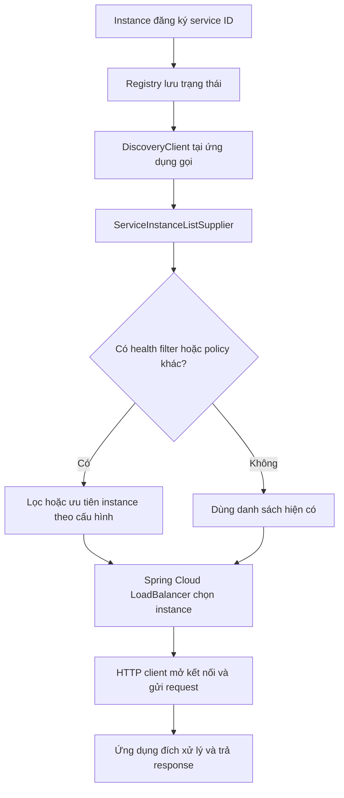
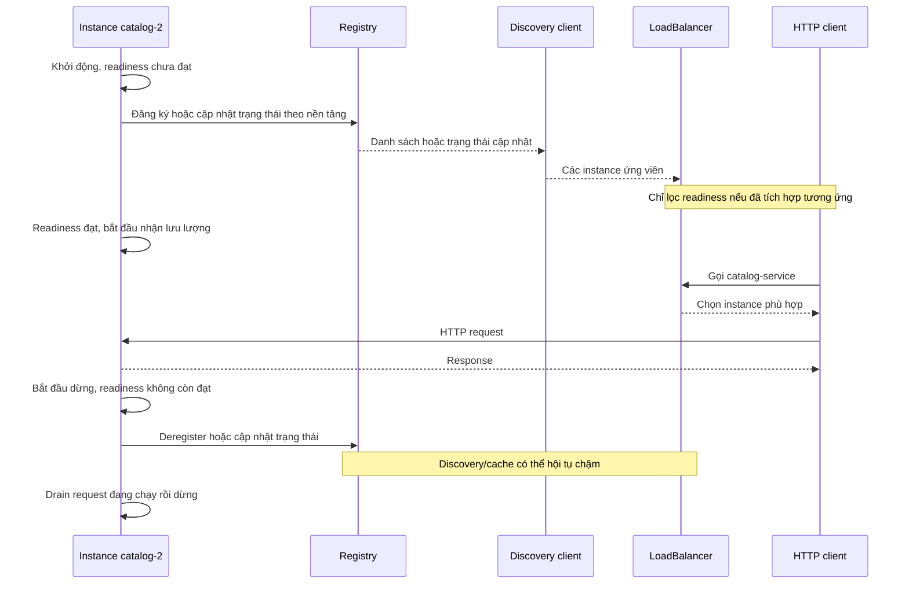

# Phân biệt trạng thái đăng ký với khả năng phục vụ thật

Trong hệ thống microservices, việc một bản sao (instance) xuất hiện trong service discovery **không chứng minh rằng nó đang xử lý yêu cầu thành công**. Instance có thể vẫn đăng ký dưới service ID `catalog-service` nhưng chưa khởi tạo xong, đang tạm ngừng nhận lưu lượng, không kết nối được cơ sở dữ liệu hoặc có cổng HTTP không thể truy cập từ ứng dụng gọi. Ngược lại, một instance còn hoạt động có thể đã bị gỡ khỏi registry để chuẩn bị dừng và không nên nhận thêm request mới.

Với Spring Cloud LoadBalancer, sự phân biệt này rất quan trọng: bộ cân bằng tải lựa chọn từ danh sách `ServiceInstance` mà `ServiceInstanceListSupplier` cung cấp. Nếu danh sách gồm cả instance chưa sẵn sàng, request qua `RestClient`, `WebClient` hoặc OpenFeign vẫn có thể thất bại dù việc khám phá dịch vụ và chọn instance diễn ra đúng. Bài học trình bày cách đánh giá **trạng thái đăng ký**, **liveness**, **readiness**, **khả năng kết nối thực tế** và **kết quả xử lý HTTP** như các tín hiệu riêng biệt.

## 1. Năm câu hỏi khác nhau về một instance

Khi kiểm tra `catalog-2`, cần phân biệt các câu hỏi sau:

| Tín hiệu | Câu hỏi được trả lời | Ví dụ | Giới hạn |
|---|---|---|---|
| **Đăng ký / membership** | Registry hoặc discovery client có biết `catalog-2` thuộc `catalog-service` không? | `DiscoveryClient.getInstances("catalog-service")` có chứa `catalog-2` | Không tự chứng minh instance sẵn sàng |
| **Liveness** | Tiến trình còn sống và có thể tiếp tục chạy không? | `/actuator/health/liveness` trả `UP` | Tiến trình sống nhưng vẫn có thể chưa phục vụ được |
| **Readiness** | Ứng dụng có đang chấp nhận lưu lượng mới không? | `/actuator/health/readiness` trả `UP` | Readiness chỉ phản ánh các điều kiện được cấu hình |
| **Reachability** | Từ chính client, có kết nối được tới địa chỉ và cổng quảng bá không? | TCP/TLS và HTTP đến `10.0.1.12:8080` thành công | Kết nối được chưa chắc endpoint nghiệp vụ đúng |
| **Application response** | Endpoint cụ thể có xử lý request đúng trong ngưỡng thời gian yêu cầu không? | `GET /api/products/42` trả `200` và dữ liệu hợp lệ | Một request thành công không bảo đảm request tiếp theo cũng thành công |

Chẳng hạn, registry còn thông tin `catalog-2` và heartbeat vẫn đều đặn nhưng `/api/products/42` trả `503` vì một dependency bắt buộc đang gián đoạn. Đây là **instance đã đăng ký nhưng chưa phục vụ được tác vụ hiện tại**. Nếu chỉ quan sát registry, ta có thể kết luận nhầm rằng hệ thống có đủ số bản sao khỏe mạnh.

Trạng thái “khỏe” luôn phụ thuộc **thời điểm, đường đi mạng, endpoint và điều kiện được kiểm tra**. Không có một cờ boolean duy nhất trả lời đầy đủ mọi câu hỏi đó.

## 2. Đăng ký dịch vụ nói lên điều gì?

Một instance thường quảng bá `serviceId`, `instanceId`, `host`, `port`, `scheme` và có thể kèm metadata. Service discovery giúp client lấy danh sách các địa chỉ được công bố. Với Spring Cloud, abstraction `DiscoveryClient` có thể truy vấn danh sách bằng service ID:

```java
List<ServiceInstance> instances =
        discoveryClient.getInstances("catalog-service");

for (ServiceInstance instance : instances) {
    System.out.printf("%s %s:%d%n",
            instance.getInstanceId(),
            instance.getHost(),
            instance.getPort());
}
```

Đoạn mã giả định có biến `discoveryClient` kiểu `DiscoveryClient`. Kết quả thể hiện **danh sách mà implementation discovery tại ứng dụng gọi đang nhìn thấy**, có thể khác trạng thái mới nhất ở registry do cơ chế cache, polling, watch hoặc thời gian hết hạn lease.

Cơ chế đăng ký phụ thuộc nền tảng: có registry dựa vào heartbeat/lease, có hệ thống quản lý endpoint và readiness theo mô hình riêng. Vì vậy, không nên đồng nhất việc *có heartbeat* với việc *health endpoint đã được kiểm tra*, hoặc cho rằng mọi registry đều chủ động gửi HTTP request đến từng instance.

Ba tình huống dễ gặp:

1. **Chưa sẵn sàng nhưng đã xuất hiện:** instance đăng ký sớm trong quá trình khởi động; dependency hoặc cache nội bộ chưa warm up.
2. **Đã chết nhưng vẫn xuất hiện:** tiến trình dừng đột ngột; registry chưa hết thời gian heartbeat/lease, discovery client hoặc cache LoadBalancer chưa làm mới.
3. **Đã gỡ đăng ký nhưng vẫn chạy:** instance bước vào giai đoạn drain khi triển khai; registry ngừng quảng bá cho request mới nhưng tiến trình còn xử lý các request đang chạy.

Trong cả ba trường hợp, “có/không có trong registry” và “có/không phục vụ được request” là hai chiều thông tin khác nhau.

## 3. Liveness và readiness không đồng nghĩa

Spring Boot Actuator hỗ trợ các health group dùng để phản ánh **liveness** và **readiness** của ứng dụng. Có thể bật các probe endpoint trong môi trường phát triển hoặc khi môi trường triển khai chưa tự bật chúng:

```yaml
management:
  endpoint:
    health:
      probes:
        enabled: true
```

Với Spring Boot Actuator được thêm vào ứng dụng và endpoint có thể truy cập theo cấu hình bảo mật, các đường dẫn thường dùng là:

```text
GET /actuator/health/liveness
GET /actuator/health/readiness
```

- **Liveness** nhằm xác định liệu ứng dụng còn vận hành được hay phải được khởi động lại. Không nên đưa tình trạng của một dependency chia sẻ, như database của toàn cụm, vào liveness một cách thiếu cân nhắc: điều đó có thể khiến nhiều instance bị restart đồng loạt khi dependency tạm lỗi.
- **Readiness** thể hiện ứng dụng có chấp nhận request mới không. Trong giai đoạn khởi động hoặc shutdown, ứng dụng có thể từ chối lưu lượng dù tiến trình vẫn còn sống. Khi một dependency là điều kiện bắt buộc để phục vụ request, có thể đưa kiểm tra đó vào readiness group một cách có chủ đích.

Ví dụ một tiến trình đã khởi chạy nhưng còn đang nạp dữ liệu:

| Tình huống | Liveness | Readiness | Có nên định tuyến request mới? |
|---|---|---|---|
| Vừa khởi động, chưa hoàn tất initialization | Có thể `UP` khi probe đã sẵn sàng | Chưa sẵn sàng | Chưa |
| Vận hành bình thường | `UP` | `UP` | Có, nếu đường mạng và API đáp ứng |
| Đang graceful shutdown / drain | Có thể vẫn `UP` | Không nhận lưu lượng mới | Không |
| Tiến trình deadlock hoặc không phục hồi | Có thể không phản hồi | Có thể không phản hồi | Không |

**Chú ý:** readiness mặc định không tự kiểm tra mọi dependency hoặc mọi endpoint nghiệp vụ. Cần xác định rõ điều kiện nào thật sự bắt buộc đối với lưu lượng và health indicator nào được đưa vào group. Nếu Actuator chạy trên cổng quản trị riêng, probe khỏe trên cổng đó **chưa chắc** chứng minh cổng ứng dụng chính còn truy cập được; nên cân nhắc cấu hình probe phù hợp với đường lưu lượng thực tế.

## 4. Một request đi qua những tầng nào?

Với client gọi `http://catalog-service/api/products/42`, danh sách được chọn không nhất thiết phản ánh sức khỏe theo thời gian thực:



Trong luồng này:

- Registry và discovery xác định **instance nào được biết đến**.
- `ServiceInstanceListSupplier` quyết định **instance nào nằm trong danh sách ứng viên**, có thể dựa trên cache, metadata, zone hoặc health check nếu đã cấu hình.
- LoadBalancer chọn một instance trong danh sách ứng viên bằng chính sách như round-robin hoặc random.
- HTTP client cần kết nối được đến địa chỉ đích và nhận response hợp lệ trong timeout.

Nếu registry trả ba instance, LoadBalancer chọn `catalog-2` rồi HTTP request timeout, **không thể kết luận LoadBalancer đã chọn sai thuật toán**. Nguyên nhân có thể là registry còn dữ liệu cũ, cổng unreachable, instance chưa readiness, timeout quá ngắn hoặc endpoint nghiệp vụ đang treo.

## 5. Health check trong Spring Cloud LoadBalancer

Spring Cloud LoadBalancer có `HealthCheckServiceInstanceListSupplier` để kiểm tra sức khỏe các ứng viên ở **phía client** và cung cấp một danh sách đã qua kiểm tra cho bộ chọn instance. Đây là khả năng **cần cấu hình theo nhu cầu**; bản thân `DiscoveryClient` có dữ liệu không có nghĩa health check chủ động của LoadBalancer đã được bật.

Một cách khai báo chuỗi supplier minh họa (phụ thuộc phiên bản Spring Cloud đang dùng) là:

```java
import org.springframework.cloud.loadbalancer.core.ServiceInstanceListSupplier;
import org.springframework.context.ConfigurableApplicationContext;
import org.springframework.context.annotation.Bean;

@Bean
ServiceInstanceListSupplier healthAwareSupplier(
        ConfigurableApplicationContext context) {
    return ServiceInstanceListSupplier.builder()
            .withDiscoveryClient()
            .withHealthChecks()
            .build(context);
}
```

Ví dụ trên được đặt trong **cấu hình LoadBalancer dành riêng cho service ID** nếu chỉ cần lọc instance của một dịch vụ, chẳng hạn qua `@LoadBalancerClient(name = "catalog-service", configuration = ...)`. Lớp cấu hình per-service nên nằm ngoài component scan của context chính để tránh áp dụng bean supplier cho những service ID không mong muốn.

Khi cấu hình health check, cần biết:

1. **Endpoint kiểm tra là gì?** `/actuator/health` hoặc `/actuator/health/readiness` có thể có ý nghĩa khác nhau. Chọn endpoint phản ánh đúng khả năng nhận lưu lượng và kiểm tra path theo service ID nếu các dịch vụ khác nhau dùng health endpoint khác nhau.
2. **Tần suất kiểm tra và refetch thế nào?** Kết quả health không cập nhật ngay tại thời điểm instance hỏng. Interval, timeout và cách lấy lại danh sách instance tác động đến độ trễ phát hiện.
3. **Cấu hình cache và supplier chain ra sao?** Nếu discovery client hoặc supplier giữ danh sách cũ, health check có thể đang đánh giá tập instance chưa cập nhật. Thứ tự cache, health check, các bộ lọc phụ thuộc request cần được xem xét.
4. **Tín hiệu nào đánh dấu unhealthy?** Một probe thất bại có thể do mạng từ client, bảo mật endpoint, timeout hoặc lỗi ứng dụng. Nó không tự chứng minh toàn bộ instance đã chết đối với mọi client khác.

Tùy nền tảng discovery, có thể dùng trạng thái readiness do orchestrator/registry phản ánh mà không cần health check riêng ở client, hoặc kết hợp hai lớp này. Tránh cấu hình quá nhiều vòng health probe giống nhau mà không rõ mục tiêu vì chúng có thể tạo tải và trạng thái thiếu nhất quán.

**Một giới hạn quan trọng:** supplier lọc instance khỏe chỉ thay đổi danh sách ứng viên của LoadBalancer tại client đang sử dụng supplier đó. Nó không tự hủy đăng ký instance khỏi registry hay sửa trạng thái ở những client khác. Một lần HTTP `5xx` cũng không tự khiến LoadBalancer loại instance vĩnh viễn nếu chưa có chính sách phát hiện và loại bỏ tương ứng.

## 6. Ví dụ cùng một dịch vụ nhưng nhiều trạng thái khác nhau

Giả sử `catalog-service` có ba instance:

| Instance | Registry thấy? | Readiness | Kết nối từ order-service | Endpoint `/api/products/42` | Diễn giải |
|---|---|---|---|---|---|
| `catalog-1` | Có | `UP` | Thành công | `200` | Đủ tín hiệu để dùng cho request minh họa |
| `catalog-2` | Có | `DOWN` | Kết nối được | `503` | Đã đăng ký nhưng không nên chọn khi readiness không đạt |
| `catalog-3` | Có | `UP` | Timeout | Không có response | Có thể lỗi mạng hoặc cổng; probe từ nơi khác không phản ánh đường đi của client |

Nếu chỉ dùng danh sách discovery và round-robin, cả ba có thể còn là ứng viên. Khi có bộ lọc health/readiness thích hợp, `catalog-2` có thể bị loại; với `catalog-3`, kết quả còn phụ thuộc nơi probe thực hiện, đường mạng và timeout. Không thể mặc định rằng `catalog-3` sẽ bị loại trong mọi triển khai.

Ví dụ này cũng cho thấy **có readiness `UP` không đảm bảo mọi nghiệp vụ đều `200`**. Một số request có thể trả `400` do dữ liệu đầu vào hoặc `404` vì tài nguyên không tồn tại, dù instance vẫn khỏe. Trạng thái HTTP phải được giải thích theo hợp đồng API, không quy mọi `4xx` thành lỗi sức khỏe.

## 7. Hành vi lúc khởi động, triển khai và dừng dịch vụ

Quá trình chuyển trạng thái có thể hình dung như sau:



Với scale-out, việc đăng ký xong **không có nghĩa** instance mới đã sẵn sàng nhận lưu lượng. Với scale-in, nên đánh dấu không nhận request mới hoặc deregister theo nền tảng, chờ các client hội tụ và cho request đang xử lý hoàn tất trước khi dừng hẳn. Nếu instance bị kill đột ngột, registry có thể tiếp tục quảng bá đến khi hết lease, làm tăng cửa sổ chọn nhầm địa chỉ cũ.

Ngoài ra, cùng một service ID có thể có nhiều ứng dụng client, mỗi ứng dụng giữ cache hoặc dùng health supplier khác nhau; vì thế **client A và client B có thể nhìn thấy các danh sách instance khác nhau tại cùng thời điểm**. Khi phân tích sự cố, cần kiểm tra từ đúng ứng dụng gọi, không chỉ xem dashboard của registry.

## 8. Các sai lầm thường gặp khi đánh giá instance khỏe

| Nhận định vội vàng | Vì sao sai? | Cách kiểm tra phù hợp |
|---|---|---|
| “Có trong Eureka/Consul tức là phục vụ được” | Đăng ký hoặc heartbeat có thể chưa phản ánh readiness/API thực tế | Đối chiếu trạng thái registry với readiness và một request có ý nghĩa |
| “Liveness `UP` thì đưa vào load balancing” | Liveness đánh giá tiến trình, không phải điều kiện nhận request | Dùng readiness hoặc chính sách loại instance phù hợp |
| “Readiness `UP` nghĩa là toàn bộ API đều thành công” | Health group có thể chưa kiểm tra dependency của API; lỗi hợp đồng vẫn có thể xảy ra | Theo dõi response thực của endpoint và dependency quan trọng |
| “Ping/HTTP health từ máy vận hành thành công thì client chắc chắn gọi được” | Đường mạng, DNS, TLS hoặc cổng của client có thể khác | Probe từ môi trường của chính ứng dụng gọi dịch vụ |
| “Có health endpoint là LoadBalancer tự lọc instance hỏng” | Health supplier chỉ hoạt động khi đã cấu hình; registry có chính sách riêng | Kiểm tra supplier chain và log danh sách ứng viên |
| “Đã remove khỏi registry thì request không thể gọi nữa” | Discovery client/cache có thể đang dùng snapshot cũ, request đang chạy chưa kết thúc | Kiểm tra độ trễ hội tụ, kết nối và shutdown/drain |
| “HTTP 500 một lần nghĩa là instance đã chết” | Lỗi có thể riêng cho một request hoặc dependency tạm thời | Phân biệt lỗi nghiệp vụ, lỗi hạ tầng, mẫu thời gian và chính sách retry |

## 9. Quy trình chẩn đoán khi request thất bại

Khi `order-service` báo lỗi khi gọi `catalog-service`, hãy thu thập dữ liệu theo thứ tự từ danh sách đến HTTP:

1. **Service ID:** xác nhận tên `catalog-service` trong URL hoặc Feign client khớp với tên đã đăng ký.
2. **Registry:** kiểm tra instance nào đang được quảng bá, trạng thái/heartbeat hoặc cơ chế lease tương ứng.
3. **Discovery tại client:** kiểm tra `DiscoveryClient.getInstances("catalog-service")` trong chính `order-service`; ghi nhận thời điểm và các instance ID, host, port.
4. **Supplier chain:** xác định cache, health check, zone hoặc request-based filter có bật không; so danh sách trước và sau từng bước, nhất là khi danh sách rỗng.
5. **Lựa chọn của LoadBalancer:** ghi instance đã chọn, chính sách chọn và thông tin request/trace. Nếu không còn instance, kiểm tra vì sao supplier không cung cấp ứng viên.
6. **Reachability:** từ môi trường client, kiểm tra TCP/TLS/HTTP tới host và port được chọn, đối chiếu với health/readiness ở đúng cổng và path.
7. **Kết quả HTTP:** xem status code, timeout, lỗi kết nối, thời lượng và log nghiệp vụ của instance đích. Xem retry có bật không và attempt có đi tới cùng một instance hay không.

Ví dụ với môi trường cho phép truy cập trực tiếp instance, có thể dùng:

```bash
curl -i http://10.0.1.12:8080/actuator/health/readiness
curl -i http://10.0.1.12:8080/api/products/42
```

Lệnh chỉ có ý nghĩa khi địa chỉ/cổng đó có thể truy cập từ nơi thực hiện phép thử. Nếu endpoint Actuator bị bảo vệ, cần dùng cơ chế xác thực phù hợp; không mở health endpoint hoặc thông tin chi tiết ra Internet chỉ để chẩn đoán.

Khi ghi metric dài hạn, nên có số instance trong discovery, số instance qua health filter, tỷ lệ danh sách rỗng, tỷ lệ kết nối lỗi và độ trễ HTTP theo service ID. Tránh đưa từng `instanceId` hoặc `traceId` vào nhãn metric cardinality cao; thông tin chi tiết nên nằm ở log/trace có kiểm soát.

## 10. Thực hành: kiểm tra chênh lệch đăng ký và readiness

Có thể chạy `catalog-service` với hai hoặc ba instance, Spring Boot Actuator và một ứng dụng `order-service` sử dụng Spring Cloud LoadBalancer:

1. **Baseline:** khởi chạy tất cả instance, xác nhận registry và `DiscoveryClient` hiển thị danh sách mong đợi; gọi API thật và ghi instance được chọn cùng HTTP status.
2. **Khởi động chậm:** cố tình trì hoãn điều kiện readiness của một instance trong môi trường thử nghiệm. Quan sát liệu instance đã có trong registry trước khi đạt readiness không và nó có được chọn trong giai đoạn này không.
3. **Readiness thất bại:** thay đổi điều kiện readiness có kiểm soát, trong khi tiến trình vẫn chạy. So liveness, readiness và kết quả gọi API qua LoadBalancer.
4. **Bật health filter:** nếu hệ thống hỗ trợ và phù hợp, cấu hình health-aware supplier cho `catalog-service` rồi so danh sách ứng viên trước/sau khi readiness thay đổi. Ghi rõ health endpoint được probe.
5. **Mất kết nối:** ngắt khả năng truy cập từ `order-service` đến một instance mà registry vẫn quảng bá. So health probe từ client với kết quả request, tránh nhầm lỗi mạng thành lỗi registration.
6. **Graceful shutdown:** cho instance vào trạng thái không nhận lưu lượng mới, deregister/drain và quan sát khi nào nó không còn được chọn; kiểm tra các request đang xử lý có hoàn tất không.
7. **Thử timeout/retry:** gây một timeout có kiểm soát, quan sát instance được chọn ở từng attempt và số lần retry. Với lệnh ghi dữ liệu, phải cân nhắc idempotency trước khi bật retry.

Một bảng quan sát mẫu:

| Thời điểm | Registry | Readiness | Danh sách sau health filter | Instance được chọn | Kết quả |
|---|---|---|---|---|---|
| `t1` | `1,2,3` | `1,2,3 UP` | `1,2,3` | `2` | `200` |
| `t2` | `1,2,3` | `2 DOWN` | Có thể vẫn `1,2,3` trong cửa sổ probe | `2` | Có thể lỗi |
| `t3` | `1,2,3` | `2 DOWN` | `1,3` sau khi filter cập nhật | `3` | `200` |
| `t4` | `1,3` | `1,3 UP` | `1,3` | `1` | `200` |

Các số trong bảng là viết tắt của `catalog-1`, `catalog-2`, `catalog-3`; dữ liệu chỉ minh họa một triển khai đã cấu hình health filter. Điều cần rút ra là **thời điểm thay đổi readiness, thời điểm registry cập nhật và thời điểm danh sách được LoadBalancer dùng thay đổi có thể khác nhau**.

## 11. Nguyên tắc thiết kế để giảm lỗi định tuyến

- Sử dụng readiness để quyết định nhận lưu lượng mới; hạn chế đưa dependency bên ngoài vào liveness khi chúng có thể khiến nhiều instance restart cùng lúc.
- Đảm bảo host, port, scheme và health path được quảng bá phù hợp với đường mạng của caller; kiểm tra cả application port nếu health probe chạy trên management port riêng.
- Chọn cơ chế health phù hợp với registry, orchestrator và nhu cầu của client; không giả định `HealthCheckServiceInstanceListSupplier` luôn được bật.
- Điều chỉnh chu kỳ refresh, cache TTL, timeout, graceful shutdown và thời gian drain dựa trên phép đo thực tế; tránh hiểu nhầm rằng giảm TTL của LoadBalancer cũng làm registry cập nhật nhanh hơn.
- Theo dõi được **ba dữ liệu riêng**: danh sách đăng ký, danh sách ứng viên sau health/policy và kết quả HTTP ở instance đã chọn.
- Đối với lỗi nhất thời, dùng retry có giới hạn và phù hợp tính chất request; retry không thay thế việc loại instance hỏng hoặc sửa lỗi readiness.

## 12. Ghi nhớ

**Đăng ký** trả lời “instance có được công bố dưới service ID này không?”. **Liveness** trả lời “tiến trình có còn hoạt động không?”. **Readiness** trả lời “ứng dụng có chấp nhận lưu lượng mới không?”. **Reachability và kết quả HTTP** trả lời “ứng dụng gọi có thực sự kết nối và hoàn thành request này không?”. Spring Cloud LoadBalancer chọn từ danh sách mà discovery và `ServiceInstanceListSupplier` cung cấp; để không chọn instance chỉ còn tên trong registry, cần phối hợp đúng health/readiness, cache, deregistration và quan sát request thực tế. Phân biệt rõ các tầng này giúp tìm đúng nguyên nhân khi `RestClient`, `WebClient` hoặc OpenFeign gặp lỗi trong quá trình scale, deploy hay gián đoạn dịch vụ.
