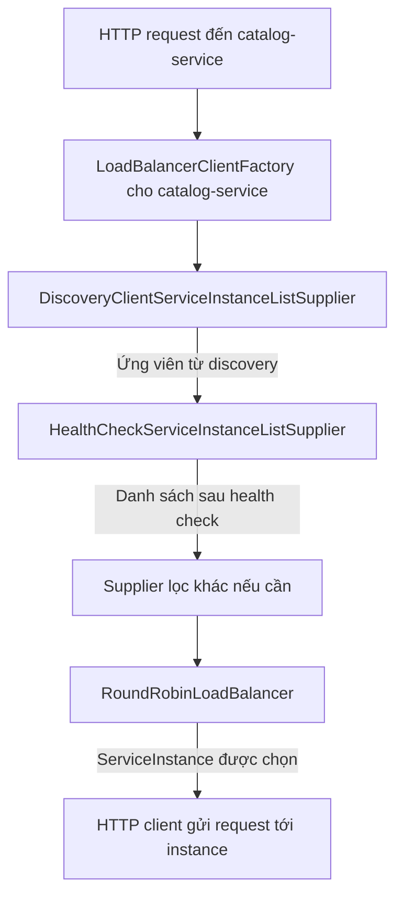

# HealthCheckServiceInstanceListSupplier và lọc bản sao khỏe

Trong hệ thống microservices, một service ID như `catalog-service` có thể tương ứng với nhiều `ServiceInstance`. Tuy nhiên, việc một bản sao còn xuất hiện trong danh sách discovery **không đồng nghĩa** nó đang sẵn sàng nhận request. Tiến trình có thể đã mất kết nối, đang khởi động, hoặc vẫn chạy nhưng không phục vụ được nghiệp vụ. Spring Cloud LoadBalancer cung cấp `HealthCheckServiceInstanceListSupplier` để kiểm tra định kỳ các bản sao, sau đó ưu tiên đưa những bản sao được đánh giá là khỏe vào danh sách ứng viên cho thuật toán chọn instance.

Bài học này tập trung vào cơ chế kiểm tra sức khỏe ở **phía client**, cách lắp nó vào chuỗi `ServiceInstanceListSupplier`, cấu hình endpoint và chu kỳ kiểm tra, hành vi khi không còn bản sao khỏe, cùng những lỗi triển khai thường gặp. Đây là một lớp bảo vệ cho định tuyến, **không phải** cơ chế thay thế hoàn toàn discovery, retry, timeout hay circuit breaker.

## 1. Vì sao danh sách discovery chưa đủ?

Giả sử `order-service` gọi `catalog-service`, trong khi discovery trả về ba bản sao:

| Instance ID | Địa chỉ | Trạng thái thực tế |
|---|---|---|
| `catalog-a` | `10.0.2.11:8081` | Đang phục vụ bình thường |
| `catalog-b` | `10.0.2.12:8081` | Tiến trình còn chạy nhưng chưa sẵn sàng |
| `catalog-c` | `10.0.2.13:8081` | Không kết nối được |

Nếu dùng `RoundRobinLoadBalancer` trực tiếp trên danh sách ba bản sao, một số request có thể đến `catalog-b` hoặc `catalog-c` và thất bại. Việc kiểm tra sức khỏe phía client tạo thêm một bước đánh giá trước khi chọn:

```text
Discovery: [catalog-a, catalog-b, catalog-c]
    ↓ HTTP health probes
Kết quả: [catalog-a=UP, catalog-b=DOWN, catalog-c=unreachable]
    ↓ HealthCheckServiceInstanceListSupplier
Danh sách ứng viên khỏe: [catalog-a]
    ↓ RoundRobinLoadBalancer
Chọn catalog-a để gửi request
```

LoadBalancer vẫn chọn theo service ID như trước. Điểm thay đổi là **danh sách đầu vào của thuật toán** được xử lý qua một supplier bổ sung. `HealthCheckServiceInstanceListSupplier` không tự gửi request nghiệp vụ thay HTTP client; nó định kỳ kiểm tra endpoint health và cung cấp danh sách instance cho bước chọn.

## 2. Vị trí của HealthCheckServiceInstanceListSupplier

`ServiceInstanceListSupplier` là abstraction cung cấp một danh sách `ServiceInstance` cho một service ID. Spring Cloud LoadBalancer cho phép ghép nhiều supplier thành chuỗi: lấy instance từ discovery, kiểm tra sức khỏe, lọc theo zone hoặc metadata, rồi mới để `ReactorLoadBalancer` chọn.



Trong cấu hình tùy chỉnh, nên đặt `HealthCheckServiceInstanceListSupplier` **ngay sau supplier lấy instance qua mạng**, chẳng hạn `DiscoveryClientServiceInstanceListSupplier`, rồi mới đến các bộ lọc phụ thuộc request. Đây là điểm quan trọng vì kết quả health check áp dụng cho danh sách của service, còn các bộ lọc theo cookie, hint hoặc zone có thể phụ thuộc từng request.

Đối với `SimpleDiscoveryClient`, danh sách instance thường được khai báo tĩnh nên việc probe định kỳ có ích: danh sách cấu hình không tự loại một địa chỉ đã dừng hoạt động. Với Eureka, Consul hay registry có cơ chế loại instance không khỏe, đôi khi không cần thêm lớp health check tại client, vì discovery đã phản ánh tình trạng hoạt động. Hãy chỉ thêm khi có yêu cầu đo sức khỏe từ góc nhìn consumer hoặc registry chưa đáp ứng mục tiêu này.

## 3. Cơ chế kiểm tra định kỳ hoạt động thế nào?

`HealthCheckServiceInstanceListSupplier` nhận danh sách instance từ supplier bên dưới, gọi endpoint kiểm tra sức khỏe của từng instance theo lịch và cập nhật tập ứng viên. Một chu kỳ đơn giản:

1. Supplier discovery cung cấp danh sách `ServiceInstance` của `catalog-service`.
2. Health-check supplier xác định URL health cho từng instance dựa trên host, port, scheme và đường dẫn cấu hình.
3. Client thực hiện HTTP probe đến các endpoint đó.
4. Các instance đáp ứng điều kiện kiểm tra được đưa vào tập khỏe.
5. Kết quả được phát cho những thành phần sử dụng supplier; LoadBalancer chọn instance trên tập kết quả này.
6. Theo lịch tiếp theo, health-check supplier kiểm tra lại để phát hiện bản sao mới phục hồi hoặc vừa gặp sự cố.

Ví dụ với bản sao dùng Actuator:

```http
GET /actuator/health HTTP/1.1
Host: 10.0.2.11:8081
```

Một endpoint khỏe thường trả phản hồi HTTP thành công, ví dụ:

```http
HTTP/1.1 200 OK
Content-Type: application/vnd.spring-boot.actuator.v3+json

{"status":"UP"}
```

Khi ứng dụng không sẵn sàng, health endpoint có thể trả trạng thái không thành công, ví dụ `503 Service Unavailable`. Cách xác định probe đạt hay không phụ thuộc client và implementation cụ thể; ứng dụng cần kiểm tra hành vi thực tế theo phiên bản Spring Cloud đang dùng.

**Probe là kiểm tra từ góc nhìn consumer.** Một instance có thể được registry đánh dấu còn sống nhưng consumer không truy cập được vì firewall, DNS hoặc mạng. Ngược lại, một lần probe thất bại tạm thời không đủ để kết luận tiến trình đã chết; việc đặt interval và timeout cần cân bằng giữa tốc độ phát hiện lỗi và nguy cơ loại nhầm bản sao.

## 4. Hành vi đặc biệt: nếu không có instance khỏe thì sao?

Điểm dễ bị hiểu sai nhất: `HealthCheckServiceInstanceListSupplier` **không phải bộ lọc tuyệt đối luôn chỉ trả về instance khỏe**. Theo hành vi được Spring Cloud Commons mô tả, nếu không có instance nào vượt qua health check, supplier có thể **trả về toàn bộ danh sách instance đã nhận từ delegate** thay vì trả danh sách rỗng.

| Danh sách từ discovery | Kết quả kiểm tra | Danh sách cho bước chọn |
|---|---|---|
| `[A, B, C]` | A khỏe, B/C lỗi | `[A]` |
| `[A, B, C]` | A/B khỏe, C lỗi | `[A, B]` |
| `[A, B, C]` | Cả ba bị đánh giá lỗi | **`[A, B, C]` (fallback)** |
| `[]` | Không có bản sao được khám phá | `[]` |

Hành vi fallback này tránh việc bộ lọc sức khỏe tự biến một danh sách vốn có thành danh sách rỗng trong lúc mọi probe đều thất bại. Tuy nhiên, hệ quả là **request nghiệp vụ vẫn có thể đi vào một instance vừa được đánh giá không khỏe** khi tất cả instance cùng fail probe. Đây không phải bảo đảm an toàn tuyệt đối hoặc cơ chế tự chữa lỗi.

Trong một hệ thống yêu cầu *fail closed* — tuyệt đối không gửi request đến instance đã bị đánh giá không khỏe — cần thiết kế chính sách bổ sung và kiểm thử nó một cách riêng biệt. Không nên chỉ bật health-check supplier rồi suy ra rằng mọi request đến bản sao lỗi đều bị chặn.

Điều tương tự áp dụng cho trường hợp health endpoint không được triển khai đúng: nếu tất cả instance trả `404`, `401` hoặc không truy cập được health endpoint, supplier có thể rơi vào nhánh fallback. Ứng dụng vẫn gửi request, khiến người vận hành tưởng chức năng kiểm tra sức khỏe đã được bật nhưng thực tế không có tác dụng lọc như mong muốn.

## 5. Cấu hình supplier cho một service ID

Có thể đăng ký supplier trong cấu hình theo service bằng `@LoadBalancerClient`. Ví dụ `order-service` muốn kiểm tra sức khỏe chỉ cho `catalog-service`:

```java
package com.example.lbconfig;

import org.springframework.cloud.loadbalancer.core.ServiceInstanceListSupplier;
import org.springframework.context.ConfigurableApplicationContext;
import org.springframework.context.annotation.Bean;
import org.springframework.context.annotation.Configuration;

@Configuration(proxyBeanMethods = false)
public class CatalogHealthCheckConfiguration {

    @Bean
    ServiceInstanceListSupplier catalogInstanceSupplier(
            ConfigurableApplicationContext context) {
        return ServiceInstanceListSupplier.builder()
                .withDiscoveryClient()
                .withHealthChecks()
                .build(context);
    }
}
```

Gắn cấu hình vào tên logic của service:

```java
package com.example.orders;

import com.example.lbconfig.CatalogHealthCheckConfiguration;
import org.springframework.boot.autoconfigure.SpringBootApplication;
import org.springframework.cloud.loadbalancer.annotation.LoadBalancerClient;

@SpringBootApplication
@LoadBalancerClient(
        name = "catalog-service",
        configuration = CatalogHealthCheckConfiguration.class
)
public class OrderApplication {
}
```

Trong ví dụ, `CatalogHealthCheckConfiguration` nằm ngoài phạm vi component scan mặc định của `com.example.orders`, tránh việc bean dành riêng cho `catalog-service` bị tạo ở application context chính rồi tác động ngoài ý muốn tới các dịch vụ khác.

Chuỗi `.withDiscoveryClient().withHealthChecks()` thể hiện hai trách nhiệm: **lấy instance** và **lọc dựa trên health probes**. Cách dựng builder, dependency reactive và health-check client cần tương thích với phiên bản Spring Cloud mà dự án sử dụng. Với các ứng dụng dùng stack non-reactive, Spring Cloud Commons có lựa chọn `.withBlockingHealthChecks()` và cho phép dùng HTTP client phù hợp để thực hiện probe; không nên mặc định mọi dự án đều phải dùng WebClient chỉ vì ví dụ trên dùng `.withHealthChecks()`.

### Ví dụ cho ứng dụng dùng blocking HTTP client

```java
@Bean
ServiceInstanceListSupplier catalogInstanceSupplier(
        ConfigurableApplicationContext context) {
    return ServiceInstanceListSupplier.builder()
            .withDiscoveryClient()
            .withBlockingHealthChecks()
            .build(context);
}
```

Chọn **một** cách khởi tạo supplier phù hợp với loại client/stack và dependency đang có, không khai báo hai bean `ServiceInstanceListSupplier` cạnh tranh cho cùng service mà không xác định rõ phạm vi.

`HealthCheckServiceInstanceListSupplier` chỉ tác động lên **danh sách ứng viên**. Nó không đổi thuật toán mặc định của `RoundRobinLoadBalancer`, không tự thêm HTTP retry và không tự thiết lập timeout cho request nghiệp vụ qua `RestClient`, `WebClient` hay OpenFeign.

## 6. Cấu hình đường dẫn health check và chu kỳ probe

Các thuộc tính thường dùng nằm dưới prefix `spring.cloud.loadbalancer.health-check`. Ví dụ:

```yaml
spring:
  cloud:
    loadbalancer:
      health-check:
        initial-delay: 0s
        interval: 15s
        path:
          default: /actuator/health
          catalog-service: /actuator/health/readiness
        refetch-instances: true
        refetch-instances-interval: 30s
        repeat-health-check: true
        update-results-list: false
```

Các giá trị là **ví dụ điều chỉnh cho môi trường thử nghiệm**, không phải khuyến nghị mặc định cho mọi hệ thống. Cần hiểu vai trò của từng property:

| Property sau prefix `health-check` | Ý nghĩa |
|---|---|
| `initial-delay` | Khoảng trễ trước lần kiểm tra đầu theo scheduler |
| `interval` | Khoảng thời gian chạy lại kiểm tra sức khỏe |
| `path.default` | Đường dẫn health chung nếu service không có đường dẫn riêng |
| `path.catalog-service` | Đường dẫn health riêng cho service ID `catalog-service` |
| `refetch-instances` | Yêu cầu lấy lại danh sách từ delegate trong trường hợp nguồn không tự phát danh sách cập nhật |
| `refetch-instances-interval` | Chu kỳ lấy lại danh sách instance khi bật refetch |
| `repeat-health-check` | Điều khiển việc tiếp tục chạy probe lặp lại, kể cả giữa các lần refetch |
| `update-results-list` | Điều khiển cách phát các kết quả instance khỏe theo đợt kiểm tra |

Theo tài liệu Spring Cloud Commons, đường dẫn mặc định là `/actuator/health` khi không khai báo đường dẫn khác. `interval` thường mặc định `25s` trong các phiên bản hiện hành, nhưng luôn cần kiểm tra configuration metadata của release train cụ thể.

Khi `update-results-list: false`, health-check supplier đợi thu thập kết quả thành danh sách rồi mới phát; điều này giúp hạn chế việc subscriber nhận các danh sách trung gian trong cùng một đợt probe. Tùy chọn này không làm probe thành tức thời và không thay thế các chiến lược xử lý lỗi của HTTP client.

### Khi nào bật `refetch-instances`?

Việc **kiểm tra lại tình trạng khỏe** khác với việc **lấy lại danh sách các bản sao tồn tại**. Nếu underlying supplier trả về danh sách tại một thời điểm mà không tự phát thay đổi, có thể bật `refetch-instances: true` để nhận những instance mới đăng ký hoặc loại instance đã rời registry. Với nguồn instance vốn phát cập nhật liên tục, có thể không cần cơ chế refetch bổ sung.

Trong một số thiết kế, mỗi lần refetch còn kích hoạt kiểm tra sức khỏe. Khi đó, `repeat-health-check: false` có thể giúp tránh probe lặp dư thừa, nhưng phải cân nhắc tốc độ phát hiện instance lỗi giữa hai lần refetch. Không nên giảm interval quá nhỏ chỉ để thấy kết quả thử nghiệm thay đổi nhanh; nhiều consumer cùng probe sẽ tạo lưu lượng nền đáng kể.

## 7. Phía dịch vụ đích phải cung cấp health endpoint phù hợp

Health check phía client cần một endpoint **có thể truy cập từ consumer**. Nếu dùng mặc định `/actuator/health`, dịch vụ đích thường thêm Spring Boot Actuator:

```xml
<dependency>
    <groupId>org.springframework.boot</groupId>
    <artifactId>spring-boot-starter-actuator</artifactId>
</dependency>
```

Đây là dependency của **dịch vụ được kiểm tra**, không mặc nhiên là dependency bắt buộc của ứng dụng gọi. Một endpoint health tự triển khai cũng có thể được sử dụng nếu phản ánh đúng trạng thái phục vụ và trả status HTTP phù hợp.

Cần phân biệt:

- **Liveness:** tiến trình có còn chạy và có cần khởi động lại không.
- **Readiness:** tiến trình có sẵn sàng phục vụ request mới không.
- **Health của dependency:** cơ sở dữ liệu, message broker hoặc dịch vụ khác có đang khả dụng không.

Với mục tiêu loại bản sao chưa sẵn sàng khỏi lưu lượng nghiệp vụ, endpoint readiness thường phù hợp hơn một endpoint chỉ xác nhận tiến trình còn sống. Tuy nhiên, đường dẫn `/actuator/health/readiness` cần được Spring Boot cấu hình để thực sự tồn tại và truy cập được trong môi trường tương ứng; không nên chỉ sao chép đường dẫn mà không kiểm chứng.

Nếu Actuator chạy trên **management port khác** với port nghiệp vụ, phải cấu hình đúng port health check theo khả năng phiên bản đang dùng và bảo đảm consumer có thể truy cập. Nếu endpoint được bảo vệ bởi cơ chế xác thực, probe cũng phải có khả năng truy cập hợp lệ. Tránh công khai toàn bộ endpoint quản trị ra Internet chỉ để health check hoạt động; ưu tiên endpoint tối thiểu, network nội bộ và quyền phù hợp.

## 8. Vì sao không nên chồng thêm cache một cách mặc định?

`HealthCheckServiceInstanceListSupplier` đã có cơ chế lưu/phát lại kết quả dựa trên Reactor Flux `replay()`. Vì thế, tài liệu Spring Cloud khuyến nghị cân nhắc **không bọc thêm `CachingServiceInstanceListSupplier`** quanh health-check supplier. Một cache không được thiết kế đúng vị trí có thể giữ danh sách cũ ngay cả khi probe đã phát hiện một instance không khỏe.

Hai cách sắp xếp sau không tương đương:

```text
Đúng định hướng:
  Discovery → HealthCheck → bộ lọc phụ thuộc request → LoadBalancer

Cần xem xét kỹ:
  Discovery → HealthCheck → Cache danh sách sau health check → LoadBalancer
```

Trong ví dụ cấu hình dùng builder, không thêm `.withCaching()` chỉ vì nhiều bài về discovery thường có cache. Nếu cần cache vì lý do hiệu năng, hãy đo tác động đến độ tươi của danh sách và kiểm thử thời gian loại bỏ instance lỗi. **Không lưu cố định kết quả đã lọc theo một request** như danh sách chung của mọi request khác.

## 9. Phân biệt health check ở LoadBalancer, registry và nền tảng

| Cơ chế | Ai kiểm tra hoặc quyết định? | Danh sách bị ảnh hưởng ở đâu? | Giới hạn |
|---|---|---|---|
| `HealthCheckServiceInstanceListSupplier` | Ứng dụng gọi thực hiện probe tới instance | Supplier phía client | Không thay trạng thái registry, có fallback khi tất cả probe fail |
| Eureka/Consul health hoặc lease | Registry và/hoặc agent theo mô hình registry | Dữ liệu discovery của nhiều consumer | Có độ trễ đồng bộ và phụ thuộc cấu hình registry |
| Kubernetes readiness probe | Kubelet và control plane/network dataplane | Endpoint của Kubernetes Service | Không tự cấu hình supplier của Spring Cloud LoadBalancer nếu ứng dụng không dùng discovery tương ứng |
| Spring Boot Actuator | Chính dịch vụ đích cung cấp endpoint và trạng thái | Nguồn tín hiệu để cơ chế khác kiểm tra | Có endpoint không có nghĩa client đang dùng health filtering |
| HTTP timeout/retry | HTTP client và lớp retry | Request đang thực thi | Chỉ phản ứng sau sự kiện kết nối/request, không bảo trì tập ứng viên trước đó |

Các cơ chế này bổ sung cho nhau nhưng không đồng nhất. Chẳng hạn, registry có thể chưa kịp loại một instance vừa lỗi; supplier phía client có thể tạm loại nó theo probe. Ngược lại, nếu registry chỉ trả về các instance đã khỏe và topology thay đổi liên tục, thêm probe ở mọi consumer có thể tăng chi phí mà không đem lại nhiều lợi ích.

Không nên kết luận rằng có health endpoint trên mọi instance thì LoadBalancer tự động biết lọc. Cần có chính sách discovery hoặc supplier thực sự sử dụng tín hiệu đó.

## 10. Kiểm thử với SimpleDiscoveryClient: một khỏe, một lỗi

Một bài lab dễ tái hiện dùng hai tiến trình `catalog-service` trên cùng máy, một ở cổng `8081` và một ở `8082`. Ứng dụng gọi sử dụng static discovery:

```yaml
spring:
  cloud:
    discovery:
      client:
        simple:
          instances:
            catalog-service:
              - uri: http://localhost:8081
              - uri: http://localhost:8082
```

Chỉ dùng `localhost` khi cả hai tiến trình đích và consumer chạy trong cùng ngữ cảnh mạng của máy phát triển. Nếu consumer chạy trong Docker, địa chỉ `localhost` sẽ trỏ vào container consumer và không phù hợp cho việc gọi hai tiến trình trên host.

Tạo endpoint `/whoami` ở cả hai instance để trả lại instance ID hoặc port, và cho mỗi instance cung cấp health endpoint. Sau đó kiểm tra:

1. Khởi chạy cả hai bản sao và xác nhận có thể gọi trực tiếp `/actuator/health` hoặc endpoint health đã cấu hình.
2. Cho cả A và B khỏe; đợi ít nhất một chu kỳ probe, rồi gửi nhiều request qua `http://catalog-service/whoami`. Cả hai có thể xuất hiện trong kết quả nếu chính sách chọn cho phép.
3. Làm health endpoint của B trả trạng thái không khỏe hoặc dừng tiến trình B, nhưng **giữ nguyên** danh sách discovery tĩnh.
4. Đợi kết quả probe được cập nhật. Gửi lại request qua service ID và xem có còn request đến B hay không.
5. Khôi phục B, đợi chu kỳ kiểm tra tiếp theo và xác minh B có thể trở lại danh sách ứng viên.
6. Làm cả A và B không khỏe; quan sát **hành vi fallback** của supplier thay vì mặc định kết quả sẽ rỗng.

Kiểm thử cần phân biệt **lúc vừa gây lỗi** và **sau khi scheduler cập nhật kết quả**. Trong khoảng trễ giữa hai lần probe, một request vẫn có thể được gửi đến instance vừa ngừng phục vụ. Đây là độ trễ phát hiện bình thường của cơ chế kiểm tra định kỳ, cần được bù bằng timeout, retry hợp lý và thiết kế nghiệp vụ chịu lỗi.

### Xác nhận danh sách supplier thật sự trả về

Ngoài nhìn vào response của endpoint nghiệp vụ, có thể kiểm tra trực tiếp supplier trong child context theo service ID:

```java
@Autowired
LoadBalancerClientFactory clientFactory;

void inspectHealthyInstances() {
    ServiceInstanceListSupplier supplier = clientFactory.getInstance(
            "catalog-service", ServiceInstanceListSupplier.class);

    supplier.get()
            .next()
            .doOnNext(instances -> instances.forEach(instance ->
                    System.out.println(instance.getInstanceId() + " -> "
                            + instance.getHost() + ":" + instance.getPort())))
            .block();
}
```

Đây là mã **chẩn đoán minh họa**, không phải logic nên chạy cho mọi request. Vì kết quả health được phát theo lịch, thời điểm lấy danh sách có thể ảnh hưởng đến điều được quan sát. Không dùng `block()` trong luồng xử lý reactive/event-loop của ứng dụng production.

## 11. Các sự cố thường gặp và cách chẩn đoán

| Hiện tượng | Nguyên nhân có thể | Hướng kiểm tra |
|---|---|---|
| Supplier luôn trả cả A và B dù B lỗi | Chưa bật health supplier, hoặc tất cả probe đều fail nên rơi vào fallback | Xem bean thực tế, thử probe trực tiếp từ consumer, xác nhận A trả health thành công |
| Mọi instance bị đánh giá lỗi | Sai `path`, health endpoint cần xác thực, management port khác hoặc HTTPS/TLS không hợp lệ | Kiểm tra URL probe, status HTTP, chứng thư và network |
| B đã phục hồi nhưng chưa nhận traffic | Chưa đến lần kiểm tra kế tiếp, danh sách discovery chưa refresh hoặc cache cũ | Kiểm tra interval, `refetch-instances`, thời điểm đăng ký và thứ tự supplier |
| Instance mới không xuất hiện | Delegate không phát danh sách mới | Kiểm tra nguồn discovery và cơ chế `refetch-instances` |
| Khi tất cả unhealthy, request vẫn được gửi | Hành vi fallback trả toàn bộ danh sách từ delegate | Thiết kế fail-closed hoặc circuit breaker riêng nếu nghiệp vụ yêu cầu |
| Một service bị ảnh hưởng bởi config của service khác | Class `@Configuration` bị component scan vào context chung | Đưa cấu hình ra ngoài scan và gắn đúng `@LoadBalancerClient(name=...)` |
| Health endpoint trả UP nhưng request nghiệp vụ lỗi | Health chưa phản ánh readiness thực hoặc lỗi chỉ nằm ở một API | Xem health indicators, dependency nghiệp vụ, response và timeout của client |
| Probe tạo tải lớn | Interval quá ngắn hoặc quá nhiều consumer và instance | Đo probe traffic, cân đối interval và dùng tín hiệu từ registry nếu đủ |

Khi điều tra, hãy đi theo bốn lớp: **discovery có trả đúng instance? → health endpoint của từng instance trả gì từ góc nhìn consumer? → supplier đang phát danh sách nào? → HTTP client thực sự gọi instance nào và nhận lỗi gì?** Đừng chỉ nhìn `503` của endpoint nghiệp vụ rồi kết luận health supplier không hoạt động.

## 12. Nguyên tắc vận hành an toàn

1. Chỉ bật health-check supplier khi cần thêm kiểm tra ở phía client; nếu registry đã loại bản sao lỗi chính xác và kịp thời, hãy đánh giá chi phí probe bổ sung.
2. Chọn endpoint thể hiện **readiness** nhận request, không chỉ liveness của tiến trình.
3. Đặt health supplier ngay sau nguồn discovery, trước các bộ lọc phụ thuộc request; cân nhắc tránh cache bọc ngoài supplier này.
4. Thiết lập chu kỳ probe dựa trên thời gian phát hiện lỗi mong muốn và tải kiểm tra chấp nhận được.
5. Kiểm chứng `path`, port, scheme, TLS và khả năng truy cập endpoint từ chính consumer.
6. Hiểu rõ nhánh fallback: **mọi instance fail health không đồng nghĩa không instance nào được trả về**.
7. Kết hợp timeout, retry có giới hạn, circuit breaker và xử lý lỗi nghiệp vụ thay vì đặt toàn bộ kỳ vọng phục hồi vào health check.
8. Đo thời gian từ khi instance lỗi đến khi nó bị loại khỏi danh sách, rồi kiểm tra lần nữa khi nó phục hồi.
9. Tránh công khai endpoint quản trị nhạy cảm; dùng endpoint health tối thiểu và mạng/truy cập phù hợp.
10. Khi cấu hình nhiều service, bảo đảm mỗi child context chỉ nhận đúng bean supplier được chỉ định.

`HealthCheckServiceInstanceListSupplier` làm rõ một ranh giới quan trọng trong Spring Cloud LoadBalancer: **discovery quyết định bản sao nào được biết đến, health check đánh giá bản sao nào nên được ưu tiên làm ứng viên, còn LoadBalancer chọn một ứng viên để gửi request**. Cách vận hành ổn định đến từ việc đặt supplier đúng thứ tự, cấu hình probe đúng endpoint, hiểu fallback khi không còn instance khỏe và kiểm thử cùng các lớp timeout/retry của HTTP client.
