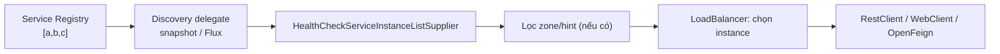

# Kiểm tra lại nguồn danh sách và phát hiện bản sao mới

## 1. Vấn đề: instance mới đã đăng ký nhưng LoadBalancer chưa nhìn thấy

Trong chương **Sức khỏe bản sao** của module `SPRING_CLOUD_SERVICE_COMMUNICATION_LOAD_BALANCING`, `order-service` gọi `inventory-service` qua service ID. Spring Cloud LoadBalancer lấy các `ServiceInstance` từ discovery, có thể thực hiện health check rồi chọn một instance để `RestClient`, `WebClient` hoặc OpenFeign gửi request.

Giả sử lúc 10:00 registry có hai instance `inventory-a` và `inventory-b`. Đến 10:05 hệ thống scale thêm `inventory-c`: instance mới đã khởi động, đăng ký thành công, endpoint readiness trả HTTP 200, nhưng request của `order-service` vẫn chỉ được gửi tới hai instance cũ. Có ít nhất ba khả năng cần phân biệt:

1. **Discovery chưa biết instance mới:** đăng ký hoặc quá trình đồng bộ phía registry chưa hoàn tất.
2. **Nguồn danh sách phía client chưa được làm mới:** `ServiceInstanceListSupplier` vẫn phát lại danh sách cũ; nó có thể không phát sự kiện khi registry thay đổi.
3. **Instance đã có trong danh sách nhưng chưa đủ điều kiện hoặc chưa được chọn:** health check chưa đánh dấu healthy, supplier khác lọc theo zone/hint, hoặc chính sách chọn chưa chọn trúng instance mới.

**Kiểm tra lại sức khỏe của các instance cũ không nhất thiết phát hiện được instance mới.** Để phát hiện `inventory-c`, LoadBalancer cần nhận được một **danh sách ứng viên mới** từ nguồn discovery hoặc một lần refetch. Bài này giải thích khi nào và vì sao phải kiểm tra lại nguồn danh sách, cách cấu hình `HealthCheckServiceInstanceListSupplier`, cách đo thời gian nhận replica mới và cách tìm điểm nghẽn.

### Mục tiêu học tập

Sau bài này, bạn cần có khả năng:

- Tách bạch **membership refresh** (làm mới danh sách instance) với **health probe** (kiểm tra một instance đã biết).
- Giải thích ý nghĩa của `refetch-instances`, `refetch-instances-interval`, `repeat-health-check`, `interval`, `initial-delay` và `update-results-list`.
- Nhận biết khi nào delegate `ServiceInstanceListSupplier` đã có luồng cập nhật liên tục và khi nào cần chủ động refetch.
- Đặt supplier health check đúng vị trí trong chuỗi discovery, cache và filter; cấu hình riêng cho service ID cần theo dõi.
- Kiểm chứng được từ lúc replica đăng ký đến lúc LoadBalancer nhìn thấy, đánh dấu healthy và có request thực sự tới replica đó.
- Xử lý trường hợp scale-out, scale-in, restart, readiness thất bại và không còn instance khỏe mạnh mà không suy luận sai từ log HTTP.

## 2. Phân biệt ba danh sách và một lần chọn

Một request không được gửi trực tiếp từ registry tới server. Nó đi qua các lớp trạng thái có thể thay đổi vào các thời điểm khác nhau:

| Lớp | Ví dụ dữ liệu | Nguồn/cơ chế | Câu hỏi chẩn đoán |
|---|---|---|---|
| **Danh sách trong registry** | `[a,b,c]` | Eureka, Consul, Kubernetes hoặc discovery khác | Registry đã nhận và công bố `c` chưa? |
| **Danh sách từ delegate supplier** | `[a,b]` hoặc `[a,b,c]` | `DiscoveryClientServiceInstanceListSupplier` hay `ReactiveDiscoveryClientServiceInstanceListSupplier` | Delegate có được gọi lại hoặc phát snapshot mới không? |
| **Danh sách sau health check** | `[a,b]` hoặc `[a,b,c]` | `HealthCheckServiceInstanceListSupplier` | `c` có được thăm dò và được xem là healthy không? |
| **Instance được chọn** | `a`, `b` hoặc `c` | Round Robin, Random hoặc chính sách tùy chỉnh | Request này thực sự chọn ai, có retry/timeout không? |

Luồng tổng quát:



Các mũi tên thể hiện luồng thông tin, **không** có nghĩa mọi bước luôn cập nhật đồng thời hoặc mọi ứng dụng đều có health supplier. Các supplier như cache, zone preference, hint hoặc sticky session chỉ hiện diện nếu được cấu hình.

### 2.1. “Healthy” và “đã được khám phá” là hai điều khác nhau

- **Membership:** instance `c` có thuộc danh sách `inventory-service` không?
- **Reachability/readiness:** khi gọi endpoint health của `c`, ứng dụng có sẵn sàng nhận traffic không?
- **Selection:** sau khi `c` có trong tập hợp đủ điều kiện, thuật toán có chọn `c` ở lần gọi cụ thể không?

Một health-check scheduler chỉ biết `a` và `b` có thể tiếp tục xác nhận cả hai đều khỏe, nhưng không có thông tin để tự khám phá `c` nếu nguồn danh sách của nó không được cập nhật. Ngược lại, một instance mới được registry trả về nhưng endpoint readiness vẫn lỗi có thể bị supplier health check loại khỏi danh sách dùng để chọn.

## 3. HealthCheckServiceInstanceListSupplier hoạt động như thế nào?

Spring Cloud Commons cung cấp `HealthCheckServiceInstanceListSupplier` để định kỳ thăm dò sức khỏe các instance do delegate `ServiceInstanceListSupplier` cung cấp. Nó thường trả về những instance được thăm dò thành công.

Theo tài liệu Spring Cloud Commons, có một ngoại lệ cần biết: **khi không tìm thấy instance healthy nào, implementation mặc định có thể trả lại toàn bộ các instance đã nhận**, thay vì trả danh sách trống. Đây là hành vi fallback cần kiểm chứng với version của bạn; không được coi health supplier mặc định như một bộ lọc “fail closed” tuyệt đối. Nếu service có toàn bộ instance chết, một request vẫn có thể được định tuyến tới instance hỏng và báo lỗi kết nối/timeout.

Cơ chế health check hữu ích khi dùng `SimpleDiscoveryClient` hoặc nguồn không cung cấp thông tin sức khỏe đáng tin cậy. Với service registry vốn trả về các instance đã được kiểm soát readiness/health, thêm một lớp HTTP health check riêng có thể không cần thiết và làm tăng số probe. Lựa chọn phải dựa trên đặc tính discovery thực tế.

### 3.1. Hai bộ hẹn giờ không giống nhau

**Lịch health probe** kiểm tra trạng thái instance đã biết:

- `spring.cloud.loadbalancer.health-check.initial-delay`: độ trễ trước lần kiểm tra đầu tiên; tài liệu Commons 4.3 nêu mặc định `0`.
- `spring.cloud.loadbalancer.health-check.interval`: khoảng lặp health check; mặc định `25s`.
- `spring.cloud.loadbalancer.health-check.repeat-health-check`: có tiếp tục chạy vòng probe lặp lại hay không; mặc định `true`.

**Lịch refetch danh sách** chủ động lấy lại tập instance từ delegate:

- `spring.cloud.loadbalancer.health-check.refetch-instances`: cho phép health supplier chủ động gọi lại delegate để lấy danh sách; mặc định `false`.
- `spring.cloud.loadbalancer.health-check.refetch-instances-interval`: chu kỳ refetch nếu đã bật; mặc định `25s`.

Một lần refetch **cũng kích hoạt health check** cho các instance được lấy về. Vì vậy tài liệu gợi ý có thể đặt `repeat-health-check=false` nếu muốn dựa vào chu kỳ refetch để thăm dò luôn. Tuy nhiên, nếu để **cả** `refetch-instances=false` và `repeat-health-check=false`, các lần kiểm tra lặp lại có thể không diễn ra; không chọn tổ hợp đó nếu mục tiêu là theo dõi sức khỏe liên tục.

### 3.2. Bảng thuộc tính cốt lõi

| Thuộc tính (tiền tố `spring.cloud.loadbalancer.health-check.`) | Giá trị mặc định được tài liệu Commons 4.3 liệt kê | Ý nghĩa và giới hạn |
|---|---|---|
| `initial-delay` | `0` | Thời gian chờ trước khi scheduler health bắt đầu |
| `interval` | `25s` | Chu kỳ lặp health probe khi chế độ lặp hoạt động |
| `refetch-instances` | `false` | Có chủ động lấy lại danh sách instance từ delegate hay không |
| `refetch-instances-interval` | `25s` | Chu kỳ refetch khi `refetch-instances=true` |
| `repeat-health-check` | `true` | Có lặp health probe riêng hay không; mỗi refetch vẫn dẫn tới health check |
| `update-results-list` | `true` | `true`: có thể phát kết quả theo từng instance healthy; `false`: đợi gom danh sách kết quả healthy rồi mới phát |
| `path` | Không có đường dẫn riêng thì dùng `/actuator/health` | Có thể cấu hình map theo service ID và `default` |
| `port` | Cổng của `ServiceInstance` nếu không khai báo riêng | Chỉ định cổng health check khi khác cổng dịch vụ |

**Lưu ý:** đây là thông tin để học và thử nghiệm theo tài liệu Spring Cloud Commons 4.3; đối chiếu metadata và cách bind của **Spring Cloud Release Train thực tế** trước khi đưa vào dự án. Không tự suy ra rằng mọi thuộc tính đều được hỗ trợ hoặc có tác dụng như nhau ở các phiên bản khác.

### 3.3. “Refetch” làm mới nguồn nào?

Tùy loại delegate:

1. **Delegate phát luồng cập nhật liên tục:** nếu registry thay đổi và delegate tự phát danh sách mới, health supplier có thể nhận bản cập nhật mà không phải chủ động refetch. Bật refetch ở đây có thể chỉ tạo thêm truy vấn.
2. **Delegate chỉ phát một snapshot lúc đăng ký/subscribe:** sau khi registry có instance mới, health supplier có thể không nhận thêm giá trị. `refetch-instances=true` được dùng để gọi lại delegate định kỳ.
3. **Delegate lấy lại danh sách nhưng trả dữ liệu bị cache:** refetch vẫn có thể gặp snapshot cũ, cần kiểm tra cache của registry/client và TTL.
4. **Delegate dùng cấu hình tĩnh `SimpleDiscoveryClient`:** một lần refetch không tự khiến instance mới xuất hiện nếu danh sách cấu hình không thay đổi. Muốn làm lab scale động, dùng registry có đăng ký runtime hoặc delegate thử nghiệm có danh sách thay đổi được.

**Nguyên tắc:** refetch chỉ có thể lấy những gì delegate **có thể cung cấp tại thời điểm được gọi**. Nó không tự đăng ký instance mới, không sửa service ID, không làm cho instance chưa ready trở thành healthy và không đảm bảo request tiếp theo chắc chắn chọn instance mới.

## 4. Những cấu hình giúp phát hiện replica mới

### 4.1. Bật refetch cùng health check

Ví dụ trên `order-service`, khi dùng một delegate vốn **không tự phát cập nhật** nhưng mỗi lần truy vấn có thể lấy được danh sách mới:

```yaml
spring:
  cloud:
    loadbalancer:
      health-check:
        initial-delay: 0s
        interval: 10s
        refetch-instances: true
        refetch-instances-interval: 8s
        repeat-health-check: false
        update-results-list: false
        path:
          default: /actuator/health
          inventory-service: /actuator/health/readiness
```

Ý nghĩa của ví dụ:

- Mỗi chu kỳ refetch khoảng `8s`, health supplier cố lấy lại tập instance từ delegate và kiểm tra sức khỏe các instance nhận được.
- `repeat-health-check=false` tránh thêm một lịch probe độc lập; **nó không tắt health check do refetch gây ra**.
- `interval=10s` được đặt để minh họa sự phân biệt với refetch interval; khi đã tắt health probe lặp riêng, đừng dùng `10s` để ước lượng tần suất probe thực tế.
- `update-results-list=false` để đợi gom kết quả healthy thành danh sách rồi mới phát, thay vì đưa từng instance healthy ra Flux ở các thời điểm trung gian.
- `inventory-service` phải có endpoint `/actuator/health/readiness` hoạt động trên cổng được kiểm tra; nếu chỉ có `/actuator/health` thì đổi đường dẫn cho đúng.

**Cấu hình property chỉ có tác dụng khi `HealthCheckServiceInstanceListSupplier` thực sự nằm trong chuỗi supplier.** Đặt các khóa `health-check.*` vào YAML không tự bảo đảm ứng dụng đã dùng loại supplier này.

### 4.2. Tạo supplier cho riêng inventory-service

Ví dụ dùng Java configuration, cấu hình `RestClient` gọi theo service ID và health supplier ở child context của `inventory-service`:

```java
@Configuration(proxyBeanMethods = false)
@LoadBalancerClient(
        name = "inventory-service",
        configuration = InventoryHealthLoadBalancerConfiguration.class)
class InventoryClientConfiguration {

    @Bean
    @LoadBalanced
    RestClient.Builder inventoryRestClientBuilder() {
        return RestClient.builder();
    }
}

// Lớp này không đặt @Configuration và không đăng ký vào component scan toàn cục.
class InventoryHealthLoadBalancerConfiguration {

    @Bean
    ServiceInstanceListSupplier inventoryInstanceListSupplier(
            ConfigurableApplicationContext context) {
        return ServiceInstanceListSupplier.builder()
                .withDiscoveryClient()
                .withBlockingHealthChecks()
                .build(context);
    }
}
```

Trong ứng dụng **chỉ dùng WebClient/reactive**, có thể dùng biến thể builder:

```java
@Bean
ServiceInstanceListSupplier inventoryInstanceListSupplier(
        ConfigurableApplicationContext context) {
    return ServiceInstanceListSupplier.builder()
            .withDiscoveryClient()
            .withHealthChecks()
            .build(context);
}
```

Hai đoạn cấu hình supplier là **phương án thay thế**, không đăng ký cả hai cùng lúc cho một client. Theo tài liệu Commons, `withHealthChecks()` dùng health-check theo stack reactive, còn `withBlockingHealthChecks()` phù hợp khi dùng cơ chế HTTP blocking. Có thể đưa `WebClient`, `RestTemplate` hoặc `RestClient` phù hợp làm công cụ probe theo API của phiên bản đang dùng. Bổ sung dependency LoadBalancer và DiscoveryClient thích hợp.

Khi sử dụng OpenFeign, bản thân Feign có thể đi qua Spring Cloud LoadBalancer nếu dependency/configuration phù hợp; nhưng cơ chế **health-check HTTP** do supplier đảm nhiệm phải được thiết kế phù hợp với stack đang có, không mặc định Feign tự cung cấp scheduler.

### 4.3. Không đặt cache sai vị trí

Thứ tự khuyến nghị:

```text
DiscoveryClientServiceInstanceListSupplier
    -> HealthCheckServiceInstanceListSupplier
    -> (các supplier lọc theo zone/hint nếu cần)
    -> LoadBalancer chọn instance
```

Spring Cloud Commons khuyến nghị health supplier nằm **ngay sau thành phần lấy instance từ mạng**, trước các supplier lọc theo request. `HealthCheckServiceInstanceListSupplier` có cơ chế replay/cache nội bộ dựa trên Reactor Flux; không nên bọc chồng bằng `CachingServiceInstanceListSupplier` một cách tùy tiện.

Một chuỗi khó chẩn đoán là:

```text
Discovery -> CachingServiceInstanceListSupplier
          -> HealthCheckServiceInstanceListSupplier
```

Khi đó, dù health supplier được cấu hình refetch, delegate gần nhất có thể vẫn trả bản cache cũ. Nếu cache chứa snapshot `[a,b]`, instance mới `c` chưa chắc xuất hiện cho đến khi cache hết hạn hoặc được invalidated. Không kết luận “refetch lỗi” khi chưa kiểm tra supplier chain và cache TTL.

### 4.4. Cấu hình riêng theo service ID

Khi ứng dụng gọi nhiều dịch vụ, chỉ `inventory-service` cần refetch mạnh hơn; các service khác có registry cung cấp luồng cập nhật tốt thì giữ cấu hình bình thường:

```yaml
spring:
  cloud:
    loadbalancer:
      health-check:
        refetch-instances: false
      clients:
        inventory-service:
          health-check:
            refetch-instances: true
            refetch-instances-interval: 8s
            repeat-health-check: false
```

Theo cơ chế cấu hình theo từng `LoadBalancerClient` của Spring Cloud Commons 4.3, các property hỗ trợ override dưới `spring.cloud.loadbalancer.clients.<clientId>.` sẽ hợp nhất với giá trị chung, ưu tiên riêng cho client đó. Ở đây `clientId` là service ID `inventory-service` mà `RestClient`/`WebClient`/OpenFeign gọi qua LoadBalancer, **không phải** tên ứng dụng caller `order-service`. Vẫn phải xác minh thuộc tính được bind đúng ở version thực tế.

## 5. Dựng bài lab scale-out để quan sát replica mới

### 5.1. Topology và điều kiện đầu vào

Dùng một registry hỗ trợ đăng ký/loại bỏ instance khi chạy, chẳng hạn Eureka hoặc Consul trong môi trường lab. Có thể thay bằng custom discovery delegate trả danh sách thay đổi được, miễn là **mỗi lần đọc mới phản ánh registry đã cập nhật**.

| Thành phần | Cấu hình | Mục đích |
|---|---|---|
| `order-service` | Gọi `http://inventory-service/api/inventory/{sku}` qua LoadBalancer | Quan sát instance được chọn |
| `inventory-a` | Service ID `inventory-service`, cổng `8081`, instance ID duy nhất | Instance ban đầu |
| `inventory-b` | Cùng service ID, cổng `8082` | Instance ban đầu |
| `inventory-c` | Cùng service ID, cổng `8083`, khởi động sau | Replica mới cần phát hiện |
| Registry | Hỗ trợ thêm/xóa instance lúc runtime | Nguồn danh sách |
| Actuator trên inventory | Endpoint readiness/health trả trạng thái thực | Cho health-check supplier kiểm tra |

Nếu registry đã cung cấp luồng danh sách liên tục cho supplier, thí nghiệm có thể chứng minh **không cần refetch**. Muốn kiểm chứng chính sự khác biệt giữa `refetch-instances=false` và `true`, cần một delegate không tự phát danh sách mới nhưng **có thể trả snapshot mới khi được gọi lại**. Không nên lấy `SimpleDiscoveryClient` cấu hình tĩnh không đổi làm bằng chứng về dynamic discovery.

### 5.2. Endpoint để nhận biết instance

Trong mỗi instance `inventory-service`, trả về instance ID cùng response:

```java
@RestController
class InventoryController {
    private final Environment environment;

    InventoryController(Environment environment) {
        this.environment = environment;
    }

    @GetMapping("/api/inventory/{sku}")
    Map<String, String> inventory(@PathVariable String sku) {
        return Map.of(
                "sku", sku,
                "instanceId", environment.getProperty(
                        "app.instance-id", "unknown"));
    }
}
```

Ví dụ trên sử dụng Spring MVC. Mỗi tiến trình có `app.instance-id` riêng và cùng `spring.application.name=inventory-service`. Khi gọi bằng LoadBalancer, response giúp biết server nào **đã xử lý thành công** request. Cần thêm log ở caller nếu muốn biết instance nào đã được **chọn nhưng kết nối thất bại**.

### 5.3. Trình tự thí nghiệm

1. Khởi động registry, `order-service`, `inventory-a` và `inventory-b`. Kiểm tra registry hiện chỉ có hai instance.
2. Kiểm tra `/actuator/health/readiness` tại mỗi instance; xác nhận endpoint trả mã trạng thái thành công và thực sự phản ánh readiness.
3. Gửi request qua `order-service`, ghi instance ID và timestamp. Xác nhận chỉ `a`, `b` được chọn.
4. Bật ghi log hoặc metric cho danh sách **trước health filter** và danh sách **sau health filter**. Ghi cấu hình `refetch-instances`, các interval, phiên bản thư viện và thứ tự supplier.
5. Khởi động `inventory-c`. Ghi thời điểm `T_register` khi registry công bố `c` (không chỉ thời điểm process vừa start).
6. Chờ nhật ký delegate lấy lại danh sách mới, ghi `T_discover` khi `c` thực sự xuất hiện trong danh sách delegate.
7. Ghi `T_healthy` khi health supplier phát danh sách chứa `c`.
8. Gửi request đều đặn; ghi `T_first_selected` khi LoadBalancer chọn `c`, và `T_first_success` khi có HTTP response thành công từ `c`.
9. Tắt `inventory-c` hoặc làm readiness báo không khỏe, tiếp tục quan sát việc loại `c` và điều kiện fallback.
10. Lặp lại với `refetch-instances=false` và `true` **trên cùng delegate có đặc tính xác định**; đảm bảo khởi động lại hoặc reset trạng thái giữa hai lượt để tránh cache cũ làm nhiễu.

Khi thử nghiệm `refetch-instances=false`, instance `c` **có thể vẫn xuất hiện** nếu delegate tự phát danh sách mới. Khi thử `true`, instance `c` có thể vẫn chậm xuất hiện nếu registry propagation trễ, cache chưa cập nhật hoặc health check chưa thành công. Đó là kết quả cần phân tích, không phải điều kiện để mặc định kết luận cấu hình đúng/sai.

## 6. Tính thời gian hội tụ đúng cách

Không gộp mọi độ trễ thành một con số “LoadBalancer phát hiện chậm”:

| Mốc | Ghi nhận | Hệ thống liên quan |
|---|---|---|
| `T_start` | Process `inventory-c` khởi động | Server/startup |
| `T_ready` | Readiness của `c` báo thành công | Server và dependencies |
| `T_register` | Registry hiển thị `c` đủ điều kiện được khám phá | Service registry |
| `T_discover` | Delegate supplier của caller trả danh sách có `c` | Discovery client, refresh, cache |
| `T_healthy` | Health supplier phát danh sách đủ điều kiện chứa `c` | Health probe, lịch refetch |
| `T_first_selected` | LoadBalancer thực sự chọn `c` | Thuật toán và lưu lượng request |
| `T_first_success` | Có HTTP response hợp lệ từ `c` | Network, HTTP client, server |

Các hiệu số hữu ích:

\[
\begin{aligned}
\Delta_{\text{discovery}} &= T_{\text{discover}} - T_{\text{register}},\\
\Delta_{\text{health}} &= T_{\text{healthy}} - T_{\text{discover}},\\
\Delta_{\text{selection}} &= T_{\text{first selected}} - T_{\text{healthy}},\\
\Delta_{\text{end-to-end}} &= T_{\text{first success}} - T_{\text{register}}.
\end{aligned}
\]

Các hiệu số chỉ có ý nghĩa khi timestamp được ghi tại cùng caller hoặc đồng hồ các thành phần được đồng bộ đủ chính xác. Với hệ thống phân tán, dùng tracing, monotonic clock/nhật ký theo cùng tiến trình nếu cần độ chính xác cao.

**Không xem `refetch-instances-interval=8s` là SLA “instance chắc chắn được dùng trong 8 giây”.** Nó mới là khoảng lịch cố gắng lấy lại danh sách. Registry propagation, độ trễ lời gọi discovery, timeout, probe, cache, chính sách chọn và tần suất request đều ảnh hưởng thời điểm instance mới được phục vụ. Nếu `RoundRobinLoadBalancer` có ba instance, sau khi `c` eligible nó vẫn phải tới lượt chọn; nếu traffic không phát sinh, sẽ không có `T_first_selected` dù supplier đã cập nhật.

### 6.1. Bảng kết quả giả định

Dưới đây chỉ là số liệu minh họa, **không phải benchmark đã chạy**:

| Mốc | Thời gian | Nhận định |
|---|---|---|
| `T_start` | 10:05:00 | Bắt đầu khởi động `c` |
| `T_ready` | 10:05:04 | Endpoint readiness sẵn sàng |
| `T_register` | 10:05:05 | Registry công bố `c` |
| `T_discover` | 10:05:12 | Delegate nhận danh sách `[a,b,c]` |
| `T_healthy` | 10:05:13 | Health supplier xác nhận `c` |
| `T_first_selected` | 10:05:14 | LoadBalancer chọn `c` |
| `T_first_success` | 10:05:14.035 | HTTP response từ `c` |

Trong bảng này `\Delta_{\text{discovery}}=7s`; đây là chỗ nên kiểm tra lịch refetch, registry và cache. `\Delta_{\text{health}}=1s` có thể do probe hoặc thời gian gom kết quả. Chỉ nhìn thời điểm response đầu tiên không cho biết đoạn nào gây trễ.

## 7. Ba lỗi cấu hình thường khiến replica mới mãi không được chọn

### 7.1. Delegate không cập nhật, còn refetch bị tắt

**Triệu chứng:** registry có `[a,b,c]` nhưng snapshot phía supplier vẫn `[a,b]` lâu dài, trong khi health check `a` và `b` vẫn chạy đúng lịch.

**Kiểm tra:** xác định delegate phát Flux liên tục hay phát một lần; kiểm tra `refetch-instances` và log các lần lấy danh sách. Nếu cần và delegate đọc lại được snapshot mới, bật refetch cùng chu kỳ phù hợp.

### 7.2. Refetch bật nhưng vẫn thấy snapshot cũ

**Triệu chứng:** health supplier có refetch định kỳ, nhưng danh sách trước health check vẫn thiếu `c`.

**Kiểm tra:** registry đã thực sự xuất bản `c` chưa; delegate có truy vấn fresh hay chỉ dùng cache; `CachingServiceInstanceListSupplier` có nằm giữa network discovery và health supplier không; cache TTL nào đang áp dụng; có nhiều caller replica với context/cached list riêng không. Refetch không vô hiệu hóa mọi cache ở các lớp khác.

### 7.3. Delegate có c nhưng health supplier không trả c

**Triệu chứng:** `c` hiện trong dữ liệu discovery nhưng thiếu ở danh sách đã lọc healthy.

**Kiểm tra:** cổng, path health, trạng thái HTTP, cấu hình readiness, TLS, quyền truy cập, DNS, timeout của HTTP client dùng làm probe. Nếu `inventory-c` vẫn `STARTING` hoặc endpoint readiness trả lỗi, không nên buộc supplier chọn nó chỉ để “scale nhanh”.

Một trường hợp khác là có supplier **zone preference**, **hint** hoặc **metadata filter** phía sau health: `c` có thể healthy nhưng không phù hợp chính sách định tuyến. Khi đó `c` không xuất hiện trong tập chọn cuối cùng dù hoàn toàn khỏe.

## 8. Khi scale-in và khi toàn bộ instance không khỏe

Refetch không chỉ dành cho việc thêm instance. Nó giúp nhận ra các instance đã bị unregister khi delegate không tự phát cập nhật. Tuy nhiên:

- Một instance vừa tắt có thể vẫn còn trong registry trong thời gian heartbeat/lease/TTL; refetch trong giai đoạn này vẫn trả instance cũ.
- Health check có thể loại instance không phản hồi **trước** khi registry xóa. Nếu có nhiều instance còn khỏe, danh sách healthy thường không chứa instance bị lỗi.
- Khi mọi instance bị coi là unhealthy, `HealthCheckServiceInstanceListSupplier` mặc định có fallback trả lại **toàn bộ danh sách đã lấy**, vì vậy vẫn có thể xảy ra request tới instance lỗi. Cần log và thiết kế đường xử lý `503`, timeout, circuit breaker và retry có giới hạn. Không xem health check là biện pháp bảo đảm tuyệt đối không gọi instance lỗi.
- Một instance biến mất trong lượt chọn nhưng request đang thực hiện có thể vẫn thất bại; discovery và health check không thể ngăn toàn bộ race condition giữa lựa chọn và kết nối.

### 8.1. Vì sao không nên bật cả hai lịch với tần suất rất cao?

Nếu `refetch-instances-interval` ngắn và `repeat-health-check=true` với `interval` ngắn, hệ thống phát sinh hai luồng hoạt động: refetch thường xuyên và health probe thường xuyên. Với `M` caller replicas, `S` services và `K` instances trên mỗi service, tổng số probe có thể tăng nhanh theo số tổ hợp caller–service–instance.

Trong môi trường thật, nên cân bằng yêu cầu phát hiện nhanh với giới hạn registry và endpoint readiness. Nếu registry đã xác nhận health, có thể chỉ dựa vào discovery mà không dựng thêm scheduler health; nếu cần health check ở số ít service, cấu hình theo từng `clientId` thay vì áp mọi service.

## 9. Quan sát bằng log và metric

Một bản log có ích cho lab cần phân biệt ba thời điểm:

```text
10:05:12.000 serviceId=inventory-service stage=delegate
              instances=[a,b,c]
10:05:13.010 serviceId=inventory-service stage=healthy
              instances=[a,b,c]
10:05:14.000 serviceId=inventory-service stage=selected
              instanceId=c requestId=R-42
```

Các dòng trên là **định dạng gợi ý**, không phải log mặc định mà Spring Cloud LoadBalancer luôn xuất ra. Có thể bổ sung instrumentation tại `ServiceInstanceListSupplier`, callback `LoadBalancerLifecycle` và tại instance xử lý HTTP. Không log raw token, cookie hoặc thông tin nhạy cảm.

Theo dõi tối thiểu:

| Chỉ số / log | Câu hỏi trả lời |
|---|---|
| `registry_instance_count` theo service ID | Registry biết bao nhiêu replica? |
| `delegate_instance_count` | Caller đã thấy replica mới chưa? |
| `healthy_instance_count` | Có bao nhiêu instance vượt qua health check? |
| `candidate_instance_count` sau filters | Bao nhiêu instance đủ điều kiện lựa chọn? |
| `refetch_count`, `refetch_duration`, `refetch_error_count` | Việc lấy lại danh sách có chạy và thành công không? |
| `health_probe_success/failure` | Endpoint readiness có phản hồi đúng? |
| `selected_instance_id`, HTTP status, retry attempts | Instance mới có được gọi thực tế không? |
| `discovery_to_selection_delay` | Mất bao lâu từ khi registry có replica tới lần chọn đầu tiên? |

Tên trong bảng là **gợi ý metric nội bộ để tự instrument**, không phải lời khẳng định Spring Cloud luôn tạo sẵn các tên metric này. Khi dùng Micrometer/Actuator, đối chiếu metric có sẵn với version tương ứng rồi bổ sung metric custom nếu cần.

## 10. Bài thực hành mở rộng

### Bài 1 — Chỉ health probe, chưa refetch

Giữ delegate chỉ phát một snapshot khi đăng ký subscriber, nhưng có thể trả snapshot mới nếu được gọi lại. Bắt đầu `[a,b]`, thêm `c` vào nguồn. Để `refetch-instances=false`, `repeat-health-check=true` và quan sát:

- Health check tiếp tục thăm dò `a` và `b`.
- `c` chưa xuất hiện nếu delegate không phát thêm danh sách.
- Nâng `health-check.interval` xuống thấp cũng không tự khám phá `c`.

Giải thích vì sao health probe và membership refresh khác nhau.

### Bài 2 — Bật refetch và đo độ trễ hội tụ

Giữ cùng delegate của Bài 1. Bật `refetch-instances=true`, `refetch-instances-interval=8s`, `repeat-health-check=false`. Thêm `c` và ghi bốn mốc từ registry đến response đầu tiên; lặp ít nhất ba lần. Giải thích dao động giữa các lượt dựa trên lịch refetch, thời điểm đăng ký và tốc độ request.

### Bài 3 — Kiểm tra supplier chain có cache

Thêm một cache nằm trước health supplier (chỉ cho mục đích minh họa lỗi), giữ TTL đủ dài, rồi thêm `c`. So sánh danh sách của registry, delegate/cache, health supplier. Sau đó đổi về chuỗi được khuyến nghị `Discovery -> HealthCheck -> filter` và kiểm tra lại. Không thay cache TTL giữa chừng mà không ghi nhận vì sẽ tạo yếu tố nhiễu.

### Bài 4 — Instance mới chưa ready

Thêm `c` vào registry khi endpoint readiness còn trả lỗi. Xác nhận `c` đã ở danh sách delegate nhưng không được chọn khi vẫn có instance khỏe. Chuyển `c` sang readiness thành công và quan sát thời điểm được thêm vào danh sách healthy. Nếu health supplier phát danh sách cập nhật theo từng probe, ghi nhận hành vi `update-results-list` của version đang chạy.

### Bài 5 — Scale-in và all-unhealthy

Dừng `b`, tiếp tục cho `a`/`c` hoạt động; sau đó làm cả hai instance cuối trả trạng thái unhealthy. Quan sát khác biệt giữa danh sách registry, healthy và tập mà LoadBalancer trả về trong trường hợp không có instance healthy. Nêu lý do không thể xem health supplier mặc định là cơ chế fail-closed.

## 11. Checklist hoàn thành

- [ ] Đã ghi Spring Boot version, Spring Cloud Release Train, phiên bản `spring-cloud-commons` và `spring-cloud-loadbalancer` thực tế.
- [ ] Đã xác nhận `inventory-service` là service ID dùng trong URI của HTTP client và trong cấu hình `clients.inventory-service`.
- [ ] Đã xác minh có `HealthCheckServiceInstanceListSupplier` trong chain nếu muốn dùng `health-check.*`.
- [ ] Đã phân biệt delegate **push** snapshot mới và delegate cần **pull/refetch**.
- [ ] Đã thử trước/sau khi bật `refetch-instances` với cùng nguồn có khả năng thay đổi.
- [ ] Đã kiểm tra thời gian `T_register`, `T_discover`, `T_healthy` và `T_first_selected` riêng biệt.
- [ ] Đã bảo đảm endpoint health/readiness và cổng của replica mới là chính xác.
- [ ] Đã kiểm tra cache/supplier chain và các filter zone/hint phía sau health check.
- [ ] Đã thử scale-in, instance chưa ready, trường hợp all-unhealthy và fallback.
- [ ] Đã tách log lần chọn, HTTP response, timeout, retry và số instance đủ điều kiện.

## Tài liệu tham khảo chính thức

- [Spring Cloud Commons 4.3 — Spring Cloud LoadBalancer](https://docs.spring.io/spring-cloud-commons/reference/4.3/spring-cloud-commons/loadbalancer.html), phần **Instance Health-Check for LoadBalancer**: mục đích của `HealthCheckServiceInstanceListSupplier`, `refetch-instances`, `repeat-health-check`, cách cấu hình builder và thứ tự supplier.
- [Spring Cloud Commons 4.3 — Configuration Properties](https://docs.spring.io/spring-cloud-commons/reference/4.3/configprops.html): tên property và mặc định của `spring.cloud.loadbalancer.health-check.*`.
- [Spring Cloud Commons — tài liệu bản ổn định](https://docs.spring.io/spring-cloud-commons/reference/spring-cloud-commons/loadbalancer.html): so sánh với nhánh mới; luôn kiểm tra version đầu trang.
- [Spring Cloud project — Release Train](https://spring.io/projects/spring-cloud/): đối chiếu Spring Cloud với Spring Boot trước khi copy cấu hình sang hệ thống khác.

**Điểm cần nhớ:** sức khỏe trả lời “instance đã biết còn phục vụ được không?”, còn refetch trả lời “danh sách instance đã biết có thay đổi không?”. Muốn replica mới được chọn, phải có chuỗi đầy đủ: **registry cập nhật → delegate phát hoặc được refetch danh sách mới → health/filter chấp nhận instance → LoadBalancer lựa chọn → HTTP request thành công**.
