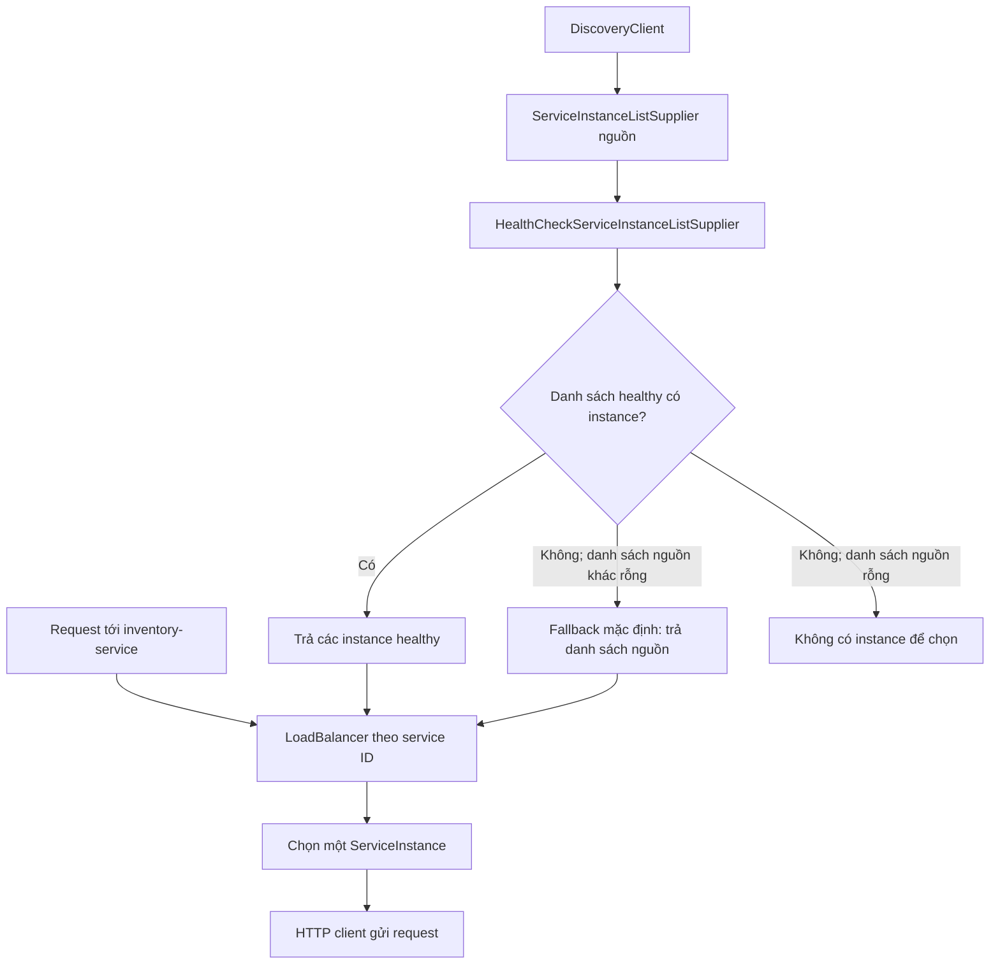
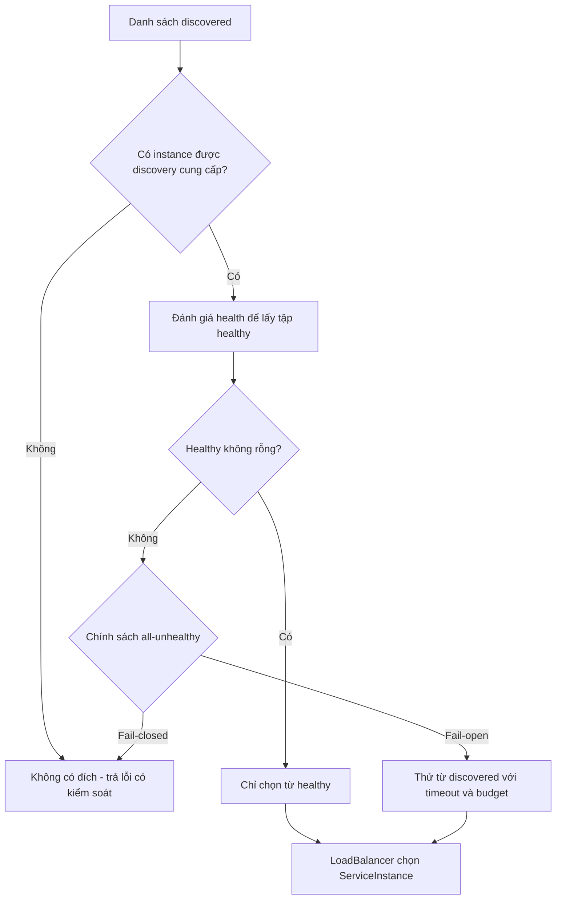

# Chính sách khi mọi bản sao đều bị đánh dấu không khỏe

Spring Cloud LoadBalancer chọn `ServiceInstance` theo **service ID** từ danh sách mà `ServiceInstanceListSupplier` cung cấp. Khi tích hợp kiểm tra sức khỏe, những instance không vượt qua health check thường bị loại khỏi tập ứng viên. Nhưng điều gì xảy ra nếu **tất cả** instance đều bị đánh dấu không khỏe? Nên gửi request tới một instance có nguy cơ lỗi, hay từ chối request ngay để bảo vệ hệ thống?

Đây không chỉ là tình huống của thuật toán Round Robin hoặc Random. Nó là **chính sách availability, safety và phục hồi**: cố gắng phục vụ bằng danh sách gốc (**fail-open**) hay không chọn bất kỳ đích nào khi không có instance khỏe (**fail-closed**). Spring Cloud LoadBalancer có một hành vi mặc định quan trọng trong `HealthCheckServiceInstanceListSupplier`: khi không còn instance vượt qua kiểm tra, supplier có thể **trả lại toàn bộ các instance mà delegate đã cung cấp**, thay vì trả danh sách rỗng. Hiểu rõ hành vi này giúp tránh ngộ nhận rằng bật health check luôn loại bỏ được mọi instance không khỏe.

## 1. Ba tập dữ liệu cần phân biệt

Hãy giả sử ứng dụng `order-service` gọi `inventory-service` qua URL logic:

```text
http://inventory-service/api/v1/items/42
```

Trong bài, ta dùng ba khái niệm:

- **Discovered**: danh sách instance mà discovery hoặc supplier nguồn trả về, ví dụ `[A, B, C]`. Nguồn có thể là `SimpleDiscoveryClient`, Eureka, Consul hoặc cơ chế discovery khác.
- **Healthy**: tập con của `discovered` vượt qua kiểm tra sức khỏe do supplier thực hiện, ví dụ `[A, C]`.
- **Candidates**: danh sách thực sự đi đến thuật toán chọn instance sau khi áp dụng health policy và các bộ lọc khác.

| Tình huống | Discovered | Healthy | Ý nghĩa |
|---|---|---|---|
| Mọi instance khỏe | [A, B, C] | [A, B, C] | Có nhiều đích bình thường |
| Một instance lỗi | [A, B, C] | [A, C] | Có thể tránh B |
| Tất cả bị đánh dấu lỗi | [A, B, C] | [] | Cần xác định chính sách khi mất toàn bộ healthy |
| Không tìm thấy dịch vụ | [] | [] | Không có instance gốc để fallback |

**Tất cả instance bị đánh dấu unhealthy** khác với **danh sách discovery rỗng**. Hai trạng thái đều có thể khiến request thất bại, nhưng nguyên nhân và chính sách fallback khác nhau. Đừng xem chúng là một trường hợp duy nhất.



Sơ đồ mô tả hành vi của health-check supplier được tài liệu Spring Cloud Commons nêu. Nếu còn **các lớp lọc khác** sau health check, chúng có thể tiếp tục loại instance. Ngoài ra, cách phản hồi khi không có instance phụ thuộc vào HTTP client và tích hợp LoadBalancer; không phải mọi client đều trả cùng một loại exception.

## 2. Hành vi mặc định của HealthCheckServiceInstanceListSupplier

`HealthCheckServiceInstanceListSupplier` là một thành phần tùy chọn của Spring Cloud LoadBalancer. Nó kiểm tra định kỳ những instance được delegate trả về, giữ danh sách instance sống, và **khi không tìm thấy instance khỏe thì trả lại toàn bộ instance nhận được từ delegate**. Đây là lựa chọn thiên về khả năng phục vụ trong trường hợp thông tin health không đủ tin cậy hoặc tất cả probe gặp lỗi tạm thời.

Ví dụ, với nguồn trả về `[A, B, C]`:

| Kết quả health check | Danh sách do supplier thông thường cung cấp | Điều có thể xảy ra |
|---|---|---|
| A, B, C đều healthy | [A, B, C] | LoadBalancer chọn trong cả ba |
| Chỉ B unhealthy | [A, C] | B không nằm trong tập từ health-check supplier |
| A, B, C đều unhealthy | [A, B, C] | **Fallback về danh sách gốc**, các instance unhealthy vẫn có thể được chọn |
| Delegate trả [] | [] | Không có đích để fallback |

Nếu cả A, B, C thực sự đã dừng, fallback không khiến dịch vụ hoạt động trở lại; request vẫn có thể bị `Connection refused`, connect timeout hoặc read timeout. Nếu các health probe trả kết quả âm tính giả do mất kết nối tạm thời hoặc cấu hình sai, một số request nghiệp vụ vẫn **có thể** thành công khi thử instance từ danh sách gốc. Đó là lý do cần tách “bị đánh dấu unhealthy” khỏi “chắc chắn không thể xử lý request”.

**Không nên hiểu sai:** hành vi này không có nghĩa health check vô ích. Khi **còn ít nhất một instance healthy**, health-check supplier có thể thu hẹp tập ứng viên xuống các instance khỏe. Fallback đáng chú ý chủ yếu xảy ra ở trạng thái **không còn instance healthy trong tập nguồn**.

Một lưu ý về phiên bản: thuộc tính kiểm tra sức khỏe, chuỗi supplier và cách xử lý danh sách có thể khác giữa các release train Spring Cloud. Hãy dùng Spring Cloud BOM tương thích với Spring Boot và kiểm tra tài liệu hoặc mã nguồn đúng phiên bản triển khai, đặc biệt nếu hệ thống yêu cầu fail-closed.

## 3. Fail-open và fail-closed: hai chính sách khác nhau

**Fail-open** nghĩa là khi toàn bộ healthy bị loại, vẫn cho phép thử một instance từ danh sách gốc. **Fail-closed** nghĩa là không gửi request tới một đích đã bị đánh dấu không hợp lệ; thông báo không còn đích có thể dùng và để tầng trên xử lý.

| Tiêu chí | Fail-open khi all-unhealthy | Fail-closed khi all-unhealthy |
|---|---|---|
| Danh sách ứng viên | Quay về danh sách nguồn, nếu không rỗng | Rỗng |
| Mục tiêu | Ưu tiên cơ hội phục vụ khi health có thể sai hoặc tạm thời | Ưu tiên an toàn, cách ly lỗi và tính đúng đắn |
| Khả năng thành công | Có thể còn, nhưng không được bảo đảm | Không thử instance đã bị loại |
| Nguy cơ | Dồn request vào instance hỏng, tăng timeout/retry, gây quá tải | Từ chối cả request có thể thành công nếu health check sai |
| Dễ phát hiện lỗi probe | Có thể che giấu vì còn request thành công | Rõ ràng hơn ở response/metric |
| Phù hợp khi | Đường đọc idempotent, health probe có nguy cơ false negative và có budget chặt | Giao dịch nhạy cảm, yêu cầu residency, an toàn, hoặc trạng thái readiness là điều kiện bắt buộc |

Không có chính sách duy nhất đúng cho mọi hệ thống. Ví dụ:

- Tra cứu danh mục sản phẩm có thể chấp nhận thử một bản sao trả lời chậm để tăng khả năng phục vụ, miễn có timeout, retry budget và circuit breaker.
- Ghi giao dịch tài chính hoặc dữ liệu cần kiểm soát chặt có thể chọn fail-closed để tránh gửi request vào instance chưa đạt readiness hoặc không bảo đảm trạng thái đồng bộ.
- Hệ thống đa vùng có thể dùng một nhóm instance dự phòng ở vùng khác **chỉ khi vùng đó vẫn thỏa mọi ràng buộc an toàn và tuân thủ**. Không dùng “fallback” để bỏ qua các điều kiện bắt buộc.

**Nguyên tắc:** phân biệt **health như tín hiệu ưu tiên** và **hard constraints**. Fallback mặc định của health-check supplier không được dùng để vượt qua yêu cầu phân quyền, đúng tenant, phiên bản dữ liệu hay vị trí lưu trú dữ liệu. Những điều kiện này phải được thực thi riêng trong hệ thống và không được nới lỏng khi healthy rỗng.

## 4. Chọn chính sách theo mức độ tin cậy của health signal

Health check thường gửi một HTTP request tới một endpoint như `/actuator/health` hoặc `/actuator/health/readiness`. Một kết quả không khỏe có nhiều nguyên nhân:

1. Instance thực sự bị dừng, treo, hết kết nối hoặc đang shutdown.
2. Instance vẫn phục vụ được một số request, nhưng readiness là DOWN vì dependency không bắt buộc cho mọi loại request đang lỗi.
3. Đường dẫn health check không đúng và luôn trả 404.
4. Endpoint có authentication, trả 401/403 cho health checker.
5. Proxy, DNS, TLS hoặc firewall khiến health checker không truy cập được dù HTTP client nghiệp vụ có đường đi khác.
6. Timeout của health probe quá ngắn hoặc chu kỳ probe tạo tải lớn.

Một chính sách có thể hợp lý cho trường hợp 2 hoặc 5 nhưng nguy hiểm trong trường hợp 1. Do đó cần trả lời ba câu hỏi: **probe có phản ánh đúng khả năng phục vụ loại request này không?**, **không đủ healthy là trạng thái tạm thời hay tình huống thật?**, và **thử một instance không khỏe có thể gây hậu quả gì?**

### Readiness khác liveness

- **Liveness** thường trả lời tiến trình còn cần được chạy hay nên khởi động lại.
- **Readiness** trả lời instance đã sẵn sàng nhận traffic hay chưa.

Đối với định tuyến, readiness thường phù hợp hơn liveness: một tiến trình vẫn sống nhưng đang khởi tạo cache, kết nối database hoặc graceful shutdown có thể chưa thích hợp nhận request. Tuy nhiên, nếu readiness phụ thuộc quá nhiều dịch vụ không liên quan, sự cố chung có thể khiến toàn bộ instance bị đánh dấu không khỏe dù một số endpoint vẫn hoạt động.

**Không nên** xử lý hiện tượng “mọi instance unhealthy” bằng cách tùy tiện trả HTTP 200 cho health endpoint bất kể trạng thái. Cách đó làm mất tín hiệu giám sát và có thể cho phép traffic đến instance chưa sẵn sàng.

## 5. Cấu hình health check trong Spring Cloud LoadBalancer

Với ứng dụng client, cần dependency `spring-cloud-starter-loadbalancer` và Spring Cloud BOM tương thích với Spring Boot. Đối với provider Spring Boot, có thể dùng `spring-boot-starter-actuator` để cung cấp health endpoint. Trong một bài lab, hãy đặt endpoint health trên cùng port mà instance đang nhận request để tránh nhầm lẫn.

Ví dụ client dùng `SimpleDiscoveryClient` cung cấp hai instance:

```yaml
spring:
  cloud:
    discovery:
      client:
        simple:
          instances:
            inventory-service:
              - uri: http://localhost:8091
              - uri: http://localhost:8092
    loadbalancer:
      health-check:
        path:
          inventory-service: /actuator/health/readiness
        interval: 10s
        initial-delay: 2s
```

Các giá trị `10s` và `2s` chỉ là **cấu hình thí nghiệm**, không phải lời khuyên dùng trực tiếp trong production. Chọn chu kỳ, timeout và độ trễ khởi đầu theo tải, số instance và thời gian phục hồi của hệ thống. Đường dẫn readiness cần được provider thực sự hỗ trợ; nếu không, mọi probe có thể thất bại và vô tình kích hoạt fallback.

Ở phía provider, có thể bật health probes của Spring Boot Actuator khi tính năng chưa được bật trong môi trường đang dùng:

```yaml
management:
  endpoint:
    health:
      probes:
        enabled: true
```

Sau khi cấu hình và khởi động provider, kiểm tra trực tiếp:

```bash
curl -i http://localhost:8091/actuator/health/readiness
curl -i http://localhost:8092/actuator/health/readiness
```

Kỳ vọng HTTP 2xx khi provider đang ready; tùy health status mapping của Spring Boot, trạng thái không ready thường thể hiện qua HTTP 503. Endpoint có thể cần cấu hình truy cập bảo mật phù hợp với hạ tầng; **không mở công khai thông tin vận hành nhạy cảm chỉ để health checker truy cập**.

### 5.1. Không chỉ khai báo properties: phải gắn supplier thực hiện health check

Thuộc tính `spring.cloud.loadbalancer.health-check.*` không tự bảo đảm mọi HTTP client đã dùng `HealthCheckServiceInstanceListSupplier`. Trong cấu hình theo service ID, cần tạo chuỗi supplier tương ứng. Với ứng dụng blocking và phiên bản Spring Cloud hỗ trợ builder API, có thể dùng:

```java
import org.springframework.cloud.loadbalancer.core.ServiceInstanceListSupplier;
import org.springframework.context.annotation.Bean;
import org.springframework.context.annotation.Configuration;
import org.springframework.context.ConfigurableApplicationContext;

@Configuration(proxyBeanMethods = false)
public class InventoryLoadBalancerConfiguration {

    @Bean
    ServiceInstanceListSupplier inventorySupplier(
            ConfigurableApplicationContext context) {
        return ServiceInstanceListSupplier.builder()
                .withDiscoveryClient()
                .withBlockingHealthChecks()
                .build(context);
    }
}
```

Gắn configuration cho đúng service ID:

```java
import org.springframework.boot.SpringApplication;
import org.springframework.boot.autoconfigure.SpringBootApplication;
import org.springframework.cloud.loadbalancer.annotation.LoadBalancerClient;

@SpringBootApplication
@LoadBalancerClient(
        name = "inventory-service",
        configuration = InventoryLoadBalancerConfiguration.class)
public class OrderApplication {
    public static void main(String[] args) {
        SpringApplication.run(OrderApplication.class, args);
    }
}
```

**Quan trọng:** đặt `InventoryLoadBalancerConfiguration` **ngoài vùng component scan mặc định** của application context chính, hoặc cấu trúc package sao cho cấu hình này chỉ được nạp vào child context của `inventory-service`. Nếu vô tình bị scan vào context chính, các bean đặc thù có thể ảnh hưởng đến service ID khác.

Với ứng dụng reactive, builder có đường `withHealthChecks()` phù hợp. Dùng cấu hình khớp HTTP stack và phiên bản Spring Cloud; ví dụ trên minh họa blocking stack.

### 5.2. Làm mới instance và tránh nhiều lớp cache không cần thiết

Supplier health check cần biết danh sách instance hiện tại. Nếu delegate không phát danh sách mới khi discovery thay đổi, có thể xem xét:

```yaml
spring:
  cloud:
    loadbalancer:
      health-check:
        refetch-instances: true
        refetch-instances-interval: 30s
        repeat-health-check: true
```

Các tùy chọn này áp dụng theo cách triển khai `HealthCheckServiceInstanceListSupplier` và có thể tương tác với scheduler của nó. Nếu delegate vốn tự phát cập nhật, không nhất thiết cần bật refetch. Cần phân biệt **tần suất làm mới danh sách instance** với **tần suất kiểm tra sức khỏe**.

Health-check supplier có cơ chế giữ lại kết quả phát cho subscriber thông qua Reactor `replay()`. Vì vậy, tài liệu Spring Cloud khuyến nghị cân nhắc **không bọc thêm** supplier này trong `CachingServiceInstanceListSupplier` nếu không cần; nhiều lớp cache có thể khiến trạng thái bị trễ khó giải thích. Cũng nên đặt health-check supplier ngay sau supplier đọc instance từ network, trước các bộ lọc khác, theo hướng dẫn của phiên bản đang dùng.

## 6. Thiết kế fail-closed hoặc fallback có kiểm soát

Nếu yêu cầu nghiệp vụ **không được gọi một instance đã bị đánh dấu không khỏe**, không thể chỉ bật health check mặc định rồi mặc nhiên coi danh sách cuối là fail-closed. Cần áp dụng chính sách riêng có thể phân biệt danh sách gốc và kết quả probe.

Một hàm thuần Java sau đây thể hiện **quy tắc lựa chọn tập ứng viên**. Đây là mã minh họa chính sách, **chưa phải bean supplier có thể cắm trực tiếp** vào Spring Cloud LoadBalancer:

```java
import java.util.List;
import org.springframework.cloud.client.ServiceInstance;

enum AllUnhealthyPolicy {
    FAIL_OPEN,
    FAIL_CLOSED
}

final class HealthRoutingPolicy {

    private HealthRoutingPolicy() {
    }

    static List<ServiceInstance> candidates(
            List<ServiceInstance> discovered,
            List<ServiceInstance> healthy,
            AllUnhealthyPolicy policy) {

        if (discovered == null || discovered.isEmpty()) {
            return List.of();
        }
        if (healthy != null && !healthy.isEmpty()) {
            return healthy;
        }
        if (policy == AllUnhealthyPolicy.FAIL_OPEN) {
            return discovered;
        }
        return List.of();
    }
}
```

Quy tắc này có ba bất biến:

1. Không có instance từ discovery ⇒ không thể tạo đích từ không khí.
2. Có instance healthy ⇒ chỉ dùng tập healthy đã được xác thực.
3. Tất cả unhealthy ⇒ chính sách mới quyết định quay về discovered hay trả danh sách rỗng.

Trong bản triển khai production, **không được tin một danh sách `healthy` tùy ý từ bên ngoài**: cần bảo đảm nó là tập con được xác thực của discovered, cùng thời điểm hoặc có quy tắc snapshot rõ ràng. Nếu cần fail-closed, custom supplier phải quan sát **kết quả probe trước fallback mặc định** hoặc tự quản lý health state; bọc một bộ lọc sau `HealthCheckServiceInstanceListSupplier` thường không đủ, vì lúc đó phân biệt giữa “mọi instance khỏe” và “mọi instance unhealthy đã fallback” có thể đã bị mất.



### Một chính sách trung gian

Hệ thống có thể chấp nhận **degraded mode** thay vì fail-open không giới hạn hoặc fail-closed tuyệt đối:

- Chỉ cho phép retry có giới hạn trong một khoảng thời gian ngắn và có tổng timeout rõ ràng.
- Chỉ thử những operation đã xác nhận idempotent; dùng idempotency key khi thích hợp.
- Ưu tiên kết quả cache hợp lệ hoặc trả response suy giảm chức năng với contract minh bạch nếu nghiệp vụ cho phép.
- Chuyển sang nhóm instance/zone dự phòng **đã được xác nhận đủ điều kiện**, không vượt qua ràng buộc tenant, quyền truy cập hoặc residency.
- Dừng thử thêm khi circuit breaker mở hoặc retry budget đã cạn.

Các hành vi này **không tự xuất hiện chỉ nhờ cấu hình health check**. Cần thiết kế ở tầng ứng dụng, policy supplier hoặc resilience component tương ứng.

## 7. Retry, timeout và bảo vệ tài nguyên khi all-unhealthy

Khi tất cả instance đều gặp sự cố, fail-open không kèm giới hạn có thể biến tình huống xấu thành vòng lặp request thất bại:

```text
Caller -> LoadBalancer -> instance A (timeout)
       -> retry -> instance B (timeout)
       -> retry -> instance A (timeout)
       -> giữ thread/connection, tạo thêm tải cho dịch vụ đã lỗi
```

Cần kết hợp các lớp bảo vệ:

| Cơ chế | Vai trò |
|---|---|
| Connect timeout | Giới hạn thời gian thiết lập kết nối TCP |
| Read/response timeout | Giới hạn thời gian chờ phản hồi |
| Tổng deadline | Bảo đảm chuỗi retry không vượt ngân sách thời gian của request nghiệp vụ |
| Retry budget | Giới hạn số lần thử hoặc tỷ lệ retry, tránh retry storm |
| Circuit breaker | Tạm ngừng gọi khi một đích/dịch vụ liên tục lỗi theo chính sách |
| Bulkhead / concurrency limit | Giới hạn số request đồng thời để giữ tài nguyên của client |
| Backoff và jitter | Tránh nhiều client cùng retry vào một thời điểm |
| Graceful degradation | Trả dữ liệu cache hoặc thông báo suy giảm chức năng nếu hợp lệ |

Đặc biệt, **retry không mặc nhiên chọn instance khác**. Việc chọn lại hay giữ instance cũ phụ thuộc integration và cấu hình retry của `RestClient`, `RestTemplate`, OpenFeign hoặc các extension point của Spring Cloud LoadBalancer. Không nên dựa vào một lời hứa “sẽ đổi instance” nếu chưa kiểm tra trace.

Với request ghi dữ liệu, timeout không chứng minh server chưa xử lý thành công. Retry không có idempotency có thể tạo giao dịch trùng. Trong sự cố diện rộng, không nên cho phép retry vô hạn chỉ để tăng cơ hội thành công.

## 8. Thực hành kiểm thử các trạng thái sức khỏe

Giả sử `inventory-service` có hai bản sao A ở `localhost:8091` và B ở `localhost:8092`. Mỗi bản sao cung cấp:

- `GET /actuator/health/readiness` để kiểm tra sẵn sàng.
- `GET /api/v1/items/{id}` trả về response có trường `servedBy` để biết instance nào đã nhận request.

Ứng dụng client dùng `RestClient` hoặc `RestTemplate` có tích hợp `@LoadBalanced`, gọi `http://inventory-service/api/v1/items/42` và đã bật health-check supplier cho service ID này.

### 8.1. Ma trận kiểm thử

| Kịch bản | Probe A | Probe B | Discovered | Tập health-check supplier được kỳ vọng |
|---|---|---|---|---|
| Cả hai khỏe | Healthy | Healthy | [A, B] | [A, B] |
| A khỏe, B lỗi | Healthy | Unhealthy | [A, B] | [A] |
| A lỗi, B khỏe | Unhealthy | Healthy | [A, B] | [B] |
| Cả hai bị đánh dấu lỗi | Unhealthy | Unhealthy | [A, B] | **[A, B] theo fallback mặc định** |
| Discovery không có instance | Không có | Không có | [] | [] |

Lưu ý các danh sách là kỳ vọng **sau khi health-check cycle đã cập nhật ổn định**. Trong giai đoạn khởi động hoặc đang kiểm tra, supplier có thể phát kết quả trung gian theo tùy chọn và cách triển khai. Hãy đợi đủ chu kỳ health check trước khi kết luận từ một request đơn lẻ.

### 8.2. Các bước kiểm thử

1. Khởi động A và B, xác minh cả hai endpoint readiness trả về trạng thái khỏe.
2. Gửi nhiều request từ client; quan sát trường `servedBy` để xác nhận cả hai có thể được chọn.
3. Đưa B sang trạng thái **not ready** trong profile kiểm thử nhưng để tiến trình còn chạy. Đợi supplier cập nhật, sau đó kiểm tra request có chuyển sang A không.
4. Đưa cả A và B sang **not ready**. Quan sát rằng với supplier mặc định, hai instance từ danh sách nguồn vẫn có thể trở thành ứng viên lựa chọn. Request nghiệp vụ có thể thành công hoặc thất bại tùy provider, nên cần ghi cả **lượt chọn instance** lẫn kết quả HTTP.
5. Thử tình huống discovery nguồn trả về `[]`. Dự kiến không có đích; so sánh với tình huống all-unhealthy ở bước 4.
6. Phục hồi readiness từng instance; quan sát khoảng thời gian từ khi probe trở lại healthy đến lúc client lựa chọn được instance đó.
7. Nếu ứng dụng có custom fail-closed policy, lặp lại bước 4: kỳ vọng policy trả về `[]` thay vì fallback về A/B.

Ví dụ kiểm tra readiness:

```bash
curl -i http://localhost:8091/actuator/health/readiness
curl -i http://localhost:8092/actuator/health/readiness
```

**Không tự gây ngắt kết nối hoặc tắt readiness của môi trường production chỉ để học**. Các thao tác thay đổi health state nên diễn ra trong môi trường lab với hai instance có thể kiểm soát và khôi phục.

### 8.3. Tình huống health endpoint cấu hình sai

Một phép thử chẩn đoán hữu ích là cố ý cấu hình sai đường dẫn probe trong môi trường test, ví dụ dùng `/wrong-health-path`. Khi cả hai provider trả 404, client có thể coi mọi instance unhealthy và kích hoạt fallback về danh sách gốc; request `/api/v1/items/42` đôi khi vẫn trả 200. Nếu chỉ quan sát response nghiệp vụ, ta dễ kết luận sai rằng health check đang hoạt động tốt.

Hãy quan sát đồng thời status của **health request** và **business request**. Sau khi xác nhận tình huống, khôi phục đúng đường dẫn `/actuator/health/readiness`.

## 9. Log, metric và cảnh báo phải phân biệt fallback với bình thường

Trong trạng thái all-unhealthy, tỷ lệ request HTTP thành công **không đủ để đánh giá sức khỏe hệ thống**. Nếu supplier fallback về tất cả instance và một phần request vẫn thành công, vấn đề probe hoặc dependency có thể bị che giấu.

Các trường quan sát hữu ích:

| Trường/metric | Câu hỏi cần trả lời |
|---|---|
| `serviceId` | Đang cân bằng tải cho dịch vụ nào? |
| `discoveredCount` | Registry/supplier nguồn đang có bao nhiêu instance? |
| `healthyCount` | Bao nhiêu instance vượt qua probe? |
| `allUnhealthy` | Có phải mọi instance trong danh sách nguồn đều bị đánh dấu lỗi? |
| `fallbackPolicy` | Fail-open, fail-closed hay degraded mode? |
| `fallbackActivated` | Đã phải quay về danh sách gốc hay chưa? |
| `selectedInstance` | Request thực tế được chọn tới đâu? |
| `probeStatus` và `probeDuration` | Health endpoint trả gì và mất bao lâu? |
| `httpStatus`, `exception`, `latency` | Request nghiệp vụ thành công hay thất bại ở bước nào? |
| `retryCount` và tổng thời gian | Có retry storm hoặc vượt deadline hay không? |

Nếu muốn thêm metric như `healthyCount` hoặc `fallbackActivated`, có thể cần custom instrumentation/supplier; **đừng giả định** các tên trên là metric mặc định do Spring Cloud cung cấp sẵn.

Nên tạo cảnh báo khi `discoveredCount > 0` nhưng `healthyCount = 0` qua nhiều chu kỳ, đặc biệt nếu `fallbackActivated` kéo dài. Kết hợp cảnh báo với số request thất bại, tăng timeout, độ trễ và mức tải provider để xác định ưu tiên xử lý. Hạn chế số nhãn metric và không đưa token, cookie hoặc thông tin người dùng vào log.

### Quy trình chẩn đoán ngắn

1. Kiểm tra source discovery có instance hay không.
2. Kiểm tra kết quả probe trực tiếp tới từng instance, đúng URL, port, TLS và quyền truy cập.
3. Kiểm tra cấu hình `HealthCheckServiceInstanceListSupplier` có thực sự được kích hoạt cho đúng service ID.
4. Phân biệt trạng thái còn một số healthy, tất cả unhealthy và discovery rỗng.
5. Quan sát có bật fallback mặc định hay custom policy, sau đó ghi nhận instance đã được chọn.
6. Nếu request thất bại sau khi đã chọn instance, kiểm tra connect/read timeout, circuit breaker, retry và log provider.
7. Sau khi sửa lỗi, xác nhận health probe được phục hồi và danh sách healthy được cập nhật, thay vì chỉ thấy request nghiệp vụ trả 200.

## 10. Các điểm cần nhớ

1. `HealthCheckServiceInstanceListSupplier` lọc những instance không khỏe **khi còn ít nhất một instance healthy**; khi không còn instance healthy, hành vi được tài liệu mô tả là **fallback về tất cả instance từ delegate**.
2. **All-unhealthy khác discovery-empty**: không có instance nguồn thì không có đích nào để fallback.
3. Fallback mặc định theo hướng **fail-open**, tăng cơ hội thử request nhưng có thể làm tăng timeout và tải lên các instance đang lỗi.
4. Nếu nghiệp vụ yêu cầu fail-closed, phải thiết kế rõ chính sách và thu thập health state trước khi supplier mặc định xóa mất thông tin phân biệt all-unhealthy.
5. Health check không thay thế readiness đúng nghĩa, discovery cập nhật, timeout, retry có giới hạn, circuit breaker và graceful shutdown.
6. Cấu hình probe sai có thể khiến **mọi instance bị đánh dấu lỗi giả**, trong khi business request vẫn có lúc thành công nhờ fallback.
7. Luôn đo **số instance nguồn, số instance healthy, trạng thái fallback, instance được chọn và kết quả HTTP** để đánh giá sự cố.

Khi mọi bản sao đều bị đánh dấu không khỏe, câu hỏi quan trọng không phải chỉ là “Round Robin chọn ai?”, mà là **“có nên cho phép chọn ai nữa hay không?”**. Spring Cloud LoadBalancer cung cấp hành vi fallback hướng tới khả năng phục vụ, nhưng ứng dụng cần xác định ranh giới an toàn, giới hạn thời gian và retry, đồng thời xây dựng kiểm thử và giám sát để chọn đúng giữa fail-open và fail-closed.

**Tham khảo:** [Spring Cloud Commons — Spring Cloud LoadBalancer, Instance Health-Check](https://docs.spring.io/spring-cloud-commons/reference/spring-cloud-commons/loadbalancer.html).
