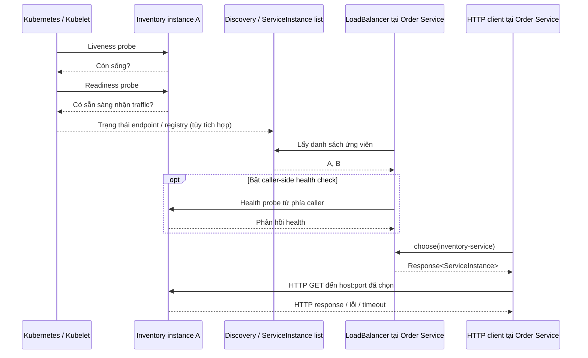
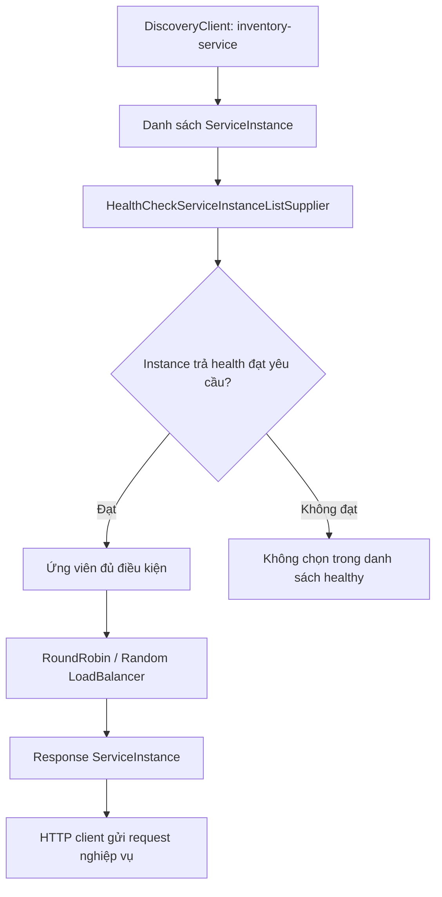

# Phân biệt liveness, readiness và kiểm tra từ phía bên gọi

Trong kiến trúc microservice, một instance có thể **vẫn chạy**, **chưa nên nhận request mới** hoặc **không thể được một caller cụ thể kết nối đến**. Ba trạng thái này liên quan nhưng không đồng nhất. Khi sử dụng Spring Cloud LoadBalancer, nhầm lẫn giữa chúng có thể gây ra những sự cố khó hiểu: Pod cứ khởi động lại dù chỉ có database chậm, instance chưa sẵn sàng vẫn được chọn hoặc mọi request đều báo không có server dù ứng dụng đích đang hoạt động.

Bài học thuộc chương **Sức khỏe bản sao** của module Spring Cloud LoadBalancer. Mục tiêu là tách rõ:

- **Liveness:** tiến trình có còn hoạt động đủ để tiếp tục chạy, hay cần khởi động lại?
- **Readiness:** instance có nên nhận lưu lượng nghiệp vụ mới ở thời điểm hiện tại?
- **Caller-side health check:** từ vị trí của bên gọi, instance trong danh sách `ServiceInstance` có còn là một đích phù hợp để thử kết nối không?

Ba tín hiệu có đối tượng quan sát, cơ chế thực thi và hậu quả khác nhau. Chúng nên phối hợp với discovery, `ServiceInstanceListSupplier`, chính sách định tuyến, timeout/retry của `RestClient`, `WebClient`, OpenFeign và hệ thống observability; không nên dùng một endpoint health cho mọi quyết định mà không hiểu ý nghĩa.

## 1. Bảng so sánh nhanh ba loại kiểm tra

| Tiêu chí | Liveness | Readiness | Caller-side health check |
|---|---|---|---|
| **Câu hỏi chính** | Có cần khởi động lại tiến trình/container không? | Có nên đưa request mới vào instance không? | Bên gọi này có nên xem instance là ứng viên khả dụng không? |
| **Ai thường kiểm tra?** | Kubelet hoặc bộ giám sát tiến trình. | Kubelet, orchestrator hoặc bộ điều phối traffic. | Chính ứng dụng caller, thông qua Spring Cloud LoadBalancer và supplier khi được bật. |
| **Góc nhìn** | Sức sống cục bộ của tiến trình. | Khả năng sẵn sàng phục vụ của ứng dụng. | Khả năng kết nối/nhận phản hồi health từ đường mạng của caller và danh sách discovery hiện có. |
| **Khi thất bại** | Orchestrator có thể restart container sau các ngưỡng probe. | Instance bị đánh dấu NotReady; trong Kubernetes, Pod thường không còn là endpoint nhận traffic từ Service. | Supplier có thể loại instance khỏi danh sách ứng viên mà LoadBalancer đang dùng. |
| **Mặc định bảo đảm gì?** | Không bảo đảm downstream khỏe mạnh hay latency nghiệp vụ tốt. | Không bảo đảm mọi API và dependency đều đáp ứng đúng hạn. | Không bảo đảm request nghiệp vụ sau đó sẽ thành công. |
| **Rủi ro nếu dùng sai** | Restart hàng loạt khi dependency chung gặp sự cố. | Loại toàn bộ replica khỏi traffic dù có thể vẫn xử lý một phần nghiệp vụ. | Tăng số probe, stale health, false negative hoặc loại hết ứng viên trong từng caller. |

Điểm cốt lõi: **liveness phục vụ quyết định restart; readiness phục vụ quyết định nhận traffic; caller-side health check phục vụ quyết định chọn đích từ góc nhìn bên gọi**.

## 2. Tách ba góc nhìn trong cùng một request

Giả sử `order-service` gọi `inventory-service` theo URI logic:

```http
GET http://inventory-service/api/items/42
```

Ứng dụng inventory chạy hai instance, A và B. Kubernetes giám sát Pod; hệ thống discovery cung cấp danh sách instance; Spring Cloud LoadBalancer ở `order-service` lấy danh sách rồi chọn đích; HTTP transport thực hiện kết nối và gửi request.



Sơ đồ mô tả **trách nhiệm logic**, không ngụ ý Kubernetes luôn trực tiếp cập nhật cùng một registry mà ứng dụng dùng. Trong môi trường Kubernetes, Service/EndpointSlice phản ánh readiness theo cơ chế riêng; trong môi trường Eureka/Consul hoặc static discovery, dữ liệu danh sách phụ thuộc tích hợp và cấu hình cụ thể. Caller-side health check là bước **tùy chọn**, không mặc nhiên chạy cho mọi `@LoadBalanced` client.

## 3. Liveness: tiến trình có cần được khởi động lại?

**Liveness** trả lời liệu tiến trình còn ở trạng thái có thể tiếp tục hoạt động không. Ví dụ, JVM bị kẹt vĩnh viễn, deadlock nghiêm trọng hoặc không còn đáp ứng endpoint kiểm tra trong khoảng thời gian đã cấu hình. Một liveness probe thất bại đủ số lần có thể khiến Kubernetes khởi động lại container.

Liveness **không nên phản ánh trực tiếp tình trạng của một dependency dùng chung** như database hay message broker. Nếu DB lỗi tạm thời và mọi Pod đều trả liveness thất bại, orchestrator có thể đồng loạt restart tất cả Pod. Điều đó vừa làm tăng tải khởi động, vừa không khắc phục được sự cố DB, thậm chí còn khiến thời gian phục hồi dài hơn.

Ví dụ:

| Tình huống | Liveness nên thế nào? | Lý do |
|---|---|---|
| JVM và event loop vẫn chạy, DB đang lỗi | Thường vẫn `UP` nếu process có thể tự phục hồi khi DB trở lại. | Restart JVM không sửa lỗi DB. |
| Process rơi vào trạng thái kẹt không thể tự phục hồi | Có thể `DOWN`. | Restart có thể là biện pháp phục hồi. |
| Ứng dụng đang khởi động và cần warm-up | Sử dụng startup probe hoặc ngân sách khởi động phù hợp. | Tránh liveness restart trước khi ứng dụng có cơ hội sẵn sàng. |
| Một endpoint nghiệp vụ trả `500` | Không nhất thiết `DOWN`. | Một lỗi nghiệp vụ không đồng nghĩa process không còn sống. |

**Liveness không phải SLA của API.** Trả `200 OK` cho liveness không bảo đảm mọi request nghiệp vụ thành công hoặc chạy nhanh.

## 4. Readiness: instance có nên nhận traffic mới?

**Readiness** cho biết ứng dụng có sẵn sàng phục vụ request hay không. Một Pod có thể đang chạy nhưng chưa sẵn sàng: ứng dụng mới khởi động, đang nạp cache, chưa hoàn tất bước khởi tạo thiết yếu hoặc chuẩn bị shutdown để drain request.

Trong Kubernetes, khi readiness probe thất bại, Pod được đánh dấu **NotReady**. Kubernetes cập nhật trạng thái endpoint để tránh gửi **lưu lượng mới qua Kubernetes Service thông thường** đến Pod chưa sẵn sàng. Điều này không ngăn hoàn toàn kết nối trực tiếp đến IP Pod hoặc traffic đi qua một đường discovery khác chưa phản ánh readiness.

Các trường hợp phổ biến:

- **Khởi động:** Pod sống nhưng readiness chưa đạt; không nên nhận request cho đến khi tài nguyên bắt buộc đã sẵn sàng.
- **Graceful shutdown:** chuyển sang not-ready trước khi dừng để giảm request mới, đồng thời cho request đang chạy có thời gian hoàn tất.
- **Thiếu tài nguyên thiết yếu:** có thể tạm ngừng nhận traffic nếu việc tiếp tục nhận sẽ gây lỗi liên tục.
- **Dependency chung lỗi:** cần cân nhắc có nên đánh dấu toàn bộ replica NotReady hay không. Nếu mọi Pod bị loại khỏi Service, hệ thống có thể mất toàn bộ đường phục vụ, kể cả những endpoint vẫn hoạt động độc lập.

Mức độ phụ thuộc mà readiness kiểm tra cần dựa vào **khả năng phục vụ nghiệp vụ thực tế**. Không nên tự động đưa mọi dependency phụ vào readiness; một Redis dùng cho cache không bắt buộc có thể hỏng nhưng request vẫn chạy được bằng fallback. Ngược lại, nếu ứng dụng thật sự không thể xử lý một request nào khi dependency thiết yếu mất, readiness có thể cần phản ánh điều đó.

### Liveness và readiness có thể khác nhau cùng lúc

| Trạng thái | Liveness | Readiness | Diễn giải |
|---|---|---|---|
| Ứng dụng vừa khởi động | `UP` hoặc startup probe còn đang kiểm tra | `DOWN`/NotReady | Có thể sống nhưng chưa nhận traffic. |
| Ứng dụng đang phục vụ bình thường | `UP` | `UP` | Sẵn sàng nhận lưu lượng. |
| Đang drain để shutdown | Có thể vẫn `UP` | `DOWN`/NotReady | Tiếp tục xử lý request đang chạy, hạn chế request mới. |
| Process bị kẹt không tự phục hồi | `DOWN` theo probe | Thường không còn sẵn sàng | Có thể cần restart theo chính sách orchestrator. |
| Downstream chậm tạm thời | Thường vẫn `UP` | Tùy mức ảnh hưởng và policy | Không nên gộp máy móc vào liveness. |

## 5. Spring Boot Actuator: endpoint cho liveness và readiness

Với Spring Boot Actuator, health groups thường dùng:

- `/actuator/health/liveness`: phản ánh nhóm trạng thái liveness.
- `/actuator/health/readiness`: phản ánh nhóm trạng thái readiness.

Khi cấu hình health probes và yêu cầu endpoint được cung cấp ngay trên **cổng HTTP chính của ứng dụng**, có thể dùng các đường dẫn bổ sung `/livez` và `/readyz` theo khả năng hỗ trợ của phiên bản Spring Boot tương ứng.

Ví dụ trong **ứng dụng inventory-service**:

```yaml
# application.yml của inventory-service
management:
  endpoint:
    health:
      probes:
        enabled: true
        add-additional-paths: true
```

Với cấu hình và phiên bản hỗ trợ như trên, có thể kiểm tra ở cổng ứng dụng:

```http
GET http://inventory-instance:8080/livez
GET http://inventory-instance:8080/readyz
```

Điều kiện quan trọng: **đường dẫn và cổng phải khớp endpoint thực tế được expose**. Nếu Actuator chạy trên một management port riêng, probe chỉ tới management port có thể thành công trong khi cổng nghiệp vụ không hoạt động. Việc bật các additional path trên cổng chính giúp phát hiện một số sự cố tại cổng phục vụ request. Cần kiểm tra mapping và security của phiên bản Spring Boot thực tế, tránh coi `/livez` và `/readyz` là endpoint luôn tồn tại mà không cần bật cấu hình.

Ví dụ rút gọn về probe trên một container Kubernetes khi các đường dẫn trên đã được expose:

```yaml
# Trích đoạn cấu hình container trong Kubernetes workload
containers:
  - name: inventory-service
    image: example/inventory-service:demo
    ports:
      - containerPort: 8080
    startupProbe:
      httpGet:
        path: /livez
        port: 8080
      periodSeconds: 2
      failureThreshold: 30
    livenessProbe:
      httpGet:
        path: /livez
        port: 8080
      periodSeconds: 10
      failureThreshold: 3
    readinessProbe:
      httpGet:
        path: /readyz
        port: 8080
      periodSeconds: 5
      failureThreshold: 3
```

Các giá trị chu kỳ/ngưỡng chỉ là **minh họa**, không phải tham số tối ưu cho mọi hệ thống. `startupProbe` cho phép ứng dụng có thời gian khởi động trước khi các probe còn lại được tính đến; nó đặc biệt hữu ích khi warm-up mất nhiều thời gian. Cần thiết kế `initialDelaySeconds`, `periodSeconds`, `timeoutSeconds`, `failureThreshold` và `successThreshold` theo hành vi thực, tránh quá nhạy với độ trễ ngắn hoặc quá chậm khi instance thật sự hỏng.

**Không để liveness phụ thuộc vào DB chỉ vì health endpoint tổng `/actuator/health` đang tổng hợp kiểm tra DB.** Nhóm liveness/readiness có mục tiêu riêng và có thể có nội dung khác health tổng.

## 6. Caller-side health check trong Spring Cloud LoadBalancer

Khi `order-service` gọi `inventory-service`, caller thường chỉ biết danh sách `ServiceInstance` nhận từ discovery. **Caller-side health check** là cơ chế bên gọi chủ động kiểm tra các instance trong danh sách đó, rồi sử dụng kết quả để quyết định tập ứng viên cho LoadBalancer.

Trong Spring Cloud LoadBalancer, thành phần liên quan là `HealthCheckServiceInstanceListSupplier`. Nó có thể được kết hợp vào chuỗi `ServiceInstanceListSupplier` để kiểm tra sức khỏe các instance được discovery cung cấp và phát danh sách phù hợp cho thuật toán chọn đích. Cơ chế, chu kỳ thăm dò và cách giữ kết quả phụ thuộc cấu hình, phiên bản và cách xây dựng supplier chain.



Một cấu hình minh họa theo service ID ở ứng dụng **order-service**:

```java
@Configuration
@LoadBalancerClient(
    name = "inventory-service",
    configuration = InventoryLoadBalancerConfig.class
)
class InventoryLoadBalancerRegistration {
}

// Đặt lớp cấu hình này ngoài component scan thông thường.
class InventoryLoadBalancerConfig {

    @Bean
    ServiceInstanceListSupplier inventorySupplier(
            ConfigurableApplicationContext context) {

        return ServiceInstanceListSupplier.builder()
            .withDiscoveryClient()
            .withHealthChecks()
            .build(context);
    }
}
```

Ví dụ cấu hình đường dẫn kiểm tra cho service ID, giả sử inventory-service đã expose `/readyz` trên cổng mà discovery công bố:

```yaml
# application.yml của order-service (bên gọi)
spring:
  cloud:
    loadbalancer:
      health-check:
        path:
          inventory-service: /readyz
```

Đây là **mẫu tích hợp**, không phải tuyên bố mọi phiên bản Spring Cloud có cùng auto-configuration và các giá trị mặc định. Cần kiểm tra dependency, tên thuộc tính và thứ tự supplier builder tương ứng với BOM Spring Cloud của ứng dụng. Lớp `InventoryLoadBalancerConfig` phải được tổ chức để chỉ áp dụng trong context LoadBalancer dành cho `inventory-service`, không bị component scan vô tình áp dụng toàn cục. Khi thêm caching hoặc supplier decorator khác, phải hiểu thứ tự và cơ chế làm mới; `HealthCheckServiceInstanceListSupplier` có cơ chế giữ/phát lại kết quả của riêng nó trong một số phiên bản, nên không thêm cache tùy tiện.

### Khác biệt quan trọng: readiness của Pod và health từ caller

Kubernetes có thể báo Pod Ready, nhưng `order-service` vẫn không thể kết nối đến Pod do:

- NetworkPolicy hoặc firewall giữa hai namespace/zone.
- DNS, route, TLS hoặc proxy của caller bị cấu hình sai.
- Discovery cung cấp địa chỉ/port không đúng từ góc nhìn caller.
- Cổng ứng dụng khả dụng trong cluster nhưng không tới được từ môi trường gọi.

Ngược lại, `order-service` có thể gọi health endpoint thành công nhưng request nghiệp vụ vẫn timeout hoặc lỗi do đường dẫn API khác, database chậm hoặc tải tăng sau thời điểm probe.

**Một health check thành công là tín hiệu tại thời điểm kiểm tra, không phải cam kết request kế tiếp sẽ thành công.** Health check cũng không tự biến Round Robin thành thuật toán ưu tiên instance ít CPU hoặc ít request in-flight.

## 7. Lựa chọn endpoint kiểm tra phía caller: health tổng hay readiness?

Không phải lúc nào `/actuator/health` cũng là endpoint phù hợp nhất. Health tổng có thể chứa nhiều indicator không quan trọng đối với lời gọi nghiệp vụ cụ thể; health group readiness có ý nghĩa gần với khả năng nhận traffic mới hơn. Tuy nhiên, dùng readiness cũng phải kiểm tra nó phản ánh đúng nhu cầu của caller.

| Endpoint / cách kiểm tra | Lợi ích | Rủi ro cần chú ý |
|---|---|---|
| `/actuator/health` | Có thể phản ánh nhiều thành phần hệ thống. | Một dependency phụ bị DOWN có thể khiến loại replica dù API mục tiêu vẫn phục vụ được. |
| `/actuator/health/readiness` | Gần với câu hỏi “có nên nhận request mới?”. | Nếu readiness thiếu indicator thiết yếu hoặc tổng hợp quá rộng, kết quả vẫn gây sai lệch. |
| `/readyz` trên cổng ứng dụng | Kiểm tra tuyến HTTP gần với request thực hơn khi cấu hình additional paths. | Chỉ tồn tại khi cấu hình/phiên bản hỗ trợ; không đo trực tiếp toàn bộ API nghiệp vụ. |
| Endpoint tùy chỉnh cho use case | Có thể phản ánh dependency và khả năng phục vụ đặc thù. | Phải giữ probe nhẹ, nhanh, ít side effect; tránh biến thành request nghiệp vụ tốn tài nguyên. |

Một endpoint health tốt phải đủ nhẹ để kiểm tra định kỳ, có timeout ngắn hơn ngân sách nghiệp vụ, không thay đổi dữ liệu, và có ngữ nghĩa trả lời rõ ràng. Đừng dùng thao tác tạo đơn hàng, trừ tiền hoặc ghi trạng thái làm health probe. Nếu cần endpoint được gọi từ caller, phải cấu hình quyền truy cập và đường mạng phù hợp; một response `401`/`403` do probe thiếu quyền không đồng nghĩa instance chết.

## 8. Trường hợp không còn instance healthy

Khi `HealthCheckServiceInstanceListSupplier` không còn ứng viên đáp ứng kiểm tra, thuật toán LoadBalancer có thể nhận danh sách rỗng và trả kết quả không có server, hoặc có hành vi khác theo cách supplier được cấu hình. Phải kiểm tra trường hợp này trên phiên bản đang chạy thay vì mặc nhiên coi là HTTP `503` do ứng dụng đích trả về.

Ba tình huống cần phân biệt:

| Trường hợp | Dấu hiệu | Nên kiểm tra |
|---|---|---|
| **Không tìm thấy instance** | Discovery trả danh sách rỗng. | Service ID, registry, việc đăng ký/gỡ đăng ký, readiness và nguồn discovery. |
| **Có instance nhưng health check thất bại** | Danh sách ban đầu có instance; supplier lọc hết hoặc không đánh dấu healthy. | Path, port, security, response status, timeout của health, reachability từ caller. |
| **Đã chọn instance nhưng request nghiệp vụ lỗi** | `Response<ServiceInstance>` có server; HTTP client gặp timeout, connection refused hoặc HTTP `5xx`. | Mạng, TLS, API, latency downstream, connection pool và chính sách retry. |

Khi không chọn được instance, một số HTTP client/integration có thể biến tình huống đó thành exception hoặc status lỗi. Điều này khác bản chất với trường hợp **instance thực sự trả HTTP `503`** cho request nghiệp vụ. Cần log bước xảy ra lỗi, không kết luận từ status cuối cùng một cách máy móc.

Không tự động failover sang zone khác nếu có ràng buộc dữ liệu, tenant hoặc chính sách bảo mật. Một yêu cầu được phép ưu tiên zone gần (soft preference) khác với yêu cầu chỉ được xử lý trong một region nhất định (hard constraint); thiếu instance trong vùng hợp lệ không có nghĩa được bỏ qua ràng buộc.

## 9. Khi ba trạng thái mâu thuẫn nhau

Thử xét các tình huống thực tế:

| Liveness | Readiness | Kết quả caller health | Điều có thể đang xảy ra |
|---|---|---|---|
| `UP` | `UP` | Tốt | Instance hiện tại đủ điều kiện theo các phép kiểm tra, nhưng API vẫn có thể lỗi. |
| `UP` | `DOWN` | Có thể tốt | Pod đang drain hoặc readiness yêu cầu nhiều điều kiện hơn endpoint caller kiểm tra. |
| `UP` | `UP` | Không tới được | Lỗi mạng riêng của caller, địa chỉ discovery sai, port sai hoặc health endpoint bị chặn. |
| `DOWN` | `DOWN` | Có thể còn kết quả cũ | Probe/registry/supplier cập nhật không đồng thời; state có độ trễ. |
| `UP` | `UP` | Tốt nhưng request timeout | Health kiểm tra quá nông, tải tăng đột biến hoặc endpoint nghiệp vụ phụ thuộc thành phần khác. |

Từ bảng này, không có công thức `liveness == readiness == callerHealthy`. Mỗi tín hiệu có mục tiêu và độ trễ riêng. Khi điều tra, hãy lấy timestamp và phạm vi mạng của từng phép đo.

### Ví dụ sự cố: database ngừng hoạt động

Giả sử toàn bộ replica `inventory-service` dùng chung một database đang lỗi.

1. Nếu liveness kiểm tra kết nối DB, mọi Pod có thể bị restart liên tục; database không được phục hồi nhờ restart.
2. Nếu readiness kiểm tra DB và mọi endpoint inventory đều cần DB, tất cả Pod có thể chuyển NotReady, làm service không còn endpoint; đây có thể là biểu hiện đúng của việc không phục vụ được, nhưng cần chuẩn bị response/fallback ở caller.
3. Nếu chỉ một số API cần DB, đưa DB vào readiness toàn cục có thể loại cả những API vẫn hoạt động; cân nhắc tách service, nhóm health hoặc thiết kế degradation phù hợp.
4. Caller-side health check chỉ xác nhận khả năng nhận phản hồi từ một endpoint; nếu endpoint không phản ánh DB thì caller vẫn có thể chọn một instance sẽ trả lỗi ở endpoint nghiệp vụ.

Bài học là định nghĩa readiness theo **hợp đồng phục vụ** và thiết kế khả năng suy giảm chức năng, thay vì chuyển mọi sự cố downstream thành yêu cầu restart.

## 10. Health check không thay thế timeout, retry và circuit breaker

Giả sử ở thời điểm T, caller health check nhận `200 OK` từ A. Tại T+100 ms, A gặp GC pause hoặc không thể kết nối DB; request nghiệp vụ vẫn có thể timeout. Đây là khoảng lệch giữa kiểm tra và sử dụng (*time-of-check to time-of-use*).

Để giao tiếp ổn định cần phối hợp:

- **HTTP timeout:** connect timeout, response/read timeout và tổng deadline được thiết kế theo tính chất nghiệp vụ của `RestClient`, `WebClient` hoặc OpenFeign.
- **Retry có giới hạn:** chỉ thử lại với lỗi tạm thời và request an toàn để lặp; retry có thể chọn lại instance tùy cách tích hợp LoadBalancer và cấu hình.
- **Idempotency:** thao tác thay đổi trạng thái, đặc biệt `POST`, cần cơ chế chống xử lý trùng trước khi cho phép retry sau timeout.
- **Circuit breaker/bulkhead:** bảo vệ caller và downstream khi lỗi tăng hoặc tài nguyên bão hòa; không đồng nghĩa việc một instance đạt liveness.
- **Discovery và health refresh:** chấp nhận sự chậm trễ giữa thay đổi thực tế và cập nhật danh sách.

Một sai lầm phổ biến là retry vô hạn đến một instance đang chậm vì health trước đó vẫn `UP`. Điều này có thể khuếch đại tải và kéo dài outage. Tương tự, nếu health probe có timeout quá ngắn so với thực tế mạng, tất cả caller có thể đồng loạt loại các instance khỏe mạnh.

## 11. Chú ý chi phí kiểm tra từ phía caller

Caller-side health check có chi phí vận hành: mỗi caller phải kiểm tra danh sách instance mà nó biết. Nếu có nhiều caller, cùng một upstream instance có thể nhận rất nhiều probe.

Ví dụ minh họa: 100 caller, mỗi caller biết 20 instance, mỗi instance được probe một lần trong 10 giây:

```text
Số probe trung bình ≈ (100 caller × 20 instance) / 10 giây
                     = 200 request health/giây
```

Đây chỉ là phép tính mức tải khi **mỗi caller đều tự probe đầy đủ** ở chu kỳ giả định, không phải hành vi mặc định hoặc thông số mặc định của Spring Cloud LoadBalancer. Trong triển khai thật, caching, refresh, tập instance, số caller và cơ chế deduplication ảnh hưởng số probe.

Những nguy cơ cần quản lý:

- **Probe storm:** đồng bộ chu kỳ probe ở nhiều caller có thể tạo đột biến vào đúng một thời điểm.
- **False negative:** endpoint phản hồi chậm do load nhất thời, dẫn đến loại instance vốn vẫn có thể phục vụ request.
- **Stale health:** trạng thái từ lần probe trước không còn phản ánh thời điểm request.
- **Health flapping:** instance liên tục vào/ra danh sách, gây dao động traffic và khó phân tích sự cố.
- **Thông tin đích sai:** discovery port trỏ đến cổng ứng dụng nhưng health chỉ mở trên management port khác.
- **Dữ liệu không thống nhất:** Kubernetes đã loại Pod NotReady nhưng một registry riêng vẫn công bố bản ghi cũ.

Nếu platform/discovery đã cung cấp danh sách chỉ gồm instance Ready đáng tin cậy, có thể không cần mọi caller thăm dò lại tất cả instance. Quyết định có bật `HealthCheckServiceInstanceListSupplier` hay không nên dựa trên giá trị tăng thêm so với chi phí probe, loại môi trường và khả năng cập nhật của discovery.

## 12. Ví dụ sử dụng WebClient phía caller

Ví dụ Bean `WebClient.Builder` được Spring Cloud LoadBalancer tích hợp:

```java
@Configuration
class HttpClientConfiguration {

    @Bean
    @LoadBalanced
    WebClient.Builder loadBalancedWebClientBuilder() {
        return WebClient.builder();
    }
}

@Service
class InventoryGateway {

    private final WebClient client;

    InventoryGateway(@LoadBalanced WebClient.Builder builder) {
        this.client = builder
            .baseUrl("http://inventory-service")
            .build();
    }

    Mono<Item> getItem(String id) {
        return client.get()
            .uri("/api/items/{id}", id)
            .retrieve()
            .bodyToMono(Item.class);
    }
}
```

Lớp `Item` là DTO ứng dụng; import được lược bỏ. Ví dụ chỉ thể hiện **gọi theo service ID**; việc có caller-side health check hay không vẫn phụ thuộc supplier chain đã cấu hình ở `order-service`. Khi LoadBalancer chọn được instance, HTTP client vẫn chịu trách nhiệm timeout, TLS, pooling, xử lý status và body. Với `RestClient` hoặc OpenFeign, nguyên tắc tách trách nhiệm cũng tương tự dù API cấu hình transport khác.

Khi thêm retry, cần quan sát số **logical requests**, số **HTTP attempts** và số lần **LoadBalancer selection** thay vì xem mọi lần retry là một request mới độc lập. Nếu toàn bộ instance bị loại khỏi danh sách, tăng read timeout không tự khôi phục được tập ứng viên.

## 13. Thực hành xác định đúng loại health

Thiết lập hai replica `inventory-service`, A và B, trong môi trường thử nghiệm. Mỗi replica có endpoint trả về `instanceId` để nhìn thấy đích thực. Có thể dùng Kubernetes và Spring Boot Actuator hoặc một môi trường giả lập có trạng thái health riêng.

| Bài thử | Thao tác | Điều cần quan sát |
|---|---|---|
| **Khởi động chậm** | Delay warm-up của B nhưng giữ process sống. | Liveness không nên ép restart vô ích; readiness ngăn B nhận traffic mới trước khi sẵn sàng. |
| **Drain B** | Chuyển readiness B sang NotReady trước khi dừng. | Endpoint discovery cập nhật và số request mới đến B giảm, trong khi request đang xử lý có thể hoàn tất. |
| **Probe path sai** | Cấu hình caller health tới đường dẫn không tồn tại. | Caller có thể loại các instance vẫn Ready; log cho thấy lỗi do path/port. |
| **Chặn đường từ một caller** | Dùng network policy thử nghiệm để chặn đường tới A từ riêng caller X. | Kubernetes vẫn có thể báo A Ready; X probe fail trong khi caller Y vẫn gọi được. |
| **API chậm, health nhanh** | Cho endpoint nghiệp vụ B chờ lâu nhưng `/readyz` vẫn trả nhanh. | Caller vẫn có thể chọn B; request nghiệp vụ timeout, cho thấy health không phải bảo đảm latency. |
| **Dependency dùng chung lỗi** | Làm DB thử nghiệm ngừng hoạt động. | Quan sát sự khác nhau giữa liveness và readiness; tránh restart loop không cần thiết. |
| **Retry sau khi chọn** | Mô phỏng connection error với endpoint idempotent. | Số attempt, instance được chọn lại, tổng deadline và lý do lỗi. |

Trong mỗi thử nghiệm, theo dõi timestamp, kết quả probe, danh sách discovery trước/sau khi lọc, instance được chọn, status/exception của HTTP client và thời gian xử lý. Chỉ xác nhận hành vi trên đúng phiên bản Spring Boot, Spring Cloud và orchestrator đang dùng; không kết luận từ một log `200` đơn lẻ.

## 14. Checklist trước khi triển khai

- **Liveness:** chỉ quyết định tiến trình có cần restart không; không gộp vô điều kiện lỗi DB hay mọi downstream vào liveness.
- **Readiness:** phản ánh khả năng nhận traffic mới; tính đến startup, shutdown/drain và các dependency thiết yếu cho hợp đồng phục vụ.
- **Caller health:** chỉ bật khi cần thêm quan sát từ góc nhìn caller; xác nhận đường dẫn, port, security và chu kỳ probe.
- **Actuator:** xác minh `/actuator/health/liveness`, `/actuator/health/readiness` hoặc `/livez`, `/readyz` được expose và có semantics đúng.
- **Kubernetes:** kiểm tra `startupProbe`, `livenessProbe`, `readinessProbe` và thời gian cập nhật EndpointSlice/Service khi Pod thay đổi readiness.
- **Discovery/supplier:** hiểu nguồn `ServiceInstance`, cache, refresh và thứ tự `HealthCheckServiceInstanceListSupplier` trong chuỗi.
- **Không có ứng viên:** phân biệt discovery rỗng, health lọc hết và lỗi transport sau khi đã chọn instance.
- **An toàn định tuyến:** không fallback sang zone/tenant bị cấm khi không còn instance hợp lệ.
- **Tải probe:** theo dõi tổng số probe, false negative, health flapping và tác động của nhiều caller.
- **Resilience:** vẫn cần timeout, retry có giới hạn, idempotency và circuit breaker phù hợp; health check không thay thế chúng.
- **Observability:** nối trace từ caller, discovery/chọn đích, health và HTTP status; tránh ghi token, cookie hoặc dữ liệu nhạy cảm vào log/metric.

**Ghi nhớ:** **liveness** hỗ trợ quyết định *có nên restart*, **readiness** hỗ trợ quyết định *có nên nhận request mới*, còn **caller-side health check** hỗ trợ quyết định *caller này nên chọn instance nào trong danh sách hiện có*. Chúng không có cùng ý nghĩa, không cập nhật đồng thời và không thay thế xử lý lỗi thực tế. Phân biệt đúng ba góc nhìn giúp Spring Cloud LoadBalancer chọn `ServiceInstance` có chủ đích, giảm chọn nhầm replica không khả dụng và tránh các vòng lặp restart/retry gây quá tải dây chuyền.
