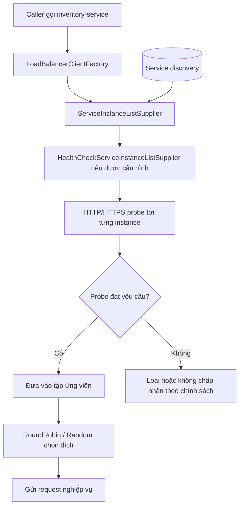
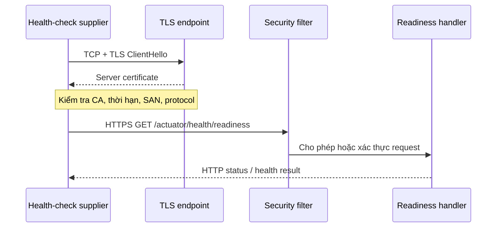

# Ảnh hưởng của endpoint kiểm tra cần xác thực hoặc HTTPS

Một instance có thể đang chạy bình thường nhưng vẫn bị xem là **không khỏe** nếu client kiểm tra sức khỏe không được phép truy cập endpoint hoặc không thiết lập được kết nối HTTPS. Chẳng hạn, `inventory-service` trả `200 OK` cho request nghiệp vụ có token hợp lệ, nhưng probe mặc định gọi `/actuator/health/readiness` không kèm token và nhận `401 Unauthorized`. Khi đó một cơ chế lọc theo health check có thể loại instance khỏi danh sách ứng viên, dù ứng dụng thực sự không bị lỗi.

Trong Spring Cloud LoadBalancer, danh sách `ServiceInstance` được cung cấp bởi `ServiceInstanceListSupplier`; `HealthCheckServiceInstanceListSupplier` có thể kiểm tra khả năng truy cập các instance rồi trả danh sách đã được lọc. Cấu hình authentication, HTTPS, chứng chỉ và đường dẫn của **health probe** vì vậy tác động trực tiếp đến quyết định chọn đích của `RestClient`, `WebClient` hoặc OpenFeign khi các client này dùng chung chuỗi supplier được cấu hình.

Bài học thuộc chương **Sức khỏe bản sao**, tập trung vào việc phân biệt **dịch vụ thực sự hỏng** với **probe không có quyền hoặc không bắt tay TLS thành công**, cùng cách triển khai endpoint sức khỏe vừa an toàn vừa có thể kiểm tra được.

## 1. Health check nằm ở đâu trong luồng LoadBalancer?

Giả sử `order-service` gọi URL logic:

```text
GET http://inventory-service/api/products/P-1001
```

Discovery trả về ba instance của `inventory-service`. Một supplier có hỗ trợ health check có thể gửi request kiểm tra tới từng instance và chỉ đưa các đích đáp ứng chính sách kiểm tra vào danh sách cho thuật toán chọn instance.



**Hai loại request khác nhau** cần được phân biệt:

- **Request nghiệp vụ:** caller gửi tới `/api/products/P-1001` qua HTTP client đã tích hợp LoadBalancer; có thể kèm token, cookie và các header nghiệp vụ.
- **Request health probe:** do thành phần health check phát tới endpoint kiểm tra, ví dụ `/actuator/health/readiness`. Nó không tự động mang toàn bộ authentication header của request nghiệp vụ.

Chính sách health-check supplier không nhất thiết được bật chỉ vì ứng dụng có Actuator. Phải có cấu hình supplier chain phù hợp và dependency cần thiết. Ngược lại, service discovery hoặc hạ tầng như Kubernetes có thể có health/readiness riêng, không đồng nghĩa chính cơ chế `HealthCheckServiceInstanceListSupplier` đang được sử dụng.

## 2. Vì sao endpoint cần xác thực có thể gây false negative?

Một endpoint health có thể được bảo vệ bởi Spring Security, gateway, reverse proxy, service mesh hoặc middleware khác. Nếu probe không có credential phù hợp, hệ thống bảo vệ có thể trả:

| Response hoặc hiện tượng | Ý nghĩa thường gặp | Ảnh hưởng có thể có tới health check |
|---|---|---|
| `200 OK` với trạng thái sẵn sàng phù hợp | Endpoint cho phép probe và báo thành công. | Instance được coi hợp lệ nếu thỏa hàm health check. |
| `401 Unauthorized` | Thiếu hoặc sai credential. | Probe có thể đánh dấu instance không khỏe dù API vẫn chạy. |
| `403 Forbidden` | Có danh tính nhưng không đủ quyền, hoặc bị policy chặn. | Probe thất bại, có thể bị lọc khỏi danh sách. |
| `302 Found` chuyển đến trang đăng nhập | Security yêu cầu đăng nhập tương tác. | Kết quả phụ thuộc redirect handling; thường không phù hợp với probe máy-máy. |
| `404 Not Found` | Sai path, context-path hoặc management port. | Probe không xác minh được instance theo endpoint mong đợi. |
| `503 Service Unavailable` từ readiness endpoint | Có thể ứng dụng chưa sẵn sàng phục vụ. | Đây có thể là tín hiệu loại instance hợp lệ. |
| Timeout hoặc lỗi TLS | Probe không nhận được HTTP response hợp lệ. | Có thể bị xem là thất bại kết nối thay vì lỗi sức khỏe nghiệp vụ. |

Đặc biệt, `401` và `403` chứng minh **yêu cầu kiểm tra không được chấp nhận**, chứ không chứng minh API nghiệp vụ đang lỗi. Nếu cả ba instance đều áp dụng cùng policy yêu cầu Bearer token nhưng probe không có token, toàn bộ nhóm có thể bị đánh giá không hợp lệ. Caller sau đó có thể nhận lỗi không tìm thấy đích, `503` hoặc lỗi liên quan tùy phiên bản và tích hợp; không nên mặc định một mã lỗi duy nhất cho mọi kiểu client.

### False negative và false positive

**False negative:** instance phục vụ bình thường nhưng bị đánh dấu không khỏe, chẳng hạn probe nhận `401` hoặc `SSLHandshakeException`.

**False positive:** probe trả kết quả thành công nhưng instance không xử lý được nghiệp vụ. Ví dụ endpoint `/health` chỉ luôn trả `200`, trong khi connection pool hoặc cơ sở dữ liệu cần thiết đã cạn. Một trang login hay trang fallback trả `200` cũng có thể tạo tín hiệu sai nếu hàm kiểm tra chỉ xét mã HTTP.

Do đó, việc chọn endpoint và định nghĩa “healthy” quan trọng không kém cấp quyền truy cập cho nó.

## 3. Readiness khác liveness như thế nào?

Spring Boot Actuator thường được dùng để cung cấp thông tin sức khỏe. Trong những phiên bản hỗ trợ health probe groups, hai khái niệm thường gặp là:

| Loại kiểm tra | Câu hỏi | Có phù hợp để lọc instance nhận request không? |
|---|---|---|
| **Liveness** | Tiến trình có còn hoạt động và có cần khởi động lại không? | Không đủ để xác định khả năng nhận lưu lượng nghiệp vụ. |
| **Readiness** | Instance hiện có sẵn sàng nhận request không? | Thường phù hợp hơn khi chọn đích, nếu tín hiệu được thiết kế đúng. |

Ví dụ, ứng dụng đang khởi động và chưa tạo xong kết nối thiết yếu có thể vẫn “sống” nhưng chưa “sẵn sàng”. Nếu health-check supplier chỉ gọi liveness, request nghiệp vụ có thể bị gửi đến instance quá sớm.

Khi sử dụng Spring Boot Actuator, endpoint thường được tham chiếu như:

```text
/actuator/health/liveness
/actuator/health/readiness
```

Trong môi trường không tự kích hoạt probes, tùy phiên bản Spring Boot có thể cần:

```yaml
management:
  endpoint:
    health:
      probes:
        enabled: true
```

**Lưu ý:** readiness không nên bao gồm tùy tiện mọi dependency chia sẻ. Nếu tất cả instance đều bị đánh dấu không sẵn sàng chỉ vì một dependency chung tạm thời lỗi, hệ thống có thể mất toàn bộ tập ứng viên dù ứng dụng còn xử lý được một số API. Cần thiết kế health indicator theo hợp đồng phục vụ và chiến lược chịu lỗi của dịch vụ.

## 4. Cấu hình đúng đường dẫn health check cho service ID

Endpoint mặc định mà một phiên bản Spring Cloud LoadBalancer dùng để probe có thể không trùng với Actuator readiness endpoint. Đừng suy luận rằng việc bật `spring-boot-starter-actuator` sẽ tự chuyển probe đến `/actuator/health/readiness`.

Với các bản Spring Cloud LoadBalancer hỗ trợ cấu hình đường dẫn health check theo service ID, có thể khai báo:

```yaml
spring:
  cloud:
    loadbalancer:
      health-check:
        path:
          inventory-service: /actuator/health/readiness
          payment-service: /internal/ready
```

Tên `inventory-service` và `payment-service` phải khớp **service ID** mà caller dùng để phân giải URL logic. Hãy xác minh tên property và khả năng hỗ trợ trong release train thực tế.

Một số nguyên nhân khiến path được cấu hình vẫn không hoạt động:

- Dịch vụ có `server.servlet.context-path` hoặc WebFlux base path khác dự kiến.
- Actuator dùng base path riêng hoặc endpoint readiness không được kích hoạt.
- Security filter hoặc gateway chuyển probe sang một path khác.
- Actuator chạy trên **management port riêng**, trong khi địa chỉ `ServiceInstance` chỉ đến application port.
- Instance HTTPS dùng scheme/port khác với thông tin đăng ký ở discovery.

**Path là đường dẫn, không phải cấu hình TLS.** Đặt `https://host/...` vào trường path thường không phải cách biến một probe HTTP thành HTTPS; cần kiểm tra URI/scheme, cổng và cơ chế tạo request của supplier.

### Management port khác application port

Giả sử API hoạt động trên `https://inventory.internal:8443` còn Actuator ở `https://inventory.internal:9443`. Nếu health-check supplier ghép health path lên URI chính của `ServiceInstance`, nó sẽ thử cổng 8443 thay vì 9443. Kết quả có thể là 404 hoặc connection error dù endpoint tại 9443 vẫn khỏe.

Khi đó phải chọn một phương án có chủ đích: expose endpoint readiness tối thiểu tại application port qua đường dẫn nội bộ được phép; đăng ký/biểu diễn địa chỉ probe phù hợp nếu provider hỗ trợ; hoặc xây dựng hàm health check tùy chỉnh sử dụng management address. Không nên chỉ đổi TTL, retry hoặc thuật toán chọn đích để “sửa” lỗi sai cổng.

## 5. Các chiến lược bảo vệ endpoint không làm hỏng probe

Một health endpoint nên cung cấp **ít thông tin nhất cần thiết** nhưng phải có cơ chế cho phép đúng thành phần kiểm tra truy cập.

### Phương án A: endpoint readiness tối giản và giới hạn mạng

Có thể cho phép request không có application token tới một endpoint readiness **chỉ chứa kết quả chung** (chẳng hạn trạng thái và HTTP status), đồng thời giới hạn truy cập qua private network, firewall, security group, network policy hoặc ingress nội bộ.

Với Spring Security hiện đại, một phần cấu hình minh họa là:

```java
@Bean
SecurityFilterChain securityFilterChain(HttpSecurity http) throws Exception {
    return http
            .authorizeHttpRequests(authorize -> authorize
                    .requestMatchers("/actuator/health/readiness").permitAll()
                    .anyRequest().authenticated())
            .build();
}
```

Ví dụ này chỉ minh họa **quy tắc authorization cho một path**, không phải cấu hình bảo mật production đầy đủ. Phải giữ các quy tắc khác của ứng dụng, xét thứ tự nhiều `SecurityFilterChain`, actuator base path, management port và cấu hình thực tế. `permitAll()` **không** tự giới hạn IP; khi mở một đường dẫn không cần xác thực, phải bảo vệ nó bằng ranh giới mạng và hạn chế chi tiết health response.

Trong Spring Boot, cơ chế hiển thị chi tiết health có thể được cấu hình riêng. Tránh công khai thông tin như tên database, thông tin kết nối, thành phần nội bộ hoặc exception chi tiết chỉ để phục vụ LoadBalancer.

### Phương án B: probe xác thực bằng service identity

Nếu chính sách bắt buộc xác thực, probe cần có danh tính hợp lệ: chẳng hạn một service principal với phạm vi quyền `health:read`, token được cấp đúng audience, hoặc cơ chế nội bộ tương đương.

Các nguyên tắc:

1. Cấp quyền chỉ cho endpoint kiểm tra, không dùng credential có quyền nghiệp vụ rộng.
2. Cập nhật/refresh token hoặc chứng chỉ đúng vòng đời; tránh hard-code token vào source code.
3. Bảo vệ credential trong secret manager hoặc cơ chế secret injection của hạ tầng.
4. Xử lý rõ `401`, `403` và lỗi lấy token; không coi chúng tương đương instance nghiệp vụ đã chết.
5. Không log Authorization header hoặc client secret trong log chẩn đoán.

**Không giả định** `HealthCheckServiceInstanceListSupplier` mặc định tự lấy Bearer token của request nghiệp vụ, tự đăng nhập OAuth2 hoặc chèn API key vào probe. Nếu cần xác thực ở mức này, phải cấu hình HTTP client/hàm kiểm tra riêng được hỗ trợ trong phiên bản đang dùng. Việc dùng một `WebClient` cho probe cần được thiết kế thận trọng: không nên dùng một WebClient đã `@LoadBalanced` để probe lại cùng service ID, tránh làm cơ chế chọn instance phụ thuộc vào chính nó.

### Phương án C: dùng mTLS cho kênh nội bộ

Một số tổ chức yêu cầu **mutual TLS (mTLS)** để cả hai phía xác minh danh tính. Server health endpoint chỉ chấp nhận client certificate đã tin cậy. Khi đó probe phải được cấu hình SSL context có client certificate và private key hợp lệ, ngoài việc tin cậy server certificate.

Nếu thiếu client certificate hoặc CA không được tin cậy, TLS handshake sẽ thất bại trước khi nhận response HTTP. Việc sửa authorization rule ở Spring Security không đủ để giải quyết lỗi mTLS xảy ra ngay ở tầng kết nối.

## 6. HTTPS tác động đến health check như thế nào?

Khi service có HTTPS, probe phải kết nối đúng **scheme**, **port**, **hostname**, và thiết lập được TLS với chuỗi chứng chỉ hợp lệ.



**TLS diễn ra trước HTTP.** Nếu handshake thất bại, endpoint không có cơ hội trả `401` hay `200`; probe thường ghi nhận lỗi kết nối hoặc SSL.

| Lỗi | Nguyên nhân phổ biến | Hướng xác minh |
|---|---|---|
| `SSLHandshakeException` / `PKIX path building failed` | Truststore không chứa CA phù hợp hoặc thiếu intermediate certificate. | Kiểm tra chuỗi chứng chỉ, truststore của probe runtime. |
| Hostname verification failed | URI trong discovery dùng IP hoặc tên không nằm trong SAN của cert. | Đối chiếu hostname trong `ServiceInstance` và SAN trên certificate. |
| Certificate expired / not yet valid | Chứng chỉ hết hạn, chưa tới thời điểm hiệu lực hoặc thời gian máy sai. | Kiểm tra validity dates và đồng hồ hệ thống. |
| Handshake failure do mTLS | Server yêu cầu client certificate nhưng probe không gửi chứng chỉ phù hợp. | Kiểm tra trust, key material và chính sách mTLS hai chiều. |
| Protocol/cipher negotiation failure | Hai bên không thống nhất phiên bản TLS hoặc cipher suite. | Đối chiếu cấu hình TLS của client và server. |
| `Connection refused` / timeout | Sai port, listener không chạy, firewall hoặc network policy chặn. | Kiểm tra cổng, địa chỉ trong discovery và đường mạng. |
| `401`/`403` sau handshake | TLS thành công nhưng HTTP authorization từ chối. | Kiểm tra credential, role/scope hoặc filter chain. |

### Tình huống discovery đăng ký IP nhưng cert dùng DNS

Registry có thể trả instance `10.0.10.12:8443`, còn certificate chỉ chứa DNS SAN `inventory.internal`. Nếu probe sử dụng `https://10.0.10.12:8443`, hostname verification có thể thất bại. Đừng “sửa nhanh” bằng cách vô hiệu hóa hostname verification; cần thống nhất tên được đăng ký, certificate SAN và đường kết nối mà ứng dụng thực sự sử dụng.

### Tình huống HTTP và HTTPS bị nhầm

Nếu instance được đăng ký là `http://inventory.internal:8443` trong khi cổng 8443 chỉ nhận TLS, client gửi HTTP plaintext đến một HTTPS listener, dẫn đến lỗi giao thức. Ngược lại, gửi HTTPS đến cổng HTTP cũng không hoạt động. Kiểm tra `ServiceInstance.getUri()` và trạng thái `isSecure()` của instance theo provider/phiên bản, không chỉ nhìn `health-check.path`.

## 7. Cấu hình kiểm tra sức khỏe trong Spring Cloud LoadBalancer

Khi tự xây supplier chain, một mẫu minh họa dùng builder API ở các phiên bản hỗ trợ:

```java
@Configuration(proxyBeanMethods = false)
public class InventoryHealthLoadBalancerConfiguration {

    @Bean
    ServiceInstanceListSupplier serviceInstanceListSupplier(
            ConfigurableApplicationContext context) {
        return ServiceInstanceListSupplier.builder()
                .withDiscoveryClient()
                .withHealthChecks()
                .build(context);
    }
}
```

Đăng ký riêng với service ID:

```java
@SpringBootApplication
@LoadBalancerClient(
        name = "inventory-service",
        configuration = InventoryHealthLoadBalancerConfiguration.class)
public class OrderApplication {
    public static void main(String[] args) {
        SpringApplication.run(OrderApplication.class, args);
    }
}
```

Lớp `InventoryHealthLoadBalancerConfiguration` nên đặt **ngoài phạm vi component scan của ứng dụng chính** để tránh tạo supplier toàn cục ngoài dự kiến. API builder, dependency cần thiết, nguồn discovery và hành vi cache/health phải được kiểm tra theo release train thực tế.

**Chú ý:** Ví dụ chỉ xây health-check supplier tiêu chuẩn. Nếu endpoint cần Bearer token, custom truststore, mTLS hoặc URL management riêng, đoạn builder này **chưa tự giải quyết** các yêu cầu đó. Cần cấu hình probe client/hàm health check được phiên bản đang dùng hỗ trợ hoặc chọn endpoint readiness nội bộ có thể truy cập một cách an toàn.

Một health-check supplier có thể duy trì kết quả và lịch kiểm tra riêng; không nhất thiết cần bọc thêm `CachingServiceInstanceListSupplier`. Việc xếp hai lớp cache sai thứ tự có thể khiến danh sách unhealthy hoặc healthy bị giữ lâu hơn dự kiến. Đọc tài liệu của phiên bản sử dụng trước khi thêm cache.

## 8. Kiểm chứng endpoint từ đúng vị trí của caller

Một endpoint truy cập thành công trên máy developer không có nghĩa probe chạy trong `order-service` cũng truy cập được. DNS, route, firewall, truststore, service identity và network policy có thể khác nhau giữa môi trường.

Thử nghiệm nên thực hiện từ môi trường mạng tương đương caller, theo thứ tự:

1. Đối chiếu service ID và danh sách `ServiceInstance` mà discovery trả về.
2. Xác định URI/port thực tế probe dùng, cùng path health.
3. Kiểm tra DNS, kết nối TCP và TLS handshake.
4. Gửi HTTP request đến đúng endpoint, ghi response code và latency.
5. Nếu endpoint yêu cầu auth, kiểm tra từng trường hợp không có credential, credential sai và credential hợp lệ.
6. So sánh với kết quả của `HealthCheckServiceInstanceListSupplier` và instance được LoadBalancer chọn.

Ví dụ kiểm tra endpoint HTTPS được ký bởi CA nội bộ:

```bash
curl -i --cacert /path/to/internal-ca.pem \
  https://inventory.internal:8443/actuator/health/readiness
```

Nếu cần xác nhận server dùng DNS `inventory.internal` nhưng kết nối đến một IP cụ thể, có thể dùng:

```bash
curl -i --resolve inventory.internal:8443:10.0.10.12 \
  --cacert /path/to/internal-ca.pem \
  https://inventory.internal:8443/actuator/health/readiness
```

Với môi trường mTLS được phép sử dụng chứng chỉ kiểm tra:

```bash
curl -i --cacert /path/to/internal-ca.pem \
  --cert /path/to/client.crt \
  --key /path/to/client.key \
  https://inventory.internal:8443/actuator/health/readiness
```

Các đường dẫn certificate ở trên là placeholder. Phải bảo vệ private key và không ghi chúng trong log hoặc repository. Không dùng `curl -k` hay cơ chế tắt certificate verification làm cấu hình lâu dài cho production; chúng che giấu lỗi trust/hostname thực sự.

Khi endpoint yêu cầu Bearer token, chỉ dùng token thử nghiệm đã được cấp theo quy định, không đặt token vào URL hay paste token vào hệ thống log. Để kiểm chứng chính xác, cần so sánh **request do probe thực gửi**, không chỉ request curl đã có credential khác.

## 9. Ma trận kiểm thử auth và TLS

| Trường hợp | Kết quả kỳ vọng ở endpoint | Điều cần quan sát trong LoadBalancer |
|---|---|---|
| Không có token, endpoint bắt buộc Bearer | `401`. | Probe bị từ chối; có thể làm instance bị coi không khỏe. |
| Token hết hạn hoặc không đủ quyền | `401` hoặc `403`. | Sau khi cấp credential hợp lệ, kết quả probe phải thay đổi theo chu kỳ kiểm tra. |
| Chứng chỉ server hợp lệ và CA được tin cậy | TLS thành công; endpoint trả kết quả health. | Instance có thể tham gia danh sách nếu readiness đạt. |
| CA chưa được trust | Lỗi xác minh chứng chỉ, không có HTTP status. | Chẩn đoán SSL/trust thay vì lỗi readiness. |
| Hostname không khớp SAN | Hostname verification failure. | Kiểm tra host từ registry và URL probe. |
| mTLS nhưng không có client certificate | TLS handshake bị từ chối. | Không cố sửa bằng `permitAll()` đơn thuần. |
| Sai management port hoặc path | Kết nối lỗi hoặc `404`. | So khớp app port, management port, context path. |
| Readiness đang `OUT_OF_SERVICE` | Thường là HTTP status không thành công theo mapping health. | Loại instance nếu supplier thực sự kiểm tra readiness. |
| Readiness hồi phục | Trả thành công khi sẵn sàng. | Xác minh thời gian được đưa lại vào danh sách. |

Khi tạo kịch bản, giữ các giả định khác cố định: service ID, discovery instance, health path, TLS material và cấu hình interval. Nếu đồng thời đổi certificate, service registry và retry, rất khó xác định nguyên nhân của kết quả.

## 10. Khi toàn bộ instance bị đánh giá không khỏe

Giả sử ba instance đều yêu cầu token ở `/actuator/health/readiness` nhưng probe không có token:

```text
inventory-1 -> 401
inventory-2 -> 401
inventory-3 -> 401
```

Nếu cơ chế lọc chỉ giữ các instance có probe thành công, tập ứng viên có thể rỗng. Lúc đó LoadBalancer có thể không chọn được instance dù cả ba endpoint nghiệp vụ đều hoạt động khi client có credential. Tùy phiên bản, triển khai supplier và chính sách fallback, cách xử lý tập rỗng có thể khác; phải quan sát thay vì khẳng định luôn trả cùng một trạng thái.

Để xử lý:

- Kiểm tra status và nguyên nhân lỗi probe trước khi restart tất cả instance.
- Xác minh một endpoint readiness được cho phép từ đúng nguồn probe.
- Nếu áp dụng auth, cấp đúng service identity/token hoặc client certificate.
- Đối chiếu URL/hostname/CA nếu có HTTPS.
- Kiểm tra xem supplier có lọc hết do health hay danh sách discovery vốn đã rỗng.
- Xác minh việc instance **được đưa trở lại** sau khi cấu hình được sửa, vì có thể cần thời gian tới lần poll/refresh tiếp theo.

**Không giải quyết bằng cách vô hiệu hóa health check hoặc TLS một cách mù quáng.** Tắt health check có thể khiến request được gửi đến instance thực sự lỗi; tắt xác minh chứng chỉ mở ra rủi ro kết nối đến endpoint giả mạo.

## 11. Tránh nhầm lỗi HTTPS của probe với lỗi HTTPS của request nghiệp vụ

Một client nghiệp vụ và một client probe có thể dùng **hai cấu hình TLS khác nhau**:

| Thành phần | Có thể dùng cấu hình riêng |
|---|---|
| `RestClient` hoặc `WebClient` gọi API nghiệp vụ | Connection pool, truststore, SSL context, client certificate, timeout. |
| `WebClient`/HTTP client dùng cho health probe | Truststore, client identity, URI, timeout và header của probe. |
| Service mesh hoặc sidecar | mTLS policy, upstream identity, kết nối nội bộ và health-check bypass. |

Vì vậy, một API nghiệp vụ có thể gọi HTTPS thành công, trong khi probe lỗi vì thiếu CA hoặc không có client certificate. Điều ngược lại cũng xảy ra: probe thành công nhưng HTTP client nghiệp vụ không trust cùng chứng chỉ hoặc dùng hostname khác.

Khi cấu hình custom HTTP client cho health check, phải bảo đảm client gọi trực tiếp đến URI instance. Không dùng một client load-balanced được gắn service ID lại để kiểm tra chính việc chọn đích của service đó nếu điều này tạo vòng phụ thuộc không mong muốn.

## 12. Mối liên hệ với retry, timeout và cache danh sách instance

Authentication và TLS lỗi có thể xuất hiện đồng thời với cache, timeout hoặc retry, nhưng các cơ chế này giải quyết những vấn đề khác nhau:

- **Health-check interval/timeout:** quyết định thời điểm và thời gian chờ của phép kiểm tra; quá ngắn có thể gây false negative khi mạng chậm.
- **Instance cache:** có thể tiếp tục cung cấp snapshot cũ; thứ tự cache/health supplier ảnh hưởng việc cập nhật danh sách.
- **HTTP client timeout:** giới hạn thời gian request nghiệp vụ chờ một instance đã chọn.
- **Retry:** thử lại request theo điều kiện; không tự cung cấp credential hợp lệ hay sửa chứng chỉ TLS.
- **Discovery update:** cho caller biết instance đăng ký/rút khỏi registry; không tương đương việc probe được phép truy cập endpoint.

Đặc biệt, retry liên tục khi mọi probe đều lỗi auth/TLS chỉ tạo thêm tải mà không sửa nguyên nhân. Với `POST` hoặc thao tác ghi, retry mù quáng còn có thể sinh side effect trùng nếu backend đã thực hiện thành công nhưng response bị mất. Phải kết hợp retry có giới hạn với idempotency.

## 13. Giám sát để phân biệt lỗi dịch vụ với lỗi cấu hình

Trong log/metric, nên tách các nguyên nhân `unhealthy`:

| Tín hiệu | Ý nghĩa cần phân tích |
|---|---|
| HTTP `401`/`403` từ health path | Sai/thiếu credential hoặc authorization policy. |
| HTTP `404` | Sai path, base path, cổng management hoặc route. |
| TLS handshake/PKIX/hostname error | Sai truststore, certificate, scheme hoặc service discovery metadata. |
| Readiness `503` | Ứng dụng hoặc dependency thiết yếu chưa sẵn sàng theo health indicator. |
| Connection timeout | Lỗi đường mạng, overload, firewall hoặc timeout quá thấp. |
| Số instance được supplier trả về giảm | Cần xác định lỗi health, cache hay discovery. |
| Thời gian phục hồi sau sửa lỗi | Kiểm tra interval, timeout, refresh và danh sách sau lọc. |

Các trường log hữu ích gồm `serviceId`, `instanceId`, hostname hoặc route pattern, scheme, health path, HTTP status, loại exception, duration và timestamp. Không ghi Bearer token, cookie, private key, chuỗi certificate bí mật hoặc thông tin người dùng. Khi xuất metric, giới hạn cardinality để tránh việc mỗi hostname động trở thành chuỗi label không kiểm soát.

Nếu dùng Spring Boot Actuator, Micrometer và tracing, việc có sẵn metric health supplier phụ thuộc starter và phiên bản. Không tự giả định mọi loại lỗi sẽ được ghi ra một metric duy nhất; có thể cần thêm log/instrumentation có kiểm soát.

## 14. Bài thực hành: hai instance, một endpoint bị khóa

Chuẩn bị hai server giả lập cùng service ID `inventory-service`, lần lượt chạy ở cổng 8081 và 8082. Mỗi server cung cấp API `GET /api/debug/instance` để trả instance ID và một readiness endpoint. Có thể dùng `SimpleDiscoveryClient` để đăng ký cục bộ:

```yaml
spring:
  cloud:
    discovery:
      client:
        simple:
          instances:
            inventory-service:
              - uri: http://localhost:8081
              - uri: http://localhost:8082
    loadbalancer:
      health-check:
        path:
          inventory-service: /actuator/health/readiness
```

Ví dụ chỉ thể hiện danh sách instance và đường dẫn health; cần có `HealthCheckServiceInstanceListSupplier` được đăng ký vào supplier chain nếu muốn kiểm chứng health filtering thực sự.

**Kịch bản 1 — Baseline:** Hai readiness endpoint trả thành công, gửi nhiều request qua `@LoadBalanced RestClient` hoặc `WebClient` và quan sát tập instance/đích được chọn.

**Kịch bản 2 — Khóa endpoint:** Bật authentication chỉ ở `inventory-2` để probe không có token nhận `401`. Xác nhận `inventory-2` vẫn phục vụ API nghiệp vụ có token hợp lệ, nhưng có thể bị health supplier loại. Đây là tình huống **false negative do auth**.

**Kịch bản 3 — Sửa cấu hình quyền truy cập:** Cho phép probe nội bộ truy cập readiness với chính sách an toàn, hoặc cấu hình probe có danh tính hợp lệ. Quan sát thời gian `inventory-2` được đưa lại vào danh sách sau khi health check thành công.

**Kịch bản 4 — HTTPS:** Chuyển instance thử nghiệm sang HTTPS bằng certificate được cấp cho hostname phù hợp. Cấu hình truststore và, nếu cần, mTLS cho probe. Sau đó cố ý mô phỏng thiếu CA hoặc sai hostname trong môi trường lab để phân biệt lỗi TLS với `401`/`403`.

**Kịch bản 5 — Sai cổng/path:** Chạy Actuator tại management port khác. Kiểm tra probe có tới đúng endpoint không; thay đổi cách publish/route health endpoint cho phù hợp rồi so sánh kết quả.

Các bước có thể được thực hiện độc lập. Không cố tình phá certificate, khóa endpoint hay mở `permitAll()` cho hệ thống production đang phục vụ người dùng.

## 15. Bảng chẩn đoán nhanh

| Triệu chứng | Giả thuyết ưu tiên | Cách kiểm tra |
|---|---|---|
| Mọi instance đột nhiên unhealthy sau khi bật Spring Security | Probe thiếu quyền hoặc bị redirect. | Kiểm tra `401`, `403`, `302` từ vị trí caller. |
| API nghiệp vụ chạy tốt nhưng health check báo SSL failure | Probe dùng SSL context/truststore khác. | So sánh TLS settings của hai HTTP client. |
| Sau đổi HTTP sang HTTPS, không còn instance | Discovery vẫn đăng ký scheme/cổng cũ. | Xem `ServiceInstance.getUri()`, `isSecure()` và listener thật. |
| Cert hợp lệ nhưng probe báo hostname mismatch | Registry dùng IP, certificate chỉ chứa DNS SAN. | Đối chiếu URI của instance với SAN. |
| Bật mTLS rồi probe bị lỗi handshake | Probe chưa có client certificate hợp lệ. | Kiểm tra client key/cert và CA tin cậy hai phía. |
| Health endpoint trả `404` dù browser mở được | Browser truy cập management port/path khác. | Kiểm tra host, port, base path theo URI của probe. |
| Readiness trả `200` nhưng API thường xuyên `500` | Health indicator chưa phản ánh khả năng phục vụ API. | Rà soát readiness và dependency thiết yếu. |
| Đã sửa auth nhưng instance chưa quay lại ngay | Lịch health check, cache hoặc discovery còn trễ. | Quan sát thời điểm refresh và supplier output. |
| Không thấy health probe nào | Chưa đăng ký supplier health check, hoặc không có request/kích hoạt. | Kiểm tra bean và supplier chain trong child context. |

## 16. Checklist cấu hình health endpoint an toàn

- [ ] Chọn readiness endpoint phản ánh đúng khả năng nhận request, không chỉ liveness.
- [ ] Xác minh service ID, URI, scheme, port và đường dẫn được probe sử dụng.
- [ ] Đảm bảo probe có quyền truy cập hợp lệ; không mặc định request nghiệp vụ sẽ truyền token sang probe.
- [ ] Nếu endpoint không yêu cầu token, giới hạn mạng và mức độ thông tin trả về.
- [ ] Với HTTPS, kiểm tra CA, chuỗi certificate, thời hạn và SAN khớp hostname.
- [ ] Với mTLS, cấu hình client certificate và trust chain cho chính probe runtime.
- [ ] Không tắt TLS verification hay làm yếu bảo mật chỉ để health check trả thành công.
- [ ] Kiểm tra đường đi khi Actuator dùng management port hoặc base path riêng.
- [ ] Đã bật health-check supplier thực sự, không chỉ có Actuator dependency.
- [ ] Kiểm tra sự tương tác với cache, interval, timeout và danh sách instance được chọn.
- [ ] Phân biệt `401`/`403`, TLS handshake và readiness `503` khi chẩn đoán.
- [ ] Thử quá trình lỗi–hồi phục trên môi trường lab và quan sát thời gian instance quay lại.

**Kết luận:** Một health endpoint cần xác thực hoặc HTTPS không tự nhiên là vấn đề; vấn đề phát sinh khi **health probe không được cấu hình phù hợp với ranh giới bảo mật và TLS**. Spring Cloud LoadBalancer chỉ có thể tin vào tín hiệu kiểm tra mà supplier nhận được. Để tránh loại nhầm instance, hãy kết hợp readiness endpoint đúng nghĩa, quyền truy cập tối thiểu, certificate/truststore chính xác, cấu hình đường dẫn rõ ràng và kiểm chứng từ chính môi trường caller.
