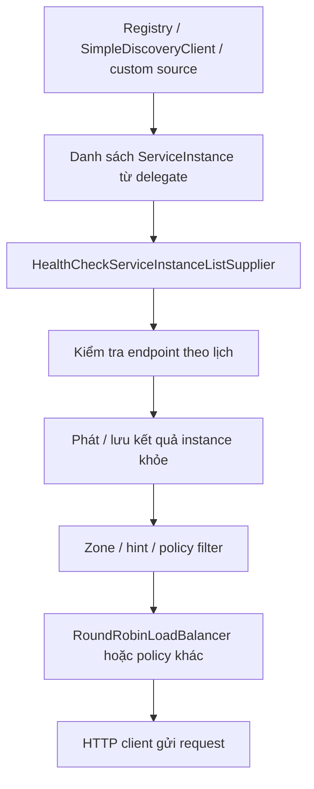

# Kết hợp health check với cache và cập nhật danh sách

Trong hệ thống microservices, danh sách `ServiceInstance` của một service không đứng yên. Pod có thể bị thay thế, một máy chủ có thể mất kết nối, instance mới cần thời gian khởi động, còn cache của client có thể giữ lại dữ liệu khám phá dịch vụ đã cũ. Spring Cloud LoadBalancer hỗ trợ `HealthCheckServiceInstanceListSupplier` để kiểm tra định kỳ các instance được nguồn danh sách cung cấp và giảm khả năng chọn một đích không còn phục vụ tốt.

Tuy nhiên, **health check, cache và cập nhật topology là ba vấn đề khác nhau**. Health check trả lời *instance đang phản hồi kiểm tra hay không?*; cache trả lời *có nên đọc lại danh sách từ nguồn hay không?*; cơ chế refresh trả lời *khi nào nhận diện instance mới hoặc instance đã bị thu hồi?*. Kết hợp sai có thể dẫn tới giữ endpoint đã chết, kiểm tra health lặp quá nhiều, hoặc vô tình đưa request quay lại các instance vừa bị đánh dấu lỗi.

Bài học thuộc chương **Sức khỏe bản sao** giải thích chuỗi xử lý này trong Spring Cloud LoadBalancer, cách cấu hình thực tế với Spring Boot, `RestClient`/`WebClient`, giới hạn của hành vi mặc định và phương pháp kiểm thử khi instance bị mất hoặc quay trở lại.

## 1. Ba câu hỏi cần tách biệt

Giả sử `order-service` cần gọi `inventory-service` có ba instance:

| Instance | Endpoint | Trạng thái tại một thời điểm |
|---|---|---|
| `inventory-a` | `10.0.1.10:8080` | Sẵn sàng nhận request |
| `inventory-b` | `10.0.1.11:8080` | Đang khởi động, chưa ready |
| `inventory-c` | `10.0.1.12:8080` | Vừa bị ngắt kết nối |

Ứng dụng gọi qua service ID:

```text
GET http://inventory-service/api/items/42
```

Các cơ chế có trách nhiệm riêng:

| Cơ chế | Câu hỏi nó xử lý | Điều nó không bảo đảm |
|---|---|---|
| **Discovery / registry** | Những instance nào được đăng ký cho `inventory-service`? | Không bảo đảm mọi instance có thể xử lý request ngay lúc này |
| **Cache danh sách instance** | Có thể tái sử dụng danh sách đã lấy để giảm chi phí tra cứu không? | Không tự phát hiện socket chết hoặc ứng dụng chưa ready |
| **Health check** | Endpoint được kiểm tra có phản hồi thành công tại lần probe gần nhất không? | Không tự bảo đảm instance sẽ còn khỏe ở request kế tiếp |
| **LoadBalancer** | Chọn instance nào trong danh sách ứng viên hiện có? | Không tự khắc phục lỗi mạng hoặc thực hiện lại nghiệp vụ |
| **HTTP client** | Gửi request, quản lý kết nối, timeout và retry như thế nào? | Không nhất thiết cập nhật danh sách discovery khi request thất bại |

**Điểm cốt lõi:** một instance còn tên trong registry nhưng thất bại readiness probe không nên được xem như một đích khỏe; ngược lại, một instance mới đã sẵn sàng nhưng chưa xuất hiện trong danh sách nguồn cũng chưa thể được LoadBalancer chọn.

## 2. Luồng phối hợp của discovery, cache và health check

Spring Cloud LoadBalancer nhận các ứng viên từ `ServiceInstanceListSupplier`. Supplier có thể lấy dữ liệu từ `DiscoveryClient`, `ReactiveDiscoveryClient`, `SimpleDiscoveryClient` hoặc nguồn tự định nghĩa. Khi thêm `HealthCheckServiceInstanceListSupplier`, nó bọc nguồn này để kiểm tra các endpoint.



Sơ đồ biểu diễn chuỗi **đề xuất**: đặt health-check supplier ngay sau nguồn lấy danh sách, trước các bộ lọc theo request. Trong thực tế, còn có cache nội bộ của discovery client, chu kỳ cập nhật registry và trạng thái readiness của nền tảng triển khai.

### 2.1. Phân biệt hai hướng cập nhật

Có hai biến động cần xử lý độc lập:

1. **Health thay đổi trên tập instance đang biết:** `inventory-a` vẫn đăng ký, nhưng endpoint health bắt đầu lỗi. Health check tiếp theo có thể cập nhật đánh giá của client mà không cần registry thay đổi danh sách.
2. **Danh sách thành viên thay đổi:** `inventory-d` vừa được tạo, hoặc `inventory-b` đã bị thu hồi. Health check không thể kiểm tra `inventory-d` nếu nguồn delegate chưa đưa nó vào danh sách. Cần refresh/refetch nguồn instance.

Do đó, chỉ rút ngắn **khoảng health check** không bảo đảm instance mới được phát hiện nhanh. Ngược lại, chỉ rút ngắn **TTL của cache discovery** không bảo đảm một instance đã thấy trong danh sách được đánh giá khỏe kịp thời.

## 3. HealthCheckServiceInstanceListSupplier hoạt động như thế nào?

`org.springframework.cloud.loadbalancer.core.HealthCheckServiceInstanceListSupplier` là một decorator của `ServiceInstanceListSupplier`. Nó nhận danh sách từ delegate, định kỳ gửi health probe tới các instance, rồi phát danh sách phù hợp cho thành phần chọn đích.

Các thành phần của luồng này gồm:

- **Delegate supplier:** cung cấp địa chỉ/metadata của instance đã khám phá.
- **Health-check scheduler:** quyết định thời điểm bắt đầu và khoảng lặp probe.
- **HTTP health probe:** kiểm tra endpoint như `/actuator/health` hoặc readiness path được cấu hình.
- **Reactor Flux `replay()`:** duy trì và phát lại kết quả cho subscriber, giúp không phải chạy lại toàn bộ chuỗi kiểm tra cho mỗi request.
- **Downstream supplier/LoadBalancer:** tiêu thụ danh sách đã xử lý và chọn instance.

Hành vi kiểm tra là **định kỳ, bất đồng bộ so với request nghiệp vụ**. Không có nghĩa một lời gọi `RestClient` tới `inventory-service` sẽ gửi một health request tới tất cả instance trước khi gửi request chính. Lựa chọn đích dựa trên kết quả gần nhất mà supplier đã phát.

### 3.1. Khác biệt giữa health endpoint và endpoint nghiệp vụ

Một HTTP `200 OK` từ `/actuator/health` cho biết health endpoint phản hồi theo cấu hình indicator tương ứng; nó không chứng minh mọi chức năng đều chạy được. Một endpoint chỉ kiểm tra process còn sống có thể trả OK dù ứng dụng đang bão hòa thread pool, không còn quyền ghi database hoặc chưa tải xong dữ liệu.

Khi dùng health check để quyết định có gửi traffic mới hay không, nên ưu tiên **readiness** thay vì chỉ kiểm tra liveness:

| Probe | Ý nghĩa thường gặp | Mục đích |
|---|---|---|
| Liveness | Process còn hoạt động, chưa mắc kẹt không thể phục hồi | Hỗ trợ quyết định restart process |
| Readiness | Instance đang có khả năng nhận request mới | Quyết định có đưa vào tập nhận traffic hay không |
| API nghiệp vụ thử nghiệm | Một luồng tính năng cụ thể có hoạt động không | Giám sát sâu; thường không phù hợp để probe quá thường xuyên |

Readiness cần được thiết kế đủ nhẹ và đúng yêu cầu phục vụ. Nếu endpoint đòi gọi hàng loạt dependency nặng cho mỗi lần probe, số client nhân với số instance có thể tạo tải đáng kể.

## 4. Hành vi rất quan trọng: khi không có instance nào khỏe

Theo tài liệu Spring Cloud Commons, `HealthCheckServiceInstanceListSupplier` thường **chỉ trả các instance khỏe, trừ khi không có instance nào vượt qua kiểm tra; khi đó nó trả lại tất cả instance đã lấy từ delegate**.

Xét tập instance nguồn `[a, b, c]`:

| Kết quả health gần nhất | Danh sách supplier trả về theo hành vi mặc định |
|---|---|
| `a`, `b` khỏe; `c` lỗi | `[a, b]` |
| Chỉ `b` khỏe | `[b]` |
| Cả `a`, `b`, `c` đều lỗi | **`[a, b, c]`** — fallback toàn bộ danh sách nguồn |
| Nguồn discovery trả danh sách rỗng | `[]` — không có instance nguồn để fallback |

Hành vi này giúp hệ thống tránh mất hoàn toàn tập ứng viên chỉ vì health endpoint gặp sự cố đồng loạt hoặc cấu hình probe tạm thời không đúng. Nhưng **đây là fail-open đối với kết quả health**, không phải một bảo đảm an toàn cho mọi nghiệp vụ.

Ví dụ, nếu ba instance đang thực sự ngừng phục vụ, fallback toàn bộ danh sách vẫn khiến HTTP client thử kết nối rồi gặp lỗi. Nếu yêu cầu bắt buộc là **không được gửi traffic tới instance bị đánh dấu unready**, phải dùng chính sách/supplier tùy chỉnh có hành vi fail-closed và kiểm thử cẩn thận; không nên mặc định rằng health-check supplier sẵn có luôn trả danh sách rỗng khi mọi probe thất bại.

> Không được dùng kết quả health check như bằng chứng xác thực hoặc phân quyền. Các ràng buộc cứng như vùng dữ liệu, tenant isolation, phiên bản API và năng lực thực thi vẫn cần được kiểm tra riêng. Dù health supplier có fail-open, một bộ lọc an toàn ở phía sau vẫn phải loại những đích không đáp ứng ràng buộc bắt buộc.

## 5. Vì sao không nên chồng health check và caching một cách máy móc?

Spring Cloud cung cấp `CachingServiceInstanceListSupplier` để giảm số lần lấy danh sách từ discovery. Tuy nhiên `HealthCheckServiceInstanceListSupplier` đã có cơ chế lưu/phát lại kết quả dựa trên Reactor `replay()`.

Một chuỗi có thể gây nhầm lẫn:

```text
DiscoveryClient
    -> CachingServiceInstanceListSupplier (TTL)
    -> HealthCheckServiceInstanceListSupplier (probe + replay)
    -> LoadBalancer
```

Trong cách kết hợp này, health supplier có thể chỉ refetch được **snapshot cũ từ lớp cache**; sau khi danh sách thực tế đã thay đổi, health probe tiếp tục làm việc với tập instance chưa đầy đủ. Hai cơ chế giữ dữ liệu cũng làm khó xác định thời điểm một instance được cập nhật.

Tài liệu Spring Cloud khuyến cáo **dùng một trong hai supplier `CachingServiceInstanceListSupplier` hoặc `HealthCheckServiceInstanceListSupplier`**, thay vì mặc định xếp cả hai, và đặt nó **ngay sau** supplier lấy instance qua mạng, trước các filter khác.

### 5.1. Cách sắp xếp được khuyến nghị

Khi chủ đích dùng health checks:

```text
DiscoveryClientServiceInstanceListSupplier
    -> HealthCheckServiceInstanceListSupplier
    -> ZonePreferenceServiceInstanceListSupplier
    -> RoundRobinLoadBalancer
```

Khi chủ đích dùng caching mà không chủ động probe health:

```text
DiscoveryClientServiceInstanceListSupplier
    -> CachingServiceInstanceListSupplier
    -> ZonePreferenceServiceInstanceListSupplier
    -> RoundRobinLoadBalancer
```

Nếu discovery client, chẳng hạn Eureka client, **đã tự cache và lọc trạng thái instance**, việc thêm cả LoadBalancer cache lẫn health check có thể không đem lại nhiều lợi ích. Trước khi thay đổi, hãy kiểm tra cơ chế registry, thời gian refresh, readiness và số lượng instance thực tế.

### 5.2. Hai lớp giữ dữ liệu khác nhau về mục đích

| Tính chất | `CachingServiceInstanceListSupplier` | `HealthCheckServiceInstanceListSupplier` |
|---|---|---|
| Mục tiêu chính | Tái sử dụng danh sách từ nguồn | Kiểm tra instance và xuất danh sách theo kết quả probe |
| Cơ chế lưu | LoadBalancer cache provider; TTL và capacity tùy cấu hình | Flux `replay()` và lịch health/refetch |
| Khi nguồn topology đổi | Thường cần hết TTL/invalidate rồi đọc lại | Cần delegate phát danh sách mới hoặc bật refetch |
| Khi instance bắt đầu lỗi health | Không tự chạy probe | Probe có thể phát hiện ở lần kiểm tra tiếp theo |
| Có nên bọc chồng mặc định? | Không | Không |

Lưu ý: bật `spring.cloud.loadbalancer.cache.enabled=false` chỉ tắt **LoadBalancer cache theo cấu hình**, không tắt cơ chế `replay()` của health supplier và cũng không buộc discovery client phải bỏ cache nội bộ của nó.

## 6. Cấu hình health check cho một service ID

Ví dụ sau sử dụng Spring Cloud LoadBalancer, nguồn discovery và health-check supplier. Cần có `org.springframework.cloud:spring-cloud-starter-loadbalancer` cùng discovery adapter hoặc `SimpleDiscoveryClient` đã cấu hình.

### 6.1. Cấu hình supplier reactive

Tạo class cấu hình riêng cho `inventory-service`:

```java
import org.springframework.beans.factory.annotation.Bean;
import org.springframework.cloud.loadbalancer.core.ServiceInstanceListSupplier;
import org.springframework.context.ConfigurableApplicationContext;

public class InventoryHealthLoadBalancerConfiguration {

    @Bean
    ServiceInstanceListSupplier inventorySupplier(
            ConfigurableApplicationContext context) {

        return ServiceInstanceListSupplier.builder()
                .withDiscoveryClient()
                .withHealthChecks()
                .withZonePreference()
                .build(context);
    }
}
```

Đăng ký cho đúng service ID từ ứng dụng gọi:

```java
@SpringBootApplication
@LoadBalancerClient(
        name = "inventory-service",
        configuration = InventoryHealthLoadBalancerConfiguration.class)
public class OrderServiceApplication {
    public static void main(String[] args) {
        SpringApplication.run(OrderServiceApplication.class, args);
    }
}
```

Hai class trong ví dụ được đặt ở **hai file Java riêng**; phần import của `OrderServiceApplication` được lược bớt để tập trung vào cấu hình LoadBalancer.

`withDiscoveryClient()` lấy nguồn khám phá dịch vụ thích hợp, `withHealthChecks()` bổ sung health supplier và `withZonePreference()` lọc ưu tiên zone sau health. `InventoryHealthLoadBalancerConfiguration` nên đặt ngoài phạm vi component scan thông thường hoặc không đánh dấu `@Configuration`, tránh bean chỉ dành cho một service ID bị đăng ký nhầm vào context chung.

### 6.2. Cấu hình cho blocking stack

Nếu ứng dụng dùng `RestClient` hoặc stack blocking và muốn health check qua client blocking tương thích, builder có API tương ứng:

```java
@Bean
ServiceInstanceListSupplier inventorySupplier(
        ConfigurableApplicationContext context) {

    return ServiceInstanceListSupplier.builder()
            .withBlockingDiscoveryClient()
            .withBlockingHealthChecks()
            .withZonePreference()
            .build(context);
}
```

Đây là **phương án thay thế** đoạn bean reactive phía trên, không phải đăng ký thêm bean cùng loại để hai nguồn cạnh tranh. Theo tài liệu Spring Cloud, có thể cung cấp `WebClient`, `RestTemplate` hoặc `RestClient` riêng làm phương tiện gửi health probe. Chọn stack dựa trên dependency và thực tế vận hành; không giả định chỉ cần có `WebClient` là cả discovery client và probe đều tự động trở thành reactive.

### 6.3. Cấu hình lịch kiểm tra và endpoint readiness

Ví dụ `application.yml` cho một thử nghiệm:

```yaml
spring:
  cloud:
    loadbalancer:
      cache:
        enabled: false
      health-check:
        initial-delay: 2s
        interval: 10s
        path:
          default: /actuator/health/readiness
          inventory-service: /actuator/health/readiness
```

Các giá trị `2s` và `10s` ở đây **chỉ là ví dụ**, không phải thời gian bắt buộc hay khuyến nghị dùng chung. `initial-delay` điều khiển độ trễ trước lịch kiểm tra; `interval` điều khiển chu kỳ probe. `path.default` đặt đường dẫn chung; `path.inventory-service` có thể dùng để ghi đè theo service ID. Nếu không cấu hình path phù hợp, Spring Cloud mặc định sử dụng `/actuator/health`.

Để ứng dụng đích có readiness endpoint qua Spring Boot Actuator, cần dependency `spring-boot-starter-actuator`. Trong môi trường không tự bật probes, có thể cấu hình trên **ứng dụng đích**:

```yaml
management:
  endpoint:
    health:
      probes:
        enabled: true
```

Kiểm tra thực tế rằng `/actuator/health/readiness` đang có HTTP status đúng với khả năng nhận traffic; endpoint có thể bị đổi path, yêu cầu xác thực hoặc chạy trên management port khác. Nếu cổng health khác service port, Spring Cloud hỗ trợ `spring.cloud.loadbalancer.health-check.port`; chỉ cấu hình một cổng chung khi nó phù hợp với các instance cần kiểm tra. Không nên vô tình công bố thông tin health nhạy cảm ra Internet để phục vụ client nội bộ.

**Chú ý:** nếu path của một service được đặt rỗng/null trong cấu hình được framework hỗ trợ, health check của service đó có thể không được thực hiện. Trước khi dùng cách này cần hiểu kết quả fallback, thay vì nghĩ rằng đường dẫn rỗng sẽ tự trở thành `/actuator/health`.

## 7. Refresh danh sách khác với lặp health probe

Đây là phần dễ gây nhầm lẫn nhất khi phối hợp health check với cache và discovery.

### 7.1. `refetch-instances`: lấy lại danh sách thành viên

`HealthCheckServiceInstanceListSupplier` phụ thuộc vào danh sách `ServiceInstance` do delegate phát ra. Một số delegate có thể chỉ trả snapshot khi được truy vấn, không tự phát một giá trị mới mỗi lần topology thay đổi. Tài liệu Spring Cloud nêu `DiscoveryClientServiceInstanceListSupplier` như một ví dụ cần cân nhắc cấu hình refetch trong trường hợp danh sách thay đổi nhưng delegate không liên tục phát bản cập nhật.

Để health supplier chủ động lấy lại danh sách từ delegate:

```yaml
spring:
  cloud:
    loadbalancer:
      health-check:
        refetch-instances: true
        refetch-instances-interval: 20s
```

`refetch-instances=true` khiến health supplier định kỳ lấy lại danh sách. `refetch-instances-interval` điều khiển chu kỳ làm mới tập thành viên; đừng hiểu đây là thời hạn bảo đảm phát hiện một replica mới, vì discovery client/registry còn có thể chậm cập nhật.

### 7.2. `repeat-health-check`: chạy thêm các vòng probe hay không?

Mỗi lần refetch danh sách cũng kích hoạt health check. Nếu đã bật refetch đều đặn và muốn giảm các lần kiểm tra lặp bổ sung, có thể đặt:

```yaml
spring:
  cloud:
    loadbalancer:
      health-check:
        refetch-instances: true
        refetch-instances-interval: 15s
        repeat-health-check: false
```

Khi `repeat-health-check=false`, cần hiểu health được cập nhật khi các sự kiện refetch kích hoạt kiểm tra, thay vì dựa vào một chu kỳ probe riêng lặp liên tục. Đừng tắt lặp probe nếu nguồn không được refetch đúng lúc: một instance có thể đổi trạng thái sức khỏe nhưng không được kiểm tra lại trong khoảng mong muốn.

### 7.3. Hai nhịp cập nhật độc lập

Nếu bật cả refetch và repeat health check:

```text
Timeline minh họa (không biểu thị chính xác scheduler thực tế)

t=0       t=10       t=20       t=30       t=40
 |----------|----------|----------|----------|
 Health:  probe      probe      probe      probe
 Refetch:            lấy mới               lấy mới

Event A: một instance cũ đột ngột unready
  -> vòng health kế tiếp có thể phát hiện

Event B: một instance mới được đăng ký
  -> chỉ có thể được probe sau khi nguồn chứa nó
     và health supplier refetch / nhận cập nhật
```

Từ đó, có hai độ trễ cần đo: **thời gian phát hiện thay đổi health của instance đã biết** và **thời gian nhận diện instance mới/cũ trong danh sách**. Không được dùng mỗi một con số `interval` hoặc TTL để giải thích toàn bộ thời gian hội tụ.

### 7.4. `update-results-list`: phát kết quả từng phần hay theo đợt

Theo tài liệu Spring Cloud, mặc định health-check flux có thể phát lại danh sách khi từng instance khỏe được xác nhận. Khi muốn chờ kiểm tra xong toàn bộ tập ứng viên và chỉ phát kết quả tổng hợp sau mỗi lượt, đặt:

```yaml
spring:
  cloud:
    loadbalancer:
      health-check:
        update-results-list: false
```

| Giá trị | Hành vi nhìn từ downstream supplier |
|---|---|
| `true` (mặc định) | Có thể thấy các bản cập nhật trung gian khi từng instance khỏe được kiểm tra xong |
| `false` | Đợi thu thập danh sách instance khỏe của lượt kiểm tra rồi phát toàn bộ; không phát các tập kết quả trung gian trong lượt đó |

Tùy đặc điểm ứng dụng, cập nhật từng phần có thể giúp phát hiện một instance khỏe sớm hơn nhưng cũng làm tập ứng viên biến động giữa các bước probe. Cập nhật theo đợt thuận tiện hơn khi muốn quan sát danh sách nhất quán theo mỗi lần kiểm tra. Dù chọn cách nào, đừng nhầm đây với cấu hình `refetch-instances` hoặc TTL cache.

## 8. Cache của discovery vẫn có thể giữ topology cũ

Giả sử instance `inventory-c` bị thu hồi khỏi registry, nhưng caller dùng một discovery client có local registry cache. Health supplier có thể phát hiện `inventory-c` không phản hồi và loại nó khỏi tập khỏe. Song nguồn delegate vẫn có thể trả một danh sách chứa `inventory-c` cho đến khi discovery cache cập nhật.

```mermaid
sequenceDiagram
    participant Registry as Registry
    participant Discovery as DiscoveryClient cache
    participant Health as HealthCheck supplier
    participant LB as LoadBalancer
    Registry->>Registry: Thu hồi inventory-c
    Note over Discovery: Còn bản snapshot cũ
    Health->>Discovery: Refetch instances
    Discovery-->>Health: [a, b, c] (cũ)
    Health->>Health: Probe; c thất bại
    Health-->>LB: [a, b] (khi có instance khỏe)
    Discovery->>Registry: Làm mới theo lịch riêng
    Registry-->>Discovery: [a, b]
    Health->>Discovery: Refetch lần sau
    Discovery-->>Health: [a, b]
```

**Hai tình huống khác nhau:**

- **Instance cũ bị lỗi:** health check có thể giảm tác động trước khi registry cache hội tụ, miễn còn ít nhất một instance khỏe.
- **Instance mới đã sẵn sàng:** health check không thể tự khám phá một endpoint chưa có trong danh sách nguồn. Cần refetch và chờ discovery cập nhật.

Vì thế, giảm `health-check.interval` không giải quyết mọi triệu chứng stale. Nếu registry hoặc discovery mất 30 giây để quảng bá instance mới, probe mỗi 2 giây vẫn không khiến instance đó tự xuất hiện trong LoadBalancer.

### 8.1. Khi nào cần LoadBalancer cache?

Nếu chỉ muốn giảm chi phí lấy danh sách và registry đã cung cấp trạng thái health đáng tin, lựa chọn đơn giản có thể là discovery + caching hoặc chỉ discovery client có cache riêng. Trong trường hợp đã dùng health-check supplier, hãy ưu tiên cơ chế replay/refetch của chính nó và tránh thêm caching supplier trừ khi có lý do rõ ràng, đã kiểm thử tính đúng đắn và hiểu thứ tự cập nhật.

Spring Cloud LoadBalancer có thuộc tính `spring.cloud.loadbalancer.cache.ttl` (mặc định thường là `35s`) và `spring.cloud.loadbalancer.cache.capacity` (initial capacity mặc định `256`) cho cache danh sách thông thường. Hai thuộc tính này **không phải** lịch health check và cũng không thay thế `refetch-instances-interval`. `capacity=256` không có nghĩa tối đa 256 instance.

## 9. Cân bằng chi phí health probe và độ mới

Health probe là một HTTP request bổ sung. Nếu có nhiều caller cùng tự thực hiện health check, tổng tải probe tăng theo số instance và số caller.

Giả sử:

- `N` = số instance của service cần probe trong một caller.
- `I` = khoảng thời gian giữa hai vòng probe, tính bằng giây.
- `C` = số caller cùng bật health supplier.

Trong mô hình đều, mỗi vòng kiểm tra mỗi instance một lần, tải probe lý tưởng gần:

\[
Q_{health} \approx \frac{C \times N}{I}
\quad \text{request/giây}
\]

Ví dụ `C=50`, `N=20`, `I=10s` cho khoảng 100 HTTP health request/giây tới toàn bộ nhóm instance. Khi giảm khoảng probe từ 10 giây xuống 2 giây, tải lý tưởng tăng năm lần. Đây chỉ là ước lượng: actual scheduling, số lượng instance khỏe, cập nhật kết quả từng phần, refetch và cơ chế probe có thể khiến lưu lượng khác đi.

| Cấu hình | Mặt lợi | Rủi ro/chi phí |
|---|---|---|
| Probe rất dày | Phát hiện một số lỗi nhanh hơn | Tăng tải endpoint, socket, CPU và nguy cơ false-negative khi nguồn nghẽn |
| Probe thưa | Ít chi phí, đơn giản hơn | Giữ đánh giá health cũ lâu hơn giữa hai lượt |
| Refetch nhanh | Thấy topology mới sớm hơn nếu discovery đã cập nhật | Tăng số lần lấy danh sách và số lượt health check phát sinh |
| `update-results-list=false` | Quan sát danh sách theo đợt đầy đủ hơn | Có thể chậm đưa instance vừa vượt probe vào tập khỏe |

Không nên chọn khoảng probe chỉ theo mục tiêu phát hiện lỗi sớm nhất. Phải kiểm tra khả năng chịu tải health endpoint, timeout của HTTP client probe, độ trễ registry, mục tiêu SLO, chi phí xuyên vùng và các loại lỗi tạm thời.

## 10. Ảnh hưởng tới RestClient, WebClient và OpenFeign

Health supplier chạy ở **tầng lựa chọn instance**, không phụ thuộc endpoint nghiệp vụ cụ thể. Khi một bean `ServiceInstanceListSupplier` được áp dụng cho service ID, các HTTP client tích hợp LoadBalancer gọi service đó có thể dùng danh sách ứng viên tương ứng.

Ví dụ với `RestClient`:

```java
@Configuration
class ClientConfiguration {

    @Bean
    @LoadBalanced
    RestClient.Builder inventoryRestClientBuilder() {
        return RestClient.builder();
    }
}

@Service
class InventoryGateway {
    private final RestClient client;

    InventoryGateway(@LoadBalanced RestClient.Builder builder) {
        this.client = builder.build();
    }

    String findItem(long id) {
        return client.get()
                .uri("http://inventory-service/api/items/{id}", id)
                .retrieve()
                .body(String.class);
    }
}
```

`WebClient.Builder` có thể đánh dấu `@LoadBalanced` tương tự để dùng dịch vụ qua service ID. OpenFeign dùng `@FeignClient(name = "inventory-service")` và có integration LoadBalancer khi dependencies phù hợp.

### 10.1. HTTP timeout vẫn cần được cấu hình

Health probe trước đó thành công không bảo đảm request hiện tại thành công. Một instance có thể lỗi giữa lần probe và lần gọi, bị network partition hoặc từ chối kết nối khi quá tải. Các HTTP client cần:

- **Connect timeout:** tránh chờ vô hạn khi host/port không kết nối được.
- **Read/response timeout:** giới hạn thời gian chờ kết quả.
- **Connection pool phù hợp:** tái sử dụng TCP/TLS nhưng không coi kết nối cũ là bằng chứng readiness mới nhất.
- **Retry có giới hạn:** chỉ thử lại loại lỗi và request an toàn, cân nhắc tránh đích vừa lỗi.

Retry sau timeout không bảo đảm request trước chưa thực hiện. Với `POST` có tác dụng phụ, cần idempotency key hoặc cơ chế nghiệp vụ chống xử lý trùng. Không nên bật retry vô hạn để che giấu việc health/registry cập nhật chậm.

### 10.2. Những thay đổi đích trong giai đoạn shutdown

Khi một instance bắt đầu graceful shutdown, trình tự vận hành lý tưởng là chuyển readiness sang trạng thái không sẵn sàng, cho phép registry và health supplier hội tụ, ngừng nhận request mới rồi mới đóng process. Không nên giả định `health-check.interval=10s` nghĩa là chờ đúng 10 giây đã đủ: discovery refresh, timeout probe, refetch và từng caller có thể lệch pha.

## 11. Quan sát và chẩn đoán khi danh sách bị sai

Phân tách ba lớp số liệu giúp tìm nguyên nhân nhanh hơn:

1. **Nguồn:** registry/discovery trả bao nhiêu `ServiceInstance`, cùng timestamp snapshot.
2. **Health supplier:** probe trả kết quả nào; danh sách sau kiểm tra gồm bao nhiêu instance; có đang fallback toàn bộ khi all-unhealthy không?
3. **HTTP client:** LoadBalancer chọn instance nào, request thành công hay thất bại, timeout/retry bao nhiêu lần.

| Triệu chứng | Khả năng cần xem xét | Cách xác minh |
|---|---|---|
| Instance chết còn bị chọn một lúc | Probe chưa đến lượt, timeout chưa kết thúc hoặc kết quả cũ được replay | Đối chiếu giờ lỗi, lần probe và danh sách healthy |
| Instance mới đã ready nhưng không nhận traffic | Delegate không phát danh sách mới; chưa bật refetch hoặc discovery cache cũ | Kiểm tra `refetch-instances`, registry và danh sách nguồn |
| Tất cả probe lỗi nhưng request vẫn đi đến backend | Hành vi fallback all-unhealthy của health supplier | Kiểm tra tình trạng probe, danh sách nguồn và chính sách fail-closed mong muốn |
| Số request dồn về một instance trong lúc kiểm tra | Danh sách healthy được cập nhật từng phần | Cân nhắc `update-results-list=false` và đo kết quả |
| Health endpoint trả `404` | Sai path, Actuator chưa bật hoặc management context khác | Kiểm tra path/port trực tiếp từ caller |
| Probe trả `401/403` | Health endpoint có authentication chưa phù hợp | Cấu hình bảo mật nội bộ và HTTP client probe đúng quyền |
| Probe thất bại ngẫu nhiên khi tăng tải | Endpoint health quá nặng, timeout quá thấp hoặc mạng nghẽn | Đo latency probe, saturation và tải của từng caller |
| Đổi TTL cache nhưng topology vẫn trễ | Discovery/registry/refetch mới là nút thắt | Đo chuỗi registry → discovery → supplier → request |
| Health lặp đôi với cache | Bọc hai supplier lưu dữ liệu hoặc có nhiều provider health | Kiểm tra bean/chuỗi supplier thực tế |

### 11.1. Metrics và logging nên có

- Service ID, số instance do delegate trả về và số instance trong danh sách sau health check.
- Số probe thành công/thất bại, thời gian probe và mã HTTP theo từng service.
- Thời điểm refetch và thời gian từ topology event đến khi instance xuất hiện/biến mất.
- Số lần fallback khi không có instance nào vượt qua probe.
- Số request lỗi connect/read timeout và số lần retry theo service/nhóm nguyên nhân.
- p95/p99 latency request nghiệp vụ và số request đang active theo dịch vụ.

Spring Cloud LoadBalancer có hỗ trợ thống kê qua Micrometer khi kích hoạt và có `MeterRegistry` tương ứng. Tuy nhiên, **không được giả định mọi metric probe health hoặc refetch đều tự có sẵn**: với những dữ liệu chưa được export, cần instrumentation bổ sung, log có cấu trúc hoặc metrics ở HTTP/Actuator layer.

Tránh đưa token, cookie, tenant ID, request ID hoặc path có tham số động làm metric label không giới hạn. Nếu cần phân tích instance cụ thể, xác định chiến lược cardinality và quyền xem log.

## 12. Bài thực hành: kiểm tra sức khỏe khi danh sách thay đổi

Chuẩn bị `inventory-service` chạy ở hai cổng `8081` và `8082` và một client dùng service ID `inventory-service`. Có thể dùng `SimpleDiscoveryClient` cho thử nghiệm sức khỏe của tập instance cố định:

```yaml
spring:
  cloud:
    discovery:
      client:
        simple:
          instances:
            inventory-service:
              - uri: http://127.0.0.1:8081
              - uri: http://127.0.0.1:8082
    loadbalancer:
      cache:
        enabled: false
      health-check:
        interval: 5s
        path:
          default: /actuator/health/readiness
        update-results-list: false
```

Hai instance phải có readiness endpoint đúng đường dẫn và chạy trên máy mà `127.0.0.1` trỏ tới. Trong container, `127.0.0.1` trỏ tới chính container đó, không trỏ tới container khác.

Thực hiện theo trình tự:

1. Bật health-check supplier theo cấu hình per-service; xác nhận ban đầu cả hai instance ready.
2. Gọi API `/whoami` nhiều lần qua HTTP client đã `@LoadBalanced`; ghi lại instance trả response.
3. Làm readiness của `8081` thất bại nhưng giữ `8082` khỏe. Quan sát sau vòng probe, danh sách ứng viên ưu tiên chỉ còn `8082`.
4. Làm readiness của `8082` cũng thất bại. **Kiểm tra hành vi fallback:** supplier có thể đưa cả hai instance trở lại danh sách nguồn thay vì trả danh sách rỗng. Ghi lại request lỗi và sự khác biệt với kỳ vọng fail-closed.
5. Khôi phục readiness của `8081`; quan sát thời gian instance này quay lại danh sách được chọn.
6. Chạy lại với `update-results-list` lần lượt `true` và `false`, xem kết quả trung gian có ảnh hưởng phân phối request không.
7. Với nguồn discovery động, thêm instance `8083`, bật `refetch-instances`, quan sát thời gian instance mới được đưa vào danh sách nguồn và được probe. Cấu hình `SimpleDiscoveryClient` cố định ở bước trước không tự phát hiện được replica mới.
8. So sánh tần suất probe `5s` và `15s` cùng một workload; theo dõi số health requests, p95/p99 và error rate.

Nên lưu bảng kết quả theo từng lần chạy, gồm timestamp: instance chuyển unready, registry đổi, delegate refresh, health supplier đổi danh sách và request đầu tiên chuyển đích. Dữ liệu này giúp xác định **điểm trễ thực sự**, thay vì điều chỉnh TTL hay health interval theo cảm tính.

## 13. Checklist để triển khai an toàn

- **Chọn đúng nguồn instance:** registry/discovery động hoặc nguồn tĩnh; xác định nguồn có tự phát danh sách mới không.
- **Chỉ thêm health supplier khi cần:** discovery dựa trên registry đã cung cấp trạng thái sức khỏe có thể không cần kiểm tra thêm.
- **Không mặc định bọc cả caching và health supplier:** health supplier đã có cơ chế replay; đặt nó ngay sau nguồn lấy danh sách.
- **Sử dụng readiness phù hợp:** kiểm tra path, HTTP status, bảo mật và port từ môi trường caller.
- **Cân nhắc refetch:** bật `refetch-instances` và chọn interval nếu nguồn không tự phát topology mới.
- **Phân biệt nhịp refetch và nhịp probe:** `repeat-health-check=false` chỉ hợp lý khi cơ chế refetch đủ đáp ứng nhu cầu.
- **Chọn hành vi phát danh sách:** hiểu `update-results-list` để tránh bất ngờ từ kết quả trung gian.
- **Đặc biệt kiểm thử all-unhealthy:** mặc định có thể trả toàn bộ danh sách nguồn; muốn fail-closed phải thiết kế riêng.
- **Đo chi phí probe theo số caller:** tránh mỗi client phát quá nhiều health requests tới các instance.
- **Giữ timeout, retry và graceful shutdown:** health check không đảm bảo request kế tiếp thành công.
- **Có metrics theo ba lớp nguồn, supplier và HTTP:** biết lỗi xảy ra ở refresh, health hay kết nối nghiệp vụ.
- **Không đưa ràng buộc dữ liệu/quyền vào cơ chế fallback health:** hard constraints phải được thực thi độc lập.

**Kết luận:** phối hợp health check với cache và cập nhật danh sách nghĩa là kiểm soát được cả **tập instance được biết đến** lẫn **trạng thái khả dụng của chúng**. Trong Spring Cloud LoadBalancer, `HealthCheckServiceInstanceListSupplier` đã có cơ chế phát lại kết quả, nên việc chồng thêm cache thường không cần thiết. Muốn nhìn thấy replica mới phải bảo đảm delegate được refresh hoặc bật `refetch-instances`; muốn phát hiện instance đã biết bị lỗi cần điều chỉnh lịch probe. Đặc biệt, phải hiểu fallback all-unhealthy và kiểm thử cả trường hợp không còn đích khỏe trước khi đưa vào production.

## Tài liệu tham khảo

- [Spring Cloud Commons — Spring Cloud LoadBalancer](https://docs.spring.io/spring-cloud-commons/reference/spring-cloud-commons/loadbalancer.html): HealthCheckServiceInstanceListSupplier, cache, refetch, repeat, update-results-list và thứ tự supplier.
- [Spring Boot Actuator — Kubernetes Probes](https://docs.spring.io/spring-boot/reference/actuator/endpoints.html#actuator.endpoints.kubernetes-probes): readiness/liveness probes, cấu hình và ý nghĩa health endpoint.
