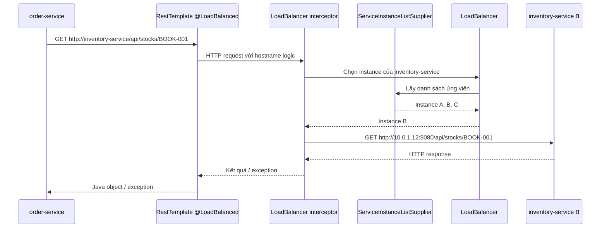

# Khai báo RestTemplate có @LoadBalanced

Trong một hệ thống microservices, `order-service` cần gọi `inventory-service` nhưng không nên gắn cứng địa chỉ IP và cổng của từng bản sao. Khi `inventory-service` có nhiều instance, ứng dụng gọi có thể sử dụng **Spring Cloud LoadBalancer** để chọn một `ServiceInstance` theo service ID, sau đó gửi HTTP request tới địa chỉ thực của instance đã chọn.

Với **`RestTemplate`**, cách tích hợp thường gặp là khai báo một Spring bean có chú thích **`@LoadBalanced`**. Khi các dependency và cấu hình Spring Cloud LoadBalancer phù hợp đã có mặt, bean này được gắn cơ chế chặn request để chuyển hostname logic trong URL thành một instance cụ thể. Nhờ đó code nghiệp vụ vẫn gọi `http://inventory-service/...` thay vì tự lấy danh sách replica hoặc tự viết thuật toán Round Robin.

Bài học thuộc chương **RestTemplate** của module `SPRING_CLOUD_SERVICE_COMMUNICATION_LOAD_BALANCING`. Trọng tâm là khai báo bean chính xác, sử dụng service ID, kiểm tra hoạt động với nhiều replica và xử lý các tình huống lỗi. Những chủ đề discovery, health check, retry, timeout và quan sát request được liên hệ trực tiếp để hiểu `@LoadBalanced` giải quyết phần nào và **không** giải quyết phần nào trong giao tiếp giữa dịch vụ.

## 1. RestTemplate và cân bằng tải phía client

`RestTemplate` là HTTP client đồng bộ của Spring Framework. Một phương thức như `getForObject(...)` hoặc `exchange(...)` sẽ gửi request và chờ kết quả hoặc exception trước khi trả quyền điều khiển cho luồng gọi.

Trong cách dùng thông thường, URL chứa địa chỉ đích được phân giải theo cơ chế mạng thông thường:

```java
RestTemplate plain = new RestTemplate();
String result = plain.getForObject(
        "http://localhost:8081/api/stocks/BOOK-001", String.class);
```

Request này hướng trực tiếp tới địa chỉ `localhost:8081`; Spring Cloud LoadBalancer không tham gia lựa chọn instance chỉ vì dependency của nó có trong dự án.

Ngược lại, một `RestTemplate` đã được cấu hình `@LoadBalanced` có thể dùng **service ID làm hostname logic**:

```java
String result = loadBalancedRestTemplate.getForObject(
        "http://inventory-service/api/stocks/BOOK-001", String.class);
```

Ở đây, `inventory-service` phải được nguồn cung cấp instance nhận diện. Nó không bắt buộc là tên DNS mà hệ điều hành phân giải được: với bean đã được tích hợp LoadBalancer, hostname này được dùng để tìm và chọn bản sao trước khi gửi HTTP request.

### Hai kiểu URL cần phân biệt

| URL | Cách hiểu | LoadBalancer có tham gia không? |
| --- | --- | --- |
| `http://localhost:8081/api/stocks/BOOK-001` qua RestTemplate thường | Đích là host và port cụ thể | Không |
| `http://inventory-service/api/stocks/BOOK-001` qua RestTemplate có `@LoadBalanced` | Hostname logic là service ID | Có, nếu tích hợp được cấu hình đúng |
| `http://inventory-service/api/stocks/BOOK-001` qua RestTemplate thường | Hệ thống cố phân giải hostname bằng cơ chế mạng bình thường | Không tự động |
| `http://10.0.1.12:8080/api/stocks/BOOK-001` | Địa chỉ instance cụ thể, không còn cần bước chọn theo service ID | Không nên dùng để kiểm chứng việc chọn replica |

Trong tích hợp RestTemplate, cú pháp thông thường là **`http://<service-id>/path`**, không phải URI `lb://...` vốn thường thấy trong các cấu hình Spring Cloud Gateway. Nếu thật sự muốn gọi trực tiếp một host hoặc IP cụ thể, hãy dùng `RestTemplate` thường: interceptor của bean `@LoadBalanced` vẫn có thể diễn giải hostname/IP trong URL như một service ID cần tra cứu, thay vì tự động bỏ qua bước cân bằng tải.

## 2. Chuẩn bị dependency

Ví dụ Maven tối thiểu cho một ứng dụng Spring Boot có HTTP client và Spring Cloud LoadBalancer:

```xml
<dependencies>
    <dependency>
        <groupId>org.springframework.boot</groupId>
        <artifactId>spring-boot-starter-web</artifactId>
    </dependency>

    <dependency>
        <groupId>org.springframework.cloud</groupId>
        <artifactId>spring-cloud-starter-loadbalancer</artifactId>
    </dependency>
</dependencies>
```

Ví dụ giả định dự án đã quản lý **phiên bản Spring Boot và Spring Cloud tương thích** qua parent/BOM hoặc cơ chế quản lý dependency tương ứng. Không nên chép một phiên bản Spring Cloud bất kỳ vào dự án mà chưa kiểm tra ma trận tương thích với Spring Boot đang dùng.

Dependency `spring-cloud-starter-loadbalancer` cung cấp thành phần cần thiết để chọn instance ở phía client. **Nguồn danh sách instance là trách nhiệm riêng.** Trong production, hệ thống có thể dùng Eureka, Consul, Kubernetes hoặc nguồn discovery khác. Trong môi trường thử nghiệm, có thể dùng `SimpleDiscoveryClient` với danh sách URI khai báo tĩnh.

Nếu không có cơ chế cung cấp danh sách instance cho `inventory-service`, việc khai báo bean `@LoadBalanced` đúng cú pháp vẫn không đủ để gửi request tới dịch vụ đích.

## 3. Khai báo bean RestTemplate có @LoadBalanced

Cách khai báo cơ bản nhất là tạo `RestTemplate` trong một lớp cấu hình Spring và gắn `@LoadBalanced` lên phương thức `@Bean`:

```java
import org.springframework.cloud.client.loadbalancer.LoadBalanced;
import org.springframework.context.annotation.Bean;
import org.springframework.context.annotation.Configuration;
import org.springframework.web.client.RestTemplate;

@Configuration
public class HttpClientConfiguration {

    @Bean
    @LoadBalanced
    public RestTemplate loadBalancedRestTemplate() {
        return new RestTemplate();
    }
}
```

Ý nghĩa của từng thành phần:

1. `@Configuration` đưa lớp cấu hình vào Spring application context.
2. `@Bean` đăng ký đối tượng `RestTemplate` để Spring quản lý và các bean khác có thể inject.
3. `@LoadBalanced` đánh dấu **bean RestTemplate này** là HTTP client cần được tích hợp LoadBalancer.
4. `new RestTemplate()` tạo client đồng bộ; phần cấu hình LoadBalancer được hệ thống Spring Cloud bổ sung qua cơ chế auto-configuration tương ứng.

Điểm quan trọng: `@LoadBalanced` **không tự tạo discovery registry**, không tự đăng ký bản sao và cũng không biến mọi đối tượng được tạo bằng `new RestTemplate()` thành client cân bằng tải. Nó chỉ có ý nghĩa khi được dùng với đúng bean và khi thành phần tích hợp Spring Cloud LoadBalancer đã được cấu hình trong ứng dụng.

### 3.1. Vì sao dùng @Bean thay vì tự new ở lớp nghiệp vụ?

Ví dụ dưới đây **không** sử dụng bean đã được đánh dấu `@LoadBalanced`:

```java
// Không dùng cách này khi muốn gọi bằng service ID qua Spring Cloud LoadBalancer.
class InventoryClient {

    String getStock() {
        RestTemplate restTemplate = new RestTemplate();
        return restTemplate.getForObject(
                "http://inventory-service/api/stocks/BOOK-001",
                String.class);
    }
}
```

Vì đối tượng được tạo trực tiếp và không đi qua quá trình cấu hình bean, request có thể cố phân giải `inventory-service` như hostname thông thường rồi gặp lỗi DNS hoặc kết nối. Điều này rất dễ bị hiểu nhầm là registry không có instance, trong khi nguyên nhân thực tế là caller đã sử dụng sai `RestTemplate`.

## 4. Spring Cloud xử lý lời gọi như thế nào?

Khi `RestTemplate` đã được tích hợp LoadBalancer, request đi qua các bước khái quát sau:



Sơ đồ biểu diễn đường đi thành công điển hình. Tùy phiên bản và cấu hình, RestTemplate có thể sử dụng `LoadBalancerInterceptor`, `RetryLoadBalancerInterceptor` hoặc lớp tích hợp tương ứng. Điều bất biến ở mức khái niệm là **hostname logic dùng để chọn instance**, còn HTTP request thực tế được gửi tới **host và port của instance đã chọn**.

`ServiceInstanceListSupplier` có thể lấy danh sách từ discovery, dùng cache, health check hoặc lọc theo zone/hint. Thuật toán như `RoundRobinLoadBalancer` chọn một instance từ danh sách ứng viên cuối cùng. `@LoadBalanced` không có nghĩa ứng dụng tự động bật mọi bộ lọc hay bảo đảm replica được chọn luôn khỏe.

## 5. Sử dụng RestTemplate trong client nghiệp vụ

Sau khi có bean, inject nó vào một adapter giao tiếp giữa dịch vụ. Ví dụ lấy tồn kho theo SKU:

```java
import org.springframework.beans.factory.annotation.Qualifier;
import org.springframework.stereotype.Service;
import org.springframework.web.client.RestTemplate;

@Service
public class InventoryClient {

    private final RestTemplate restTemplate;

    public InventoryClient(
            @Qualifier("loadBalancedRestTemplate") RestTemplate restTemplate) {
        this.restTemplate = restTemplate;
    }

    public StockResponse getStock(String sku) {
        StockResponse response = restTemplate.getForObject(
                "http://inventory-service/api/stocks/{sku}",
                StockResponse.class,
                sku);

        if (response == null) {
            throw new IllegalStateException("Inventory API returned an empty body");
        }

        return response;
    }
}

// DTO minh họa; Java 17+.
record StockResponse(String sku, int available, String instance) {}
```

Trong code trên, `@Qualifier("loadBalancedRestTemplate")` xác định đúng bean cần inject. URI template `{sku}` cho phép Spring xử lý việc thay thế tham số thay vì tự nối chuỗi URL. `StockResponse` là DTO minh họa; cấu trúc phải khớp với JSON thực sự được `inventory-service` trả về.

Nếu dự án chỉ có một bean `RestTemplate`, constructor có thể inject trực tiếp theo type. Dùng tên bean rõ ràng vẫn hữu ích khi dự án về sau bổ sung client khác phục vụ các URL ngoài hệ thống microservices.

### 5.1. Gửi header hoặc sử dụng HTTP method khác

`RestTemplate` có thể gọi `exchange(...)` khi cần kiểm soát method và headers:

```java
import org.springframework.http.HttpEntity;
import org.springframework.http.HttpHeaders;
import org.springframework.http.HttpMethod;
import org.springframework.http.MediaType;
import org.springframework.http.ResponseEntity;

HttpHeaders headers = new HttpHeaders();
headers.setAccept(java.util.List.of(MediaType.APPLICATION_JSON));

HttpEntity<Void> request = new HttpEntity<>(headers);

ResponseEntity<StockResponse> response = restTemplate.exchange(
        "http://inventory-service/api/stocks/{sku}",
        HttpMethod.GET,
        request,
        StockResponse.class,
        "BOOK-001");

StockResponse stock = response.getBody();
```

Khi sử dụng `exchange(...)`, interceptor của bean load-balanced vẫn tham gia vì request đi qua chính đối tượng `RestTemplate` đã cấu hình. Cần bảo vệ token và các header nhạy cảm khi ghi log; không log toàn bộ request chỉ để kiểm tra instance được chọn.

## 6. Khi cần cả RestTemplate thường và RestTemplate có LoadBalancer

Một ứng dụng có thể vừa gọi các microservice theo service ID, vừa gọi API bên ngoài bằng URL có hostname thật. Nên định nghĩa hai bean với tên rõ ràng để tránh inject nhầm:

```java
import org.springframework.cloud.client.loadbalancer.LoadBalanced;
import org.springframework.context.annotation.Bean;
import org.springframework.context.annotation.Configuration;
import org.springframework.web.client.RestTemplate;

@Configuration
class DualRestTemplateConfiguration {

    @Bean("loadBalancedRestTemplate")
    @LoadBalanced
    RestTemplate loadBalancedRestTemplate() {
        return new RestTemplate();
    }

    @Bean("directRestTemplate")
    RestTemplate directRestTemplate() {
        return new RestTemplate();
    }
}
```

Ở lớp sử dụng, inject theo tên:

```java
public ExternalApiClient(
        @Qualifier("directRestTemplate") RestTemplate directRestTemplate) {
    this.restTemplate = directRestTemplate;
}
```

Đoạn cấu hình này là **phương án thay thế** cho cấu hình một bean ở phần 3, không phải hướng dẫn đăng ký cả hai lớp cấu hình trong cùng ứng dụng. Nếu cùng đăng ký nhiều bean có tên trùng nhau, dự án có thể gặp lỗi hoặc cấu hình bị ghi đè tùy chế độ bean overriding.

Không nên mặc định dùng bean `@LoadBalanced` cho mọi URL bên ngoài: phần hostname của URL có thể bị coi là service ID và được đưa qua LoadBalancer. Một `RestTemplate` thường giúp tách rõ kết nối trực tiếp tới API ngoài với kết nối nội bộ dùng service discovery.

## 7. Thử nghiệm không cần service registry bên ngoài

Để nhìn thấy rõ cơ chế chọn bản sao, có thể dùng `SimpleDiscoveryClient` với danh sách instance tĩnh trong **`order-service`**. Cách này phù hợp cho học tập hoặc kiểm thử nhỏ, không tự phát hiện replica được tạo hoặc hủy động.

```yaml
# application.yml của order-service
spring:
  application:
    name: order-service
  cloud:
    discovery:
      client:
        simple:
          instances:
            inventory-service:
              - uri: http://localhost:8081
              - uri: http://localhost:8082
```

Giả sử hai tiến trình `inventory-service` đang chạy trên cùng máy với caller, lần lượt lắng nghe ở cổng `8081` và `8082`. Đây là **địa chỉ demo localhost**; nếu các dịch vụ chạy trong container hoặc trên những máy khác nhau, `localhost` bên caller thường không chỉ tới các container/máy đích. Khi ấy phải dùng địa chỉ thực sự truy cập được từ `order-service`.

Để nhận biết instance nào xử lý request, dịch vụ đích có thể trả thêm thông tin về cổng:

```java
import org.springframework.beans.factory.annotation.Value;
import org.springframework.web.bind.annotation.GetMapping;
import org.springframework.web.bind.annotation.PathVariable;
import org.springframework.web.bind.annotation.RestController;

@RestController
class InventoryController {

    @Value("${server.port}")
    private int port;

    @GetMapping("/api/stocks/{sku}")
    StockResponse stock(@PathVariable String sku) {
        return new StockResponse(sku, 15, "inventory:" + port);
    }
}

record StockResponse(String sku, int available, String instance) {}
```

Chạy **hai tiến trình độc lập** của ứng dụng đích, một với `--server.port=8081`, một với `--server.port=8082`. Sau đó gọi nhiều lần `InventoryClient.getStock("BOOK-001")` từ `order-service` và quan sát trường `instance` trả về.

Nếu thuật toán đang dùng là Round Robin và danh sách ứng viên ổn định, kết quả có thể luân phiên giữa `inventory:8081` và `inventory:8082`. Đây là kết quả **minh họa**, không phải cam kết rằng mọi chuỗi request luôn phân phối chính xác 50/50 khi có nhiều caller, retry hoặc thay đổi danh sách instance.

### 7.1. Luồng kiểm chứng thủ công

1. Khởi động instance `inventory-service` trên cổng `8081`.
2. Khởi động instance thứ hai của `inventory-service` trên cổng `8082`.
3. Khởi động `order-service` với cấu hình `SimpleDiscoveryClient` ở trên và bean `@LoadBalanced RestTemplate`.
4. Gọi phương thức `getStock("BOOK-001")` nhiều lần, ghi nhận trường `instance`.
5. Dừng instance ở cổng `8082` và thử gọi lại để quan sát lỗi khi danh sách tĩnh vẫn còn địa chỉ cũ.

Bước cuối là một bài học quan trọng: **danh sách tĩnh không tự loại instance đã dừng**. LoadBalancer có thể tiếp tục chọn địa chỉ `localhost:8082` dù tiến trình không còn lắng nghe, dẫn tới lỗi kết nối. Với service discovery động, registry, độ mới của cache và health check ảnh hưởng tới thời điểm instance lỗi biến mất khỏi danh sách ứng viên.

## 8. Cấu hình timeout cho RestTemplate có LoadBalancer

`@LoadBalanced` xác định cách tìm đích, không tự bảo đảm request sẽ kết thúc đúng thời hạn mong muốn. Với client đồng bộ, timeout là yếu tố quan trọng vì một request chờ quá lâu sẽ giữ luồng xử lý của caller.

Ví dụ khai báo bean với `SimpleClientHttpRequestFactory`:

```java
import org.springframework.cloud.client.loadbalancer.LoadBalanced;
import org.springframework.context.annotation.Bean;
import org.springframework.context.annotation.Configuration;
import org.springframework.http.client.SimpleClientHttpRequestFactory;
import org.springframework.web.client.RestTemplate;

@Configuration
class TimedRestTemplateConfiguration {

    @Bean
    @LoadBalanced
    RestTemplate loadBalancedRestTemplate() {
        SimpleClientHttpRequestFactory requestFactory =
                new SimpleClientHttpRequestFactory();

        requestFactory.setConnectTimeout(2_000);
        requestFactory.setReadTimeout(4_000);

        return new RestTemplate(requestFactory);
    }
}
```

Đây là **phương án thay thế** cho bean đơn giản ở phần 3, không dùng đồng thời hai cấu hình đăng ký cùng tên bean. Giá trị timeout trong ví dụ chỉ để minh họa; phải lựa chọn dựa trên SLA, thời gian đáp ứng của downstream, tổng deadline và số lần retry.

| Loại timeout | Giải thích |
| --- | --- |
| Connect timeout | Giới hạn thời gian thiết lập kết nối tới instance được chọn theo cơ chế của HTTP transport |
| Read timeout | Giới hạn thời gian chờ đọc dữ liệu từ kết nối, tùy HTTP transport |
| Deadline tổng của nghiệp vụ | Giới hạn thời gian từ đầu tới cuối của thao tác, gồm discovery, lựa chọn, gửi request và retry nếu có |

`SimpleClientHttpRequestFactory` dùng transport JDK phù hợp cho ví dụ cơ bản. Các HTTP client khác có thể cung cấp connection pooling, TLS và những loại timeout bổ sung. Khi đổi transport, cần dùng API cấu hình tương ứng thay vì giả định mọi factory đều có hành vi timeout giống nhau.

**Read timeout không chứng minh server chưa xử lý request.** Với một `POST` thay đổi dữ liệu, server có thể đã ghi nhận thao tác nhưng client không nhận response kịp. Retry phải xét idempotency key hoặc cơ chế tra cứu kết quả để tránh tạo tác động trùng lặp.

## 9. Phân biệt lỗi LoadBalancer, lỗi kết nối và lỗi HTTP

Khi một request từ `RestTemplate` thất bại, việc đầu tiên là xác định request có đi đến một instance hay không và client có nhận HTTP response hợp lệ hay không.

| Biểu hiện | Nhóm vấn đề thường gặp | Hướng kiểm tra |
| --- | --- | --- |
| Không tìm thấy instance cho `inventory-service` | Discovery/supplier/LoadBalancer không có ứng viên | Service ID, cấu hình discovery, registry, cache, filter và health check |
| `UnknownHostException` khi dùng URL service ID | Có thể đang gọi bằng RestTemplate thường hoặc cấu hình LB không được áp dụng | Bean đã inject có `@LoadBalanced` không, starter và auto-configuration có hiệu lực không |
| `Connection refused` | Instance được chọn không có tiến trình lắng nghe ở host/port | Địa chỉ instance, port, trạng thái replica và dữ liệu discovery cũ |
| Connect/read timeout | Mạng hoặc downstream chậm, cũng có thể vì tài nguyên cạn kiệt | Timeout thực tế, network, log/traces phía server, tổng thời gian và retry |
| HTTP `404`, `409`, `429`, `500`, `503` | Có HTTP response thể hiện kết quả không thành công | Status, headers, response body, hợp đồng API và tình trạng upstream |
| HTTP `200` nhưng `success=false` | Request HTTP thành công nhưng nghiệp vụ bị từ chối | Mã lỗi nghiệp vụ trong body; không retry chỉ vì thao tác chưa thành công |

Điểm cần lưu ý: khi danh sách instance rỗng, các bản Spring Cloud và đường tích hợp khác nhau có thể tạo exception hoặc phản hồi tổng hợp khác nhau. **Không nên khẳng định luôn có HTTP status `503` từ `inventory-service`**: nếu request chưa tới server đích thì status, nếu có, có thể do lớp phía caller tạo ra.

### 9.1. Bắt exception theo trách nhiệm

Ví dụ sau minh họa việc tách lỗi I/O ra khỏi lỗi HTTP response:

```java
import org.springframework.web.client.ResourceAccessException;
import org.springframework.web.client.RestClientResponseException;

try {
    StockResponse stock = restTemplate.getForObject(
            "http://inventory-service/api/stocks/{sku}",
            StockResponse.class,
            "BOOK-001");
} catch (ResourceAccessException ex) {
    // Kiểm tra cause: DNS, connect timeout, read timeout, TLS...
    log.warn("inventory connection failure", ex);
} catch (RestClientResponseException ex) {
    // Server/proxy trả HTTP response có status lỗi.
    log.warn("inventory HTTP error status={}", ex.getStatusCode().value());
}
```

`log` trong ví dụ tượng trưng cho logger của lớp ứng dụng. Việc phân loại exception cụ thể còn tùy HTTP transport và phiên bản. Lỗi không tìm được instance hoặc lỗi chuyển đổi body có thể xuất hiện dưới loại exception khác; hãy xem root cause thay vì chỉ bắt hai nhóm trên rồi coi mọi lỗi khác là thành công.

Một số API dùng `409` hoặc `422` cho lỗi miền; một số khác dùng `200` cùng error code trong body. Caller cần diễn giải theo **hợp đồng API**, không chỉ dựa vào HTTP status.

## 10. Retry là cơ chế riêng, không phải mặc định của @LoadBalanced

`@LoadBalanced` làm cho client có thể chọn instance dựa trên service ID. Việc **retry** hay không, retry lỗi nào, có chọn lại instance hay không và giới hạn số lần đều do tích hợp và cấu hình retry quyết định.

Trong một số cấu hình Spring Cloud LoadBalancer cho RestTemplate, retry có thể phối hợp với Spring Retry và `RetryLoadBalancerInterceptor` khi các dependency và điều kiện tương ứng được thỏa mãn. Không nên suy luận rằng chỉ cần gắn `@LoadBalanced` là mọi lỗi `5xx` hoặc timeout sẽ được tự động retry.

Các nguyên tắc quan trọng:

- Với `GET` đọc dữ liệu, retry giới hạn khi connection reset hoặc lỗi tạm thời có thể phù hợp nếu tổng deadline còn đủ.
- Với `POST` tạo đơn hàng, retry sau read timeout có thể lặp lại tác động; phải thiết kế idempotency hoặc tra cứu trạng thái thao tác.
- Với HTTP `400`, `401`, `403` và các lỗi nghiệp vụ rõ ràng, retry nguyên request thường không giúp ích.
- Với `429`, `502`, `503`, `504`, cần xét hợp đồng API, `Retry-After` nếu có, backoff, jitter và giới hạn tổng số attempt.
- Khi retry có thể chọn instance khác, phải đo từng attempt chứ không suy từ kết quả cuối cùng của request nghiệp vụ.

Không bật retry ở nhiều tầng mà không kiểm soát: gateway, caller và HTTP client có thể cùng retry khiến một yêu cầu ban đầu tạo ra rất nhiều request downstream.

## 11. Discovery, health check, zone và cache có ảnh hưởng gì?

Đối với RestTemplate có `@LoadBalanced`, **kết quả lựa chọn chỉ tốt bằng danh sách ứng viên mà LoadBalancer nhận được**.

**Discovery** quyết định instance nào được công bố cho service ID. Nếu cấu hình Eureka, Consul, Kubernetes hoặc SimpleDiscoveryClient không đúng, `RestTemplate` không thể tự tìm ra địa chỉ cần gọi.

**Cache** có thể giữ danh sách instance trong một khoảng thời gian. Replica mới đăng ký có thể chưa được thấy ngay; replica dừng hoạt động có thể còn trong local view. Một số discovery client đã có cache của riêng mình, vì vậy cần tránh bổ sung cache trùng không cần thiết tại LoadBalancer.

**Health check** có thể được bổ sung bằng `HealthCheckServiceInstanceListSupplier` trong chuỗi cung cấp instance. Nó không mặc định chứng minh mọi request tiếp theo sẽ thành công; probe thành công và request thực tế là hai thời điểm khác nhau.

**Zone/metadata routing** có thể được thực hiện qua các supplier thích hợp, ví dụ ưu tiên instance có metadata zone khớp caller. `@LoadBalanced` không tự bật tất cả chính sách này: chúng phụ thuộc cấu hình của `ServiceInstanceListSupplier` và LoadBalancer.

**Thuật toán lựa chọn**, chẳng hạn Round Robin, chỉ chọn trên danh sách ứng viên nhận được. Nếu danh sách chứa instance đã chết, thuật toán vẫn có thể chọn nó. Muốn điều tra lỗi, cần tách danh sách registry, danh sách từ discovery, danh sách sau supplier/filter và instance cuối cùng được chọn.

## 12. Lỗi khai báo thường gặp

### 12.1. Khai báo @LoadBalanced nhầm chỗ

Đánh dấu `@LoadBalanced` tại bean `RestTemplate`, không phải chỉ thêm annotation vào một phương thức nghiệp vụ rồi hy vọng Spring tự chuyển URL logic. Bean phải thuộc application context được Spring Cloud xử lý.

### 12.2. Khởi tạo RestTemplate ngoài Spring context

`new RestTemplate()` ngay trong `InventoryClient` sẽ bỏ qua bean đã cấu hình. Hãy inject bean đã đánh dấu và kiểm tra bằng `@Qualifier` nếu có nhiều bean.

### 12.3. Sai service ID

Nếu discovery đăng ký `inventory-service` nhưng URL lại viết `http://inventories/...`, LoadBalancer sẽ tìm danh sách theo hostname logic sai. Cần đối chiếu tên với service ID được nguồn discovery công bố, không chỉ nhìn tên lớp Java hay tên artifact Maven.

### 12.4. Thiếu nguồn instance

Có dependency LoadBalancer và bean `@LoadBalanced` không có nghĩa registry đã được cấu hình. Khi không tìm thấy instance, hãy kiểm tra `DiscoveryClient.getInstances("inventory-service")` hoặc nguồn supplier tương ứng và cấu hình kết nối registry.

### 12.5. Dùng localhost từ container

`localhost` bên trong `order-service` container chỉ chính container đó, không chỉ máy chủ chạy `inventory-service` bên ngoài. Với nhiều máy/container, URI của `ServiceInstance` phải là địa chỉ mà caller thực sự kết nối được.

### 12.6. Nhầm lỗi nghiệp vụ với lỗi cân bằng tải

Nếu `inventory-service` đã trả HTTP response với mã lỗi nghiệp vụ, đổi instance thường không làm điều kiện như “hết hàng” biến mất, đặc biệt khi các replica chia sẻ dữ liệu. Chỉ retry khi nguyên nhân có khả năng tạm thời và thao tác an toàn.

## 13. Quan sát request từ caller tới instance

Để xác nhận RestTemplate thực sự đi qua LoadBalancer, nên quan sát ở cả phía gọi và phía đích:

| Vị trí | Thông tin nên ghi nhận |
| --- | --- |
| Caller | Service ID logic, method, path đã làm sạch, trace ID, tổng thời gian, status/exception |
| LoadBalancer | Instance ID/host/port được chọn, số lượng ứng viên, số lần retry nếu được hỗ trợ |
| Destination instance | Instance ID, port thực, trace ID, thời gian xử lý và kết quả HTTP/nghiệp vụ |

Ví dụ log mong muốn:

```text
traceId=4de8... caller=order-service serviceId=inventory-service
event=loadbalancer.selected host=10.0.1.12 port=8080
method=GET path=/api/stocks/BOOK-001 httpStatus=200 durationMs=38
```

Phần log `loadbalancer.selected` là minh họa; muốn có bản ghi đó cần cấu hình logging/observation hoặc callback thích hợp trong phiên bản đang dùng, ví dụ `LoadBalancerLifecycle`. Nó không tự xuất hiện nguyên văn chỉ vì đã thêm `@LoadBalanced`.

Không ghi token, cookie, thông tin xác thực hoặc toàn bộ body chứa dữ liệu nhạy cảm vào log. Với metrics, tránh dùng URL/path có ID tùy ý hoặc instance ID có cardinality cao làm nhãn nếu chưa kiểm soát độ lớn của tập giá trị.

## 14. Checklist kiểm chứng trước khi đưa vào sử dụng

1. **Dependency:** `spring-cloud-starter-loadbalancer` đã có và Spring Boot/Spring Cloud tương thích.
2. **Bean:** ứng dụng khai báo đúng một bean load-balanced dự định sử dụng hoặc inject rõ bean theo qualifier.
3. **Injection:** lớp nghiệp vụ không tự gọi `new RestTemplate()` để thay thế bean đã cấu hình.
4. **Service ID:** hostname logic trong URL khớp tên dịch vụ mà discovery cung cấp.
5. **Nguồn instance:** discovery hoặc cấu hình static trả ít nhất một `ServiceInstance` hợp lệ.
6. **Địa chỉ mạng:** host/port của từng instance có thể truy cập từ caller, đặc biệt khi chạy container.
7. **Timeout:** có connect/read timeout hợp lý với SLA và transport thực tế.
8. **Retry:** không dựa vào giả định tự động; xác nhận policy và tính idempotent của API ghi dữ liệu.
9. **Quan sát:** xác minh instance được chọn, HTTP status và root cause của lỗi; không suy đoán chỉ từ kết quả nghiệp vụ.
10. **Topology thay đổi:** thử dừng một replica và đo độ trễ discovery/cache/health check làm mới danh sách.

## 15. Tự kiểm tra kiến thức

1. Tại sao một `RestTemplate` được tạo bằng `new` trong lớp nghiệp vụ thường không tự cân bằng tải theo service ID?
2. `@LoadBalanced` cần gắn ở đâu trong cấu hình bean và điều kiện nào phải có để Spring Cloud xử lý URL logic?
3. Phân biệt URL `http://inventory-service/...` với URL `http://localhost:8081/...` trong môi trường nhiều replica.
4. Vì sao chỉ thêm `spring-cloud-starter-loadbalancer` nhưng không có discovery vẫn chưa đủ để gọi một service ID?
5. Cần làm gì khi ứng dụng vừa gọi API bên ngoài bằng hostname thật, vừa gọi microservice theo tên logic?
6. Nếu `inventory-service` trên cổng `8082` đã dừng nhưng SimpleDiscoveryClient vẫn liệt kê nó, caller có thể gặp lỗi nào?
7. `@LoadBalanced` có tự bật health check, timeout, retry và zone preference không? Giải thích trách nhiệm của từng thành phần.
8. Sau một read timeout khi tạo đơn hàng, vì sao không nên retry vô điều kiện?
9. Làm cách nào kiểm chứng một request thật sự đi tới instance được LoadBalancer chọn, thay vì chỉ kiểm tra HTTP status cuối cùng?

## 16. Tổng kết

Khai báo `@Bean @LoadBalanced RestTemplate` là bước tích hợp cơ bản để **gọi dịch vụ theo service ID bằng HTTP client đồng bộ**. Khi đúng dependency và nguồn `ServiceInstance` đã được cấu hình, Spring Cloud LoadBalancer hỗ trợ lựa chọn một replica và chuyển URI logic thành địa chỉ đích thực tế. Code nghiệp vụ không cần biết trước IP của A, B hay C.

Tuy nhiên, `@LoadBalanced` **không đồng nghĩa một hệ thống đã sẵn sàng vận hành an toàn**: discovery phải cung cấp danh sách đúng, các replica phải có thể kết nối, timeout và retry phải có giới hạn, health check/cache có thể ảnh hưởng tới độ mới của danh sách, còn lỗi HTTP và lỗi nghiệp vụ phải được phân loại độc lập. Khi hiểu rõ ranh giới này, bạn có thể sử dụng RestTemplate ổn định và biết khi nào nên cân nhắc các HTTP client mới hơn như `RestClient` hoặc `WebClient` cho nhu cầu tiếp theo.
