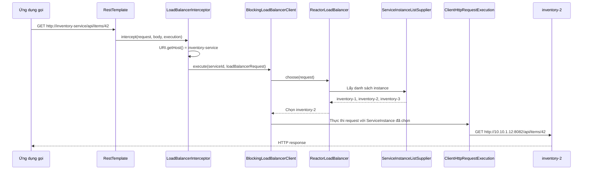

# LoadBalancerInterceptor và quá trình thay thế URI

## Mục tiêu

Khi gọi một microservice bằng `RestTemplate`, ta thường muốn dùng tên logic như `inventory-service` thay vì ghi cứng IP và cổng của một bản sao cụ thể. Trong Spring Cloud LoadBalancer, `LoadBalancerInterceptor` đóng vai trò cầu nối giữa lời gọi HTTP đồng bộ của `RestTemplate` và cơ chế chọn `ServiceInstance`.

Bài học tập trung vào câu hỏi: **vì sao request viết với URI `http://inventory-service/...` cuối cùng có thể được gửi đến `http://10.10.1.12:8082/...`?** Đây không phải phép thay thế chuỗi đơn giản hay tính năng DNS bắt buộc; đó là quá trình chọn instance và dựng lại URI trong chuỗi xử lý request của Spring Cloud.

Sau bài học, bạn sẽ:

- Hiểu tác dụng của `@LoadBalanced`, `RestTemplate`, `LoadBalancerInterceptor` và `BlockingLoadBalancerClient`.
- Theo dõi quá trình trích xuất service ID, lấy danh sách instance, chọn một bản sao và dựng URI vật lý.
- Phân biệt URI logic, `ServiceInstance` được chọn và URI thực sự gửi qua HTTP.
- Giải thích vai trò của `LoadBalancerRequestFactory`, `ServiceRequestWrapper` và `LoadBalancerUriTools`.
- Xử lý các tình huống URI sai, không tìm thấy instance, khác scheme, cache/discovery chưa cập nhật.
- Thực hành với hai backend và `SimpleDiscoveryClient`, quan sát cách request được phân phối.

## 1. URI logic khác URI vật lý như thế nào?

Giả sử `order-service` muốn truy vấn hàng tồn kho:

```java
String result = restTemplate.getForObject(
        "http://inventory-service/api/items/42?include=stock",
        String.class
);
```

Trong lệnh gọi trên:

| Phần URI | Giá trị | Vai trò |
|---|---|---|
| Scheme | `http` | Giao thức khai báo trong URI logic ban đầu. |
| Host | `inventory-service` | **Service ID** cần được LoadBalancer phân giải. |
| Path | `/api/items/42` | Endpoint nghiệp vụ của dịch vụ đích. |
| Query | `include=stock` | Tham số truy vấn của request. |

Giả sử discovery trả về:

| Instance | Host | Port | Secure |
|---|---|---:|---|
| inventory-1 | `10.10.1.11` | 8081 | `false` |
| inventory-2 | `10.10.1.12` | 8082 | `false` |
| inventory-3 | `10.10.1.13` | 8083 | `false` |

Nếu LoadBalancer chọn `inventory-2` thì URI vật lý điển hình là:

```text
http://10.10.1.12:8082/api/items/42?include=stock
```

**Service ID trong phần host được thay bằng địa chỉ của instance đã chọn.** Path và query tiếp tục mô tả tài nguyên cần truy vấn. Việc thay thế này chỉ xảy ra khi `RestTemplate` đang dùng cơ chế LoadBalancer; một `RestTemplate` thông thường sẽ cố xử lý `inventory-service` như hostname mạng.

Không nên ghi cứng các địa chỉ `10.10.1.x` trong code nghiệp vụ. Khi số bản sao thay đổi, discovery cung cấp danh sách mới và LoadBalancer chọn từ danh sách đó theo chính sách đã cấu hình.

## 2. Bật LoadBalancer cho RestTemplate

### 2.1. Dependency cần có

Dự án phải chọn cặp Spring Boot và Spring Cloud Release Train tương thích, rồi dùng Spring Cloud BOM để quản lý version các module Cloud. Với Maven, khai báo:

```xml
<dependencies>
    <!-- Spring MVC cho ứng dụng demo có HTTP endpoint (Spring Boot 4.x) -->
    <dependency>
        <groupId>org.springframework.boot</groupId>
        <artifactId>spring-boot-starter-webmvc</artifactId>
    </dependency>

    <dependency>
        <groupId>org.springframework.cloud</groupId>
        <artifactId>spring-cloud-starter-loadbalancer</artifactId>
    </dependency>
</dependencies>
```

`spring-boot-starter-webmvc` là starter phù hợp cho ví dụ Spring Boot 4.x có MVC controller. Dự án chỉ thực hiện outbound HTTP có thể dùng starter HTTP client phù hợp thay vì kéo theo web server. Với Spring Boot 3.x, cách tổ chức starter web có thể khác; cần theo phiên bản đang dùng.

### 2.2. Khai báo bean `@LoadBalanced`

`RestTemplate` không tự được tạo thành bean chỉ vì ứng dụng đã thêm starter. Ta cần đăng ký một bean và gắn `@LoadBalanced`:

```java
import org.springframework.cloud.client.loadbalancer.LoadBalanced;
import org.springframework.context.annotation.Bean;
import org.springframework.context.annotation.Configuration;
import org.springframework.web.client.RestTemplate;

@Configuration(proxyBeanMethods = false)
class HttpClientConfiguration {

    @Bean
    @LoadBalanced
    RestTemplate loadBalancedRestTemplate() {
        return new RestTemplate();
    }
}
```

Spring Cloud nhận diện bean có qualifier `@LoadBalanced` và cấu hình interceptor thích hợp để thực hiện phân giải service ID. Trong những phiên bản hiện đại, chuỗi interceptor có thể chứa `DeferringLoadBalancerInterceptor` trước khi chuyển tiếp đến `LoadBalancerInterceptor` thực tế. Khi retry của LoadBalancer được bật và đáp ứng điều kiện tích hợp, cũng có thể sử dụng interceptor dành cho retry.

**Không cần tự new `LoadBalancerInterceptor`** hoặc tự viết lại logic thay URI khi đã dùng auto-configuration đúng cách. Cách đơn giản và an toàn nhất là khai báo `@LoadBalanced` trên bean mà ứng dụng dùng.

### 2.3. Dùng bean trong nghiệp vụ

```java
import org.springframework.cloud.client.loadbalancer.LoadBalanced;
import org.springframework.stereotype.Service;
import org.springframework.web.client.RestTemplate;

@Service
class InventoryGateway {

    private final RestTemplate restTemplate;

    InventoryGateway(@LoadBalanced RestTemplate restTemplate) {
        this.restTemplate = restTemplate;
    }

    String findItem(int itemId) {
        return restTemplate.getForObject(
                "http://inventory-service/api/items/{id}",
                String.class,
                itemId
        );
    }
}
```

`@LoadBalanced` trên tham số constructor giúp chọn đúng bean khi ứng dụng có nhiều `RestTemplate`. `{id}` được `RestTemplate` mở rộng thành biến URI trước khi thực hiện request.

### 2.4. Nếu cần cả RestTemplate trực tiếp

Một số URL như `https://api.example.org/v1` phải được gọi trực tiếp, không qua discovery. Khi ứng dụng cần cả hai loại, khai báo riêng:

```java
@Bean
@LoadBalanced
RestTemplate loadBalancedRestTemplate() {
    return new RestTemplate();
}

@Bean
@Primary
RestTemplate directRestTemplate() {
    return new RestTemplate();
}
```

Trong code thật, hai bean này nằm trong một lớp `@Configuration` và cần import `org.springframework.context.annotation.Primary`. `@Primary` đánh dấu bean HTTP trực tiếp cho trường hợp inject không có qualifier; muốn load balance, inject bằng `@LoadBalanced`.

Nếu sử dụng `http://localhost:8081` với **bean có `@LoadBalanced`**, phần host `localhost` có thể bị hiểu là **service ID `localhost`**. Vì thế lời gọi có thể báo `No instances available for localhost` thay vì truy cập localhost như mong muốn. Hãy dùng bean trực tiếp cho URL máy chủ cụ thể.

## 3. LoadBalancerInterceptor làm gì trong chuỗi RestTemplate?

`LoadBalancerInterceptor` là một triển khai `ClientHttpRequestInterceptor` của Spring Framework, có nhiệm vụ chuyển request của `RestTemplate` sang `LoadBalancerClient`.

Luồng tổng quát:



Các bước diễn ra từ góc nhìn lập trình viên:

1. `RestTemplate` nhận URL logic, phương thức HTTP, header và body.
2. Chuỗi `ClientHttpRequestInterceptor` được kích hoạt. `LoadBalancerInterceptor` lấy URI hiện tại từ `HttpRequest.getURI()`.
3. Interceptor đọc `originalUri.getHost()` và coi kết quả là **service ID**.
4. Interceptor sử dụng `LoadBalancerRequestFactory` để tạo đối tượng `LoadBalancerRequest` chứa request, body và `ClientHttpRequestExecution`.
5. `BlockingLoadBalancerClient.execute(serviceId, request)` thực hiện lựa chọn instance thông qua load balancer của service ID tương ứng.
6. `ReactorLoadBalancer`, thường là `RoundRobinLoadBalancer` nếu chưa tùy biến, lấy ứng viên từ `ServiceInstanceListSupplier`; supplier có thể dùng discovery, cache, health check, zone hoặc hint.
7. Sau khi có `ServiceInstance`, request được thực hiện bằng một wrapper cung cấp URI vật lý, có thể được biến đổi thêm bởi `LoadBalancerRequestTransformer`.
8. `ClientHttpRequestExecution` tiếp tục thực thi lời gọi HTTP đến instance đã chọn và trả `ClientHttpResponse` để `RestTemplate` xử lý.

Sơ đồ và trình tự trên là mô tả luồng logic. Một số chi tiết auto-configuration hoặc retry thay đổi theo phiên bản Spring Cloud và dependency có trong ứng dụng, nhưng **host logic → service ID → chọn instance → URI vật lý** là phần cốt lõi cần hiểu.

## 4. Bên trong interceptor: service ID lấy từ host

Điểm quyết định nằm ở hành vi tương đương pseudocode sau:

```java
// Pseudocode để giải thích, không phải toàn bộ source của thư viện.
URI originalUri = request.getURI();
String serviceId = originalUri.getHost();

if (serviceId == null) {
    throw new IllegalStateException(
            "Request URI does not contain a valid hostname");
}

LoadBalancerRequest<ClientHttpResponse> lbRequest =
        requestFactory.createRequest(request, body, execution);

return loadBalancer.execute(serviceId, lbRequest);
```

Không có bước tìm `service ID` từ path. Với `http://inventory-service/api/items/42`, service ID là `inventory-service`, không phải `api` hoặc `items`.

Vì sử dụng `URI.getHost()`, URL cần có **host hợp lệ**. Những trường hợp sai thường gặp:

| URI ban đầu | Điều LoadBalancer nhận được |
|---|---|
| `http://inventory-service/api/items` | Host = `inventory-service`; phù hợp. |
| `https://inventory-service/api/items` | Host = `inventory-service`; có thể dùng với instance HTTPS tương thích. |
| `http://localhost:8081/api/items` | Host = `localhost`; bị coi là service ID nếu bean có LoadBalancer. |
| `/api/items` | URI tương đối, không có host; không đủ thông tin để chọn service ID. |
| `http:///api/items` | URI không có host hợp lệ; cần sửa URL. |
| `http://inventory_service/api/items` | Host có thể không được Java URI nhận diện là DNS hostname hợp lệ; nên dùng service ID phù hợp quy tắc hostname. |

`LoadBalancerInterceptor` không tự sửa lỗi URL sai. URI thiếu hostname thường dẫn tới lỗi từ interceptor hoặc tầng tạo request; URL đúng cú pháp nhưng service ID không có instance lại là một lỗi khác.

**Nguyên tắc:** trong `RestTemplate` có LoadBalancer, host là tên logic; trong `RestTemplate` trực tiếp, host là tên DNS/IP cần kết nối.

## 5. Chọn ServiceInstance diễn ra trước khi thay URI

Khi đã có service ID, `BlockingLoadBalancerClient` gọi cơ chế lựa chọn instance. Hệ thống có thể dùng một trong các chính sách:

| Chính sách | Tác động đến kết quả |
|---|---|
| Round robin | Luân phiên chọn một instance trong danh sách ứng viên. |
| Random | Chọn ngẫu nhiên một instance. |
| Zone preference | Ưu tiên các instance có metadata zone phù hợp với caller. |
| Weighted | Phân phối theo trọng số tương đối của instance. |
| Hint/metadata filtering | Giới hạn hoặc ưu tiên tập instance trước khi chọn. |
| Health check | Sử dụng danh sách instance phù hợp với tình trạng kiểm tra sức khỏe, theo hành vi fallback của supplier. |

Ví dụ `RoundRobinLoadBalancer` được cấu hình mặc định không có nghĩa mọi request luôn quay vòng qua **tất cả instance trong registry**. Nếu supplier đứng trước đã lọc danh sách theo zone hoặc hint, thuật toán chỉ chọn trong danh sách còn lại.

`ServiceInstance` được chọn mang những thông tin tối thiểu:

```text
serviceId  = inventory-service
instanceId = inventory-2
host       = 10.10.1.12
port       = 8082
secure     = false
metadata   = {zone=zone-a, weight=2}
```

LoadBalancer không “đi qua một gateway mới” chỉ vì đã chọn instance. Trong mô hình client-side load balancing, HTTP client thường kết nối trực tiếp tới host/port của instance. Tuy nhiên, đường đi có thể còn proxy mạng, service mesh hoặc gateway tùy kiến trúc triển khai thực tế.

Nếu không có instance khả dụng, `BlockingLoadBalancerClient` có thể ném `IllegalStateException` với thông báo như:

```text
No instances available for inventory-service
```

Đây là lỗi ở phía **caller**, trước khi lời gọi đến một backend thành công. Nó không tự động có nghĩa backend đã trả HTTP `404` hay `503`. Ứng dụng hoặc gateway có thể quyết định cách ánh xạ lỗi này thành response cho người dùng.

## 6. Dựng lại URI: ServiceRequestWrapper và reconstructURI

### 6.1. Không phải sửa trực tiếp chuỗi URL gốc

Khi đã chọn instance, `LoadBalancerRequestFactory` tạo request callback để thực hiện lời gọi. Trong luồng mặc định, `ServiceRequestWrapper` bọc `HttpRequest` ban đầu và ghi đè `getURI()`.

Về mặt ý tưởng, wrapper trả về:

```java
// Pseudocode gần với cấu trúc API: chỉ minh họa ý nghĩa.
URI getURI() {
    return loadBalancer.reconstructURI(
            selectedInstance,
            originalRequest.getURI()
    );
}
```

`LoadBalancerClient.reconstructURI(instance, original)` tạo một URI phù hợp với endpoint vật lý. Với `BlockingLoadBalancerClient` của Spring Cloud LoadBalancer, việc dựng lại URI dựa trên `LoadBalancerUriTools`.

Trong ví dụ đang xét:

```text
URI logic:
  http://inventory-service/api/items/42?include=stock

Instance đã chọn:
  inventory-2 { host=10.10.1.12, port=8082, secure=false }

URI vật lý:
  http://10.10.1.12:8082/api/items/42?include=stock
```

Việc dùng `HttpRequestWrapper` giúp chuỗi thực thi HTTP tiếp theo nhìn thấy URI được xây dựng lại, trong khi code nghiệp vụ vẫn chỉ biết URI logic. Không cần và không nên thay `inventory-service` bằng địa chỉ IP bằng lệnh `String.replace(...)` trong tầng nghiệp vụ.

### 6.2. Phần nào thay đổi, phần nào được giữ lại?

| Phần request | Hành vi |
|---|---|
| Host trong URI | Thay service ID bằng host của `ServiceInstance` đã chọn. |
| Port trong URI | Sử dụng port của `ServiceInstance`. |
| Scheme (`http`/`https`) | Có thể được xác định lại theo `ServiceInstance.getScheme()` và trạng thái `isSecure()`. |
| Path | Giữ đường dẫn tài nguyên theo URI logic, trừ khi ứng dụng có bộ biến đổi request riêng. |
| Query | Giữ các tham số truy vấn và encoding theo URI đã được tạo hợp lệ. |
| HTTP method | Không được đổi chỉ vì LoadBalancer chọn instance. |
| Body và header | Được chuyển tiếp qua execution; có thể có transformer/interceptor tùy chỉnh. |

Một `ServiceInstance` bảo mật có thể dẫn tới URI cuối là `https://...` dù URI logic ban đầu dùng `http://inventory-service/...`. Không nên giả định scheme luôn được giữ nguyên 100%; cần kiểm tra metadata/`getScheme()`/`isSecure()` của discovery implementation và khả năng TLS của backend.

Ví dụ một trường hợp secure:

```text
URI logic:
  http://inventory-service/api/items/42

Instance được chọn:
  host=inventory.internal.example
  port=8443
  secure=true

URI vật lý điển hình:
  https://inventory.internal.example:8443/api/items/42
```

Nếu metadata khai báo sai scheme hoặc port, client có thể gặp lỗi kết nối/TLS. Đừng cố sửa bằng cách tự thay chữ `http` trong chuỗi URL; hãy sửa cấu hình instance và kiểm tra URI thực tế.

### 6.3. Encoding, query string và fragment

Với request có ký tự đặc biệt, hãy tạo URI bằng API URI builder/`RestTemplate` đúng cách. Tránh nối chuỗi tùy tiện:

```java
String result = restTemplate.getForObject(
        "http://inventory-service/api/search?keyword={keyword}",
        String.class,
        "cà phê & trà"
);
```

Lệnh gọi ở trên sử dụng biến URI để `RestTemplate` xử lý việc mã hóa tham số thay vì nối trực tiếp `"&"` vào URL. Nếu bạn tự truyền một `URI` đã được mã hóa, tránh mã hóa lại cùng đoạn query lần thứ hai.

`LoadBalancerUriTools` có nhiệm vụ dựng lại URI sau khi đã có một URI hợp lệ; nó không thay thế logic xử lý URL input sai hoặc kiểm tra an toàn dữ liệu đầu vào.

Fragment như `#section` có thể tồn tại trong biểu diễn URI nhưng **không phải thành phần được gửi trên HTTP request line**. Không dùng fragment để truyền dữ liệu nghiệp vụ cho backend.

## 7. LoadBalancerRequestFactory và transformer có nhiệm vụ gì?

`LoadBalancerRequestFactory` tạo một `LoadBalancerRequest<ClientHttpResponse>` từ:

- `HttpRequest` ban đầu.
- `byte[] body` của request.
- `ClientHttpRequestExecution` để tiếp tục gửi HTTP sau khi đã chọn instance.

Khi thực thi callback với một `ServiceInstance`, request được bọc thành `ServiceRequestWrapper` rồi chuyển qua những `LoadBalancerRequestTransformer` đã cấu hình (nếu có), sau đó được gửi bằng `execution.execute(...)`.

Đây là điểm mở rộng phù hợp khi muốn đính kèm thông tin từ instance đã chọn vào header phục vụ chẩn đoán nội bộ.

Ví dụ thêm header định danh bản sao trong môi trường thử nghiệm:

```java
import org.springframework.cloud.client.loadbalancer.LoadBalancerRequestTransformer;
import org.springframework.http.HttpHeaders;
import org.springframework.http.client.support.HttpRequestWrapper;
import org.springframework.context.annotation.Bean;
import org.springframework.context.annotation.Configuration;

@Configuration(proxyBeanMethods = false)
class LoadBalancerDiagnosticsConfiguration {

    @Bean
    LoadBalancerRequestTransformer instanceHeaderTransformer() {
        return (request, instance) -> new HttpRequestWrapper(request) {
            @Override
            public HttpHeaders getHeaders() {
                HttpHeaders headers = new HttpHeaders();
                headers.putAll(super.getHeaders());
                if (instance != null && instance.getInstanceId() != null) {
                    headers.set("X-Debug-Instance-Id", instance.getInstanceId());
                }
                return headers;
            }
        };
    }
}
```

Transformer ở đây không chọn instance và không cần tự dựng lại URI. Nó dùng thông tin `ServiceInstance` đã được chọn để bổ sung header vào request. Đừng gửi metadata nội bộ nhạy cảm cho dịch vụ không đáng tin cậy; chỉ bật header chẩn đoán nếu có lý do vận hành rõ ràng.

Đối với WebClient, Spring Cloud cung cấp API transformer khác dành cho reactive HTTP client. Bài này đang xét đường xử lý **blocking** của `RestTemplate`.

## 8. Thực hành: RestTemplate gọi hai instance qua một service ID

Mục tiêu của ví dụ: chứng minh ứng dụng caller chỉ viết `http://inventory-service/whoami`, nhưng request được gửi lần lượt tới các instance vật lý khác nhau.

### Bước 1. Chuẩn bị hai backend

Tạo một ứng dụng `inventory-service` đơn giản có endpoint:

```java
import org.springframework.core.env.Environment;
import org.springframework.web.bind.annotation.GetMapping;
import org.springframework.web.bind.annotation.RestController;

@RestController
class WhoAmIController {

    private final Environment environment;

    WhoAmIController(Environment environment) {
        this.environment = environment;
    }

    @GetMapping("/whoami")
    String whoAmI() {
        return environment.getProperty("demo.instance-id", "unknown");
    }
}
```

Chạy hai bản sao với cấu hình khác nhau:

```text
Backend A: server.port=8081, demo.instance-id=inventory-A
Backend B: server.port=8082, demo.instance-id=inventory-B
```

Hai backend phải thật sự lắng nghe trên hai cổng này. Nếu dùng IDE hoặc hai tiến trình Java, đặt `--server.port=8081 --demo.instance-id=inventory-A` cho tiến trình thứ nhất và các giá trị tương ứng cho tiến trình thứ hai.

### Bước 2. Khai báo instance tĩnh trong caller

Để tập trung vào interceptor, ta chưa cần Eureka. Trong `application.yml` của ứng dụng caller dùng `SimpleDiscoveryClient`:

```yaml
server:
  port: 8080

spring:
  application:
    name: order-service
  cloud:
    discovery:
      client:
        simple:
          instances:
            inventory-service:
              - uri: http://localhost:8081
              - uri: http://localhost:8082
```

Đây là danh sách để demo. Khi triển khai thật, danh sách instance có thể đến từ Eureka, Consul, Spring Cloud Kubernetes hoặc một discovery implementation khác. Nếu backend không được phát hiện hoặc không thực sự chạy, LoadBalancer không thể tạo ra kết nối thành công chỉ từ cấu hình URI.

### Bước 3. Tạo RestTemplate và endpoint ở caller

Sử dụng bean `@LoadBalanced RestTemplate` của phần 2. Tạo endpoint demo:

```java
import org.springframework.cloud.client.loadbalancer.LoadBalanced;
import org.springframework.web.bind.annotation.GetMapping;
import org.springframework.web.bind.annotation.RestController;
import org.springframework.web.client.RestTemplate;

@RestController
class DemoController {

    private final RestTemplate inventoryRestTemplate;

    DemoController(@LoadBalanced RestTemplate restTemplate) {
        this.inventoryRestTemplate = restTemplate;
    }

    @GetMapping("/demo/inventory")
    String callInventory() {
        return inventoryRestTemplate.getForObject(
                "http://inventory-service/whoami",
                String.class
        );
    }
}
```

Ở đây `@LoadBalanced` trên constructor xác định bean có interceptor, và `inventory-service` trong URL được dùng làm service ID.

### Bước 4. Gửi nhiều request

Từ terminal, gọi:

```bash
curl "http://localhost:8080/demo/inventory"
curl "http://localhost:8080/demo/inventory"
curl "http://localhost:8080/demo/inventory"
curl "http://localhost:8080/demo/inventory"
```

Với `RoundRobinLoadBalancer` mặc định, dữ liệu discovery ổn định và không có bộ lọc loại instance, kết quả thường luân phiên giữa `inventory-A` và `inventory-B`. Instance nào được chọn đầu tiên không nên được coi là cố định; khi có nhiều caller, lần gọi song song, retry hoặc cấu hình riêng, thứ tự quan sát có thể khác.

### Bước 5. Đối chiếu URI logic và URI vật lý

| Thành phần | Giá trị |
|---|---|
| URI trong `DemoController` | `http://inventory-service/whoami` |
| Service ID từ `getHost()` | `inventory-service` |
| Danh sách từ `SimpleDiscoveryClient` | `localhost:8081`, `localhost:8082` |
| `ServiceInstance` được chọn | Một trong hai instance trên |
| URI thực tế khi chọn A | `http://localhost:8081/whoami` |
| URI thực tế khi chọn B | `http://localhost:8082/whoami` |

Đây chính là minh chứng cho `LoadBalancerInterceptor` và `reconstructURI`: ứng dụng gọi bằng service ID nhưng backend nhận HTTP request trên cổng vật lý tương ứng.

### Bước 6. Thử tình huống lỗi

1. Tắt cả hai backend nhưng giữ cấu hình discovery tĩnh: danh sách instance vẫn có thể tồn tại, nhưng kết nối tới port sẽ lỗi; đây **không nhất thiết** là lỗi “No instances available”.
2. Xóa hoặc đổi sai key `inventory-service` trong danh sách discovery: LoadBalancer có thể không tìm được instance và báo lỗi chọn dịch vụ.
3. Gọi `http://localhost:8081/whoami` bằng bean `@LoadBalanced`: LoadBalancer có thể tìm service ID `localhost` rồi thất bại.
4. Dùng một `RestTemplate` không có interceptor gọi `http://inventory-service/whoami`: hệ thống phải phân giải hostname qua DNS; nếu không có bản ghi DNS tương ứng, sẽ gặp lỗi tên host.

Những trường hợp trên giúp phân biệt **không tìm thấy instance**, **đã chọn được instance nhưng HTTP kết nối thất bại** và **RestTemplate không được cấu hình LoadBalancer**.

## 9. Quan sát interceptor và quá trình thay URI

### 9.1. Kiểm tra RestTemplate có interceptor hay chưa

Trong môi trường phát triển, có thể in danh sách interceptor của bean:

```java
@Bean
ApplicationRunner inspectRestTemplate(
        @LoadBalanced RestTemplate restTemplate) {
    return args -> restTemplate.getInterceptors()
            .forEach(interceptor ->
                    System.out.println(interceptor.getClass().getName()));
}
```

Cần import `org.springframework.boot.ApplicationRunner`, `org.springframework.context.annotation.Bean` và các kiểu `RestTemplate`, `LoadBalanced` tương ứng. Tên class interceptor thực tế có thể là `LoadBalancerInterceptor`, `DeferringLoadBalancerInterceptor` hoặc biến thể retry tùy phiên bản/cấu hình.

Nếu danh sách không có interceptor LoadBalancer như mong đợi, kiểm tra dependency, qualifier `@LoadBalanced`, bean có được Spring quản lý hay không và cấu hình auto-configuration. Việc `new RestTemplate()` bên trong một method nghiệp vụ **không** tự làm đối tượng đó nhận interceptor từ bean post-processor.

### 9.2. Bật log ở môi trường phát triển

```yaml
logging:
  level:
    org.springframework.cloud.client.loadbalancer: DEBUG
    org.springframework.cloud.loadbalancer: DEBUG
```

Log hỗ trợ nhận biết lỗi chọn instance và hoạt động của các thành phần LoadBalancer, nhưng thông tin được ghi cụ thể tùy phiên bản và cấu hình. Không giả định mọi request sẽ tự ghi đầy đủ URI vật lý. Có thể bổ sung log ở backend (`/whoami`), `LoadBalancerLifecycle` hoặc bộ request transformer phục vụ chẩn đoán.

### 9.3. Kiểm tra bằng debugger

Nếu cần theo dõi trực tiếp, đặt breakpoint ở các vị trí:

1. `LoadBalancerInterceptor.intercept(...)`: xem `request.getURI()` ban đầu và `originalUri.getHost()`.
2. `BlockingLoadBalancerClient.execute(...)`: xem service ID, danh sách ứng viên và `ServiceInstance` được chọn.
3. `ServiceRequestWrapper.getURI()`: so sánh URI logic với `reconstructURI(...)`.
4. `ClientHttpRequestExecution.execute(...)`: xem URI thực sự được request factory dùng khi thực thi.

Không cần sửa mã nguồn thư viện để debug. Có thể dùng source JAR tương ứng với phiên bản Spring Cloud trên classpath. Breakpoint và tên class có thể thay đổi theo phiên bản, nhất là khi retry hoặc interceptor hoãn khởi tạo được dùng.

## 10. Những lỗi thường gặp

| Triệu chứng | Nguyên nhân có thể | Cách xử lý |
|---|---|---|
| `No instances available for inventory-service` | Sai service ID, discovery trả danh sách rỗng hoặc supplier lọc hết instance | Kiểm tra tên dịch vụ, registry và danh sách `ServiceInstance` cuối cùng. |
| `No instances available for localhost` | Gọi URL vật lý bằng `@LoadBalanced RestTemplate` | Dùng `RestTemplate` trực tiếp hoặc URL service ID đúng. |
| `UnknownHostException: inventory-service` | RestTemplate không có LoadBalancer hoặc ứng dụng đang dùng DNS thay vì discovery | Kiểm tra `@LoadBalanced`, auto-configuration và `getInterceptors()`. |
| `Request URI does not contain a valid hostname` | URI tương đối hoặc host không hợp lệ | Dùng URI tuyệt đối có scheme và service ID hợp lệ. |
| `Connection refused` sau khi chọn instance | Port sai, backend đã dừng hoặc cache/discovery còn instance cũ | Kiểm tra host, port, readiness, cache và trạng thái backend. |
| SSL/TLS handshake lỗi | Scheme/cổng/secure metadata không khớp TLS backend | Kiểm tra `getScheme()`, `isSecure()`, certificate và port thực tế. |
| Query bị biến dạng hoặc mã hóa hai lần | URI được nối/mã hóa không đúng trước khi reconstruct | Dùng URI template/builder đúng cách và kiểm tra giá trị URI trước interceptor. |
| Request đi sai nhóm stable/canary | Chưa có supplier hint hoặc metadata không khớp; filter fallback | Kiểm tra supplier chain và metadata theo từng service ID. |
| Không thấy request chia đều | Cache danh sách, filter, retry hoặc thuật toán không phải round robin | Đối chiếu supplier, thuật toán, số request và instance thực tế nhận traffic. |
| Tự cấu hình interceptor gây hành vi không mong muốn | Cùng bean có nhiều interceptor LoadBalancer hoặc thứ tự không đúng | Ưu tiên auto-configuration và tránh tự thêm interceptor trùng lặp. |

## 11. Retry, timeout và health check trong luồng này

`LoadBalancerInterceptor` chủ yếu chịu trách nhiệm đưa request vào quá trình **chọn instance và thực thi qua LoadBalancer**. Nó không thay thế tất cả các khâu đảm bảo độ tin cậy:

- **Discovery:** phải công bố instance hiện tồn tại và có metadata đúng.
- **Cache:** có thể làm danh sách instance cũ tồn tại đến đợt làm mới tiếp theo.
- **Health check:** có thể giúp lọc instance không khỏe, với các giới hạn và fallback của supplier.
- **Retry:** có thể chọn lại instance theo chính sách, nhưng không đồng nghĩa mọi request đều an toàn để gửi lặp lại.
- **Timeout:** cần cấu hình ở HTTP request factory/client; không nên trông chờ LoadBalancer tự chọn timeout cho mọi kết nối.
- **Circuit breaker:** là một cơ chế riêng, không được bật chỉ vì thêm starter LoadBalancer.

Ví dụ với một thao tác đọc `GET` không gây tác dụng phụ, retry có giới hạn sang instance khác có thể giúp vượt qua một instance vừa bị shutdown. Nhưng với `POST` thanh toán hoặc tạo đơn, tự retry khi chưa có idempotency key có thể gây xử lý trùng. Cần phối hợp retry ở LoadBalancer, HTTP client và gateway để không tạo nhiều lần thử quá ngân sách.

**Trường hợp không có instance:** lỗi có thể xảy ra trước khi có HTTP request vật lý. **Trường hợp instance có nhưng đã chết:** quá trình chọn instance thành công rồi lỗi xuất hiện ở tầng kết nối. Hai lỗi này cần được theo dõi và xử lý khác nhau.

## 12. Checklist hiểu đúng quá trình thay URI

- [ ] `RestTemplate` dùng trong nghiệp vụ là bean do Spring quản lý và có `@LoadBalanced`.
- [ ] Đã có `spring-cloud-starter-loadbalancer` và Spring Boot/Spring Cloud tương thích.
- [ ] URI logic có scheme và host chứa đúng service ID.
- [ ] Service ID trùng với tên trong discovery; các instance có host/port/scheme chính xác.
- [ ] Đã phân biệt phần chọn instance với phần thực hiện HTTP request.
- [ ] Hiểu rằng `LoadBalancerInterceptor` trích service ID từ `URI.getHost()`.
- [ ] Hiểu vai trò của `LoadBalancerRequestFactory` và `ServiceRequestWrapper`.
- [ ] Biết `LoadBalancerClient.reconstructURI(...)` tạo URI vật lý từ `ServiceInstance`.
- [ ] Kiểm tra path/query vẫn mô tả đúng endpoint sau khi được dựng lại.
- [ ] Không dùng bean `@LoadBalanced` để gọi trực tiếp `localhost` hoặc IP khi không có service ID tương ứng.
- [ ] Đã phân biệt lỗi không có instance và lỗi kết nối tới instance đã chọn.
- [ ] Timeout, retry và cache được cấu hình tại đúng tầng, có kiểm thử với backend thật.
- [ ] Có cách kiểm tra interceptor, log hoặc breakpoint để xác nhận request được gửi đến đâu.

## Kết luận

`LoadBalancerInterceptor` giúp `RestTemplate` gọi dịch vụ bằng **URI logic** mà không cần biết địa chỉ từng bản sao. Interceptor lấy service ID từ host của URI và chuyển request cho `BlockingLoadBalancerClient`. Sau khi LoadBalancer chọn `ServiceInstance` từ danh sách ứng viên, `ServiceRequestWrapper` cung cấp URI vật lý thông qua `LoadBalancerClient.reconstructURI(...)`, rồi `ClientHttpRequestExecution` gửi HTTP request thật.

Điểm quan trọng nhất là **URI không được thay thế tùy tiện trước khi gọi RestTemplate**: địa chỉ cuối cùng xuất hiện như kết quả của quy trình discovery → lựa chọn instance → dựng lại URI → thực thi HTTP. Nắm rõ ranh giới này giúp debug các lỗi không tìm thấy service, sai scheme/port, cache cũ và timeout một cách chính xác.

## Tài liệu tham khảo

- [Spring Cloud Commons — Spring RestTemplate as a LoadBalancer Client](https://docs.spring.io/spring-cloud-commons/reference/spring-cloud-commons/common-abstractions.html)
- [Spring Cloud Commons 5.0.4 — Spring Cloud LoadBalancer](https://docs.spring.io/spring-cloud-commons/reference/spring-cloud-commons/loadbalancer.html)
- [Spring Cloud Commons source — LoadBalancerInterceptor](https://github.com/spring-cloud/spring-cloud-commons/blob/main/spring-cloud-commons/src/main/java/org/springframework/cloud/client/loadbalancer/LoadBalancerInterceptor.java)
- [Spring Cloud Commons source — ServiceRequestWrapper](https://github.com/spring-cloud/spring-cloud-commons/blob/main/spring-cloud-commons/src/main/java/org/springframework/cloud/client/loadbalancer/ServiceRequestWrapper.java)
- [Spring Cloud Commons source — LoadBalancerClient](https://github.com/spring-cloud/spring-cloud-commons/blob/main/spring-cloud-commons/src/main/java/org/springframework/cloud/client/loadbalancer/LoadBalancerClient.java)
- [Spring Cloud Commons source — LoadBalancerRequestFactory](https://github.com/spring-cloud/spring-cloud-commons/blob/main/spring-cloud-commons/src/main/java/org/springframework/cloud/client/loadbalancer/LoadBalancerRequestFactory.java)
- [Spring Boot 4 — Spring MVC starter và dependency management](https://docs.spring.io/spring-boot/4.0/tutorial/first-application/index.html)
