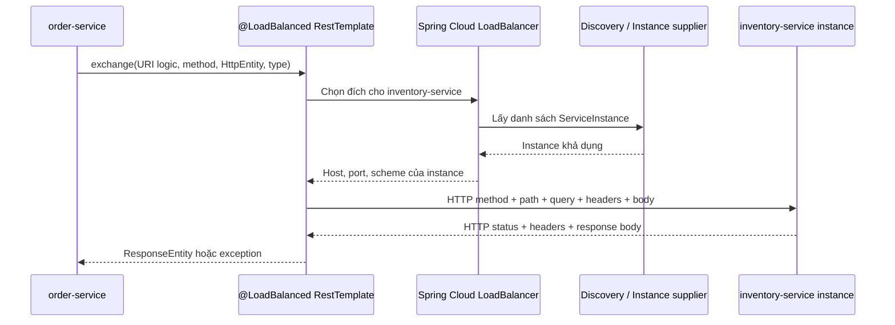

# Gửi path, query, header và body qua lời gọi có cân bằng tải

Một lời gọi HTTP giữa các microservices thường chứa nhiều thành phần hơn một URL đơn giản: **path variable** xác định tài nguyên, **query parameter** diễn đạt điều kiện lọc, **header** mang thông tin xác thực hoặc correlation ID, và **body** mang dữ liệu nghiệp vụ. Khi dùng Spring Cloud LoadBalancer với `RestTemplate`, những thành phần này vẫn được gửi theo cơ chế HTTP thông thường; điểm khác biệt là **host của URL ban đầu là service ID**, không phải địa chỉ vật lý của một bản sao.

Bài học thuộc chương **RestTemplate** của module `SPRING_CLOUD_SERVICE_COMMUNICATION_LOAD_BALANCING`. Chúng ta sẽ xây một client cho `inventory-service`, dùng `@LoadBalanced RestTemplate` để gửi GET và POST, bảo toàn path/query/header/body trong khi LoadBalancer chọn `ServiceInstance` theo discovery và chính sách định tuyến. Phần cuối đề cập encoding, xử lý lỗi, timeout/retry và cách kiểm thử một lời gọi thực sự đi qua LoadBalancer.

## 1. Từ service ID đến HTTP request hoàn chỉnh

Giả sử `order-service` muốn đọc tồn kho cho SKU `SKU-001` ở kho `hcm-01`. API đích nhận:

```http
GET /api/v1/items/SKU-001?warehouse=hcm-01 HTTP/1.1
Accept: application/json
Authorization: Bearer <access-token>
X-Correlation-ID: req-2042
```

`order-service` sử dụng URI logic:

```text
http://inventory-service/api/v1/items/SKU-001?warehouse=hcm-01
       └── service ID ──┘
```

Giả sử discovery trả hai instance:

| Service ID | Instance | Host | Port |
|---|---|---|---:|
| `inventory-service` | `inventory-1` | `10.0.2.11` | 8081 |
| `inventory-service` | `inventory-2` | `10.0.2.12` | 8082 |

LoadBalancer chọn một instance và thay phần đích logic thành địa chỉ của instance đó. Ví dụ request có thể được gửi tới:

```text
http://10.0.2.12:8082/api/v1/items/SKU-001?warehouse=hcm-01
```

**Path, query, header và body không phải đối tượng mà thuật toán round robin/random dùng để thay đổi theo mặc định.** Thuật toán chủ yếu chọn instance; các thành phần HTTP được client giữ theo request đã xây dựng. Nếu dự án cài thêm supplier định tuyến theo request, header hoặc hint có thể **được dùng để quyết định tập instance phù hợp** nhưng không có nghĩa LoadBalancer tự sinh hay tự sửa mọi header.



Trên nhánh không có instance, lỗi phát sinh tại bước chọn đích hoặc tích hợp client; khi đó không nên giả định một HTTP request đã tới service đích.

## 2. Điều kiện để RestTemplate được cân bằng tải

Cần có:

1. Ứng dụng Spring Boot sử dụng Spring Web hoặc có các dependency cần thiết để tạo `RestTemplate`.
2. `spring-cloud-starter-loadbalancer` tương thích với Spring Boot và Spring Cloud BOM đang dùng.
3. Nguồn cung cấp `ServiceInstance`, chẳng hạn Eureka/Consul/Kubernetes discovery hoặc `SimpleDiscoveryClient`.
4. Một bean `RestTemplate` được đánh dấu `@LoadBalanced`.
5. URL dùng đúng **service ID** đã đăng ký.

Ví dụ các dependency Maven cần thiết cho client đồng bộ:

```xml
<dependencies>
    <dependency>
        <groupId>org.springframework.boot</groupId>
        <artifactId>spring-boot-starter-web</artifactId>
    </dependency>

    <dependency>
        <groupId>org.springframework.cloud</groupId>
        <artifactId>spring-cloud-starter-loadbalancer</artifactId>
    </dependency>

    <!-- Chỉ thêm discovery starter phù hợp nếu có registry.
         Ví dụ khi sử dụng Eureka:
    <dependency>
        <groupId>org.springframework.cloud</groupId>
        <artifactId>spring-cloud-starter-netflix-eureka-client</artifactId>
    </dependency>
    -->
</dependencies>
```

Ví dụ giả định dự án đã import `org.springframework.cloud:spring-cloud-dependencies` BOM trong `dependencyManagement`, nên không cần ghi version riêng cho các Spring Cloud starter được BOM quản lý.

### 2.1. Đăng ký bean @LoadBalanced RestTemplate

```java
import org.springframework.cloud.client.loadbalancer.LoadBalanced;
import org.springframework.context.annotation.Bean;
import org.springframework.context.annotation.Configuration;
import org.springframework.web.client.RestTemplate;

@Configuration(proxyBeanMethods = false)
public class HttpClientConfiguration {

    @Bean("loadBalancedRestTemplate")
    @LoadBalanced
    RestTemplate loadBalancedRestTemplate() {
        return new RestTemplate();
    }
}
```

Spring Boot **không tự động tạo sẵn một bean `RestTemplate`** để application inject; cần khai báo bean như trên. Annotation `@LoadBalanced` giúp Spring Cloud gắn tích hợp lựa chọn instance vào bean tương ứng khi các dependency đã có.

Nếu cần một RestTemplate riêng cho URL cố định bên ngoài, có thể cấu hình bean thứ hai:

```java
@Bean("plainRestTemplate")
RestTemplate plainRestTemplate() {
    return new RestTemplate();
}
```

Khi inject, dùng `@Qualifier("loadBalancedRestTemplate")` hoặc qualifier `@LoadBalanced` để tránh lấy nhầm bean thường. Không coi mọi bean RestTemplate đều được load balance chỉ vì ứng dụng đã có Spring Cloud starter.

### 2.2. URI logic khác URI vật lý

| URI | Ý nghĩa |
|---|---|
| `http://inventory-service/api/v1/items` | URI logic: host là service ID, đi qua LoadBalancer |
| `http://10.0.2.12:8082/api/v1/items` | URI vật lý: chỉ đích cụ thể; không có lợi ích discovery cho service ID |
| `http://localhost:8081/api/v1/items` | URI địa phương, thường dùng test một instance |
| `https://inventory-service/api/v1/items` | URI logic dùng HTTPS; scheme thực tế phải phù hợp cấu hình bảo mật của instance |

Không tự phân giải DNS của `inventory-service` trước khi gọi, rồi biến URL thành IP, nếu mục tiêu là chọn instance qua Spring Cloud LoadBalancer. Cũng không đặt cứng host/port trong controller hoặc gateway khi service có thể scale.

## 3. RestTemplate.exchange là phương thức tổng quát

`RestTemplate` có các shortcut như `getForObject`, `getForEntity`, `postForEntity`. Nhưng khi phải gửi **header tùy chỉnh và body cùng một lời gọi**, `exchange` thường rõ ràng hơn:

```java
<T> ResponseEntity<T> exchange(
        URI url,
        HttpMethod method,
        HttpEntity<?> requestEntity,
        Class<T> responseType);
```

Các thành phần:

| Tham số | Vai trò |
|---|---|
| `URI url` | Scheme, service ID, path, query đã được dựng và encode |
| `HttpMethod method` | `GET`, `POST`, `PUT`, `PATCH`, `DELETE`, ... |
| `HttpEntity<?> requestEntity` | Header và body outbound |
| `Class<T> responseType` | Kiểu dữ liệu response được chuyển từ JSON/XML/... theo message converter |

Kết quả `ResponseEntity<T>` cho phép đọc đồng thời `getStatusCode()`, `getHeaders()` và `getBody()`.

Đối với GET thông thường, dùng `HttpEntity<Void>` chỉ chứa header. Đối với POST/PUT, dùng `HttpEntity<Payload>` với DTO làm body.

**Lưu ý:** `exchange` không tự retry và không tự thiết lập timeout chỉ vì caller truyền nhiều thành phần HTTP. Cần cấu hình các phần đó riêng.

## 4. Gửi path variable an toàn

Một cách gọi ngắn gọn dùng URI template:

```java
ResponseEntity<ItemView> response = restTemplate.getForEntity(
        "http://inventory-service/api/v1/items/{sku}",
        ItemView.class,
        "SKU-001");
```

Hoặc dùng named variables:

```java
Map<String, ?> values = Map.of("sku", "SKU-001");

ResponseEntity<ItemView> response = restTemplate.getForEntity(
        "http://inventory-service/api/v1/items/{sku}",
        ItemView.class,
        values);
```

Spring sẽ thay `{sku}` bằng giá trị thích hợp. Tuy nhiên, khi giá trị có ký tự đặc biệt như dấu cách, dấu `/` hoặc dấu `+`, cần hiểu chế độ encode URI đang sử dụng.

### 4.1. Dựng URI bằng UriComponentsBuilder

Cách rõ ràng để kiểm soát encoding là **encode template trước, rồi mới expand biến**:

```java
import java.net.URI;
import org.springframework.web.util.UriComponentsBuilder;

String sku = "SKU/2026";

URI uri = UriComponentsBuilder
        .fromUriString("http://inventory-service")
        .path("/api/v1/items/{sku}")
        .encode()
        .buildAndExpand(sku)
        .toUri();

// raw path kỳ vọng:
// /api/v1/items/SKU%2F2026
```

`UriComponentsBuilder.encode()` trước `buildAndExpand(...)` giúp các ký tự có ý nghĩa dành riêng trong **giá trị biến** được mã hóa như dữ liệu. Nếu nối `sku` vào URL trước khi encode, dấu `/` có thể bị xem là dấu phân cách path segment.

Không tự nối:

```java
// Không nên: không kiểm soát encoding/path segmentation.
String url = "http://inventory-service/api/v1/items/" + sku;
```

Có thể dùng `pathSegment("api", "v1", "items", "{sku}")` khi muốn diễn đạt path rõ ràng theo segment. Tuy vậy, việc servlet hoặc gateway phía đích có cho phép encoded slash (`%2F`) hay không còn phụ thuộc cấu hình server và bảo mật; encode đúng không có nghĩa mọi router đều chấp nhận SKU chứa slash.

## 5. Gửi query parameter

Query parameter thuộc URI, sau dấu `?`. Ví dụ endpoint có các điều kiện:

```http
GET /api/v1/items/SKU-001?warehouse=hcm-01&includeReserved=true HTTP/1.1
```

Dùng builder:

```java
URI uri = UriComponentsBuilder
        .fromUriString("http://inventory-service")
        .path("/api/v1/items/{sku}")
        .queryParam("warehouse", "{warehouse}")
        .queryParam("includeReserved", "{reserved}")
        .encode()
        .buildAndExpand(
                Map.of(
                        "sku", "SKU-001",
                        "warehouse", "hcm-01",
                        "reserved", true))
        .toUri();
```

Kết quả giữ đúng host logic `inventory-service`, path được expand và query được serialize cùng request.

### 5.1. Query chứa khoảng trắng, &, + hoặc ký tự tiếng Việt

Ví dụ tìm kiếm với từ khóa `áo + đỏ&xanh`:

```java
URI uri = UriComponentsBuilder
        .fromUriString("http://catalog-service")
        .path("/api/v1/search")
        .queryParam("q", "{keyword}")
        .encode()
        .buildAndExpand("áo + đỏ&xanh")
        .toUri();
```

Khi encode template trước khi expand, ký tự `+` và `&` trong **giá trị biến** được encode để không bị hiểu thành cú pháp query. Không tự thay khoảng trắng bằng `+` rồi lại encode lần nữa.

Khi đã có `java.net.URI` được dựng và encode đúng, hãy truyền trực tiếp **URI object** vào overload `RestTemplate.exchange(URI, ...)` hoặc `getForEntity(URI, ...)`. Điều này tránh việc RestTemplate lại xử lý chuỗi như một URI template cần encode.

### 5.2. Query lặp và query tùy chọn

Một API có thể nhận nhiều tag:

```java
URI uri = UriComponentsBuilder
        .fromUriString("http://catalog-service")
        .path("/api/v1/items")
        .queryParam("tag", "sale", "featured")
        .queryParam("page", 2)
        .build()
        .toUri();
```

Query có thể chứa `tag=sale&tag=featured&page=2`. Nếu một tham số không được cung cấp, chỉ thêm `queryParam` khi có giá trị hợp lệ thay vì cố đưa `null` vào builder; API phía đích cần được thống nhất việc tham số vắng mặt và chuỗi rỗng có khác nhau không.

### 5.3. Không đưa bí mật vào query

Không đặt access token, mật khẩu, khóa API có tính bí mật hoặc dữ liệu nhạy cảm vào query string nếu có thể tránh. URI thường xuất hiện trong access log, metrics, tracing hoặc hệ thống proxy. Token thường thuộc `Authorization` header theo thiết kế xác thực của API.

## 6. Gửi header qua HttpHeaders

Header mang thông tin ngoài nội dung URI, ví dụ:

- `Accept: application/json`: client mong đợi JSON.
- `Authorization: Bearer ...`: xác thực tới service đích.
- `X-Correlation-ID` hoặc `traceparent`: truy vết một giao dịch.
- `X-Request-Source`: ngữ cảnh nghiệp vụ nếu được định nghĩa.
- `Idempotency-Key`: bảo vệ thao tác ghi khi có khả năng retry.
- `Content-Type: application/json`: định dạng body gửi đi.

Ví dụ tạo header:

```java
import java.util.List;
import org.springframework.http.HttpHeaders;
import org.springframework.http.MediaType;

HttpHeaders headers = new HttpHeaders();
headers.setAccept(List.of(MediaType.APPLICATION_JSON));
headers.setBearerAuth(accessToken);
headers.set("X-Correlation-ID", correlationId);
```

`setBearerAuth(accessToken)` nhận **token thô**, không truyền nguyên chuỗi `"Bearer <token>"` vì hàm sẽ tạo scheme `Bearer` cho bạn.

**Header không tự động được chuyển tiếp từ inbound request.** Nếu controller của `order-service` nhận `X-Correlation-ID` từ caller, gateway phải chủ động lấy, kiểm tra rồi gắn header outbound. Chỉ chuyển tiếp những header được cho phép, tránh sao chép toàn bộ header có cookie hoặc Authorization không dành cho service đích.

### 6.1. Gửi GET có header

```java
HttpEntity<Void> request =
        new HttpEntity<>(null, headers);

ResponseEntity<ItemView> response = restTemplate.exchange(
        uri,
        HttpMethod.GET,
        request,
        ItemView.class);
```

Với GET này, `request` chỉ chứa header. `HttpEntity<Void>` không có body; response có thể chứa status, response headers và DTO.

### 6.2. Thêm header động nhưng không làm rò rỉ dữ liệu

Không ghi toàn bộ `Authorization` vào log. Nếu cần phân tích một request, ghi `correlationId`, service ID, path template, status, thời gian và mã lỗi thay vì raw token.

Không cho người dùng bên ngoài quyết định tùy ý header nội bộ như zone, hint hoặc tenant nếu các giá trị đó ảnh hưởng tới chính sách định tuyến/bảo mật. Áp dụng allowlist và phân quyền trước khi chuyển thành outbound header.

## 7. Gửi JSON body bằng HttpEntity

Với thao tác giữ hàng, `order-service` gọi:

```http
POST /api/v1/reservations?source=checkout HTTP/1.1
Content-Type: application/json
Accept: application/json
Authorization: Bearer <access-token>
Idempotency-Key: checkout-evt-2042

{
  "sku": "SKU-001",
  "quantity": 2
}
```

Body là một object được Spring message converter (thường là Jackson khi có Spring Web/Jackson) serialize thành JSON.

DTO minh họa bằng Java record:

```java
public record ReserveStockRequest(
        String sku,
        int quantity) {
}

public record ReserveStockResponse(
        String reservationId,
        String status) {
}
```

Dựng URI và entity:

```java
URI uri = UriComponentsBuilder
        .fromUriString("http://inventory-service")
        .path("/api/v1/reservations")
        .queryParam("source", "{source}")
        .encode()
        .buildAndExpand("checkout")
        .toUri();

HttpHeaders headers = new HttpHeaders();
headers.setContentType(MediaType.APPLICATION_JSON);
headers.setAccept(List.of(MediaType.APPLICATION_JSON));
headers.setBearerAuth(accessToken);
headers.set("Idempotency-Key", idempotencyKey);

ReserveStockRequest body =
        new ReserveStockRequest("SKU-001", 2);

HttpEntity<ReserveStockRequest> request =
        new HttpEntity<>(body, headers);

ResponseEntity<ReserveStockResponse> response =
        restTemplate.exchange(
                uri,
                HttpMethod.POST,
                request,
                ReserveStockResponse.class);
```

Trong ví dụ:

| Phần | Giá trị | Nguồn |
|---|---|---|
| Service ID | `inventory-service` | Host logic của URI |
| Path | `/api/v1/reservations` | `UriComponentsBuilder.path(...)` |
| Query | `source=checkout` | `queryParam(...)` |
| Header | `Authorization`, `Content-Type`, `Idempotency-Key` | `HttpHeaders` |
| Body | JSON chứa `sku` và `quantity` | `HttpEntity<ReserveStockRequest>` |
| Đích vật lý | Một `ServiceInstance` khả dụng | Spring Cloud LoadBalancer |

**Không tự set header `Host` thành IP của instance**, cũng không hard-code URI vật lý. LoadBalancer xử lý việc chọn đích, còn HTTP client thực hiện gửi request theo kết quả đó.

### 7.1. PUT, PATCH và DELETE

`exchange` cũng hỗ trợ `HttpMethod.PUT`, `HttpMethod.PATCH` và `HttpMethod.DELETE`, tùy request factory và server đích. Ví dụ cập nhật một tài nguyên:

```java
HttpEntity<UpdateItemRequest> request =
        new HttpEntity<>(updateBody, headers);

restTemplate.exchange(
        "http://inventory-service/api/v1/items/{sku}",
        HttpMethod.PUT,
        request,
        Void.class,
        sku);
```

Đây là cú pháp minh họa. Nếu SKU có ký tự đặc biệt, dùng URI builder như các phần trước. Hỗ trợ PATCH có thể phụ thuộc HTTP client/request factory thực tế; không giả định mọi implementation JDK đều xử lý PATCH như nhau.

`DELETE` thường không có body, nhưng nếu API đích yêu cầu body thì `exchange` cho phép mô hình hóa request entity tùy khả năng HTTP client và hợp đồng API. Không dựa vào body của DELETE trừ khi đã thống nhất với phía server và các proxy trung gian.

## 8. Ví dụ tổng hợp: Gateway gửi đủ path, query, header, body

Một lớp gateway nhận bean `RestTemplate` load-balanced qua qualifier, cung cấp hai method: đọc một mặt hàng và tạo một yêu cầu giữ hàng.

```java
package com.example.order.inventory;

import java.net.URI;
import java.util.List;
import java.util.Map;
import java.util.Objects;

import org.springframework.beans.factory.annotation.Qualifier;
import org.springframework.http.HttpEntity;
import org.springframework.http.HttpHeaders;
import org.springframework.http.HttpMethod;
import org.springframework.http.MediaType;
import org.springframework.http.ResponseEntity;
import org.springframework.stereotype.Service;
import org.springframework.web.client.RestTemplate;
import org.springframework.web.util.UriComponentsBuilder;

@Service
public class InventoryGateway {

    private final RestTemplate restTemplate;

    public InventoryGateway(
            @Qualifier("loadBalancedRestTemplate")
            RestTemplate restTemplate) {
        this.restTemplate = restTemplate;
    }

    public ItemView findItem(
            String sku,
            String warehouse,
            String accessToken,
            String correlationId) {

        URI uri = UriComponentsBuilder
                .fromUriString("http://inventory-service")
                .path("/api/v1/items/{sku}")
                .queryParam("warehouse", "{warehouse}")
                .encode()
                .buildAndExpand(
                        Map.of(
                                "sku", sku,
                                "warehouse", warehouse))
                .toUri();

        HttpHeaders headers = new HttpHeaders();
        headers.setAccept(List.of(MediaType.APPLICATION_JSON));
        headers.setBearerAuth(accessToken);
        headers.set("X-Correlation-ID", correlationId);

        HttpEntity<Void> request =
                new HttpEntity<>(null, headers);

        ResponseEntity<ItemView> response =
                restTemplate.exchange(
                        uri,
                        HttpMethod.GET,
                        request,
                        ItemView.class);

        return Objects.requireNonNull(
                response.getBody(),
                "Inventory response body is empty");
    }

    public ReserveStockResponse reserve(
            String sku,
            int quantity,
            String accessToken,
            String idempotencyKey) {

        URI uri = UriComponentsBuilder
                .fromUriString("http://inventory-service")
                .path("/api/v1/reservations")
                .queryParam("source", "{source}")
                .encode()
                .buildAndExpand("checkout")
                .toUri();

        HttpHeaders headers = new HttpHeaders();
        headers.setContentType(MediaType.APPLICATION_JSON);
        headers.setAccept(List.of(MediaType.APPLICATION_JSON));
        headers.setBearerAuth(accessToken);
        headers.set("Idempotency-Key", idempotencyKey);

        ReserveStockRequest body =
                new ReserveStockRequest(sku, quantity);

        HttpEntity<ReserveStockRequest> request =
                new HttpEntity<>(body, headers);

        ResponseEntity<ReserveStockResponse> response =
                restTemplate.exchange(
                        uri,
                        HttpMethod.POST,
                        request,
                        ReserveStockResponse.class);

        return Objects.requireNonNull(
                response.getBody(),
                "Reservation response body is empty");
    }
}
```

Các kiểu DTO minh họa cần được khai báo trong project, ví dụ:

```java
package com.example.order.inventory;

public record ItemView(
        String sku,
        int available,
        String servedBy) {
}

public record ReserveStockRequest(
        String sku,
        int quantity) {
}

public record ReserveStockResponse(
        String reservationId,
        String status) {
}
```

Mã minh họa dùng Java có hỗ trợ `record` (chẳng hạn Java 17 trở lên), Spring Web và Spring Cloud Commons/LoadBalancer đã được cấu hình. Phía `inventory-service` cần có API tương ứng với contract và có các message converter thích hợp.

Ở lớp gateway, không tự tạo `new RestTemplate()` vì bean mới đó không được Spring Cloud bổ sung LoadBalancer interceptor như bean đã được cấu hình. Cũng không gắn vào đó các địa chỉ instance dạng `10.0.2.x`.

### 8.1. ResponseEntity và response body rỗng

`getBody()` có thể trả `null` nếu API trả status không có body, ví dụ `204 No Content`. Ví dụ tổng hợp dùng `Objects.requireNonNull` để thể hiện rõ hợp đồng **bắt buộc trả JSON body**. Trong code production, nên chuyển tình huống này thành lỗi có loại rõ ràng hoặc trả kiểu `Optional` tùy thiết kế API, không để exception mơ hồ.

## 9. Path và query với danh sách hoặc kiểu response phức tạp

Khi API trả một danh sách DTO, generic type bị xóa ở runtime nếu chỉ truyền `List.class`. Dùng `ParameterizedTypeReference`:

```java
import java.net.URI;
import java.util.List;

import org.springframework.core.ParameterizedTypeReference;
import org.springframework.http.HttpEntity;
import org.springframework.http.HttpMethod;
import org.springframework.http.ResponseEntity;

URI uri = UriComponentsBuilder
        .fromUriString("http://inventory-service")
        .path("/api/v1/items")
        .queryParam("warehouse", "{warehouse}")
        .encode()
        .buildAndExpand("hcm-01")
        .toUri();

ResponseEntity<List<ItemView>> response =
        restTemplate.exchange(
                uri,
                HttpMethod.GET,
                new HttpEntity<Void>(null, headers),
                new ParameterizedTypeReference<List<ItemView>>() {});
```

Cách này giúp Jackson và `RestTemplate` biết kiểu item trong danh sách, thay vì chỉ biết một `List` thô.

Nếu API trả trang dữ liệu, khai báo DTO kiểu `PageResponse<ItemView>` hoặc một record wrapper phù hợp, rồi dùng `ParameterizedTypeReference<PageResponse<ItemView>>`.

### 9.1. Giữ service ID khi dựng URI động

Dù path hoặc query có thay đổi, **base URI logic** vẫn phải phù hợp:

```text
http://inventory-service
  ├─ /api/v1/items/{sku}?warehouse={warehouse}
  └─ /api/v1/reservations?source={source}
```

Không xây host từ tham số không tin cậy do người dùng gửi. Nếu caller có thể thay cả scheme/host, request có thể bị chuyển sang đích ngoài chính sách discovery và tạo rủi ro SSRF. Chỉ cho phép các service ID và endpoint đã được ứng dụng định nghĩa.

## 10. Thiết lập timeout cho lời gọi đồng bộ

`RestTemplate` là client đồng bộ: thread gọi thường chờ kết quả cho đến khi nhận phản hồi hoặc gặp lỗi/timeout. Load balancing không thay thế connect timeout hay read timeout.

Ví dụ dùng `SimpleClientHttpRequestFactory`:

```java
import org.springframework.cloud.client.loadbalancer.LoadBalanced;
import org.springframework.context.annotation.Bean;
import org.springframework.context.annotation.Configuration;
import org.springframework.http.client.SimpleClientHttpRequestFactory;
import org.springframework.web.client.RestTemplate;

@Configuration(proxyBeanMethods = false)
class TimedRestTemplateConfiguration {

    @Bean("loadBalancedRestTemplate")
    @LoadBalanced
    RestTemplate loadBalancedRestTemplate() {
        SimpleClientHttpRequestFactory factory =
                new SimpleClientHttpRequestFactory();

        factory.setConnectTimeout(2_000);
        factory.setReadTimeout(5_000);

        return new RestTemplate(factory);
    }
}
```

Các giá trị millisecond ở đây chỉ là ví dụ. Sử dụng **một trong hai** cấu hình bean `loadBalancedRestTemplate` ở mục 2 hoặc mục 10; không khai báo trùng cùng tên trong ứng dụng.

Trong hệ thống thực, có thể dùng request factory với connection pooling và hỗ trợ TLS phù hợp. Cần cấu hình connect/read timeout theo thư viện HTTP bên dưới và xác minh phiên bản Spring Boot/Spring Framework đang dùng. Connect/read timeout không mặc nhiên tạo **deadline tổng cho nhiều lần retry**.

Nếu một request trải qua service discovery, chọn instance, kết nối HTTP và retry, hãy tính ngân sách thời gian toàn luồng. Tránh để một request giữ thread quá lâu hoặc timeout chồng nhiều tầng.

## 11. Xử lý lỗi theo đúng vị trí phát sinh

Một request có thể thất bại ở nhiều lớp:

| Tình huống | Vị trí | Biểu hiện có thể |
|---|---|---|
| Sai service ID | Discovery/supplier | Không có ứng viên cho tên service |
| Không còn instance hợp lệ | LoadBalancer | Lỗi không chọn được đích hoặc response lỗi tùy integration |
| Instance đã dừng | Network | Connection refused hoặc timeout |
| Token hết hạn | Service đích | HTTP 401/403 |
| SKU không tồn tại | Service đích | HTTP 404 |
| Service đích quá tải | Service đích | HTTP 429/503 |
| DTO/JSON sai contract | Message converter | Lỗi parse/serialize |
| Body response rỗng | API contract | `getBody() == null` |

`RestTemplate` mặc định thường ném exception khi response có status 4xx hoặc 5xx:

- `HttpClientErrorException` cho 4xx.
- `HttpServerErrorException` cho 5xx.
- `ResourceAccessException` cho một số lỗi I/O, bao gồm lỗi kết nối/timeout.
- `RestClientException` là kiểu cha của nhiều lỗi từ RestTemplate.

Ví dụ phân loại:

```java
try {
    ItemView item = inventoryGateway.findItem(
            sku, warehouse, accessToken, correlationId);
    return item;
} catch (HttpClientErrorException.NotFound ex) {
    // SKU không có ở service đích; xử lý theo nghiệp vụ.
    throw new ItemUnavailableException(sku, ex);
} catch (HttpServerErrorException ex) {
    // Service đích trả 5xx; ghi nhận dependency failure.
    throw new DependencyUnavailableException(
            "inventory-service returned 5xx", ex);
} catch (ResourceAccessException ex) {
    // Có thể là timeout hoặc network I/O failure.
    throw new DependencyUnavailableException(
            "inventory-service transport failure", ex);
}
```

`ItemUnavailableException` và `DependencyUnavailableException` ở trên là **exception ứng dụng tự định nghĩa**, không phải class có sẵn của Spring. Nếu dùng đoạn mã, cần tạo các class này và import `org.springframework.web.client.*` phù hợp.

**Quan trọng:** khi LoadBalancer không có instance, cách lỗi biểu hiện có thể thay đổi theo phiên bản/tích hợp `BlockingLoadBalancerClient` và error handler. Không coi mọi trường hợp đều là `HttpServerErrorException` hoặc mọi trường hợp đều ném cùng một exception; hãy kiểm tra integration test của project.

### 11.1. Đừng nuốt lỗi để trả dữ liệu giả

Nếu không có instance hoặc dependency timeout, không nên tự trả “tồn kho còn 0” để tránh báo lỗi. Giá trị giả có thể bị diễn giải là kết quả nghiệp vụ thật, dẫn tới hủy đơn hoặc ra quyết định sai.

Khi có fallback, hãy định nghĩa rõ nguồn dữ liệu, tuổi dữ liệu tối đa và trạng thái `degraded`. Với giao dịch giữ hàng, thường nên fail sớm thay vì giả định đã đặt thành công.

## 12. Retry và tính an toàn của body

Một request GET đọc trạng thái thường phù hợp hơn với retry có kiểm soát so với POST tạo reservation. Với POST, client có thể timeout **sau khi server đã xử lý xong**, vì vậy gửi lại có nguy cơ tạo hai reservation.

Khi thiết kế retry:

1. Phân loại lỗi có khả năng tạm thời, ví dụ connection reset hoặc một số status 5xx.
2. Giới hạn số lượt retry, backoff và deadline tổng.
3. Tránh retry lỗi xác thực hoặc lỗi cấu hình như sai service ID.
4. Với request ghi, yêu cầu **idempotency key** và logic deduplicate phía server trước khi tự động retry.
5. Kiểm tra chính sách retry của cả LoadBalancer, HTTP client và các tầng khác để tránh retry chồng nhau.
6. Quan sát retry count, instance được chọn, trạng thái cuối và tổng latency.

Spring Cloud LoadBalancer có cơ chế retry tùy phiên bản và dependency. Với `RestTemplate` blocking, tài liệu Spring Cloud mô tả hỗ trợ Spring Retry khi thư viện cần thiết có trên classpath; mặc định không nên giả định request tự retry. Có thể tắt retry LoadBalancer bằng cấu hình:

```yaml
spring:
  cloud:
    loadbalancer:
      retry:
        enabled: false
```

Dùng chính sách retry phù hợp với bản Spring Cloud BOM của ứng dụng; không đặt lại body theo một cách khiến stream hoặc resource không còn có thể đọc lại ở lần retry. JSON DTO thông thường dễ tái tạo hơn body dạng input stream, nhưng **tính khả dụng của body không đồng nghĩa thao tác nghiệp vụ an toàn để lặp lại**.

## 13. Kiểm thử path, query, header, body và lựa chọn instance

Bài thực hành nên kiểm tra hai tầng: **tạo đúng HTTP request** và **đi qua LoadBalancer để chọn instance thật**.

### 13.1. Kiểm tra URI encoding bằng unit test

```java
import java.net.URI;

import org.junit.jupiter.api.Test;
import org.springframework.web.util.UriComponentsBuilder;

import static org.junit.jupiter.api.Assertions.assertEquals;

class InventoryUriTest {

    @Test
    void pathAndQueryAreEncodedAsValues() {
        URI uri = UriComponentsBuilder
                .fromUriString("http://inventory-service")
                .path("/api/v1/items/{sku}")
                .queryParam("warehouse", "{warehouse}")
                .encode()
                .buildAndExpand("SKU/2026", "HCM + 01")
                .toUri();

        assertEquals("inventory-service", uri.getHost());
        assertEquals(
                "/api/v1/items/SKU%2F2026",
                uri.getRawPath());
        assertEquals(
                "warehouse=HCM%20%2B%2001",
                uri.getRawQuery());
    }
}
```

Test này kiểm tra URI được xây đúng, không chứng minh LoadBalancer đã chọn instance. Nó giúp tách lỗi URI encoding khỏi lỗi service discovery.

### 13.2. Thử LoadBalancer không cần registry thật

Nếu không có Eureka/Consul, có thể dùng `SimpleDiscoveryClient` để khai báo các instance cố định. Ví dụ trong file properties của **client**:

```properties
spring.cloud.discovery.client.simple.instances.inventory-service[0].uri=http://localhost:8081
spring.cloud.discovery.client.simple.instances.inventory-service[1].uri=http://localhost:8082
```

Cần chạy hai instance `inventory-service` ở port 8081 và 8082 với cùng API `/api/v1/items/{sku}` và `/api/v1/reservations`, sau đó khởi động `order-service` ở một port khác.

Gửi nhiều request tới gateway:

- Xác nhận phía server đích nhận đúng **SKU sau khi decode** và query `warehouse`.
- Kiểm tra `Authorization`/correlation ID có mặt theo contract, nhưng không in token thô vào log.
- Với POST, xác nhận server nhận JSON `sku` và `quantity`, cùng `Idempotency-Key`.
- Ghi instance ID trả về (chẳng hạn trường `servedBy`) để quan sát request đi đến các bản sao khác nhau.
- Dừng một instance rồi quan sát thay đổi ở nguồn instance/health check và lỗi, tránh kết luận round robin tự loại instance chết nếu danh sách đầu vào chưa được cập nhật.

**SimpleDiscoveryClient là nguồn danh sách tĩnh.** Nó không tự cung cấp đầy đủ cơ chế đăng ký, deregister hoặc health của service registry thật. Khi cần thử khôi phục discovery, hãy dùng môi trường registry hoặc supplier giả lập có thể cập nhật danh sách.

### 13.3. Vì sao mock HTTP không đủ để chứng minh cân bằng tải?

`MockRestServiceServer` hoặc mock trực tiếp `RestTemplate.exchange(...)` có thể xác minh URI/header/body ở tầng client, nhưng không nhất thiết xác nhận quá trình Spring Cloud chọn `ServiceInstance` đã được thực thi. Nếu test thay thế toàn bộ request execution chain, nó có thể bỏ qua interceptor của LoadBalancer.

Nên tách:

| Loại test | Xác nhận |
|---|---|
| Unit test URI | Path và query được expand/encode đúng |
| Test HTTP request | Header, Content-Type, JSON body, status/response mapping đúng |
| Integration test LoadBalancer | Service ID được giải quyết sang host/port của một instance |
| Test failure/retry | Khi không có instance hoặc endpoint timeout, ứng dụng xử lý đúng |
| Test observability | Có service ID, số lần chọn, kết quả và lỗi, không lộ token |

Nếu hệ thống chọn instance bằng round robin, kiểm tra một dãy request đủ dài và điều kiện tuần tự để quan sát phân phối. Không gắn chặt kỳ vọng thứ tự A/B vào những phép thử có nhiều client, retry, concurrent requests hoặc supplier thay đổi.

## 14. Quan sát lời gọi RestTemplate load-balanced

Khi chẩn đoán, cần biết request nào đang được xử lý, service ID được tra cứu và instance cuối nào được chọn. Có thể dùng Spring Cloud LoadBalancer metrics/lifecycle cùng logging HTTP có kiểm soát.

Các thông tin gợi ý:

| Trường | Ý nghĩa |
|---|---|
| `serviceId` | `inventory-service` |
| `httpMethod` | GET/POST/PUT |
| `pathTemplate` | `/api/v1/items/{sku}` thay vì ghi SKU thật làm label |
| `requestId` / `traceId` | Ghép các log qua dịch vụ |
| `selectionOutcome` | Chọn được instance hay không |
| `selectedInstanceId` | Đích đã chọn (log/trace có kiểm soát) |
| `responseStatus` | HTTP status từ dependency |
| `elapsedMillis` | Độ trễ gọi HTTP |
| `retryAttempts` | Số lần thử lại |
| `failureCategory` | No instance, timeout, network, 4xx, 5xx, conversion |

Đừng đưa mỗi SKU hoặc URI hoàn chỉnh vào tag metric nếu các giá trị quá nhiều, vì sẽ làm tăng cardinality. Đối với Spring Cloud LoadBalancer khi dùng RestTemplate, tài liệu chính thức khuyến nghị cân nhắc:

```yaml
spring:
  cloud:
    loadbalancer:
      stats:
        include-path: false
```

Property trên giúp tránh việc ghi path có cardinality cao vào một số nhãn metric của LoadBalancer khi bật tính năng thống kê tương ứng.

### 14.1. Kết nối truy vết với request header

Nếu hệ thống đã có Micrometer Tracing hoặc công cụ tracing khác, ưu tiên cơ chế propagation chuẩn thay vì tự phát minh trace ID. Header `X-Correlation-ID` trong bài chỉ là ví dụ giúp liên hệ inbound/outbound request; nó không tự đảm bảo distributed tracing end-to-end nếu không có instrumentation tương ứng.

## 15. Những lỗi thường gặp

| Hiện tượng | Nguyên nhân có thể | Cách kiểm tra |
|---|---|---|
| `UnknownHostException: inventory-service` | Inject nhầm RestTemplate thường hoặc chưa có interceptor LoadBalancer | Kiểm tra bean `@LoadBalanced` và `@Qualifier` |
| “No instances available” | Sai service ID, discovery chưa có bản sao hoặc supplier lọc hết | Kiểm tra tên service và danh sách `ServiceInstance` |
| Path chứa `/` tạo thêm segment | Nối chuỗi URL hoặc encode sai thứ tự | Dùng `UriComponentsBuilder.encode().buildAndExpand(...)` |
| Query `+` hoặc `&` bị hiểu sai | Ghép chuỗi query/encode không phù hợp | Dùng `queryParam` và URI object |
| Header thiếu ở service đích | Tạo HttpHeaders nhưng không đưa vào `HttpEntity`, hoặc inbound không được chuyển outbound | Kiểm tra `exchange` và request thực tế |
| Server nhận body rỗng | Chỉ truyền headers, quên DTO trong `HttpEntity` | Kiểm tra payload và Content-Type |
| HTTP 400/415 | JSON field sai hoặc Content-Type không đúng | So DTO contract và message converter |
| Response 404/500 ném exception | `DefaultResponseErrorHandler` của RestTemplate | Bắt đúng exception hoặc cấu hình error handler có chủ đích |
| Timeout khi một instance chết | Discovery/cache/health chưa bỏ instance hoặc request timeout chưa cấu hình | Kiểm tra supplier, freshness và request factory |
| POST tạo trùng reservation | Retry thao tác ghi không có idempotency | Dùng idempotency key và deduplicate phía server |
| Lúc test chọn được instance, lúc khác không | Dữ liệu discovery/health/cache thay đổi hoặc nhiều request đồng thời | Ghi nhận danh sách instance và các bước lọc |

Một vấn đề chỉ xuất hiện sau khi gọi nhiều lần chưa chắc do `RestTemplate.exchange(...)`. Nếu danh sách instance có bản sao lỗi, cùng một đoạn mã có thể thành công khi chọn bản sao khỏe và timeout khi chọn bản sao lỗi. Hãy kiểm tra **nguồn instance và thuật toán chọn** trước khi thay code tạo path/query/header/body.

## 16. Checklist triển khai

Trước khi đưa một RestTemplate client vào production, cần xác nhận:

1. `RestTemplate` được khai báo thành bean `@LoadBalanced`.
2. Dự án có `spring-cloud-starter-loadbalancer` và nguồn `ServiceInstance` thích hợp.
3. URL sử dụng service ID, không hard-code host của một instance.
4. Path/query được dựng bằng URI template hoặc `UriComponentsBuilder` với encoding đã kiểm tra.
5. Header cần thiết được đặt vào `HttpHeaders` và được gửi qua `HttpEntity`.
6. Body của POST/PUT tương thích Content-Type và DTO mà service đích chấp nhận.
7. Response body rỗng, 4xx/5xx và network exception được xử lý theo hợp đồng API.
8. Connect/read timeout và tổng thời gian retry được giới hạn phù hợp.
9. Thao tác ghi chỉ được retry khi có biện pháp chống lặp hoặc hợp đồng idempotent.
10. Test tích hợp chứng minh service ID được giải quyết sang instance và dữ liệu HTTP được giữ nguyên.
11. Log/metric có request context để chẩn đoán nhưng không lộ token hoặc làm tăng cardinality không kiểm soát.

## 17. Kết luận

`@LoadBalanced RestTemplate` cho phép ứng dụng gọi `http://inventory-service/...` mà không cần biết host/port của từng bản sao. Spring Cloud LoadBalancer chịu trách nhiệm chọn `ServiceInstance` dựa trên service ID và danh sách do discovery/supplier cung cấp; còn `RestTemplate` gửi **HTTP method, path, query, header và body** theo request được dựng.

Khi cần truyền nhiều thành phần trong một lời gọi, hãy xây `URI` an toàn bằng `UriComponentsBuilder`, dùng `HttpHeaders` cho header, `HttpEntity` cho header và body, rồi gọi `exchange(...)` để nhận `ResponseEntity`. Kết hợp kiểm thử encoding, test tích hợp LoadBalancer, timeout/retry có giới hạn và observability sẽ giúp lời gọi đồng bộ giữa các dịch vụ đáng tin cậy hơn.

Trong dự án Spring mới, có thể ưu tiên `RestClient` cho API đồng bộ hiện đại; `RestTemplate` vẫn quan trọng để hiểu và duy trì những ứng dụng đang sử dụng nó. Các nguyên tắc về service ID, encoding và ranh giới giữa lựa chọn instance với dữ liệu HTTP đều có thể áp dụng khi chuyển sang client khác.

### Tài liệu tham khảo

- [Spring Cloud Commons — Spring RestTemplate as a LoadBalancer Client](https://docs.spring.io/spring-cloud-commons/reference/spring-cloud-commons/common-abstractions.html) — cấu hình `@LoadBalanced RestTemplate`, service ID và retry.
- [Spring Framework — REST Clients](https://docs.spring.io/spring-framework/reference/integration/rest-clients.html) — API `RestTemplate`, `HttpEntity`, `ResponseEntity` và HTTP client behavior.
- [Spring Framework — URI Links](https://docs.spring.io/spring-framework/reference/web/webmvc/mvc-uri-building.html) — `UriComponentsBuilder`, encoding URI templates và giá trị biến.
- [Spring Cloud Commons — SimpleDiscoveryClient](https://docs.spring.io/spring-cloud-commons/reference/spring-cloud-commons/common-abstractions.html) — khai báo instance tĩnh qua properties để thử nghiệm.

