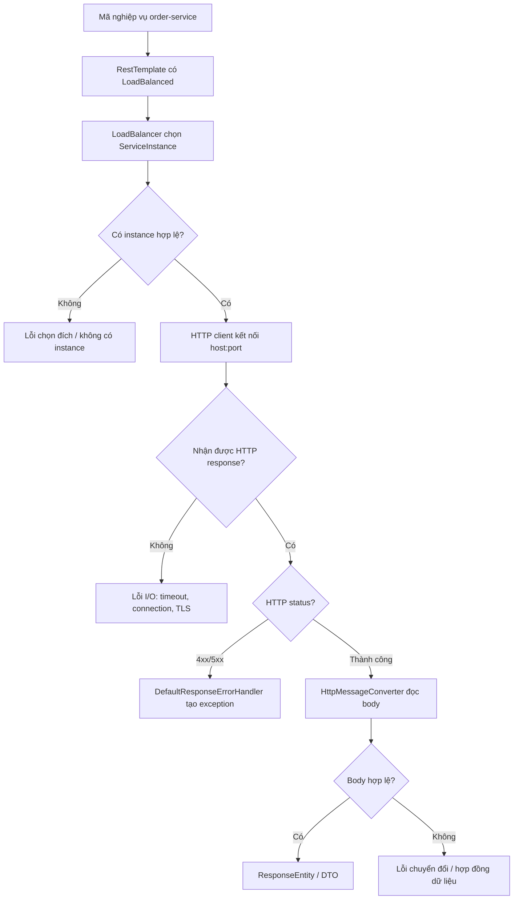

# Đọc response và ánh xạ lỗi HTTP

Khi dùng `RestTemplate` để gọi một dịch vụ qua Spring Cloud LoadBalancer, việc chọn đúng `ServiceInstance` mới chỉ hoàn tất **bước định tuyến**. Ứng dụng gọi còn phải đọc HTTP status, headers và body, chuyển dữ liệu JSON thành kiểu Java, đồng thời phân biệt lỗi nghiệp vụ của dịch vụ đích với lỗi mạng hoặc lỗi tìm instance. Nếu gom mọi thất bại thành một ngoại lệ chung, mã nghiệp vụ sẽ khó quyết định nên trả `404`, thông báo phụ thuộc tạm thời không khả dụng, thử lại có kiểm soát hay sửa request.

Bài này nằm trong phần **RestTemplate** của module Spring Cloud LoadBalancer. Mục tiêu là biết cách đọc response thành dữ liệu có kiểu, hiểu hành vi báo lỗi mặc định của `RestTemplate`, ánh xạ lỗi HTTP thành ngoại lệ phù hợp với nghiệp vụ và quan sát được lỗi ở từng tầng giao tiếp giữa các dịch vụ.

## 1. Một lời gọi HTTP có những kết quả nào?

Giả sử `order-service` cần lấy sản phẩm từ `catalog-service` bằng URL logic:

```text
GET http://catalog-service/api/products/42
```

Khi `RestTemplate` được tích hợp `@LoadBalanced`, Spring Cloud LoadBalancer phân giải `catalog-service` thành instance cụ thể trước khi HTTP client thực hiện request. Sau đó, kết quả có thể thuộc nhiều nhóm:

| Kết quả | Ví dụ | Tầng cần xem xét |
|---|---|---|
| HTTP thành công, body hợp lệ | `200 OK`, JSON sản phẩm | Đọc `ResponseEntity` và deserialize |
| HTTP thành công, không có body | `204 No Content` | Hợp đồng API và cách xử lý body rỗng |
| HTTP lỗi phía request / nghiệp vụ | `400`, `404`, `409`, `422`, `429` | Phân loại status và error payload của dịch vụ đích |
| HTTP lỗi phía server hoặc gateway | `500`, `502`, `503`, `504` | Dịch vụ đích, proxy/gateway và chính sách retry |
| Không nhận được HTTP response | Connection refused, timeout, lỗi TLS/DNS | Kết nối của HTTP client, host/port được chọn, timeout |
| Không chọn được instance | Discovery không trả ứng viên, bộ lọc loại hết instance | Registry, `ServiceInstanceListSupplier`, LoadBalancer |
| Nhận response nhưng không chuyển được body | JSON sai cấu trúc, kiểu trường không khớp, content type không phù hợp | Hợp đồng dữ liệu và HTTP message converter |

**Điểm quan trọng:** có HTTP status nghĩa là một bên ở đầu kia của kết nối đã trả response. Timeout hoặc không có instance có thể xảy ra **trước khi nhận được bất kỳ HTTP response nào**; không nên biến những trường hợp đó thành `404 Not Found` của sản phẩm.

## 2. Cấu hình `RestTemplate` được cân bằng tải

Một bean `RestTemplate` thông thường gửi request đến hostname trong URL. Để tên `catalog-service` được coi là **service ID**, khai báo bean có `@LoadBalanced` và bảo đảm ứng dụng có dependency Spring Cloud LoadBalancer cùng nguồn instance phù hợp (discovery client hoặc danh sách instance cấu hình tĩnh).

Ví dụ bean đồng bộ với connect timeout và read timeout:

```java
import org.springframework.cloud.client.loadbalancer.LoadBalanced;
import org.springframework.context.annotation.Bean;
import org.springframework.context.annotation.Configuration;
import org.springframework.http.client.SimpleClientHttpRequestFactory;
import org.springframework.web.client.RestTemplate;

@Configuration(proxyBeanMethods = false)
class CatalogHttpConfiguration {

    @Bean
    @LoadBalanced
    RestTemplate catalogRestTemplate() {
        SimpleClientHttpRequestFactory requestFactory =
                new SimpleClientHttpRequestFactory();
        requestFactory.setConnectTimeout(2_000);
        requestFactory.setReadTimeout(5_000);
        return new RestTemplate(requestFactory);
    }
}
```

Thời gian trong ví dụ tính bằng mili giây. Connect timeout giới hạn thời gian thiết lập kết nối; read timeout giới hạn thời gian chờ đọc dữ liệu theo HTTP request factory cụ thể. Chúng **không đồng nghĩa với một deadline duy nhất** bao trùm mọi bước discovery, chọn instance, retry và xử lý nghiệp vụ. Khi dùng HTTP client/request factory khác, hãy kiểm tra ý nghĩa và API timeout của implementation đó.

Nếu ứng dụng đồng thời có `RestTemplate` thường và `RestTemplate` được cân bằng tải, nên dùng `@Qualifier("catalogRestTemplate")` ở điểm inject để chắc chắn request theo service ID đi qua đúng bean.

## 3. Đọc response: `getForObject`, `getForEntity` và `exchange`

Ba API phổ biến có mức độ thông tin khác nhau:

| API | Trả về | Dùng khi |
|---|---|---|
| `getForObject(url, Type.class, ...)` | Đối tượng đã chuyển đổi từ body | Chỉ cần body, chấp nhận cách xử lý lỗi mặc định |
| `getForEntity(url, Type.class, ...)` | `ResponseEntity<Type>` gồm status, headers và body | Cần đọc metadata phản hồi hoặc nhận biết body rỗng |
| `exchange(...)` | `ResponseEntity<T>` | Cần tùy chỉnh method, headers, request entity hoặc kiểu generic |

### 3.1. Đọc status, headers và body bằng `ResponseEntity`

Giả sử dịch vụ `catalog-service` trả JSON:

```json
{
  "id": "42",
  "name": "Mechanical Keyboard"
}
```

Trong Java, có thể khai báo DTO:

```java
public record ProductResponse(String id, String name) { }
```

`RestTemplate` sẽ dùng `HttpMessageConverter` thích hợp, thường là JSON converter có Jackson trên classpath, để chuyển body thành `ProductResponse`:

```java
ResponseEntity<ProductResponse> response = restTemplate.getForEntity(
        "http://catalog-service/api/products/{id}",
        ProductResponse.class,
        "42");

int status = response.getStatusCode().value();
String requestId = response.getHeaders().getFirst("X-Request-Id");
ProductResponse product = response.getBody();
```

Đoạn này giả định `restTemplate` là bean có `@LoadBalanced` và request thành công hoặc nhận status không bị error handler coi là lỗi. `ResponseEntity.getBody()` **có thể trả `null`**, chẳng hạn với `204 No Content`. Nếu hợp đồng API yêu cầu body cho `200 OK`, ứng dụng nên kiểm tra rõ điều kiện đó trước khi xử lý nghiệp vụ.

Một điểm dễ nhầm: với error handler mặc định, `getForEntity()` **không trả `ResponseEntity` để bạn tự kiểm tra `404` hoặc `500`**; `RestTemplate` thường ném exception khi nhận các status này, được giải thích ở phần sau.

### 3.2. Dùng `exchange` khi cần header và generic type

Ví dụ endpoint trả về một danh sách sản phẩm. `List<ProductResponse>.class` không tồn tại trong Java, nên dùng `ParameterizedTypeReference` để giữ thông tin generic:

```java
import java.util.List;
import org.springframework.core.ParameterizedTypeReference;
import org.springframework.http.HttpEntity;
import org.springframework.http.HttpHeaders;
import org.springframework.http.HttpMethod;
import org.springframework.http.MediaType;
import org.springframework.http.ResponseEntity;

HttpHeaders headers = new HttpHeaders();
headers.setAccept(List.of(MediaType.APPLICATION_JSON));
HttpEntity<Void> requestEntity = new HttpEntity<>(headers);

ResponseEntity<List<ProductResponse>> response = restTemplate.exchange(
        "http://catalog-service/api/products?category={category}",
        HttpMethod.GET,
        requestEntity,
        new ParameterizedTypeReference<List<ProductResponse>>() { },
        "accessories");

List<ProductResponse> products = response.getBody();
```

Nếu API yêu cầu bearer token hoặc correlation header, đặt vào `HttpHeaders` của request theo cơ chế xác thực và tracing của hệ thống. Không sao chép tùy ý toàn bộ header từ request bên ngoài sang dịch vụ nội bộ.

### 3.3. `2xx` chưa bảo đảm nội dung có thể dùng

Một response `200` nhưng JSON bị sai schema vẫn có thể gây lỗi chuyển đổi dữ liệu. Response `204` là thành công về HTTP nhưng không thể đọc thành `ProductResponse` có nội dung. Ngược lại, `404` không có nghĩa JSON không đọc được: error handler mặc định đã phát hiện status và tạo exception trước khi bước xử lý thành công thông thường hoàn tất.

Vì vậy, mã gọi nên kiểm tra **hai điều kiện độc lập**: HTTP status phù hợp với hợp đồng, và body/headers phù hợp với điều kiện nghiệp vụ.

## 4. Hành vi lỗi mặc định của `RestTemplate`

`RestTemplate` sử dụng `DefaultResponseErrorHandler` theo mặc định. Error handler đánh dấu các response thuộc họ **4xx** và **5xx** là lỗi và tạo exception có thông tin status, headers và có thể cả body phản hồi.

| Nhóm lỗi | Exception thường gặp | Ví dụ |
|---|---|---|
| HTTP 4xx | `HttpClientErrorException` và các subtype như `NotFound` | API trả `404 Not Found` |
| HTTP 5xx | `HttpServerErrorException` và các subtype nếu có | API trả `503 Service Unavailable` |
| HTTP status lỗi không nhận diện theo enum thông thường | `UnknownHttpStatusCodeException` trong những phiên bản/trường hợp liên quan | Mã status không chuẩn |
| Không có HTTP response do I/O | `ResourceAccessException` | Connection refused, read timeout |
| Lỗi chuyển đổi dữ liệu hoặc xử lý HTTP khác | Các subtype của `RestClientException` | Không parse được JSON, sai converter |

Các exception gắn với response HTTP có thể được bắt theo lớp cha `RestClientResponseException`. Lớp này cung cấp những API như:

```java
int status = ex.getStatusCode().value();
HttpHeaders responseHeaders = ex.getResponseHeaders();
String errorBody = ex.getResponseBodyAsString();
```

Trong snippet, `ex` có kiểu `RestClientResponseException` và ví dụ giả định Spring Framework 6.x hoặc API tương ứng. Body có thể rỗng; khi in log cần giới hạn độ dài và loại bỏ token hoặc thông tin cá nhân. Tên subtype và cách xử lý status lạ có thể khác theo phiên bản, nhưng việc phân biệt **response lỗi** với **I/O không có response** luôn cần giữ rõ.

`RestTemplate` không tự thử lại mọi HTTP `500` hoặc `503` chỉ vì chúng là lỗi server. Nếu ứng dụng cấu hình retry qua Spring Cloud LoadBalancer hoặc cơ chế riêng, exception quan sát được cuối cùng có thể là kết quả sau nhiều attempt; cần ghi nhận từng lần thử khi phân tích.

## 5. Ánh xạ status thành lỗi có ý nghĩa với nghiệp vụ

Không nên để mọi controller và service tự bắt `RestClientException` rồi trả cùng một status. Một **adapter/gateway** cho `catalog-service` có thể chịu trách nhiệm chuyển lỗi tích hợp thành các loại ngoại lệ có ý nghĩa cho tầng nghiệp vụ. Ví dụ cách ánh xạ thường gặp:

| Phản hồi từ `catalog-service` | Ý nghĩa cần xác minh | Hướng xử lý ở `order-service` |
|---|---|---|
| `400` hoặc `422` | Dữ liệu gửi đến catalog không hợp lệ | Xem hợp đồng request; không tự quy lỗi hoàn toàn về người dùng cuối |
| `401`, `403` | Thiếu/xác thực sai token hoặc thiếu quyền | Kiểm tra thông tin xác thực giữa hai dịch vụ, không retry mù quáng |
| `404` | Không tìm được tài nguyên đã yêu cầu | Ánh xạ sang lỗi sản phẩm không tồn tại nếu hợp đồng API định nghĩa như vậy |
| `409` | Xung đột trạng thái | Xử lý theo quy tắc cập nhật/đặt hàng, kiểm tra idempotency |
| `429` | Bị giới hạn tốc độ | Tôn trọng `Retry-After` nếu có, tránh retry dồn dập |
| `500` | Lỗi xử lý bên dịch vụ đích | Coi là lỗi phụ thuộc, quan sát log/trace và cân nhắc retry an toàn |
| `502`, `503`, `504` | Gateway hoặc dịch vụ tạm lỗi/quá tải | Coi là lỗi phụ thuộc, kiểm tra timeout, retry và khả năng fallback |

Một HTTP `404` do `catalog-service` trả về không nhất thiết trùng với `404` nên trả cho API của `order-service`. Điều đó phụ thuộc nghiệp vụ: chẳng hạn sản phẩm bị xóa có thể khiến đơn hàng không thể tạo, nhưng mã phản hồi cuối cùng cần dựa trên hợp đồng của API đang phục vụ người dùng. Hãy **giữ nguyên status gốc trong thông tin chẩn đoán** và tách riêng quyết định ánh xạ ở ranh giới nghiệp vụ.

### Ví dụ adapter có xử lý lỗi rõ ràng

Ví dụ dưới đây dùng một `RestTemplate` đã đánh dấu `@LoadBalanced`, được inject theo tên bean. Các exception tùy biến được khai báo ngay trong ví dụ để minh họa luồng xử lý; trong dự án thực tế nên đặt chúng ở package phù hợp.

```java
import org.springframework.beans.factory.annotation.Qualifier;
import org.springframework.http.ResponseEntity;
import org.springframework.stereotype.Component;
import org.springframework.web.client.HttpClientErrorException;
import org.springframework.web.client.ResourceAccessException;
import org.springframework.web.client.RestClientResponseException;
import org.springframework.web.client.RestTemplate;

@Component
class CatalogGateway {

    private final RestTemplate restTemplate;

    CatalogGateway(
            @Qualifier("catalogRestTemplate") RestTemplate restTemplate) {
        this.restTemplate = restTemplate;
    }

    ProductResponse requireProduct(String id) {
        try {
            ResponseEntity<ProductResponse> response = restTemplate.getForEntity(
                    "http://catalog-service/api/products/{id}",
                    ProductResponse.class,
                    id);

            if (!response.getStatusCode().is2xxSuccessful()
                    || response.getBody() == null) {
                throw new CatalogProtocolException(
                        "Catalog did not return a usable product response");
            }
            return response.getBody();

        } catch (HttpClientErrorException.NotFound ex) {
            // 404 có thể biểu thị không tìm thấy sản phẩm theo hợp đồng catalog.
            throw new ProductNotFoundException(id, ex);

        } catch (RestClientResponseException ex) {
            // Có HTTP response nhưng status lỗi: 4xx, 5xx hoặc status đặc biệt.
            throw new CatalogHttpException(ex.getStatusCode().value(), ex);

        } catch (ResourceAccessException ex) {
            // Lỗi I/O: timeout, connection refused, TLS hoặc mạng.
            throw new CatalogTransportException(ex);
        }
    }
}

record ProductResponse(String id, String name) { }

class ProductNotFoundException extends RuntimeException {
    ProductNotFoundException(String id, Throwable cause) {
        super("Product not found: " + id, cause);
    }
}

class CatalogProtocolException extends RuntimeException {
    CatalogProtocolException(String message) {
        super(message);
    }
}

class CatalogHttpException extends RuntimeException {
    private final int status;

    CatalogHttpException(int status, Throwable cause) {
        super("Catalog returned HTTP " + status, cause);
        this.status = status;
    }

    int getStatus() { return status; }
}

class CatalogTransportException extends RuntimeException {
    CatalogTransportException(Throwable cause) {
        super("Cannot reach catalog-service", cause);
    }
}
```

Với cấu hình mặc định, `404` thường vào nhánh `HttpClientErrorException.NotFound`; các HTTP lỗi khác được xử lý bởi `RestClientResponseException`, còn vấn đề kết nối được xử lý bởi `ResourceAccessException`. `CatalogProtocolException` dành cho response không khớp điều kiện kỳ vọng, chẳng hạn `204` khi API bắt buộc trả sản phẩm.

Ví dụ giữ nguyên status trong `CatalogHttpException` để tầng nghiệp vụ phân biệt `409`, `429`, `503` hoặc các lỗi khác. Không tự động trả nguyên văn error body từ dịch vụ nội bộ cho caller bên ngoài; body có thể có thông tin kỹ thuật hoặc dữ liệu không phù hợp để công bố.

**Giới hạn của ví dụ:** khi thiếu instance trong service discovery hoặc quá trình LoadBalancer thất bại trước khi có HTTP response, exception cụ thể phụ thuộc phiên bản và integration. Không có bảo đảm mọi lỗi không chọn được instance đều bị bọc trong `ResourceAccessException`. Nên ghi nhận và xử lý nhóm lỗi định tuyến riêng dựa trên hành vi thực tế của ứng dụng, thay vì bắt toàn bộ `RuntimeException` rồi xem là timeout.

## 6. Khi cần đọc trực tiếp response có status 4xx/5xx

Đôi khi API dùng một HTTP status ngoài 2xx như một phần của hợp đồng dữ liệu, hoặc adapter cần đọc nguyên vẹn status và error body trước khi tự quyết định. Với `RestTemplate`, việc đó đòi hỏi **`ResponseErrorHandler` tùy biến**, bởi mặc định `getForEntity()` và `exchange()` sẽ ném exception cho lỗi 4xx/5xx.

Ví dụ một bean phục vụ mục đích quan sát raw response:

```java
import java.io.IOException;
import org.springframework.cloud.client.loadbalancer.LoadBalanced;
import org.springframework.context.annotation.Bean;
import org.springframework.http.client.ClientHttpResponse;
import org.springframework.web.client.DefaultResponseErrorHandler;
import org.springframework.web.client.RestTemplate;

@Bean
@LoadBalanced
RestTemplate rawStatusRestTemplate() {
    RestTemplate template = new RestTemplate();
    template.setErrorHandler(new DefaultResponseErrorHandler() {
        @Override
        public boolean hasError(ClientHttpResponse response) throws IOException {
            return false;
        }
    });
    return template;
}
```

Khi dùng bean này, có thể lấy response 404/503 bằng `ResponseEntity<String>` để tự đọc status và body:

```java
ResponseEntity<String> response = rawStatusRestTemplate.getForEntity(
        "http://catalog-service/api/products/{id}",
        String.class,
        "unknown");

int status = response.getStatusCode().value();
String rawBody = response.getBody();
```

**Không nên thay error handler của mọi `RestTemplate` toàn ứng dụng chỉ để tiện đọc lỗi.** Khi error handler không đánh dấu 4xx/5xx là lỗi, API gọi có thể tiếp tục xử lý payload lỗi như payload thành công nếu code không kiểm tra status. Dùng bean chuyên biệt, kiểm tra đầy đủ status và hợp đồng response, hoặc giữ mặc định rồi đọc body từ `RestClientResponseException` thường đơn giản và an toàn hơn.

Nếu body lỗi là JSON, việc parse nó thành một DTO lỗi cần tách biệt với DTO response thành công. Không nên deserialize error body thành `ProductResponse` hoặc giả định mọi dịch vụ có cùng error schema. Có thể đọc `ex.getResponseBodyAsString()` và parse theo một error contract đã thỏa thuận; cần dự phòng trường hợp body rỗng, JSON sai hoặc `Content-Type` không đúng.

## 7. Phân biệt lỗi HTTP với lỗi mạng, discovery và chuyển đổi dữ liệu

Trong một request qua Spring Cloud LoadBalancer, đường đi khái quát như sau:



Cách khoanh vùng khi request thất bại:

1. **Không có instance:** so service ID trong URL với registry, danh sách discovery tại client và các bước lọc `ServiceInstanceListSupplier`. Không đổ lỗi cho response HTTP khi chưa có request tới server.
2. **Có instance nhưng kết nối lỗi:** kiểm tra host, port, scheme, DNS/TLS, route mạng, firewall và timeout từ chính môi trường client.
3. **Có HTTP 4xx:** đối chiếu request method, path, header xác thực, body và hợp đồng nghiệp vụ. Chỉ retry khi xác định lỗi có thể hết theo thời gian, ví dụ `429` có `Retry-After`.
4. **Có HTTP 5xx:** thu thập trace/request ID, response status, thời lượng và log của instance đích. Không giả định LoadBalancer tự loại instance trả 500.
5. **Có response thành công nhưng parse lỗi:** kiểm tra `Content-Type`, DTO, Jackson/message converter, encoding và trường bắt buộc.

Một `400` do `catalog-service` trả về **không đồng nghĩa** với lỗi khi kết nối. Ngược lại, connection refused thường không có HTTP status để ánh xạ. Phân tách các nhóm này giúp cấu hình retry, fallback và thông báo lỗi đúng mục đích.

## 8. Timeout, retry và tác động đến cách đọc lỗi

**Timeout** là cơ chế chặn request chờ vô hạn; **retry** là một quyết định thử lại. Chúng có phạm vi khác nhau với cơ chế chọn instance:

| Cơ chế | Mục tiêu | Lưu ý |
|---|---|---|
| Connect timeout | Giới hạn thời gian mở kết nối | Không bao trùm discovery hoặc thời gian xử lý body |
| Read timeout | Giới hạn thời gian chờ đọc dữ liệu theo HTTP client | Không bảo đảm tổng thời gian request bằng đúng timeout |
| Spring Cloud LoadBalancer | Chọn instance theo service ID và supplier chain | Không tự sửa response lỗi hay bảo đảm request thành công |
| Retry policy | Quyết định có thử lại, với điều kiện và giới hạn nào | Có thể tạo nhiều lần gọi đến một hoặc nhiều instance |
| Circuit breaker/fallback nếu dùng | Giới hạn ảnh hưởng của dependency lỗi hoặc đưa kết quả dự phòng | Cần cấu hình, không phải khả năng mặc định của `RestTemplate` |

Không retry tất cả các HTTP 4xx. Đặc biệt `400`, `401`, `403`, `404` thường không tự thành công nếu gửi lại giống hệt request. Với `429`, cần xét rate limit và `Retry-After`. Với `502`, `503`, `504` hoặc lỗi mạng tạm thời, retry có thể có ích nhưng cần giới hạn số lần thử, thời gian chờ và tổng thời gian.

Đối với `POST` tạo đơn hàng hoặc các thao tác gây thay đổi trạng thái, **server có thể đã xử lý thành công nhưng response bị mất**. Retry thiếu idempotency key hoặc cơ chế chống trùng có thể tạo hành động lặp. Vì thế, quyết định retry phải dựa trên hợp đồng nghiệp vụ, không chỉ dựa vào lớp exception.

Nếu retry đã được bật, log tại điểm gọi cuối có thể chỉ phản ánh lỗi của attempt cuối. Khi điều tra, cần biết số attempt, instance được chọn từng lần, loại lỗi và thời lượng mỗi attempt. Tránh phân tích một exception cuối cùng như thể chỉ có một lần HTTP request.

## 9. Quan sát và ánh xạ lỗi tại ranh giới API

Khi `order-service` gọi `catalog-service`, nên ghi dữ liệu chẩn đoán đủ để nối một lỗi HTTP với instance cụ thể:

- `serviceId` logic (`catalog-service`), method và route theo mẫu, tránh log nguyên URL chứa dữ liệu nhạy cảm.
- Instance ID/host:port được LoadBalancer chọn nếu hệ thống có instrumentation cho bước chọn.
- Trace ID, số attempt, thời lượng, HTTP status nếu có và loại exception nếu không có response.
- Kết quả ánh xạ nghiệp vụ, ví dụ `PRODUCT_NOT_FOUND` hay `DEPENDENCY_UNAVAILABLE`.

Không ghi tràn lan toàn bộ request/response body, token, cookie hoặc thông tin nhận dạng người dùng. Khi cần ghi error body để gỡ lỗi, giới hạn độ dài và lọc dữ liệu nhạy cảm; `ex.getResponseBodyAsString()` có thể chứa nội dung ngoài dự kiến do dịch vụ đích trả về.

Ví dụ ánh xạ theo tầng:

| Lỗi phát hiện tại CatalogGateway | Ý nghĩa với `order-service` | Hướng API response minh họa |
|---|---|---|
| `ProductNotFoundException` | Sản phẩm đầu vào không tồn tại | Tùy hợp đồng, có thể `404` hoặc thông báo validation |
| `CatalogHttpException` status `409` | Catalog từ chối thao tác do trạng thái | Xử lý xung đột nghiệp vụ trước khi quyết định status ngoài |
| `CatalogHttpException` status `429` | Catalog giới hạn tần suất | Backoff/rate limit; cân nhắc `503` hoặc response phù hợp hợp đồng |
| `CatalogHttpException` status `5xx` | Dependency trả lỗi | Tùy kiến trúc, có thể `502`/`503` với thông điệp đã kiểm soát |
| `CatalogTransportException` | Không nhận được HTTP response | Coi là phụ thuộc tạm lỗi, kiểm tra kết nối/timeout |
| `CatalogProtocolException` | Response không đúng hợp đồng | Điều tra version API/DTO, tránh xem là sản phẩm không tồn tại |

Bảng chỉ là ví dụ chính sách ứng dụng. **Không có ánh xạ HTTP status từ dịch vụ đích sang status API bên ngoài phù hợp với mọi hệ thống.** Một gateway có thể giữ status gốc trong ngữ cảnh nhất định, còn một service nghiệp vụ nên quyết định dựa trên hợp đồng với caller của chính nó.

## 10. Thực hành kiểm tra các tình huống response

Để thấy rõ hành vi, có thể tạo endpoint thử nghiệm của `catalog-service` hoặc dùng HTTP mock server trả response theo các kịch bản sau. `order-service` gọi qua bean `RestTemplate` có `@LoadBalanced`, ghi nhận exception, status, body và instance được chọn.

| Kịch bản | Response hoặc sự cố giả lập | Kết quả mong đợi |
|---|---|---|
| A | `200`, JSON đúng DTO | `ResponseEntity` trả status, headers và `ProductResponse` |
| B | `204`, body rỗng | Không có body; adapter xử lý theo hợp đồng |
| C | `404`, JSON mô tả lỗi | `HttpClientErrorException.NotFound` với handler mặc định; map sang `ProductNotFoundException` nếu phù hợp |
| D | `409` hoặc `429` | Exception HTTP có status để tầng nghiệp vụ quyết định |
| E | `503`, JSON lỗi | Exception HTTP server, giữ status và trace để điều tra |
| F | Đóng cổng hoặc ngắt mạng của instance | Exception I/O/transport, thường không có HTTP status |
| G | `200`, JSON sai kiểu dữ liệu | Lỗi chuyển đổi dữ liệu; cần kiểm tra API schema |
| H | Không có instance cho service ID | Lỗi tại LoadBalancer/discovery; kiểm tra cấu hình và danh sách ứng viên |

Nên thử thêm một HTTP mock trả `404` với error body và header `X-Request-Id`, sau đó bắt `RestClientResponseException` để xác nhận ứng dụng đọc được status, headers và body của phản hồi lỗi. Thử một request có connect/read timeout để thấy **không có status** trong nhóm lỗi này. Khi kiểm tra trên hệ thống có nhiều instance, quan sát request nào đã đến instance nào để tách lỗi định tuyến với lỗi response của ứng dụng đích.

Một checklist chẩn đoán ngắn cho mỗi lần gọi: **service ID → danh sách ứng viên → instance được chọn → kết nối → HTTP status → body/converter → ánh xạ nghiệp vụ**. Việc ghi nhận đúng thứ tự giúp tránh nhầm một sản phẩm không tồn tại với một dịch vụ không sẵn sàng.

## 11. Ghi nhớ

`RestTemplate` có thể trả `ResponseEntity` để đọc status, headers và body khi response không bị error handler coi là lỗi. Mặc định, HTTP 4xx/5xx được chuyển thành exception chứa thông tin response, trong khi timeout và lỗi kết nối thường thuộc nhóm I/O không có HTTP status. Trong Spring Cloud LoadBalancer, lỗi discovery hoặc không chọn được instance còn là một tầng khác, xảy ra trước khi gửi HTTP. Hãy ánh xạ rõ ràng **lỗi tài nguyên/nghiệp vụ**, **lỗi HTTP của dependency**, **lỗi transport** và **lỗi hợp đồng dữ liệu**; cấu hình timeout, retry và observability phù hợp để việc gọi dịch vụ ổn định và dễ chẩn đoán.
