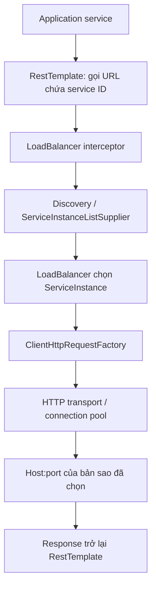

# Cấu hình request factory, timeout và connection pool

Khi dùng `RestTemplate` để gọi dịch vụ qua Spring Cloud LoadBalancer, việc chọn đúng `ServiceInstance` mới giải quyết được **đích đến** của HTTP request. Để một request thực sự hoàn thành, ứng dụng còn phải có kết nối mạng, chờ server phản hồi và quản lý tài nguyên socket khi nhiều request diễn ra đồng thời. Ba vấn đề này được xử lý ở tầng **HTTP transport**, nơi `ClientHttpRequestFactory`, timeout và connection pool đóng vai trò chính.

Trong module `SPRING_CLOUD_SERVICE_COMMUNICATION_LOAD_BALANCING`, mục tiêu không chỉ là gọi `http://catalog-service/...` bằng tên dịch vụ. Ứng dụng còn cần giới hạn thời gian chờ khi instance lỗi, tránh mở quá nhiều kết nối mới, nhận biết khi pool bị quá tải và phối hợp hợp lý với discovery, health check và retry. Bài học này tập trung vào cách cấu hình những thành phần đó cho `RestTemplate` mà không nhầm lẫn với thuật toán của Spring Cloud LoadBalancer.

## 1. Vị trí của request factory trong luồng LoadBalancer

`RestTemplate` là HTTP client đồng bộ của Spring Framework. Ứng dụng gọi phương thức như `getForObject`, `exchange` hoặc `execute`; phía dưới, `RestTemplate` dùng một `ClientHttpRequestFactory` để tạo request HTTP thực tế.

Trong một ứng dụng được cấu hình `@LoadBalanced`, có thêm bước phân giải service ID thành instance:



Ví dụ, ứng dụng gọi:

```java
Product product = restTemplate.getForObject(
        "http://catalog-service/api/products/{id}",
        Product.class,
        productId);
```

LoadBalancer có thể chọn instance `catalog-b` tại `10.20.1.12:8081`. Sau bước chọn, request factory thực hiện kết nối đến `10.20.1.12:8081`, không phải tự tìm thêm instance khác. Vì vậy cần phân biệt rõ:

| Lớp | Câu hỏi nó trả lời | Ví dụ vấn đề |
|---|---|---|
| Discovery và `ServiceInstanceListSupplier` | Những instance nào có thể được chọn? | Registry còn giữ địa chỉ lỗi |
| `ReactorLoadBalancer<ServiceInstance>` | Chọn instance nào trong danh sách? | Round robin, random, zone |
| LoadBalancer interceptor | Ánh xạ URL logic sang đích thực tế ra sao? | Thiếu `@LoadBalanced`, service ID không được phân giải |
| `ClientHttpRequestFactory` | Tạo request và sử dụng HTTP transport nào? | Dùng factory mặc định không có pooling mong muốn |
| HTTP client / connection manager | Kết nối, chờ response và tái sử dụng socket thế nào? | Timeout, hết slot pool, kết nối nhàn rỗi bị đóng |

**Thêm connection pool không thay thế Spring Cloud LoadBalancer.** Pool tái sử dụng kết nối TCP đến các địa chỉ đã chọn; nó không quyết định `catalog-service` phải dùng instance nào.

## 2. `ClientHttpRequestFactory` là gì?

`ClientHttpRequestFactory` là interface mà `RestTemplate` sử dụng để tạo một HTTP request. Các implementation phổ biến bao gồm:

| Factory | Đặc điểm | Khi cân nhắc sử dụng |
|---|---|---|
| `SimpleClientHttpRequestFactory` | Dùng cơ chế HTTP của JDK, cấu hình tương đối đơn giản | Ví dụ nhỏ, nhu cầu kết nối đơn giản |
| `HttpComponentsClientHttpRequestFactory` | Tích hợp Apache HttpClient; có thể dùng pooling và chính sách kết nối chi tiết | Ứng dụng có nhiều request đồng thời hoặc cần quản trị pool |
| `JdkClientHttpRequestFactory` | Dựa trên `java.net.http.HttpClient` của JDK hiện đại | Muốn dùng transport JDK và cấu hình phù hợp |

Không nên suy luận rằng mọi factory đều hỗ trợ cùng một API về timeout, connection pool hay TLS. **Khả năng cấu hình cụ thể phụ thuộc implementation và phiên bản Spring Framework/HTTP client.** Ví dụ dưới đây dùng `HttpComponentsClientHttpRequestFactory` với **Apache HttpClient 5**, phù hợp với các dự án trên Spring Framework 6 / Spring Boot 3.x.

`RestTemplate` mặc định có thể tự chọn request factory theo cách nó được khởi tạo và cấu hình. Nếu ứng dụng cần một pool với giới hạn cụ thể, hãy **chỉ định factory rõ ràng** và kiểm tra client thực tế thay vì dựa vào giả định “đã thêm thư viện là pooling chắc chắn được bật đúng ý”.

## 3. Ba loại timeout không được nhầm lẫn

Giả sử một request cần kết nối đến `catalog-b` qua Apache HttpClient dùng connection pool. Có ít nhất ba thời điểm chờ khác nhau:

```text
Request bắt đầu
  │
  ├─ [A] Chờ lấy một connection từ pool
  │         connection request / pool lease timeout
  │
  ├─ [B] Mở kết nối mới đến host:port nếu cần
  │         connect timeout
  │
  ├─ [C] Gửi request và đợi dữ liệu từ server
  │         response timeout / socket read timeout
  │
  └─ Nhận response hoặc phát sinh lỗi
```

| Loại timeout | Giới hạn gì? | Khi nào có thể xảy ra lỗi? |
|---|---|---|
| **Connection request timeout** | Thời gian đợi được cấp một connection từ pool | Mọi connection thích hợp đang bận, pool đạt giới hạn |
| **Connect timeout** | Thời gian cho một lần thiết lập kết nối mạng mới | Instance không truy cập được, SYN không hoàn thành đúng hạn |
| **Response / socket timeout** | Thời gian đợi phản hồi hoặc dữ liệu từ socket theo semantics của HTTP client | Server chậm gửi response, socket chờ dữ liệu quá lâu |

Trong Apache HttpClient 5, `RequestConfig` có thể cấu hình `connectionRequestTimeout` và `responseTimeout`; `ConnectionConfig` có thể cấu hình `connectTimeout` và socket timeout. Cách tính thời gian cụ thể phụ thuộc transport: response timeout không nhất thiết là **giới hạn tổng thời gian của toàn bộ lời gọi**, và socket read timeout thường giới hạn thời gian chờ thao tác đọc thay vì tổng thời gian xử lý nghiệp vụ.

### Ví dụ phân biệt lỗi

- Pool đã có 25 connection bận đến `catalog-b`, một request mới chờ slot pool quá lâu: **connection request timeout**.
- Pool còn chỗ nhưng mở kết nối TCP tới IP của `catalog-b` không thành công trong hạn định: **connect timeout** hoặc lỗi kết nối tức thời.
- Kết nối thành công, request đã gửi nhưng server không trả dữ liệu đúng hạn: **response/socket timeout**.
- LoadBalancer không tìm thấy một `ServiceInstance` cho `catalog-service`: **lỗi phân giải/chọn instance**, không phải connect timeout.
- Server trả `503 Service Unavailable` ngay lập tức: **HTTP response lỗi**, không phải timeout.

Các trường hợp này cần chỉ số và hướng xử lý khác nhau. Tăng connect timeout sẽ không giải quyết việc pool hết connection; tăng pool size sẽ không sửa IP instance sai; retry mọi lỗi `503` cũng không bảo đảm khôi phục được dịch vụ.

## 4. Tại sao connection pool quan trọng?

Mỗi kết nối TCP mới có chi phí thiết lập; HTTPS còn có thêm chi phí bắt tay TLS. Nếu mở một kết nối mới cho mọi request, ứng dụng sẽ tăng độ trễ, tiêu thụ socket/CPU và có nguy cơ tạo quá nhiều kết nối ngắn sống.

Connection pool giữ một số connection có thể tái sử dụng cho những request sau. Với Apache HttpClient, pool thường được quản lý **theo route** đến đích HTTP, ví dụ scheme + host + port, và có cả giới hạn toàn cục.

Giả sử `catalog-service` có hai bản sao:

```text
catalog-service
  ├─ catalog-a = http://10.20.1.11:8081
  └─ catalog-b = http://10.20.1.12:8081

Pool dùng chung của RestTemplate
  ├─ Route http://10.20.1.11:8081  → các connection có thể tái sử dụng
  └─ Route http://10.20.1.12:8081  → các connection có thể tái sử dụng
```

Khi LoadBalancer chọn `catalog-a`, transport sử dụng hoặc tạo connection cho route của A. Khi chọn B, nó dùng route tương ứng B. **Có pool không có nghĩa client sẽ bị sticky vào bản sao đã dùng connection trước đó.** LoadBalancer vẫn chọn instance cho từng lần cần lựa chọn; pooling chỉ giúp các connection đến đích đã chọn được sử dụng hiệu quả.

Hai giới hạn quan trọng:

- **Maximum total connections:** tổng số connection mà manager cho phép quản lý ở thời điểm cấu hình.
- **Maximum connections per route:** số connection tối đa cho cùng một route đích.

Nếu per-route quá nhỏ, một bản sao nhận nhiều request có thể trở thành điểm nghẽn dù pool toàn cục còn chỗ. Nếu total quá nhỏ, nhiều service và nhiều instance cùng chia sẻ pool sẽ tranh nhau slot. Nếu các giới hạn quá lớn, ứng dụng có thể mở nhiều socket hơn khả năng của hệ điều hành hoặc server đích.

## 5. Dependencies cần thiết trong dự án

Với Spring Boot 3.x và Maven, có thể bắt đầu bằng:

```xml
<dependencies>
    <dependency>
        <groupId>org.springframework.boot</groupId>
        <artifactId>spring-boot-starter-web</artifactId>
    </dependency>

    <dependency>
        <groupId>org.springframework.cloud</groupId>
        <artifactId>spring-cloud-starter-loadbalancer</artifactId>
    </dependency>

    <dependency>
        <groupId>org.apache.httpcomponents.client5</groupId>
        <artifactId>httpclient5</artifactId>
    </dependency>
</dependencies>
```

`spring-boot-starter-web` cung cấp Spring Web có `RestTemplate`. `spring-cloud-starter-loadbalancer` cung cấp tích hợp cân bằng tải phía client. `httpclient5` cho phép tạo Apache HttpClient 5 với connection pool. Phiên bản các thư viện cần do **Spring Boot dependency management** và **Spring Cloud BOM** tương thích quản lý; tránh tự ghép các bản không cùng thế hệ.

Không cần Eureka/Consul nếu bài lab lấy instance từ `SimpleDiscoveryClient`; trong môi trường có registry động, bổ sung discovery starter phù hợp với hạ tầng đang dùng.

## 6. Cấu hình Apache HttpClient 5 với pool và timeout

Ví dụ sau chủ động tạo một HTTP client có connection pool và truyền nó vào `HttpComponentsClientHttpRequestFactory`. Các giá trị là **đề xuất cho bài thực hành**, không phải thông số phải áp dụng nguyên vẹn trong production.

```java
package com.example.orders.config;

import org.apache.hc.client5.http.config.ConnectionConfig;
import org.apache.hc.client5.http.config.RequestConfig;
import org.apache.hc.client5.http.impl.classic.CloseableHttpClient;
import org.apache.hc.client5.http.impl.classic.HttpClients;
import org.apache.hc.client5.http.impl.io.PoolingHttpClientConnectionManager;
import org.apache.hc.client5.http.impl.io.PoolingHttpClientConnectionManagerBuilder;
import org.apache.hc.core5.util.TimeValue;
import org.apache.hc.core5.util.Timeout;
import org.springframework.boot.web.client.RestTemplateBuilder;
import org.springframework.cloud.client.loadbalancer.LoadBalanced;
import org.springframework.context.annotation.Bean;
import org.springframework.context.annotation.Configuration;
import org.springframework.http.client.HttpComponentsClientHttpRequestFactory;
import org.springframework.web.client.RestTemplate;

@Configuration(proxyBeanMethods = false)
public class OutboundHttpConfiguration {

    @Bean(destroyMethod = "close")
    CloseableHttpClient pooledHttpClient() {
        ConnectionConfig connectionConfig = ConnectionConfig.custom()
                .setConnectTimeout(Timeout.ofSeconds(2))
                .setSocketTimeout(Timeout.ofSeconds(5))
                .build();

        PoolingHttpClientConnectionManager connectionManager =
                PoolingHttpClientConnectionManagerBuilder.create()
                        .setMaxConnTotal(100)
                        .setMaxConnPerRoute(25)
                        .setDefaultConnectionConfig(connectionConfig)
                        .build();

        RequestConfig requestConfig = RequestConfig.custom()
                .setConnectionRequestTimeout(Timeout.ofSeconds(1))
                .setResponseTimeout(Timeout.ofSeconds(5))
                .build();

        return HttpClients.custom()
                .setConnectionManager(connectionManager)
                .setDefaultRequestConfig(requestConfig)
                .evictExpiredConnections()
                .evictIdleConnections(TimeValue.ofSeconds(30))
                .build();
    }

    @Bean
    @LoadBalanced
    RestTemplate loadBalancedRestTemplate(
            RestTemplateBuilder builder,
            CloseableHttpClient pooledHttpClient) {

        return builder
                .requestFactory(() ->
                        new HttpComponentsClientHttpRequestFactory(
                                pooledHttpClient))
                .build();
    }
}
```

Đoạn code thể hiện các trách nhiệm riêng:

1. `PoolingHttpClientConnectionManager` quản lý pool và giới hạn tổng/per-route.
2. `ConnectionConfig` đặt thời gian mở kết nối mới và socket timeout.
3. `RequestConfig` đặt thời gian chờ lấy connection từ pool và thời gian chờ response.
4. `HttpClients.custom()` tạo `CloseableHttpClient`, kèm chính sách dọn connection hết hạn/nhàn rỗi.
5. `HttpComponentsClientHttpRequestFactory` dùng client này làm transport cho `RestTemplate`.
6. `RestTemplateBuilder` giúp giữ các cấu hình/converter/customizer Spring Boot áp dụng cho `RestTemplate`.
7. `@LoadBalanced` đánh dấu `RestTemplate` để Spring Cloud gắn khả năng phân giải service ID.

**Lưu ý tương thích:** API builder và phương thức cấu hình timeout có thể thay đổi giữa các phiên bản Spring Boot/Spring Framework/Apache HttpClient. Ví dụ này hướng đến Spring Boot 3.x, Spring Framework 6.x và HttpClient 5; cần đối chiếu dependency thực tế của dự án trước khi sao chép vào bản phát hành khác. Khi có `RestTemplateCustomizer` toàn cục hoặc cấu hình timeout thêm từ `RestTemplateBuilder`, hãy kiểm tra thứ tự áp dụng để tránh ghi đè giá trị dự kiến.

### Vòng đời của pool

Bean `CloseableHttpClient` được quản lý bởi Spring, có `destroyMethod = "close"`, để tài nguyên kết nối được giải phóng khi application context đóng. Không tạo `CloseableHttpClient` mới trong mỗi phương thức nghiệp vụ hoặc mỗi request: cách làm đó phá mục tiêu tái sử dụng connection và có thể tạo quá nhiều socket.

Một `RestTemplate` đã được cấu hình đầy đủ có thể dùng chung cho các lời gọi đồng thời trong ứng dụng. Tránh thay đổi interceptor, request factory hoặc các thành phần cấu hình bên trong `RestTemplate` trong khi các thread đang sử dụng nó. Với ứng dụng gọi nhiều service và cần chia sẻ pool, một singleton `CloseableHttpClient` cùng một hoặc nhiều `RestTemplate` là mô hình thường gặp.

### Tại sao cấu hình cả socket timeout và response timeout?

Hai tham số thuộc các lớp cấu hình khác nhau của Apache HttpClient 5. `responseTimeout` gắn với thời gian chờ response của request; socket timeout điều khiển thời gian chờ ở thao tác I/O. Không nên coi cả hai là một “deadline tổng” có thể thay thế cho nhau. Nếu nghiệp vụ yêu cầu giới hạn **tổng thời gian một thao tác**, gồm chọn instance, đợi pool, kết nối, retry và đọc body, cần thêm cơ chế deadline/budget ở tầng gọi phù hợp.

## 7. Sử dụng `RestTemplate` đã được cân bằng tải

Sau khi tạo bean, dịch vụ nghiệp vụ có thể inject và sử dụng:

```java
package com.example.orders.client;

import org.springframework.cloud.client.loadbalancer.LoadBalanced;
import org.springframework.stereotype.Component;
import org.springframework.web.client.RestTemplate;

@Component
public class CatalogClient {

    private final RestTemplate restTemplate;

    public CatalogClient(@LoadBalanced RestTemplate restTemplate) {
        this.restTemplate = restTemplate;
    }

    public Product getProduct(String id) {
        return restTemplate.getForObject(
                "http://catalog-service/api/products/{id}",
                Product.class,
                id);
    }
}
```

`Product` trong ví dụ là DTO của ứng dụng, do người học tự khai báo. Khi có nhiều `RestTemplate` bean, có thể dùng `@Qualifier` cùng tên bean chính xác để tránh nhập nhằng; annotation `@LoadBalanced` được dùng ở điểm khai báo/inject theo cấu hình Spring Cloud đang dùng.

Nếu cần thử nghiệm mà chưa có registry, khai báo hai instance tĩnh:

```yaml
spring:
  cloud:
    discovery:
      client:
        simple:
          instances:
            catalog-service:
              - uri: http://localhost:8081
              - uri: http://localhost:8082
```

Chạy `catalog-service` trên hai port; để mỗi bản sao trả về `instanceId` hoặc `server.port` nhằm quan sát instance đã xử lý request. Khi `CatalogClient` gọi URL logic, Spring Cloud LoadBalancer chọn một instance rồi factory/pool thực hiện request. Đối với `SimpleDiscoveryClient`, việc dừng một process sẽ không tự xóa địa chỉ trong cấu hình; phải dùng health check, điều chỉnh danh sách hoặc kết hợp retry/failover hợp lý nếu muốn tránh tiếp tục gọi replica đã dừng.

## 8. Tinh chỉnh pool theo lưu lượng thực tế

Một pool không nên được cấu hình chỉ dựa vào tổng số request mỗi giây. Hãy xem **độ đồng thời** và **số lượng route đích**. Về trực giác, request ở trong hệ thống càng lâu thì càng có nhiều request chồng lên nhau, khiến số connection cần sử dụng tăng.

Ví dụ mang tính minh họa:

| Trường hợp | Nhận định cần kiểm tra |
|---|---|
| Lưu lượng thấp, ít instance | Pool nhỏ có thể đủ, ưu tiên cấu hình đơn giản |
| Một instance nóng, nhiều request đồng thời | `maxConnPerRoute` có thể là giới hạn trước cả `maxConnTotal` |
| Nhiều service ID và nhiều instance | Giới hạn `maxConnTotal` có thể tạo cạnh tranh giữa các route |
| Response lâu hoặc server trả dữ liệu chậm | Connection bị giữ lâu; tăng pool một mình không sửa nguyên nhân chậm |
| Scale từ 2 lên 20 replica | Số route thay đổi; cần quan sát hiệu quả tái sử dụng connection |
| Rollout liên tục thay IP instance | Cần dọn connection idle/expired và bảo đảm discovery không giữ IP cũ quá lâu |

Từ những quan sát này có thể đưa ra quy trình tinh chỉnh:

1. Đo số request đồng thời, độ trễ p50/p95/p99 và số instance đích ở giờ cao điểm.
2. Đặt `maxConnPerRoute` đủ cho lưu lượng của một instance trong điều kiện nghiêng tải.
3. Đặt `maxConnTotal` phù hợp với tổng lưu lượng nhiều route và giới hạn hệ điều hành.
4. Đặt `connectionRequestTimeout` để tránh thread đợi slot vô thời hạn khi pool hết chỗ.
5. Đo tỷ lệ connection đang được thuê, còn rảnh và đang chờ cấp phát (nếu có metric).
6. Kiểm tra server đích chịu được số kết nối đồng thời mà client được phép mở.
7. Load test với endpoint phản hồi nhanh, chậm và lỗi; điều chỉnh theo số liệu thay vì tăng tất cả giới hạn cùng lúc.

Trong Apache HttpClient 5, pool manager cung cấp thông tin thống kê như `leased`, `available`, `pending` và `max` (ví dụ qua `getTotalStats()` khi có tham chiếu đến manager). Cần có cách quan sát hợp lệ qua metrics hoặc log trong môi trường thực tế. Không ghi log mỗi lần mượn/trả connection ở tải lớn nếu điều đó tự gây thêm chi phí.

## 9. Connection reuse, keep-alive và kết nối lỗi thời

Connection pooling chỉ hiệu quả khi connection được phép tái sử dụng và server chưa đóng nó. Một số chi tiết cần quan tâm:

- **HTTP keep-alive:** cho phép nhiều request lần lượt dùng cùng một TCP connection khi điều kiện giao thức cho phép.
- **Idle eviction:** dọn những connection nhàn rỗi quá lâu, hạn chế giữ socket không còn hữu ích.
- **Expired eviction / time-to-live:** giới hạn vòng đời connection; đặc biệt cần khi network, proxy hoặc server có chính sách đóng socket định kỳ.
- **Stale connection:** connection từng hợp lệ có thể đã bị server hoặc hạ tầng đóng khi đang idle. Request tiếp theo phải phát hiện lỗi và xử lý theo chính sách phù hợp.
- **Connection release:** response phải được đọc/đóng đúng cách. Nếu code dùng `execute` với stream hoặc custom `ResponseExtractor`, phải đóng tài nguyên phù hợp để connection được trả về pool.

Với `getForObject()` hoặc `exchange()` theo cách thông thường, Spring xử lý việc đóng response trong luồng thực thi. Nếu người học tự thao tác với stream hoặc cài request factory tùy chỉnh, cần kiểm tra kỹ vòng đời tài nguyên. **Pool exhaustion** đôi khi là triệu chứng của response không được giải phóng chứ không chỉ do lưu lượng cao.

Không nên trông chờ vào TCP keep-alive để chứng minh instance còn đáp ứng nghiệp vụ. Keep-alive và health check giải quyết hai lớp vấn đề khác nhau; connection còn sống không bảo đảm endpoint trả kết quả đúng.

## 10. Timeout của transport khác timeout của LoadBalancer và discovery

Khi gọi `http://catalog-service/api/products/42`, một request có thể mất thời gian ở nhiều bước:

```text
T1: HTTP client được gọi
T2: Supplier/discovery cung cấp danh sách instance
T3: LoadBalancer chọn instance
T4: Chờ connection từ pool
T5: Thiết lập TCP/TLS nếu cần
T6: Gửi request và chờ response
T7: Đọc body/deserialize
T8: Trả kết quả cho caller
```

`connectTimeout` chủ yếu tác động đến bước T5; `connectionRequestTimeout` tác động T4; response/socket timeout tác động các giai đoạn chờ dữ liệu ở T6–T7 theo semantics của HTTP client. Chúng **không nhất thiết** giới hạn mọi bước từ T1 đến T8.

Ví dụ, discovery chưa trả về danh sách, một lần retry bị trì hoãn hoặc ứng dụng phải chờ thread pool có chỗ có thể tăng thời gian tổng mà không bị một timeout transport bắt đúng chỗ. Muốn bảo vệ SLA của API gọi ngoài, cần thiết kế **time budget tổng** và cân đối các timeout con.

Đặc biệt, một request timeout không có nghĩa server chưa xử lý tác vụ. Trường hợp request POST đã được server thực thi nhưng response mất giữa đường phải được giải quyết bằng idempotency key, giao dịch hoặc cơ chế chống lặp phù hợp; không mặc định retry là an toàn.

## 11. Tương tác với retry của Spring Cloud LoadBalancer

Spring Cloud LoadBalancer và các HTTP client có thể có những cơ chế retry khác nhau. Apache HttpClient cũng có chính sách retry ở tầng transport. Nếu ứng dụng bật retry ở nhiều tầng cùng lúc, số lần gửi request thực tế có thể lớn hơn nhiều so với mong muốn.

Ví dụ, nếu một tầng thử lại request và một tầng khác cũng tự thử lại, một thao tác có thể bị phát nhiều lần cho cùng instance hoặc các instance khác nhau. Cần xác định rõ:

| Câu hỏi | Vì sao quan trọng? |
|---|---|
| Tầng nào chịu trách nhiệm retry? | Tránh retry chồng nhau |
| Có chọn lại `ServiceInstance` sau lỗi không? | Phân biệt retry cùng instance và retry khác instance |
| Những lỗi nào được retry? | Connect error, timeout, HTTP 5xx có semantics khác nhau |
| Phương thức HTTP có idempotent không? | Tránh thực thi lặp thao tác ghi |
| Giới hạn số lần và tổng thời gian? | Không vượt time budget của caller |
| Có health check/circuit breaker không? | Giảm retry liên tục vào replica đang lỗi |

Nếu muốn một lớp retry chủ đạo chịu trách nhiệm, hãy kiểm tra và có thể tắt retry tự động của Apache HttpClient qua cấu hình phù hợp (ví dụ `HttpClients.custom().disableAutomaticRetries()`), rồi cấu hình retry tập trung ở lớp chọn và gọi dịch vụ. Đây là **quyết định thiết kế**, không phải bước bắt buộc trong mọi hệ thống.

Timeout không nên được đặt quá lớn để che giấu instance lỗi, cũng không nên quá nhỏ đến mức loại nhầm request hợp lệ trong giờ cao điểm. Hãy đo độ trễ thực tế và kiểm thử failure mode trước khi chọn ngưỡng.

## 12. Chẩn đoán: xác định đúng tầng bị lỗi

`RestTemplate` thường đóng gói lỗi I/O vào `ResourceAccessException`. Trong khi đó, response HTTP 4xx/5xx với default error handler thường gây `HttpClientErrorException` hoặc `HttpServerErrorException`. Không thể suy ra chính xác nguyên nhân chỉ từ loại exception ở tầng ngoài cùng; cần xem **cause** và thông tin kết nối.

| Triệu chứng | Khả năng thường gặp | Điểm cần kiểm tra |
|---|---|---|
| `No instances available` hoặc không phân giải service ID | Discovery trống, supplier lọc hết instance, thiếu tích hợp LoadBalancer | Danh sách `ServiceInstance`, bean `@LoadBalanced`, service ID |
| `Connection refused` | Địa chỉ/cổng có thể truy cập nhưng không có process lắng nghe | Host/port của instance, tiến trình đích, firewall |
| `Connect timed out` | Không mở được kết nối trong thời hạn | IP, route, ACL, connect timeout |
| Chờ lâu rồi lỗi thuê connection | Pool cạn hoặc per-route limit thấp | `leased`, `pending`, `maxConnPerRoute`, connection request timeout |
| Socket/read/response timeout | Instance chậm trả dữ liệu hoặc network chập chờn | Response timeout, socket timeout, endpoint chậm |
| HTTP `503`, `500` | Server đích đã trả response lỗi | Status, response body, trace ID, health của instance |
| Sau rollout xuất hiện lỗi socket rải rác | Connection cũ/stale hoặc discovery giữ địa chỉ cũ | Idle eviction, TTL, registry refresh và DNS |
| Chỉ một service bị lỗi dù service khác bình thường | Đích cụ thể hoặc pool route cụ thể bị nghẽn | Route stats, instance ID, per-route metrics |

Một quy trình tìm nguyên nhân hiệu quả:

1. Ghi lại service ID, URL logic và `ServiceInstance` được chọn (khi có).
2. Kiểm tra request đã đi qua LoadBalancer interceptor hay chưa.
3. Từ môi trường chạy **consumer**, thử kết nối trực tiếp đến host/port được discovery công bố.
4. Xác định request bị lỗi trước kết nối, lúc mượn connection hay sau khi gửi request.
5. Quan sát pool đang leased/available/pending và thống kê theo route.
6. Đối chiếu thời gian phát lỗi với timeout đã cấu hình và số lần retry thực tế.
7. Nếu server có phản hồi HTTP, kiểm tra status/body/trace thay vì đổ lỗi cho connection pool.

Tránh đưa token xác thực, cookie hoặc nội dung payload nhạy cảm vào log debug. Có thể ghi service ID, instance ID, route, thời gian, kết quả và loại exception để chẩn đoán mà không ghi dữ liệu người dùng.

## 13. Bài thực hành: một instance nhanh, một instance chậm

**Mục tiêu:** phân biệt timeout của response với lỗi hết slot pool và chứng minh LoadBalancer vẫn hoạt động khi transport có pooling.

Chuẩn bị một `catalog-service` trả endpoint `/api/products/{id}` và một endpoint `/whoami` cho biết tên instance. Chạy hai bản sao:

- `catalog-a` trên `localhost:8081`, trả response nhanh.
- `catalog-b` trên `localhost:8082`, có thể thêm độ trễ thử nghiệm để mô phỏng server chậm.

Ứng dụng consumer dùng `@LoadBalanced RestTemplate`, instance tĩnh như phần 7 và cấu hình Apache HttpClient 5 như phần 6.

### Kịch bản A — kiểm tra chọn instance

Gửi nhiều request đến `http://catalog-service/whoami`; ghi lại instance ID được trả về. Nếu dùng round robin mặc định và danh sách instance ổn định, có thể quan sát luân phiên giữa các bản sao. Connection pool sẽ tái sử dụng socket cho các route tương ứng, **không** làm thay đổi thuật toán chọn.

### Kịch bản B — kiểm tra response timeout

Thiết lập độ trễ của `catalog-b` lớn hơn response timeout; để `catalog-a` phản hồi nhanh. Gửi request nhiều lần và ghi lại instance ID dự định gọi, loại exception, khoảng thời gian chờ. Khi B được chọn, request có thể thất bại vì response timeout; khi A được chọn, request có thể hoàn thành. Nếu bật retry thì kết quả quan sát sẽ khác vì một request có thể được thử lại; hãy chủ động tắt retry trong bài đo riêng timeout để tránh nhầm lẫn.

### Kịch bản C — kiểm tra hết slot pool

Để dễ quan sát trong môi trường **test**, hạ `maxConnPerRoute` xuống giá trị nhỏ, ví dụ `1`, đồng thời giữ một request đến một route ở trạng thái chờ phản hồi. Phát thêm nhiều request song song đến cùng route và đặt `connectionRequestTimeout` ngắn. Một số request có thể thất bại do không lấy được connection kịp thời dù server vẫn có thể kết nối.

Vì LoadBalancer có thể phân phối request sang nhiều instance, nên để kiểm chứng giới hạn **per-route**, cần biết những request đã đi đến route nào; có thể thử với một instance duy nhất hoặc một client test gọi thẳng địa chỉ đích. Không dùng lượng request tổng cộng làm bằng chứng duy nhất rằng một route bị bão hòa.

### Kịch bản D — kiểm tra vòng đời connection

Dừng `catalog-b`, chờ discovery/health cập nhật nếu có, sau đó khởi chạy lại. Kiểm tra xem các connection cũ có được loại bỏ và request mới có kết nối lại thành công hay không. Đồng thời xác nhận thời gian thất bại thuộc bước discovery/chọn instance hay thuộc transport. Với danh sách static `SimpleDiscoveryClient`, địa chỉ B vẫn tồn tại ngay cả khi process đã dừng, trừ khi có cơ chế lọc khác.

Sau bài lab, lập bảng ghi thời gian chờ connection, thời gian mở kết nối mới, thời gian đợi response, instance được chọn, số retry và trạng thái pool. Dữ liệu này quan trọng hơn kết luận chung rằng “RestTemplate chậm”.

## 14. Checklist trước khi dùng trong production

1. `RestTemplate` có được tạo bằng factory dự kiến và đánh dấu `@LoadBalanced` nếu gọi theo service ID không?
2. Apache HttpClient 5 và Spring Boot/Spring Cloud có tương thích phiên bản không?
3. Bean HTTP client có được tái sử dụng và đóng đúng lúc dừng ứng dụng không?
4. Có phân biệt connection lease timeout, connect timeout và response/socket timeout không?
5. `maxConnTotal` và `maxConnPerRoute` đã được đo dưới tải thực tế chưa?
6. Connection cũ/idle/expired có được dọn, và response có được giải phóng đúng cách không?
7. Timeout của transport có nằm trong time budget tổng tính cả discovery, retry và xử lý body không?
8. Retry được điều phối ở bao nhiêu lớp, có giới hạn số lần và an toàn với request ghi không?
9. Có metric cho pool, latency, timeout và instance được chọn để phân biệt nghẽn transport với lỗi discovery không?
10. Đã thử các trường hợp instance dừng đột ngột, phản hồi chậm, pool cạn và rollout đổi địa chỉ chưa?

Khi triển khai `RestTemplate` với Spring Cloud LoadBalancer, hãy xem **LoadBalancer là tầng lựa chọn đích** còn **request factory và connection pool là tầng thực thi HTTP**. Cấu hình timeout đúng loại, quản lý vòng đời pool rõ ràng và theo dõi số liệu theo route giúp ứng dụng dùng được nhiều instance mà không biến sự cố mạng hoặc quá tải connection thành lỗi lan rộng giữa các dịch vụ.
