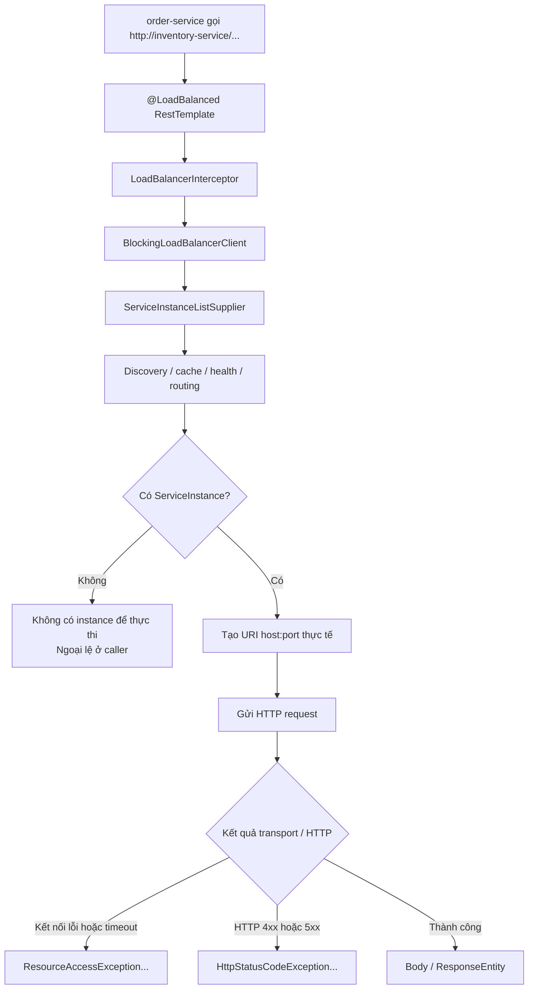

# Xử lý trường hợp không tìm thấy service ID hoặc bản sao

## 1. Bối cảnh và kết quả cần đạt

Trong chương **RestTemplate** của module `SPRING_CLOUD_SERVICE_COMMUNICATION_LOAD_BALANCING`, ứng dụng gọi sử dụng Spring Cloud LoadBalancer để tìm và chọn một `ServiceInstance` dựa trên **service ID**. Việc tìm kiếm có thể dùng Eureka, Consul, Kubernetes hoặc `SimpleDiscoveryClient`; trước khi gửi HTTP, danh sách có thể được cache, kiểm tra sức khỏe và lọc theo zone hoặc chính sách định tuyến.

Xét hệ thống:

- `order-service` nhận yêu cầu tra cứu tồn kho.
- `order-service` sử dụng `@LoadBalanced RestTemplate` gọi `http://inventory-service/api/inventory/ABC-1`.
- `inventory-service` có thể có nhiều instance, ví dụ `inventory-a` ở cổng `8081` và `inventory-b` ở `8082`.

Bình thường, LoadBalancer chọn một instance rồi `RestTemplate` gửi HTTP request. Nhưng điều gì xảy ra nếu cấu hình gõ sai `inventory-service`, registry không còn bản sao nào, hoặc các instance đã đăng ký nhưng không thể kết nối? Ba tình huống này tạo **những lỗi có ý nghĩa khác nhau**.

Sau bài này, bạn có thể:

1. Mô tả luồng `RestTemplate → LoadBalancerInterceptor → BlockingLoadBalancerClient → ServiceInstanceListSupplier`.
2. Giải thích vì sao “không thấy service ID” và “service ID có tồn tại nhưng không có instance đủ điều kiện” thường cho cùng kết quả ở tầng chọn instance.
3. Phân biệt **không chọn được instance**, **chọn được nhưng kết nối thất bại** và **server trả mã HTTP lỗi**.
4. Xử lý ngoại lệ ở đúng ranh giới, chuyển lỗi thiếu downstream thành phản hồi ứng dụng có kiểm soát mà không che mất lỗi lập trình.
5. Cấu hình timeout, retry có giới hạn, quan sát log/metric và kiểm chứng bằng bài lab.
6. Xác định sự cố do service ID, discovery, cache, health check, chính sách chọn instance hay tầng mạng.

## 2. Luồng request và vị trí lỗi xuất hiện

Để `RestTemplate` cân bằng tải, ta tạo một bean đánh dấu `@LoadBalanced`. Trong các nhánh Spring Cloud Commons hiện đại, `LoadBalancerInterceptor` và `BlockingLoadBalancerClient` đảm nhiệm lựa chọn và thay thế URI chứa service ID bằng địa chỉ instance thực tế.



**Điểm chính:** ở nhánh **không có `ServiceInstance`**, HTTP request tới `inventory-service` **chưa được gửi**. Không có HTTP response từ downstream để `RestTemplate` đọc. Việc báo lỗi HTTP 503 cho *client bên ngoài* là lựa chọn của `order-service` khi xử lý exception, không phải status mà `inventory-service` trả về.

### 2.1. Ba lớp “không tìm thấy”

| Tình huống | Dữ liệu/điều kiện | Giai đoạn phát hiện | Kết quả điển hình |
|---|---|---|---|
| Gõ sai hoặc chưa đăng ký **service ID** | `inventory-servcie` không có bản ghi nào trong discovery | Tra instance theo tên | Danh sách rỗng; LoadBalancer không chọn được instance |
| Service ID có tồn tại nhưng **không có bản sao khả dụng** | Registry rỗng, scale-to-zero, hoặc supplier lọc hết các ứng viên | Tạo danh sách và chọn instance | Cũng có thể trả danh sách rỗng / `EmptyResponse` |
| Đã chọn instance nhưng **không truy cập được** | Registry/cached list còn `host:port`, nhưng pod chết, DNS/network lỗi hoặc server quá chậm | Kết nối và đọc HTTP | Lỗi I/O, timeout; thường được `RestTemplate` bọc trong `ResourceAccessException` |
| Instance trả **HTTP 404** | Endpoint cụ thể không tồn tại hoặc SKU không tồn tại | Sau khi server xử lý HTTP | `HttpClientErrorException.NotFound` theo error handler mặc định |
| Instance trả **HTTP 503** | Server nhận request rồi chủ động báo không sẵn sàng | Sau khi server xử lý HTTP | `HttpServerErrorException.ServiceUnavailable` theo error handler mặc định |

Hai hàng đầu tiên **không thể phân biệt chắc chắn chỉ từ exception “No instances available”**. Tầng chọn instance chỉ biết không có đích phù hợp cho service ID đó. Muốn xác định nguyên nhân gốc, phải kiểm tra tên trong URI, registry, danh sách supplier, cache, health check và các bộ lọc theo request.

### 2.2. BlockingLoadBalancerClient làm gì khi không chọn được instance?

Với cách cài đặt `BlockingLoadBalancerClient` của những phiên bản Spring Cloud Commons phổ biến, `RoundRobinLoadBalancer` nhận danh sách rỗng sẽ trả `EmptyResponse`; `BlockingLoadBalancerClient` không lấy được `ServiceInstance` và có thể ném:

```text
java.lang.IllegalStateException:
    No instances available for inventory-service
```

Đây là ví dụ **triệu chứng ở tầng Java**, không phải HTTP response 503. Hành vi, kiểu ngoại lệ và nội dung thông báo có thể thay đổi theo Release Train hoặc implementation LoadBalancer khác. Hãy đối chiếu dependency đã resolve, mã nguồn của bản đang chạy và stack trace thật trước khi viết logic phụ thuộc vào chuỗi thông báo.

**Phân biệt với Spring Cloud Gateway:** một bộ lọc LoadBalancer của Gateway có thể tự chuyển trường hợp không thấy instance thành HTTP 503. Điều đó **không có nghĩa** mọi ứng dụng dùng `@LoadBalanced RestTemplate` cũng tự sinh HTTP 503. Nếu exception ở controller không được xử lý, Spring MVC thường trả lỗi server theo chính sách xử lý exception của ứng dụng (ví dụ HTTP 500). Chính ứng dụng gọi phải quyết định hợp đồng lỗi dành cho client.

## 3. Cấu hình RestTemplate đúng để gọi theo service ID

Một ví dụ tối giản trong `order-service`:

```java
@Configuration(proxyBeanMethods = false)
class InventoryRestTemplateConfig {

    @Bean
    @LoadBalanced
    RestTemplate inventoryRestTemplate() {
        SimpleClientHttpRequestFactory requestFactory =
                new SimpleClientHttpRequestFactory();
        requestFactory.setConnectTimeout(1_000); // ms
        requestFactory.setReadTimeout(2_000);    // ms

        return new RestTemplate(requestFactory);
    }
}
```

Trong đoạn trên:

- `@LoadBalanced` cho phép cơ chế Spring Cloud gắn interceptor cân bằng tải vào bean `RestTemplate`; ứng dụng phải có `spring-cloud-starter-loadbalancer`.
- URI sẽ có dạng `http://inventory-service/...`; phần host là **service ID**, không phải địa chỉ mạng thật.
- Hai timeout thuộc HTTP request factory, **không** phải thuộc tính tìm service ID. Chúng áp dụng sau khi request đã có đích hoặc ở thời điểm mở kết nối tùy transport.
- Ở ứng dụng thực tế, có thể tạo `RestTemplate` qua `RestTemplateBuilder` mà Spring Boot đã cấu hình để giữ customizer, metrics, tracing và HTTP transport phù hợp.

Một service dùng `RestTemplate` này:

```java
@Service
class InventoryReader {

    private final RestTemplate restTemplate;

    InventoryReader(@LoadBalanced RestTemplate restTemplate) {
        this.restTemplate = restTemplate;
    }

    InventoryStock read(String sku) {
        return restTemplate.getForObject(
                "http://inventory-service/api/inventory/{sku}",
                InventoryStock.class,
                sku);
    }
}

record InventoryStock(String sku, int available) {}
```

`InventoryStock` là DTO minh họa; cấu hình JSON của `inventory-service` phải tương thích với tên trường và kiểu dữ liệu. Có thể dùng `getForEntity(...)` nếu cần status và headers của response thành công. Lưu ý `getForObject(...)` có thể trả `null` khi response thành công nhưng không có body; đây là một trường hợp hợp đồng dữ liệu khác với lỗi không tìm thấy instance.

### 3.1. Phân biệt RestTemplate thường và RestTemplate cân bằng tải

Nếu cùng ứng dụng cần gọi cả URL ngoài và URL nội bộ theo service ID, nên khai báo hai bean:

```java
@Configuration(proxyBeanMethods = false)
class RestTemplateBeans {

    @Bean
    @LoadBalanced
    RestTemplate serviceRestTemplate() {
        return new RestTemplate();
    }

    @Bean
    @Primary
    RestTemplate plainRestTemplate() {
        return new RestTemplate();
    }
}
```

Tiêm `@LoadBalanced RestTemplate` tại nơi gọi `inventory-service` để tránh lấy nhầm bean. Nếu dùng `RestTemplate` thường gọi `http://inventory-service/...`, hệ điều hành sẽ cố phân giải `inventory-service` như DNS host; khi DNS không có tên đó, bạn có thể thấy `UnknownHostException` nằm trong `ResourceAccessException`, **khác** với lỗi discovery không có instance.

Ngược lại, nếu dùng `@LoadBalanced RestTemplate` để gọi `http://localhost:8081`, chữ `localhost` có thể bị hiểu là **service ID** cần tra trong discovery, dẫn đến `No instances available for localhost`. Hãy dùng RestTemplate thường cho URL cố định và RestTemplate có LoadBalancer cho URI chứa tên dịch vụ logic. Không dùng `lb://...` làm URI giả định cho `RestTemplate` nếu integration thực tế được thiết kế cho host là service ID với scheme HTTP/HTTPS.

### 3.2. Phụ thuộc và discovery

Tối thiểu ứng dụng caller cần Spring Web (để có `RestTemplate`), Spring Cloud BOM tương thích Spring Boot, và starter `spring-cloud-starter-loadbalancer`. Thêm starter discovery phù hợp (Eureka/Consul/Kubernetes...) hoặc dùng `SimpleDiscoveryClient` để tạo danh sách tĩnh cho bài lab.

**Cần kiểm tra phiên bản thật:** cùng một dự án có thể dùng Spring Cloud Commons 4.1, 4.2, 4.3 hoặc 5.0 tùy Spring Boot/Release Train. Không copy dependency version hoặc khóa cấu hình từ tài liệu latest nếu dự án đang dùng nhánh khác.

## 4. Chiến lược xử lý lỗi ở ranh giới gọi dịch vụ

Một cách tiếp cận thực tế là quy đổi lỗi ở adapter `InventoryReader` sang exception có ý nghĩa ở domain ứng dụng, rồi để controller/advice quyết định HTTP response. Không bắt `Exception` hoặc `RuntimeException` rộng và trả dữ liệu mặc định khiến lỗi bị che mất.

Các nhóm lỗi cần phân biệt:

| Nhóm | Biểu hiện trong caller | Gợi ý chính sách |
|---|---|---|
| Không có instance để chọn | `IllegalStateException` với thông điệp `No instances available for ...` trong implementation đã xác minh | Đánh dấu downstream unavailable, HTTP 503 ở API biên, log service ID và tình trạng discovery |
| Lỗi kết nối / timeout sau lựa chọn | `ResourceAccessException`; nguyên nhân sâu có thể là `ConnectException`, `SocketTimeoutException`, `UnknownHostException` | Áp timeout, thử lại có giới hạn nếu an toàn, xem registry/health/network |
| Downstream trả HTTP 503/500 | `HttpServerErrorException` hoặc lớp con, do default error handler | Đánh giá hợp đồng lỗi, có thể map 502/503 hoặc retry có chọn lọc |
| Downstream trả HTTP 404 | `HttpClientErrorException.NotFound` | Thường là dữ liệu/endpoint không tồn tại; không kết luận service ID mất |
| Response 2xx nhưng body rỗng hoặc sai schema | `null` hoặc lỗi parse JSON | Báo lỗi hợp đồng dữ liệu; không ngụy trang thành discovery failure |
| Sai cấu hình bean/interceptor | Không đi qua LoadBalancer hoặc context không khởi tạo | Sửa wiring/dependency thay vì tăng retry |

### 4.1. Ví dụ bắt lỗi tối thiểu, không che mất lỗi khác

Trong ví dụ sau, `order-service` quy đổi **chỉ những lỗi đã biết** của `inventory-service` thành `DownstreamUnavailableException`:

```java
final class DownstreamUnavailableException extends RuntimeException {

    private final String serviceId;

    DownstreamUnavailableException(String serviceId, Throwable cause) {
        super("Dependent service temporarily unavailable: " + serviceId, cause);
        this.serviceId = serviceId;
    }

    String serviceId() {
        return serviceId;
    }
}
```

```java
@Service
class InventoryGateway {

    private static final String SERVICE_ID = "inventory-service";
    private final RestTemplate restTemplate;

    InventoryGateway(@LoadBalanced RestTemplate restTemplate) {
        this.restTemplate = restTemplate;
    }

    InventoryStock read(String sku) {
        try {
            return restTemplate.getForObject(
                    "http://inventory-service/api/inventory/{sku}",
                    InventoryStock.class,
                    sku);
        } catch (ResourceAccessException ex) {
            // Kết nối, DNS, TLS hoặc read timeout sau bước chọn đích.
            throw new DownstreamUnavailableException(SERVICE_ID, ex);
        } catch (IllegalStateException ex) {
            // Chỉ phân loại thông báo đã kiểm chứng cho bản LoadBalancer này.
            if (isNoInstanceException(ex)) {
                throw new DownstreamUnavailableException(SERVICE_ID, ex);
            }
            throw ex; // Một IllegalStateException khác có thể là lỗi lập trình.
        }
    }

    private boolean isNoInstanceException(IllegalStateException ex) {
        return ("No instances available for " + SERVICE_ID)
                .equals(ex.getMessage());
    }
}
```

Trong production, **không xem việc so khớp `getMessage()` là API ổn định**. Đoạn trên minh họa cách cô lập mã tương thích với một phiên bản đã xác minh trong một adapter duy nhất. Khi nâng Release Train hoặc thay implementation:

1. Kiểm tra stack trace/kiểu exception và sửa adapter nếu cần.
2. Có thể tạo lớp bao bọc `LoadBalancerClient` riêng hoặc cơ chế báo lỗi đã kiểm chứng để nhận biết nhánh không chọn được instance mà không phụ thuộc vào câu chữ.
3. Không đổi mọi `IllegalStateException` thành HTTP 503, vì như vậy có thể che giấu lỗi lập trình nghiêm trọng.
4. Ghi metric/log theo service ID và nguyên nhân đã phân loại; tránh ghi dữ liệu bí mật hoặc endpoint chứa token.

Nếu downstream trả HTTP 503 thực sự, `RestTemplate` với error handler mặc định ném `HttpServerErrorException.ServiceUnavailable`; đoạn `InventoryGateway` phía trên **không bắt lỗi đó**. Hãy xử lý nhóm HTTP status riêng theo hợp đồng API, không gom nó với “chưa có instance”. Nếu cần phân biệt không tìm thấy instance với lỗi kết nối ngay ở nghiệp vụ, nên tạo các exception domain riêng (ví dụ `NoCandidateInstanceException`, `DownstreamTransportException`) thay vì dùng chung một loại `DownstreamUnavailableException` như phiên bản tối giản này.

### 4.2. Trả HTTP 503 tại API biên

Ví dụ mapping exception domain sang response có cấu trúc bằng Spring MVC:

```java
@RestControllerAdvice
class DownstreamExceptionAdvice {

    @ExceptionHandler(DownstreamUnavailableException.class)
    ResponseEntity<ProblemDetail> onUnavailable(
            DownstreamUnavailableException ex) {
        ProblemDetail detail = ProblemDetail.forStatusAndDetail(
                HttpStatus.SERVICE_UNAVAILABLE,
                "Một dịch vụ phụ thuộc đang tạm thời không khả dụng.");
        detail.setTitle("Tạm thời không thể xử lý yêu cầu");

        return ResponseEntity.status(HttpStatus.SERVICE_UNAVAILABLE)
                .body(detail);
    }
}
```

Controller mẫu:

```java
@RestController
@RequestMapping("/orders")
class OrderController {

    private final InventoryGateway inventory;

    OrderController(InventoryGateway inventory) {
        this.inventory = inventory;
    }

    @GetMapping("/inventory/{sku}")
    InventoryStock stock(@PathVariable String sku) {
        return inventory.read(sku);
    }
}
```

Nếu service không có instance hoặc kết nối không khả dụng và adapter quy đổi được lỗi, API trả HTTP **503 Service Unavailable** kèm body kiểu `ProblemDetail`. Không trả raw stack trace hoặc host/port nội bộ trong body. Có thể bổ sung correlation ID để hỗ trợ vận hành.

**Lưu ý hợp đồng:** HTTP 503 thể hiện hệ thống đang không phục vụ được yêu cầu do dependency tạm thời không khả dụng. Nếu lỗi do typo service ID, thiếu cấu hình discovery hoặc sai build, nguyên nhân thực tế là sự cố cấu hình cần cảnh báo và sửa ngay, dù API có thể tạm trả 503 để client biết yêu cầu chưa thể hoàn thành. Mã HTTP không thay thế chẩn đoán nguyên nhân.

### 4.3. Có nên dùng ResponseErrorHandler để xử lý “không có instance”?

`ResponseErrorHandler` của `RestTemplate` xử lý **HTTP response đã nhận** (ví dụ 404, 500, 503). Khi LoadBalancer không chọn được instance, thường chưa có response, nên không có status để `ResponseErrorHandler` xử lý. Vì vậy phải xử lý exception ở adapter, ở cơ chế LoadBalancer được tích hợp hoặc tại ranh giới controller.

Không tạo một `ResponseErrorHandler` “giả HTTP 503” cho trường hợp chưa từng phát HTTP request rồi cho rằng request đã tới `inventory-service`.

## 5. Lab có thể tái hiện bằng SimpleDiscoveryClient

Dùng `SimpleDiscoveryClient` để tạo tình huống có hoặc không có instance một cách chủ động, không phải phụ thuộc vào thời điểm registry cập nhật.

Giả sử `order-service` chạy cổng `8080` và `inventory-service` chạy cổng `8081`. Cấu hình một instance ở `application.yml` của **order-service**:

```yaml
spring:
  application:
    name: order-service
  cloud:
    discovery:
      client:
        simple:
          instances:
            inventory-service:
              - uri: http://localhost:8081
    loadbalancer:
      retry:
        enabled: false
      cache:
        enabled: false

server:
  port: 8080
```

`retry.enabled=false` và `cache.enabled=false` giúp thí nghiệm cơ sở dễ diễn giải. Tất cả URL `localhost` trong cấu hình chỉ phù hợp khi caller và inventory chạy cùng máy/network namespace; trong Docker hoặc Kubernetes, dùng địa chỉ instance truy cập được từ caller.

Đảm bảo chương trình dùng `InventoryGateway` và `DownstreamExceptionAdvice` ở trên. Nếu trong project có Eureka/Consul client khác đang hoạt động, chúng có thể cung cấp danh sách discovery ngoài SimpleDiscoveryClient; dùng một môi trường lab được cô lập để kết quả rõ ràng.

### 5.1. Tình huống A: service ID tồn tại, instance khỏe

1. Chạy một `inventory-service` tại `8081`, cung cấp endpoint `GET /api/inventory/{sku}` trả JSON tương thích `InventoryStock`.
2. Khởi động `order-service` với cấu hình như trên.
3. Gọi:

```bash
curl -i http://localhost:8080/orders/inventory/ABC-1
```

Kỳ vọng: `RestTemplate` chọn instance được khai báo và nhận body từ `inventory-service`; API trả 2xx theo controller. Log inventory xác nhận có request đến `8081`.

### 5.2. Tình huống B: không hề có service ID

1. Giữ `order-service` chạy nhưng sửa riêng URI trong adapter thành `http://inventory-service-missing/...` cho lần thử này; hoặc tạo một endpoint thử riêng dùng service ID không tồn tại.
2. Không đăng ký `inventory-service-missing` trong discovery.
3. Gửi request, ghi stack trace (ở môi trường dev) và kết quả API.

Với `BlockingLoadBalancerClient` thông thường, nhánh chọn instance có thể ném:

```text
IllegalStateException: No instances available for inventory-service-missing
```

**Chú ý:** helper `isNoInstanceException(...)` minh họa ở trên chỉ nhận diện `inventory-service`. Nếu bạn đổi service ID trong mã để thử service ID khác, cần cập nhật cùng giá trị service ID trong adapter hoặc tạo adapter riêng cho service đó. Không được suy từ việc helper không nhận diện lỗi sang kết luận LoadBalancer không hề trả lỗi.

Trong trường hợp helper nhận diện đúng ID, controller advice sẽ trả **503**. Nếu không nhận diện, lỗi nguyên thủy tiếp tục được ném để không biến mọi ngoại lệ thành “service unavailable”.

### 5.3. Tình huống C: service ID đúng nhưng danh sách rỗng

1. Quay lại gọi `inventory-service` như ví dụ ban đầu.
2. Xóa mục `inventory-service` trong danh sách `spring.cloud.discovery.client.simple.instances` của bài lab, rồi khởi động lại `order-service`.
3. Gọi `/orders/inventory/ABC-1`.

Kỳ vọng ở tầng lựa chọn: không có ứng viên cho `inventory-service`, kết quả tương tự trường hợp service ID sai. Đây là lý do **chỉ nhìn exception chưa đủ để biết tên bị gõ sai hay service đã scale-to-zero**.

Nếu dùng discovery động, có thể dừng/unregister toàn bộ instance rồi chờ registry và cache/supplier cập nhật; tuy nhiên không dùng thời điểm process vừa tắt làm bằng chứng chắc chắn rằng LoadBalancer đã thấy danh sách rỗng.

### 5.4. Tình huống D: instance vẫn được chọn nhưng port không có server

1. Khôi phục mục `inventory-service` với URI `http://localhost:8081`.
2. Không chạy bất kỳ tiến trình nào lắng nghe cổng `8081`.
3. Gọi API.

Kỳ vọng: **vẫn có `ServiceInstance`** để chọn; lỗi xảy ra khi thiết lập kết nối, thường được `RestTemplate` bọc trong `ResourceAccessException` với nguyên nhân sâu là `ConnectException`. Đây không phải tình huống “không có instance”. Vì adapter đang gom hai nhóm lỗi vào `DownstreamUnavailableException`, API cũng có thể trả 503 nhưng **log/metric nguyên nhân phải khác**.

### 5.5. Tình huống E: instance trả HTTP 503

1. Cho `inventory-service` chạy, nhưng endpoint thử nghiệm chủ động trả HTTP 503.
2. Gọi qua `order-service` với `RestTemplate`.

Kỳ vọng: request đã tới server, response có status **503**, `RestTemplate` với default error handler ném `HttpServerErrorException.ServiceUnavailable`. Với ví dụ adapter tối giản, lỗi này không bị đổi sang `DownstreamUnavailableException`. Muốn API ngoài trả 503 hoặc 502 tùy chính sách, tạo một nhánh xử lý HTTP upstream error riêng và ghi rõ khác biệt với “không chọn được instance”.

### 5.6. Tình huống F: một instance chết, instance khác khỏe

Chuyển cấu hình tĩnh thành hai URI trong cùng service ID:

```yaml
spring:
  cloud:
    discovery:
      client:
        simple:
          instances:
            inventory-service:
              - uri: http://localhost:8081
              - uri: http://localhost:8082
```

Chỉ bật server ở `8082` và gửi các request liên tiếp. Nếu không có health-check supplier lọc instance `8081`, Round Robin có thể chọn cả port lỗi lẫn port khỏe. Kết quả sẽ có các lần thành công xen kẽ lỗi kết nối. **Thêm bản sao khỏe không bảo đảm mọi request đều thành công** khi danh sách còn instance đã chết.

Trong một môi trường khác, cấu hình `HealthCheckServiceInstanceListSupplier` hoặc discovery health filter để kiểm chứng instance chết được loại khỏi danh sách đủ điều kiện. Lưu ý độ trễ refresh/cache và cách health supplier xử lý trường hợp tất cả instance unhealthy theo phiên bản đang chạy.

## 6. Retry giúp gì, và không giúp gì?

Spring Cloud LoadBalancer hỗ trợ retry cho client blocking `RestTemplate` khi có thành phần retry tương ứng (thường là Spring Retry). Cấu hình và default phụ thuộc Release Train và classpath; ở một số nhánh, chỉ cần thêm Spring Retry vào classpath có thể kích hoạt logic retry nếu không tắt bằng property. **Để tránh nhầm khi học**, baseline luôn đặt `spring.cloud.loadbalancer.retry.enabled=false`.

Khi muốn thực hành retry, kiểm tra dependency `spring-retry` và các tham số chính thức của bản đang dùng. Ví dụ cấu hình cho một phép thử GET idempotent:

```yaml
spring:
  cloud:
    loadbalancer:
      retry:
        enabled: true
        max-retries-on-same-service-instance: 0
        max-retries-on-next-service-instance: 1
        retryable-status-codes:
          - 503
```

Ý nghĩa dự kiến: không thử lại trên cùng instance; có thể thử thêm tối đa một instance khác theo cơ chế hỗ trợ; HTTP 503 nằm trong danh sách mã có thể retry. Kết quả thật còn phụ thuộc vào bean retry, loại exception, `ServiceInstanceListSupplier` và chính sách có tránh instance vừa lỗi không.

**Không kỳ vọng retry giải quyết mọi trường hợp:**

- **Không có instance:** không có đích hợp lệ để retry; lặp lại yêu cầu chọn không tự làm registry xuất hiện instance. Một số bản/đường xử lý có thể dừng ngay hoặc phát sinh ngoại lệ khác.
- **Một instance chết, một instance khỏe:** retry sang instance khác có thể giúp request đọc thành công nếu cơ chế tránh chọn lại instance hỏng hoạt động.
- **Tất cả instance chết:** retry chỉ tăng số lần thử và thời gian chờ; dễ làm nặng thêm sự cố.
- **HTTP 404:** thường là dữ liệu/endpoint không tồn tại, không nên retry trừ khi có hợp đồng đặc biệt.
- **POST tạo đơn/thu tiền:** không retry tự động khi chưa có idempotency key và cơ chế kiểm soát giao dịch; một lần timeout không chứng minh server chưa xử lý.
- **Retry ở nhiều lớp:** RestTemplate/LoadBalancer, Spring Retry, Resilience4j, gateway hoặc HTTP client có thể cùng thử lại; cần giới hạn **tổng** số attempt.

Với request chỉ đọc, bạn có thể thử retry 1 lần và quan sát thêm log từ cả hai instance. Nếu mục tiêu chỉ là xử lý “không tìm thấy service ID”, chiến lược đáng tin cậy hơn là xử lý lỗi rõ ràng, kiểm tra discovery và khôi phục các instance cần thiết.

## 7. Timeout, fail-fast và fallback

### 7.1. Đặt timeout có ý nghĩa

Ví dụ `SimpleClientHttpRequestFactory` ở mục 3 đặt `connectTimeout=1000ms` và `readTimeout=2000ms`. Hai timeout này giúp tránh chờ quá lâu khi đã có đích nhưng mạng/server gặp trục trặc. Chúng **không quyết định** bao lâu discovery/health supplier phải tìm được một instance.

Một request qua `order-service` có thể bao gồm:

```text
Tổng thời gian API
  = thời gian lấy danh sách / lựa chọn instance
  + thời gian kết nối
  + thời gian đọc response
  + thời gian retry / backoff (nếu bật)
  + thời gian xử lý còn lại của order-service
```

Đây là phép phân rã để lập **ngân sách thời gian**, không phải công thức thời gian cứng cho mọi HTTP transport. Cần cấu hình deadline của luồng nghiệp vụ nếu muốn giới hạn toàn bộ thời gian, đồng thời đo latency và timeout theo từng lớp.

### 7.2. Fallback phải đúng nghĩa nghiệp vụ

Khi `inventory-service` không khả dụng, trả một danh sách giả với `available=0` có thể bị hiểu là sản phẩm đã hết hàng, dù thực tế hệ thống **không biết** tồn kho. Tương tự, không đánh dấu đơn hàng đã thanh toán nếu `payment-service` không trả kết quả.

Một số cách xử lý phù hợp tùy hợp đồng:

- Trả HTTP 503 cùng mã lỗi ổn định và correlation ID để client biết request chưa hoàn thành.
- Dùng dữ liệu cache có TTL/ngữ nghĩa rõ ràng cho chức năng chỉ đọc, kèm dấu hiệu dữ liệu có thể cũ.
- Đưa công việc có thể thực hiện lại vào hàng đợi nếu nghiệp vụ hỗ trợ eventual consistency và idempotency.
- Với chức năng tùy chọn, bỏ qua phần không thiết yếu nhưng vẫn ghi nhận rằng dependency đang unavailable.

Không tạo fallback “thành công” chỉ nhằm giảm số lỗi trên dashboard.

## 8. Quan sát đúng lỗi ở tầng LoadBalancer

Một lỗi không chọn được instance thường xuất hiện **trước HTTP transport**; vì vậy log ở server `inventory-service` có thể không có request nào. Cần nhìn dữ liệu phía `order-service`:

| Dữ liệu quan sát | Giúp xác định |
|---|---|
| `serviceId` lấy từ URI | Đã gõ đúng `inventory-service` chưa? |
| Danh sách instance registry | Registry biết bao nhiêu bản sao? |
| Danh sách `ServiceInstanceListSupplier` | Có cache, zone, health hoặc request hint lọc hết không? |
| Sự kiện lựa chọn và kết quả `LoadBalancerLifecycle` | Có instance được chọn không hay bị discard? |
| Exception type/cause | Lỗi không có instance, lỗi I/O hay HTTP status? |
| Số lần retry và instance ID mỗi attempt | Có thử lại cùng instance hay instance khác? |
| Latency/timeout caller | Có vấn đề ở discovery, connect hoặc response? |
| Log server và trace ID | Request đã thật sự tới downstream chưa? |

Có thể tăng mức log theo package trong môi trường phát triển:

```yaml
logging:
  level:
    org.springframework.cloud.loadbalancer: DEBUG
    org.springframework.cloud.client.loadbalancer: DEBUG
```

**Không đảm bảo mọi version ghi sẵn danh sách instance ở mức DEBUG.** Khi cần độ chính xác cao, instrument `ServiceInstanceListSupplier`, `LoadBalancerLifecycle` và adapter gọi HTTP để ghi dữ liệu thích hợp. Không log token, cookie phiên, URI chứa dữ liệu nhạy cảm hoặc body cá nhân.

### 8.1. Micrometer cho sự kiện không chọn được instance

Một số nhánh Spring Cloud Commons cung cấp metric như:

- `loadbalancer.requests.success`: thời gian request được xử lý qua cơ chế LoadBalancer và thành công theo semantics của instrumentation.
- `loadbalancer.requests.failed`: thời gian request kết thúc với lỗi.
- `loadbalancer.requests.discard`: đếm trường hợp không lấy được instance để chạy request.

Để nhận metric cần dependency Micrometer/`MeterRegistry` phù hợp và bật integration theo bản Spring Cloud đang dùng, ví dụ `spring.cloud.loadbalancer.stats.micrometer.enabled=true` ở các nhánh hỗ trợ. Không giả định metric đã có nếu `/actuator/metrics` chưa hiển thị; tên và tag có thể thay đổi theo Release Train.

Khi đo missing service ID, metric `discard` đặc biệt hữu ích nếu implementation phát sự kiện; đồng thời phải phân biệt nó với HTTP 5xx thực sự do downstream trả về. Đừng coi một lần HTTP 503 từ controller advice là bằng chứng có HTTP response từ `inventory-service`.

## 9. Quy trình chẩn đoán theo thứ tự

Khi có lỗi như `No instances available for inventory-service`:

1. **Đọc service ID thực tế** từ URL trong `RestTemplate` và stack trace; đối chiếu chữ hoa/thường, alias, DNS-like name và cấu hình registry. Một lỗi đánh máy nhỏ có thể làm danh sách rỗng.
2. **Xác nhận bean client:** `RestTemplate` có được tạo bởi bean `@LoadBalanced` không, dependency `spring-cloud-starter-loadbalancer` có mặt không, có tiêm nhầm RestTemplate thường không?
3. **Kiểm tra registry:** tên `inventory-service` có đăng ký không, bao nhiêu instance, host/port/zone/metadata, readiness/lease còn hợp lệ?
4. **Kiểm tra supplier và cache:** caller thực sự thấy danh sách nào? Cache có giữ dữ liệu cũ không, registry propagation có trễ không?
5. **Kiểm tra health/filter:** instance có bị loại do readiness, zone, hint hoặc supplier tùy chỉnh không? Một vài health supplier có fallback khi toàn bộ instance unhealthy, cần hiểu hành vi version.
6. **Kiểm tra tầng network nếu đã có instance:** port, DNS, TLS, route, firewall, connect timeout và read timeout.
7. **Kiểm tra retry/fallback:** có nhiều attempt, có thêm exception wrapper hay đang che mất lỗi gốc không?
8. **Phân loại rồi phản hồi:** chuyển lỗi dependency đúng chuẩn API, báo service ID trong log có giới hạn, tránh trả topology nội bộ ra bên ngoài.

### 9.1. Bảng “triệu chứng → nơi cần xem trước”

| Triệu chứng | Kiểm tra đầu tiên | Vì sao |
|---|---|---|
| `No instances available for inventory-servcie` | Chuỗi host trong URI | Có thể sai service ID |
| Registry không liệt kê `inventory-service` | Đăng ký ứng dụng, service ID, lease | Discovery chưa biết service |
| Registry có hai instance nhưng caller thấy 0 | Supplier, cache, health, zone/hint filter | Danh sách quan sát khác nhau giữa các lớp |
| `No instances available for localhost` | Có gọi URL vật lý bằng `@LoadBalanced RestTemplate` không? | `localhost` có thể bị coi là service ID |
| `UnknownHostException: inventory-service` | Có tiêm nhầm RestTemplate thường không? | DNS đang giải quyết host thay vì LoadBalancer |
| `Connection refused` sau khi chọn instance | Port thực tế, server, cache/discovery stale | Đã chọn instance nhưng không kết nối được |
| `HttpServerErrorException.ServiceUnavailable` | Response của inventory, log server | Có server trả HTTP 503 thật |
| Chỉ một vài request thành công khi có 2 instance | Health/filter, retry, phân phối | Một instance có thể chết nhưng vẫn trong danh sách |
| Tăng retry mà lỗi không giảm | Danh sách rỗng hoặc mọi instance chết | Không có đích khỏe để thử lại |

## 10. Bài thực hành tổng hợp

### Bài 1 — Phân biệt lỗi không có service ID với DNS

Tạo một `RestTemplate` thường và một `@LoadBalanced RestTemplate`. Gọi cùng URL `http://inventory-service-missing/api/inventory/ABC-1`:

- Với client có LoadBalancer và không có registration, quan sát nhánh `No instances available...` (theo implementation đang dùng).
- Với client thường, quan sát nỗ lực phân giải DNS/tầng transport. Nếu tên không tồn tại trong DNS, sẽ xuất hiện lỗi DNS/I/O.
- Giải thích vì sao hai exception nói về hai tầng khác nhau.

### Bài 2 — Phân biệt “không có instance” với “instance chết”

Giữ service ID đúng. Lần A, để danh sách `inventory-service` rỗng. Lần B, đăng ký URI `localhost:8081` nhưng không bật server. Lần C, bật server và cho trả HTTP 503. Ghi lại ngoại lệ gốc, exception wrapper, có HTTP request tới server hay không và HTTP status do `order-service` trả cho client.

### Bài 3 — Thử nhiều bản sao và retry

Dùng hai instance, tắt một, để retry tắt rồi đếm số lần thành công/thất bại. Bật retry có giới hạn cho `GET`, theo dõi từng attempt và số instance đã chọn. Không dựa vào 10 request để kết luận tỷ lệ phân phối ổn định; ghi đủ số lượt, trạng thái health và sự thay đổi của danh sách.

### Bài 4 — Từ exception tới hợp đồng HTTP 503

Áp dụng `InventoryGateway` và `DownstreamExceptionAdvice`. Xác nhận lỗi no-instance đã **được phân loại chính xác theo version** thì API trả 503 và body `ProblemDetail`, nhưng lỗi lập trình `IllegalStateException` không liên quan phải tiếp tục được ném. Không cần cố mô phỏng lỗi lập trình ở production; thực hiện trong môi trường test.

### Bài 5 — Kiểm tra độ trễ cập nhật discovery

Với registry động, bắt đầu hai instance, scale xuống 0 rồi scale lên 1. Ghi thời điểm registry đổi, caller nhận danh sách mới và request thành công lại. So sánh khoảng chờ với cache TTL, health-check interval và chu kỳ discovery refresh. Chỉ điều chỉnh retry/timeout sau khi biết sự cố thực sự nằm ở đâu.

## 11. Checklist trước khi hoàn thành

- [ ] `RestTemplate` sử dụng `@LoadBalanced` đúng bean, không dùng nhầm cho host:port cố định.
- [ ] `spring-cloud-starter-loadbalancer` và cơ chế discovery phù hợp đã có trên classpath.
- [ ] Host trong URL là đúng service ID, không gõ sai alias hay tên dịch vụ.
- [ ] Đã phân biệt danh sách trống với instance đã chọn nhưng lỗi kết nối.
- [ ] Đã xác minh behavior của `BlockingLoadBalancerClient` theo Spring Cloud Release Train thực tế.
- [ ] Exception mapping chỉ bắt loại lỗi đã biết; không che `IllegalStateException` bất kỳ.
- [ ] HTTP 503 của API biên không bị nhầm với HTTP 503 do downstream trả.
- [ ] Timeout HTTP, retry và ngân sách thời gian toàn request có giới hạn rõ ràng.
- [ ] Retry thao tác ghi chỉ khi có bảo đảm idempotency phù hợp.
- [ ] Có log/metric ở caller để quan sát service ID, lựa chọn instance, discard và lỗi transport.
- [ ] Đã kiểm chứng từng tình huống: service ID sai, danh sách rỗng, instance chết, HTTP 503 thật và hồi phục.

## Tài liệu tham khảo

- [Spring Cloud Commons 4.3 — Common Abstractions, RestTemplate as a LoadBalancer Client](https://docs.spring.io/spring-cloud-commons/reference/4.3/spring-cloud-commons/common-abstractions.html): tạo `@LoadBalanced RestTemplate`, phân biệt bean thường và bean được cân bằng tải, retry.
- [Spring Cloud Commons 4.3 — Spring Cloud LoadBalancer](https://docs.spring.io/spring-cloud-commons/reference/4.3/spring-cloud-commons/loadbalancer.html): `ServiceInstanceListSupplier`, `BlockingLoadBalancerClient`, lifecycle, health check, cache và Micrometer.
- [Spring Cloud Commons 4.3 — Configuration Properties](https://docs.spring.io/spring-cloud-commons/reference/4.3/configprops.html): đối chiếu tên property và default theo version.
- [Spring Framework — RestTemplate](https://docs.spring.io/spring-framework/reference/integration/rest-clients.html#rest-resttemplate): `RestTemplate`, response error handling và HTTP client.
- [Spring Cloud — Release Train](https://spring.io/projects/spring-cloud/): kiểm tra phiên bản Spring Cloud tương thích với Spring Boot.

**Điểm cần nhớ:** “không tìm thấy service ID” và “không có bản sao đủ điều kiện” có thể cùng dẫn tới **không chọn được `ServiceInstance`**. Khi đó `RestTemplate` chưa gửi HTTP request; hãy xử lý exception ở caller và chẩn đoán discovery/supplier. Nếu đã chọn instance, lỗi kết nối và HTTP status là **những nhóm lỗi riêng** cần timeout, retry, metric và hợp đồng API phù hợp.
