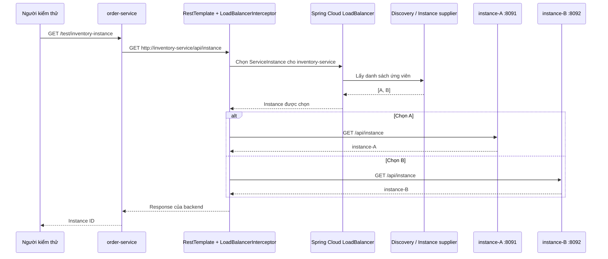

# Kiểm thử phân phối lời gọi giữa nhiều bản sao

Trong hệ thống microservices, `RestTemplate` có thể gọi một dịch vụ bằng **service ID** thay vì gắn cứng host và port của một bản sao. Khi bean `RestTemplate` được đánh dấu `@LoadBalanced`, Spring Cloud LoadBalancer tìm danh sách `ServiceInstance` của service ID đó, chọn một instance rồi chuyển HTTP request đến địa chỉ cụ thể. Nhưng làm thế nào biết rằng request thực sự được phân phối giữa nhiều bản sao thay vì luôn đến cùng một nơi?

Bài học này hướng dẫn **kiểm thử phân phối request của RestTemplate** bằng hai cách: kiểm tra thủ công trên các tiến trình Spring Boot và viết integration test JUnit gửi HTTP request thật tới hai backend giả lập trên cổng động. Ta sẽ quan sát instance nào nhận từng lời gọi, tổng hợp số lần xuất hiện, nhận diện các sai lệch do discovery, cache, retry và trạng thái backend, đồng thời hiểu tại sao phân phối gần đều không đồng nghĩa cân bằng hoàn toàn về CPU hoặc độ trễ.

## 1. Mục tiêu và nguyên tắc của phép kiểm thử

Sau bài này, bạn cần có khả năng:

1. Cấu hình `@LoadBalanced RestTemplate` gọi một service ID.
2. Khởi chạy hai bản sao cùng cung cấp một endpoint nhưng trả về **mã định danh bản sao** khác nhau.
3. Đếm số request được chọn tới mỗi instance và quan sát Round Robin.
4. Viết integration test dùng HTTP server thực, không mock mất phần chọn instance.
5. Phân biệt lỗi không chọn được instance, lỗi kết nối, lỗi HTTP và phân phối không như kỳ vọng.
6. Nêu giới hạn của việc đếm response để đánh giá khả năng cân bằng tải.

**Nguyên tắc quan trọng:** cần biết **backend nào thực sự xử lý lời gọi**. Chỉ thấy 20 request đều trả HTTP 200 chưa chứng minh có cân bằng tải; có thể tất cả đã đi tới một instance duy nhất. Ngược lại, chỉ nhìn số request thành công cũng không phản ánh những instance được chọn nhưng gặp lỗi kết nối.

Trong môi trường học tập, mỗi backend sẽ trả về `instance-A` hoặc `instance-B`. Chuỗi này chỉ dùng để kiểm thử; trong production có thể sử dụng trace, metric hoặc log ở lớp load balancing thay vì thêm thông tin hạ tầng vào response nghiệp vụ.

## 2. Luồng request của RestTemplate có LoadBalancer

Ví dụ ứng dụng `order-service` muốn hỏi `inventory-service`:

```text
GET http://inventory-service/api/instance
```

Đối với `@LoadBalanced RestTemplate`, phần host `inventory-service` là **service ID logic**. Đây không phải lời gọi DNS bắt buộc phải phân giải hostname đó thành IP. LoadBalancer tìm instance qua discovery rồi tái tạo URI với host và port của instance được chọn.



Với cấu hình mặc định thông dụng, Spring Cloud LoadBalancer sử dụng `RoundRobinLoadBalancer` để chọn lần lượt giữa các instance trong danh sách hiện tại. Một vòng chọn minh họa có thể là:

```text
Request 01 -> A
Request 02 -> B
Request 03 -> A
Request 04 -> B
...
```

Đây **không phải cam kết request đầu tiên luôn chọn A**. Bộ đếm có thể bắt đầu ở một vị trí khác, đồng thời nhiều client hoặc lời gọi từ nơi khác có thể làm thay đổi chuỗi quan sát được. Với hai instance ổn định và 40 lượt chọn tuần tự trong một client, phân phối thường rất gần 20/20.

## 3. Chuẩn bị dự án và dependency

Ví dụ dùng hai ứng dụng Spring Boot:

| Ứng dụng | Vai trò | Port |
|---|---|---:|
| `inventory-service`, instance A | Backend cung cấp endpoint giống bản sao B | 8091 |
| `inventory-service`, instance B | Backend cung cấp endpoint giống bản sao A | 8092 |
| `order-service` | Client gọi theo service ID và expose endpoint kiểm thử | 8080 |

Với Maven, ứng dụng **client** cần tối thiểu:

```xml
<dependencies>
    <dependency>
        <groupId>org.springframework.boot</groupId>
        <artifactId>spring-boot-starter-web</artifactId>
    </dependency>
    <dependency>
        <groupId>org.springframework.cloud</groupId>
        <artifactId>spring-cloud-starter-loadbalancer</artifactId>
    </dependency>
    <dependency>
        <groupId>org.springframework.boot</groupId>
        <artifactId>spring-boot-starter-test</artifactId>
        <scope>test</scope>
    </dependency>
</dependencies>
```

Đoạn này là **phần dependencies**, không phải `pom.xml` hoàn chỉnh. Dự án phải dùng Spring Boot parent hoặc dependency management tương ứng, đồng thời import `spring-cloud-dependencies` BOM ở `dependencyManagement` với **release train tương thích phiên bản Spring Boot**. Các phiên bản cụ thể cần được chọn theo bảng tương thích Spring Cloud; không tự ghép phiên bản starter với các bản Spring Boot bất kỳ.

Ứng dụng **provider** chỉ cần `spring-boot-starter-web` cho bài lab. Không cần Eureka hoặc Consul: ứng dụng client có thể dùng `SimpleDiscoveryClient` với danh sách URI tĩnh để quan sát LoadBalancer. Cấu hình tĩnh này chỉ dành cho môi trường học tập; khi mở rộng bài thử sang discovery động, cần một nguồn instance có khả năng cập nhật.

## 4. Tạo hai backend có dấu hiệu nhận diện

Trong dự án `inventory-service`, khai báo một endpoint đơn giản:

```java
import org.springframework.web.bind.annotation.GetMapping;
import org.springframework.web.bind.annotation.RestController;

@RestController
class InstanceController {

    @GetMapping("/api/instance")
    String instance() {
        return System.getProperty("instance.label", "unknown");
    }
}
```

Mỗi tiến trình chạy cùng một JAR nhưng có giá trị system property và port khác nhau. Sau khi build, mở **hai terminal**:

```bash
# Terminal A
java -Dinstance.label=instance-A -jar inventory-service.jar --server.port=8091
```

```bash
# Terminal B
java -Dinstance.label=instance-B -jar inventory-service.jar --server.port=8092
```

Lưu ý: `-Dinstance.label=...` là tùy chọn của JVM nên đặt **trước** `-jar`. Tham số `--server.port` là tùy chọn của Spring Boot. Nếu lệnh ở terminal A hoặc B không khởi động, cần sửa lỗi provider trước khi xem xét LoadBalancer.

Xác nhận hai backend bằng lời gọi trực tiếp:

```bash
curl http://localhost:8091/api/instance
curl http://localhost:8092/api/instance
```

Kết quả lần lượt phải là:

```text
instance-A
instance-B
```

Nếu cả hai cùng trả `unknown` hoặc cùng một nhãn, phép đo phân phối phía client sẽ không phân biệt được instance. Đừng tiếp tục kiểm thử LoadBalancer khi điều kiện đầu vào này chưa đạt.

## 5. Cấu hình danh sách instance trong order-service

Đặt cấu hình sau vào `application-lab.yml` của **ứng dụng client**:

```yaml
server:
  port: 8080

spring:
  application:
    name: order-service
  cloud:
    discovery:
      client:
        simple:
          instances:
            inventory-service:
              - uri: http://localhost:8091
              - uri: http://localhost:8092
```

Thuộc tính `spring.cloud.discovery.client.simple.instances` ánh xạ **service ID** sang danh sách `ServiceInstance` tĩnh. Cả hai URI cùng thuộc khóa `inventory-service`; không tạo hai service ID `inventory-A` và `inventory-B` vì đó là hai bản sao của cùng dịch vụ logic.

Kích hoạt profile khi chạy client:

```bash
java -jar order-service.jar --spring.profiles.active=lab
```

`localhost` chỉ phù hợp khi client và provider chạy trên cùng máy hoặc cùng network namespace. Nếu client ở Docker container, `localhost` là container client, không phải host hoặc container provider; khi đó cần hostname/địa chỉ truy cập được từ container.

### 5.1. Đăng ký đúng RestTemplate bean

Spring Cloud không tự biến mọi `RestTemplate` trong ứng dụng thành load-balanced client. Ta cần đánh dấu bean cụ thể:

```java
import org.springframework.boot.web.client.RestTemplateBuilder;
import org.springframework.cloud.client.loadbalancer.LoadBalanced;
import org.springframework.context.annotation.Bean;
import org.springframework.context.annotation.Configuration;
import org.springframework.web.client.RestTemplate;

@Configuration
class RestTemplateConfiguration {

    @Bean
    @LoadBalanced
    RestTemplate loadBalancedRestTemplate(RestTemplateBuilder builder) {
        return builder.build();
    }
}
```

Annotation `@LoadBalanced` cho phép Spring Cloud cấu hình interceptor để thay service ID bằng URI của instance được chọn. Ở ứng dụng có nhiều `RestTemplate`, nên inject đúng bean bằng `@Qualifier`:

```java
import org.springframework.beans.factory.annotation.Qualifier;
import org.springframework.stereotype.Service;
import org.springframework.web.client.RestTemplate;

@Service
class InventoryGateway {

    private final RestTemplate restTemplate;

    InventoryGateway(
            @Qualifier("loadBalancedRestTemplate") RestTemplate restTemplate) {
        this.restTemplate = restTemplate;
    }

    String selectedInstance() {
        return restTemplate.getForObject(
                "http://inventory-service/api/instance",
                String.class);
    }
}
```

Để tiện quan sát từ terminal, thêm endpoint proxy trong client:

```java
import org.springframework.web.bind.annotation.GetMapping;
import org.springframework.web.bind.annotation.RestController;

@RestController
class DistributionDemoController {

    private final InventoryGateway gateway;

    DistributionDemoController(InventoryGateway gateway) {
        this.gateway = gateway;
    }

    @GetMapping("/test/inventory-instance")
    String instance() {
        return gateway.selectedInstance();
    }
}
```

Request gửi tới `http://localhost:8080/test/inventory-instance` sẽ gọi backend thông qua `@LoadBalanced RestTemplate` và trả lại nhãn của instance. Cách này giữ nguyên service ID trong gateway; ta không phải viết logic tự chọn port bằng `if` hoặc `Random` trong controller.

## 6. Kiểm tra thủ công và đếm số request mỗi bản sao

Đầu tiên gửi vài lời gọi:

```bash
curl http://localhost:8080/test/inventory-instance
curl http://localhost:8080/test/inventory-instance
curl http://localhost:8080/test/inventory-instance
curl http://localhost:8080/test/inventory-instance
```

Nếu mọi thành phần hoạt động, các response cho biết request đang đến `instance-A` hoặc `instance-B`. Muốn đánh giá phân phối, cần **đếm một tập request**, không chỉ nhìn hai hoặc ba request.

### 6.1. Trên PowerShell

Gửi 40 request tuần tự rồi nhóm response:

```powershell
1..40 |
  ForEach-Object {
    $result = curl.exe --silent --show-error --fail http://localhost:8080/test/inventory-instance
    if ($LASTEXITCODE -ne 0) {
      throw "Request $_ failed; do not count this as a backend response"
    }
    $result
  } |
  Group-Object |
  Select-Object Name, Count
```

Đoạn script kiểm tra exit code của `curl.exe` sau từng request và dừng khi có HTTP lỗi hoặc lỗi kết nối. Không để các response rỗng do lỗi bị tính như một “instance thứ ba” trong bảng thống kê.

### 6.2. Trên Linux/macOS

```bash
set -euo pipefail
for i in $(seq 1 40); do
  curl --silent --show-error --fail \
    http://localhost:8080/test/inventory-instance
  printf '\n'
done | sort | uniq -c
```

Ví dụ **kết quả kỳ vọng minh họa** khi danh sách ổn định và chỉ có một client gửi request tuần tự:

| Instance | Số response trong 40 request | Tỷ lệ |
|---|---:|---:|
| `instance-A` | 20 | 50% |
| `instance-B` | 20 | 50% |

Không coi đúng 20/20 là điều kiện bất biến trong mọi môi trường. Spring Cloud LoadBalancer thường dùng Round Robin mặc định, nhưng thứ tự ban đầu, các request khác, thay đổi danh sách, retry và cấu hình supplier có thể làm số liệu khác đi.

### 6.3. Đo tỷ lệ, không chỉ đếm

Với tổng `N` response đã được gán nhãn và số response từ instance `i` là `c_i`, tỷ lệ quan sát được:

\[
r_i = \frac{c_i}{N}\times 100\%.
\]

Ví dụ A có 22, B có 18 response trong 40 lời gọi thì `r_A=55%` và `r_B=45%`. Điều này chưa phải lỗi: trước khi kết luận, cần xác nhận có bao nhiêu instance hợp lệ tại thời điểm chọn, có request khác xen vào không, có request thất bại không, và phép thử có đi qua đúng một load balancer hay không.

## 7. Integration test JUnit với hai HTTP server thật

Kiểm tra thủ công tốt cho bài lab, nhưng muốn biến nó thành phép kiểm thử có thể chạy lại trong CI, ta cần tự tạo backend. Một lựa chọn gọn là sử dụng `HttpServer` của JDK để dựng hai server HTTP trên **cổng động**, sau đó đăng ký URI cho `SimpleDiscoveryClient` bằng `@DynamicPropertySource`.

Ưu điểm:

- Test không phụ thuộc hai tiến trình provider đang chạy ngoài test.
- Mỗi instance trả nhãn riêng, giúp xác minh **request thật** đi qua RestTemplate và LoadBalancer.
- Cổng động hạn chế xung đột với ứng dụng khác trên máy/CI.
- Không dùng mock HTTP request nằm **trước** interceptor, nên vẫn đi qua bước chọn instance và kết nối mạng.

Ví dụ dưới đây dùng JUnit Jupiter và Spring Boot Test. Giả sử ứng dụng client đã có `@SpringBootApplication` và bean `loadBalancedRestTemplate` như mục 5, tạo lớp `InstanceDistributionTest`:

```java
import static org.junit.jupiter.api.Assertions.assertEquals;
import static org.junit.jupiter.api.Assertions.assertTrue;

import java.io.IOException;
import java.io.OutputStream;
import java.io.UncheckedIOException;
import java.net.InetSocketAddress;
import java.nio.charset.StandardCharsets;
import java.util.HashMap;
import java.util.Map;

import com.sun.net.httpserver.HttpServer;
import org.junit.jupiter.api.AfterAll;
import org.junit.jupiter.api.Test;
import org.springframework.beans.factory.annotation.Autowired;
import org.springframework.beans.factory.annotation.Qualifier;
import org.springframework.boot.test.context.SpringBootTest;
import org.springframework.test.context.DynamicPropertyRegistry;
import org.springframework.test.context.DynamicPropertySource;
import org.springframework.web.client.RestTemplate;

@SpringBootTest(webEnvironment = SpringBootTest.WebEnvironment.NONE)
class InstanceDistributionTest {

    private static final HttpServer SERVER_A = startServer("instance-A");
    private static final HttpServer SERVER_B = startServer("instance-B");

    @DynamicPropertySource
    static void configureInstances(DynamicPropertyRegistry properties) {
        properties.add(
                "spring.cloud.discovery.client.simple.instances.inventory-service[0].uri",
                () -> "http://127.0.0.1:" + SERVER_A.getAddress().getPort());

        properties.add(
                "spring.cloud.discovery.client.simple.instances.inventory-service[1].uri",
                () -> "http://127.0.0.1:" + SERVER_B.getAddress().getPort());
    }

    @Autowired
    @Qualifier("loadBalancedRestTemplate")
    private RestTemplate restTemplate;

    @Test
    void distributesCallsAcrossBothInstances() {
        Map<String, Integer> counts = new HashMap<>();

        for (int i = 0; i < 40; i++) {
            String instance = restTemplate.getForObject(
                    "http://inventory-service/api/instance",
                    String.class);
            counts.merge(instance, 1, Integer::sum);
        }

        assertEquals(40, counts.values().stream()
                .mapToInt(Integer::intValue).sum());
        assertEquals(2, counts.size(),
                "Phải thấy response của cả hai bản sao");
        assertTrue(counts.getOrDefault("instance-A", 0) >= 10,
                "Instance A không được nhận quá ít request");
        assertTrue(counts.getOrDefault("instance-B", 0) >= 10,
                "Instance B không được nhận quá ít request");
    }

    @AfterAll
    static void stopServers() {
        SERVER_A.stop(0);
        SERVER_B.stop(0);
    }

    private static HttpServer startServer(String instanceId) {
        try {
            HttpServer server = HttpServer.create(
                    new InetSocketAddress("127.0.0.1", 0), 0);

            server.createContext("/api/instance", exchange -> {
                byte[] body = instanceId.getBytes(StandardCharsets.UTF_8);
                exchange.getResponseHeaders().set(
                        "Content-Type", "text/plain; charset=UTF-8");
                exchange.sendResponseHeaders(200, body.length);

                try (OutputStream output = exchange.getResponseBody()) {
                    output.write(body);
                }
            });

            server.start();
            return server;
        } catch (IOException exception) {
            throw new UncheckedIOException(exception);
        }
    }
}
```

Với JDK 17, `com.sun.net.httpserver.HttpServer` nằm trong module JDK `jdk.httpserver`; nếu dự án cấu hình Java module system tường minh, cần khai báo yêu cầu module tương ứng. Test này dùng các tiện ích chuẩn của JDK, không đòi thêm thư viện mock HTTP server.

Chạy bằng Maven (thay lệnh phù hợp với cách dự án đóng gói):

```bash
./mvnw -Dtest=InstanceDistributionTest test
```

Trên Windows PowerShell, nếu dự án có Maven Wrapper:

```powershell
.\mvnw.cmd -Dtest=InstanceDistributionTest test
```

**Điều kiện của test:** ứng dụng test phải có dependency LoadBalancer, cấu hình RestTemplate bean đã đánh dấu `@LoadBalanced` và không có source discovery khác vô tình thay danh sách `inventory-service`. `@DynamicPropertySource` đăng ký URI vào Spring Environment **trước khi context test được xây dựng**; hai server được tạo khi lớp test được khởi tạo và đóng ở `@AfterAll`.

### Vì sao không assert đúng 20/20?

Mục tiêu của integration test là phát hiện việc cấu hình sai khiến **tất cả request chỉ đi tới một instance** hoặc đi ngoài đường LoadBalancer. Do đó test xác minh:

1. 40 lời gọi đều nhận response được phân loại.
2. Xuất hiện đúng hai nhãn instance được khai báo.
3. Mỗi instance nhận ít nhất 10 response trong kịch bản tuần tự, danh sách hai instance ổn định và thuật toán mặc định.

Ngưỡng 10/40 là lựa chọn **cho fixture này**, không phải SLA hoặc định nghĩa Round Robin. Để kiểm thử chính xác từng quyết định thuật toán, nên viết unit test riêng cho `RoundRobinLoadBalancer` với supplier và bộ đếm có thể kiểm soát, thay vì phụ thuộc vào thời điểm khởi tạo context hoặc sự xen kẽ của các request HTTP.

Không dùng `MockRestServiceServer` để thay thế hoàn toàn đường thực thi HTTP trong **phép kiểm thử phân phối đầu-cuối** nếu nó khiến request không còn đi qua LoadBalancer. Mock thích hợp cho unit test một gateway, nhưng để chứng minh việc chọn giữa các URI thực tế, cần giữ nguyên interceptor và tầng gửi HTTP hoặc mock ở lớp sau khi đã chọn instance một cách có chủ đích.

## 8. Thử các tình huống bất thường

Một bài kiểm thử tốt không chỉ đo trường hợp cả hai instance đều khỏe.

| Kịch bản | Hiện tượng có thể thấy | Điều cần kiểm tra |
|---|---|---|
| Hai instance hoạt động | Response từ cả A và B | Đúng service ID, đúng bean RestTemplate, danh sách đủ hai URI |
| Chỉ khai báo A | Tất cả request tới A | Đây là hành vi hợp lệ nếu danh sách thực sự chỉ có A |
| B đã dừng nhưng danh sách tĩnh vẫn chứa B | Một số request bị lỗi kết nối hoặc timeout | Danh sách instance tĩnh không tự loại B |
| Discovery không trả instance | Không chọn được đích; lỗi tùy tích hợp | Khóa service ID, registry, supplier và danh sách hiện có |
| Instance trả HTTP 500 | RestTemplate mặc định có thể ném exception HTTP | Phân biệt lỗi của backend với lỗi thuật toán chọn |
| Đổi sang danh sách A, B, C | Phân phối giữa ba instance sau khi danh sách được cập nhật | Dữ liệu discovery/cache, thời điểm làm mới và việc có 3 provider thực |
| B unhealthy nhưng chưa bật health filtering | B vẫn có thể được chọn | Health check không tự có chỉ vì đã thêm LoadBalancer starter |
| Gửi request đồng thời từ nhiều client | Chuỗi response khó luân phiên tuyệt đối | Mỗi ứng dụng client có state lựa chọn và snapshot instance riêng |

### 8.1. Đóng một provider: vì sao vẫn bị chọn?

Nếu chạy ví dụ với `SimpleDiscoveryClient` tĩnh và dừng backend B, danh sách trong client vẫn có thể chứa `http://localhost:8092`. Round Robin vẫn có thể chọn B, sau đó **HTTP transport** báo `Connection refused`. Đây không phải chứng cứ rằng LoadBalancer không hoạt động; chính là LoadBalancer đã chọn một instance chưa được loại khỏi danh sách ứng viên.

Muốn loại instance lỗi, cần có discovery cập nhật trạng thái hoặc cấu hình `HealthCheckServiceInstanceListSupplier` phù hợp. Health check cũng có chu kỳ phát hiện; một instance có thể chết sau khi đã được chọn. Retry là cơ chế riêng và không được bật hoặc bảo đảm chọn lại instance chỉ vì dùng `@LoadBalanced`.

### 8.2. Scale out và scale in

Với `SimpleDiscoveryClient` từ `application-lab.yml`, việc sửa YAML trên ổ đĩa không nhất thiết làm danh sách đổi ngay trong ứng dụng đang chạy. Để mô phỏng chuyển từ A/B sang A/B/C:

- Trong lab đơn giản: cập nhật danh sách tĩnh, khởi động thêm C và **khởi động lại client** trước khi đo.
- Trong lab nâng cao: dùng discovery động hoặc supplier tùy biến có thể thay đổi dữ liệu khi ứng dụng vẫn chạy; ghi lại thời điểm client nhìn thấy danh sách mới.

Khi số instance từ `n=2` thành `n=3`, Round Robin tính chỉ số lựa chọn theo **độ dài danh sách hiện tại**. Vì vậy sự thay đổi không nhất thiết tạo chuỗi A/B/C ngay lập tức, nhất là khi cache và nhiều client đang sử dụng những snapshot khác nhau.

## 9. Phân biệt số lượt chọn, response thành công và tải thực tế

Trong một phép kiểm thử, có ít nhất bốn đại lượng khác nhau:

| Đại lượng | Ý nghĩa | Có bằng nhau không? |
|---|---|---|
| Số lượt chọn instance | LoadBalancer đã đưa ra quyết định chọn đích bao nhiêu lần | Có thể lớn hơn số request nghiệp vụ nếu retry |
| Số request gửi tới instance | HTTP transport đã thử gửi request | Có thể khác lượt chọn nếu lỗi xảy ra trước khi kết nối |
| Số response thành công từ instance | Backend trả response thành công được client nhận | Có thể nhỏ hơn số request đã thử |
| Tải thực tế của instance | CPU, memory, số connection, thời gian xử lý và công việc nghiệp vụ | Không thể suy trực tiếp từ số response |

Ví dụ một instance nhận 50 request đơn giản, instance khác nhận 50 request truy vấn dữ liệu nặng: số lượng request bằng nhau, nhưng tải CPU hoặc latency có thể rất khác. Round Robin phân phối **lượt chọn** theo danh sách, không đo thời gian xử lý hay tải còn lại của từng instance.

Để kiểm thử toàn diện hơn, cần quan sát ở cả client và backend:

- Tại client: service ID, instance được chọn, URI đích, thời gian xử lý, exception và retry count.
- Tại backend: instance ID, tổng số request đến, tỷ lệ lỗi, request duration và tài nguyên sử dụng.
- Tại discovery: số instance đang đăng ký, thay đổi health, cache TTL hoặc thời điểm làm mới supplier.

Trong môi trường thực tế, không nên ghi token, cookie, dữ liệu cá nhân hoặc toàn bộ response body vào log chỉ để đo phân phối. Có thể dùng tracing/metrics với nhãn service ID và instance ID đã chuẩn hóa.

## 10. Lỗi thường gặp khi kiểm thử

| Triệu chứng | Nguyên nhân thường gặp | Cách khắc phục |
|---|---|---|
| `UnknownHostException: inventory-service` | RestTemplate không dùng interceptor LoadBalancer, hoặc hostname instance thật không phân giải được | Kiểm tra bean `@LoadBalanced`, `@Qualifier` và danh sách URI đã chọn |
| Chỉ thấy `instance-A` | Chỉ một URI, bean sai, provider B trả nhãn sai hoặc test có request đến instance khác không nhìn thấy | Gọi trực tiếp hai provider; kiểm tra discovery và REST client |
| `Connection refused` | Provider chưa chạy, port sai hoặc container không truy cập được `localhost` của máy host | Xác minh port và gọi trực tiếp URI từ môi trường client |
| Nhiều response rỗng trong script | HTTP lỗi bị bỏ qua khi nhóm response | Kiểm tra exit code của curl và tách số request lỗi khỏi kết quả thành công |
| Round Robin không đạt đúng 50/50 | Request đồng thời, danh sách thay đổi, filter, retry hoặc sample chưa đúng | Đếm lượt chọn; ổn định danh sách và kiểm tra cấu hình |
| `No instances available` hoặc HTTP 503 | Discovery/supplier không cung cấp instance phù hợp | So service ID trong URL với key danh sách instance và active profile |
| Integration test lỗi ngẫu nhiên vì port đã chiếm | Dùng port cố định trong test | Dùng port 0 và `@DynamicPropertySource` như mục 7 |
| Test xanh nhưng production lỗi | Test dùng danh sách tĩnh, chưa kiểm chứng registry/network/health thực | Bổ sung smoke test và tracing trong môi trường gần production |

Khi chẩn đoán, đi theo đúng chuỗi **service ID → danh sách instance → instance được chọn → URI đích → kết nối HTTP → response**. Bước nào thất bại sẽ chỉ ra lớp vấn đề cần sửa; không nên vội thay thuật toán khi lỗi chỉ là bean RestTemplate chưa tích hợp LoadBalancer.

## 11. Checklist hoàn thành

- [ ] Hai backend cung cấp cùng endpoint và trả về nhãn instance khác nhau.
- [ ] Có thể gọi trực tiếp cả A và B trên hai cổng khác nhau.
- [ ] Ứng dụng client có `spring-cloud-starter-loadbalancer` và Spring Cloud BOM tương thích.
- [ ] `SimpleDiscoveryClient` khai báo đúng service ID `inventory-service` cùng hai URI.
- [ ] `RestTemplate` được đánh dấu `@LoadBalanced` và được inject đúng bean.
- [ ] Gọi URL logic `http://inventory-service/api/instance` thay vì gắn cứng một port.
- [ ] Phép thử thủ công đếm được response từ cả hai bản sao.
- [ ] Integration test JUnit sử dụng hai HTTP server thật và xác minh số lượng phân phối.
- [ ] Phép đo nhận diện rõ request lỗi, retry và sự khác biệt giữa số lượt chọn với số response thành công.
- [ ] Giải thích được vì sao instance đã dừng vẫn có thể được chọn khi danh sách discovery chưa cập nhật.

**Kết luận:** kiểm thử phân phối lời gọi của `RestTemplate` cần chứng minh **instance nào** đã xử lý từng request, không chỉ kiểm tra rằng request trả về 200. Với hai backend có ID riêng, một `@LoadBalanced RestTemplate`, danh sách instance rõ ràng và integration test thật, ta có thể xác minh đúng luồng chọn đích của Spring Cloud LoadBalancer, đồng thời phát hiện lỗi cấu hình, vấn đề cập nhật discovery và những giới hạn của phân phối theo số request.
