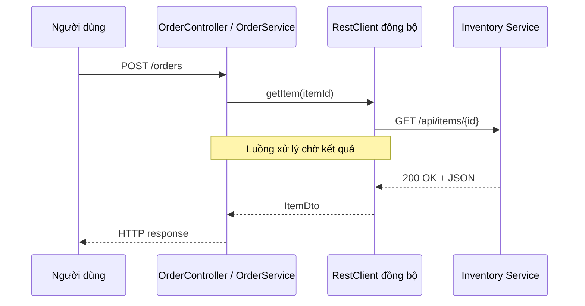
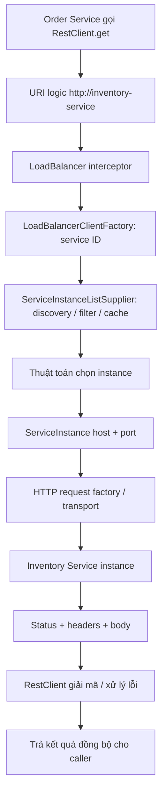

# Mô hình gọi đồng bộ với RestClient

Trong kiến trúc microservice, một dịch vụ thường phải gọi dịch vụ khác để hoàn tất nghiệp vụ. Chẳng hạn, khi tạo đơn hàng, `order-service` cần hỏi `inventory-service` xem một sản phẩm còn hàng hay không. Với **Spring Framework RestClient**, ta có thể viết lời gọi HTTP theo phong cách fluent, dễ đọc, nhưng **đây vẫn là mô hình thực thi đồng bộ (blocking)**: luồng thực hiện lời gọi chờ cho đến khi nhận đủ kết quả hoặc xảy ra lỗi/timeout.

Khi tích hợp **Spring Cloud LoadBalancer**, caller không cần hard-code địa chỉ từng replica. Caller dùng service ID như `http://inventory-service`, còn LoadBalancer tra cứu danh sách `ServiceInstance` và chọn một instance trước khi HTTP transport kết nối tới đích.

Bài học này trình bày chính xác đường đi của một lời gọi `RestClient` đồng bộ, cách khởi tạo `@LoadBalanced RestClient.Builder`, phân biệt lựa chọn instance với gửi HTTP, cách xử lý lỗi, timeout, retry và các rủi ro vận hành khi nhiều request đồng thời. Đây là nền tảng để sử dụng RestClient ổn định trong module Spring Cloud LoadBalancer, đồng thời hiểu điểm khác so với `WebClient` và OpenFeign.

## 1. RestClient là gì?

`RestClient` là HTTP client đồng bộ của Spring Framework, có API fluent để tạo request, gửi qua HTTP transport và đọc response. Nó được giới thiệu từ **Spring Framework 6.1**, thường có mặt trong ứng dụng Spring Boot 3.2 trở lên khi dùng các phiên bản tương thích.

Ví dụ gọi một URL cụ thể, **chưa tích hợp LoadBalancer**:

```java
RestClient client = RestClient.create();

String body = client.get()
    .uri("http://localhost:8081/api/hello")
    .retrieve()
    .body(String.class);

System.out.println(body);
```

Trong đoạn mã này:

1. `get()` xác định HTTP method.
2. `uri(...)` xác định đích và đường dẫn.
3. `retrieve()` bắt đầu quy trình lấy response theo API `RestClient`.
4. `body(String.class)` thực hiện thao tác để trả về body được chuyển đổi sang `String`; **luồng gọi chờ** trong khi HTTP request hoàn tất.

`RestClient` không phải RestTemplate, dù đều hỗ trợ gọi HTTP đồng bộ. `RestClient` sử dụng API fluent; `RestTemplate` có API phương thức như `getForObject(...)` hoặc `exchange(...)`. `WebClient` là lựa chọn reactive, trả về `Mono`/`Flux` khi dùng theo mô hình non-blocking phù hợp.

## 2. “Đồng bộ” nghĩa là gì trong thực tế?

Với RestClient, câu lệnh gọi HTTP chạy trên **luồng hiện tại** và chưa trả quyền điều khiển về mã tiếp theo cho đến khi request hoàn tất, thất bại hoặc bị timeout. Ví dụ:

```java
public OrderView createOrder(String itemId) {
    ItemDto item = inventoryClient.getItem(itemId); // Chờ kết quả HTTP
    return new OrderView(item.id(), item.name());
}
```

Nếu gọi inventory mất 800 ms, luồng chạy `createOrder` có thể bị chiếm trong phần lớn khoảng thời gian đó, dù CPU của luồng không thực sự bận tính toán. Nếu gọi trên một request-handling thread của ứng dụng servlet, khả năng tiếp nhận thêm request phụ thuộc số thread còn lại, connection pool, timeout và các tài nguyên khác.



**Blocking không đồng nghĩa CPU luôn hoạt động.** Phần lớn thời gian có thể là chờ socket, TLS, database phía upstream hoặc mạng. Tuy nhiên, trong mô hình sử dụng platform threads thông thường, mỗi lời gọi đang chờ vẫn chiếm một luồng. Nếu ứng dụng dùng virtual threads, chi phí giữ luồng có thể thấp hơn trong nhiều tình huống, nhưng semantics của `RestClient` vẫn là **đồng bộ**: phương thức gọi chưa hoàn tất thì mã phía sau chưa tiếp tục.

### Ví dụ ảnh hưởng đến concurrency

Giả sử endpoint của `order-service` có 100 request đồng thời, mỗi request gọi `inventory-service` và chờ trung bình 500 ms. Khi dùng RestClient, có thể có 100 lời gọi đang chờ HTTP cùng lúc (phụ thuộc số request-handling threads/virtual threads và các giới hạn khác).

Theo định luật Little trong trạng thái ổn định:

```text
in-flight trung bình ≈ throughput × thời gian phản hồi trung bình
Ví dụ: 200 request/s × 0,5 s ≈ 100 request đang xử lý
```

Đây chỉ là minh họa về concurrency; không phải số thread thực tế bắt buộc của mọi cấu hình. Nếu timeout quá dài hoặc upstream bị nghẽn, số request đang chờ có thể tăng và làm bão hòa tài nguyên caller.

## 3. Spring Cloud LoadBalancer tham gia ở đâu?

Giả sử `inventory-service` có ba instance được discovery công bố:

| Service ID | Host | Port | Ghi chú |
|---|---|---:|---|
| `inventory-service` | `10.0.1.11` | 8080 | Replica A |
| `inventory-service` | `10.0.1.12` | 8080 | Replica B |
| `inventory-service` | `10.0.1.13` | 8080 | Replica C |

Caller muốn gọi `GET http://inventory-service/api/items/42` mà không biết replica nào hiện đang khả dụng. Khi `RestClient.Builder` được tích hợp Spring Cloud LoadBalancer bằng `@LoadBalanced`, LoadBalancer interceptor sẽ lấy service ID từ host URI logic, yêu cầu LoadBalancer chọn một `ServiceInstance` rồi thay đích logic bằng địa chỉ thực cho transport.



Các lớp có trách nhiệm riêng:

| Thành phần | Nhiệm vụ |
|---|---|
| `RestClient` | Xây dựng request, gửi qua HTTP transport, chuyển đổi response và báo lỗi. |
| `@LoadBalanced RestClient.Builder` | Builder được cấu hình để request bằng service ID đi qua integration LoadBalancer. |
| `LoadBalancerClientFactory` | Truy cập cấu hình LoadBalancer theo service ID. |
| `ServiceInstanceListSupplier` | Cung cấp tập instance ứng viên từ discovery hoặc nguồn cấu hình, có thể áp dụng health check, cache, zone/hint filters. |
| LoadBalancer chọn instance | Áp dụng round robin, random hoặc chính sách khác lên danh sách ứng viên. |
| `ServiceInstance` | Mô tả host, port, URI, secure flag và metadata của replica được chọn. |
| HTTP transport | Thực hiện kết nối TCP/TLS, connection pooling và các timeout theo cách transport được cấu hình. |

**Điểm cần phân biệt:** chọn được `ServiceInstance` không chứng minh HTTP request sẽ thành công. Sau khi chọn đích vẫn có thể gặp connection refused, TLS error, timeout hoặc HTTP `5xx`.

## 4. Chuẩn bị dependency và cấu hình cần thiết

Để chạy ví dụ trong ứng dụng Spring Boot phù hợp, thường cần:

- Spring Web để có `RestClient` và HTTP request handling.
- Spring Cloud LoadBalancer để sử dụng `@LoadBalanced` với cơ chế chọn `ServiceInstance`.
- Một nguồn discovery như Eureka/Consul/Kubernetes hoặc một cấu hình instance tĩnh phù hợp môi trường thử nghiệm.
- Bộ phiên bản Spring Boot/Spring Cloud tương thích theo BOM của dự án.

Ví dụ khai báo dependency bằng Maven, chưa nêu số phiên bản vì được quản lý bởi dependency management/BOM đang dùng:

```xml
<dependencies>
    <dependency>
        <groupId>org.springframework.boot</groupId>
        <artifactId>spring-boot-starter-web</artifactId>
    </dependency>
    <dependency>
        <groupId>org.springframework.cloud</groupId>
        <artifactId>spring-cloud-starter-loadbalancer</artifactId>
    </dependency>
</dependencies>
```

Hai dependency này **không tự tạo danh sách instance** cho mọi service ID nếu chưa có discovery hoặc nguồn instance được cung cấp. Nếu chỉ viết `http://inventory-service` mà không đăng ký `inventory-service` ở nguồn discovery/tĩnh phù hợp, LoadBalancer có thể không tìm thấy instance để gọi.

Trong Spring Boot, cũng có thể inject builder mặc định do Boot cấu hình. Nhưng builder thông thường **không tự mang khả năng chọn instance**; nên khai báo rõ bean builder `@LoadBalanced` khi cần request bằng service ID.

## 5. Tạo @LoadBalanced RestClient.Builder

Ví dụ trong `order-service`:

```java
import org.springframework.cloud.client.loadbalancer.LoadBalanced;
import org.springframework.context.annotation.Bean;
import org.springframework.context.annotation.Configuration;
import org.springframework.web.client.RestClient;

@Configuration
class RestClientConfiguration {

    @Bean
    @LoadBalanced
    RestClient.Builder loadBalancedRestClientBuilder() {
        return RestClient.builder();
    }

    @Bean
    RestClient inventoryRestClient(
            @LoadBalanced RestClient.Builder builder) {
        return builder.clone()
            .baseUrl("http://inventory-service")
            .build();
    }
}
```

Ý nghĩa:

1. Bean `loadBalancedRestClientBuilder` được đánh dấu `@LoadBalanced` để Spring Cloud cấu hình integration LoadBalancer cho builder này.
2. Bean `inventoryRestClient` lấy builder phù hợp, nhân bản cấu hình và đặt `baseUrl` bằng **service ID**, không đặt IP một replica cố định.
3. Khi gọi `/api/items/42`, client giải quyết URI dựa trên `http://inventory-service` và integration sẽ chọn instance phù hợp.

Nếu có nhiều bean `RestClient.Builder` hoặc `RestClient`, hãy dùng qualifier/`@LoadBalanced` rõ ràng để Spring biết đúng builder cần inject. Dùng `builder.clone()` tránh việc chỉnh base URL cho một service làm thay đổi cấu hình builder có thể được dùng để tạo những client khác.

**Chú ý:** `@LoadBalanced` không áp dụng cho mọi `RestClient` được tạo bằng `RestClient.create()`. Muốn chọn instance theo service ID phải dùng đúng builder đã được tích hợp; một client thông thường có thể cố giải `inventory-service` như hostname DNS.

## 6. Viết gateway gọi inventory-service

Để tách chi tiết HTTP khỏi business logic, tạo một gateway chuyên gọi inventory:

```java
import org.springframework.beans.factory.annotation.Qualifier;
import org.springframework.stereotype.Service;
import org.springframework.web.client.RestClient;

record ItemDto(String id, String name, int available) {
}

@Service
class InventoryGateway {

    private final RestClient restClient;

    InventoryGateway(@Qualifier("inventoryRestClient") RestClient restClient) {
        this.restClient = restClient;
    }

    ItemDto findItem(String id) {
        return restClient.get()
            .uri("/api/items/{id}", id)
            .retrieve()
            .body(ItemDto.class);
    }
}
```

Caller sử dụng gateway:

```java
@Service
class OrderService {

    private final InventoryGateway inventory;

    OrderService(InventoryGateway inventory) {
        this.inventory = inventory;
    }

    OrderView previewOrder(String itemId) {
        ItemDto item = inventory.findItem(itemId);
        if (item == null) {
            throw new IllegalStateException("Empty inventory response");
        }
        return new OrderView(item.id(), item.available());
    }
}

record OrderView(String itemId, int available) {
}
```

Luồng xử lý là:

1. `OrderService` gọi `InventoryGateway.findItem(id)`.
2. `RestClient` xây dựng `GET /api/items/{id}` dựa trên base URL là `http://inventory-service`.
3. Integration LoadBalancer phân giải `inventory-service` thành một instance và chuyển request cho HTTP transport.
4. HTTP client chờ response; nếu thành công, JSON được chuyển thành `ItemDto`.
5. Phương thức `findItem` trả về `ItemDto` cho `OrderService`; luồng gọi chỉ tiếp tục khi bước trước kết thúc.

Ví dụ dùng Java record và lược bớt import ở đoạn `OrderService`. Trong production cần xử lý trường hợp body rỗng, lỗi HTTP và dữ liệu không hợp lệ thay vì giả định luôn có `ItemDto`.

## 7. Đọc response: status, header và body

`RestClient` hỗ trợ nhiều cách nhận kết quả:

```java
// Chỉ lấy body
ItemDto item = restClient.get()
    .uri("/api/items/{id}", id)
    .retrieve()
    .body(ItemDto.class);

// Lấy cả status, headers và body qua ResponseEntity
ResponseEntity<ItemDto> result = restClient.get()
    .uri("/api/items/{id}", id)
    .retrieve()
    .toEntity(ItemDto.class);

HttpStatusCode status = result.getStatusCode();
HttpHeaders headers = result.getHeaders();
ItemDto value = result.getBody();
```

Với `retrieve()`, Spring áp dụng status handling của `RestClient`. Theo mặc định, response `4xx`/`5xx` thường dẫn đến ngoại lệ HTTP status tương ứng, thay vì tự động trả body DTO như response thành công. `toEntity(...)` vẫn sử dụng cơ chế `retrieve()` và status handling đó.

Nếu cần tùy chỉnh một nhóm status:

```java
ItemDto item = restClient.get()
    .uri("/api/items/{id}", id)
    .retrieve()
    .onStatus(
        code -> code.value() == 503,
        (request, response) -> {
            throw new IllegalStateException(
                "Inventory replied 503 Service Unavailable");
        })
    .body(ItemDto.class);
```

Hãy quyết định lỗi nào được chuyển thành exception nghiệp vụ, lỗi nào nên đi qua tầng retry/resilience và lỗi nào cần trả về caller. Không nên dùng một catch `Exception` rộng để biến tất cả lỗi kết nối, lỗi phân giải instance và lỗi dữ liệu thành “hết hàng”.

Ngoài `retrieve()`, API `exchange(...)` cho phép xử lý request/response ở mức thấp hơn. Với `exchange(...)`, các status handler của `retrieve()` không tự áp dụng theo cùng cách; người viết mã phải chịu trách nhiệm kiểm tra HTTP status và đóng/đọc response hợp lý. Chỉ dùng khi thực sự cần truy cập response thấp hơn.

## 8. Ba nhóm lỗi không được trộn lẫn

Trong tích hợp RestClient + LoadBalancer, cùng một request có thể hỏng tại ba tầng:

| Giai đoạn | Dấu hiệu | Nguyên nhân nên kiểm tra |
|---|---|---|
| **Trước khi có instance** | Không có server khả dụng cho `inventory-service`; integration báo exception hoặc lỗi tùy phiên bản. | Sai service ID, discovery rỗng, metadata/zone filter loại hết, health check không đạt. |
| **Đã có instance, kết nối thất bại** | `ResourceAccessException`, connection refused, socket timeout, TLS handshake error hoặc lỗi transport tương tự. | Địa chỉ/port sai, mạng, TLS, proxy, timeout, server down sau lúc được chọn. |
| **HTTP upstream phản hồi lỗi** | Response status `404`, `409`, `429`, `500`, `503`... | Hợp đồng API, tài nguyên, rate limit, ứng dụng đích lỗi hoặc quá tải. |

**HTTP 503 từ upstream không đồng nghĩa lỗi “không tìm thấy instance”.** Tùy integration, một số lỗi trước khi kết nối có thể được ánh xạ thành status hoặc exception tương tự. Cần quan sát điểm phát sinh lỗi và instance đã được chọn hay chưa.

Một cách xử lý `404` có chủ đích:

```java
import org.springframework.web.client.HttpClientErrorException;
import java.util.Optional;

Optional<ItemDto> findOptional(String id) {
    try {
        return Optional.ofNullable(restClient.get()
            .uri("/api/items/{id}", id)
            .retrieve()
            .body(ItemDto.class));
    } catch (HttpClientErrorException.NotFound e) {
        return Optional.empty();
    }
}
```

Ở đây chỉ `404 Not Found` được diễn giải thành tài nguyên không tồn tại. `401`, `403`, `429`, `5xx` và lỗi kết nối không bị nuốt. Đó là khác biệt quan trọng khi caller cần chẩn đoán nguyên nhân và quyết định có retry hay không.

## 9. Timeout của HTTP client không phải timeout của thuật toán chọn đích

`RestClient` là một API cấp cao; timeout phụ thuộc `ClientHttpRequestFactory` và HTTP engine được chọn. Ví dụ dùng request factory đơn giản cho ứng dụng demo:

```java
@Bean
RestClient inventoryRestClient(@LoadBalanced RestClient.Builder builder) {
    SimpleClientHttpRequestFactory factory =
        new SimpleClientHttpRequestFactory();

    factory.setConnectTimeout(1_000);
    factory.setReadTimeout(3_000);

    return builder.clone()
        .baseUrl("http://inventory-service")
        .requestFactory(factory)
        .build();
}
```

Các số `1_000` và `3_000` là mili giây trong API nhận tham số nguyên tương ứng của những phiên bản Spring Framework hỗ trợ. Khi dùng phiên bản có overload nhận `Duration`, có thể đặt giá trị tương đương theo API đó. Không nên copy-paste mà không kiểm tra phiên bản thực tế.

| Timeout | Phạm vi thường gặp | Không giải quyết được |
|---|---|---|
| Connect timeout | Thời gian chờ thiết lập kết nối đến host:port đã chọn. | Discovery không có instance, health filter rỗng. |
| Read timeout | Thời gian chờ đọc dữ liệu từ kết nối theo ngữ nghĩa của HTTP engine. | CPU/DB quá tải ở upstream, logic xử lý lỗi nghiệp vụ. |
| Request deadline tổng | Hạn mức thời gian cho cả lời gọi nghiệp vụ, có thể gồm lựa chọn instance, kết nối, xử lý response và retry. | Không tự có chỉ bằng cấu hình connect/read timeout; phải thiết kế ở tầng phù hợp. |

Ví dụ đơn giản này không dùng connection pool chuyên dụng; môi trường có lưu lượng lớn cần cân nhắc HTTP engine với pooling, idle connection timeout, pool limits và TLS/proxy configuration. **Chỉnh timeout là cấu hình HTTP transport**, không phải thay đổi `RoundRobinLoadBalancer` hoặc `ServiceInstanceListSupplier`.

## 10. Retry trong lời gọi đồng bộ

Một lời gọi đồng bộ có thể bị lỗi tạm thời và caller muốn thử lại. Tuy vậy:

- **Không phải mọi lỗi đều nên retry:** `400`, `401`, `403`, `404` thường không có lợi khi gửi lại y nguyên. Một số `502`, `503`, `504`, lỗi kết nối và timeout có thể thử lại có điều kiện.
- **Không phải method nào cũng an toàn để thử lại:** `GET` thường là safe/idempotent; `PUT` và `DELETE` có ngữ nghĩa idempotent theo HTTP nhưng vẫn phải xét hợp đồng API. `POST` tạo giao dịch có thể bị thực thi một lần dù response bị mất; retry cần idempotency key hoặc bảo đảm chống trùng.
- **Không giả định retry sẽ đổi instance:** nếu retry chạy ở HTTP engine sau khi đã chọn host, lần sau có thể vẫn gọi cùng địa chỉ. Tùy vị trí retry trong integration Spring Cloud LoadBalancer và chính sách chọn lại, mới có thể chọn instance khác.
- **Giới hạn số attempt và thời gian:** retry phải có backoff, jitter và deadline tổng. Nếu RestClient, LoadBalancer và tầng nghiệp vụ cùng retry mà không phối hợp, số HTTP attempt có thể bị nhân lên.

Ví dụ ngân sách thời gian: nếu một lần gọi chờ kết nối tối đa 1 giây, đọc tối đa 3 giây, cho phép hai attempt và thêm backoff, thời gian tổng có thể vượt 8 giây, chưa kể các giai đoạn khác. **Không thể xem read timeout 3 giây là tổng deadline 3 giây**.

Một trường hợp dễ gây sự cố là `POST /api/orders`: server đã tạo đơn nhưng client mất kết nối trước khi nhận response. Timeout không cho biết giao dịch có được commit hay không. Nếu tự động retry `POST` không có idempotency key, có nguy cơ tạo nhiều đơn hàng và tăng tải hệ thống.

## 11. Blocking RestClient và WebClient nên chọn khi nào?

| Tiêu chí | RestClient | WebClient |
|---|---|---|
| Mô hình lập trình | Đồng bộ, code xử lý tuần tự. | Reactive, có thể non-blocking khi sử dụng đúng cách. |
| Giá trị trả về điển hình | `ItemDto`, `ResponseEntity<ItemDto>`. | `Mono<ItemDto>`, `Flux<ItemDto>`. |
| Trong thời gian chờ I/O | Luồng gọi chờ đến khi có kết quả. | Có thể giải phóng event-loop khỏi việc block, chuỗi reactive tiếp tục khi có signal. |
| Dễ tích hợp với service Spring MVC đồng bộ | Thuận tiện. | Cần hiểu cách phối hợp reactive/blocking để tránh `block()` sai chỗ. |
| Cách kết hợp LoadBalancer | Builder `@LoadBalanced RestClient.Builder`. | Builder `@LoadBalanced WebClient.Builder`. |
| Tự bảo đảm tốc độ/độ tin cậy? | Không. | Cũng không; vẫn cần timeout, bulkhead, backpressure/giới hạn concurrency, xử lý lỗi. |

Không cần chuyển toàn bộ ứng dụng sang reactive chỉ để sử dụng client-side LoadBalancer. Với workload request vừa phải và code service đồng bộ, RestClient có thể là lựa chọn rõ ràng. Với nhiều cuộc gọi I/O đồng thời ở quy mô lớn, WebClient có thể phù hợp hơn nếu **toàn bộ đường xử lý** được thiết kế theo reactive; dùng WebClient rồi gọi `block()` trong event loop không đem lại lợi ích non-blocking như mong đợi.

OpenFeign cũng thường được dùng theo kiểu gọi đồng bộ nhưng khai báo API qua interface. Dù API trông khác, nó vẫn cần phân biệt **service ID để chọn instance** với **HTTP client transport và retry/timeout**.

## 12. Observability: theo dõi chọn instance và HTTP call

Khi điều tra caller chậm, chỉ log “HTTP request failed” là không đủ. Nên liên hệ:

| Tín hiệu | Câu hỏi cần trả lời |
|---|---|
| Service ID | Request muốn gọi dịch vụ logic nào? |
| Instance được chọn | Host/port hoặc instance ID nào đã được chọn, nếu đã chọn thành công? |
| Discovery/health | Danh sách ứng viên có rỗng, stale hoặc bị filter hết không? |
| Thời gian chọn instance | Có tốn thời gian ở discovery/supplier không? |
| Kết nối và HTTP response | Có connect timeout, read timeout, TLS error hoặc status `5xx` không? |
| Latency p50/p95/p99 | Độ trễ tăng do caller, network hay upstream? |
| HTTP attempts và retry | Một logical request đã bị thử lại bao nhiêu lần? |
| Thread/connection pool metrics | Caller có bị nghẽn do quá nhiều lời gọi đồng bộ đang chờ không? |

Thêm trace/correlation ID để nối thời gian từ `order-service` sang `inventory-service`; cấu hình observability và HTTP client instrumentation phụ thuộc phiên bản Spring Boot, Micrometer và transport. Tránh đưa token, cookie, dữ liệu nhạy cảm hoặc header tùy ý của người dùng vào log hay metric tag. Các giá trị có cardinality cao như instance ID thay đổi liên tục cũng cần được quản lý hợp lý.

## 13. Bài thực hành: hai replica và một RestClient

Mục tiêu: quan sát mô hình đồng bộ và cơ chế chọn instance.

### Chuẩn bị

Tạo hai instance `inventory-service` trong môi trường test, cùng service ID nhưng cổng khác nhau. Mỗi instance có endpoint trả về danh tính instance:

```json
{
  "instanceId": "inventory-8081",
  "itemId": "42",
  "available": 12
}
```

Đăng ký hai instance bằng discovery provider phù hợp hoặc sử dụng cơ chế danh sách tĩnh của Spring Cloud LoadBalancer theo cấu hình phiên bản đang chạy. Không cần chạy Eureka riêng nếu muốn bắt đầu bằng một bài test tối giản.

### Các bước

1. **Chưa bật LoadBalancer:** thử `RestClient.create().get().uri("http://inventory-service/...")`; xác định điều gì xảy ra khi `inventory-service` không phải hostname phân giải được bằng DNS.
2. **Bật builder `@LoadBalanced`:** gọi nhiều lần qua base URL `http://inventory-service`; ghi instance ID được trả về.
3. **Quan sát lựa chọn:** với tập instance ổn định và round robin, số lượt chọn thường gần đều. Không suy ra CPU hoặc latency cũng được chia đều.
4. **Giả lập request chậm:** cho một replica chậm 4 giây và đặt read timeout 3 giây; ghi thời gian chờ và loại exception bên caller.
5. **Dừng một replica:** quan sát độ trễ cập nhật discovery/cache, khả năng một request vẫn chọn bản ghi cũ và các lỗi transport phát sinh.
6. **Bỏ hết instance:** xác định hình dạng lỗi khi không còn ứng viên; phân biệt với HTTP `503` do upstream thực sự trả về.
7. **Thử xử lý `404`:** xác minh chỉ Not Found được chuyển thành `Optional.empty()` nếu nghiệp vụ quy định; lỗi khác không bị che mất.
8. **Thử concurrency có giới hạn:** gửi nhiều request song song vào `order-service` rồi quan sát thời gian chờ, số thread, connection pool và p95 latency. Chỉ thử trong môi trường test, giới hạn tốc độ để không làm nghẽn hệ thống dùng chung.

### Kết quả cần giải thích

Sau thí nghiệm, cần trả lời được:

- Khi nào `RestClient` block luồng thực thi và khi nào nó tiếp tục?
- Service ID được chuyển thành host/port ở bước nào?
- Lỗi do không có instance xảy ra trước hay sau kết nối HTTP?
- HTTP client timeout và chính sách LoadBalancer nằm ở hai tầng nào?
- Vì sao số lượt chọn gần đều không bảo đảm thời gian xử lý hoặc tải CPU gần đều?
- Retry có thực sự chọn lại instance không, và số attempt được giới hạn ở đâu?

## 14. Checklist trước khi sử dụng RestClient trong production

- Dùng đúng bộ Spring Framework/Spring Boot/Spring Cloud tương thích; bảo đảm có `RestClient` và starter LoadBalancer.
- Có nguồn `ServiceInstance` thật cho service ID được dùng trong URI.
- Với URI `http://inventory-service`, dùng đúng `@LoadBalanced RestClient.Builder` thay vì client thường.
- Tách builder dùng chung và client theo service; cân nhắc `clone()` trước khi thay base URL và transport.
- Đặt connect/read timeout và deadline tổng phù hợp; chọn request factory/connection pool theo mức tải.
- Phân biệt lỗi discovery/chọn instance, lỗi kết nối/transport và HTTP `4xx`/`5xx`.
- Xử lý `404` hoặc `409` đúng ý nghĩa nghiệp vụ; không nuốt mọi exception thành fallback chung.
- Retry có giới hạn, backoff, tránh chồng retry nhiều tầng; chỉ retry thao tác ghi khi bảo đảm chống trùng.
- Theo dõi số request đang chờ, thread pool, connection pool, latency p95/p99 và tỷ lệ timeout tại caller.
- Kiểm tra `ServiceInstanceListSupplier`, health check và chính sách zone/hint khi có các tình huống no-instance hoặc định tuyến sai.
- Không giả định `@LoadBalanced` tự cung cấp circuit breaker, authentication hoặc giới hạn concurrency.
- Kiểm thử shutdown/drain, replica rời registry và dữ liệu cache stale trước khi triển khai thật.

**Ghi nhớ:** `RestClient` giúp viết HTTP call bằng API fluent nhưng **mô hình thực thi là đồng bộ**. Spring Cloud LoadBalancer chọn `ServiceInstance` theo service ID trước khi HTTP client gửi request; nó không biến RestClient thành non-blocking và cũng không tự quản lý toàn bộ timeout, retry hay sức khỏe nghiệp vụ. Một tích hợp ổn định cần **đúng builder `@LoadBalanced`, nguồn discovery, timeout có ngân sách, xử lý lỗi rõ ràng và quan sát từ caller đến instance đích**.
