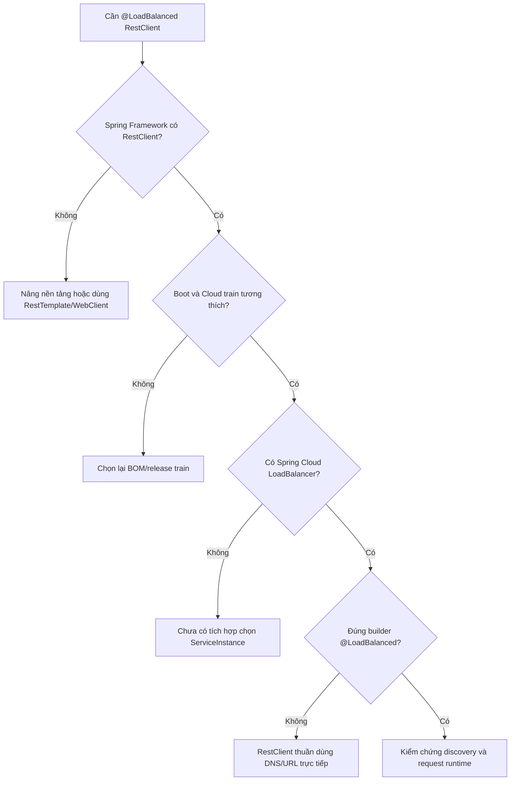
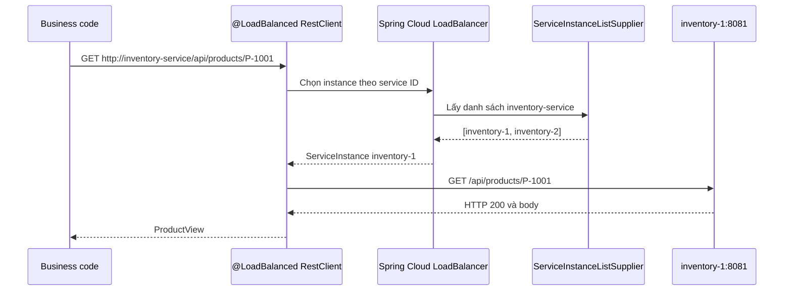

# Điều kiện phiên bản hỗ trợ tích hợp Spring Cloud LoadBalancer

`RestClient` là HTTP client đồng bộ (blocking) với fluent API của Spring Framework. Tuy nhiên, **có lớp `RestClient` không đồng nghĩa với việc URL dùng service ID tự động được load balance**. Để một ứng dụng có thể gọi `http://inventory-service/api/products/P-1001` và chọn `ServiceInstance` từ service discovery, phải đáp ứng đồng thời các điều kiện về phiên bản, thư viện, cấu hình bean và danh sách instance thực tế.

Bài học thuộc chương **RestClient** trong module Spring Cloud LoadBalancer. Trọng tâm là cách xác định một dự án đã đủ điều kiện hỗ trợ tích hợp hay chưa; cách tránh trộn Spring Framework, Spring Boot, Spring Cloud sai version; và cách chứng minh `@LoadBalanced RestClient.Builder` thực sự chọn instance. Các ví dụ có thể áp dụng khi gọi dịch vụ nội bộ với RestClient, đồng thời đặt nền tảng để so sánh với WebClient hoặc OpenFeign ở những bài khác.

## 1. Ba tầng phiên bản phải tương thích

| Thành phần | Vai trò | Mốc tính năng cần biết |
|---|---|---|
| **Spring Framework** | Cung cấp `org.springframework.web.client.RestClient`, API tạo request và HTTP request factory. | `RestClient` xuất hiện từ **Spring Framework 6.1**. |
| **Spring Boot** | Quản lý phiên bản Framework, auto-configuration, builder/customizers và cấu hình ứng dụng. | **Spring Boot 3.2** là dòng Boot đầu tiên dùng Spring Framework 6.1 và hỗ trợ `RestClient`. |
| **Spring Cloud** | Tích hợp `@LoadBalanced`, client-side interceptor, service discovery và `ReactorLoadBalancer<ServiceInstance>`. | Tích hợp load-balanced `RestClient.Builder` bắt đầu được hỗ trợ từ thế hệ **Spring Cloud 2023.0 / Spring Cloud Commons 4.1**. |

Các mốc trên giải thích **khi nào API và khả năng tích hợp xuất hiện**, không có nghĩa mọi bản vá Boot 3.2 đều hợp với mọi bản vá Cloud 2023.0, càng không có nghĩa Cloud 2023.0 phù hợp với tất cả những dòng Boot mới hơn. Khi chọn phiên bản thực tế, phải đối chiếu bảng tương thích (compatibility matrix) và release notes của đúng **Spring Cloud release train** và **Spring Boot patch** đang triển khai.



**Không dùng việc compile thành công làm bằng chứng tương thích đầy đủ.** Lỗi binary compatibility có thể chỉ xuất hiện khi Spring tạo auto-configured beans hoặc khi request đầu tiên đi qua interceptor.

## 2. Nhận diện trường hợp có và chưa có hỗ trợ

| Trường hợp | Điều cần kết luận |
|---|---|
| **Spring Boot 3.1 / Framework 6.0** theo tập dependency chuẩn | `RestClient` của Framework 6.1 chưa có; nên nâng Boot theo tổ hợp được hỗ trợ hoặc dùng HTTP client khác. |
| **Boot 3.2 / Framework 6.1** nhưng không có LoadBalancer starter | Có `RestClient`, nhưng chưa có đủ cơ chế phân giải service ID bằng Spring Cloud LoadBalancer. |
| **Boot 3.2 + Cloud 2023.0** theo bản vá tương thích, có starter | Thuộc thế hệ hỗ trợ `RestClient.Builder` được load balance; còn phải cấu hình đúng bean và discovery. |
| **Boot 3.3 hoặc mới hơn** | Dùng release train Cloud và patch phù hợp theo bảng tương thích; không mặc định dùng lại mọi cấu hình của 2023.0. |
| Tự ép version của `spring-web` hay `spring-cloud-commons` lệch BOM | Có thể biên dịch ở máy này nhưng gặp `NoSuchMethodError` hoặc lỗi auto-configuration ở runtime. |

**“Có API” và “có LoadBalancer tích hợp” là hai khẳng định khác nhau.** Ví dụ:

```java
RestClient plainClient = RestClient.create();
```

Đoạn code chỉ chứng minh class tồn tại. Client thuần sẽ dùng cơ chế phân giải host theo URL/HTTP transport; nếu `inventory-service` không phải tên DNS thật, request có thể lỗi `UnknownHostException`. Nó không chứng minh `ServiceInstanceListSupplier` hoặc LoadBalancer đã được sử dụng.

## 3. Dependency cần thiết và cách quản lý phiên bản

Thông thường một ứng dụng gọi HTTP đồng bộ qua `RestClient` cần:

1. **Spring Web** để có `RestClient`, thường đi qua `spring-boot-starter-web`.
2. **Spring Cloud LoadBalancer starter** để có cơ chế tích hợp chọn `ServiceInstance`.
3. **Nguồn cung cấp instance**: `SimpleDiscoveryClient` với instance tĩnh trong bài thực hành hoặc discovery provider thật khi triển khai.
4. **Spring Boot BOM/parent và Spring Cloud BOM** để các artifact Framework–Boot–Cloud đồng bộ.

Ví dụ `pom.xml` rút gọn cho dự án Spring Boot đã cấu hình Boot parent hoặc Boot BOM:

```xml
<dependencyManagement>
    <dependencies>
        <dependency>
            <groupId>org.springframework.cloud</groupId>
            <artifactId>spring-cloud-dependencies</artifactId>
            <version>REPLACE_WITH_COMPATIBLE_CLOUD_VERSION</version>
            <type>pom</type>
            <scope>import</scope>
        </dependency>
    </dependencies>
</dependencyManagement>

<dependencies>
    <dependency>
        <groupId>org.springframework.boot</groupId>
        <artifactId>spring-boot-starter-web</artifactId>
    </dependency>

    <dependency>
        <groupId>org.springframework.cloud</groupId>
        <artifactId>spring-cloud-starter-loadbalancer</artifactId>
    </dependency>
</dependencies>
```

Chuỗi `REPLACE_WITH_COMPATIBLE_CLOUD_VERSION` là **placeholder** và phải thay bằng release train có thật, tương thích với Boot của dự án; không thể chạy Maven nguyên ví dụ nếu chưa thay thế. Với Gradle, sử dụng Boot plugin và cơ chế dependency management/platform phù hợp để có cùng kết quả quản lý version.

Không nên ghi đè thủ công từng version của `spring-web`, `spring-context`, `spring-cloud-commons` hoặc `spring-cloud-loadbalancer` để xử lý một lỗi compile đơn lẻ. Làm như vậy có thể phá tập dependency đã được kiểm thử cùng nhau qua BOM.

### Có phải thêm Eureka/Consul?

**Không bắt buộc để học hoặc thử nghiệm local.** Có thể dùng `SimpleDiscoveryClient` với danh sách tĩnh. Khi ứng dụng production dùng Eureka, Consul, Kubernetes discovery hoặc một provider khác, cần dependency và cấu hình phù hợp. LoadBalancer không tự tạo instance chỉ từ một service ID.

## 4. Ví dụ RestClient được LoadBalancer quản lý

Giả sử Boot và Cloud đã được chọn đúng phiên bản, có Spring Web, Spring Cloud LoadBalancer và các annotation cần thiết.

### 4.1. Tạo một builder có `@LoadBalanced`

```java
import org.springframework.cloud.client.loadbalancer.LoadBalanced;
import org.springframework.context.annotation.Bean;
import org.springframework.context.annotation.Configuration;
import org.springframework.web.client.RestClient;

@Configuration(proxyBeanMethods = false)
public class OutboundHttpConfiguration {

    @Bean
    @LoadBalanced
    RestClient.Builder loadBalancedRestClientBuilder() {
        return RestClient.builder();
    }
}
```

`@LoadBalanced` đánh dấu builder để Spring Cloud auto-configuration nhận diện và bổ sung cơ chế chọn instance khi tương thích. Marker tự nó không tạo registry, không cấu hình health check và không bảo đảm endpoint đích hoạt động.

### 4.2. Inject đúng builder vào gateway

```java
import org.springframework.cloud.client.loadbalancer.LoadBalanced;
import org.springframework.stereotype.Service;
import org.springframework.web.client.RestClient;

@Service
public class InventoryClient {

    private final RestClient client;

    public InventoryClient(@LoadBalanced RestClient.Builder builder) {
        this.client = builder
                .baseUrl("http://inventory-service")
                .build();
    }

    public ProductView findProduct(String productId) {
        return client.get()
                .uri("/api/products/{id}", productId)
                .retrieve()
                .body(ProductView.class);
    }
}
```

`ProductView` là DTO của ứng dụng ví dụ. URL ở `baseUrl` sử dụng host logic `inventory-service`. Khi LoadBalancer hoạt động, service ID này được ánh xạ thành một `ServiceInstance` rồi request đi đến host và port thực tế. Nếu có nhiều bean `RestClient.Builder`, phải inject đúng bean mang `@LoadBalanced` thay vì builder dùng cho URL trực tiếp.

### 4.3. Cung cấp instance tĩnh để chạy thử

```yaml
spring:
  cloud:
    discovery:
      client:
        simple:
          instances:
            inventory-service:
              - uri: http://localhost:8081
              - uri: http://localhost:8082
```

Hai server tại 8081 và 8082 cần thật sự chạy, cung cấp `/api/products/{id}`. Nếu YAML có instance nhưng backend chưa chạy, LoadBalancer vẫn có thể **chọn được** đích và sau đó thất bại với `Connection refused`.

## 5. Luồng runtime khi các điều kiện đã thỏa



`RestClient` là **blocking HTTP client**. Việc gọi đồng bộ chờ phản hồi hoặc timeout. Dù một số thành phần LoadBalancer sử dụng API reactive ở bên trong, `RestClient` không biến thành `WebClient`, và cấu hình timeout/transport của hai client không tự động giống nhau.

## 6. Vì sao `@LoadBalanced` chưa đủ?

Một bean có marker `@LoadBalanced` chỉ là **một trong nhiều điều kiện**:

| Điều kiện | Khi không đạt |
|---|---|
| Spring Framework chứa `RestClient` | Compile lỗi hoặc thiếu class ở runtime. |
| Boot/Cloud release train tương thích | Auto-configuration có thể bị bỏ qua hoặc gặp lỗi class/method. |
| Có LoadBalancer starter và cơ chế interceptor phù hợp | Builder không được bổ sung bước chọn instance đúng cách. |
| Dùng đúng bean `RestClient.Builder` mang marker | HTTP request đi qua host DNS thay vì service discovery. |
| Supplier có instance cho service ID | Không có ứng viên để LoadBalancer lựa chọn. |
| HTTP transport kết nối tới backend được chọn | Chọn instance thành công nhưng request có thể timeout, lỗi TLS hoặc connection refused. |

Ứng dụng khởi động thành công chưa chắc đã đi qua đủ nhánh auto-configuration của `RestClient`. Nhiều lỗi chỉ lộ ra ở lời gọi HTTP đầu tiên.

## 7. Kiểm tra dependency tree, không chỉ nhìn file build

Để biết thư viện thật sự được nạp, cần kiểm tra **resolved dependencies**, không chỉ khai báo trong `pom.xml` hay `build.gradle`.

Các lệnh Maven minh họa:

```bash
./mvnw dependency:tree -Dincludes=org.springframework:spring-web
./mvnw dependency:tree -Dincludes=org.springframework.cloud:spring-cloud-commons
./mvnw dependency:tree -Dincludes=org.springframework.cloud:spring-cloud-loadbalancer
```

Các lệnh Gradle tương đương:

```bash
./gradlew dependencyInsight --dependency spring-web --configuration runtimeClasspath
./gradlew dependencyInsight --dependency spring-cloud-commons --configuration runtimeClasspath
./gradlew dependencyInsight --dependency spring-cloud-loadbalancer --configuration runtimeClasspath
```

Đây là những lệnh người học có thể thực hiện trong dự án của mình, **không phải bước chạy build khi biên soạn bài**. Khi đọc kết quả, cần xác minh phiên bản `spring-web` chứa `RestClient`; các artifact Cloud thuộc đúng train; không có override bất thường; và JDK runtime đáp ứng Boot/Framework đã chọn.

## 8. Kiểm tra Spring Boot auto-configuration có hoạt động

Khi code compile nhưng URL service ID không được load balance, hãy kiểm tra bean và điều kiện auto-configuration. Trong môi trường phát triển, có thể bật Condition Evaluation Report:

```bash
java -jar order-service.jar --debug
```

Hoặc, nếu có `spring-boot-starter-actuator`, chỉ trong môi trường được bảo vệ, expose hai endpoint kiểm tra:

```yaml
management:
  endpoints:
    web:
      exposure:
        include: health,conditions,beans
```

Sau đó kiểm tra `/actuator/conditions` và `/actuator/beans`. Những điều kiện ảnh hưởng đến load-balanced RestClient có thể liên quan tới classpath, sự tồn tại của bean builder, bean được đánh dấu `@LoadBalanced`, HTTP request factory hoặc các thành phần load balancing. Tên bean/post-processor có thể đổi giữa các release train; nên xác minh **hành vi bean thực tế**, không viết logic chẩn đoán phụ thuộc cứng vào một tên class nội bộ.

Một điểm dễ bỏ qua: tạo một `RestClient` bằng `RestClient.create()` hoặc `RestClient.builder()` trong tầng business **không tự dùng bean builder đã cấu hình ở Spring context**. Cần inject builder từ Spring rồi `build()`, như ví dụ ở phần 4.

### Phân biệt hai loại lỗi sau khi gọi

Nếu HTTP stack báo:

```text
UnknownHostException: inventory-service
```

thì một giả thuyết quan trọng là request đang sử dụng RestClient thuần và hệ thống cố resolve service ID như hostname DNS. Trước khi can thiệp vào DNS, hãy kiểm tra builder `@LoadBalanced`, auto-configuration và URL logic.

Nếu LoadBalancer thật sự chọn theo service ID nhưng supplier trả danh sách rỗng, lỗi có thể liên quan tới **không có instance**, có thể được biểu hiện bằng trạng thái `503` hay exception khác tùy HTTP client và phiên bản. Đó là lỗi khác với `UnknownHostException`. Nếu URI của một instance được chọn là `localhost:8081` nhưng cổng không có server, nguyên nhân lại là **kết nối tới backend**, không phải điều kiện phiên bản.

## 9. Các nhóm lỗi phiên bản và lỗi cấu hình

| Triệu chứng | Nguyên nhân có thể | Việc kiểm tra ưu tiên |
|---|---|---|
| Compile: `cannot find symbol: RestClient` | Spring Framework/Web quá cũ hoặc chưa có dependency `spring-web`. | Xem Spring Boot, `spring-web` được resolve và imports. |
| `ClassNotFoundException` hoặc `NoClassDefFoundError` về class Spring | Thiếu dependency khi đóng gói, classpath runtime khác compile hoặc version bị trộn. | So sánh dependency tree compile/runtime, BOM và JAR thực tế. |
| `NoSuchMethodError` liên quan Spring Framework/Cloud | Binary incompatibility do ép một artifact khác release train. | Bỏ override phiên bản lõi, chọn BOM tương thích. |
| `NoSuchBeanDefinitionException` cho builder | Chưa khai báo bean thích hợp hoặc sai qualifier. | Kiểm tra bean definitions và vị trí annotation `@LoadBalanced`. |
| `UnknownHostException: inventory-service` | RestClient chưa được tích hợp LoadBalancer hoặc URL không đi qua interceptor. | Kiểm tra builder được inject, auto-configuration và cách xây client. |
| Không có instance cho service ID | Sai service ID, registry rỗng hoặc supplier lọc hết. | Kiểm tra discovery và `ServiceInstanceListSupplier`. |
| `Connection refused` sau khi đã chọn đích | Địa chỉ hoặc cổng của instance không phục vụ HTTP. | Gọi thử URI trực tiếp trong môi trường lab. |
| `SSLHandshakeException` | TLS truststore, certificate, SAN hoặc mTLS không phù hợp. | Chẩn đoán HTTP transport/cert, không tắt xác minh TLS. |
| Local chạy, CI lỗi | JDK, resolved dependencies, profile hoặc đóng gói khác nhau. | So sánh Java runtime, dependency lock/BOM và cấu hình runtime. |

Đừng kết luận “Spring Cloud không hỗ trợ RestClient” chỉ từ việc một HTTP request thất bại. Cần tìm **tầng đã thất bại**: biên dịch/classpath, tạo bean, chọn instance, thiết lập kết nối hay nhận response.

## 10. Boot customizations và RestClient.Builder tự tạo

Spring Boot có thể tùy chỉnh builder khi ứng dụng khai báo các thành phần như message converters, observation/tracing, HTTP transport, SSL hoặc customizers. Mẫu:

```java
@Bean
@LoadBalanced
RestClient.Builder loadBalancedRestClientBuilder() {
    return RestClient.builder();
}
```

là ví dụ tối thiểu để minh họa phần đánh dấu LoadBalancer. Nó **không mặc nhiên bảo đảm** tất cả customization mà Boot đã áp dụng cho builder auto-configured khác sẽ được kế thừa. Tùy nhu cầu của dự án, phải dùng các configurer/customizer được **đúng phiên bản Spring Boot** hỗ trợ để kết hợp cấu hình HTTP client với `@LoadBalanced`.

Hai yêu cầu cần được kiểm chứng độc lập:

- **Load balancing:** Builder phải được Spring Cloud nhận diện, có cơ chế chọn `ServiceInstance` trước khi thực hiện HTTP.
- **Cấu hình HTTP client:** Request factory, timeout, TLS, proxy, authentication, headers, codec/message converter, observation và logging phải đúng hợp đồng của ứng dụng.

Không nên mặc định rằng migrate từ `RestTemplate` sang `RestClient` sẽ tự sao chép `ClientHttpRequestInterceptor`, timeout và toàn bộ tùy chỉnh transport đã cấu hình trước đó.

### Tránh nhầm RestClient thông thường với RestClient có LoadBalancer

Trong ứng dụng vừa gọi API công khai bằng URL thật vừa gọi microservice bằng service ID, có thể cần **hai loại builder**. Dùng tên bean/qualifier rõ ràng và inject bằng `@LoadBalanced` cho client gọi service ID. Không áp LoadBalancer lên mọi client một cách vô tình: request tới một hostname DNS ngoài sẽ không nhất thiết có service ID tương ứng trong discovery.

## 11. Timeout, retry và HTTP transport không do mốc phiên bản quyết định

Khi được hỗ trợ load-balanced `RestClient`, các cơ chế sau vẫn là các lớp khác nhau:

| Thành phần | Nhiệm vụ |
|---|---|
| HTTP request factory/transport | Tạo kết nối, áp dụng connection/read/response timeout, TLS, proxy. |
| Spring Cloud LoadBalancer | Lấy instance từ supplier và chọn một `ServiceInstance` theo service ID. |
| Retry layer (nếu có) | Quyết định có gửi lại request sau lỗi hay không, số attempt, backoff và điều kiện retry. |
| `ServiceInstanceListSupplier` | Cung cấp/filter danh sách instance; có thể kết hợp cache và health checks. |

Vì vậy, **nâng Boot/Cloud để có tích hợp RestClient không tự sinh ra cấu hình retry/timeout phù hợp**. Chi tiết cấu hình timeouts phụ thuộc HTTP transport thật sự được chọn (ví dụ JDK HTTP client, Apache HttpComponents hoặc request factory khác) và phiên bản Boot đang dùng. Không sao chép một property timeout của client khác và giả định RestClient sẽ đọc nó.

Nếu ứng dụng gọi `POST /orders`, retry khi timeout có thể tạo lệnh ghi trùng nếu backend đã commit nhưng response bị mất. Trước khi bật retry cho thao tác có side effect, cần idempotency key hoặc bảo đảm nghiệp vụ tương đương. Việc có LoadBalancer không tự làm request ghi an toàn để thử lại.

## 12. HTTPS có thể làm tích hợp đúng nhưng request vẫn lỗi

Ví dụ `SimpleDiscoveryClient` khai báo một instance HTTPS:

```yaml
spring:
  cloud:
    discovery:
      client:
        simple:
          instances:
            inventory-service:
              - uri: https://inventory.internal:8443
```

YAML trên mô tả địa chỉ instance; nó **không cấu hình truststore, client certificate hoặc hostname verification**. Ngay cả khi RestClient đã chọn đúng instance, HTTP transport có thể gặp lỗi xác minh CA, hostname/SAN, certificate hết hạn hoặc mTLS.

Không nên “sửa nhanh” bằng cách tắt TLS verification. Thay vào đó cần cấu hình đúng scheme, port và tên được chứng chỉ xác nhận, đồng thời sử dụng SSL bundle/truststore phù hợp với phiên bản Boot và transport đang có.

Tương tự, đổi URL logic thành `https://inventory-service` chưa chắc là cách xử lý phù hợp: scheme và URI do discovery cung cấp, cơ chế dựng URL của client và chính sách TLS của backend đều phải nhất quán.

## 13. Quy trình kiểm chứng theo từng tầng

Một bài kiểm chứng nên đi từ điều kiện tĩnh đến hành vi thực tế, để khi có lỗi biết tầng nào gây ra:

### Tầng A — Phiên bản và dependency

Ghi lại Spring Boot, Spring Framework, Spring Cloud release train và JDK runtime của dự án. Đọc dependency tree để xác nhận `spring-web` chứa `RestClient` và các artifact Cloud đến từ BOM tương thích. Không dùng thông tin phiên bản từ IDE nếu CI/production resolve một classpath khác.

### Tầng B — Bean và auto-configuration

Tạo `RestClient.Builder` có `@LoadBalanced`, inject đúng vào gateway; bật Condition Evaluation Report khi cần. Quan sát lỗi bean creation và phân biệt client được build qua bean hay được tạo trực tiếp bằng `RestClient.create()`.

### Tầng C — Discovery

Chuẩn bị hai server local trả response khác nhau ở cùng route:

```json
{"instance":"inventory-1","productId":"P-1001"}
```

và:

```json
{"instance":"inventory-2","productId":"P-1001"}
```

Đăng ký hai URI vào `SimpleDiscoveryClient` dưới **cùng service ID**. Kiểm tra service ID xuất hiện trong URL logic khớp chính xác với key cấu hình.

### Tầng D — Gọi HTTP thực tế

Gửi liên tiếp nhiều request qua gateway:

```text
GET http://inventory-service/api/products/P-1001
GET http://inventory-service/api/products/P-1001
GET http://inventory-service/api/products/P-1001
```

Nếu supplier đưa ra hai instance và chính sách là round robin, các lượt chọn có thể luân phiên. Không kết luận thuật toán nào đang chạy chỉ dựa vào vài request; cần xem bean thuật toán, instance list và log trên backend.

### Tầng E — Giả lập lỗi

Tắt thử backend thứ hai trong môi trường lab, theo dõi thông tin instance được chọn, `Connection refused`/timeout, health check, cache và retry. Một backend đã chết có thể vẫn nằm trong discovery/cache một thời gian; đây không tự động là lỗi tương thích phiên bản. Không thử các tình huống tạo dữ liệu trùng trên production.

## 14. Sai lầm phổ biến khi nâng cấp

**Chỉ nâng Spring Framework:** ép `spring-web` lên 6.1 nhưng giữ Boot/Cloud cũ có thể làm API xuất hiện mà auto-configuration không tương thích. Nâng theo tổ hợp đã được công bố hỗ trợ.

**Chỉ nâng Spring Cloud:** Cloud mới không làm một Boot/Framework quá cũ có đầy đủ API `RestClient`. Nền tảng Spring Web phải đáp ứng điều kiện trước.

**Tạo RestClient ngoài Spring context:** `RestClient.create()` không tự dùng builder bean đã được `@LoadBalanced`. Với service ID, hãy inject đúng builder.

**Có marker nhưng không có discovery:** `@LoadBalanced` không tạo ra `ServiceInstance`. Registry, supplier hoặc danh sách tĩnh phải cung cấp dữ liệu thật.

**Ép một artifact ra khỏi BOM:** dễ phát sinh `NoSuchMethodError` và các lỗi chỉ xuất hiện ở runtime.

**Nghĩ request thành công là đã load balance:** nếu `inventory-service` tình cờ cũng là DNS host hợp lệ, RestClient thường có thể gọi được mà không cần LoadBalancer. Cần quan sát instance selection từ Spring Cloud.

**Sao chép mọi cấu hình timeout/SSL từ client khác:** RestClient, WebClient và OpenFeign có thể dùng HTTP transport hoặc cách cấu hình khác nhau. Chứng minh timeout/SSL ở client **đang chạy**.

## 15. Checklist trước khi sử dụng RestClient với LoadBalancer

- [ ] Spring Framework đang dùng có `RestClient` (từ 6.1), nền Spring Boot hỗ trợ tương ứng (từ 3.2).
- [ ] Spring Cloud release train có hỗ trợ load-balanced RestClient và **tương thích Boot cùng patch**.
- [ ] Spring Boot parent/BOM và Spring Cloud BOM quản lý các dependency lõi.
- [ ] Không tự override `spring-web`/`spring-cloud-commons` lệch release train.
- [ ] Có `spring-web` hoặc `spring-boot-starter-web` và `spring-cloud-starter-loadbalancer`.
- [ ] Có discovery provider hoặc `SimpleDiscoveryClient` trả instance cho đúng service ID.
- [ ] Đăng ký bean `RestClient.Builder` mang `@LoadBalanced` và inject đúng bean.
- [ ] Không tạo client trực tiếp bằng `RestClient.create()` khi cần service-ID routing.
- [ ] Biết xem resolved dependency tree và Condition Evaluation Report nếu auto-configuration lỗi.
- [ ] Đã quan sát ít nhất hai backend được chọn qua runtime, không chỉ nhìn application.yml.
- [ ] Đã kiểm chứng timeout, SSL/TLS, health check, cache và retry theo đúng HTTP transport.
- [ ] Đã kiểm tra rủi ro retry với request ghi và có idempotency khi cần.
- [ ] Đã có regression test khi đổi Boot, Cloud, JDK hoặc HTTP transport.

**Kết luận:** Hỗ trợ RestClient trong Spring Cloud LoadBalancer không phải một flag độc lập. Cần **Framework có API RestClient**, **Boot–Cloud tương thích theo release train và bản vá**, **LoadBalancer starter**, **builder được đánh dấu `@LoadBalanced`**, và **discovery cung cấp instance hợp lệ**. Kiểm chứng theo chuỗi *dependency → bean → instance list → HTTP request* giúp phân biệt đúng lỗi phiên bản, lỗi cấu hình và lỗi hạ tầng.

