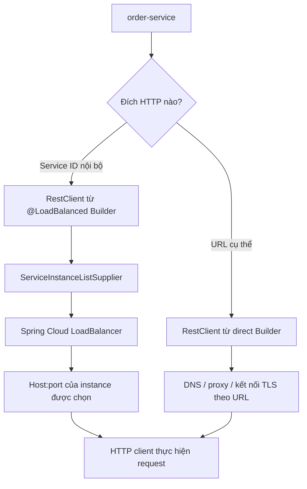

# Tách builder có cân bằng tải và builder gọi URL trực tiếp

`RestClient` là HTTP client đồng bộ (imperative) của Spring Framework. Trong một ứng dụng Spring Cloud, không phải request HTTP nào cũng cần đi qua Spring Cloud LoadBalancer: lời gọi giữa các microservice thường dùng **service ID**, trong khi lời gọi tới hệ thống bên ngoài, một endpoint cố định hoặc API đối tác thường dùng **URL thực**. Cấu hình một `RestClient.Builder` duy nhất cho cả hai loại đích dễ tạo lỗi định tuyến và làm rò rỉ các tùy chỉnh như header hoặc timeout sang client không mong muốn.

Bài học thuộc chương **RestClient** trình bày cách tách hai builder: một builder được gắn `@LoadBalanced` để Spring Cloud chọn `ServiceInstance` theo service ID, và một builder bình thường để gọi URL trực tiếp. Ta sẽ xem cách khai báo `@Bean`, chọn đúng builder khi inject, bảo toàn cấu hình tự động của Spring Boot, kiểm thử và xử lý những lỗi thường gặp. Cách phân tách này giúp kết hợp discovery, health check và chính sách chọn đích cho nội bộ mà không áp đặt chúng lên API bên ngoài.

## 1. Hai loại địa chỉ, hai đường xử lý

Giả sử `order-service` cần:

- Gọi `inventory-service` qua discovery để kiểm tra tồn kho. Có thể tồn tại nhiều instance ở các host/port khác nhau.
- Gọi API đối tác ở `https://api.partner.example` theo hostname thực, dùng DNS/TLS và chính sách bảo mật riêng. Tên miền `.example` là địa chỉ minh họa, không phải endpoint dùng được trong production.



Sự khác biệt không nằm ở API `get()`, `post()` hay `retrieve()`; hai `RestClient` có thể dùng cùng một cách gọi. Khác biệt nằm ở **cách diễn giải hostname trong URI** trước khi HTTP request được gửi.

| Loại lời gọi | Ví dụ URI | Builder nên dùng | Đích kết nối được xác định thế nào? |
|---|---|---|---|
| Service logic qua discovery | `http://inventory-service/api/items/42` | `@LoadBalanced` | `inventory-service` được xem là **service ID**; LoadBalancer chọn instance |
| API bên ngoài | `https://api.partner.example/v1/rates` | Direct | Host `api.partner.example` được phân giải/kết nối theo cấu hình HTTP client |
| URL có host và port cụ thể | `http://10.0.2.15:9090/health` | Direct | Kết nối trực tiếp endpoint đã chỉ định |
| Endpoint có DNS load balancing sẵn | `https://internal-api.example/` | Thường là direct | DNS, proxy hoặc load balancer phía hạ tầng chọn đích |

**Nguyên tắc:** chỉ dùng `@LoadBalanced` khi hostname trong URI thực sự là tên service do cơ chế discovery của Spring Cloud quản lý. Hostname trông giống tên miền không nhất thiết là một service ID, và một service ID đôi khi có thể được DNS nội bộ phân giải; cần xác định chủ đích của lời gọi thay vì suy luận chỉ từ cú pháp URL.

## 2. @LoadBalanced thay đổi điều gì trong RestClient.Builder?

Trong Spring Cloud Commons, bean `RestClient.Builder` được đánh dấu `@LoadBalanced` sẽ được cấu hình để tích hợp Spring Cloud LoadBalancer. Khi tạo `RestClient` bằng builder này và gửi request tới URI có service ID, integration sẽ lấy service ID, truy vấn `ServiceInstanceListSupplier`, chọn instance và dựng URI đích trước khi HTTP client thực hiện kết nối.

```text
RestClient dùng @LoadBalanced builder
  -> http://inventory-service/api/items/42
  -> LoadBalancer chọn inventory-b (10.0.1.11:8080)
  -> http://10.0.1.11:8080/api/items/42
  -> HTTP request thực tế
```

Một builder **không** có `@LoadBalanced` giữ hành vi HTTP thông thường: hostname trong URL được xử lý theo cơ chế DNS/proxy/request factory. Nó không tự hỏi service registry có `inventory-service` hay không.

Lưu ý: `@LoadBalanced` trên bean builder là qualifier và là tín hiệu để Spring Cloud tích hợp interceptor. Việc gọi `RestClient.builder()` đơn thuần **không tự động** có cơ chế chọn instance. Tương tự, việc gắn `@LoadBalanced` lên biến cục bộ hoặc truyền string `http://service-id` không thay thế khai báo bean và dependency LoadBalancer đúng cách.

### 2.1. Các dependency cần thiết

Với Spring Boot/Spring Cloud ở dòng phiên bản tương thích, cần có:

- `spring-boot-starter-web` hoặc bộ dependency cung cấp `RestClient`/Spring Web phù hợp.
- `spring-cloud-starter-loadbalancer` để sử dụng Spring Cloud LoadBalancer.
- Một nguồn `ServiceInstance`: Eureka, Consul, discovery Kubernetes, `SimpleDiscoveryClient` hoặc supplier tùy chỉnh.

Ví dụ Maven dependency cho LoadBalancer:

```xml
<dependency>
    <groupId>org.springframework.cloud</groupId>
    <artifactId>spring-cloud-starter-loadbalancer</artifactId>
</dependency>
```

Phiên bản Spring Cloud nên được quản lý bởi BOM tương thích với Spring Boot, không tự chọn một phiên bản starter độc lập chỉ vì ví dụ này. RestClient có từ Spring Framework 6.1/Spring Boot 3.2 trở lên; với những dự án cũ hơn, cần đối chiếu API và phương án client phù hợp.

## 3. Cấu hình hai RestClient.Builder tách biệt

Cách rõ ràng nhất là khai báo **hai bean cùng kiểu** nhưng khác qualifier và mức ưu tiên:

```java
import org.springframework.cloud.client.loadbalancer.LoadBalanced;
import org.springframework.context.annotation.Bean;
import org.springframework.context.annotation.Configuration;
import org.springframework.context.annotation.Primary;
import org.springframework.web.client.RestClient;

@Configuration(proxyBeanMethods = false)
public class RestClientBuildersConfiguration {

    @Bean
    @LoadBalanced
    RestClient.Builder loadBalancedRestClientBuilder() {
        return RestClient.builder();
    }

    @Bean
    @Primary
    RestClient.Builder directRestClientBuilder() {
        return RestClient.builder();
    }
}
```

| Thành phần | Ý nghĩa |
|---|---|
| `@Bean` | Đưa builder vào Spring IoC container để các thành phần khác inject |
| `@LoadBalanced` | Chỉ định builder được Spring Cloud cấu hình cho lời gọi theo service ID |
| `@Primary` trên builder direct | Nếu inject `RestClient.Builder` **không có qualifier**, ưu tiên builder gọi URL trực tiếp |
| Tên hai bean khác nhau | Phân biệt khi cần `@Qualifier` theo tên; không phụ thuộc trùng tên biến |

**Tại sao `@Primary` nằm ở builder trực tiếp?** Nếu một component khác chỉ yêu cầu `RestClient.Builder` mà không chỉ rõ `@LoadBalanced`, lựa chọn an toàn và dễ dự đoán thường là HTTP thông thường. Caller muốn discovery phải thể hiện ý định bằng qualifier `@LoadBalanced`.

Đoạn cấu hình trên là ví dụ tối thiểu theo tài liệu Spring Cloud. Trong ứng dụng Spring Boot thực tế, nó có một điểm cần cải thiện: dùng `RestClient.builder()` thô có thể bỏ qua những tùy chỉnh mà Boot thường áp dụng cho builder tự động cấu hình, ví dụ message converters, request factory và observability. Phần sau sẽ bổ sung `RestClientBuilderConfigurer` để giải quyết.

## 4. Inject đúng builder vào đúng client

Tạo hai `RestClient` dùng cho hai mục tiêu khác nhau trong một service:

```java
import org.springframework.beans.factory.annotation.Value;
import org.springframework.cloud.client.loadbalancer.LoadBalanced;
import org.springframework.stereotype.Service;
import org.springframework.web.client.RestClient;

@Service
public class InventoryAndPartnerGateway {

    private final RestClient inventoryClient;
    private final RestClient partnerClient;

    public InventoryAndPartnerGateway(
            @LoadBalanced RestClient.Builder loadBalancedBuilder,
            RestClient.Builder directBuilder,
            @Value("${clients.partner.base-url}") String partnerBaseUrl) {

        this.inventoryClient = loadBalancedBuilder
                .baseUrl("http://inventory-service")
                .build();

        this.partnerClient = directBuilder
                .baseUrl(partnerBaseUrl)
                .build();
    }

    public Item getInventoryItem(long itemId) {
        return inventoryClient.get()
                .uri("/api/items/{id}", itemId)
                .retrieve()
                .body(Item.class);
    }

    public PartnerRate getPartnerRate(String currencyCode) {
        return partnerClient.get()
                .uri("/v1/rates/{code}", currencyCode)
                .retrieve()
                .body(PartnerRate.class);
    }
}
```

Trong ví dụ:

1. Constructor inject `loadBalancedBuilder` **có** `@LoadBalanced`, nên hostname `inventory-service` được xử lý thành service ID.
2. Constructor inject `directBuilder` **không** có qualifier; do `@Primary`, Spring đưa vào builder direct.
3. Cả hai builder chỉ được dùng lúc khởi tạo các `RestClient` tương ứng. Các request nghiệp vụ dùng client đã được `build()`, tránh chỉnh sửa builder cho mỗi request.
4. `Item` và `PartnerRate` là DTO giả định trong ứng dụng, cần định nghĩa theo hợp đồng API thực tế.

Đặt URL bên ngoài trong `application.yml`, không hard-code trong service:

```yaml
clients:
  partner:
    base-url: https://api.partner.example
```

Trong production, dùng URL thật của đối tác từ cấu hình đã được kiểm soát. Nếu endpoint yêu cầu token hoặc API key, lấy secret từ secret manager/environment phù hợp, không ghi trực tiếp giá trị bí mật vào Markdown, source code hay YAML commit lên repository.

### 4.1. Có thể inject bằng tên bean thay vì @Primary không?

Có, Spring hỗ trợ `@Qualifier`, ví dụ:

```java
public SomeGateway(
        @Qualifier("loadBalancedRestClientBuilder") RestClient.Builder lb,
        @Qualifier("directRestClientBuilder") RestClient.Builder direct) {
    // ...
}
```

Tuy nhiên, với bean load-balanced, dùng `@LoadBalanced` ngay tại injection point bộc lộ rõ mục đích và nhất quán với tài liệu Spring Cloud. Nếu dùng qualifier bằng tên, cần đảm bảo tên bean khớp chính xác. Không nên trộn lẫn nhiều quy ước trong cùng một codebase mà không có hướng dẫn chung.

### 4.2. Định nghĩa RestClient thành các bean có ý nghĩa

Khi nhiều gateway sử dụng chung một cấu hình đã build, có thể đăng ký các `RestClient` theo chức năng:

```java
@Configuration(proxyBeanMethods = false)
class ServiceClientsConfiguration {

    @Bean("inventoryRestClient")
    RestClient inventoryRestClient(
            @LoadBalanced RestClient.Builder builder) {
        return builder.baseUrl("http://inventory-service").build();
    }

    @Bean("partnerRestClient")
    RestClient partnerRestClient(
            RestClient.Builder builder,
            @Value("${clients.partner.base-url}") String url) {
        return builder.baseUrl(url).build();
    }
}
```

Nếu inject trực tiếp hai bean `RestClient` này vào một class khác, dùng `@Qualifier("inventoryRestClient")` và `@Qualifier("partnerRestClient")` để phân biệt. `@Primary` của **builder** không tự phân biệt được các bean **RestClient đã build**.

## 5. Giữ các tùy chỉnh tự động của Spring Boot

Trong Spring Boot, builder do auto-configuration tạo thường được cấu hình message converters, HTTP request factory, các `RestClientCustomizer` phù hợp và khả năng observability. Khi chủ động khai báo builder mới để gắn `@LoadBalanced`, đừng giả định `RestClient.builder()` thô sẽ giữ nguyên các thiết lập đó.

Spring Boot cung cấp `RestClientBuilderConfigurer` để áp dụng các mặc định tương tự builder do Boot tạo. Một cấu hình thực tiễn là:

```java
import org.springframework.beans.factory.config.ConfigurableBeanFactory;
import org.springframework.boot.autoconfigure.web.client.RestClientBuilderConfigurer;
import org.springframework.cloud.client.loadbalancer.LoadBalanced;
import org.springframework.context.annotation.Bean;
import org.springframework.context.annotation.Configuration;
import org.springframework.context.annotation.Primary;
import org.springframework.context.annotation.Scope;
import org.springframework.web.client.RestClient;

@Configuration(proxyBeanMethods = false)
public class RestClientBuildersConfiguration {

    @Bean
    @Primary
    @Scope(ConfigurableBeanFactory.SCOPE_PROTOTYPE)
    RestClient.Builder directRestClientBuilder(
            RestClientBuilderConfigurer configurer) {
        return configurer.configure(RestClient.builder());
    }

    @Bean
    @LoadBalanced
    @Scope(ConfigurableBeanFactory.SCOPE_PROTOTYPE)
    RestClient.Builder loadBalancedRestClientBuilder(
            RestClientBuilderConfigurer configurer) {
        return configurer.configure(RestClient.builder());
    }
}
```

**Phiên bản API:** import `RestClientBuilderConfigurer` trong đoạn code trên dành cho **Spring Boot 3.2–3.5** (`org.springframework.boot.autoconfigure.web.client`). Với **Spring Boot 4.x**, package của class này là `org.springframework.boot.restclient.autoconfigure.RestClientBuilderConfigurer`. Hãy chọn import đúng theo phiên bản Spring Boot đã khóa trong dự án; không trộn class của hai phiên bản.

Hai builder được tạo độc lập nhưng nhận cùng bộ mặc định của Spring Boot. Chỉ bean có `@LoadBalanced` được Spring Cloud tích hợp service discovery. Cấu hình này giúp dễ quản trị HTTPS, timeout, observability và các serializer mà không phải tự sao chép mọi tùy chỉnh của Boot sang từng builder.

### 5.1. Vì sao nên dùng prototype cho builder?

`RestClient.Builder` là **mutable**: gọi `.baseUrl(...)`, `.defaultHeader(...)`, `.requestInterceptor(...)` hoặc `.requestFactory(...)` làm thay đổi trạng thái builder. Nếu một builder là singleton và nhiều component tùy chỉnh nó, thay đổi của component này có thể ảnh hưởng client được build sau đó trong component khác.

`@Scope(ConfigurableBeanFactory.SCOPE_PROTOTYPE)` giúp Spring tạo một builder mới cho mỗi lần bean được resolve/inject. Điều này gần với cách Spring Boot tự động cung cấp builder theo prototype, giảm nguy cơ nhiễm cấu hình giữa các gateway. Prototype **không** làm mỗi HTTP request sinh builder mới nếu service chỉ inject một lần khi khởi tạo.

Nếu nhận một builder cần dùng cho nhiều client trong cùng component, có thể sao chép bằng `.clone()` trước khi cấu hình riêng:

```java
RestClient inventory = loadBalancedBuilder.clone()
        .baseUrl("http://inventory-service")
        .build();

RestClient billing = loadBalancedBuilder.clone()
        .baseUrl("http://billing-service")
        .build();
```

Cả hai client trên **đều** dùng cơ chế LoadBalancer vì clone từ builder đã được tích hợp. Clone không biến builder load-balanced thành direct. Muốn gọi URL thực, phải lấy từ **builder direct**. Cũng không nên sửa builder được nhiều thread sử dụng song song; hãy tạo, cấu hình và `build()` các client khi khởi động ứng dụng.

### 5.2. Tùy chỉnh chung và tùy chỉnh riêng

Một `RestClientCustomizer` trong Spring Boot có thể áp dụng cho các builder được configurer xử lý. Các customizer chung nên dành cho thiết lập không phân biệt loại đích, ví dụ message converter hoặc observation convention chung. Những thiết lập riêng như:

- Header `Authorization`/API key của đối tác.
- Proxy dành cho Internet hoặc egress network.
- TLS truststore/mTLS nội bộ.
- Connect/read timeout và connection pool riêng theo hệ thống đích.
- Base URL cụ thể và retry policy.

nên được áp dụng **chỉ trên builder/client tương ứng**. Nếu đưa token đối tác vào global customizer, token có thể được gửi nhầm sang service nội bộ. Ngược lại, cấu hình mTLS nội bộ không nhất thiết tương thích với máy chủ bên ngoài.

## 6. URI và baseUrl: lỗi do trộn service ID với URL thật

`baseUrl()` quyết định URI gốc cho các đường dẫn tương đối. Cùng lời gọi `.uri("/api/items/{id}", id)` có thể dẫn tới đích hoàn toàn khác nhau tùy builder:

| Builder | `baseUrl` | `.uri(...)` | Hành vi mong đợi |
|---|---|---|---|
| Load-balanced | `http://inventory-service` | `/api/items/42` | Lấy instance từ discovery cho `inventory-service` |
| Direct | `https://api.partner.example` | `/v1/rates/USD` | Gửi tới hostname `api.partner.example` |
| Direct | `http://10.0.2.15:9090` | `/health` | Gửi thẳng đến IP/port |

**Lỗi 1: URL bên ngoài đi qua load-balanced builder.**

```java
RestClient wrong = loadBalancedBuilder
        .baseUrl("https://api.partner.example")
        .build();
```

Integration có thể coi `api.partner.example` là service ID và cố tìm instance trong discovery. Nếu không có bản đăng ký cho tên đó, lời gọi sẽ thất bại ở bước chọn đích, dù DNS của tên miền bên ngoài vẫn hoạt động bình thường. Dùng direct builder cho trường hợp này.

**Lỗi 2: service ID đi qua direct builder.**

```java
RestClient wrong = directBuilder
        .baseUrl("http://inventory-service")
        .build();
```

HTTP client có thể cố phân giải `inventory-service` bằng DNS. Trong môi trường không có bản ghi DNS tương ứng, nó sẽ lỗi phân giải tên. Ở một số môi trường Kubernetes, tên service có thể phân giải qua DNS và request thậm chí thành công, nhưng **không sử dụng chính sách lựa chọn instance của Spring Cloud LoadBalancer** như bạn mong đợi.

**Lỗi 3: dùng absolute URI khác host so với baseUrl.** Một absolute URI có thể thay thế host của `baseUrl` tại thời điểm request. Vì vậy, không nên nghĩ `.baseUrl("http://inventory-service")` là hàng rào ngăn lời gọi tới endpoint khác. Hãy kiểm tra code, nguồn dữ liệu URI và client được inject đúng loại.

### 6.1. Đừng dùng URL người dùng nhập làm đích direct tùy ý

Nếu API nhận trực tiếp URL từ người dùng rồi truyền cho direct RestClient, ứng dụng có nguy cơ **SSRF (Server-Side Request Forgery)**, ví dụ truy cập địa chỉ metadata của cloud hoặc mạng nội bộ. Khi chức năng yêu cầu gọi URL động, cần allowlist host/scheme/port, kiểm soát redirect, giới hạn mạng egress và không gửi secret chung tới host không đáng tin.

Tách hai builder giải quyết phân biệt định tuyến, **không thay thế** kiểm tra an toàn URL hay xác thực/phân quyền.

## 7. Timeout, retry và kết nối không tự giống nhau

Phân tách builder giúp áp dụng chính sách phù hợp cho từng nhóm đích. Ví dụ:

| Chính sách | Client theo service ID | Client URL trực tiếp |
|---|---|---|
| Discovery và lựa chọn instance | Có, qua Spring Cloud LoadBalancer | Không, dùng DNS/proxy/URL thực |
| Connect timeout | Điều chỉnh theo mạng nội bộ và thời gian failover | Điều chỉnh theo độ trễ Internet/đối tác |
| Read/response timeout | Cân bằng SLO downstream và deadline của caller | Theo SLA của đối tác, giới hạn không vượt tổng deadline |
| Retry | Có thể phối hợp retry-aware selection, phải xét idempotency | Retry HTTP trực tiếp theo chính sách; không kỳ vọng LoadBalancer đổi instance |
| TLS/mTLS | Có thể dùng chứng chỉ nội bộ hoặc truststore riêng | Xác thực hostname/chứng chỉ đối tác, proxy/CA riêng nếu cần |
| Connection pool | Theo endpoint thực tế đã chọn | Theo host và cấu hình HTTP request factory |

`@LoadBalanced` chỉ quyết định **chọn endpoint**; nó không tự đặt timeout hoặc bảo đảm retry. Cấu hình retry của Spring Cloud LoadBalancer và của HTTP client có thể khác nhau theo phiên bản và dependency. Không bật nhiều lớp retry mà không tính tổng số lần gọi và deadline.

### 7.1. Tính toán deadline khi retry

Giả sử một request có timeout chờ response `2s` và được cho phép thử tối đa 3 lần. Nếu mỗi lần đều dùng hết timeout, thời gian tổng có thể vượt `6s` sau khi cộng thời gian kết nối, lấy danh sách, backoff và chi phí khác. Vì vậy:

\[
T_{total} \approx \sum_{attempt=1}^{N}
  (T_{connect} + T_{response}) + T_{backoff} + T_{overhead}
\]

Đây là một **ước lượng ngân sách thời gian**, không phải cách tất cả HTTP client tính timeout. Một vài client có giới hạn tổng deadline, một số chỉ giới hạn từng pha. Cần kiểm tra request factory, retry integration và các deadline của hệ thống thực tế.

Đối với `POST` tạo đơn hàng, timeout **không chứng minh** server chưa xử lý nghiệp vụ. Khi retry request có side effect, dùng idempotency key hoặc cơ chế nghiệp vụ đảm bảo không thực thi trùng.

### 7.2. Request factory và connection pool

`RestClient` có thể sử dụng những `ClientHttpRequestFactory` khác nhau dựa trên cấu hình và dependency, ví dụ JDK HTTP client hoặc Apache HttpComponents. Connection pooling, keep-alive, proxy và timeout chủ yếu do request factory/HTTP client phía dưới đảm nhiệm, không phải do `@LoadBalanced`.

Nếu muốn cấu hình riêng cho nội bộ và đối tác, hãy xây dựng request factory tương ứng rồi áp dụng trên builder đúng loại:

```java
RestClient internal = loadBalancedBuilder
        .requestFactory(internalRequestFactory)
        .baseUrl("http://inventory-service")
        .build();

RestClient external = directBuilder
        .requestFactory(partnerRequestFactory)
        .baseUrl("https://api.partner.example")
        .build();
```

`internalRequestFactory` và `partnerRequestFactory` trong ví dụ là các bean/đối tượng đã được cấu hình ở nơi khác, không phải class có sẵn của Spring. Khi gọi `.requestFactory(...)`, bạn đang **ghi đè** lựa chọn request factory của builder; phải bảo toàn những tùy chỉnh thực sự cần thiết như TLS, timeout, proxy hoặc observability. Không tự chia sẻ một connection pool cho các client có yêu cầu bảo mật khác nhau khi chưa hiểu hậu quả.

## 8. Observability: đo được đường đi khác nhau

Khi điều tra một lỗi, cần biết request chạy qua LoadBalancer hay trực tiếp. Ví dụ cùng nhận `ResourceAccessException`, nhưng nguyên nhân có thể khác nhau:

- **Load-balanced:** service ID sai, discovery trả danh sách rỗng, instance stale, health filter loại ứng viên hoặc kết nối instance bị lỗi.
- **Direct:** DNS bên ngoài lỗi, chứng chỉ TLS không hợp lệ, proxy từ chối, đối tác trả HTTP 5xx hoặc không phản hồi trước timeout.

Nên ghi nhận có cấu trúc: nhóm client (`internal-load-balanced`/`external-direct`), service ID hoặc tên provider đã chuẩn hóa, HTTP method, loại lỗi, số lần retry và latency. Với lời gọi nội bộ, có thể quan sát instance được chọn qua metrics/lifecycle integration của Spring Cloud LoadBalancer khi đã bật; lời gọi direct không có quyết định chọn `ServiceInstance` từ Spring Cloud để ghi lại.

`RestClientBuilderConfigurer` giúp giữ cấu hình Boot về observation trong các phiên bản hỗ trợ, nhưng meter/tracing chỉ xuất hiện khi dependency và cấu hình quan sát tương ứng được bật. Đừng giả định cứ khai báo builder là đã có trace và metric.

Tránh đưa bearer token, cookie, API key, toàn bộ URL có query nhạy cảm hoặc ID người dùng vào log/metric label. Các label như request ID hoặc tenant ID thường có cardinality cao và có thể làm hệ thống giám sát quá tải.

## 9. Kiểm thử phân tách hai builder

Thử nghiệm cần chứng minh hai đường gọi **thật sự khác nhau**, không chỉ kiểm tra ứng dụng khởi động được.

### 9.1. Môi trường thử nghiệm tối thiểu

Chạy hai instance thử nghiệm của `inventory-service` trên `8081` và `8082`, mỗi instance có endpoint `/whoami` trả về tên của chính nó. Dùng `SimpleDiscoveryClient` để cung cấp danh sách tĩnh:

```yaml
spring:
  cloud:
    discovery:
      client:
        simple:
          instances:
            inventory-service:
              - uri: http://127.0.0.1:8081
              - uri: http://127.0.0.1:8082

clients:
  partner:
    base-url: http://127.0.0.1:9090
```

Trong test này, `9090` là một stub HTTP server giả lập API đối tác, không đăng ký trong discovery. Ba địa chỉ `127.0.0.1` chỉ hoạt động khi các process đang chạy trên cùng máy với caller. Trong container, phải dùng địa chỉ mà container caller kết nối được.

### 9.2. Các trường hợp cần kiểm tra

| Kịch bản | Kết quả mong đợi |
|---|---|
| Gọi `http://inventory-service/whoami` bằng load-balanced builder | Request đến một trong các instance `8081` hoặc `8082` theo chính sách chọn |
| Gửi nhiều request tới service ID | Có thể quan sát phân phối lượt chọn khi source/health/retry không thay đổi |
| Gọi URL stub `http://127.0.0.1:9090` bằng direct builder | Request đến đúng stub, không cần đăng ký discovery |
| Cố gọi `api.partner.example` qua load-balanced builder | Dễ gặp lỗi không tìm thấy instance cho hostname giả làm service ID |
| Gọi `inventory-service` qua direct builder khi DNS không có record | Lỗi phân giải tên; không đi qua Spring Cloud discovery |
| Không dùng `@LoadBalanced` tại injection point | Spring ưu tiên bean `@Primary` direct, không tự chọn builder LB |
| Thiếu bean direct hoặc khai báo hai bean không có qualifier/primary phù hợp | Có thể xuất hiện lỗi injection/ambiguity hoặc không inject đúng builder |
| Thêm header riêng cho đối tác | Header chỉ xuất hiện trên request tới stub đối tác, không rò sang service nội bộ |
| Một instance inventory dừng | Hành vi failover phụ thuộc discovery/health/timeout/retry, không do direct builder |

Để kiểm tra header/timeout/exception cụ thể, có thể dùng mock HTTP server hoặc WireMock trên endpoint stub. Hãy nhìn **request server thực sự nhận được**; chỉ kiểm tra tên bean hoặc URI in ra log chưa chứng minh LoadBalancer đã chọn đúng instance.

### 9.3. Unit test lựa chọn bean

Trong một test ứng dụng có context Spring, có thể xác minh container có cả hai builder:

```java
@SpringBootTest
class RestClientBuilderWiringTest {

    @Autowired
    @LoadBalanced
    RestClient.Builder loadBalancedBuilder;

    @Autowired
    RestClient.Builder defaultBuilder;

    @Test
    void beansAreAvailable() {
        assertNotNull(loadBalancedBuilder);
        assertNotNull(defaultBuilder);
        assertNotSame(loadBalancedBuilder, defaultBuilder);
    }
}
```

Đoạn kiểm tra trên chỉ xác nhận wiring và tính tách biệt của hai đối tượng builder khi dùng prototype; **nó chưa xác nhận đường mạng**. Cần có ít nhất một integration test gọi service ID và một test gọi URL trực tiếp như bảng trên.

## 10. Những lỗi phổ biến và hướng chẩn đoán

| Triệu chứng | Nguyên nhân có thể | Cách xử lý |
|---|---|---|
| Gọi đối tác báo `No instances available` | URL bên ngoài được gửi qua builder `@LoadBalanced` | Dùng direct builder, kiểm tra qualifier tại constructor |
| Gọi service nội bộ báo `UnknownHostException` | Đang dùng direct builder nên service ID được xử lý bằng DNS | Inject `@LoadBalanced RestClient.Builder` |
| `NoUniqueBeanDefinitionException` khi inject builder | Có hai bean cùng kiểu, chưa xác định ưu tiên phù hợp | Đánh dấu direct bean bằng `@Primary`; dùng `@LoadBalanced` ở injection point |
| Dữ liệu JSON chuyển đổi khác kỳ vọng | Tạo builder thô khiến không dùng các converter/configurer của Boot | Dùng `RestClientBuilderConfigurer`, kiểm tra customizers |
| Mất observation/tracing trên một client | Builder tự tạo không nhận cấu hình Boot, hoặc thiếu instrumentation | Configurer cho cả hai; kiểm tra dependency/observation |
| Header đối tác xuất hiện trên lời gọi nội bộ | Tái sử dụng builder đã mutate hoặc dùng global default header | Tách prototype/clone; cấu hình header ở client đúng phạm vi |
| Timeout nội bộ hoặc đối tác bất thường | Ghi đè request factory, dùng chung timeout cho hai kiểu đích | Xác định request factory và cấu hình riêng theo SLA |
| Gọi service ID thành công nhưng không có route theo metadata | DNS hoặc direct builder đã xử lý lời gọi; hoặc supplier chưa có policy | Kiểm tra đường gọi qua LoadBalancer và chuỗi `ServiceInstanceListSupplier` |
| Retry quá nhiều lần | Retry ở cả client và tầng LoadBalancer | Tính số attempt tối đa, backoff và tổng deadline |
| Cấu hình builder thay đổi ngẫu nhiên | Singleton mutable builder bị nhiều component dùng chung | Sử dụng prototype bean, `.clone()` hoặc xây dựng client một lần |

### 10.1. Checklist chẩn đoán nhanh

1. Kiểm tra URI thực tế có hostname là service ID hay URL thật.
2. Kiểm tra bean builder được đánh dấu `@LoadBalanced` ở định nghĩa **và** tại vị trí inject.
3. Kiểm tra bean direct có `@Primary` và không mang `@LoadBalanced`.
4. Kiểm tra Spring Cloud LoadBalancer starter có trên classpath và có nguồn instance đúng service ID.
5. Kiểm tra `RestClientBuilderConfigurer` và customizers của Boot không bị bỏ qua.
6. Kiểm tra request factory, TLS, proxy, timeout, retry và việc sử dụng builder mutable.
7. Đối chiếu log/metrics của LoadBalancer với request mà backend thực sự nhận được.

## 11. Thực hành nâng cấp cấu hình từ một builder sang hai builder

Nếu ứng dụng đang có một bean builder `@LoadBalanced` dùng cho mọi request, có thể chuyển dần theo trình tự:

1. **Phân loại đích:** liệt kê các lời gọi theo service ID (`inventory-service`, `billing-service`) và các lời gọi theo URL thật (API đối tác, endpoint máy cố định).
2. **Khai báo hai bean:** giữ bean `@LoadBalanced` và thêm bean direct `@Primary`, ưu tiên dùng `RestClientBuilderConfigurer` với prototype.
3. **Sửa injection:** ghi rõ `@LoadBalanced` cho gateway nội bộ, dùng direct builder cho gateway bên ngoài.
4. **Tách base URL và secrets:** đưa URL đối tác vào cấu hình, giữ credentials ở secret store; tránh `defaultHeader` toàn cục có chứa thông tin nhạy cảm.
5. **Tách timeout/request factory:** chọn chính sách theo mạng nội bộ hoặc Internet và theo deadline nghiệp vụ.
6. **Kiểm thử:** dùng discovery giả lập và stub server; xác minh cả đường nội bộ lẫn trực tiếp.
7. **Quan sát và rollout:** theo dõi lỗi discovery, DNS, TLS, latency và retry; rollback nếu tỷ lệ lỗi vượt ngưỡng.

### 11.1. Những nguyên tắc nên giữ lâu dài

- Dùng `@LoadBalanced RestClient.Builder` **chỉ** cho service ID được quản lý qua Spring Cloud discovery.
- Dùng direct `RestClient.Builder` cho URL tuyệt đối, hostname/IP cụ thể hoặc DNS/proxy-based routing không cần Spring Cloud LoadBalancer.
- Đặt `@Primary` trên bean direct để lời gọi không có qualifier không vô tình trở thành lời gọi qua LoadBalancer.
- Dùng `RestClientBuilderConfigurer` khi định nghĩa builder riêng để giữ cấu hình Boot; chọn import theo đúng Spring Boot 3.x hoặc 4.x.
- Coi `RestClient.Builder` là mutable; tạo prototype hoặc clone trước khi thay đổi cấu hình theo client.
- Tách URL, token, TLS, request factory, timeout, retry và logging theo đúng phạm vi của từng nhóm đích.
- Không lấy kết quả health/discovery làm sự bảo đảm HTTP request tiếp theo thành công; vẫn cần timeout, retry có giới hạn và idempotency.
- Kiểm thử bằng request thực tế để xác nhận service ID đi qua LoadBalancer còn URL ngoài đi trực tiếp.

**Kết luận:** một ứng dụng có thể cần Spring Cloud LoadBalancer cho lời gọi nội bộ đồng thời vẫn cần HTTP client thông thường cho API đối tác. Hai `RestClient.Builder` được phân tách bằng `@LoadBalanced` và `@Primary` làm ranh giới định tuyến rõ ràng; sử dụng configurer và prototype giúp các client giữ cấu hình Spring Boot nhưng không gây nhiễm trạng thái. Cách thiết kế này giúp discovery, health check và chính sách chọn `ServiceInstance` chỉ tác động tới những lời gọi thực sự cần chúng.

## Tài liệu tham khảo

- [Spring Cloud Commons — Common Abstractions](https://docs.spring.io/spring-cloud-commons/reference/spring-cloud-commons/common-abstractions.html): `@LoadBalanced RestClient.Builder`, sử dụng nhiều builder và `@Primary`.
- [Spring Cloud Commons — Spring Cloud LoadBalancer](https://docs.spring.io/spring-cloud-commons/reference/spring-cloud-commons/loadbalancer.html): discovery, `ServiceInstanceListSupplier` và cơ chế chọn instance.
- [Spring Boot — Calling REST Services](https://docs.spring.io/spring-boot/reference/io/rest-client.html): auto-configured `RestClient.Builder`, customizers và `.clone()`.
- [Spring Boot 3.5 — RestClientBuilderConfigurer API](https://docs.spring.io/spring-boot/3.5/api/java/org/springframework/boot/autoconfigure/web/client/RestClientBuilderConfigurer.html) và [Spring Boot 4 — RestClientBuilderConfigurer API](https://docs.spring.io/spring-boot/4.0/api/java/org/springframework/boot/restclient/autoconfigure/RestClientBuilderConfigurer.html): package và `configure(...)` theo phiên bản.
