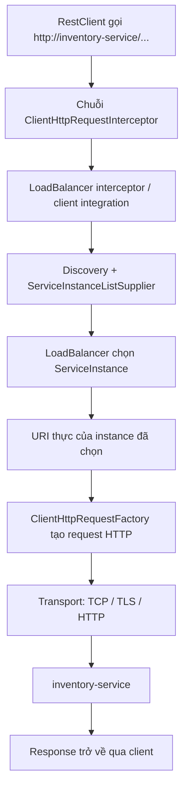

# Interceptor và request factory của RestClient

Trong Spring Framework, **`RestClient`** là HTTP client đồng bộ có API fluent. Khi được tích hợp với Spring Cloud LoadBalancer, `RestClient` có thể gọi dịch vụ bằng **service ID** thay vì phải biết trước IP và port của từng bản sao. Ví dụ, `order-service` gọi `http://inventory-service/api/stocks/BOOK-001`; Spring Cloud LoadBalancer tìm và chọn một `ServiceInstance`, sau đó request mới được gửi đến máy đích.

Hai điểm mở rộng quan trọng trên đường đi này là **`ClientHttpRequestInterceptor`** và **`ClientHttpRequestFactory`**. Chúng thường bị nhầm là cùng làm nhiệm vụ gửi request, trong khi thực tế giải quyết hai vấn đề khác nhau:

- **Interceptor** can thiệp vào quá trình thực hiện một HTTP request: thêm header, đo thời gian, ghi log, hoặc tham gia bước chuyển service ID thành địa chỉ instance khi Spring Cloud tích hợp LoadBalancer.
- **Request factory** tạo request HTTP ở mức thấp bằng một cơ chế vận chuyển cụ thể: JDK HTTP Client, Apache HttpComponents, hoặc implementation khác. Nó quyết định những khả năng như kết nối, timeout và tài nguyên HTTP client bên dưới.

Bài học này giải thích ranh giới trách nhiệm, cách phối hợp hai thành phần với `@LoadBalanced RestClient.Builder`, thứ tự interceptor, cấu hình timeout, nhận diện lỗi và các tình huống thường gặp trong hệ thống microservices. Nội dung hướng tới mục tiêu giao tiếp ổn định của module `SPRING_CLOUD_SERVICE_COMMUNICATION_LOAD_BALANCING`.

## 1. Nhìn toàn bộ đường đi của lời gọi RestClient

Giả sử `inventory-service` có ba bản sao:

| Instance | Host và port | Trạng thái giả định |
| --- | --- | --- |
| A | `10.0.1.11:8080` | Đang phục vụ |
| B | `10.0.1.12:8080` | Đang phục vụ |
| C | `10.0.1.13:8080` | Đang phục vụ |

Mã nghiệp vụ gọi URL logic:

```java
StockResponse response = restClient.get()
        .uri("http://inventory-service/api/stocks/{sku}", "BOOK-001")
        .retrieve()
        .body(StockResponse.class);
```

Nếu `RestClient` được tạo từ builder đã tích hợp Spring Cloud LoadBalancer, luồng khái niệm là:



Sơ đồ minh họa vai trò từng bước, **không cam kết thứ tự chính xác của mọi interceptor**. Các interceptor do ứng dụng và framework đăng ký sẽ tạo thành một chuỗi; vị trí của từng interceptor trong chuỗi phụ thuộc cách builder được cấu hình và tích hợp ở phiên bản đang dùng.

Một điểm cốt lõi: **request factory không chọn bản sao**, còn **interceptor ghi log không tự động cân bằng tải**. Chức năng chọn instance chỉ xuất hiện khi HTTP client được gắn cơ chế Spring Cloud LoadBalancer thích hợp.

## 2. Ba khái niệm dễ nhầm

| Thành phần | Thuộc hệ sinh thái | Trách nhiệm chính |
| --- | --- | --- |
| `ClientHttpRequestInterceptor` | Spring Framework | Bao quanh một lượt thực thi HTTP; có thể xem/sửa request và xử lý response |
| `ClientHttpRequestFactory` | Spring Framework | Tạo request HTTP ở tầng transport bằng HTTP client cụ thể |
| `LoadBalancerRequestFactory` | Spring Cloud Commons | Tạo đối tượng yêu cầu cho đường xử lý `LoadBalancerClient` trong những tích hợp sử dụng adapter này; không phải request factory mạng |

`LoadBalancerRequestFactory` và `ClientHttpRequestFactory` có tên gần giống nhau nhưng là **hai abstraction khác nhau**. `LoadBalancerRequestFactory` tham gia liên kết lựa chọn instance với cách thực thi một lời gọi trong Spring Cloud. `ClientHttpRequestFactory` cuối cùng phục vụ việc tạo request và giao tiếp qua HTTP.

Trong đa số mã nghiệp vụ, ta cần trực tiếp cấu hình **`RestClient.Builder`**, `ClientHttpRequestInterceptor` và `ClientHttpRequestFactory`; các chi tiết adapter nội bộ của Spring Cloud chỉ cần hiểu khi điều tra sâu.

## 3. Tích hợp Spring Cloud LoadBalancer với RestClient.Builder

Để dùng `http://inventory-service/...` làm URL logic, ứng dụng cần dependency Spring Cloud LoadBalancer tương thích với phiên bản Spring Boot/Spring Cloud đang chạy và một nguồn cung cấp danh sách instance. Ví dụ dependency Maven thường gặp:

```xml
<dependency>
    <groupId>org.springframework.cloud</groupId>
    <artifactId>spring-cloud-starter-loadbalancer</artifactId>
</dependency>
```

Spring Boot phải có dependency Spring Web phù hợp để dùng `RestClient`. Các version của Spring Cloud nên do BOM tương thích với Spring Boot quản lý; không tự ghép các version tùy ý.

### 3.1. Khai báo builder có LoadBalancer

```java
import org.springframework.cloud.client.loadbalancer.LoadBalanced;
import org.springframework.context.annotation.Bean;
import org.springframework.context.annotation.Configuration;
import org.springframework.web.client.RestClient;

@Configuration
class RestClientConfiguration {

    @Bean
    @LoadBalanced
    RestClient.Builder loadBalancedRestClientBuilder() {
        return RestClient.builder();
    }
}
```

`@LoadBalanced` đặt trên **bean `RestClient.Builder`** để Spring Cloud có thể tùy biến builder bằng cơ chế cân bằng tải khi các điều kiện auto-configuration thỏa mãn. Annotation này không tự tạo registry, không đăng ký instance và không biến một `RestClient` đã được tạo riêng bằng `RestClient.create()` thành client có khả năng phân giải service ID.

Sau đó, lớp gọi dịch vụ nhận builder tương ứng:

```java
import org.springframework.cloud.client.loadbalancer.LoadBalanced;
import org.springframework.stereotype.Service;
import org.springframework.web.client.RestClient;

@Service
class InventoryGateway {
    private final RestClient restClient;

    InventoryGateway(@LoadBalanced RestClient.Builder builder) {
        this.restClient = builder.build();
    }

    StockResponse getStock(String sku) {
        return restClient.get()
                .uri("http://inventory-service/api/stocks/{sku}", sku)
                .retrieve()
                .body(StockResponse.class);
    }
}
```

Ở đây `StockResponse` là DTO do ứng dụng định nghĩa theo hợp đồng API. URL sử dụng host logic `inventory-service`; HTTP client tích hợp LoadBalancer thực hiện bước chọn instance trước khi gửi request. Để code hoạt động, danh sách instance tương ứng phải được discovery client hoặc nguồn tĩnh trả về.

**Đừng lẫn builder thường với builder có `@LoadBalanced`.** Nếu một ứng dụng vừa gọi service ID vừa gọi URL Internet trực tiếp, nên giữ hai builder/bean được đặt tên rõ và tiêm bằng qualifier tương ứng. Không nên sử dụng cùng một builder tùy tiện cho mọi kiểu địa chỉ khi không kiểm soát các interceptor được gắn vào nó.

### 3.2. Vì sao `RestClient.create()` không tương đương?

```java
// Không tự có Spring Cloud LoadBalancer chỉ nhờ URL giống service ID.
RestClient plainClient = RestClient.create();

plainClient.get()
        .uri("http://inventory-service/api/stocks/BOOK-001")
        .retrieve()
        .body(String.class);
```

Trong ví dụ trên, nếu không có một cơ chế DNS hoặc proxy bên ngoài phân giải hostname `inventory-service`, HTTP transport có thể báo lỗi không tìm thấy host. Ngay cả khi DNS phân giải được host, điều đó **không chứng minh** Spring Cloud LoadBalancer đã thực hiện lựa chọn `ServiceInstance`. Muốn dùng client-side load balancing của Spring Cloud, phải kiểm tra builder đã được tích hợp đúng.

## 4. ClientHttpRequestInterceptor: điểm mở rộng quanh một request

`ClientHttpRequestInterceptor` là interface của Spring Framework. Một interceptor nhận:

- `HttpRequest request`: method, URI và headers có thể quan sát hoặc điều chỉnh theo hợp đồng API.
- `byte[] body`: nội dung request đã được chuẩn bị cho lần thực thi đó.
- `ClientHttpRequestExecution execution`: đối tượng cho phép chuyển việc thực thi tới thành phần kế tiếp trong chuỗi.

Chữ ký chính:

```java
ClientHttpResponse intercept(
        HttpRequest request,
        byte[] body,
        ClientHttpRequestExecution execution
) throws IOException;
```

Interceptor thường gọi `execution.execute(request, body)` **một lần**, rồi trả response cho chuỗi phía ngoài. Nó có thể ghi thời gian, thêm header hoặc xử lý một số điều kiện chung, nhưng không nên tự triển khai retry chỉ bằng cách gọi `execute(...)` nhiều lần khi chưa xét tính idempotent và cơ chế đóng response.

### 4.1. Ví dụ interceptor đo thời gian và ghi log

```java
import java.io.IOException;
import java.util.concurrent.TimeUnit;

import org.slf4j.Logger;
import org.slf4j.LoggerFactory;
import org.springframework.http.HttpRequest;
import org.springframework.http.client.ClientHttpRequestExecution;
import org.springframework.http.client.ClientHttpRequestInterceptor;
import org.springframework.http.client.ClientHttpResponse;

class SafeTimingInterceptor implements ClientHttpRequestInterceptor {

    private static final Logger log =
            LoggerFactory.getLogger(SafeTimingInterceptor.class);

    @Override
    public ClientHttpResponse intercept(
            HttpRequest request,
            byte[] body,
            ClientHttpRequestExecution execution) throws IOException {

        long startNanos = System.nanoTime();

        try {
            ClientHttpResponse response = execution.execute(request, body);
            long durationMs = TimeUnit.NANOSECONDS.toMillis(
                    System.nanoTime() - startNanos);

            log.info("http.client method={} status={} durationMs={}",
                    request.getMethod(),
                    response.getStatusCode().value(),
                    durationMs);

            return response;
        } catch (IOException ex) {
            long durationMs = TimeUnit.NANOSECONDS.toMillis(
                    System.nanoTime() - startNanos);

            log.warn("http.client method={} errorType={} durationMs={}",
                    request.getMethod(),
                    ex.getClass().getSimpleName(),
                    durationMs);
            throw ex;
        }
    }
}
```

Ví dụ không ghi token, body, query string hoặc toàn bộ URI để tránh lộ thông tin nhạy cảm. Khi muốn ghi path, cần chuẩn hóa path template hoặc loại bỏ các ID nhạy cảm. Interceptor **không tự đóng response** trước khi trả về vì tầng gọi cần tiếp tục đọc response; việc quản lý vòng đời và đóng tài nguyên thuộc HTTP client/integration tương ứng.

Một điểm dễ nhầm: interceptor này có thể ghi `status=404` và trả `ClientHttpResponse` bình thường. Sau khi chuỗi interceptor trả response, lời gọi `retrieve()` của `RestClient` mới áp dụng cơ chế xử lý status và có thể ném exception cho `4xx`/`5xx`. Vì vậy, `catch (IOException)` trong interceptor **không phải** nơi bắt tất cả HTTP status lỗi.

### 4.2. Gắn interceptor vào RestClient.Builder

```java
@Bean
@LoadBalanced
RestClient.Builder loadBalancedRestClientBuilder() {
    return RestClient.builder()
            .requestInterceptor(new SafeTimingInterceptor());
}
```

Ứng dụng có thể bổ sung nhiều interceptor, chẳng hạn correlation ID, logging, authentication hoặc chính sách riêng. Tuy nhiên, các interceptor phải nhẹ, tránh thao tác blocking không cần thiết và không được tạo vòng lặp lời gọi HTTP vô ý.

Với request có tải lớn hoặc body chứa dữ liệu nhạy cảm, tránh sao chép, ghi log hay giữ lại toàn bộ `byte[] body`. Những nội dung như token, cookie và thông tin cá nhân không nên đưa trực tiếp vào log.

## 5. Interceptor của Spring Cloud LoadBalancer làm gì?

Trong tích hợp đồng bộ của Spring Cloud, cơ chế LoadBalancer có thể được nối vào chuỗi request thông qua một **load-balancing interceptor**. Thành phần này đọc service ID từ host trong URL logic, yêu cầu LoadBalancer chọn `ServiceInstance` và chuyển việc thực thi sang địa chỉ của instance đã chọn.

Ví dụ:

```text
URI ứng dụng yêu cầu:
  http://inventory-service/api/stocks/BOOK-001

Service ID:
  inventory-service

Danh sách instance được supplier cung cấp:
  10.0.1.11:8080
  10.0.1.12:8080

Kết quả lựa chọn (ví dụ):
  10.0.1.12:8080

Địa chỉ HTTP cuối cùng:
  http://10.0.1.12:8080/api/stocks/BOOK-001
```

Tích hợp này sử dụng những lớp của Spring Cloud như `LoadBalancerClient`, `ServiceInstanceListSupplier` và các adapter request phù hợp. Nó **không biến factory HTTP thành registry**: request factory chỉ biết cách thực hiện request tới địa chỉ được cung cấp, không tự lựa chọn service ID từ Eureka, Consul hoặc nguồn discovery khác.

### 5.1. Thứ tự interceptor ảnh hưởng quan sát

Nếu ứng dụng vừa có `SafeTimingInterceptor` vừa có LoadBalancer interceptor, câu hỏi quan trọng là **interceptor nào chạy bên ngoài interceptor nào**.

```text
Trường hợp khái niệm A:
  Timing -> LoadBalancer -> HTTP transport

Trường hợp khái niệm B:
  LoadBalancer -> Timing -> HTTP transport
```

Hai cách sắp xếp có thể dẫn tới phạm vi đo thời gian và URI quan sát được khác nhau. Chẳng hạn, một interceptor ở ngoài cơ chế cân bằng tải có thể thấy URI logic; một interceptor ở phía trong cơ chế chuyển đổi URI có thể thấy URI vật lý, tùy cách implementation bọc request.

**Không nên giả định `request.getURI()` trong mọi interceptor luôn là URI vật lý.** Khi cần xác định chính xác bản sao được chọn, nên dùng điểm quan sát của LoadBalancer, ví dụ `LoadBalancerLifecycle`, kết hợp trace/correlation ID hoặc logging ở ranh giới phù hợp với phiên bản đang chạy.

Nếu một interceptor thêm header để supplier đọc hint, cần kiểm tra header có được thêm **trước thời điểm LoadBalancer lấy request context** hay không. Gắn header vào một điểm chạy sau bước lựa chọn instance thì không thể tác động ngược tới lựa chọn vừa xảy ra.

## 6. ClientHttpRequestFactory: tầng thực thi HTTP phía dưới

`ClientHttpRequestFactory` là abstraction tạo `ClientHttpRequest` cho địa chỉ và method cụ thể. Những implementation phổ biến gồm:

| Implementation | Nền tảng HTTP | Cân nhắc chính |
| --- | --- | --- |
| `JdkClientHttpRequestFactory` | `java.net.http.HttpClient` của JDK | Dễ dùng khi ứng dụng dùng JDK hiện đại; cấu hình client và timeout rõ ràng |
| `HttpComponentsClientHttpRequestFactory` | Apache HttpComponents Client 5 | Phù hợp khi cần connection pooling và tùy chọn transport phong phú; cần dependency tương ứng |
| `JettyClientHttpRequestFactory` | Jetty HTTP Client | Dành cho môi trường đã chọn Jetty client làm transport |
| `SimpleClientHttpRequestFactory` | Cơ chế HTTP đơn giản của JDK | Ít khả năng điều chỉnh nâng cao; dùng với nhận thức về giới hạn transport |

Không có request factory nào trong bảng **tự biến host `inventory-service` thành `ServiceInstance`**. Đó là trách nhiệm của cơ chế LoadBalancer hoặc một hệ thống phân giải tên khác.

Khi ứng dụng không chọn request factory tường minh, `RestClient` có thể tự chọn implementation dựa trên các thư viện và JDK có sẵn. Việc thay đổi dependency có thể làm thay đổi transport được dùng; để kiểm soát timeout, TLS và connection pool ổn định giữa các môi trường, nên cấu hình factory chủ động khi cần.

## 7. Cấu hình JdkClientHttpRequestFactory và timeout

Ví dụ sau minh họa `RestClient` có LoadBalancer nhưng dùng JDK HTTP Client cho bước gửi HTTP thực tế:

```java
import java.net.http.HttpClient;
import java.time.Duration;

import org.springframework.beans.factory.annotation.Qualifier;
import org.springframework.cloud.client.loadbalancer.LoadBalanced;
import org.springframework.context.annotation.Bean;
import org.springframework.context.annotation.Configuration;
import org.springframework.http.client.ClientHttpRequestFactory;
import org.springframework.http.client.JdkClientHttpRequestFactory;
import org.springframework.web.client.RestClient;

@Configuration
class InventoryRestClientConfig {

    @Bean("inventoryHttpRequestFactory")
    ClientHttpRequestFactory inventoryHttpRequestFactory() {
        HttpClient httpClient = HttpClient.newBuilder()
                .connectTimeout(Duration.ofSeconds(2))
                .build();

        JdkClientHttpRequestFactory factory =
                new JdkClientHttpRequestFactory(httpClient);
        factory.setReadTimeout(Duration.ofSeconds(5));
        return factory;
    }

    @Bean
    @LoadBalanced
    RestClient.Builder inventoryRestClientBuilder(
            @Qualifier("inventoryHttpRequestFactory")
            ClientHttpRequestFactory factory) {

        return RestClient.builder()
                .requestFactory(factory)
                .requestInterceptor(new SafeTimingInterceptor());
    }
}
```

Trong ví dụ:

- `connectTimeout(Duration.ofSeconds(2))` đặt thời hạn thiết lập kết nối trên JDK `HttpClient`.
- `setReadTimeout(Duration.ofSeconds(5))` đặt thời gian chờ đọc/nhận response cho factory theo hợp đồng của implementation.
- `requestFactory(factory)` yêu cầu `RestClient` dùng transport đã cấu hình.
- `requestInterceptor(...)` thêm logic quan sát; nó **không** thay thế transport.
- `@LoadBalanced` cho phép Spring Cloud tùy biến builder để phân giải service ID thành instance, khi có dependency và nguồn instance phù hợp.

`connectTimeout` và `readTimeout` có ý nghĩa khác nhau. Nếu không thể mở kết nối tới bản sao được chọn trong thời hạn cấu hình, client có thể báo lỗi kết nối. Nếu kết nối đã mở và server phản hồi quá chậm, client có thể báo lỗi chờ response. **Read timeout không chứng minh server chưa xử lý request**: với thao tác ghi dữ liệu, phía server có thể đã thực hiện thành công trước khi client hết thời gian chờ.

Các timeout nêu trên là ví dụ, không phải giá trị khuyến nghị cho mọi nghiệp vụ. Cần thiết kế thêm **deadline tổng** của request, số lần retry và giới hạn thời gian của từng attempt; thời gian thực tế có thể bao gồm bước discovery, lựa chọn instance, chờ kết nối trong pool và xử lý trên server.

### 7.1. Connection pool thuộc factory/client bên dưới

Khi dùng Apache HttpComponents hoặc transport có pooling, connection pool thường do HTTP client bên dưới quản lý. Ví dụ một `CloseableHttpClient` có cấu hình pool rồi được truyền vào `HttpComponentsClientHttpRequestFactory`.

Cache `ServiceInstance` và connection pool là hai cơ chế khác nhau. LoadBalancer chọn instance dựa trên danh sách ứng viên; sau đó transport có thể tái sử dụng kết nối phù hợp tới địa chỉ đích. Thay đổi TTL của cache LoadBalancer không tương đương với đóng tất cả kết nối cũ hoặc điều chỉnh thời gian chờ lấy connection từ pool.

Nếu tự tạo HTTP client có pool tài nguyên và vòng đời riêng, cần bảo đảm tài nguyên được đóng khi ứng dụng dừng theo đúng hướng dẫn của implementation. Không tạo một HTTP client/pool mới cho từng request nghiệp vụ.

## 8. Phân biệt lỗi LoadBalancer, HTTP transport và nghiệp vụ

Một lời gọi thất bại có thể dừng ở nhiều lớp:

| Biểu hiện | Lớp cần điều tra | Ý nghĩa |
| --- | --- | --- |
| Không có `ServiceInstance` khả dụng | Discovery, supplier, LoadBalancer | Chưa có địa chỉ đích đủ điều kiện để gửi request |
| Không phân giải được hostname vật lý | DNS/transport | Đã có URI cần gọi nhưng tên host không phân giải được |
| Connection refused hoặc connect timeout | TCP/network/request factory | Client không thiết lập được kết nối tới đích |
| Read timeout hoặc connection reset | Transport/server/proxy | Có thể request đã gửi nhưng response chưa nhận được đầy đủ |
| `HTTP 401`, `404`, `429`, `503` | HTTP response và hợp đồng API | Server hoặc gateway đã trả HTTP status cụ thể |
| `HTTP 200` kèm `success=false` | Lớp nghiệp vụ | Trao đổi HTTP thành công nhưng hành động bị từ chối theo quy tắc miền |

Với `RestClient.retrieve()`, HTTP `4xx`/`5xx` mặc định được chuyển thành exception thuộc nhóm `RestClientResponseException`. Lỗi I/O khi thực thi request thường được bọc trong `ResourceAccessException`. Các exception cụ thể phụ thuộc request factory và HTTP client bên dưới; cần xem **root cause** để phân biệt connect timeout, TLS handshake hoặc read timeout.

```java
import org.springframework.web.client.ResourceAccessException;
import org.springframework.web.client.RestClientResponseException;

try {
    StockResponse stock = inventoryGateway.getStock("BOOK-001");
    // Phân tích các trường nghiệp vụ trong StockResponse nếu API yêu cầu.
} catch (ResourceAccessException ex) {
    // Điều tra kết nối, TLS, timeout và cause từ HTTP client bên dưới.
} catch (RestClientResponseException ex) {
    // Có HTTP response với status lỗi (theo hành vi retrieve mặc định).
    int status = ex.getStatusCode().value();
    String errorBody = ex.getResponseBodyAsString();
    // Ánh xạ sang lỗi miền dựa trên status + error code trong body.
}
```

Nếu ứng dụng cấu hình `.onStatus(...)` hoặc error handler riêng, cách ánh xạ status có thể khác. Interceptor chỉ ghi nhận status ở tầng thực thi HTTP; logic quyết định request nghiệp vụ thành công hay thất bại vẫn cần đọc hợp đồng API, không nên kết luận từ `2xx` đơn thuần.

## 9. Không đặt chính sách retry tùy tiện trong interceptor

Một cách cài đặt dễ gây lỗi là gọi lại `execution.execute(request, body)` nhiều lần khi nhận exception:

```java
// Không sử dụng như chính sách retry tổng quát:
try {
    return execution.execute(request, body);
} catch (IOException ex) {
    return execution.execute(request, body); // retry không kiểm soát
}
```

Đoạn code trên là ví dụ **không nên áp dụng**. Một lỗi read timeout không chứng minh server chưa xử lý request. Retry không kiểm soát có thể tạo thao tác trùng lặp; interceptor cũng không mặc nhiên biết request có idempotent hay không, body có thể gửi lại an toàn không hoặc còn deadline tổng bao nhiêu.

Khi cần retry, nên có chính sách rõ ở tầng HTTP client hoặc tích hợp Spring Cloud LoadBalancer:

1. Xác định lỗi nào được phép retry, ví dụ lỗi kết nối tạm thời hay một số HTTP status nhất định.
2. Xác định thao tác có thể thực hiện lại không; với API ghi dữ liệu, cân nhắc idempotency key hoặc cơ chế tra cứu trạng thái.
3. Giới hạn tổng số attempt, thời gian chờ giữa các lần và tổng thời gian của nghiệp vụ.
4. Quy định có thử lại cùng instance hay chọn instance khác.
5. Ghi nhận từng attempt và instance để tránh che nguyên nhân thật.

Lưu ý cấu hình retry có thể tồn tại ở nhiều tầng: gateway, service adapter, Spring Cloud LoadBalancer và HTTP client bên dưới. Nếu mỗi tầng retry độc lập, số request thực tế có thể bị nhân lên lớn hơn mong muốn. Chỉ đặt retry tại những tầng có chủ sở hữu và giới hạn rõ ràng.

## 10. Tracing và metrics: interceptor quan sát HTTP, lifecycle quan sát lựa chọn

Một interceptor có thể đo thời gian từ lúc nó bắt đầu thực thi tới khi `execution.execute(...)` trả response hoặc exception. Nhưng thời gian đó **có thể gồm hoặc không gồm** một phần thao tác chọn instance, tùy interceptor được chèn tại vị trí nào trong chuỗi.

Muốn quan sát toàn diện, hãy phân biệt:

| Điểm quan sát | Thông tin nên thu thập |
| --- | --- |
| Interceptor của RestClient | HTTP method, đường dẫn đã chuẩn hóa, status, thời gian, nhóm lỗi I/O |
| `LoadBalancerLifecycle` | Thời điểm bắt đầu cân bằng tải, instance đã chọn, trạng thái hoàn tất |
| Discovery / supplier | Danh sách ứng viên, số instance trước/sau cache, health check và filter |
| Server / gateway | Response status thực tế, thời gian xử lý và lỗi downstream |
| Lớp nghiệp vụ | Error code nghiệp vụ, kết quả cuối cùng và idempotency status |

Ví dụ tập log có thể giúp truy nguyên:

```text
traceId=c8a2... serviceId=inventory-service event=lb.selected instance=10.0.1.12:8080
traceId=c8a2... event=http.client method=GET status=503 durationMs=311
traceId=c8a2... event=inventory.response category=upstream-unavailable
```

Trace ID giúp liên kết các tầng. Không ghi access token, cookie, body hoặc query chứa dữ liệu nhạy cảm. Với metrics, hạn chế tạo nhãn chứa các URI động hoặc instance ID có cardinality quá lớn; ưu tiên template path, method, service ID và các nhóm kết quả ổn định.

Khi ứng dụng đã có Micrometer và Spring Observability, nên tận dụng các cơ chế instrument có sẵn thay vì tự tạo một bộ đo trùng lặp. Interceptor tùy chỉnh vẫn có ích để ghi ngữ cảnh đặc thù nhưng cần tránh đếm trùng một lời gọi ở nhiều lớp.

## 11. Các lỗi cấu hình thường gặp

| Hiện tượng | Nguyên nhân khả dĩ | Cách kiểm tra |
| --- | --- | --- |
| Gọi `http://inventory-service/...` báo unknown host | `RestClient` không được tạo từ builder `@LoadBalanced` hoặc DNS không biết service ID | Kiểm tra bean builder và interceptor tích hợp LoadBalancer |
| Discovery có ba instance nhưng chỉ một instance được chọn | Supplier filter, zone, cache hoặc thuật toán lựa chọn | Quan sát danh sách sau supplier và kết quả lựa chọn |
| Đã chỉnh `connectTimeout` nhưng vẫn read timeout | Hai loại timeout điều khiển các giai đoạn khác nhau | Kiểm tra request factory được dùng và thời gian xử lý downstream |
| Cấu hình factory nhưng timeout không đổi | Bean/Builder thực tế không sử dụng factory vừa cấu hình | Xác minh builder được tiêm, `requestFactory(...)`, auto-configuration và classpath |
| Interceptor log URI logic thay vì IP đích | Vị trí interceptor so với LoadBalancer interceptor | Quan sát thứ tự và dùng lifecycle để lấy selected instance |
| `retrieve()` ném exception cho `404` dù interceptor log bình thường | `retrieve()` xử lý status sau khi HTTP response đi qua interceptor | Phân biệt interceptor I/O với response status handler |
| Có nhiều log hoặc nhiều attempt hơn số request nghiệp vụ | Retry hoặc interceptor được áp dụng ở nhiều lớp | Gắn trace ID, attempt index và xác định phạm vi từng metric |
| HTTP client trực tiếp bị ảnh hưởng bởi chính sách LoadBalancer | Dùng nhầm builder hoặc interceptor dùng chung | Tách bean builder cho service ID và URL vật lý |

Một trường hợp đáng lưu ý là cấu hình Spring Boot sẵn có cho `RestClient.Builder`. Nếu tự tạo bean builder mới bằng `RestClient.builder()`, các customizer mà Boot thường áp dụng cho builder được auto-configured có thể không còn xuất hiện như mong đợi. Vì vậy cần kiểm tra cách Boot cấu hình builder ở phiên bản hiện tại và bảo đảm những thiết lập quan trọng (observability, codec, request factory, headers) không vô tình bị bỏ qua.

## 12. Kiểm thử phối hợp giữa interceptor và request factory

Để kiểm tra không chỉ code mà cả wiring, có thể dựng hai instance `inventory-service` trong môi trường test và dùng nguồn instance tĩnh nếu không cần registry thật. Ví dụ cấu hình **chỉ dành cho môi trường kiểm thử**:

```yaml
spring:
  cloud:
    discovery:
      client:
        simple:
          instances:
            inventory-service:
              - uri: http://localhost:18081
              - uri: http://localhost:18082
```

Nguồn danh sách tĩnh này chỉ có ý nghĩa khi integration discovery tương ứng đang được bật và hai server test thực sự lắng nghe các port đã khai báo. Không nên coi nó là thay thế đầy đủ cho kiểm thử với registry, health check và cache trong môi trường triển khai thật.

Một ma trận kiểm thử hữu ích:

| Kiểm thử | Điều cần xác minh |
| --- | --- |
| Builder `@LoadBalanced` gọi service ID | Request tới một trong các instance đã cấu hình, không phải DNS tình cờ phân giải service ID |
| Builder thường gọi URL vật lý | Không bị thay đổi bởi interceptor cân bằng tải ngoài ý muốn |
| Interceptor ghi log một lời gọi bình thường | Có method, status, thời gian; không lộ dữ liệu nhạy cảm |
| Server trả `404` | Interceptor quan sát HTTP response; `retrieve()` áp dụng status handler như mong đợi |
| Instance không lắng nghe | Nhận diện exception ở tầng kết nối và instance đã chọn |
| Server phản hồi rất chậm | Request factory áp dụng response timeout được cấu hình |
| Retry được bật ở tầng phù hợp | Đếm đúng attempt, không retry vô hạn hoặc duplicate khi thao tác không an toàn |
| Thay đổi danh sách instance | LoadBalancer nhận topology mới theo chính sách discovery/cache |

Với đơn vị kiểm thử không cần mạng thật, có thể giả lập tầng HTTP response và kiểm tra interceptor thêm header, ghi log hoặc không thay đổi body. Nhưng để chứng minh **service ID được chọn thành instance thật**, cần kiểm thử tích hợp qua Spring context có Spring Cloud LoadBalancer và nguồn `ServiceInstance` phù hợp.

## 13. Quy trình chẩn đoán một request thất bại

Khi lời gọi `RestClient` không hoạt động như mong đợi, hãy kiểm tra từ ngoài vào trong:

1. **Xác nhận loại client:** instance `RestClient` được build từ builder nào? Bean `RestClient.Builder` có `@LoadBalanced` không?
2. **Kiểm tra URL:** host trong URI là service ID (`inventory-service`) hay IP/hostname vật lý? Có cấu hình base URL xung đột không?
3. **Kiểm tra nguồn instance:** DiscoveryClient và `ServiceInstanceListSupplier` có trả danh sách hợp lệ cho service ID không?
4. **Kiểm tra lựa chọn:** LoadBalancer đã chọn instance nào? Có bị filter bởi health, zone hoặc cache không?
5. **Kiểm tra interceptor:** những interceptor nào được đăng ký và theo thứ tự nào? Header, thời gian đo hoặc URI ghi log có phù hợp không?
6. **Kiểm tra request factory:** JDK/Apache/Jetty/Simple implementation nào đang được dùng? Connect/read timeout và connection pool có đúng với cấu hình hiệu lực không?
7. **Phân loại lỗi:** chưa có instance, lỗi kết nối, HTTP status error hay kết quả nghiệp vụ thất bại?
8. **Xác minh retry và deadline:** có thao tác nào bị gửi lại không, số attempt bao nhiêu, có nguy cơ trùng lặp nghiệp vụ không?

Nếu lỗi chỉ xuất hiện khi dùng service ID nhưng gọi trực tiếp IP/port vẫn thành công, hãy ưu tiên kiểm tra **wiring LoadBalancer, service ID và danh sách instance**. Nếu cả URL logic lẫn URL vật lý đều gặp connect/read timeout, hãy kiểm tra **transport, network, request factory và server**. Nếu nhận response HTTP nhưng nghiệp vụ từ chối, hãy xử lý theo **status và error code** thay vì thay đổi thuật toán cân bằng tải.

## 14. Tự kiểm tra kiến thức

1. `ClientHttpRequestInterceptor` và `ClientHttpRequestFactory` khác nhau ở vai trò nào?
2. Vì sao `RestClient.create()` không tự trở thành Spring Cloud LoadBalancer client?
3. Annotation `@LoadBalanced` nên được dùng ở thành phần nào khi tích hợp `RestClient.Builder`?
4. `LoadBalancerRequestFactory` có phải là request factory transport như `JdkClientHttpRequestFactory` không?
5. Tại sao cùng một interceptor có thể nhìn thấy URL logic ở môi trường này nhưng URL vật lý ở môi trường khác?
6. Một interceptor bắt `IOException` có mặc nhiên bắt được lỗi `HTTP 404` do `retrieve()` xử lý không?
7. `connectTimeout` và `readTimeout` khác nhau ra sao? Vì sao read timeout không chứng minh request chưa được server xử lý?
8. Nếu discovery trả instance đúng nhưng RestClient vẫn báo unknown host cho service ID, bạn sẽ kiểm tra gì đầu tiên?
9. Vì sao không nên viết retry bằng cách tự gọi `execution.execute(...)` lần hai trong một interceptor chung?
10. Những trường dữ liệu nào cần quan sát để phân biệt lỗi LoadBalancer, lỗi HTTP transport và lỗi nghiệp vụ?

**Kết luận:** `RestClient` xử lý API gọi HTTP; interceptor tạo điểm mở rộng quanh lời gọi; Spring Cloud LoadBalancer cung cấp cơ chế chọn `ServiceInstance`; request factory quyết định cách request được thực hiện trên mạng. Tách bạch bốn trách nhiệm này giúp cấu hình timeout, retry, tracing và định tuyến theo service ID đúng chỗ, đồng thời rút ngắn thời gian chẩn đoán khi giao tiếp giữa các dịch vụ gặp lỗi.
