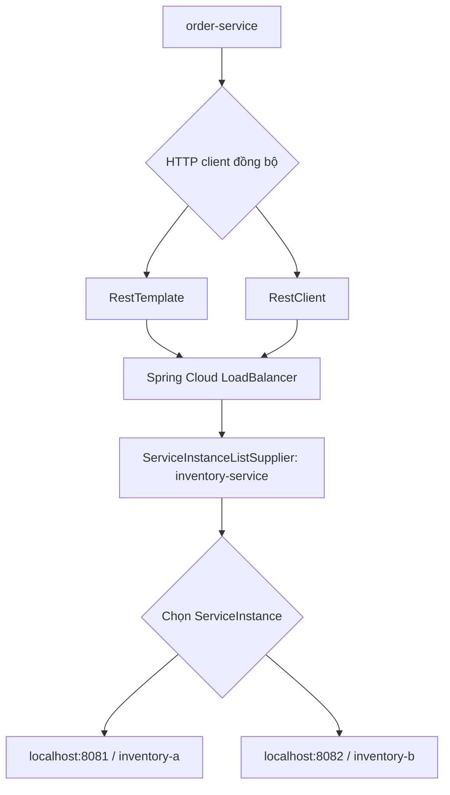
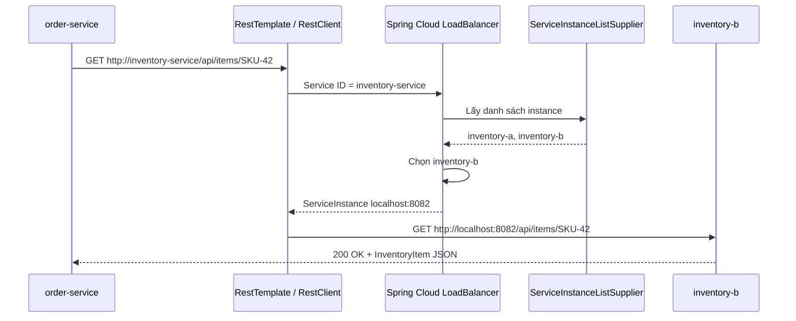

# So sánh cách dùng RestClient và RestTemplate trong cùng kịch bản

## Mục tiêu

Spring Cloud LoadBalancer cho phép ứng dụng gọi các dịch vụ khác qua **service ID** thay vì phải biết IP hoặc cổng của từng bản sao. Với HTTP đồng bộ (blocking), hai lựa chọn thường gặp trong hệ sinh thái Spring là `RestTemplate` và `RestClient`.

Hai client có thể thực hiện **cùng một lời gọi đến cùng một service ID**, sử dụng cùng cơ chế discovery và Spring Cloud LoadBalancer, nhưng khác nhau về cách khai báo bean, cách xây dựng request và xử lý response. Hiểu sự khác biệt này hữu ích khi duy trì ứng dụng cũ dùng `RestTemplate`, viết chức năng mới với `RestClient` hoặc di chuyển dần giữa hai API.

Sau bài học, bạn có thể:

- Xây dựng một kịch bản gọi `inventory-service` bằng cả `RestTemplate` và `RestClient`.
- Phân biệt `@LoadBalanced RestTemplate` với `@LoadBalanced RestClient.Builder`.
- So sánh `getForEntity()`/`exchange()` của `RestTemplate` với chuỗi `get().uri().retrieve().toEntity()` của `RestClient`.
- Hiểu rằng cả hai vẫn cần một service ID hợp lệ, discovery và `ServiceInstance` để thực hiện client-side load balancing.
- Gửi header, nhận status/header/body, xử lý HTTP 4xx/5xx và cấu hình timeout trong cùng tình huống.
- Nhận diện sự khác nhau giữa lỗi **không có instance**, lỗi **HTTP từ backend** và lỗi **kết nối**.
- Chọn công cụ phù hợp cho dự án mới hoặc một kế hoạch chuyển đổi từ code cũ.

## 1. Tình huống chung: order-service gọi inventory-service

Giả sử `order-service` cần đọc số lượng tồn kho của một mặt hàng từ `inventory-service`. Dịch vụ tồn kho có hai bản sao:

| Instance ID | Host | Port | Vai trò |
|---|---|---:|---|
| `inventory-a` | `localhost` | 8081 | Backend tồn kho thứ nhất |
| `inventory-b` | `localhost` | 8082 | Backend tồn kho thứ hai |

Cả hai cung cấp endpoint:

```http
GET /api/items/SKU-42
Accept: application/json
```

Response mẫu từ bản sao thứ nhất:

```json
{
  "sku": "SKU-42",
  "available": 12,
  "instanceId": "inventory-a"
}
```

Để xem bản sao nào xử lý request, response chứa `instanceId`. Trong ứng dụng thực tế, trường này chỉ nên dùng khi có mục đích chẩn đoán hoặc thử nghiệm.

Phía caller sử dụng **cùng URL logic** cho cả hai HTTP client:

```text
http://inventory-service/api/items/{sku}
```

Host `inventory-service` không phải địa chỉ DNS vật lý bắt buộc. Với bean đã gắn `@LoadBalanced`, Spring Cloud LoadBalancer hiểu host này là **service ID**, lấy danh sách bản sao từ discovery và chọn một instance, chẳng hạn `http://localhost:8082`, rồi thực hiện HTTP request.



**Điểm quan trọng:** đây là bài so sánh **API ở phía caller**, không phải hai thuật toán load balancing khác nhau. Nếu cùng sử dụng một service ID và cấu hình LoadBalancer giống nhau thì cả hai đều chọn từ cùng một tập instance hợp lệ.

## 2. RestTemplate và RestClient: điểm giống và khác

Spring Framework cung cấp cả hai API để thực hiện HTTP request đồng bộ. `RestTemplate` có kiểu gọi theo template method như `getForObject()`, `postForEntity()` và `exchange()`. `RestClient` sử dụng API fluent: chọn HTTP method, cấu hình URI/header/body, sau đó gọi `retrieve()` để xử lý response.

| Tiêu chí | RestTemplate | RestClient |
|---|---|---|
| Kiểu thực thi | Đồng bộ, blocking | Đồng bộ, blocking |
| Phong cách API | Template methods | Fluent, nối từng bước |
| Ví dụ GET lấy body | `getForObject(...)` | `get().uri(...).retrieve().body(...)` |
| Ví dụ GET lấy status và header | `getForEntity(...)` | `get().uri(...).retrieve().toEntity(...)` |
| Header cho một request | Thường dùng `HttpEntity` và `exchange(...)` | `header(...)` hoặc `headers(...)` trong request spec |
| POST với body | `postForEntity(...)` hoặc `exchange(...)` | `post().body(...).retrieve()` |
| Xử lý trạng thái lỗi | `ResponseErrorHandler`, hoặc bắt exception | `onStatus(...)`, `defaultStatusHandler(...)` hoặc bắt exception |
| Cấu hình LoadBalancer | Bean `RestTemplate` có `@LoadBalanced` | Bean `RestClient.Builder` có `@LoadBalanced` |
| Dùng trong dự án cũ | Rất phổ biến | Phù hợp khi viết mới hoặc chuyển đổi |
| Hướng phát triển Spring Framework | API cũ; đã deprecated từ Spring Framework 7 | API đồng bộ được ưu tiên cho code mới |

Theo tài liệu Spring Framework hiện hành, `RestTemplate` đã được đánh dấu **deprecated trong Spring Framework 7**, với `RestClient` là lựa chọn thay thế. Điều đó không có nghĩa mọi ứng dụng hiện tại phải viết lại ngay. Nếu code cũ đang ổn định và có kiểm thử, có thể di chuyển theo từng gateway/service thay vì thay đổi đồng loạt.

`RestClient` **không phải** `WebClient`. Dù có API fluent giống nhau, `RestClient` vẫn blocking; `WebClient` sử dụng kiểu reactive và có thể thực thi non-blocking. Đổi từ `RestTemplate` sang `RestClient` không tự biến ứng dụng thành reactive.

## 3. Chuẩn bị dự án với Spring Cloud LoadBalancer

Ví dụ minh họa dùng **Spring Boot 4.x** cùng một **Spring Cloud Release Train tương thích** (chẳng hạn Spring Cloud `2025.1.x` cho Spring Boot `4.0.x` hoặc nhánh Boot `4.1.x` được hỗ trợ). Khi triển khai, luôn kiểm tra release notes và BOM của bản phát hành cụ thể.

Trong Maven, sử dụng parent/BOM Spring Boot và import Spring Cloud BOM tương ứng; sau đó khai báo:

```xml
<dependencies>
    <!-- Chứa Spring MVC cho ứng dụng demo expose endpoint. -->
    <dependency>
        <groupId>org.springframework.boot</groupId>
        <artifactId>spring-boot-starter-webmvc</artifactId>
    </dependency>

    <dependency>
        <groupId>org.springframework.cloud</groupId>
        <artifactId>spring-cloud-starter-loadbalancer</artifactId>
    </dependency>
</dependencies>
```

Ví dụ sử dụng Spring Boot 4.x nên dùng `spring-boot-starter-webmvc`. Với Spring Boot 3.x, starter và một số package auto-configuration có thể khác; không sao chép các import của Boot 4 vào dự án Boot 3 mà không kiểm tra phiên bản.

`spring-cloud-starter-loadbalancer` bổ sung các thành phần cân bằng tải phía client. Muốn discovery động từ Eureka, Consul hoặc Spring Cloud Kubernetes, bạn cần thêm discovery provider phù hợp. Ở bài thực hành này, sử dụng `SimpleDiscoveryClient` với hai địa chỉ tĩnh để tách vấn đề API HTTP khỏi việc vận hành service registry.

### 3.1. Cấu hình SimpleDiscoveryClient trong caller

`application.yml` của `order-service`:

```yaml
server:
  port: 8080

spring:
  application:
    name: order-service
  cloud:
    discovery:
      client:
        simple:
          instances:
            inventory-service:
              - uri: http://localhost:8081
              - uri: http://localhost:8082
```

Khi code gọi `http://inventory-service/...`, LoadBalancer có thể chọn một trong hai instance này. Nếu `inventory-a` hoặc `inventory-b` chưa chạy, việc có URI trong cấu hình **không bảo đảm** HTTP request thành công: client vẫn có thể gặp `Connection refused` hoặc timeout.

### 3.2. Định nghĩa DTO dùng chung

Cả hai HTTP client đọc cùng JSON về cùng kiểu dữ liệu Java:

```java
public record InventoryItem(
        String sku,
        int available,
        String instanceId
) {
}
```

Các ví dụ dưới đây giả định `InventoryItem` nằm trong package phù hợp và hai ứng dụng đã thống nhất hợp đồng JSON này. `record` giúp biểu diễn dữ liệu ngắn gọn khi sử dụng Java hiện đại.

## 4. Cấu hình hai HTTP client cùng được load balance

### 4.1. RestTemplate: đánh dấu trực tiếp bean

`RestTemplate` là đối tượng HTTP client đã hoàn chỉnh, nên gắn `@LoadBalanced` trực tiếp trên bean:

```java
import org.springframework.cloud.client.loadbalancer.LoadBalanced;
import org.springframework.context.annotation.Bean;
import org.springframework.context.annotation.Configuration;
import org.springframework.web.client.RestTemplate;

@Configuration(proxyBeanMethods = false)
class RestTemplateConfiguration {

    @Bean
    @LoadBalanced
    RestTemplate loadBalancedRestTemplate() {
        return new RestTemplate();
    }
}
```

Spring Cloud cấu hình interceptor LoadBalancer cho `RestTemplate` bean được Spring quản lý. Khi gọi URI logic, interceptor lấy host làm service ID, dùng `BlockingLoadBalancerClient` chọn `ServiceInstance` và thực thi request với URI vật lý.

Nếu tự tạo `new RestTemplate()` trong method nghiệp vụ, đối tượng đó **không tự được gắn interceptor** chỉ vì ứng dụng có starter LoadBalancer. Cần sử dụng bean đã được Spring cấu hình.

### 4.2. RestClient: đánh dấu RestClient.Builder

Khác với `RestTemplate`, Spring Cloud hướng dẫn khai báo bean **`RestClient.Builder`** có `@LoadBalanced`. Từ builder đó, ứng dụng tạo `RestClient`:

```java
import org.springframework.cloud.client.loadbalancer.LoadBalanced;
import org.springframework.context.annotation.Bean;
import org.springframework.context.annotation.Configuration;
import org.springframework.web.client.RestClient;

@Configuration(proxyBeanMethods = false)
class RestClientConfiguration {

    @Bean
    @LoadBalanced
    RestClient.Builder loadBalancedRestClientBuilder() {
        return RestClient.builder();
    }
}
```

Có thể dùng bản cấu hình tích hợp Spring Boot để giữ các customizer/observability mặc định khi tự tạo builder:

```java
import org.springframework.boot.restclient.autoconfigure.RestClientBuilderConfigurer;
import org.springframework.cloud.client.loadbalancer.LoadBalanced;
import org.springframework.context.annotation.Bean;
import org.springframework.context.annotation.Configuration;
import org.springframework.web.client.RestClient;

@Configuration(proxyBeanMethods = false)
class RestClientConfiguration {

    @Bean
    @LoadBalanced
    RestClient.Builder loadBalancedRestClientBuilder(
            RestClientBuilderConfigurer configurer) {
        return configurer.configure(RestClient.builder());
    }
}
```

**Chọn một trong hai khai báo `RestClientConfiguration`**, không đăng ký đồng thời hai bean cùng tên. `RestClientBuilderConfigurer` ở ví dụ trên thuộc package **Spring Boot 4.x**; với phiên bản Boot khác, package có thể thay đổi. Trong ứng dụng thực tế, cách dùng configurer giúp giữ nhiều khả năng do Spring Boot cấu hình sẵn thay vì khởi tạo một builder hoàn toàn độc lập.

### 4.3. Vì sao annotation ở những vị trí khác nhau?

| API | Đối tượng nhận `@LoadBalanced` | Đối tượng đưa vào nghiệp vụ |
|---|---|---|
| RestTemplate | `@Bean RestTemplate` | Chính `RestTemplate` bean |
| RestClient | `@Bean RestClient.Builder` | `RestClient` tạo bằng `builder.build()` |

Đây là khác biệt đáng nhớ nhất khi chuyển mã nguồn. Nếu chỉ gọi `RestClient.create()` trong một lớp nghiệp vụ, client đó không tự tham gia Spring Cloud LoadBalancer theo annotation của builder bean đã khai báo ở nơi khác.

Khi ứng dụng có cả HTTP client load-balanced và HTTP client trực tiếp, nên phân biệt bean bằng `@LoadBalanced` và `@Primary`/`@Qualifier`. URL vật lý như `http://localhost:8081` thường cần HTTP client **không** load balance; dùng client có `@LoadBalanced` sẽ khiến `localhost` có thể bị hiểu là service ID `localhost`.

## 5. Cùng một GET: RestTemplate và RestClient

Ta triển khai hai gateway riêng, nhưng cả hai đều truy vấn cùng dữ liệu từ `inventory-service`.

### 5.1. Cách dùng RestTemplate

```java
import org.springframework.cloud.client.loadbalancer.LoadBalanced;
import org.springframework.http.ResponseEntity;
import org.springframework.stereotype.Component;
import org.springframework.web.client.RestTemplate;

@Component
class InventoryRestTemplateGateway {

    private final RestTemplate restTemplate;

    InventoryRestTemplateGateway(
            @LoadBalanced RestTemplate restTemplate) {
        this.restTemplate = restTemplate;
    }

    ResponseEntity<InventoryItem> getItem(String sku) {
        return restTemplate.getForEntity(
                "http://inventory-service/api/items/{sku}",
                InventoryItem.class,
                sku
        );
    }
}
```

Lời gọi `getForEntity(...)` thực hiện HTTP GET và trả về `ResponseEntity<InventoryItem>`. Từ đó có thể lấy:

```java
ResponseEntity<InventoryItem> response = gateway.getItem("SKU-42");

int status = response.getStatusCode().value();
String contentType = String.valueOf(response.getHeaders().getContentType());
InventoryItem item = response.getBody();
```

Nếu chỉ cần body và không quan tâm status/header, `RestTemplate` có thể dùng `getForObject(...)`. Trong bài so sánh này, chúng ta dùng `ResponseEntity` để nhìn thấy đầy đủ response.

### 5.2. Cách dùng RestClient

```java
import org.springframework.cloud.client.loadbalancer.LoadBalanced;
import org.springframework.http.MediaType;
import org.springframework.http.ResponseEntity;
import org.springframework.stereotype.Component;
import org.springframework.web.client.RestClient;

@Component
class InventoryRestClientGateway {

    private final RestClient restClient;

    InventoryRestClientGateway(
            @LoadBalanced RestClient.Builder builder) {
        this.restClient = builder
                .baseUrl("http://inventory-service")
                .build();
    }

    ResponseEntity<InventoryItem> getItem(String sku) {
        return restClient.get()
                .uri("/api/items/{sku}", sku)
                .accept(MediaType.APPLICATION_JSON)
                .retrieve()
                .toEntity(InventoryItem.class);
    }
}
```

Ở đây:

1. `baseUrl("http://inventory-service")` đặt URI logic dùng chung cho gateway.
2. `get()` chọn HTTP method.
3. `uri("/api/items/{sku}", sku)` mở rộng biến URI theo SKU.
4. `accept(...)` khai báo kiểu response mà client mong đợi.
5. `retrieve()` chuyển sang API xử lý response.
6. `toEntity(InventoryItem.class)` trả cả status, header và body trong một `ResponseEntity`.

Kết quả có thể được xử lý giống `RestTemplate`:

```java
ResponseEntity<InventoryItem> response = gateway.getItem("SKU-42");

int status = response.getStatusCode().value();
String contentType = String.valueOf(response.getHeaders().getContentType());
InventoryItem item = response.getBody();
```

Chỉ khác **cách xây dựng HTTP request**, không khác kiểu dữ liệu hay hợp đồng HTTP đích.

### 5.3. Đối chiếu từng dòng

| Ý định | RestTemplate | RestClient |
|---|---|---|
| Dùng service ID | URL `http://inventory-service/...` | `baseUrl("http://inventory-service")` |
| Phương thức GET | `getForEntity(...)` | `get()` |
| Path và tham số | `".../{sku}", sku` | `uri("/.../{sku}", sku)` |
| Accept JSON | Có thể đặt qua `HttpEntity`/`exchange(...)` | `accept(MediaType.APPLICATION_JSON)` |
| Lấy cả response | `getForEntity(...)` | `retrieve().toEntity(...)` |
| Lấy chỉ body | `getForObject(...)` | `retrieve().body(...)` |
| Chọn instance | Spring Cloud LoadBalancer | Spring Cloud LoadBalancer |

`RestClient` thường dễ mở rộng hơn khi request có nhiều header, body, cookie hoặc quy tắc status riêng. `RestTemplate` vẫn có thể làm tất cả các việc này, nhưng thường phải chuẩn bị `HttpHeaders`, `HttpEntity` và chọn overload của `exchange(...)`.

## 6. So sánh khi gửi header cho từng request

Giả sử caller cần truyền `X-Request-Id` để theo dõi một request xuyên nhiều service. Giá trị này nên được hệ thống kiểm tra/chuẩn hóa; ví dụ dưới đây giả định request ID đã an toàn để đưa vào header.

### 6.1. RestTemplate: HttpHeaders + HttpEntity + exchange

```java
import org.springframework.http.HttpEntity;
import org.springframework.http.HttpHeaders;
import org.springframework.http.HttpMethod;
import org.springframework.http.MediaType;
import org.springframework.http.ResponseEntity;

ResponseEntity<InventoryItem> getItemWithRequestId(
        String sku, String requestId) {

    HttpHeaders headers = new HttpHeaders();
    headers.setAccept(List.of(MediaType.APPLICATION_JSON));
    headers.set("X-Request-Id", requestId);

    HttpEntity<Void> entity = new HttpEntity<>(headers);

    return restTemplate.exchange(
            "http://inventory-service/api/items/{sku}",
            HttpMethod.GET,
            entity,
            InventoryItem.class,
            sku
    );
}
```

Đoạn này cần import `java.util.List` ngoài các import đã nêu. `RestTemplate.exchange(...)` cho phép tùy chỉnh HTTP method, header, body và kiểu response qua `HttpEntity`.

### 6.2. RestClient: fluent headers

```java
ResponseEntity<InventoryItem> getItemWithRequestId(
        String sku, String requestId) {

    return restClient.get()
            .uri("/api/items/{sku}", sku)
            .accept(MediaType.APPLICATION_JSON)
            .header("X-Request-Id", requestId)
            .retrieve()
            .toEntity(InventoryItem.class);
}
```

`RestClient` gắn header trực tiếp trong request spec, không cần tự tạo `HttpEntity` cho GET thông thường. Điều này đặc biệt rõ ràng với request có nhiều header tùy chọn.

Nếu muốn một header được gửi trên **mọi** request của một RestClient, có thể cấu hình `defaultHeader(...)` trên builder thay vì lặp lại `header(...)` trong từng method. Không đặt token cố định của một người dùng lên builder dùng chung cho nhiều người dùng; thông tin xác thực theo request phải được cung cấp đúng ngữ cảnh.

### 6.3. Nếu cần POST với body

Với cùng JSON body, cách gọi điển hình:

| RestTemplate | RestClient |
|---|---|
| `postForEntity(url, requestBody, ResponseType.class)` | `post().uri(path).body(requestBody).retrieve().toEntity(ResponseType.class)` |

Ví dụ RestClient:

```java
ResponseEntity<ReservationResult> response = restClient.post()
        .uri("/api/reservations")
        .contentType(MediaType.APPLICATION_JSON)
        .body(new ReservationRequest("SKU-42", 2))
        .retrieve()
        .toEntity(ReservationResult.class);
```

`ReservationRequest` và `ReservationResult` ở đây là DTO minh họa của API đặt giữ hàng, cần được định nghĩa tương ứng trong dự án. Với thao tác POST có side effect, không bật retry mù quáng nếu backend chưa hỗ trợ idempotency key/chống tạo trùng.

## 7. Xử lý HTTP status: 404, 500 và lỗi mạng

Một khác biệt có ý nghĩa khi migration là cách tùy biến xử lý lỗi của hai API.

### 7.1. Hành vi mặc định khá giống nhau

Mặc định, `RestTemplate` với error handler thông thường và `RestClient.retrieve()` đều ném ngoại lệ cho status HTTP 4xx hoặc 5xx. Cả hai thuộc họ `RestClientException` và có thể cung cấp thông tin status/body thông qua các exception thích hợp.

Điểm quan trọng là không nhầm **HTTP 404 do backend trả về** với **không tìm thấy ServiceInstance**:

- **HTTP 404:** đã chọn được một instance và backend phản hồi rằng tài nguyên không tồn tại.
- **Không có instance:** discovery/supplier không có backend để chọn, lỗi có thể xảy ra **trước khi có HTTP response**.
- **Connection refused/timeout:** có instance được chọn nhưng kết nối hoặc quá trình nhận response thất bại.

### 7.2. RestTemplate: bắt exception hoặc cấu hình error handler

```java
import org.springframework.web.client.HttpClientErrorException;

InventoryItem findOrNull(String sku) {
    try {
        return restTemplate.getForObject(
                "http://inventory-service/api/items/{sku}",
                InventoryItem.class,
                sku
        );
    }
    catch (HttpClientErrorException.NotFound ex) {
        return null;
    }
}
```

Trong ứng dụng production, có thể trả `Optional<InventoryItem>` hoặc một result type rõ ràng hơn `null`. Với `RestTemplate`, có thể tùy chỉnh `ResponseErrorHandler` qua `setErrorHandler(...)`, nhưng đây là cấu hình thường áp dụng cho nhiều request của cùng client. Trong Spring Framework 7, các API gắn với `RestTemplate` đang ở nhánh cũ, vì thế nên cân nhắc migration thay vì bổ sung nhiều cơ chế tùy chỉnh mới.

### 7.3. RestClient: onStatus theo từng request

```java
import org.springframework.web.client.RestClientResponseException;

InventoryItem findOrNull(String sku) {
    try {
        return restClient.get()
                .uri("/api/items/{sku}", sku)
                .retrieve()
                .onStatus(
                        status -> status.value() == 404,
                        (request, response) -> {
                            throw new ItemNotFoundException(sku);
                        }
                )
                .body(InventoryItem.class);
    }
    catch (ItemNotFoundException ex) {
        return null;
    }
}
```

Trong ví dụ này, `ItemNotFoundException` là một exception ứng dụng tự định nghĩa:

```java
class ItemNotFoundException extends RuntimeException {
    ItemNotFoundException(String sku) {
        super("Item not found: " + sku);
    }
}
```

`onStatus(...)` chỉ xử lý status khớp điều kiện, ở đây là HTTP 404. Những status lỗi khác vẫn được xử lý theo chính sách mặc định hoặc các status handler khác. Có thể đặt `defaultStatusHandler(...)` trên `RestClient.Builder` nếu cần quy tắc nhất quán giữa nhiều method.

Không bắt mọi `RestClientException` rồi coi chúng là “item không tồn tại”. Lỗi mạng, sai cấu hình discovery và HTTP 500 cần được phân biệt để không che sự cố thực sự.

### 7.4. Hai phương thức exchange không tương đương hoàn toàn

Đây là điểm dễ gây nhầm khi đọc tên API:

- `RestTemplate.exchange(...)`: phương thức cấp cao thường thực hiện chuyển đổi body và áp dụng `ResponseErrorHandler` của RestTemplate.
- `RestClient.exchange((request, response) -> ...)`: callback truy cập request/response thấp hơn; **status handlers của `retrieve()` không tự áp dụng** trong nhánh này. Ứng dụng phải kiểm tra trạng thái và xử lý response đúng cách.

Do đó, nếu đang dùng `RestTemplate.exchange(...)` và muốn di chuyển sang `RestClient` trong một tình huống thông thường, cách tương đương thường là `method(...).uri(...).retrieve().toEntity(...)`, chứ không nhất thiết là `RestClient.exchange(...)`.

## 8. Cùng cơ chế chọn ServiceInstance, khác API xây dựng request

Với bean `@LoadBalanced` được khai báo đúng, đường đi logic của hai lời gọi gần giống nhau:



`RestTemplate` sử dụng interceptor LoadBalancer trong chuỗi `ClientHttpRequestInterceptor`. `RestClient.Builder` đã được cấu hình `@LoadBalanced` cũng tích hợp bước phân giải service ID và chọn instance khi thực thi request. Với HTTP client đồng bộ, Spring Cloud sử dụng `BlockingLoadBalancerClient` để đưa service ID tới endpoint vật lý.

Các policy như round robin, random, zone preference, hint filtering, health check và caching nằm trong **cấu hình LoadBalancer theo service ID**, không phải một lợi thế riêng chỉ có ở `RestClient`.

Vì thế:

- Chuyển code từ `RestTemplate` sang `RestClient` **không tự tăng** số backend hoặc cải thiện chất lượng discovery.
- Hai gateway có thể cùng gọi `inventory-service` và chia sẻ chính sách chọn instance cho service ID đó.
- Không thể yêu cầu hai client luôn nhận cùng một instance trên hai request liên tiếp; thuật toán có thể chọn khác nhau theo trạng thái nội bộ và thời điểm gọi.
- Nếu `inventory-a` gặp lỗi, cả hai đều cần timeout/retry phù hợp chứ không phải chỉ đổi API HTTP là tự phục hồi.

## 9. Cấu hình timeout: phải đặt ở đúng tầng

Spring Cloud LoadBalancer chịu trách nhiệm **chọn instance**; thời gian chờ kết nối và chờ response là trách nhiệm của HTTP client/request factory tương ứng.

Để so sánh dễ hiểu, có thể dùng `SimpleClientHttpRequestFactory` cho hai client:

```java
import org.springframework.http.client.SimpleClientHttpRequestFactory;

static SimpleClientHttpRequestFactory requestFactory() {
    SimpleClientHttpRequestFactory factory =
            new SimpleClientHttpRequestFactory();
    factory.setConnectTimeout(2_000);
    factory.setReadTimeout(3_000);
    return factory;
}
```

Đây là một factory ví dụ với connect timeout khoảng 2 giây và read timeout khoảng 3 giây. Có thể khai báo trong class cấu hình chung, sau đó truyền vào mỗi client:

```java
@Bean
@LoadBalanced
RestTemplate timedRestTemplate() {
    return new RestTemplate(requestFactory());
}

@Bean
@LoadBalanced
RestClient.Builder timedRestClientBuilder(
        RestClientBuilderConfigurer configurer) {
    return configurer.configure(RestClient.builder())
            .requestFactory(requestFactory());
}
```

Hai bean trên **là phương án cấu hình thay thế** những bean `@LoadBalanced` ở phần 4, không nên đăng ký tất cả cùng lúc mà không đặt tên/qualifier rõ ràng. `SimpleClientHttpRequestFactory` thích hợp để minh họa; ở production nên đánh giá HTTP client có connection pooling, TLS, proxy và timeout phù hợp với lưu lượng.

Không đặt `connectTimeout` của OpenFeign vào `spring.cloud.loadbalancer.clients.inventory-service` rồi kỳ vọng cả `RestClient` và `RestTemplate` tự áp dụng. Nếu dùng các HTTP client/request factory khác nhau, cần đặt timeout theo đúng API của chúng.

Để xác định timeout hiệu quả, hãy đo latency thực tế, giới hạn thời gian của caller/gateway và budget retry. Timeout quá dài giữ request ở backend đang ngừng hoạt động; timeout quá ngắn gây lỗi khi backend chỉ chậm tạm thời.

## 10. Retry, health check và khả năng quan sát

### 10.1. Retry không giống nhau chỉ vì dùng cùng LoadBalancer

Spring Cloud có cơ chế retry cho nhiều kiểu HTTP client, nhưng điều kiện kích hoạt và phụ thuộc thư viện có thể khác. Theo tài liệu Spring Cloud Commons, với `RestTemplate` load-balanced dùng kiểu blocking, retry tích hợp Spring Retry cần có **Spring Retry trên classpath**. Cần kiểm tra chính sách retry của đúng Spring Cloud Release Train và client đang sử dụng; không suy ra rằng chỉ cần bật một property là mọi `RestClient` và `RestTemplate` tự retry giống nhau.

Ví dụ một số tham số của LoadBalancer:

```yaml
spring:
  cloud:
    loadbalancer:
      retry:
        enabled: true
        max-retries-on-same-service-instance: 0
        max-retries-on-next-service-instance: 1
```

Cấu hình trên minh họa ý định tối đa một lần thử sang instance khác; hiệu lực cụ thể còn phụ thuộc tích hợp retry và loại lỗi được coi là retryable. Với `GET` đọc tồn kho, việc thử lại có thể hữu ích. Với `POST` tạo đơn hoặc giữ hàng, phải có idempotency key/chống xử lý trùng nếu muốn retry an toàn.

### 10.2. Health check và cache nằm ngoài lựa chọn RestClient/RestTemplate

Các policy như:

- `HealthCheckServiceInstanceListSupplier` để xem xét trạng thái instance.
- `CachingServiceInstanceListSupplier` để giảm chi phí lấy danh sách từ discovery.
- `ZonePreferenceServiceInstanceListSupplier` để ưu tiên bản sao cùng zone.
- `HintBasedServiceInstanceListSupplier` để lọc theo hint.

được cấu hình cho service ID trong Spring Cloud LoadBalancer. Đổi API từ `RestTemplate` sang `RestClient` không tự sửa dữ liệu discovery cũ hoặc chọn một supplier khác.

Khi tự tạo supplier chain, cache hoặc health-check supplier nên nằm ngay sau nguồn discovery, trước các filter theo request. Không cache nhầm danh sách đã lọc theo caller/hint.

### 10.3. Observability

Nếu quan tâm tracing/metrics, việc tự khai báo `RestClient.Builder` bằng `RestClient.builder()` có thể bỏ qua một số cấu hình hữu ích do Spring Boot cung cấp. Có thể dùng `RestClientBuilderConfigurer` (Boot 4) như phần 4 để giữ các customizer/observability đã được cấu hình.

Với `RestTemplate`, tương tự nên cân nhắc cấu hình thông qua `RestTemplateBuilder`/các customizer của Spring Boot nếu dự án dựa vào quan sát request mặc định.

Trong thực hành, đo ít nhất:

| Tín hiệu | Ý nghĩa |
|---|---|
| `serviceId` | Dịch vụ logic đang được gọi. |
| `instanceId` | Bản sao nào xử lý request. |
| HTTP status | Phân biệt 2xx, 4xx và 5xx. |
| Duration/latency | Đo độ trễ và phát hiện timeout. |
| Retry count | Phát hiện request bị gửi lại quá mức. |
| Error class | Tách lỗi HTTP, discovery và kết nối. |
| Trace/correlation ID | Liên kết log giữa caller và backend. |

Không ghi token xác thực, cookie hoặc dữ liệu cá nhân vào log. Với metrics, cần hạn chế tag có cardinality quá cao.

## 11. Thực hành: kiểm tra hai API cùng một backend contract

### Bước 1. Tạo backend tồn kho

Trong ứng dụng `inventory-service`, expose một endpoint:

```java
import org.springframework.core.env.Environment;
import org.springframework.web.bind.annotation.GetMapping;
import org.springframework.web.bind.annotation.PathVariable;
import org.springframework.web.bind.annotation.RestController;

@RestController
class InventoryController {

    private final Environment environment;

    InventoryController(Environment environment) {
        this.environment = environment;
    }

    @GetMapping("/api/items/{sku}")
    InventoryItem getItem(@PathVariable String sku) {
        return new InventoryItem(
                sku,
                12,
                environment.getProperty("demo.instance-id", "unknown")
        );
    }
}
```

Chạy hai instance:

```text
instance inventory-a:
  --server.port=8081 --demo.instance-id=inventory-a

instance inventory-b:
  --server.port=8082 --demo.instance-id=inventory-b
```

Đảm bảo cả hai thực sự chạy và phản hồi JSON đúng. `InventoryItem` record phải khả dụng ở backend và caller, có thể thông qua một module hợp đồng chung hoặc hai DTO có JSON tương thích.

### Bước 2. Khởi động order-service

Ứng dụng caller chạy tại port 8080 với `SimpleDiscoveryClient` trong phần 3. Đăng ký:

- Bean `@LoadBalanced RestTemplate`.
- Bean `@LoadBalanced RestClient.Builder`.
- Hai gateway `InventoryRestTemplateGateway` và `InventoryRestClientGateway`.

Nếu dùng cấu hình `RestClientBuilderConfigurer`, hãy chỉ khai báo một builder bean `@LoadBalanced` và chắc chắn Boot auto-configuration tạo được configurer tương ứng.

### Bước 3. Tạo hai endpoint demo ở caller

```java
import org.springframework.http.ResponseEntity;
import org.springframework.web.bind.annotation.GetMapping;
import org.springframework.web.bind.annotation.PathVariable;
import org.springframework.web.bind.annotation.RestController;

@RestController
class DemoController {

    private final InventoryRestTemplateGateway templateGateway;
    private final InventoryRestClientGateway clientGateway;

    DemoController(
            InventoryRestTemplateGateway templateGateway,
            InventoryRestClientGateway clientGateway) {
        this.templateGateway = templateGateway;
        this.clientGateway = clientGateway;
    }

    @GetMapping("/demo/template/{sku}")
    ResponseEntity<InventoryItem> viaTemplate(
            @PathVariable String sku) {
        return templateGateway.getItem(sku);
    }

    @GetMapping("/demo/client/{sku}")
    ResponseEntity<InventoryItem> viaRestClient(
            @PathVariable String sku) {
        return clientGateway.getItem(sku);
    }
}
```

Hai endpoint chỉ khác gateway HTTP được gọi, còn service ID và hợp đồng JSON đều giống nhau.

### Bước 4. Gửi request xen kẽ

```bash
curl "http://localhost:8080/demo/template/SKU-42"
curl "http://localhost:8080/demo/client/SKU-42"
curl "http://localhost:8080/demo/template/SKU-42"
curl "http://localhost:8080/demo/client/SKU-42"
```

Kết quả mong đợi là những response JSON cùng cấu trúc, cùng `sku` và `available`. Trường `instanceId` có thể là `inventory-a` hoặc `inventory-b` tùy lần LoadBalancer chọn instance.

**Không yêu cầu hai API luôn nhận response từ cùng một instance.** Nếu `RoundRobinLoadBalancer` đang chọn luân phiên, các request xen kẽ có thể tới những instance khác nhau. Nếu có cache, retry, nhiều caller hoặc policy riêng, thứ tự thực tế cũng có thể thay đổi.

### Bước 5. So sánh các tình huống

| Tình huống | RestTemplate | RestClient | Cần kết luận |
|---|---|---|---|
| Cả hai instance sẵn sàng | `getForEntity(...)` trả response | `retrieve().toEntity(...)` trả response | Hợp đồng HTTP tương đương. |
| Một instance dừng nhưng vẫn trong discovery | Có thể lỗi kết nối nếu chọn instance đó | Có thể lỗi kết nối nếu chọn instance đó | Đổi API không tự giải quyết stale discovery. |
| Service ID không tồn tại | Có thể lỗi trước khi gửi HTTP | Có thể lỗi trước khi gửi HTTP | Kiểm tra discovery/supplier. |
| Backend trả HTTP 404 | Mặc định ném HTTP status exception | `retrieve()` mặc định ném HTTP status exception | Có thể tùy biến xử lý riêng. |
| Cần header theo request | `HttpEntity`/`exchange(...)` | `header(...)` | Fluent API của RestClient ngắn gọn hơn. |
| Cần status và header | `ResponseEntity` | `toEntity(...)` | Cả hai hỗ trợ. |
| Cần timeout | Request factory / client | Request factory / client | Cùng trách nhiệm ở tầng HTTP. |

### Bước 6. Thử lỗi có chủ đích

1. Tắt hai backend nhưng giữ URI tĩnh trong discovery: LoadBalancer vẫn có thể chọn instance, nhưng HTTP kết nối sẽ thất bại.
2. Đổi `inventory-service` trong URL sang một service ID không có instance: phân biệt lỗi discovery/selection với lỗi kết nối.
3. Gọi URL `http://localhost:8081` bằng bean có `@LoadBalanced`: hostname `localhost` có thể bị hiểu thành service ID và gây lỗi không có instance.
4. Thêm logic để backend trả 404 khi SKU không tồn tại, rồi kiểm tra cách `RestTemplate` và `RestClient.retrieve()` xử lý status.
5. Giới hạn timeout thấp trong môi trường demo có độ trễ cố ý để kiểm tra lỗi timeout; không cần làm việc này ở môi trường production.

## 12. Khi nào dùng RestClient, khi nào giữ RestTemplate?

Với một dự án mới dùng Spring Framework 7, **`RestClient` là lựa chọn đồng bộ được ưu tiên** nhờ API fluent, xử lý status linh hoạt và hướng hỗ trợ hiện tại. Đối với ứng dụng cũ đang dùng `RestTemplate`:

- Nếu code đã ổn định, có test và không cần thay đổi API ngay, có thể tiếp tục bảo trì trong phạm vi phiên bản đang hỗ trợ.
- Nếu đang nâng lên Spring Framework 7 hoặc viết gateway mới, nên lập kế hoạch chuyển dần sang `RestClient`.
- Nếu ứng dụng là reactive và cần gọi HTTP không chặn luồng, hãy đánh giá `WebClient` thay vì xem `RestClient` là non-blocking.
- Nếu API của service được dùng ở nhiều nơi, có thể xem xét Spring HTTP Interface Clients để tách hợp đồng gọi dịch vụ khỏi mã gọi HTTP; chúng có thể dùng adapter phù hợp bên dưới.

### 12.1. Quy trình migration gợi ý

1. Xác định từng `RestTemplate` bean đang dùng LoadBalancer hay gọi trực tiếp.
2. Ghi nhận những chức năng đang có: interceptor, error handler, request factory, timeout, message converter, tracing, authentication và retry.
3. Tạo `@LoadBalanced RestClient.Builder` và cấu hình `RestClientBuilderConfigurer` phù hợp phiên bản Boot.
4. Chuyển một gateway nhỏ từ `getForEntity`/`exchange` sang `get().uri().retrieve().toEntity()`.
5. Đảm bảo status, header, body, JSON mapping và exception policy không thay đổi ngoài ý muốn.
6. Chạy unit test cho hợp đồng HTTP và integration test thực sự với hai instance/discovery.
7. Theo dõi latency, error rate và retry trước/sau khi chuyển.
8. Chỉ loại bean `RestTemplate` cũ khi không còn caller phụ thuộc.

Đừng vô tình tạo hai lần gọi HTTP khi di chuyển: một số lớp gateway đang wrap `RestTemplate` qua retry/circuit breaker riêng. Nếu giữ wrapper đó rồi thêm retry mới trên `RestClient`, tổng số lần thử có thể tăng mạnh.

## 13. Checklist

- [ ] Cả hai client đang thực hiện **cùng API** và cùng hợp đồng response.
- [ ] `RestTemplate` là bean `@LoadBalanced` do Spring quản lý.
- [ ] `RestClient` được tạo từ bean `@LoadBalanced RestClient.Builder`.
- [ ] Host trong URI logic chính xác là service ID trong discovery.
- [ ] Đã xác định rõ bean gọi qua LoadBalancer và bean gọi URL vật lý.
- [ ] DTO và quy tắc serialize/deserialize JSON tương thích.
- [ ] Biết cách đọc cả body và status/header từ `ResponseEntity`.
- [ ] Không nhầm `RestTemplate.exchange(...)` với callback `RestClient.exchange(...)`.
- [ ] Phân biệt HTTP 404/500, lỗi không tìm thấy instance và lỗi kết nối.
- [ ] Timeout được cấu hình ở tầng HTTP request factory phù hợp.
- [ ] Retry có giới hạn và có kiểm soát tính idempotent.
- [ ] Đã xem xét Boot customizer/observability khi tự khai báo RestClient.Builder.
- [ ] Có integration test với nhiều instance để chứng minh cả hai client thực sự dùng LoadBalancer.
- [ ] Dự án mới cân nhắc `RestClient`; dự án cũ có kế hoạch chuyển đổi theo từng gateway.

## Kết luận

`RestTemplate` và `RestClient` đều có thể gọi `inventory-service` qua Spring Cloud LoadBalancer bằng một **URI logic chứa service ID**. Chúng dùng cùng cơ chế chọn `ServiceInstance` nhưng khác phong cách lập trình:

- `RestTemplate` phù hợp khi duy trì code cũ với API `getForEntity()`, `postForEntity()` và `exchange()`.
- `RestClient` cung cấp fluent API `get().uri().retrieve().toEntity()`, dễ cấu hình header/body/status theo từng request và là hướng được ưu tiên cho code blocking mới.

Chuyển đổi từ `RestTemplate` sang `RestClient` chủ yếu thay đổi **cách xây dựng và xử lý HTTP request**, không tự thay đổi discovery, thuật toán cân bằng tải, cache, retry hay timeout. Cách đánh giá đúng nhất là đặt cả hai trong cùng kịch bản, đối chiếu response và đo request thực sự tới những instance nào.

## Tài liệu tham khảo

- [Spring Cloud Commons — Spring RestTemplate và Spring RestClient as a LoadBalancer Client](https://docs.spring.io/spring-cloud-commons/reference/spring-cloud-commons/common-abstractions.html)
- [Spring Cloud Commons — Spring Cloud LoadBalancer](https://docs.spring.io/spring-cloud-commons/reference/spring-cloud-commons/loadbalancer.html)
- [Spring Framework — REST Clients: RestClient, RestTemplate, exchange và error handling](https://docs.spring.io/spring-framework/reference/integration/rest-clients.html)
- [Spring Boot 4 — RestClientBuilderConfigurer API](https://docs.spring.io/spring-boot/api/java/org/springframework/boot/restclient/autoconfigure/RestClientBuilderConfigurer.html)
- [Spring Cloud Commons source — LoadBalanced annotation](https://github.com/spring-cloud/spring-cloud-commons/blob/main/spring-cloud-commons/src/main/java/org/springframework/cloud/client/loadbalancer/LoadBalanced.java)
