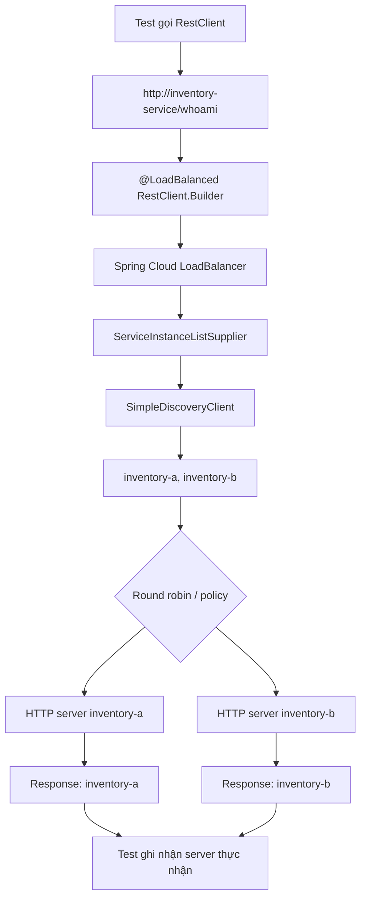
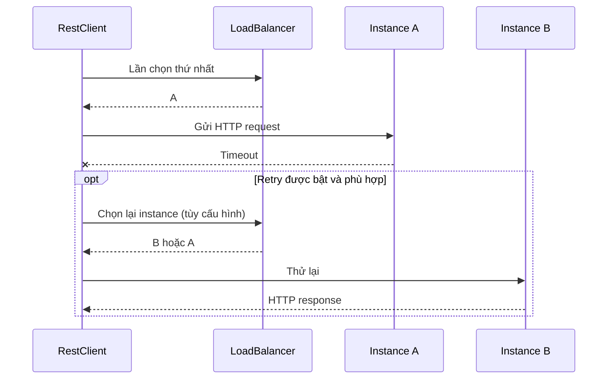

# Kiểm thử lời gọi và kiểm tra bản sao được chọn

Khi một ứng dụng dùng Spring Cloud LoadBalancer để gọi `http://inventory-service/api/items`, chương trình không kết nối trực tiếp tới host có tên `inventory-service` theo cách gọi DNS thông thường. `RestClient` được tạo từ `@LoadBalanced RestClient.Builder` sẽ dùng tên logic này để chọn một `ServiceInstance`, sau đó gửi HTTP request đến host, port và scheme của instance được chọn.

Một bài kiểm thử thành công không chỉ chứng minh API trả `200 OK`. Nó còn phải trả lời: **Request có thực sự đi qua LoadBalancer không? Những instance nào được chọn? Khi không có instance hoặc một instance bị lỗi, ứng dụng phản ứng thế nào?** Đây là trọng tâm của bài thuộc chương **RestClient** trong module `SPRING_CLOUD_SERVICE_COMMUNICATION_LOAD_BALANCING`.

Bài viết hướng dẫn phương pháp kiểm thử từ mức đơn vị đến tích hợp: cách tạo bean `@LoadBalanced RestClient.Builder`, dùng hai HTTP server giả lập làm instance của cùng service ID, công bố chúng qua `SimpleDiscoveryClient`, quan sát instance ID trên response và thiết kế assertion đáng tin cậy. Phần cuối trình bày cách kiểm tra discovery, health check, cache, retry/timeout và metric để tìm nguyên nhân khi kết quả chọn instance không như mong đợi.

## 1. Kiểm thử đúng điều gì?

Giả sử ứng dụng `order-service` gọi `inventory-service`, discovery cung cấp hai bản sao:

| Thuộc tính | Instance A | Instance B |
|---|---|---|
| Service ID | `inventory-service` | `inventory-service` |
| Instance ID | `inventory-a` | `inventory-b` |
| Host | `127.0.0.1` | `127.0.0.1` |
| Port | Cổng động A | Cổng động B |
| Endpoint | `GET /whoami` | `GET /whoami` |
| Response body | `inventory-a` | `inventory-b` |

Client luôn gọi **một URL logic**:

```text
http://inventory-service/whoami
```

Spring Cloud LoadBalancer có nhiệm vụ tra danh sách instance theo service ID và chọn một trong hai endpoint thật.



Các mục tiêu có thể kiểm chứng:

1. **Chọn theo service ID:** client gọi `inventory-service` thay vì IP/cổng viết cứng.
2. **Có ít nhất một instance thực nhận request:** body hoặc header phản ánh instance đã xử lý.
3. **Chọn đúng tập ứng viên:** không kết nối đến instance ngoài danh sách.
4. **Chính sách lựa chọn hoạt động:** round robin thường làm cả hai instance xuất hiện khi các điều kiện ổn định.
5. **Không có ứng viên được xử lý đúng:** không cố gửi tới địa chỉ đoán trước.
6. **Lỗi kết nối được nhận diện:** phân biệt no-instance, network failure và lỗi HTTP trả từ service đích.

Không nên chỉ kiểm tra kết quả nghiệp vụ giống nhau ở hai instance: nếu cả hai cùng trả `{"stock": 10}`, bài test không thể biết request đã đến máy nào nếu server không gắn thêm dấu nhận diện dành cho kiểm thử.

## 2. Các tầng kiểm thử và phạm vi chứng minh

| Loại test | Ví dụ công cụ | Chứng minh được | Chưa chứng minh được |
|---|---|---|---|
| Unit test tạo request | `MockRestServiceServer` gắn vào builder không có LoadBalancer | HTTP method, URI, header, body và response mapping | Discovery hay lựa chọn instance thật |
| Unit test thuật toán | Supplier giả lập + `ReactorServiceInstanceLoadBalancer` | Logic chọn instance trên danh sách đầu vào | HTTP request đã gửi thành công |
| Integration test với hai HTTP server | `@SpringBootTest` + `SimpleDiscoveryClient` + `@LoadBalanced RestClient` | Tên service được giải quyết đến endpoint thật; quan sát đích nhận | Sự đồng bộ của registry bên ngoài |
| Integration test với Eureka/Consul | Registry và service đích có thể điều khiển | Đăng ký, deregister, cache, chọn instance và kết nối | Độ tin cậy tuyệt đối của mọi môi trường production |
| Kiểm thử độ bền | Tắt một instance, thay danh sách, giới hạn retry | Ứng dụng phản ứng khi dữ liệu/đích thay đổi | Mọi race condition hoặc độ trễ mạng ngoài đời |

**Chọn tầng kiểm thử theo câu hỏi.** Nếu chỉ cần biết `RestClient` có gửi đúng header `X-Correlation-ID` hay không, mock HTTP đủ. Nếu cần khẳng định `RoundRobinLoadBalancer` thực sự điều hướng request đến hai bản sao, phải để request đi qua tích hợp LoadBalancer và ít nhất một transport HTTP thật hoặc một phép đo tương đương tại điểm chọn.

## 3. Cấu hình tối thiểu cho RestClient có cân bằng tải

Spring Framework hỗ trợ `RestClient` ở các phiên bản hiện đại (ví dụ Spring Framework 6.1 trở lên). Trong một dự án Spring Boot/Spring Cloud tương thích, cần:

- Spring Web để có `RestClient` và các API HTTP cần thiết.
- `spring-cloud-starter-loadbalancer` để có Spring Cloud LoadBalancer.
- Một nguồn `ServiceInstance`: `SimpleDiscoveryClient` cho test đơn giản, hoặc discovery provider thật.
- Bean `RestClient.Builder` được đánh dấu `@LoadBalanced`.
- URL outbound dùng đúng service ID.

Ví dụ dependencies Maven, giả sử Spring Cloud BOM đã được import:

```xml
<dependencies>
    <dependency>
        <groupId>org.springframework.boot</groupId>
        <artifactId>spring-boot-starter-web</artifactId>
    </dependency>

    <dependency>
        <groupId>org.springframework.cloud</groupId>
        <artifactId>spring-cloud-starter-loadbalancer</artifactId>
    </dependency>

    <dependency>
        <groupId>org.springframework.boot</groupId>
        <artifactId>spring-boot-starter-test</artifactId>
        <scope>test</scope>
    </dependency>
</dependencies>
```

`SimpleDiscoveryClient` có thể được Spring Cloud tạo từ properties khi không có discovery provider thật phù hợp. Đối với ví dụ test tích hợp bên dưới, chúng ta không cần khởi động Eureka hay Consul.

### 3.1. Bean RestClient.Builder phải được gắn @LoadBalanced

```java
import org.springframework.cloud.client.loadbalancer.LoadBalanced;
import org.springframework.context.annotation.Bean;
import org.springframework.context.annotation.Configuration;
import org.springframework.web.client.RestClient;

@Configuration(proxyBeanMethods = false)
public class LoadBalancedHttpClientConfiguration {

    @Bean("loadBalancedRestClientBuilder")
    @LoadBalanced
    RestClient.Builder loadBalancedRestClientBuilder() {
        return RestClient.builder();
    }
}
```

Dùng builder được Spring quản lý để tạo client:

```java
@Service
public class InventoryGateway {

    private final RestClient client;

    public InventoryGateway(
            @Qualifier("loadBalancedRestClientBuilder")
            RestClient.Builder builder) {

        this.client = builder.build();
    }

    public String selectedInstance() {
        return client.get()
                .uri("http://inventory-service/whoami")
                .retrieve()
                .body(String.class);
    }
}
```

Ở đây `@Qualifier` trỏ đúng bean builder load-balanced. Một builder được tạo trực tiếp bằng `RestClient.builder()` bên ngoài container không tự nhận cấu hình này.

Đối với URI logic, `inventory-service` phải khớp service ID trong discovery. Nếu dùng URL cố định `http://127.0.0.1:8081` thì request được gửi đến một endpoint cụ thể; test đó không chứng minh lựa chọn theo service ID.

## 4. Thiết kế server giả lập để nhận diện instance

Nếu hai instance đều trả cùng JSON, kết quả không cung cấp bằng chứng về đích được chọn. Một endpoint test nên tự nhận diện:

```http
GET /whoami HTTP/1.1
Host: inventory-service
```

Ví dụ response từ instance A:

```http
HTTP/1.1 200 OK
Content-Type: text/plain; charset=UTF-8
X-Instance-Id: inventory-a

inventory-a
```

Instance B trả body và header `inventory-b`.

Lợi ích:

- Test quan sát **server thực xử lý** request chứ không chỉ nhìn danh sách discovery.
- Có thể đối chiếu instance ID ở body và header, phát hiện nhầm endpoint.
- Có thể đếm số lượt mỗi instance nhận và đo phân phối.
- Khi test lỗi, có thể dừng riêng một server để xem ứng dụng phản ứng ra sao.

Header `X-Instance-Id` trong ví dụ là **header tự đặt cho test**, không phải header mặc định mà Spring Cloud LoadBalancer tự thêm vào response. Trong production không nên công khai thông tin host hoặc instance ID nếu có rủi ro lộ cấu trúc hạ tầng; có thể chỉ bật header nhận diện trong môi trường test.

## 5. Kiểm thử tích hợp hoàn chỉnh với hai HTTP server cục bộ

Có thể dùng Testcontainers, WireMock hoặc một HTTP stub khác; để bài học độc lập registry và không thêm dependency HTTP mock ngoài JUnit/Spring Boot Test, ví dụ sau dùng `com.sun.net.httpserver.HttpServer` của JDK.

Kịch bản:

1. Tạo hai HTTP server trên `127.0.0.1` với cổng **động**.
2. Cung cấp URI của hai server cho `SimpleDiscoveryClient` bằng `@DynamicPropertySource`.
3. Khởi động Spring context có bean `@LoadBalanced RestClient.Builder`.
4. Gửi tám request **tuần tự** đến `http://inventory-service/whoami`.
5. Thu thập body/header `X-Instance-Id` và bảo đảm cả A, B đều được chọn với round robin mặc định.
6. Gọi một service ID chưa được đăng ký để xác nhận nhánh không có instance.

### 5.1. Mã test minh họa

```java
import java.io.IOException;
import java.io.OutputStream;
import java.io.UncheckedIOException;
import java.net.InetSocketAddress;
import java.nio.charset.StandardCharsets;
import java.util.HashSet;
import java.util.Set;

import com.sun.net.httpserver.HttpServer;
import org.junit.jupiter.api.AfterAll;
import org.junit.jupiter.api.Test;
import org.springframework.beans.factory.annotation.Autowired;
import org.springframework.beans.factory.annotation.Qualifier;
import org.springframework.boot.SpringBootConfiguration;
import org.springframework.boot.autoconfigure.EnableAutoConfiguration;
import org.springframework.boot.test.context.SpringBootTest;
import org.springframework.cloud.client.loadbalancer.LoadBalanced;
import org.springframework.context.annotation.Bean;
import org.springframework.http.ResponseEntity;
import org.springframework.test.context.DynamicPropertyRegistry;
import org.springframework.test.context.DynamicPropertySource;
import org.springframework.web.client.RestClient;

import static org.junit.jupiter.api.Assertions.assertEquals;
import static org.junit.jupiter.api.Assertions.assertThrows;
import static org.junit.jupiter.api.Assertions.assertTrue;

@SpringBootTest(
        classes = RestClientSelectionTest.TestApplication.class,
        webEnvironment = SpringBootTest.WebEnvironment.NONE,
        properties = {
                "spring.cloud.loadbalancer.cache.enabled=false",
                "spring.cloud.loadbalancer.retry.enabled=false"
        }
)
class RestClientSelectionTest {

    private static final HttpServer INSTANCE_A =
            createServer("inventory-a");

    private static final HttpServer INSTANCE_B =
            createServer("inventory-b");

    @DynamicPropertySource
    static void registerInstances(DynamicPropertyRegistry registry) {
        registry.add(
                "spring.cloud.discovery.client.simple.instances."
                        + "inventory-service[0].uri",
                () -> "http://127.0.0.1:"
                        + INSTANCE_A.getAddress().getPort());

        registry.add(
                "spring.cloud.discovery.client.simple.instances."
                        + "inventory-service[1].uri",
                () -> "http://127.0.0.1:"
                        + INSTANCE_B.getAddress().getPort());
    }

    @Autowired
    @Qualifier("loadBalancedBuilder")
    private RestClient.Builder loadBalancedBuilder;

    @Test
    void requestGoesToBothRegisteredInstances() {
        RestClient client = loadBalancedBuilder.build();
        Set<String> observed = new HashSet<>();

        for (int i = 0; i < 8; i++) {
            ResponseEntity<String> response = client.get()
                    .uri("http://inventory-service/whoami")
                    .retrieve()
                    .toEntity(String.class);

            assertTrue(response.getStatusCode().is2xxSuccessful());

            String id = response.getBody();
            assertTrue(Set.of("inventory-a", "inventory-b")
                    .contains(id));

            assertEquals(
                    id,
                    response.getHeaders()
                            .getFirst("X-Instance-Id"));

            observed.add(id);
        }

        assertEquals(
                Set.of("inventory-a", "inventory-b"),
                observed);
    }

    @Test
    void unknownServiceDoesNotUseAnArbitraryEndpoint() {
        RestClient client = loadBalancedBuilder.build();

        // Kiểu exception/response chi tiết phụ thuộc
        // tích hợp client và release train Spring Cloud.
        assertThrows(RuntimeException.class, () ->
                client.get()
                        .uri("http://not-registered-service/whoami")
                        .retrieve()
                        .toBodilessEntity());
    }

    @AfterAll
    static void stopServers() {
        INSTANCE_A.stop(0);
        INSTANCE_B.stop(0);
    }

    private static HttpServer createServer(String instanceId) {
        try {
            HttpServer server = HttpServer.create(
                    new InetSocketAddress("127.0.0.1", 0),
                    0);

            server.createContext("/whoami", exchange -> {
                byte[] body =
                        instanceId.getBytes(StandardCharsets.UTF_8);

                exchange.getResponseHeaders()
                        .set("Content-Type",
                                "text/plain; charset=UTF-8");

                exchange.getResponseHeaders()
                        .set("X-Instance-Id", instanceId);

                exchange.sendResponseHeaders(200, body.length);

                try (OutputStream out =
                             exchange.getResponseBody()) {
                    out.write(body);
                }
            });

            server.start();
            return server;
        } catch (IOException ex) {
            throw new UncheckedIOException(ex);
        }
    }

    @SpringBootConfiguration
    @EnableAutoConfiguration
    static class TestApplication {

        @Bean("loadBalancedBuilder")
        @LoadBalanced
        RestClient.Builder loadBalancedBuilder() {
            return RestClient.builder();
        }
    }
}
```

### 5.2. Vì sao test này phù hợp hơn gọi trực tiếp địa chỉ instance?

- Hai server được khởi tạo trên **cổng động**, tránh xung đột với tiến trình khác.
- `@DynamicPropertySource` đăng ký đúng URI thực tế khi Spring Test dựng context.
- `SimpleDiscoveryClient` cung cấp hai URI dưới cùng service ID `inventory-service`.
- `RestClient` gửi request đến **hostname logic**, không biết trước địa chỉ của A hay B.
- Mỗi HTTP server phản hồi ID của chính nó, giúp test kiểm tra **đích đã thực nhận request**.
- Không cần một discovery server bên ngoài, nên lỗi liên quan registry/lease không xen vào bài test cơ bản.

Đoạn mã là ví dụ tích hợp để đặt trong `src/test/java` của dự án có Spring Boot Test tương thích. Nếu dự án Java module-path, cần bảo đảm module `jdk.httpserver` có sẵn. Nếu test infrastructure không cho dùng `HttpServer`, có thể thay bằng WireMock hoặc MockWebServer nhưng vẫn giữ nguyên nguyên tắc: **hai endpoint thật và URI logic qua LoadBalancer**.

### 5.3. Lưu ý về thứ tự chọn instance

Với cấu hình mặc định, Spring Cloud LoadBalancer thường dùng `RoundRobinLoadBalancer`. Khi có đúng hai instance khỏe và gửi tuần tự, ta kỳ vọng **cả hai sẽ xuất hiện** qua nhiều lần chọn.

Nhưng không nên viết assertion phụ thuộc chặt vào chuỗi:

```text
A, B, A, B, A, B, A, B
```

Vì chỉ số khởi đầu của round robin, khởi tạo context, retry hoặc các lời gọi khác có thể ảnh hưởng thứ tự. Assertion tập hợp `Set.of("inventory-a", "inventory-b")` ổn định hơn khi mục tiêu là chứng minh hai instance đều được sử dụng.

Nếu thay thuật toán bằng `RandomLoadBalancer`, việc cả hai instance xuất hiện sau tám lần chọn **không được bảo đảm**. Với random, nên kiểm tra mọi lần chọn đều thuộc tập ứng viên hợp lệ; nếu cần kiểm thử phân phối thống kê, chạy nhiều mẫu và dùng phương pháp thống kê phù hợp, không yêu cầu một chuỗi kết quả cố định.

### 5.4. Về việc tắt cache và retry trong test

Hai property trong `@SpringBootTest` nhằm giảm biến số gây nhiễu:

```properties
spring.cloud.loadbalancer.cache.enabled=false
spring.cloud.loadbalancer.retry.enabled=false
```

Test chọn instance không cần kiểm tra TTL hoặc retry. Khi cần kiểm tra chúng, hãy tách thành **bài test riêng** thay vì để một test chịu tác động của quá nhiều chính sách.

Trong một project có cấu hình discovery, supplier hoặc thuật toán custom, cần bảo đảm `TestApplication` và auto-configuration thực sự dùng nguồn Simple Discovery và Round Robin như mong đợi. Nếu bộ lọc health/zone đang chạy, tập ứng viên có thể bị thay đổi.

## 6. Khác nhau giữa MockRestServiceServer và test LoadBalancer

`MockRestServiceServer` là công cụ tốt để kiểm tra request mà `RestClient` tạo ra: method, URI, header, body và cách parse response.

Ví dụ unit test bằng builder **không gắn LoadBalancer**:

```java
import org.junit.jupiter.api.Test;
import org.springframework.http.HttpMethod;
import org.springframework.http.MediaType;
import org.springframework.test.web.client.MockRestServiceServer;
import org.springframework.web.client.RestClient;

import static org.springframework.test.web.client.match
        .MockRestRequestMatchers.method;
import static org.springframework.test.web.client.match
        .MockRestRequestMatchers.requestTo;
import static org.springframework.test.web.client.match
        .MockRestRequestMatchers.header;
import static org.springframework.test.web.client.response
        .MockRestResponseCreators.withSuccess;

class RestClientRequestUnitTest {

    @Test
    void buildsHttpRequestCorrectly() {
        RestClient.Builder builder = RestClient.builder();
        MockRestServiceServer server =
                MockRestServiceServer.bindTo(builder).build();

        server.expect(requestTo(
                        "http://inventory-service/api/items/SKU-001"
                                + "?warehouse=hcm"))
                .andExpect(method(HttpMethod.GET))
                .andExpect(header("X-Correlation-ID", "req-42"))
                .andRespond(withSuccess(
                        "{\"sku\":\"SKU-001\"}",
                        MediaType.APPLICATION_JSON));

        RestClient client = builder.build();

        String response = client.get()
                .uri("http://inventory-service/api/items/{sku}"
                                + "?warehouse={warehouse}",
                        "SKU-001", "hcm")
                .header("X-Correlation-ID", "req-42")
                .retrieve()
                .body(String.class);

        server.verify();
    }
}
```

Test này chứng minh `RestClient` tạo request với URI và header mong đợi. **Nó không chứng minh** service ID được resolve, vì mock request factory có thể trả response ngay mà không sử dụng discovery và một server đích thật.

Với test chỉ kiểm tra request format, không nên ép Spring Boot khởi động toàn bộ discovery. Ngược lại, với test xác nhận instance được chọn, phải sử dụng context có load balancing thật và server quan sát được.

### 6.1. Một test HTTP mock có thể cho kết quả sai lệch thế nào?

Giả sử một REST mock trả `200 OK` cho URI logic `http://inventory-service/whoami`. Test vẫn xanh ngay cả khi ứng dụng thiếu `spring-cloud-starter-loadbalancer` hoặc bean `RestClient.Builder` không có `@LoadBalanced`.

Đó không phải lỗi của `MockRestServiceServer`: nó đang thực hiện đúng chức năng mô phỏng HTTP. Vấn đề là test chưa đặt assertion vào **hành vi cần chứng minh**.

## 7. Kiểm tra trực tiếp danh sách ứng viên và thuật toán chọn

Quan sát response từ HTTP server là cách thực dụng để biết **request thực tế** đến đâu. Khi cần giải thích vì sao một instance được chọn, có thể kiểm tra sâu hơn ở LoadBalancer.

Mối quan hệ các lớp:

```text
ServiceInstanceListSupplier
    → [inventory-a, inventory-b]
           ↓
ReactorServiceInstanceLoadBalancer
    → choose(...)
           ↓
Response<ServiceInstance>
    → inventory-a hoặc inventory-b
           ↓
RestClient gửi HTTP
           ↓
Response body/header từ server đích
```

Các mức quan sát:

| Điểm quan sát | Biết được | Không biết được |
|---|---|---|
| Supplier trả danh sách | Những instance nào đủ điều kiện | Thuật toán đã chọn ai |
| `ReactorServiceInstanceLoadBalancer` trả `ServiceInstance` | Đích dự kiến được chọn | Server có nhận request thành công không |
| HTTP server trả `X-Instance-Id` | Đích thật đã xử lý request | Vì sao supplier loại các instance khác |
| LoadBalancer lifecycle/metrics | Kết quả chọn, thời gian, một số ngữ cảnh | Toàn bộ chi tiết transport nếu không bổ sung instrumentation |

### 7.1. Kiểm tra bean LoadBalancer của service ID

Trong integration test, có thể xác nhận bean phục vụ client context của `inventory-service`:

```java
@Autowired
LoadBalancerClientFactory factory;

@Test
void loadBalancerExistsForInventoryService() {
    ReactorServiceInstanceLoadBalancer loadBalancer =
            factory.getInstance(
                    "inventory-service",
                    ReactorServiceInstanceLoadBalancer.class);

    assertNotNull(loadBalancer);
}
```

Đoạn minh họa cần import tương ứng từ Spring Cloud LoadBalancer, JUnit và được đặt trong test context. API tìm bean và type của bean có thể khác theo release train; trong một số cấu hình bean được khai báo theo `ReactorLoadBalancer<ServiceInstance>`.

**Đừng gọi `choose()` thêm nhiều lần trong cùng test đo phân phối HTTP mà không tính đến chúng.** Các lựa chọn bổ sung có thể làm thay đổi vòng round robin và khiến assertion “request đầu tiên phải tới A” thất bại dù hệ thống hoàn toàn đúng.

### 7.2. Kiểm tra service ID

Các chuỗi phải khớp nhau:

```text
RestClient gọi:
    http://inventory-service/whoami

SimpleDiscoveryClient:
    spring.cloud.discovery.client.simple.instances.inventory-service[0].uri
    spring.cloud.discovery.client.simple.instances.inventory-service[1].uri

@LoadBalancerClient nếu có:
    name = "inventory-service"
```

Sai một trong các tên khiến client context có thể truy vấn một service khác hoặc không có instance. Không nên kết luận round robin sai nếu supplier nhận danh sách rỗng vì sai service ID.

## 8. Kiểm thử một service ID chưa đăng ký

Khi không có instance nào cho `not-registered-service`, load balancer không thể chọn endpoint. Test nên xác nhận:

- Không có request mới tới server A hoặc B.
- Phía client nhận tín hiệu thất bại, không có response thành công giả.
- Log hoặc metric thể hiện service ID không có ứng viên.
- Ứng dụng không fallback tới một địa chỉ hard-code ngoài discovery.

Ví dụ ở mục 5 dùng `assertThrows(RuntimeException.class, ...)` nhằm tránh khóa vào một exception cụ thể giữa các phiên bản/tích hợp. Với dự án thực tế, nên **thu hẹp assertion** sau khi biết kiểu lỗi trả về của RestClient + Spring Cloud LoadBalancer trong release train được chọn.

Một số integration có thể biểu diễn lỗi “no instance” bằng response 503 được đưa qua `RestClient`; khi dùng `retrieve()`, `RestClient` mặc định chuyển HTTP 4xx/5xx thành exception. Các tích hợp hoặc custom error handler khác có thể có hành vi khác, vì vậy cần kiểm tra code và hợp đồng ứng dụng thay vì giả định mọi trường hợp dùng một loại exception.

Nếu muốn test không có instance như một hành vi độc lập, hãy chạy test riêng với một service ID chỉ tồn tại ở client nhưng không có bản ghi discovery. Không cần ngừng cả hai server `inventory-service` để giả lập danh sách rỗng.

## 9. Kiểm thử khi một instance ngừng phục vụ

Bài test cơ bản có hai instance đang chạy và danh sách cố định. Nhưng một tình huống production khác là **instance vẫn nằm trong supplier nhưng server đã chết**.

Ví dụ:

```text
Discovery:
    inventory-a -> 127.0.0.1:18081
    inventory-b -> 127.0.0.1:18082

Thực tế:
    inventory-a -> đang chạy
    inventory-b -> đã tắt
```

Khi load balancer chọn B, request có thể nhận `connection refused` hoặc timeout. Đây **không phải tình huống supplier trả danh sách rỗng**. LoadBalancer đã chọn được instance nhưng transport thất bại.

Các bước thử:

1. Cho cả hai instance hoạt động; xác nhận request có thể đến A và B.
2. Dừng B, nhưng **chưa cập nhật danh sách instance** để mô phỏng dữ liệu cũ.
3. Gửi một số request và ghi kết quả: request chọn A có thể thành công, chọn B có thể lỗi.
4. Sau đó cập nhật discovery/supplier loại B hoặc bật health check phù hợp.
5. Kiểm tra request sau khi cập nhật chỉ còn tới A.
6. Phân biệt số lần chọn, số lần retry và lỗi transport.

`SimpleDiscoveryClient` đọc cấu hình tĩnh; **nó không tự deregister B** chỉ vì HTTP server bị tắt. Để thử hành vi loại instance động, cần nguồn danh sách có thể cập nhật, discovery thật hoặc supplier giả lập chủ động thay đổi dữ liệu. Đừng mong round robin tự xác định bản sao chết qua một lần connection refused nếu danh sách ứng viên chưa đổi.

### 9.1. Có nên kiểm tra chính xác A/B sau khi tắt B?

Chỉ nên yêu cầu “mọi request tiếp theo chọn A” **sau khi** có bằng chứng supplier đã loại B. Nếu chỉ tắt server B mà registry vẫn còn hai instance, assertion đó không đúng với thiết kế bình thường của LoadBalancer.

## 10. Cache và độ mới của danh sách instance khi test

Caching supplier giúp giảm số lần đọc discovery nhưng tạo nguy cơ chậm phản ánh instance mới hoặc đã gỡ. Khi kiểm tra thay đổi danh sách, phải biết:

- `spring.cloud.loadbalancer.cache.enabled` đang bật hay tắt.
- Cache TTL là bao nhiêu.
- Discovery client có cache riêng không, ví dụ Eureka.
- Chuỗi supplier có health check, zone hoặc hint filter hay không.
- Có bao nhiêu instance của ứng dụng client, mỗi tiến trình có cache riêng không.

Ví dụ một test mở rộng:

| Thời điểm | Discovery/source trả | Cache phía client có thể còn | Kết quả |
|---|---|---|---|
| `t0` | A, B | A, B | Có thể chọn A/B |
| `t1` | A, B, C | A, B | C chưa xuất hiện |
| `t2` sau refresh | A, B, C | A, B, C | Có thể chọn C |
| `t3` B bị gỡ | A, C | A, B, C | B có thể vẫn bị chọn |
| `t4` sau refresh | A, C | A, C | B không còn ứng viên |

Nếu muốn chỉ kiểm tra thuật toán chọn instance, tắt cache hoặc dùng snapshot cố định để dễ lặp lại. Nếu muốn kiểm tra tính nhất quán khi scale up/down, bật cache với TTL có chủ đích và đo **time-to-converge** thay vì đòi cập nhật ngay lập tức.

## 11. Kiểm thử chính sách định tuyến theo zone, metadata và hint

Bài test hai instance chỉ phân biệt A/B. Trong hệ thống thật, supplier có thể lọc theo zone, health hoặc metadata trước khi LoadBalancer chọn.

Ví dụ:

| Instance | Zone | Metadata hint | Healthy |
|---|---|---|---|
| A | `zone-a` | `stable` | Có |
| B | `zone-b` | `stable` | Có |
| C | `zone-a` | `canary` | Không |

Với supplier lọc health, C có thể bị loại khỏi danh sách trước khi chọn. Với chính sách zone preference, A có thể được ưu tiên. Với hint `canary`, kết quả còn phụ thuộc thứ tự decorator và việc có instance match hay không.

Các nguyên tắc kiểm thử:

1. Xác nhận **danh sách trước và sau từng filter**.
2. Kiểm tra metadata thực sự nằm trong `ServiceInstance.getMetadata()`, không chỉ nằm trong file YAML của server.
3. Phân biệt **ưu tiên mềm** và **ràng buộc cứng**; một số supplier trả về danh sách delegate khi không có match.
4. Với request-aware supplier, xác nhận header/hint đã được chuyển vào ngữ cảnh LoadBalancer.
5. Với health check, phải chờ hoặc điều khiển đúng chu kỳ đánh giá sức khỏe.
6. Đặt assertion theo chính sách đã cấu hình; không giả định mọi supplier đều fail closed khi không có candidate match.

Một ví dụ cụ thể: nếu dùng `HintBasedServiceInstanceListSupplier`, request có `X-SC-LB-Hint: canary` nhưng không có instance mang `metadata.hint=canary`, implementation mặc định có thể trả lại danh sách delegate. Test kỳ vọng request **luôn thất bại** khi không match sẽ không phù hợp nếu dùng hint mặc định kiểu ưu tiên mềm.

## 12. Kiểm thử retry và timeout mà không đếm sai lần chọn

Một HTTP request ban đầu không nhất thiết tương đương một lần lựa chọn instance khi retry được bật.



Đây là sơ đồ ý tưởng: việc chọn lại instance và số lần retry thực tế phụ thuộc phiên bản, các dependency retry và chính sách ứng dụng.

Khi kiểm thử retry:

- Tách **số logical request** do code nghiệp vụ phát ra khỏi **số HTTP attempt**.
- Ghi **instance ID của mỗi attempt**, không chỉ response cuối.
- Đặt số retry tối đa và timeout để test không treo.
- Khi B trả 500, phân biệt HTTP 5xx với kết nối bị từ chối.
- Với thao tác ghi như POST, không retry tự động nếu không có hợp đồng idempotent hoặc cơ chế chống ghi trùng.
- Không kết luận “LoadBalancer không chọn B” chỉ vì response cuối đến từ A sau một chuỗi retry.

Với request GET idempotent, retry có thể phù hợp hơn. Dù vậy, retry của RestClient, Spring Cloud LoadBalancer và thư viện resilience khác có thể chồng nhau nếu không được kiểm soát. Trong test A/B cơ bản ở mục 5, retry được tắt để số lần chọn dễ hiểu.

## 13. Kiểm tra request thực sự gửi tới instance nào

Ngoài body/header từ server đích, có thể gắn công cụ quan sát ở các tầng khác:

| Bằng chứng | Ưu điểm | Giới hạn |
|---|---|---|
| Response body `inventory-a`/`inventory-b` | Dễ quan sát, test đơn giản | Phải tự thiết kế endpoint nhận diện |
| Response header `X-Instance-Id` | Không làm thay đổi schema body | Là header tùy chỉnh, cần kiểm soát ở production |
| Counter ở HTTP server A/B | Đo chính xác số request đã tới mỗi stub | Không biết các lần chọn thất bại trước HTTP |
| `LoadBalancerLifecycle`/metrics | Quan sát quá trình chọn, outcome và latency | Tùy phiên bản, cần bật instrumentation |
| Log của supplier và thuật toán | Cho biết số lượng candidate và instance được chọn | Có thể tạo nhiều log dưới tải |
| Tracing kết hợp service ID/instance | Theo dõi một request qua nhiều service | Cần cấu hình tracing và propagation đồng bộ |

Trong production, không nên gửi host/private IP hoặc ID nội bộ ra response công khai chỉ để chẩn đoán. Có thể ghi instance ID ở log server hoặc trace nội bộ, còn integration test dùng header riêng với profile test.

### 13.1. Một record log minh họa

```text
event=loadbalancer.selection
serviceId=inventory-service
requestPathTemplate=/whoami
candidateCount=2
selectedInstanceId=inventory-b
attempt=1
outcome=SUCCESS
elapsedMs=12
```

Các field là **quy ước logging minh họa**, không phải đầy đủ metric có sẵn của Spring Cloud. Nếu dùng Micrometer, chú ý tránh gắn request ID, URI đầy đủ hoặc instance ID có cardinality cao làm tag metric.

## 14. Kiểm thử khi HTTP client tạo URL sai

Nhiều test “LoadBalancer không hoạt động” thực chất là test của một client được dựng sai.

| Hiện tượng | Nguyên nhân thường gặp | Hướng kiểm tra |
|---|---|---|
| `UnknownHostException: inventory-service` | Dùng `RestClient.create()` hoặc builder không có `@LoadBalanced` | Inject đúng builder do Spring quản lý |
| Request tới đúng một port cố định | URI đã dùng host/port vật lý | Đổi sang URI service ID |
| Không tìm thấy instance | Sai service ID, supplier rỗng hoặc thiếu discovery | Kiểm tra registry/properties và bean supplier |
| Cả A/B đều phản hồi nhưng test không biết ai | Response giống hệt, không có instance marker | Thêm header/body echo trong test |
| Test mock xanh, integration fail | Mock đã bypass LoadBalancer hoặc transport | Chạy test thực qua hai HTTP stub |
| Test random lúc xanh lúc đỏ | Assertion dựa trên thứ tự hoặc sample quá nhỏ | Kiểm tra tập hợp hợp lệ, không chuỗi cố định |
| Dừng B nhưng vẫn thấy lỗi tới B | Danh sách nguồn/cache chưa được cập nhật | Kiểm tra cache/health/deregistration |
| Một request làm nhiều server nhận request | Retry hoặc redirect được bật | Đếm attempts và theo dõi config HTTP client |
| Request nhận 503 mà chưa tới A/B | Không có instance hoặc lỗi tại tầng client | Xác nhận `candidateCount` và exception origin |

Cần phân biệt tên service dùng trong URI với host HTTP sau khi load balance. URI logic là đầu vào; URL vật lý là kết quả chọn. Test phải thể hiện rõ cả hai để tránh chẩn đoán sai.

## 15. Checklist tối thiểu cho bài thực hành

Trước khi đánh dấu bài test hoàn thành, kiểm tra:

- [ ] Test gọi `http://inventory-service/whoami` chứ không gọi IP/port trực tiếp.
- [ ] Bean `RestClient.Builder` có `@LoadBalanced` và được inject đúng.
- [ ] Có ít nhất hai `ServiceInstance` cùng service ID nhưng khác endpoint.
- [ ] Hai HTTP server thực sự đang lắng nghe, response chứa instance marker phân biệt.
- [ ] Test xác nhận status thành công, body marker và header marker nhất quán.
- [ ] Với round robin mặc định, test tuần tự nhiều request và nhìn thấy cả hai instance.
- [ ] Không viết assertion yêu cầu thứ tự A/B tuyệt đối khi không kiểm soát toàn bộ trạng thái load balancer.
- [ ] Có test service ID không đăng ký và xác nhận client xử lý lỗi.
- [ ] Cache, retry và các decorator khác được tắt hoặc cấu hình có chủ đích để kết quả lặp lại.
- [ ] Phân biệt test mock request với test tích hợp chọn instance.
- [ ] Với test lỗi instance, xác nhận danh sách discovery/health đã thay đổi trước khi đòi một instance bị loại.
- [ ] Không log token, mật khẩu hoặc URI có dữ liệu nhạy cảm khi đo trace.

## 16. Câu hỏi tự kiểm tra

**1. Vì sao test gọi trực tiếp `http://localhost:8081/whoami` không đủ?** Vì request không sử dụng service ID, nên nó bỏ qua việc chứng minh Spring Cloud LoadBalancer chọn instance.

**2. Vì sao chỉ assert `status=200` là chưa đủ?** Một instance duy nhất, mock response hoặc URL vật lý cũng có thể trả 200. Cần bằng chứng server nào đã nhận request.

**3. Nếu có hai instance nhưng tám request đều tới A thì phải kiểm tra gì?** Trước tiên kiểm tra supplier có thật sự trả A/B hay không, bean thuật toán nào đang chạy, có health/zone/hint filter, cache/sticky routing hoặc custom policy không. Với random, tám request đều A có xác suất nhỏ nhưng không bất khả thi; với round robin tuần tự mặc định thì cần điều tra sâu hơn.

**4. Vì sao tắt B không đủ để load balancer loại B?** Vì thuật toán chỉ nhìn danh sách instance mà supplier cung cấp. Nếu registry/cache vẫn trả B, lựa chọn vẫn có thể rơi vào B.

**5. Có cần Eureka để kiểm thử lựa chọn instance?** Không. `SimpleDiscoveryClient` hoặc supplier giả lập có thể cung cấp danh sách cố định. Eureka/Consul hữu ích khi muốn kiểm thử cả cơ chế đăng ký và cập nhật danh sách thật.

**6. Có thể dựa vào `MockRestServiceServer` để xác nhận round robin không?** Không nếu chỉ mock transport của một builder thường. Test phải thực sự đi qua LoadBalancer, có tập instance và bằng chứng đích được chọn.

**7. Request thứ hai luôn chọn B có phải contract của RoundRobin không?** Không nên biến đó thành contract của test tích hợp nếu không kiểm soát chỉ số khởi đầu và mọi lần chọn khác. Kiểm tra hành vi theo tập ứng viên và các điều kiện rõ ràng.

## 17. Kết luận

Muốn kiểm thử `@LoadBalanced RestClient` đúng nghĩa, cần tách rõ hai việc: **kiểm tra nội dung HTTP request** và **xác nhận `ServiceInstance` được chọn cho service ID**. Mock HTTP phù hợp để kiểm tra method, path, query, header và body; test tích hợp với hai server cục bộ và `SimpleDiscoveryClient` cung cấp bằng chứng thực tế rằng một URL logic đã được chuyển thành lời gọi tới những instance cụ thể.

Hãy dùng response marker hoặc counter từ server đích để biết ai nhận request, tránh assertion phụ thuộc thứ tự tuyệt đối, và kiểm thử riêng trường hợp không có instance, instance đã dừng, cache stale, health check, retry và timeout. Kết quả kiểm thử có giá trị nhất khi chỉ rõ **đầu vào của supplier, chính sách chọn, đích nhận request và kết quả HTTP**. Đây là nền tảng để duy trì giao tiếp ổn định giữa các microservices dùng Spring Cloud LoadBalancer.

### Tài liệu tham khảo

- [Spring Cloud Commons — RestClient as a LoadBalancer Client](https://docs.spring.io/spring-cloud-commons/reference/spring-cloud-commons/common-abstractions.html) — `@LoadBalanced RestClient.Builder` và các tích hợp client.
- [Spring Cloud Commons — Spring Cloud LoadBalancer](https://docs.spring.io/spring-cloud-commons/reference/spring-cloud-commons/loadbalancer.html) — thuật toán, `ServiceInstanceListSupplier` và cơ chế chọn instance.
- [Spring Cloud Commons — SimpleDiscoveryClient](https://docs.spring.io/spring-cloud-commons/reference/spring-cloud-commons/common-abstractions.html) — cấu hình instance tĩnh qua properties.
- [Spring Framework — REST Clients](https://docs.spring.io/spring-framework/reference/integration/rest-clients.html) — `RestClient`, request và response APIs.
- [Spring Framework — MockRestServiceServer](https://docs.spring.io/spring-framework/reference/testing/spring-mvc-test-client.html) — kiểm thử nội dung HTTP request ở client mà không cần server thật.

