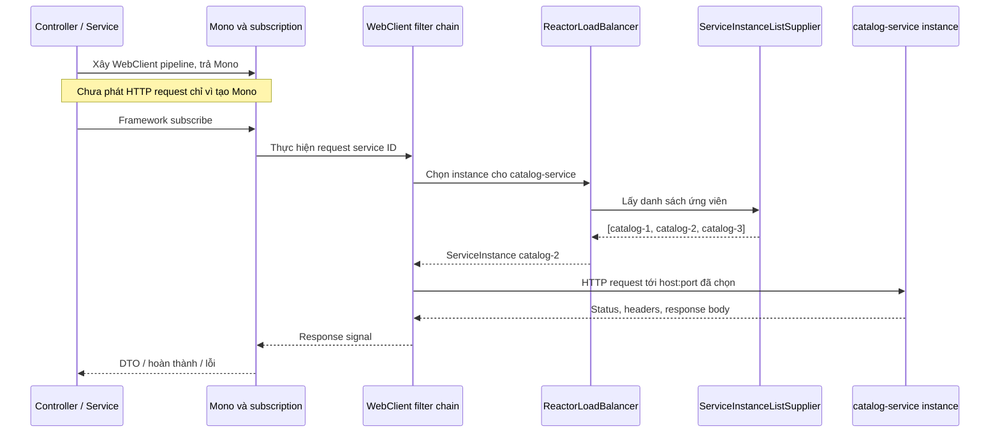

# Mô hình reactive và luồng xử lý của WebClient

`WebClient` là HTTP client thuộc Spring WebFlux, được xây dựng trên mô hình **reactive** với các kiểu `Mono` và `Flux` của Project Reactor. Khác với cách gọi đồng bộ thường gặp ở `RestTemplate`, một phương thức WebClient có thể mô tả trước một chuỗi thao tác HTTP rồi trả về `Publisher`; việc gửi request và tiêu thụ response diễn ra khi có **subscription**. Trong mô hình I/O không chặn (non-blocking), một số lượng nhỏ luồng xử lý có thể phục vụ nhiều kết nối đang chờ dữ liệu mà không cần giữ riêng một thread chờ cho mỗi request.

Khi kết hợp với **Spring Cloud LoadBalancer**, WebClient còn có khả năng gọi một **service ID** như `http://catalog-service` thay vì cố định host và port. Trong quá trình thực hiện request, bộ lọc LoadBalancer lấy danh sách `ServiceInstance`, áp dụng chính sách chọn instance rồi chuyển request đến địa chỉ thực. Bài học này giải thích từ lúc tạo `Mono` cho đến khi nhận response, ánh xạ dữ liệu, xử lý lỗi và theo dõi hoạt động của HTTP client.

## 1. Reactive không chỉ là trả về `Mono` hoặc `Flux`

Một đoạn code đồng bộ có thể gọi HTTP và chờ ngay kết quả:

```java
ProductResponse product = restTemplate.getForObject(
        "http://catalog-service/api/products/{id}",
        ProductResponse.class,
        "42");
```

Trong khi đó, WebClient thường tạo một pipeline trả về `Mono<ProductResponse>`:

```java
Mono<ProductResponse> productMono = webClient.get()
        .uri("http://catalog-service/api/products/{id}", "42")
        .retrieve()
        .bodyToMono(ProductResponse.class);
```

Ở ví dụ thứ hai, `productMono` **chưa phải** `ProductResponse`. Đây là một đối tượng mô tả một phép tính bất đồng bộ có thể phát ra tối đa một giá trị, hoàn thành không có giá trị hoặc phát tín hiệu lỗi. Theo cách sử dụng WebClient thông thường, pipeline này **chưa gửi HTTP request tại thời điểm được khai báo**; request được khởi động khi có subscriber.

Các đặc điểm cốt lõi:

- **Bất đồng bộ:** caller có thể tiếp tục làm việc, còn kết quả đến sau bằng tín hiệu của Publisher.
- **Non-blocking I/O:** trong quá trình chờ kết nối và dữ liệu mạng, thread không nhất thiết phải bị giữ lại chỉ để chờ. Điều này phụ thuộc HTTP client connector thực tế; Reactor Netty là một lựa chọn phổ biến.
- **Reactive composition:** thao tác như `map`, `flatMap`, `filter`, `onErrorResume` và `timeout` được khai báo thành pipeline thay vì chờ giá trị từng bước.
- **Backpressure:** reactive stream cho phép subscriber báo nhu cầu nhận thêm dữ liệu; đặc biệt hữu ích khi xử lý một luồng nhiều phần tử. Cơ chế này không đồng nghĩa mọi upstream HTTP server sẽ tự giảm tốc chính xác theo từng phần tử.

Mô hình reactive giúp quản lý nhiều công việc chờ I/O hiệu quả, nhưng **không tự biến tác vụ chặn như JDBC đồng bộ, đọc file blocking hoặc `Thread.sleep()` thành non-blocking**. Nếu đặt thao tác chặn lên event loop, ứng dụng có thể suy giảm thông lượng và tăng độ trễ.

## 2. `Mono`, `Flux` và các tín hiệu trong Reactor

`Mono<T>` là Publisher phát tối đa một phần tử `T`; `Flux<T>` phát từ không đến nhiều phần tử. Cả hai dùng các loại tín hiệu của Reactive Streams:

| Tín hiệu | Ý nghĩa | Ví dụ với WebClient |
|---|---|---|
| `onSubscribe` | Bắt đầu subscription, subscriber nhận khả năng yêu cầu dữ liệu | Controller hoặc framework bắt đầu xử lý pipeline |
| `onNext` | Phát một giá trị | Phát `ProductResponse` sau khi parse JSON |
| `onComplete` | Hoàn thành thành công | Body rỗng hoặc toàn bộ luồng dữ liệu đã đọc xong |
| `onError` | Kết thúc bằng lỗi | HTTP 5xx được ánh xạ thành exception, timeout hoặc lỗi kết nối |
| `cancel` | Subscriber hủy việc tiêu thụ | Client ngắt kết nối hoặc luồng reactive bị hủy |

Ví dụ với danh sách sản phẩm JSON trả về một lần:

```java
Mono<List<ProductResponse>> products = webClient.get()
        .uri("http://catalog-service/api/products")
        .retrieve()
        .bodyToMono(new ParameterizedTypeReference<List<ProductResponse>>() {});
```

Nếu endpoint cung cấp dữ liệu streaming như Server-Sent Events (SSE), có thể đọc nhiều phần tử bằng `Flux`:

```java
Flux<ProductEvent> events = webClient.get()
        .uri("http://catalog-service/api/events")
        .accept(MediaType.TEXT_EVENT_STREAM)
        .retrieve()
        .bodyToFlux(ProductEvent.class);
```

Các snippet giả định đã có `webClient` được cấu hình phù hợp, các DTO `ProductResponse`, `ProductEvent` và import `Mono`, `Flux`, `ParameterizedTypeReference`, `MediaType` tương ứng. Chọn `bodyToMono` hay `bodyToFlux` dựa trên **hợp đồng HTTP và kiểu dữ liệu trả về**, không chỉ dựa trên việc API có chứa một hay nhiều bản ghi nghiệp vụ.

## 3. Tính lazy: lắp pipeline không đồng nghĩa thực hiện request

Hãy xét phương thức sau:

```java
Mono<ProductResponse> getProduct(String id) {
    return webClient.get()
            .uri("http://catalog-service/api/products/{id}", id)
            .retrieve()
            .bodyToMono(ProductResponse.class)
            .doOnSubscribe(subscription ->
                    log.debug("Bắt đầu HTTP request: productId={}", id))
            .doOnNext(product ->
                    log.debug("Đã nhận productId={}", product.id()))
            .doOnError(error ->
                    log.warn("Gọi catalog thất bại: {}", error.toString()));
}
```

Khi chỉ gọi `Mono<ProductResponse> publisher = getProduct("42")`, ứng dụng chưa nhất thiết gửi request. Khi Spring WebFlux nhận `Mono` làm return value của controller, **framework thực hiện subscription** và quản lý tín hiệu để tạo HTTP response cho caller. Với pipeline WebClient lạnh (cold Publisher) thông thường, **mỗi subscription độc lập có thể phát sinh một HTTP request mới**, vì vậy cần chú ý khi tái sử dụng cùng Publisher.

Ví dụ:

```java
Mono<ProductResponse> result = getProduct("42");

// Hai subscription có thể tạo ra hai lần gọi HTTP độc lập.
result.subscribe(product -> log.info("A: {}", product.id()));
result.subscribe(product -> log.info("B: {}", product.id()));
```

Đoạn `subscribe()` chỉ nhằm minh họa. Trong Spring WebFlux thông thường, **không gọi `subscribe()` thủ công trong service/controller** rồi bỏ qua subscription do framework quản lý. Cách làm đó dễ khiến lỗi bị thất lạc, request chạy ngoài vòng đời HTTP ban đầu và ngữ cảnh tracing/transaction không được truyền theo cách mong đợi.

`cache()` hoặc chia sẻ một Publisher có thể thay đổi việc tái sử dụng kết quả, nhưng cần cân nhắc thời gian sống, lỗi được cache và yêu cầu tính mới của dữ liệu. Không thêm cache chỉ để tránh hai request mà chưa hiểu ngữ nghĩa nghiệp vụ.

## 4. Luồng xử lý WebClient qua Spring Cloud LoadBalancer

Với WebClient đã tích hợp LoadBalancer, request đến `http://catalog-service/api/products/42` không được gửi thẳng đến một máy chủ DNS tên `catalog-service` theo cách thông thường. LoadBalancer lấy `catalog-service` làm service ID, tìm danh sách instance và chọn đích thực.



Trình tự khái quát:

1. **Khởi tạo pipeline:** `webClient.get().uri(...).retrieve().bodyToMono(...)` tạo Publisher mô tả yêu cầu.
2. **Subscription:** ứng dụng hoặc WebFlux runtime bắt đầu tiêu thụ Publisher; các filter được thực thi trong luồng xử lý này.
3. **Phân giải service ID:** LoadBalancer exchange filter lấy tên dịch vụ trong URI, tương tác với `ReactorLoadBalancer` tương ứng.
4. **Lấy instance:** bộ chọn đọc danh sách từ `ServiceInstanceListSupplier`, có thể đã qua discovery, cache, health check, zone hoặc các policy riêng.
5. **Chọn đích:** LoadBalancer quyết định instance; filter biến URI logic thành địa chỉ HTTP thực.
6. **Gửi và nhận I/O:** HTTP connector mở hoặc tái sử dụng kết nối, gửi request và nhận status, headers, body.
7. **Xử lý phản hồi:** các operator `retrieve`, `bodyToMono`/`bodyToFlux`, `onStatus`, `timeout` và xử lý lỗi phát tín hiệu cho subscriber.

Nếu danh sách ứng viên rỗng, không có instance nào để gọi. Tùy phiên bản và cấu hình LoadBalancer, tầng HTTP integration có thể biểu diễn trường hợp đó dưới dạng response lỗi hoặc exception tương ứng; không nên đồng nhất với `404` của tài nguyên trong `catalog-service`. Nếu đã chọn instance nhưng kết nối bị từ chối, sự cố nằm ở một tầng khác.

## 5. Cấu hình `@LoadBalanced WebClient.Builder`

Một cấu hình Spring Boot phổ biến dùng `spring-boot-starter-webflux`, `spring-cloud-starter-loadbalancer` và nguồn `ServiceInstance` phù hợp (ví dụ discovery client). Khai báo builder có `@LoadBalanced`:

```java
package com.example.orders.config;

import org.springframework.cloud.client.loadbalancer.LoadBalanced;
import org.springframework.context.annotation.Bean;
import org.springframework.context.annotation.Configuration;
import org.springframework.web.reactive.function.client.WebClient;

@Configuration(proxyBeanMethods = false)
public class WebClientConfiguration {

    @Bean
    @LoadBalanced
    WebClient.Builder loadBalancedWebClientBuilder() {
        return WebClient.builder();
    }
}
```

Sử dụng builder trong client gọi dịch vụ:

```java
package com.example.orders.client;

import org.springframework.beans.factory.annotation.Qualifier;
import org.springframework.stereotype.Component;
import org.springframework.web.reactive.function.client.WebClient;
import reactor.core.publisher.Mono;

@Component
public class CatalogClient {
    private final WebClient webClient;

    public CatalogClient(
            @Qualifier("loadBalancedWebClientBuilder") WebClient.Builder builder) {
        this.webClient = builder.baseUrl("http://catalog-service").build();
    }

    public Mono<ProductResponse> getProduct(String id) {
        return webClient.get()
                .uri("/api/products/{id}", id)
                .retrieve()
                .bodyToMono(ProductResponse.class);
    }
}
```

DTO minh họa (đặt trong package phù hợp với client):

```java
public record ProductResponse(String id, String name) { }
```

`@LoadBalanced` đánh dấu builder để Spring Cloud cấu hình exchange filter cần thiết cho URL dạng service ID; annotation này **không** tự sinh ra danh sách instance. Nếu registry không có `catalog-service`, lỗi không được giải quyết chỉ bằng thay đổi WebClient. Khi ứng dụng vừa gọi URL vật lý vừa gọi service ID, nên khai báo builder thông thường và builder `@LoadBalanced` riêng, rồi inject bằng `@Qualifier` rõ ràng.

Không cần tự đăng ký `ReactorLoadBalancerExchangeFilterFunction` bằng tay nếu auto-configuration của Spring Cloud đã cấu hình builder; tránh gắn cùng filter nhiều lần gây xử lý phân giải không như dự kiến.

## 6. Phối hợp Publisher trong service và controller

Để tận dụng luồng reactive, một service nên **trả lại Publisher** thay vì tự subscribe rồi giữ kết quả trong biến cục bộ. Ví dụ controller dùng `CatalogClient` ở trên:

```java
package com.example.orders.api;

import com.example.orders.client.CatalogClient;
import com.example.orders.client.ProductResponse;
import org.springframework.web.bind.annotation.GetMapping;
import org.springframework.web.bind.annotation.PathVariable;
import org.springframework.web.bind.annotation.RequestMapping;
import org.springframework.web.bind.annotation.RestController;
import reactor.core.publisher.Mono;

@RestController
@RequestMapping("/orders")
public class OrderLookupController {

    private final CatalogClient catalogClient;

    public OrderLookupController(CatalogClient catalogClient) {
        this.catalogClient = catalogClient;
    }

    @GetMapping("/products/{id}")
    public Mono<ProductResponse> lookupProduct(@PathVariable String id) {
        return catalogClient.getProduct(id);
    }
}
```

Trong ví dụ, Spring WebFlux đảm nhận subscription và biến dữ liệu thành response; mã service/controller chỉ mô tả pipeline. Cũng có thể dùng WebClient trong ứng dụng Spring MVC, nhưng mô hình server-side và cách sử dụng kết quả phải được thiết kế rõ. **Dùng WebClient không tự biến toàn bộ một ứng dụng blocking thành reactive end-to-end.**

Nếu cần gọi hai dịch vụ độc lập và kết hợp kết quả:

```java
Mono<ProductResponse> product = catalogClient.getProduct("42");
Mono<StockResponse> stock = inventoryClient.getStock("42");

Mono<ProductView> combined = Mono.zip(product, stock)
        .map(tuple -> new ProductView(tuple.getT1(), tuple.getT2()));
```

`InventoryClient`, `StockResponse` và `ProductView` là các thành phần giả định của ứng dụng. `Mono.zip` kết hợp hai kết quả khi cả hai nguồn cung cấp giá trị; nếu một nguồn lỗi, pipeline kết hợp thường kết thúc bằng lỗi. Nếu một `Mono` hoàn thành rỗng, cần có chính sách xử lý riêng vì `zip` có thể hoàn thành mà không phát `ProductView`.

## 7. Thread, event loop và ranh giới blocking

Một connector phổ biến của WebClient là Reactor Netty. Nó xử lý I/O qua event loop; các callback của một reactive pipeline **không được bảo đảm luôn chạy trên cùng một thread**, và không nên giả định `ThreadLocal` hoặc MDC tự di chuyển đầy đủ giữa các bước xử lý.

| Cách viết | Tác động | Khuyến nghị |
|---|---|---|
| Trả `Mono<T>` từ service/controller | Cho framework quản lý subscription và I/O | Cách dùng phổ biến trong WebFlux |
| Dùng `map` cho ánh xạ dữ liệu ngắn, không chặn | Xử lý đồng bộ nhẹ khi có `onNext` | Phù hợp |
| Dùng `flatMap` cho lời gọi reactive tiếp theo | Kết nối những tác vụ bất đồng bộ | Phù hợp |
| Gọi `.block()` trên event loop | Chặn thread, có thể gây lỗi runtime hoặc nghẽn | Tránh trong luồng WebFlux |
| Gọi JDBC blocking hoặc `Thread.sleep()` trong `map` | Giữ thread khi chờ, hỏng lợi thế non-blocking | Ưu tiên API reactive hoặc cô lập công việc blocking |
| Dùng `subscribe()` rồi bỏ kết quả | Mất quản lý lỗi và vòng đời request | Trả Publisher thay vì tự subscribe |

Khi bắt buộc tích hợp một API blocking và chưa thể thay thế, có thể cô lập nó trên scheduler dành cho tác vụ chặn:

```java
Mono<LegacyResult> fromLegacy = Mono.fromCallable(() -> legacyClient.fetch())
        .subscribeOn(Schedulers.boundedElastic());
```

Đoạn trên giả định `legacyClient.fetch()` là lời gọi đồng bộ và đã import `Mono` cùng `Schedulers`. `boundedElastic()` giúp tránh chặn I/O event loop nhưng **không biến bản chất của API thành non-blocking**; nó vẫn sử dụng tài nguyên thread để đợi. Không thêm `publishOn` hoặc `subscribeOn` tùy tiện vào mọi WebClient request vì scheduler thay đổi chỗ thực thi operator, không tự tăng tốc HTTP.

## 8. Đọc HTTP response và xử lý lỗi bằng reactive operator

`retrieve()` cung cấp API tiện lợi để nhận body; theo mặc định, response 4xx/5xx sẽ được biểu diễn thành tín hiệu lỗi, thường là `WebClientResponseException` hoặc subtype tương ứng. Trường hợp request không nhận HTTP response vì kết nối/TLS/DNS có thể tạo `WebClientRequestException`. Lỗi parse JSON hoặc schema là vấn đề khác với lỗi kết nối.

Ví dụ ánh xạ `404` của catalog thành lỗi nghiệp vụ có nguyên nhân gốc:

```java
public Mono<ProductResponse> getRequiredProduct(String id) {
    return webClient.get()
            .uri("/api/products/{id}", id)
            .retrieve()
            .onStatus(status -> status.value() == 404,
                    response -> response.createException()
                            .map(cause -> new ProductNotFoundException(id, cause)))
            .bodyToMono(ProductResponse.class);
}
```

`ProductNotFoundException` là một `RuntimeException` do ứng dụng định nghĩa. Những status khác vẫn theo xử lý mặc định nếu không có handler tương ứng. Với `exchangeToMono`, caller có quyền xét status, headers và xử lý body ở từng nhánh nhưng cần tiêu thụ/giải phóng body đúng cách theo contract của API:

```java
Mono<ProductResponse> result = webClient.get()
        .uri("/api/products/{id}", id)
        .exchangeToMono(response -> {
            if (response.statusCode().is2xxSuccessful()) {
                return response.bodyToMono(ProductResponse.class);
            }
            return response.createException().flatMap(Mono::error);
        });
```

Ví dụ trên minh họa cách rẽ nhánh thành công và lỗi. Khi nhận `204 No Content`, `bodyToMono(ProductResponse.class)` có thể hoàn thành rỗng; nếu nghiệp vụ bắt buộc trả body, cần xử lý bằng `switchIfEmpty(Mono.error(...))` theo chính sách của ứng dụng.

Không dùng `onErrorResume` để âm thầm chuyển mọi lỗi thành sản phẩm giả: `404` do không tồn tại khác với `503` do dịch vụ tạm thời không sẵn sàng. Nếu muốn fallback, nên giới hạn theo **loại lỗi phù hợp** và lưu dấu vết lỗi gốc để giám sát.

## 9. Timeout, retry và hủy request

Một lời gọi reactive có thể chờ lâu vì kết nối, server xử lý chậm hoặc stream không kết thúc. Reactor cung cấp toán tử `timeout`, chẳng hạn:

```java
Mono<ProductResponse> product = catalogClient.getProduct("42")
        .timeout(Duration.ofSeconds(3));
```

Khi không có tín hiệu thích hợp trong thời hạn quy định, toán tử phát lỗi timeout và có thể hủy subscription upstream. Timeout ở cấp Publisher không nhất thiết tương đương với connect/read timeout của HTTP connector; việc giải phóng kết nối và thời điểm ngắt I/O phụ thuộc connector. Cần xem timeout của DNS, kết nối, phản hồi và tổng lời gọi theo yêu cầu hệ thống.

Ví dụ retry **có giới hạn** cho GET được coi là an toàn để thử lại trong bối cảnh API này:

```java
Mono<ProductResponse> product = catalogClient.getProduct("42")
        .timeout(Duration.ofSeconds(2))
        .retryWhen(Retry.backoff(2, Duration.ofMillis(200))
                .filter(error -> error instanceof TimeoutException
                        || error instanceof WebClientRequestException
                        || (error instanceof WebClientResponseException response
                                && response.getStatusCode().is5xxServerError())));
```

Snippet giả định import `Duration`, `TimeoutException`, `Retry`, `WebClientRequestException`, `WebClientResponseException` và các kiểu DTO. Hai lần retry có nghĩa tổng số attempt tối đa là ba, nếu những lỗi đó xảy ra và policy không dừng sớm. Do `timeout` đứng **trước** `retryWhen`, nó được áp dụng cho từng attempt; nếu cần giới hạn **tổng thời gian**, phải đặt thêm deadline riêng cho toàn pipeline.

**Không nên retry mọi lỗi:** HTTP `400/401/403/404` thường không được giải quyết bằng cách gửi lại cùng request; các thao tác `POST`/`PUT` có tác dụng phụ cần hợp đồng idempotency và chính sách riêng. Retry có thể chọn instance khác theo cấu hình LoadBalancer nhưng không bảo đảm điều đó, cũng không thay thế health check, cache hợp lý hoặc graceful shutdown.

## 10. Quan sát pipeline và xác định lỗi nằm ở tầng nào

Trong mô hình reactive, log được ghi lúc **khai báo pipeline** có thể khác thời điểm **request thực sự được thực thi**. Để kiểm tra, nên quan sát khi subscription bắt đầu, instance được LoadBalancer chọn và response HTTP hoặc tín hiệu lỗi.

| Triệu chứng | Kiểm tra trước | Nguyên nhân có thể |
|---|---|---|
| Code tạo `Mono` nhưng không có request | Publisher có subscriber chưa? | Caller không subscribe hoặc không trả Publisher cho framework |
| Gọi `catalog-service` nhưng không tìm thấy đích | Service ID và `@LoadBalanced WebClient.Builder` | Dùng builder thường, thiếu discovery/instance hoặc supplier lọc hết |
| Có instance nhưng kết nối thất bại | Instance ID, host:port, DNS/TLS, network | Instance đã chết, quảng bá sai địa chỉ, lỗi I/O |
| HTTP trả `404` | Status, path, tài nguyên và error body | Tài nguyên không tồn tại hoặc route sai |
| HTTP trả `503` | Phân biệt response từ LoadBalancer/gateway/server | Không có instance, phụ thuộc quá tải hoặc upstream lỗi |
| HTTP `200` nhưng parse lỗi | `Content-Type`, JSON và DTO | Hợp đồng dữ liệu không khớp |
| Gọi API lặp nhiều lần ngoài ý muốn | Số subscription, retry, `repeat` và cache | Nhiều subscription hoặc retry ngoài dự kiến |
| RPS giảm và CPU/thread cao | Event loop, `.block()`, API blocking trong operator | Luồng I/O bị chặn |

Một log hoặc trace hữu ích cần có service ID, request/trace ID, thời điểm subscribe, số attempt, instance được chọn, HTTP status hoặc loại lỗi, thời lượng và trạng thái hủy. Với WebFlux, ngữ cảnh được truyền qua **Reactor Context** và cơ chế context propagation/tracing được cấu hình; không nên mặc định MDC `ThreadLocal` sẽ đúng trên mọi callback.

Lưu ý **observability cũng có chi phí**: không log toàn bộ body, token, cookie và metadata nhạy cảm; hạn chế nhãn metric có cardinality cao như `instanceId` hoặc `traceId`. Khi cần theo dõi danh sách ứng viên trước và sau health/zone supplier, quan sát `ServiceInstanceListSupplier` ở đúng ranh giới thay vì suy đoán từ kết quả HTTP đơn lẻ.

## 11. Thực hành: quan sát từ subscribe đến HTTP response

Thiết lập `catalog-service` có ít nhất hai instance, ví dụ `catalog-1` và `catalog-2`, một ứng dụng `order-service` sử dụng `@LoadBalanced WebClient.Builder`, và endpoint `GET /api/products/{id}` trả thêm thông tin nhận diện instance trong response hoặc log server.

1. **Không subscribe:** gọi phương thức tạo `Mono` nhưng chưa subscribe/return từ controller; quan sát để thấy chưa có request HTTP được phát ra theo pipeline thông thường.
2. **Trả `Mono` từ controller:** gọi `/orders/products/42`; xác nhận framework subscribe, LoadBalancer chọn instance, WebClient nhận body và phát `ProductResponse`.
3. **Gọi hai lần:** gửi hai request và ghi nhận instance đã chọn; không mặc định round-robin luôn dẫn đến luân phiên tuyệt đối trong hệ thống nhiều client/cấu hình cache.
4. **Tạo hai subscriptions:** trong môi trường thử nghiệm, subscribe hai lần cùng Publisher; quan sát số request thực tế và phân biệt với `cache()` nếu có.
5. **Lỗi HTTP:** cho endpoint trả `404` rồi `503`; kiểm tra `onStatus`, `WebClientResponseException` và ánh xạ lỗi nghiệp vụ.
6. **Lỗi mạng:** dừng một instance trước khi discovery/cache cập nhật; so kết quả chọn instance, lỗi kết nối và cơ chế retry.
7. **Timeout:** tạo endpoint đáp ứng chậm; đo thời gian của mỗi attempt khi có `timeout` và `retryWhen`, tránh retry một thao tác gây tác dụng phụ.
8. **Blocking:** thử tách một lời gọi blocking sang `boundedElastic()` trong môi trường thử nghiệm và đối chiếu với việc gọi blocking trực tiếp trên event loop.

Mẫu bảng ghi kết quả:

| Trace | Subscription | Ứng viên / instance chọn | Kết quả | Nhận xét |
|---|---|---|---|---|
| `r-101` | Có | `1,2` → `1` | `200`, body hợp lệ | Luồng bình thường |
| `r-102` | Có | `1,2` → `2` | `404` | Lỗi HTTP, không phải lỗi discovery |
| `r-103` | Có | `1,2` → `2` | Connection refused | Instance không truy cập được |
| `r-104` | Không | Chưa chọn | Không gửi HTTP | Publisher chưa được tiêu thụ |

Các dữ liệu trong bảng là giả định; trong triển khai thật, status và cách biểu diễn lỗi phụ thuộc backend, filter, connector và retry policy.

## 12. Checklist thiết kế WebClient cho giao tiếp liên dịch vụ

- Sử dụng URL logic và builder `@LoadBalanced` khi muốn phân giải service ID; kiểm tra discovery, `ServiceInstanceListSupplier` và policy chọn instance.
- Trả `Mono`/`Flux` qua các tầng reactive thay vì gọi `block()` hoặc tự `subscribe()` trong controller/service.
- Dùng `map` cho biến đổi đồng bộ nhẹ và `flatMap` để kết hợp Publisher bất đồng bộ; tránh blocking trên event loop.
- Phân biệt HTTP status, lỗi kết nối, lỗi không có instance và lỗi deserialize; ánh xạ lỗi nghiệp vụ đúng hợp đồng.
- Cấu hình timeout và retry có giới hạn, cân nhắc idempotency và deadline tổng.
- Theo dõi trace/span, instance được chọn và số attempt; tránh giả định `ThreadLocal` luôn theo được reactive pipeline.
- Chọn `Mono` hay `Flux` dựa trên ngữ nghĩa response; để ý body rỗng, giới hạn bộ đệm, streaming và cancellation.

## 13. Ghi nhớ

WebClient **mô tả việc gọi HTTP bằng Publisher**, thường chưa thực hiện I/O cho đến lúc có subscription. `Mono` biểu diễn tối đa một kết quả, `Flux` biểu diễn một luồng nhiều kết quả; các operator Reactor kết hợp xử lý dữ liệu, tín hiệu lỗi, timeout và retry mà không buộc caller phải chặn chờ. Với `@LoadBalanced WebClient.Builder`, khi có subscription, Spring Cloud LoadBalancer phân giải service ID, nhận danh sách `ServiceInstance`, chọn instance và chuyển HTTP request tới host:port phù hợp. Hiểu **subscription → LoadBalancer → HTTP I/O → response/exception → subscriber** là nền tảng để cấu hình và chẩn đoán giao tiếp dịch vụ ổn định.
