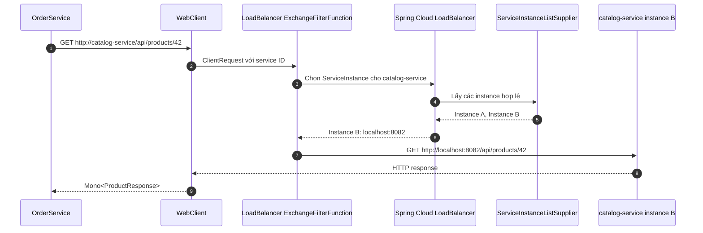

# Khai báo WebClient.Builder có @LoadBalanced

Trong ứng dụng Spring Boot, `WebClient` là HTTP client dùng API reactive để gọi dịch vụ khác mà không phải chặn thread trong lúc đợi I/O. Tuy nhiên, một `WebClient` thông thường **không tự biết** rằng `catalog-service` trong URL `http://catalog-service/api/products/42` là **service ID** cần tra cứu qua Spring Cloud LoadBalancer. Muốn gọi bằng tên dịch vụ và chọn một `ServiceInstance`, cần tạo `WebClient.Builder` được Spring Cloud nhận diện bằng `@LoadBalanced` rồi dùng builder đó để xây dựng `WebClient`.

Với module `SPRING_CLOUD_SERVICE_COMMUNICATION_LOAD_BALANCING`, cấu hình này nối ba phần: **HTTP client gửi request**, **service discovery cung cấp danh sách instance**, và **Spring Cloud LoadBalancer chọn một instance**. Bài học trình bày cách khai báo bean, sử dụng trong service, phân biệt client cân bằng tải với client thông thường, cùng các lỗi khó nhận ra khi có nhiều builder hoặc các môi trường mạng khác nhau.

## 1. `@LoadBalanced` giải quyết vấn đề gì?

Giả sử `order-service` cần lấy thông tin sản phẩm từ `catalog-service` đang có hai bản sao:

| Thành phần | Giá trị ví dụ | Vai trò |
|---|---|---|
| Service ID | `catalog-service` | Tên logic của dịch vụ cần gọi |
| Instance A | `http://localhost:8081` | Một bản sao của `catalog-service` |
| Instance B | `http://localhost:8082` | Bản sao thứ hai |
| URL được dùng trong mã | `http://catalog-service/api/products/42` | Không phụ thuộc trực tiếp host/port từng bản sao |

Nếu chỉ tạo client bằng `WebClient.builder().build()` và gửi URL này, HTTP client thường coi `catalog-service` là **hostname thật** để phân giải bằng DNS. Nếu DNS không biết tên đó, request sẽ lỗi; nếu DNS tình cờ có bản ghi, request có thể thành công nhưng **không chứng minh** Spring Cloud LoadBalancer đã chọn instance.

Khi dùng builder có `@LoadBalanced`, Spring Cloud tích hợp bộ lọc (*exchange filter*) cho request. Bộ lọc hiểu host của URL logic là service ID, truy vấn LoadBalancer và chuyển request đến URI của instance được chọn.



`@LoadBalanced` không thay đổi server đang phục vụ request, cũng không tự tạo các instance. Nó đánh dấu một HTTP client builder cần dùng hạ tầng LoadBalancer của Spring Cloud. Discovery, supplier, chính sách round robin/random và khả năng truy cập địa chỉ mạng vẫn phải được cấu hình đúng.

## 2. Dependencies tối thiểu

Với dự án Maven sử dụng Spring Boot tương thích với Spring Cloud, có thể khai báo:

```xml
<dependencies>
    <dependency>
        <groupId>org.springframework.boot</groupId>
        <artifactId>spring-boot-starter-webflux</artifactId>
    </dependency>

    <dependency>
        <groupId>org.springframework.cloud</groupId>
        <artifactId>spring-cloud-starter-loadbalancer</artifactId>
    </dependency>
</dependencies>
```

- `spring-boot-starter-webflux` cung cấp `WebClient` và các thành phần reactive phù hợp; khi dùng starter mặc định, Reactor Netty thường có mặt làm HTTP transport.
- `spring-cloud-starter-loadbalancer` cung cấp khả năng chọn `ServiceInstance` và tích hợp LoadBalancer với các HTTP client tương ứng.
- Khi muốn lấy danh sách instance qua Eureka, Consul hoặc Kubernetes, dự án còn cần discovery starter đúng nền tảng. Trong bài lab local có thể dùng danh sách tĩnh của `SimpleDiscoveryClient` mà không cần registry ngoài.

Spring Boot và Spring Cloud có **ma trận phiên bản tương thích**. Hãy quản lý phiên bản Spring Cloud bằng BOM của release train phù hợp với phiên bản Spring Boot hiện tại, thay vì gán ngẫu nhiên phiên bản cho từng starter. Mã bên dưới minh họa cách triển khai trong các phiên bản hỗ trợ `WebClient` và Spring Cloud LoadBalancer hiện đại.

**Có thể dùng `WebClient` trong ứng dụng Spring MVC.** Nếu ứng dụng đã dùng `spring-boot-starter-web` và chỉ muốn gọi downstream bằng `WebClient`, thêm WebFlux để lấy HTTP client không đồng nghĩa bắt buộc chuyển toàn bộ controller sang reactive. Tuy nhiên, cần hiểu tác động của classpath và loại ứng dụng web mà Spring Boot tự cấu hình.

## 3. Khai báo bean `@LoadBalanced WebClient.Builder`

Đây là cấu hình cơ bản nhất:

```java
package com.example.orders.config;

import org.springframework.cloud.client.loadbalancer.LoadBalanced;
import org.springframework.context.annotation.Bean;
import org.springframework.context.annotation.Configuration;
import org.springframework.web.reactive.function.client.WebClient;

@Configuration(proxyBeanMethods = false)
public class WebClientConfiguration {

    @Bean
    @LoadBalanced
    WebClient.Builder loadBalancedWebClientBuilder() {
        return WebClient.builder();
    }
}
```

Các điểm quan trọng:

1. `@Bean` đăng ký `WebClient.Builder` trong `ApplicationContext` của ứng dụng gọi.
2. `@LoadBalanced` đánh dấu builder cần tích hợp LoadBalancer. Đây là một qualifier đặc biệt để Spring nhận ra bean mục tiêu.
3. Spring Cloud, khi có cấu hình/dependency phù hợp, bổ sung `ReactorLoadBalancerExchangeFilterFunction` hoặc tích hợp tương đương vào những builder được đánh dấu.
4. Đối tượng được `builder.build()` tạo ra có bộ lọc đã cấu hình, vì vậy các request dùng service ID sẽ đi qua bước chọn instance.
5. Builder này thường nằm ở **context chính**; các chính sách `ReactorLoadBalancer` hoặc `ServiceInstanceListSupplier` riêng của từng service ID có thể nằm trong **ngữ cảnh con** do `LoadBalancerClientFactory` quản lý.

Không nên gắn `@LoadBalanced` vào một class service hoặc một phương thức gọi HTTP rồi hy vọng mọi `WebClient` trong ứng dụng đều được cân bằng tải. Điều cần đánh dấu là **bean builder** (hoặc cấu hình tích hợp tương đương được Spring Cloud hỗ trợ).

## 4. Inject builder và tạo WebClient để gọi theo service ID

Một component nghiệp vụ có thể nhận builder đã được đánh dấu qua constructor injection và tạo `WebClient` tại thời điểm khởi tạo component:

```java
package com.example.orders.client;

import org.springframework.cloud.client.loadbalancer.LoadBalanced;
import org.springframework.stereotype.Component;
import org.springframework.web.reactive.function.client.WebClient;
import reactor.core.publisher.Mono;

@Component
public class CatalogClient {

    private final WebClient webClient;

    public CatalogClient(@LoadBalanced WebClient.Builder builder) {
        this.webClient = builder.clone()
                .baseUrl("http://catalog-service")
                .build();
    }

    public Mono<ProductResponse> findProduct(String id) {
        return webClient.get()
                .uri("/api/products/{id}", id)
                .retrieve()
                .bodyToMono(ProductResponse.class);
    }
}
```

Với Java hỗ trợ `record`, DTO có thể được định nghĩa như sau:

```java
package com.example.orders.client;

public record ProductResponse(String id, String name, int available) {
}
```

Trong `baseUrl`, `catalog-service` là **service ID**, không phải địa chỉ IP. `WebClient` lưu cấu hình và có thể được giữ như một field để tái sử dụng. Việc dùng `builder.clone()` giúp tạo bản cấu hình riêng cho `CatalogClient` thay vì thay đổi `baseUrl` trên một builder bean có thể được thành phần khác dùng chung.

Phương thức `findProduct` trả `Mono<ProductResponse>`. Khi được subscribe bởi luồng reactive, WebClient thực hiện request bất đồng bộ rồi phát một kết quả hoặc lỗi. Đoạn code trên **không tự động thực hiện request ngay lập tức** khi chỉ tạo `Mono`; cần có subscriber (ví dụ Spring WebFlux xử lý giá trị trả về từ controller).

Ví dụ controller reactive:

```java
package com.example.orders.web;

import com.example.orders.client.CatalogClient;
import com.example.orders.client.ProductResponse;
import org.springframework.web.bind.annotation.GetMapping;
import org.springframework.web.bind.annotation.PathVariable;
import org.springframework.web.bind.annotation.RestController;
import reactor.core.publisher.Mono;

@RestController
public class ProductController {
    private final CatalogClient catalogClient;

    public ProductController(CatalogClient catalogClient) {
        this.catalogClient = catalogClient;
    }

    @GetMapping("/orders/products/{id}")
    public Mono<ProductResponse> product(@PathVariable String id) {
        return catalogClient.findProduct(id);
    }
}
```

Đối với service chạy trong luồng reactive, không gọi `.block()` trong thread event loop để chờ kết quả. Nếu ứng dụng Spring MVC cần tiêu thụ WebClient đồng bộ, có thể chặn ở ranh giới đồng bộ phù hợp, nhưng khi đó phải tính đủ timeout, mức đồng thời và không làm mất lợi ích non-blocking ở luồng reactive.

## 5. Dùng URL đầy đủ hay `baseUrl`?

Có hai cách thông dụng; cả hai đều dùng service ID làm host logic.

**Cách A — URI đầy đủ cho mỗi request:**

```java
Mono<ProductResponse> result = webClient.get()
        .uri("http://catalog-service/api/products/{id}", "42")
        .retrieve()
        .bodyToMono(ProductResponse.class);
```

**Cách B — khai báo base URL một lần:**

```java
WebClient catalogWebClient = loadBalancedBuilder.clone()
        .baseUrl("http://catalog-service")
        .build();

Mono<ProductResponse> result = catalogWebClient.get()
        .uri("/api/products/{id}", "42")
        .retrieve()
        .bodyToMono(ProductResponse.class);
```

Cách B tiện khi một client chỉ gọi một downstream service. Cách A phù hợp với client tổng quát có thể gọi nhiều service ID. Dù dùng cách nào, URL gửi đến LoadBalancer cần có **scheme và host** đúng dạng, ví dụ `http://catalog-service`; đường dẫn và query parameter sẽ được giữ khi thay host/port logic bằng host/port của instance được chọn.

Không nên đưa trực tiếp `localhost:8081` vào `baseUrl` của client cân bằng tải nếu mục tiêu là kiểm tra phân phối giữa nhiều instance. Khi đó request đã cố định vào một địa chỉ cụ thể, và không còn thể hiện bài toán phân giải service ID.

## 6. Nếu ứng dụng cần cả WebClient thường và WebClient cân bằng tải

Nhiều ứng dụng vừa gọi microservice nội bộ bằng service ID, vừa gọi API công khai bằng URL thật như `https://api.example.com`. Không nên mặc định mọi HTTP request đều phải đi qua Spring Cloud LoadBalancer. Có thể khai báo **hai builder**:

```java
package com.example.orders.config;

import org.springframework.cloud.client.loadbalancer.LoadBalanced;
import org.springframework.context.annotation.Bean;
import org.springframework.context.annotation.Configuration;
import org.springframework.context.annotation.Primary;
import org.springframework.web.reactive.function.client.WebClient;

@Configuration(proxyBeanMethods = false)
public class WebClientConfiguration {

    @Bean
    @LoadBalanced
    WebClient.Builder loadBalancedWebClientBuilder() {
        return WebClient.builder();
    }

    @Bean
    @Primary
    WebClient.Builder plainWebClientBuilder() {
        return WebClient.builder();
    }
}
```

Sau đó, inject chính xác builder cần dùng:

```java
@Component
class DownstreamClients {
    private final WebClient internal;
    private final WebClient external;

    DownstreamClients(
            @LoadBalanced WebClient.Builder internalBuilder,
            @Qualifier("plainWebClientBuilder") WebClient.Builder externalBuilder) {

        this.internal = internalBuilder.clone()
                .baseUrl("http://catalog-service")
                .build();
        this.external = externalBuilder.clone()
                .baseUrl("https://api.example.com")
                .build();
    }
}
```

Trong ví dụ cần import các annotation từ Spring đúng package như `org.springframework.beans.factory.annotation.Qualifier` và `org.springframework.stereotype.Component`. `@Primary` làm rõ lựa chọn khi một nơi khác inject `WebClient.Builder` mà không chỉ định qualifier; `@LoadBalanced` xác định bean có tích hợp cân bằng tải.

Nếu dự án đã có bean `WebClient.Builder` do Spring Boot auto-configuration cung cấp, hãy kiểm tra tập bean thực tế trước khi bổ sung hai builder như trên. Tránh tạo nhiều bean không có qualifier hoặc vô tình dùng builder thường cho URL `http://catalog-service`. Bean phù hợp phải được chọn **ngay tại điểm inject** hoặc qua tên/qualifier rõ ràng.

### Vì sao không tạo builder mới ngay trong phương thức gọi?

Ví dụ sau bỏ qua bean đã được Spring cấu hình:

```java
// Khong dung cho muc tieu goi qua service ID bang LoadBalancer:
WebClient client = WebClient.builder().build();
client.get().uri("http://catalog-service/api/products/42");
```

`WebClient.builder()` mới này không tự kế thừa `@LoadBalanced` từ một bean khác. Vì vậy, dù ứng dụng có cấu hình builder cân bằng tải, request ở đoạn code trên vẫn có thể đi thẳng qua DNS và không áp dụng các bộ lọc LoadBalancer mong đợi.

## 7. Cấu hình discovery tĩnh để kiểm tra trên máy local

Khi chưa triển khai Eureka, Consul hay Kubernetes, có thể dùng `SimpleDiscoveryClient` để cung cấp hai instance cho bài lab. Cấu hình trong ứng dụng **consumer**:

```yaml
spring:
  cloud:
    discovery:
      client:
        simple:
          instances:
            catalog-service:
              - uri: http://localhost:8081
              - uri: http://localhost:8082
```

Chạy hai bản sao của `catalog-service` lần lượt ở port 8081 và 8082. Ví dụ, mỗi bản sao cung cấp endpoint:

```java
@RestController
class InstanceController {
    @Value("${server.port}")
    private int port;

    @GetMapping("/whoami")
    String whoami() {
        return "catalog-service:" + port;
    }
}
```

Từ `order-service`, gọi nhiều lần:

```java
Mono<String> instance = loadBalancedWebClient.get()
        .uri("http://catalog-service/whoami")
        .retrieve()
        .bodyToMono(String.class);
```

Với round robin mặc định, danh sách instance ổn định và không có retry hoặc bộ lọc bổ sung, kết quả **có thể** cho thấy phân phối luân phiên giữa hai cổng. Tuy nhiên, trong hệ thống thực có concurrency, health check, cache hoặc retry, không nên dùng thứ tự response làm bằng chứng duy nhất cho thuật toán chọn.

**Lưu ý về `localhost`:** cấu hình trên chỉ đúng khi consumer và cả hai instance dùng chung ngữ cảnh mạng của máy phát triển. Nếu consumer chạy trong container, `localhost` trỏ về chính container đó; cần thay bằng địa chỉ mà consumer thật sự truy cập được. Trên máy ảo hoặc Kubernetes, nguồn discovery và địa chỉ được công bố phải phù hợp với hạ tầng.

## 8. Trường hợp thiếu instance hoặc instance lỗi

Khi URL chứa service ID đi qua exchange filter, client cần một danh sách `ServiceInstance`. Lỗi có thể xảy ra ở nhiều lớp:

| Triệu chứng | Nguyên nhân thường gặp | Cần kiểm tra |
|---|---|---|
| DNS không phân giải được `catalog-service` | Dùng WebClient thường, chưa có filter LoadBalancer | Bean nào được inject, có `@LoadBalanced` không |
| Không có instance phù hợp | Discovery trả rỗng, service ID sai hoặc supplier lọc hết | Danh sách instance, cấu hình registry, metadata |
| `Connection refused` | Đã chọn địa chỉ nhưng server không lắng nghe cổng | Host/port của `ServiceInstance`, trạng thái process |
| Connect/read timeout | Transport không kết nối hoặc chờ phản hồi đúng hạn | Timeout ở `HttpClient`, mạng, độ trễ server |
| HTTP 4xx hoặc 5xx | Downstream trả response lỗi | Status, response body, logic nghiệp vụ |
| Lỗi chỉ khi chạy Docker | `localhost`, network namespace, sai container port | Địa chỉ instance nhìn từ consumer container |
| Request đi sai service | Dùng builder thường, nhầm base URL hoặc service ID | URL logic, qualifier tại điểm inject |

Nếu không có instance, tích hợp LoadBalancer có thể tạo phản hồi lỗi như `503 Service Unavailable` tùy phiên bản và cấu hình; `retrieve()` có thể chuyển response 4xx/5xx thành exception trên reactive pipeline. Không nên đánh đồng một phản hồi 503 do không tìm được instance với 503 do downstream đã trả về. Cần kết hợp log service ID, danh sách discovery, địa chỉ được chọn và nguồn gốc lỗi.

Khi `WebClient` trả `Mono`, lỗi thường được truyền qua tín hiệu `onError`; nó không nhất thiết ném ngay tại lúc tạo `Mono`. Vì thế xử lý lỗi phải đặt trong luồng reactive hoặc ở nơi tiêu thụ publisher.

Ví dụ xử lý 404 như một trường hợp nghiệp vụ:

```java
Mono<ProductResponse> product = catalogWebClient.get()
        .uri("/api/products/{id}", id)
        .retrieve()
        .onStatus(
                status -> status.value() == 404,
                response -> Mono.error(
                        new ProductNotFoundException("Product " + id)))
        .bodyToMono(ProductResponse.class);
```

`ProductNotFoundException` là exception của ứng dụng, cần được khai báo. Các lỗi không có instance, timeout hoặc lỗi transport phải được xử lý bằng chính sách khác với việc sản phẩm không tồn tại.

## 9. `@LoadBalanced` không tự cấu hình timeout hoặc retry

Vai trò chính của `@LoadBalanced` là đưa **bước chọn instance** vào luồng gọi HTTP. Nó không tự ấn định connect timeout, response timeout hoặc tổng thời gian của mọi lần retry. Với WebClient dùng Reactor Netty, timeout cần cấu hình cho HTTP transport hoặc đặt ở reactive pipeline tùy mục tiêu.

Ví dụ tùy biến connector cho một WebClient dùng LoadBalancer:

```java
import io.netty.channel.ChannelOption;
import java.time.Duration;
import org.springframework.http.client.reactive.ReactorClientHttpConnector;
import reactor.netty.http.client.HttpClient;

HttpClient httpClient = HttpClient.create()
        .option(ChannelOption.CONNECT_TIMEOUT_MILLIS, 2_000)
        .responseTimeout(Duration.ofSeconds(5));

WebClient catalogWebClient = loadBalancedBuilder.clone()
        .clientConnector(new ReactorClientHttpConnector(httpClient))
        .baseUrl("http://catalog-service")
        .build();
```

Đây là ví dụ cho WebClient chạy trên Reactor Netty; `ChannelOption.CONNECT_TIMEOUT_MILLIS` giới hạn một phần quá trình mở kết nối, còn `responseTimeout` liên quan thời gian chờ phản hồi theo semantics Reactor Netty. Chúng không mặc nhiên tạo một **deadline tổng** tính cả discovery, chờ pool và retry. Các client connector khác sẽ có API cấu hình khác.

Nếu đặt `Mono.timeout(Duration.ofSeconds(8))`, đó là timeout ở tầng reactive operator khi publisher không phát tín hiệu đúng hạn; nó không tương đương trực tiếp với mọi timeout của socket hoặc connect. Nếu cần giới hạn toàn bộ thao tác nghiệp vụ, hãy cân đối tất cả các tầng và kiểm thử hành vi hủy/cancel request khi hết hạn.

Retry cũng cần được quyết định có chủ đích. Spring Cloud LoadBalancer, Reactor (`retryWhen`), gateway và HTTP client có thể có cơ chế thử lại khác nhau. Bật nhiều tầng retry cùng lúc có nguy cơ nhân số lần gọi. Với POST, PATCH hoặc các lệnh có tác dụng phụ, chỉ retry khi có bảo đảm về idempotency hoặc chính sách chống thực thi trùng.

## 10. Tương tác với chính sách chọn instance theo service ID

`WebClient.Builder` được đánh dấu `@LoadBalanced` có thể dùng để gọi nhiều service ID khác nhau. Ví dụ:

```java
Mono<String> catalog = webClient.get()
        .uri("http://catalog-service/status")
        .retrieve()
        .bodyToMono(String.class);

Mono<String> inventory = webClient.get()
        .uri("http://inventory-service/status")
        .retrieve()
        .bodyToMono(String.class);
```

Với cùng một WebClient, các request vẫn có thể dùng **các ngữ cảnh LoadBalancer khác nhau**: `catalog-service` có thể cấu hình random, còn `inventory-service` có thể dùng round robin và lọc zone. Các cấu hình đó gắn với service ID qua `@LoadBalancerClient` và `LoadBalancerClientFactory`; chúng không yêu cầu mỗi service phải có một loại builder annotation khác nhau.

Tương tự, `ServiceInstanceListSupplier` có thể bổ sung cache, health check, zone preference hoặc hint. `@LoadBalanced` giúp request đi vào cơ chế này nhưng không tự bật từng khả năng. Điều kiện để request ổn định là discovery trả đúng các instance có thể truy cập, supplier giữ danh sách hợp lệ, thuật toán chọn đúng và transport có timeout/connection pool phù hợp.

## 11. Quản lý builder, bộ lọc và HTTP client an toàn

`WebClient` được xây dựng hoàn chỉnh là đối tượng thích hợp để tái sử dụng giữa các request. `WebClient.Builder` thì **có thể thay đổi cấu hình** như `baseUrl`, `defaultHeader`, `filter` hay `clientConnector`. Một builder bean dùng chung có thể vô tình bị thành phần khác thay đổi ngoài ý muốn.

Nên làm:

- Inject builder qua constructor và tạo WebClient trong giai đoạn khởi tạo bean.
- Dùng `builder.clone()` trước khi cấu hình `baseUrl` hoặc filter riêng cho từng downstream client.
- Giữ `WebClient` thành field và tái sử dụng, tránh dựng lại HTTP client cho mọi request.
- Khi thêm filter logging/authentication/tracing, kiểm tra **thứ tự filter** và bảo đảm không ghi thông tin nhạy cảm ra log.
- Khi dùng nhiều builder, đặt tên bean và qualifier rõ ràng để phân biệt client thường và client cân bằng tải.
- Nếu cần tùy biến TLS, proxy hoặc connection pool, cấu hình tại HTTP connector tương ứng chứ không coi `@LoadBalanced` là nơi thiết lập transport.

Nên tránh:

- Tạo `WebClient.builder()` trong mỗi lời gọi và kỳ vọng nó tự có LoadBalancer.
- Gọi `.block()` trong event-loop của ứng dụng reactive.
- Đặt IP/cổng instance trực tiếp trong mã nghiệp vụ khi mục tiêu là discovery theo service ID.
- Dùng response order đơn lẻ làm bằng chứng round robin hoặc sticky session.
- Gửi cookie/token người dùng sang mọi service một cách tự động và không kiểm soát.

## 12. Thực hành kiểm tra cấu hình đúng và sai

**Chuẩn bị:** chạy `catalog-service` trên port `8081` và `8082`, mỗi bản sao có endpoint `/whoami` trả tên hoặc cổng; cấu hình `SimpleDiscoveryClient` như phần 7 và khai báo bean builder như phần 3.

| Bước | Thao tác | Kỳ vọng |
|---|---|---|
| 1 | Gửi nhiều request qua `@LoadBalanced WebClient.Builder` tới `http://catalog-service/whoami` | Request đi được đến instance do LoadBalancer chọn |
| 2 | Dùng `WebClient.builder().build()` gọi cùng URL logic | Có thể gặp lỗi DNS hoặc đi trực tiếp theo DNS, không thể coi là client-side LB |
| 3 | Inject nhầm builder thường trong component | Mất khả năng phân giải service ID theo Spring Cloud LoadBalancer |
| 4 | Đổi service ID trong URL thành tên không tồn tại trong discovery | Không tìm được instance hoặc nhận lỗi tương ứng |
| 5 | Dừng instance `8082` nhưng giữ danh sách static | Một số request có thể lỗi đến khi có cơ chế lọc/health/retry |
| 6 | Khởi động lại instance, gửi tiếp request | Danh sách và việc chọn instance hoạt động theo cấu hình đang có |
| 7 | Tùy biến `baseUrl` trên bản `builder.clone()` | Không làm thay đổi `baseUrl` của client khác dùng cùng bean builder |
| 8 | Thử một request có độ trễ lớn hơn response timeout | Nhận lỗi timeout từ transport/reactive pipeline, không nhầm với lỗi discovery |

Khi quan sát, hãy ghi lại **service ID**, **instance ID/host:port được chọn**, status HTTP, thời gian xử lý và loại exception. Đối chiếu thời điểm phát lỗi với nơi request đi qua filter LoadBalancer để phân biệt lỗi chọn instance với lỗi DNS/transport hoặc lỗi nghiệp vụ.

## 13. Checklist trước khi sử dụng trong production

1. Dự án có `spring-boot-starter-webflux` (hoặc dependency `WebClient` tương đương) và `spring-cloud-starter-loadbalancer` tương thích phiên bản không?
2. Bean `WebClient.Builder` dùng nội bộ có `@LoadBalanced` và được inject đúng qualifier không?
3. URI chứa service ID (`http://catalog-service/...`) thay vì địa chỉ instance cố định khi cần cân bằng tải không?
4. Discovery có trả đúng `ServiceInstance` và địa chỉ có thể truy cập từ consumer không?
5. Nếu dùng hai builder, code có phân biệt client thường và client cân bằng tải tại điểm inject không?
6. Builder có được clone trước khi tùy biến riêng từng downstream service không?
7. Reactive pipeline có tránh `.block()` trên event-loop và xử lý `onError` theo đúng loại lỗi không?
8. HTTP connector có connect/response timeout, pool và TLS phù hợp với SLO không?
9. Retry, health check, zone policy và các bộ lọc theo service ID đã được kiểm thử cùng nhau chưa?
10. Có thể quan sát service ID, instance được chọn, latency, lỗi discovery và lỗi HTTP/transport mà không log dữ liệu nhạy cảm không?

Tóm lại, **`@LoadBalanced WebClient.Builder` là điểm nối giữa WebClient và Spring Cloud LoadBalancer**. Dùng đúng bean, đúng service ID và đúng nguồn discovery sẽ cho phép ứng dụng gọi nhiều bản sao bằng tên logic; việc chọn instance nằm ở LoadBalancer, còn kết nối, timeout và phản hồi HTTP vẫn thuộc HTTP client. Khi tách rõ các trách nhiệm và kiểm thử cả trường hợp lỗi, ứng dụng có thể giao tiếp giữa các dịch vụ ổn định hơn mà không gắn chặt mã nghiệp vụ với địa chỉ từng bản sao.
