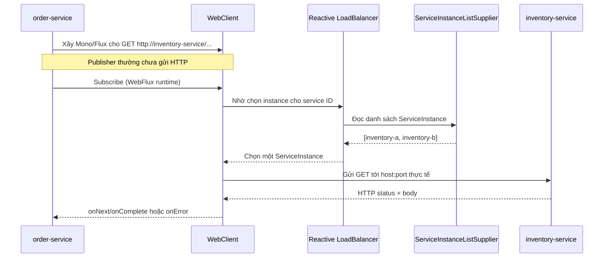

# Gọi service ID và ánh xạ Mono hoặc Flux phản hồi

## 1. Bối cảnh và mục tiêu

Module `SPRING_CLOUD_SERVICE_COMMUNICATION_LOAD_BALANCING` hướng dẫn cân bằng tải phía client bằng Spring Cloud LoadBalancer: từ service ID và discovery, qua lựa chọn `ServiceInstance`, health check và chính sách định tuyến, đến tích hợp HTTP client, retry/timeout và quan sát lỗi. Trong chương **WebClient**, chúng ta kết hợp hai cơ chế độc lập: **chọn instance** ở Spring Cloud LoadBalancer và **giải mã, xử lý response reactive** ở WebClient/Reactor.

Kịch bản xuyên suốt:

- `order-service` là dịch vụ gọi, chạy ở cổng `8080`.
- `inventory-service` là dịch vụ đích, có hai bản sao `inventory-a:8081` và `inventory-b:8082`.
- `order-service` gọi URL logic `http://inventory-service/api/inventory/ABC-1`. Host `inventory-service` là **service ID**, không phải hostname vật lý phải được DNS phân giải.
- Endpoint có thể trả một object JSON, một mảng JSON hoặc một luồng NDJSON. `WebClient` giải mã lần lượt thành `Mono<T>` hoặc `Flux<T>`.

Kết quả cần đạt:

1. Tạo `@LoadBalanced WebClient.Builder` và xác nhận request tới instance được phát hiện qua service ID.
2. Chọn `bodyToMono` khi HTTP response mang một object; chọn `bodyToFlux` khi body có nhiều phần tử.
3. Phân biệt một HTTP request trả `Flux` nhiều phần tử với `Flux` tạo **nhiều HTTP request**.
4. Biến đổi dữ liệu bằng `map`, `flatMap`, `filter`, `collectList` và kiểm soát concurrency bằng `flatMap`/`concatMap`.
5. Xử lý 404, 503, lỗi kết nối, timeout và retry theo nghĩa nghiệp vụ.
6. Truy vết request tới service ID, instance cụ thể và phản hồi, kể cả khi discovery/health check thay đổi.

## 2. Vị trí của Spring Cloud LoadBalancer trong WebClient



Với `spring-cloud-starter-loadbalancer` và Spring WebFlux trên classpath, Spring Cloud có thể cấu hình `ReactorLoadBalancerExchangeFilterFunction`. Filter lấy tên host của URL logic để tìm LoadBalancer client, tra danh sách instance rồi chuyển URL sang địa chỉ thực tế. `ServiceInstanceListSupplier` có thể lấy dữ liệu từ registry, cache, lọc theo health/zone/hint hoặc supplier tùy chỉnh.

**Hai lưu ý cốt lõi:**

- LoadBalancer thông thường chọn **một instance cho một HTTP exchange**. Nếu một HTTP response trả 100 phần tử và `bodyToFlux` phát 100 tín hiệu `onNext`, 100 phần tử đó **không khiến LoadBalancer chọn 100 instance**.
- Phần lớn publisher tạo bởi `WebClient` là **cold**. Việc xây dựng `Mono`/`Flux` chưa chắc gửi HTTP; subscription mới thực thi request. Subscribe lại vào cùng publisher chưa được chia sẻ/cache có thể gửi thêm request và chọn instance khác.

### 2.1. Mono và Flux là kiểu dữ liệu phản hồi

| Kiểu | Ngữ nghĩa | Ví dụ response | Số lần chọn instance trong một GET |
|---|---|---|---|
| `Mono<InventoryItem>` | Không hoặc một giá trị, sau đó hoàn tất; cũng có thể lỗi | Một object JSON | Thông thường một |
| `Flux<InventoryItem>` | Từ không tới nhiều giá trị, hữu hạn hoặc vô hạn | Một JSON array | Vẫn thông thường một |
| `Flux<InventoryEvent>` | Luồng các sự kiện theo thời gian | NDJSON hoặc SSE | Một lúc mở HTTP stream |
| `Flux.fromIterable(skus).flatMap(this::findOne)` | Ghép kết quả nhiều publisher | Mỗi SKU tạo một HTTP GET riêng | Có thể một lần chọn cho mỗi GET |

Một publisher `Mono` không có nghĩa backend luôn trả đúng một object; một response thành công với body rỗng có thể tạo `Mono.empty()`. Một publisher `Flux` cũng không mặc nhiên đồng nghĩa streaming realtime: array JSON có thể bị server/proxy buffer.

## 3. Phụ thuộc và topology thực hành

Ứng dụng caller cần Spring WebFlux để có `WebClient` và Spring Cloud LoadBalancer để resolve service ID. Các dependency Maven minh họa (BOM Spring Boot và Spring Cloud phải được khai báo tương thích):

```xml
<dependencies>
    <dependency>
        <groupId>org.springframework.boot</groupId>
        <artifactId>spring-boot-starter-webflux</artifactId>
    </dependency>
    <dependency>
        <groupId>org.springframework.cloud</groupId>
        <artifactId>spring-cloud-starter-loadbalancer</artifactId>
    </dependency>
</dependencies>
```

Dùng Spring Cloud Release Train phù hợp với Spring Boot version đã resolve. Trong thực tế bổ sung discovery starter tương ứng với Eureka, Consul hoặc Kubernetes. Với lab cố định, có thể dùng `SimpleDiscoveryClient` mà không cần dựng registry riêng.

Cấu hình `application.yml` tại **order-service**:

```yaml
spring:
  application:
    name: order-service
  cloud:
    discovery:
      client:
        simple:
          instances:
            inventory-service:
              - uri: http://localhost:8081
                instance-id: inventory-a
              - uri: http://localhost:8082
                instance-id: inventory-b
    loadbalancer:
      retry:
        enabled: false
server:
  port: 8080
```

Ở **inventory-service**, hai bản sao cùng tên logic:

```yaml
spring:
  application:
    name: inventory-service
server:
  port: 8081
app:
  instance-id: inventory-a
```

Chạy instance B với `server.port=8082` và `app.instance-id=inventory-b`. Các URI `localhost` ở đây chỉ áp dụng khi caller và các instance ở cùng máy/network namespace; trong container/Kubernetes phải dùng hostname/IP mà **caller** thực sự truy cập được. Nếu dùng registry thật, xác nhận cả hai `ServiceInstance` được đăng ký dưới cùng service ID.

## 4. Tạo WebClient được đánh dấu @LoadBalanced

Trong `order-service` khai báo bean:

```java
import org.springframework.cloud.client.loadbalancer.LoadBalanced;
import org.springframework.context.annotation.Bean;
import org.springframework.context.annotation.Configuration;
import org.springframework.web.reactive.function.client.WebClient;

@Configuration(proxyBeanMethods = false)
class InventoryWebClientConfig {

    @Bean
    @LoadBalanced
    WebClient.Builder loadBalancedWebClientBuilder() {
        return WebClient.builder();
    }
}
```

Tạo client dùng lại trong một gateway service:

```java
@Service
class InventoryGateway {
    private final WebClient client;

    InventoryGateway(@LoadBalanced WebClient.Builder builder) {
        this.client = builder.clone()
                .baseUrl("http://inventory-service")
                .build();
    }

    // Thêm các phương thức reactive ở mục tiếp theo.
}
```

`builder.clone()` giúp đặt `baseUrl` cho gateway riêng mà không thay đổi builder được các bean khác sử dụng. Tên host `inventory-service` được filter LoadBalancer xử lý; URL thực tế của request sẽ phụ thuộc `ServiceInstance` được chọn.

**Không mặc định** `WebClient.create("http://inventory-service")` có LoadBalancer. `WebClient.create` không tự thêm exchange filter theo cơ chế `@LoadBalanced`; nếu thiếu filter, tên dịch vụ có thể đi tới DNS như hostname bình thường và lỗi `UnknownHostException`.

### 4.1. Khi có cả client cân bằng tải và client thường

Nếu ứng dụng còn gọi URL vật lý hoặc API ngoài, có thể tạo hai builder:

```java
@Configuration(proxyBeanMethods = false)
class WebClientBuilders {
    @Bean
    @LoadBalanced
    WebClient.Builder serviceWebClientBuilder() {
        return WebClient.builder();
    }

    @Bean
    @Primary
    WebClient.Builder plainWebClientBuilder() {
        return WebClient.builder();
    }
}
```

Đây là **phương án thay thế** cho bean ở mục 4, không đăng ký cả hai cấu hình mẫu một lúc. Injection của client nội bộ phải có `@LoadBalanced` để không lấy nhầm builder thường. Cách khác là inject `ReactorLoadBalancerExchangeFilterFunction` rồi `.filter(lbFunction)` lên builder riêng; chỉ thêm **một** cơ chế filter LoadBalancer.

Spring Boot có thể cung cấp các `WebClientCustomizer` cho observability, codec và connector. Nếu tự tạo `WebClient.builder()`, hãy kiểm tra theo version đang chạy để đảm bảo các customizer cần thiết đã được áp dụng; đừng vô tình làm mất tracing/metrics của Boot.

## 5. Định nghĩa DTO và endpoint response để quan sát

Hợp đồng minh họa:

```java
record InventoryItem(String sku, int available, String instanceId) {}

record InventoryEvent(
        String sku, int available, String instanceId, long sequence) {}
```

Trong **inventory-service** dùng Spring WebFlux, tạo controller đơn giản:

```java
@RestController
@RequestMapping("/api/inventory")
class InventoryController {

    @Value("${app.instance-id}")
    private String instanceId;

    @GetMapping("/{sku}")
    Mono<InventoryItem> find(@PathVariable String sku) {
        return Mono.just(new InventoryItem(sku, 12, instanceId));
    }

    @GetMapping
    Flux<InventoryItem> all() {
        return Flux.just(
                new InventoryItem("ABC-1", 12, instanceId),
                new InventoryItem("XYZ-2", 5, instanceId));
    }

    @GetMapping(value = "/events",
                produces = MediaType.APPLICATION_NDJSON_VALUE)
    Flux<InventoryEvent> events() {
        return Flux.interval(Duration.ofSeconds(1))
                .take(5)
                .map(sequence ->
                        new InventoryEvent(
                                "ABC-1", 12, instanceId, sequence));
    }
}
```

Ví dụ sử dụng Java 17+ với `record`; các import Spring MVC annotation, WebFlux media type, Reactor `Mono`/`Flux` và Java `Duration` được lược bỏ cho ngắn. DTO ở server và caller phải có cấu trúc JSON tương thích, có thể nằm ở hai package khác nhau hoặc một contract module chung. Endpoint ở đây chỉ cung cấp mock data để quan sát instance; chưa mô phỏng tồn kho thực tế.

Endpoint `/api/inventory/{sku}` trả **một object**; `/api/inventory` trả **một JSON array**; `/api/inventory/events` trả **NDJSON stream** phát 5 event cách nhau khoảng một giây.

## 6. Gọi một SKU và ánh xạ bodyToMono

Thêm phương thức vào `InventoryGateway`:

```java
Mono<InventoryItem> findOne(String sku) {
    return client.get()
            .uri("/api/inventory/{sku}", sku)
            .accept(MediaType.APPLICATION_JSON)
            .retrieve()
            .bodyToMono(InventoryItem.class);
}
```

Phản hồi ví dụ:

```json
{
  "sku": "ABC-1",
  "available": 12,
  "instanceId": "inventory-a"
}
```

`bodyToMono(InventoryItem.class)` giải mã body thành tối đa một object. `findOne` trả publisher `Mono<InventoryItem>` để người gọi tiếp tục biến đổi bất đồng bộ. Nó **không** gửi một GET mới chỉ vì bạn gọi `findOne`; HTTP exchange thực sự xảy ra khi publisher được subscribe trong pipeline.

### 6.1. map biến đổi đồng bộ, không gọi thêm HTTP

```java
record Availability(String sku, boolean inStock, String instanceId) {}

Mono<Availability> checkAvailability(String sku) {
    return findOne(sku)
            .map(item -> new Availability(
                    item.sku(),
                    item.available() > 0,
                    item.instanceId()));
}
```

`map` biến đổi `InventoryItem` thành `Availability`. Nó không gọi lại LoadBalancer. Nếu upstream là `Mono.empty()`, lambda trong `map` không chạy.

### 6.2. flatMap kết hợp một tác vụ bất đồng bộ khác

```java
record StockAndPrice(String sku, int available, long price) {}

// priceGateway.findPrice(sku) đã được định nghĩa trả Mono<Long>.
Mono<StockAndPrice> withPrice(String sku) {
    return findOne(sku)
            .flatMap(item -> priceGateway.findPrice(item.sku())
                    .map(price -> new StockAndPrice(
                            item.sku(), item.available(), price)));
}
```

`flatMap` phù hợp khi hàm bên trong đã trả `Mono`; nếu dùng `map` sẽ dễ tạo `Mono<Mono<StockAndPrice>>`. Ở đây `priceGateway` là dependency minh họa chưa được khai báo trong snippet; giả sử đã cấu hình riêng cho `pricing-service`. Nếu `priceGateway` cũng sử dụng LoadBalancer, HTTP call của nó sẽ chọn instance **riêng**, không liên quan đến lựa chọn của `findOne`.

### 6.3. Mono.empty khác với HTTP 404

| Tín hiệu Mono | Ví dụ | Ý nghĩa |
|---|---|---|
| `onNext(item)` rồi `onComplete` | HTTP 200 có object JSON | Giải mã được một giá trị |
| `onComplete`, không có `onNext` | Response 204/no body | Publisher rỗng; không tự suy ra là 404 |
| `onError(error)` | HTTP 404/503, lỗi kết nối/decode | Tác vụ đã thất bại |

`retrieve()` với error handler mặc định biến HTTP 4xx/5xx thành `WebClientResponseException`. HTTP 404 **không** tự trở thành `Mono.empty()`. Nếu hợp đồng quy định 404 nghĩa là SKU không tồn tại:

```java
Mono<InventoryItem> findOptional(String sku) {
    return findOne(sku)
            .onErrorResume(
                    WebClientResponseException.NotFound.class,
                    error -> Mono.empty());
}
```

Chỉ chuyển chính lỗi 404 thành rỗng khi hợp đồng cho phép. Không chuyển 503/timeout thành tồn kho 0: điều đó đánh đồng “không biết” với “đã hết hàng”.

## 7. Gọi danh sách và ánh xạ bodyToFlux

### 7.1. Một GET, nhiều object JSON

```java
Flux<InventoryItem> findAll() {
    return client.get()
            .uri("/api/inventory")
            .accept(MediaType.APPLICATION_JSON)
            .retrieve()
            .bodyToFlux(InventoryItem.class);
}
```

Một response ví dụ:

```json
[
  {"sku":"ABC-1","available":12,"instanceId":"inventory-b"},
  {"sku":"XYZ-2","available":5,"instanceId":"inventory-b"}
]
```

Dù `Flux` có hai phần tử, cả hai tới từ **một HTTP GET** do **một instance** xử lý; không tự phát sinh thêm lượt chọn instance khi decode phần tử thứ hai. Với JSON array, codec có thể phát từng phần tử nhưng server/proxy cũng có thể buffer, nên không được mặc nhiên kết luận đây là streaming realtime.

### 7.2. NDJSON thật sự để quan sát dòng theo thời gian

```java
Flux<InventoryEvent> watchEvents() {
    return client.get()
            .uri("/api/inventory/events")
            .accept(MediaType.APPLICATION_NDJSON)
            .retrieve()
            .bodyToFlux(InventoryEvent.class);
}
```

Endpoint `/events` ở mục 5 phát năm event NDJSON. Một lần subscribe mở một HTTP stream và LoadBalancer chọn một instance lúc bắt đầu. Năm event thường có cùng `instanceId` trên kết nối đó. Nếu instance bị dừng giữa chừng, stream đang chạy có thể lỗi/ngắt; LoadBalancer không tự chuyển nguyên trạng kết nối sang instance khác.

Có thể dùng Server-Sent Events khi server thực sự trả `text/event-stream`, nhưng cần định nghĩa đúng contract/codec (ví dụ `ServerSentEvent<T>`) chứ không chỉ đổi header Accept.

### 7.3. collectList tạo Mono<List<T>>

```java
Mono<List<InventoryItem>> allAsList() {
    return findAll().collectList();
}
```

`collectList()` chỉ phát ra một `List` khi `Flux` **hoàn thành**. Với stream vô hạn nó có thể không bao giờ hoàn thành và tiếp tục chiếm bộ nhớ. Không dùng toán tử này tùy tiện trên event stream không giới hạn.

| Toán tử | Đầu ra thường gặp | Sử dụng |
|---|---|---|
| `map` | `Flux<R>` hoặc `Mono<R>` | Biến đổi từng phần tử đồng bộ |
| `filter` | `Flux<T>` | Giữ phần tử thỏa điều kiện |
| `take(10)` | `Flux<T>` | Lấy tối đa 10 phần tử rồi hoàn tất |
| `collectList` | `Mono<List<T>>` | Gom dòng hữu hạn thành một danh sách |
| `flatMap` | `Mono<R>` hoặc `Flux<R>` | Ghép publisher bất đồng bộ; có thể đổi thứ tự |
| `flatMapMany` | `Flux<R>` | Từ một `Mono` mở ra nhiều phần tử |
| `concatMap` | `Flux<R>` | Ghép tuần tự, bảo đảm thứ tự inner publisher |

## 8. Một Flux response hay Flux của nhiều HTTP request?

**Trường hợp A — một GET, nhiều phần tử body:**

```java
Flux<InventoryItem> items = client.get()
        .uri("/api/inventory")
        .retrieve()
        .bodyToFlux(InventoryItem.class);
```

Một subscription gây **một request**, LoadBalancer chọn **một instance**.

**Trường hợp B — ba GET khác nhau, cùng được ghép vào một Flux:**

```java
Flux<InventoryItem> items = Flux.fromIterable(
        List.of("ABC-1", "XYZ-2", "LMN-3"))
        .flatMap(this::findOne, 3);
```

`findOne` tạo một GET cho mỗi SKU. Có ba HTTP requests và **mỗi request** có thể chọn instance khác. `flatMap(...,3)` giới hạn số inner publisher được subscribe đồng thời, nhưng thứ tự kết quả có thể khác thứ tự input.

Nếu cần giữ thứ tự, dùng:

```java
Flux<InventoryItem> ordered = Flux.fromIterable(
        List.of("ABC-1", "XYZ-2", "LMN-3"))
        .concatMap(this::findOne);
```

`concatMap` đợi inner publisher trước hoàn thành rồi mới tiếp tục; thường có throughput thấp hơn nếu gọi mạng. Với danh sách SKU lớn, luôn giới hạn concurrency và xem xét connection pool/downstream capacity.

### 8.1. Subscription và cache thay đổi số HTTP attempts

```java
Mono<InventoryItem> query = findOne("ABC-1");

// Chỉ minh họa tính cold; không áp dụng tùy tiện trong service.
query.subscribe();
query.subscribe();
```

Hai lần subscribe vào một publisher cold thường tạo hai HTTP requests, dẫn tới hai lần LoadBalancer lựa chọn. Nếu dùng `query.cache()`, các subscriber về sau có thể nhận tín hiệu đã cache thay vì tạo request mới. Cần cân nhắc TTL và tính mới của inventory. Trong ứng dụng WebFlux, thường **trả publisher** cho framework quản lý subscription thay vì `subscribe()` thủ công thiếu kiểm soát lỗi/cancellation.

## 9. Ánh xạ HTTP status và xử lý lỗi

### 9.1. Các nhóm kết quả cần phân biệt

| Trường hợp | Giai đoạn | Hình thức quan sát |
|---|---|---|
| HTTP 200 + object JSON | Response decoder | `Mono<InventoryItem>` phát giá trị |
| HTTP 200 + array JSON | Response decoder | `Flux<InventoryItem>` phát các object |
| HTTP 204/body rỗng | Response decoder | `Mono.empty()` hoặc `Flux.empty()` |
| Server trả 404 | HTTP status | `WebClientResponseException.NotFound` theo default |
| Server trả 503 | HTTP status | `WebClientResponseException.ServiceUnavailable` theo default |
| Đã chọn instance nhưng kết nối lỗi | Connector | Thường là `WebClientRequestException`/cause liên quan |
| Không có instance cho service ID | LoadBalancer filter | Trong nhiều phiên bản reactive filter tạo response 503 (có thể cấu hình 404); `retrieve` biến thành lỗi HTTP |
| Body không tương thích DTO | Decoder | Lỗi giải mã/contract; không phải lỗi discovery |

**Một lỗi 503 nhìn từ WebClient chưa chứng minh `inventory-service` đã nhận request.** Trong trường hợp không có instance, LoadBalancer reactive có thể tạo response lỗi trước khi có HTTP connection. Cần xem lifecycle/metric LoadBalancer, danh sách supplier và log server để biết nguồn 503.

### 9.2. onErrorResume chỉ cho lỗi có chủ đích

```java
Mono<InventoryItem> optional(String sku) {
    return findOne(sku)
            .onErrorResume(
                    WebClientResponseException.NotFound.class,
                    ex -> Mono.empty());
}
```

Trong ví dụ này, chỉ HTTP 404 được coi là “không có SKU”. Lỗi 503, timeout, certificate và lỗi JSON vẫn là lỗi. Nếu muốn dùng `defaultIfEmpty`, phải xác định giá trị mặc định có hợp nghĩa nghiệp vụ; không âm thầm trả `available=0` khi tồn kho chưa được xác minh.

### 9.3. onStatus chuyển response HTTP sang exception riêng

```java
final class InventoryUnavailableException extends RuntimeException {
    InventoryUnavailableException(String message, Throwable cause) {
        super(message, cause);
    }
}

Mono<InventoryItem> findWithErrorMapping(String sku) {
    return client.get()
            .uri("/api/inventory/{sku}", sku)
            .retrieve()
            .onStatus(
                    code -> code.value() == 503,
                    response -> response.createException()
                            .map(ex -> new InventoryUnavailableException(
                                    "inventory-service không khả dụng", ex)))
            .bodyToMono(InventoryItem.class);
}
```

`onStatus` chỉ hoạt động khi có `ClientResponse` và đọc được status; nó **không** nhận trực tiếp lỗi kết nối xảy ra trước response. Với lỗi transport, dùng `onErrorMap`/`onErrorResume` theo exception type. Không bắt `Exception` rộng rồi thay mọi lỗi bằng dữ liệu thành công giả.

### 9.4. exchangeToMono cần xử lý cả body và status

Khi muốn điều khiển từng nhánh response:

```java
Mono<InventoryItem> findWithExchange(String sku) {
    return client.get()
            .uri("/api/inventory/{sku}", sku)
            .exchangeToMono(response -> {
                if (response.statusCode().is2xxSuccessful()) {
                    return response.bodyToMono(InventoryItem.class);
                }
                if (response.statusCode().value() == 404) {
                    return Mono.empty();
                }
                return response.createException()
                        .flatMap(ex ->
                                Mono.<InventoryItem>error(ex));
            });
}
```

Với collection, có `exchangeToFlux` và nhánh thành công trả `response.bodyToFlux(InventoryItem.class)`. Spring WebClient giải phóng response body còn lại sau khi publisher của callback hoàn tất; đừng giữ `ClientResponse` và cố decode lại ở downstream.

## 10. Timeout, retry, hủy và backpressure

### 10.1. Deadline Reactor và timeout của HTTP connector

```java
Mono<InventoryItem> findWithDeadline(String sku) {
    return findOne(sku)
            .timeout(Duration.ofSeconds(3));
}
```

`Mono.timeout` bảo đảm publisher phát tín hiệu trước deadline hoặc lỗi `TimeoutException`. Nó không thay cho connect timeout/read timeout của HTTP connector. Với Reactor Netty, có thể cấu hình riêng:

```java
HttpClient httpClient = HttpClient.create()
        .option(ChannelOption.CONNECT_TIMEOUT_MILLIS, 1000)
        .responseTimeout(Duration.ofSeconds(2));

WebClient client = loadBalancedBuilder.clone()
        .baseUrl("http://inventory-service")
        .clientConnector(new ReactorClientHttpConnector(httpClient))
        .build();
```

`loadBalancedBuilder` ở đây là bean đã inject với `@LoadBalanced`; clone vẫn giữ cấu hình filter. Các import Netty, Reactor Netty và `ReactorClientHttpConnector` tùy phiên bản. Với `Flux` stream dài, `timeout(Duration)` thường đo **thời gian không có tín hiệu tiếp theo** chứ không tạo deadline cố định cho toàn bộ stream; phải chọn timeout phù hợp với nội dung streaming.

### 10.2. Reactor retry ở tầng publisher

```java
Mono<InventoryItem> findWithLimitedRetry(String sku) {
    return findOne(sku)
            .retryWhen(Retry.backoff(
                    2, Duration.ofMillis(100))
                    .filter(error ->
                            error instanceof WebClientRequestException))
            .timeout(Duration.ofSeconds(3));
}
```

`Retry.backoff(2, ...)` cho phép tối đa **hai lần thử lại sau lần đầu**, nếu lỗi thỏa predicate và chưa chạm deadline. Re-subscribe có thể tạo HTTP request mới và chọn instance lại; không bảo đảm mỗi retry chọn instance khác nếu policy không được cấu hình tương ứng.

Spring Cloud LoadBalancer còn có retry **riêng** qua `spring.cloud.loadbalancer.retry.enabled` và các tham số số lần thử cùng/khác instance. Không bật chồng nhiều cơ chế retry (LoadBalancer, Reactor, gateway, resilience library) mà không tính tổng attempts. Thử lại GET đọc dữ liệu có thể an toàn hơn POST đặt hàng/thanh toán; thao tác ghi cần idempotency key và hợp đồng xử lý lại rõ ràng.

### 10.3. Cancellation, backpressure và không chặn luồng

- `Flux.take(5)` hoàn thành sau tối đa năm phần tử và có thể hủy upstream.
- Nếu client bên ngoài ngắt kết nối trong lúc server streaming, subscription downstream thường bị cancel; HTTP connector cần giải phóng tài nguyên phù hợp.
- Backpressure của Reactive Streams không bảo đảm mọi proxy hoặc upstream hỗ trợ giảm tốc độ ở cùng mức; kiểm tra buffer, codec và memory.
- `collectList()` trên luồng vô hạn có thể giữ bộ nhớ không giới hạn.
- `flatMap` gửi hàng nghìn request đồng thời có thể làm cạn connection pool; giới hạn concurrency.

**Tránh gọi `block()` hoặc `blockFirst()` ngay trong luồng xử lý WebFlux event loop.** Cách đó phá vỡ lợi ích non-blocking và có thể gây lỗi/thắt cổ chai. Hãy trả publisher trực tiếp từ controller hoặc kết hợp qua `map`/`flatMap`.

## 11. Controller trả Mono và Flux cho WebFlux runtime

Trong `order-service`, controller có thể trả giá trị reactive mà không tự subscribe:

```java
@RestController
@RequestMapping("/demo/inventory")
class InventoryDemoController {

    private final InventoryGateway gateway;

    InventoryDemoController(InventoryGateway gateway) {
        this.gateway = gateway;
    }

    @GetMapping("/{sku}")
    Mono<InventoryItem> one(@PathVariable String sku) {
        return gateway.findOne(sku);
    }

    @GetMapping
    Flux<InventoryItem> all() {
        return gateway.findAll();
    }

    @GetMapping(value = "/events",
                produces = MediaType.APPLICATION_NDJSON_VALUE)
    Flux<InventoryEvent> events() {
        return gateway.watchEvents();
    }
}
```

Giả định `InventoryGateway` đã có ba method `findOne`/`findAll`/`watchEvents` được trình bày trước đó. Controller không cần gọi `subscribe()`; framework sẽ subscribe khi xử lý HTTP response và thực hiện cancellation khi phù hợp.

Nếu hợp đồng API yêu cầu 404 khi không có SKU:

```java
@GetMapping("/{sku}")
Mono<ResponseEntity<InventoryItem>> optionalOne(
        @PathVariable String sku) {
    return gateway.findOptional(sku)
            .map(ResponseEntity::ok)
            .defaultIfEmpty(ResponseEntity.notFound().build());
}
```

Đây là **phương án thay thế** method `one` có cùng mapping, không đặt cả hai cùng lúc trong controller. Chỉ chuyển HTTP 404 của downstream thành empty; lỗi 503/timeout vẫn phát ra để API biên xử lý.

## 12. Lab kiểm chứng Mono, Flux và lựa chọn instance

### Bước 1 — Khởi chạy hai replica

Chạy `inventory-service` A ở `8081`, B ở `8082` với `app.instance-id` riêng, cùng tên `inventory-service`. Chạy `order-service` ở `8080` với SimpleDiscoveryClient như mục 3. Đảm bảo client dùng `@LoadBalanced WebClient.Builder`.

### Bước 2 — Một object trả Mono

```bash
curl -i http://localhost:8080/demo/inventory/ABC-1
curl -i http://localhost:8080/demo/inventory/ABC-1
curl -i http://localhost:8080/demo/inventory/ABC-1
```

Một GET đến `order-service` tạo một GET đến inventory khi publisher được subscribe. Response có `instanceId` giúp biết server xử lý. Với Round Robin và danh sách ổn định, các lần chọn thường luân phiên; nếu có request nền, retry hoặc cache/discovery khác, kết quả có thể lệch.

### Bước 3 — JSON array thành Flux

```bash
curl -i http://localhost:8080/demo/inventory
```

Một response chứa nhiều item thường có **cùng instanceId**. Điều này xác nhận `bodyToFlux` là giải mã nhiều phần tử của một HTTP response, không phải phân phối các phần tử sang nhiều replica.

### Bước 4 — NDJSON stream

```bash
curl -N -i http://localhost:8080/demo/inventory/events
```

Trong lab mock, các dòng JSON thường xuất hiện lần lượt mỗi giây. `curl -N` giảm buffering của curl; proxy hoặc server vẫn có thể buffer tùy cấu hình. Cả năm event từ một subscription đều mang instance ID của server được chọn lúc mở stream.

### Bước 5 — Nhiều GET trong một Flux

Tạo `Flux.fromIterable(skus).flatMap(this::findOne, 3)` và theo dõi ba request tới inventory. So sánh với `concatMap` để quan sát mức đồng thời và thứ tự output. Log từng request ID và instance nhận request; đừng chỉ đếm số `onNext`.

### Bước 6 — Lỗi, timeout và health

| Thử nghiệm | Kỳ vọng quan sát |
|---|---|
| Service ID không tồn tại | Không có ServiceInstance; lỗi ở reactive filter, có thể thành response 503/404 tùy version/cấu hình |
| Instance B dừng nhưng còn trong discovery | Khi chọn B có thể gặp connection error/timeout |
| Endpoint trả 404 | `retrieve` phát `WebClientResponseException.NotFound`, trừ khi map rõ |
| Endpoint trả 503 | Response 503 từ server, cần xem server log để phân biệt 503 do LB |
| Response JSON sai DTO | Decoder báo lỗi contract, không phải lỗi discovery |
| Stream đang chạy bị cắt | Stream lỗi/cancel, không tự chuyển live connection sang replica mới |
| Health supplier loại B sau refresh | Các lần chọn mới tránh B theo policy/supplier thực tế |
| Retry được bật | Theo dõi số attempts và khả năng chọn lại instance; không đánh đồng với số logical requests |

## 13. Quan sát lỗi và troubleshooting

### 13.1. Đo những gì?

- `service ID` trong URL logic, danh sách `ServiceInstance` từ discovery/supplier và instance được chọn.
- Số lần HTTP exchange và retry attempt theo service, không dùng số phần tử `Flux` làm request count.
- HTTP status, exception type, timeout và lỗi decode.
- `instanceId` trả về từ server để đối chiếu với log trong từng replica.
- p50/p95/p99 latency, throughput, in-flight request, kết nối đang mở và thời gian stream.
- Correlation/trace ID từ caller qua downstream. Dùng `LoadBalancerLifecycle` nếu cần quan sát chính xác bước chọn instance.

Có thể bật log trong lab:

```yaml
logging:
  level:
    org.springframework.cloud.loadbalancer: DEBUG
    org.springframework.web.reactive.function.client: DEBUG
```

Không giả định mọi version tự ghi đầy đủ danh sách instance/trace, và không log token/cookie/body nhạy cảm.

### 13.2. Các lỗi dễ gặp

| Triệu chứng | Khả năng nguyên nhân | Hướng xử lý |
|---|---|---|
| `UnknownHostException: inventory-service` | Builder thường, thiếu filter LoadBalancer | Kiểm tra `@LoadBalanced` ở bean/injection và dependency |
| HTTP 503 nhưng inventory không có log | Không tìm được instance hoặc lỗi trước server | Đọc supplier, LoadBalancer lifecycle, phân biệt 503 giả lập |
| `Flux` luôn có cùng instance ID | Một GET xử lý bởi một instance | Đúng với một body; muốn xem phân phối hãy gửi nhiều GET |
| `bodyToMono` không đọc đúng array | DTO/response không khớp | Dùng `bodyToFlux` hoặc DTO chứa collection |
| `bodyToFlux` phát cùng lúc | Server/proxy/codec buffer response | Dùng NDJSON/SSE và kiểm tra flush |
| `Mono.empty` bị xem là 404 | Body rỗng khác status lỗi | Xử lý status trước khi quyết định nghiệp vụ |
| `flatMap` cho kết quả đảo thứ tự | Tác vụ concurrent | Dùng `concatMap` khi cần thứ tự |
| `collectList` không xong | Dùng trên luồng vô hạn | Giới hạn số item/time hoặc xử lý stream |
| Tăng retry làm nhân request | Nhiều tầng retry/subscription | Đặt một retry policy và đếm attempts |
| `block()` gây lỗi/độ trễ cao | Chặn WebFlux event loop | Trả `Mono`/`Flux` từ controller |
| Sau scale-down vẫn chọn instance chết | Registry/cache/health chưa cập nhật | Đo từng giai đoạn và giới hạn timeout |

## 14. Bài tập và tiêu chí hoàn thành

**Bài 1 — Một item:** viết `findOne(sku): Mono<InventoryItem>`, chuyển `map` sang `Availability`, gửi 20 request tuần tự và ghi `instanceId`.

**Bài 2 — Một response nhiều item:** viết `findAll(): Flux<InventoryItem>`, rồi `allAsList(): Mono<List<InventoryItem>>`. Ghi số HTTP requests thực tế và giải thích vì sao các item cùng instance ID.

**Bài 3 — Stream:** tạo endpoint NDJSON năm sự kiện và `watchEvents()`, dùng `curl -N`, hủy kết nối giữa chừng và quan sát resource cleanup.

**Bài 4 — Nhiều request:** tạo Flux ba SKU qua `flatMap` có giới hạn concurrency, so sánh với `concatMap` về thứ tự, throughput và lựa chọn instance.

**Bài 5 — Xử lý lỗi:** mô phỏng 404, 503, không có instance, connection timeout và JSON decode error; map 404 chỉ khi hợp đồng cho phép, không che lỗi dependency.

**Bài 6 — Retry/deadline:** đặt timeout 3 giây và hai retry có backoff cho GET. Đếm số attempts, thời gian thực và phân biệt retry Reactor với retry của LoadBalancer.

Tiêu chí tự đánh giá:

- [ ] URI chứa service ID, `@LoadBalanced WebClient.Builder` đã được sử dụng đúng.
- [ ] `bodyToMono` cho response một object; `bodyToFlux` cho array hoặc streaming response.
- [ ] Giải thích được một Flux nhiều phần tử từ **một GET** khác Flux của **nhiều GET**.
- [ ] Đã dùng `map`/`flatMap`/`collectList` phù hợp; không chặn event loop bằng `block()`.
- [ ] Có đối chiếu `instanceId`, HTTP attempts và số phần tử phản hồi.
- [ ] Đã kiểm tra các trường hợp body rỗng, 404, 503, network/timeout và decode error.
- [ ] Không retry thao tác ghi khi chưa bảo đảm idempotency.
- [ ] Có bài test health/discovery thay đổi và ghi nhận độ trễ cập nhật instance.
- [ ] Có log/trace/metric đủ để chẩn đoán lỗi.

## Nguồn tham khảo chính thức

- [Spring Cloud Commons 4.3 — Common Abstractions, Spring WebClient as a LoadBalancer Client](https://docs.spring.io/spring-cloud-commons/reference/4.3/spring-cloud-commons/common-abstractions.html): `@LoadBalanced WebClient.Builder`, tên service logic, retry và reactive filter.
- [Spring Cloud Commons 4.3 — Spring Cloud LoadBalancer](https://docs.spring.io/spring-cloud-commons/reference/4.3/spring-cloud-commons/loadbalancer.html): `ServiceInstanceListSupplier`, lựa chọn instance, lifecycle, health/cache và định tuyến.
- [Spring Framework — WebClient retrieve()](https://docs.spring.io/spring-framework/reference/web/webflux-webclient/client-retrieve.html): `bodyToMono`, `bodyToFlux`, `onStatus` và xử lý 4xx/5xx.
- [Spring Framework — WebClient exchange](https://docs.spring.io/spring-framework/reference/web/webflux-webclient/client-exchange.html): `exchangeToMono` và `exchangeToFlux`.
- [Project Reactor — Mono, Flux, Reactive Streams](https://projectreactor.io/docs/core/release/reference/coreFeatures/simple-ways-to-create-a-flux-or-mono-and-subscribe-to-it.html): subscription và các kiểu publisher.

Khi áp dụng vào dự án, phải đọc tài liệu đúng **Spring Cloud Release Train** đã resolve vì default retry, các thuộc tính và API có thể khác nhau giữa nhánh. **Service ID xác định dịch vụ logic để LoadBalancer chọn đích; Mono hoặc Flux xác định cách ứng dụng xử lý dữ liệu từ HTTP response.**
