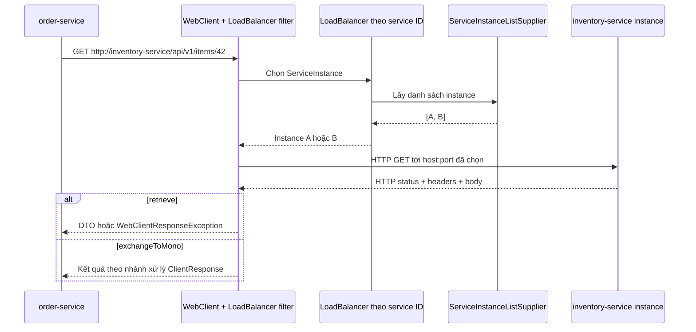

# retrieve, exchangeToMono và xử lý mã trạng thái

Trong Spring Cloud LoadBalancer, `WebClient` có thể gọi một dịch vụ qua **service ID**, chẳng hạn `http://inventory-service`, thay vì gắn cứng địa chỉ một bản sao. LoadBalancer chọn `ServiceInstance` và HTTP transport gửi request đến instance được chọn. Sau bước đó, backend vẫn có thể trả `200`, `204`, `404`, `429`, `503` hoặc kết nối có thể lỗi trước khi có bất kỳ HTTP response nào.

Để viết WebClient client đúng, cần phân biệt hai API của Spring WebFlux:

- `retrieve()`: API thuận tiện để giải mã body của response thành `Mono<T>` hoặc `Flux<T>`; mặc định coi HTTP 4xx/5xx là lỗi và cho phép tùy chỉnh bằng `onStatus`.
- `exchangeToMono()`: cung cấp trực tiếp `ClientResponse` trong callback, cho phép phân nhánh theo **status, headers và body** trước khi quyết định phát dữ liệu, hoàn tất rỗng hay phát lỗi.

Bài học này giải thích ngữ nghĩa hai API, cách xử lý các mã HTTP thường gặp, lỗi mạng, timeout/retry và tích hợp với `@LoadBalanced WebClient.Builder`, kèm ví dụ và phép kiểm thử có thể áp dụng trong lab.

## 1. Tách chọn instance khỏi xử lý HTTP status

Giả sử `order-service` gọi API của `inventory-service`:

```http
GET /api/v1/items/42 HTTP/1.1
Host: inventory-service
```

Host `inventory-service` trong URL logic là service ID. Filter LoadBalancer của WebClient yêu cầu load balancer tìm một bản sao từ `ServiceInstanceListSupplier`, sau đó tái tạo URI và chuyển request tới host/port đích. Backend nhận request và tạo HTTP response. **Thuật toán chọn đích không quyết định 404 hay 503 có ý nghĩa gì đối với nghiệp vụ.**



Nếu không có instance, tích hợp LoadBalancer có thể tạo response lỗi hoặc phát lỗi trước khi kết nối đến provider. Vì vậy, **không mặc định mọi status 503 đều đến từ backend**: nó có thể bắt nguồn từ LoadBalancer, gateway/proxy hoặc chính provider. Cần quan sát service ID, instance được chọn, trace và log để xác định tầng gây lỗi.

## 2. Môi trường thực hành

Ứng dụng **client** cần WebFlux và Spring Cloud LoadBalancer. Phần dependency Maven:

```xml
<dependencies>
    <dependency>
        <groupId>org.springframework.boot</groupId>
        <artifactId>spring-boot-starter-webflux</artifactId>
    </dependency>
    <dependency>
        <groupId>org.springframework.cloud</groupId>
        <artifactId>spring-cloud-starter-loadbalancer</artifactId>
    </dependency>
</dependencies>
```

Đây chưa phải `pom.xml` đầy đủ: dự án phải có cấu hình Spring Boot và import `spring-cloud-dependencies` BOM tương thích với phiên bản Spring Boot đang dùng. Các ví dụ Java sử dụng Java 17+ (record).

Trong `application-lab.yml` của **client**, dùng `SimpleDiscoveryClient` thay cho registry để khai báo hai bản sao:

```yaml
server:
  port: 8080

spring:
  application:
    name: order-service
  cloud:
    discovery:
      client:
        simple:
          instances:
            inventory-service:
              - uri: http://localhost:8091
              - uri: http://localhost:8092
```

Hai provider có cùng endpoint nhưng chạy ở các port `8091` và `8092`. Nếu ứng dụng chạy trong container, `localhost` là địa chỉ của chính container, không phải host hoặc container provider; cần thay bằng hostname có thể kết nối trong mạng triển khai.

### 2.1. Endpoint provider trả nhiều status

Ứng dụng `inventory-service` có Spring Boot Web hoặc WebFlux, cung cấp:

```java
import org.springframework.beans.factory.annotation.Value;
import org.springframework.http.HttpStatus;
import org.springframework.http.ResponseEntity;
import org.springframework.web.bind.annotation.GetMapping;
import org.springframework.web.bind.annotation.PathVariable;
import org.springframework.web.bind.annotation.RestController;

record ItemDto(String id, String name, String servedBy) {
}

@RestController
class InventoryController {
    private final int port;

    InventoryController(@Value("${server.port}") int port) {
        this.port = port;
    }

    @GetMapping("/api/v1/items/{id}")
    ResponseEntity<ItemDto> find(@PathVariable String id) {
        if ("missing".equals(id)) {
            return ResponseEntity.notFound().build();
        }
        if ("empty".equals(id)) {
            return ResponseEntity.noContent().build();
        }
        if ("busy".equals(id)) {
            return ResponseEntity.status(HttpStatus.SERVICE_UNAVAILABLE)
                    .build();
        }
        return ResponseEntity.ok(
                new ItemDto(id, "Item " + id, "inventory-" + port));
    }
}
```

Khởi chạy hai bản sao của cùng JAR:

```bash
# Terminal A
java -jar inventory-service.jar --server.port=8091

# Terminal B
java -jar inventory-service.jar --server.port=8092
```

Xác nhận status trực tiếp:

```bash
curl -i http://localhost:8091/api/v1/items/42
curl -i http://localhost:8092/api/v1/items/missing
curl -i http://localhost:8091/api/v1/items/empty
curl -i http://localhost:8092/api/v1/items/busy
```

Kết quả lần lượt dự kiến là `200` (JSON có `servedBy`), `404`, `204` và `503`. Nếu các endpoint trực tiếp đã sai, cần sửa provider trước khi phân tích LoadBalancer hoặc WebClient.

## 3. Tạo WebClient.Builder có LoadBalancer

`WebClient.create("http://inventory-service")` thông thường không tự được cấu hình filter LoadBalancer. Nên định nghĩa builder:

```java
import org.springframework.cloud.client.loadbalancer.LoadBalanced;
import org.springframework.context.annotation.Bean;
import org.springframework.context.annotation.Configuration;
import org.springframework.web.reactive.function.client.WebClient;

@Configuration
class WebClientConfiguration {

    @Bean
    @LoadBalanced
    WebClient.Builder loadBalancedWebClientBuilder() {
        return WebClient.builder();
    }
}
```

Tạo gateway từ đúng builder đó:

```java
import org.springframework.beans.factory.annotation.Qualifier;
import org.springframework.stereotype.Service;
import org.springframework.web.reactive.function.client.WebClient;

@Service
class InventoryClient {
    private final WebClient client;

    InventoryClient(
            @Qualifier("loadBalancedWebClientBuilder")
            WebClient.Builder builder) {
        this.client = builder
                .baseUrl("http://inventory-service")
                .build();
    }

    // Thêm các phương thức ở các mục tiếp theo vào lớp này.
}
```

Với phiên bản Spring Cloud hỗ trợ, `@LoadBalanced WebClient.Builder` được cấu hình filter reactive như `ReactorLoadBalancerExchangeFilterFunction`. Đây **không phải** đường gọi `BlockingLoadBalancerClient` thường dùng với `RestTemplate`. Không dùng `.block()` trong WebFlux event-loop thread: nó chặn thread và làm suy giảm khả năng xử lý đồng thời.

## 4. retrieve(): cách đơn giản cho response thông thường

`retrieve()` trả một `ResponseSpec`; khi status thành công, `bodyToMono` giải mã body:

```java
import reactor.core.publisher.Mono;

Mono<ItemDto> getItem(String id) {
    return client.get()
            .uri("/api/v1/items/{id}", id)
            .retrieve()
            .bodyToMono(ItemDto.class);
}
```

`Mono<ItemDto>` mô tả một kết quả bất đồng bộ. Request thông thường được thực hiện khi publisher có subscriber, ví dụ khi controller WebFlux trả `Mono` và runtime subscribe. Việc xây dựng chuỗi trên không tương đương với lập tức gửi HTTP request.

### 4.1. Hành vi mặc định theo status

| Response từ HTTP layer | `retrieve().bodyToMono(ItemDto.class)` |
|---|---|
| `200 OK` + JSON hợp lệ | Phát một `ItemDto` rồi hoàn tất |
| `201/206` có body | Vẫn thuộc 2xx; giải mã theo kiểu body yêu cầu |
| `204 No Content` | Không có body, thường hoàn tất `Mono.empty()` |
| `404 Not Found` | Mặc định phát `WebClientResponseException.NotFound` |
| `429 Too Many Requests` | Mặc định phát `WebClientResponseException.TooManyRequests` |
| `500/503` | Mặc định phát `WebClientResponseException` tương ứng |
| Mất kết nối trước response | Lỗi request/transport, không phải response HTTP từ provider |

Mặc định `retrieve()` tạo exception cho status **4xx/5xx** (status từ 400 trở lên). 404 không tự trở thành “không có dữ liệu”. Ngược lại, 204 là response **thành công** với body rỗng.

Nếu cần giữ status và headers của một response thành công:

```java
import org.springframework.http.ResponseEntity;

Mono<ResponseEntity<ItemDto>> response = client.get()
        .uri("/api/v1/items/{id}", "42")
        .retrieve()
        .toEntity(ItemDto.class);
```

`toEntity` giữ lại status/headers nhưng **vẫn sử dụng cơ chế exception cho 4xx/5xx**, trừ khi được tùy chỉnh.

## 5. onStatus(): chuyển HTTP status sang lỗi nghiệp vụ

`retrieve().onStatus(...)` định nghĩa cách ánh xạ các mã status cụ thể thành exception; handler nhận `ClientResponse` và trả `Mono<? extends Throwable>`.

Giả sử muốn phân biệt mặt hàng không tồn tại với lỗi upstream:

```java
final class ItemNotFoundException extends RuntimeException {
    ItemNotFoundException(String id, Throwable cause) {
        super("Item not found: " + id, cause);
    }
}

final class InventoryUnavailableException extends RuntimeException {
    InventoryUnavailableException(String message, Throwable cause) {
        super(message, cause);
    }
}
```

Sử dụng `onStatus`:

```java
import org.springframework.http.HttpStatusCode;
import reactor.core.publisher.Mono;

Mono<ItemDto> getItemWithBusinessErrors(String id) {
    return client.get()
            .uri("/api/v1/items/{id}", id)
            .retrieve()
            .onStatus(code -> code.value() == 404,
                    response -> response.createException()
                            .map(error -> new ItemNotFoundException(id, error)))
            .onStatus(HttpStatusCode::is5xxServerError,
                    response -> response.createException()
                            .map(error -> new InventoryUnavailableException(
                                    "Inventory service failed", error)))
            .bodyToMono(ItemDto.class);
}
```

`response.createException()` tạo `WebClientResponseException` theo response, sau đó code chuyển thành exception nghiệp vụ và giữ cause. Nếu không có `onStatus` khớp, cơ chế mặc định cho các mã 4xx/5xx vẫn hoạt động.

**Cạm bẫy quan trọng:** nếu handler của `onStatus` trả `Mono.empty()`, điều đó chỉ **bỏ qua việc biến mã HTTP thành lỗi mặc định**. Nó **không tự làm** `bodyToMono(ItemDto.class)` trở thành `Mono.empty()`. WebClient vẫn có thể thử giải mã body của response 404; nếu body là HTML hoặc cấu trúc JSON không phù hợp, có thể gặp lỗi decode.

Ví dụ dễ hiểu nhầm:

```java
// Không bảo đảm status 404 sẽ chuyển thành kết quả rỗng.
Mono<ItemDto> item = client.get()
        .uri("/api/v1/items/{id}", "missing")
        .retrieve()
        .onStatus(code -> code.value() == 404,
                response -> Mono.empty())
        .bodyToMono(ItemDto.class);
```

Muốn 404 → “không có item” rõ ràng, có thể bắt riêng `WebClientResponseException.NotFound` ở sau `retrieve()` hoặc sử dụng `exchangeToMono()` và chủ động xử lý nhánh 404.

## 6. exchangeToMono(): phân nhánh theo ClientResponse

`exchangeToMono()` nhận callback với `ClientResponse`: ứng dụng đọc status/headers và quyết định sẽ sử dụng body thế nào. Ví dụ, `200` trả DTO, `204/404` trả rỗng, các status khác phát lỗi:

```java
import reactor.core.publisher.Mono;

Mono<ItemDto> findOptional(String id) {
    return client.get()
            .uri("/api/v1/items/{id}", id)
            .exchangeToMono(response -> {
                int status = response.statusCode().value();

                if (status == 204 || status == 404) {
                    return response.releaseBody()
                            .then(Mono.<ItemDto>empty());
                }
                if (response.statusCode().is2xxSuccessful()) {
                    return response.bodyToMono(ItemDto.class);
                }
                return response.createError();
            });
}
```

Từng nhánh có ý nghĩa cụ thể:

1. `204/404`: body không được dùng và được giải phóng bằng `releaseBody()`; phương thức trả `Mono.empty()`. Đây là **quy tắc nghiệp vụ của ví dụ**, không phải hành vi mặc định của mọi WebClient.
2. Các status 2xx khác: body được giải mã vào `ItemDto`.
3. Mã còn lại: `response.createError()` phát lỗi gắn với status, headers và thông tin response.

Lợi thế là mọi nhánh đều kiểm soát body và **quy định rõ** 404 khác 503. Không nên sử dụng `exchangeToMono()` chỉ để bỏ qua toàn bộ lỗi HTTP: nếu không tạo nhánh lỗi, một response 5xx có thể vô tình bị xử lý như thành công.

### 6.1. Vòng đời response body

Khi publisher mà callback của `exchangeToMono` trả về kết thúc, WebClient sẽ xử lý phần body chưa được tiêu thụ theo cơ chế của framework. Không nên giữ `ClientResponse` để đọc body **sau khi callback hoàn tất**, hoặc thử đọc cùng một body nhiều lần.

| Tình huống | Cách xử lý thích hợp |
|---|---|
| Body thành công là một DTO | `response.bodyToMono(ItemDto.class)` |
| Stream nhiều phần tử | `exchangeToFlux()` và `bodyToFlux(...)` |
| Body bỏ qua vì 204/404 | `response.releaseBody().then(Mono.empty())` |
| Status lỗi cần giữ thông tin HTTP | `response.createException()` hoặc `response.createError()` |
| JSON lỗi có schema riêng | Đọc body **một lần** vào DTO lỗi rồi tạo exception |

Phương thức `exchange()` cũ đã bị deprecate; với code mới, ưu tiên `exchangeToMono()`/`exchangeToFlux()` vì chúng khiến việc xử lý body theo status rõ ràng và ít rủi ro hơn.

## 7. Xử lý 429, 503 và Retry-After

Các mã lỗi không đồng nhất về ý nghĩa nghiệp vụ và khả năng retry:

| Status | Tình huống điển hình | Hướng xử lý |
|---|---|---|
| `400 Bad Request` | Dữ liệu đầu vào sai | Trả lỗi phù hợp cho caller; không retry request y hệt |
| `401 Unauthorized` / `403 Forbidden` | Thiếu xác thực hoặc quyền | Kiểm tra credentials/permissions; tránh retry vô điều kiện |
| `404 Not Found` | Item không tồn tại | Chọn exception hoặc `Mono.empty()` theo contract |
| `409 Conflict` | Xung đột phiên bản/trạng thái | Áp dụng quy tắc nghiệp vụ, không mặc định retry |
| `429 Too Many Requests` | Vượt rate limit | Xem `Retry-After` và ngân sách retry |
| `500 Internal Server Error` | Backend xử lý lỗi | Log/trace, cân nhắc retry có điều kiện |
| `502/503/504` | Gateway/đích không sẵn sàng hoặc timeout | Có thể retry GET với backoff, giới hạn tổng thời gian |

`Retry-After` có thể là **số giây** hoặc **ngày giờ theo định dạng HTTP-date**. Đừng parse thành số nguyên hoặc ngủ vô thời hạn khi chưa kiểm tra giá trị. Ví dụ sau chỉ tạo exception mang thông tin header, **chưa tự retry**:

```java
import org.springframework.http.HttpHeaders;
import reactor.core.publisher.Mono;

final class RateLimitedException extends RuntimeException {
    RateLimitedException(String retryAfter) {
        super("Inventory rate limited; Retry-After=" + retryAfter);
    }
}

Mono<ItemDto> getWithRateLimitHandling(String id) {
    return client.get()
            .uri("/api/v1/items/{id}", id)
            .exchangeToMono(response -> {
                int status = response.statusCode().value();

                if (status == 429) {
                    String retryAfter = response.headers()
                            .asHttpHeaders()
                            .getFirst(HttpHeaders.RETRY_AFTER);

                    return response.releaseBody()
                            .then(Mono.<ItemDto>error(
                                    new RateLimitedException(retryAfter)));
                }
                if (response.statusCode().is2xxSuccessful()) {
                    return response.bodyToMono(ItemDto.class);
                }
                return response.createError();
            });
}
```

Nếu API cung cấp JSON lỗi có cấu trúc, có thể dùng `response.bodyToMono(RemoteError.class)` trong nhánh lỗi rồi tạo exception chứa mã nghiệp vụ, message được chuẩn hóa và các thông tin cần thiết. Không đọc response body hai lần, và không đưa toàn bộ body lỗi hoặc token vào log hay response công khai.

## 8. Phân biệt lỗi HTTP, lỗi request và lỗi decode

`retrieve()` hoặc `exchangeToMono()` chỉ có thể phân nhánh theo **HTTP status** khi có response đến WebClient. Nhiều lỗi xảy ra trước đó hoặc lúc giải mã body:

| Dấu hiệu | Loại lỗi thường gặp | Cần kiểm tra |
|---|---|---|
| Nhận HTTP `404/429/503` | `WebClientResponseException` hoặc exception nghiệp vụ tùy `onStatus` | Status, headers, provider/proxy, trace |
| DNS/connect/TLS thất bại | `WebClientRequestException` hoặc lỗi transport khác | Instance đã chọn, host/port, network, certificates |
| JSON không khớp `ItemDto` | Lỗi decode/codec | Content-Type, schema response, DTO |
| Không có instance để chọn | Lỗi/response do LoadBalancer integration tạo; đôi khi thành HTTP 503 | Service ID, discovery, supplier, log chọn đích |
| Vượt timeout | Timeout exception từ Reactor hoặc connector | Deadline, kết nối, retry/backoff, provider |

Để log lỗi ở đúng tầng:

```java
import org.springframework.web.reactive.function.client.WebClientRequestException;
import org.springframework.web.reactive.function.client.WebClientResponseException;
import reactor.core.publisher.Mono;

Mono<ItemDto> getWithDiagnostics(String id) {
    return client.get()
            .uri("/api/v1/items/{id}", id)
            .retrieve()
            .bodyToMono(ItemDto.class)
            .doOnError(WebClientResponseException.class, error ->
                    System.err.println("Inventory HTTP=" +
                            error.getStatusCode().value()))
            .doOnError(WebClientRequestException.class, error ->
                    System.err.println("Inventory transport=" +
                            error.getClass().getSimpleName()));
}
```

Đây chỉ là minh họa phân loại exception; trong production dùng logging và tracing tập trung, không ghi dữ liệu nhạy cảm. `doOnError` chỉ **quan sát** và không thay đổi kết quả của publisher. Nếu muốn biến lỗi thành response nghiệp vụ, dùng `onErrorResume`/exception handler theo contract.

### 8.1. Chuyển 404 thành Mono.empty() với retrieve()

Không nhất thiết phải dùng `exchangeToMono()` nếu chỉ có một ngoại lệ đơn giản:

```java
Mono<ItemDto> findOptionalViaRetrieve(String id) {
    return client.get()
            .uri("/api/v1/items/{id}", id)
            .retrieve()
            .bodyToMono(ItemDto.class)
            .onErrorResume(
                    WebClientResponseException.NotFound.class,
                    error -> Mono.empty());
}
```

Ví dụ bắt đúng subtype `NotFound` khi `retrieve()` giữ hành vi xử lý 404 mặc định. Nếu trước đó `onStatus` đã chuyển 404 thành `ItemNotFoundException` thì cần bắt chính kiểu lỗi mới. Tránh `onErrorResume(error -> Mono.empty())` vô điều kiện vì nó **che cả lỗi mất kết nối, lỗi decode và lỗi 5xx** thành “không tìm thấy item”.

## 9. Timeout và retry có kiểm soát

Với GET idempotent, có thể thử lại một số lỗi tạm thời. Reactor cho phép kết hợp `retryWhen` với backoff, lọc loại exception và giới hạn tổng thời gian:

```java
import java.time.Duration;
import org.springframework.web.reactive.function.client.WebClientRequestException;
import org.springframework.web.reactive.function.client.WebClientResponseException;
import reactor.core.publisher.Mono;
import reactor.util.retry.Retry;

Mono<ItemDto> getWithBoundedRetry(String id) {
    return client.get()
            .uri("/api/v1/items/{id}", id)
            .retrieve()
            .bodyToMono(ItemDto.class)
            .retryWhen(Retry.backoff(2, Duration.ofMillis(200))
                    .filter(error -> error instanceof WebClientRequestException
                            || (error instanceof WebClientResponseException http
                                    && (http.getStatusCode().value() == 502
                                    || http.getStatusCode().value() == 503
                                    || http.getStatusCode().value() == 504))))
            .timeout(Duration.ofSeconds(3));
}
```

Trong ví dụ, tối đa **hai lần retry** được phép sau lần gọi ban đầu, không phải tổng cộng hai lần thử. `timeout(3s)` nằm **ngoài** `retryWhen` để đặt giới hạn thời gian chờ kết quả của toàn bộ publisher, gồm cả các lần thử và backoff. Với môi trường thực tế nên cấu hình thêm connect/response timeout tại HTTP connector, vì timeout của Reactor không thay thế mọi giới hạn socket và connection pool.

Mặc dù retry sẽ đăng ký lại pipeline, **không thể kết luận mọi lần retry chắc chắn chọn instance khác**: quyết định này còn phụ thuộc tích hợp LoadBalancer, cấu hình retry-aware supplier, danh sách instance và phiên bản client. Retry không phù hợp cho mọi lỗi 4xx; với request ghi dữ liệu, một timeout không chứng minh server chưa xử lý giao dịch. Cần idempotency key hoặc cơ chế chống trùng trước khi thử lại.

Nếu muốn xử lý riêng `429`, cần kết hợp `Retry-After` và rate-limit policy; đoạn mã trên **không retry 429**.

## 10. Bảng so sánh và quy tắc lựa chọn API

| Tiêu chí | `retrieve()` | `exchangeToMono()` |
|---|---|---|
| Đối tượng chính | `ResponseSpec` | `ClientResponse` trong callback |
| Hành vi 4xx/5xx mặc định | Tự chuyển thành `WebClientResponseException` | Phải **tự quy định** cách diễn giải status |
| Tùy chỉnh lỗi cụ thể | `onStatus` | Các nhánh `if`/`switch` theo status |
| 404 là kết quả rỗng | `onErrorResume(NotFound.class, ...)` | `releaseBody().then(Mono.empty())` |
| Đọc status/headers | `toEntity` cho response thành công, `onStatus` cho lỗi | Truy cập trực tiếp từ `ClientResponse` |
| Body khác kiểu theo từng status | Kém thuận tiện hơn | Thuận tiện vì mỗi nhánh có cách đọc body riêng |
| Quản lý body bị bỏ qua | API cấp cao xử lý phần lớn | Nên tiêu thụ/giải phóng body rõ ràng |
| Phù hợp khi | 2xx → DTO; lỗi HTTP → exception | Có nhiều quy tắc nghiệp vụ theo status/headers/body |

Chọn **`retrieve()` làm mặc định** khi chỉ có một định dạng response thành công và exception chuẩn đủ đáp ứng. Chọn **`exchangeToMono()`** khi cần 204/404 thành `Mono.empty()`, xử lý rate-limit header hoặc giải mã các body khác nhau theo status. Không cần chuyển toàn bộ WebClient code sang `exchangeToMono()` chỉ để có cảm giác kiểm soát cao hơn.

## 11. Thực hành qua controller WebFlux

Sử dụng hai phương thức `getItem` và `findOptional` trong `InventoryClient` (ở mục 4 và mục 6). Để client trả HTTP response cho người thử, thêm controller:

```java
import org.springframework.http.ResponseEntity;
import org.springframework.web.bind.annotation.GetMapping;
import org.springframework.web.bind.annotation.PathVariable;
import org.springframework.web.bind.annotation.RestController;
import reactor.core.publisher.Mono;

@RestController
class InventoryProxyController {
    private final InventoryClient inventoryClient;

    InventoryProxyController(InventoryClient inventoryClient) {
        this.inventoryClient = inventoryClient;
    }

    @GetMapping("/items/raw/{id}")
    Mono<ItemDto> raw(@PathVariable String id) {
        return inventoryClient.getItem(id);
    }

    @GetMapping("/items/optional/{id}")
    Mono<ResponseEntity<ItemDto>> optional(@PathVariable String id) {
        return inventoryClient.findOptional(id)
                .map(item -> ResponseEntity.ok(item))
                .defaultIfEmpty(ResponseEntity.notFound().build());
    }
}
```

Lưu ý `ItemDto` cần có cấu trúc tương thích ở **cả provider và client**, ví dụ `record ItemDto(String id, String name, String servedBy) {}` trong mỗi dự án (hoặc qua contract module dùng chung). Trong ứng dụng client, các phương thức ở mục 4 và 6 phải được đặt vào chính lớp `InventoryClient` để controller gọi được.

Khởi động ứng dụng client:

```bash
java -jar order-service.jar --spring.profiles.active=lab
```

Sau đó chạy:

```bash
# HTTP 200, body JSON có trường servedBy
curl -i http://localhost:8080/items/optional/42
curl -i http://localhost:8080/items/optional/42

# Provider trả 404 -> findOptional phát Mono.empty
# Controller trả HTTP 404 do quy tắc của ví dụ
curl -i http://localhost:8080/items/optional/missing

# Provider trả 204 -> findOptional rỗng
# Controller cũng trả 404, không giữ nguyên status 204
curl -i http://localhost:8080/items/optional/empty

# Provider trả 503 -> findOptional vẫn phát error
# HTTP status ở proxy phụ thuộc exception handler của order-service
curl -i http://localhost:8080/items/optional/busy
```

**Lưu ý:** không có `@RestControllerAdvice`/`onErrorResume` phù hợp, một `WebClientResponseException` từ upstream có thể bị trình xử lý lỗi mặc định của proxy biểu diễn thành response 500. Status từ provider **không được tự động chuyển nguyên vẹn** về phía caller. Trong production cần có chính sách ánh xạ lỗi và ẩn thông tin nhạy cảm rõ ràng.

### 11.1. Ma trận kiểm thử

| Provider | `retrieve().bodyToMono` | `exchangeToMono` ở mục 6 | Proxy optional |
|---|---|---|---|
| 200 + JSON | Phát `ItemDto` | Phát `ItemDto` | 200 + JSON |
| 204 | Hoàn tất rỗng | Hoàn tất rỗng | 404 theo contract ví dụ |
| 404 | Phát `NotFound` exception | Hoàn tất rỗng | 404 theo contract ví dụ |
| 503 | Phát HTTP exception | Phát HTTP exception | Lỗi chuyển lên tầng API; cần ánh xạ có chủ đích |
| Connection refused | Request/transport exception | Request/transport exception | Không có provider response để đọc status |

Nếu muốn kiểm chứng tự động các tín hiệu reactive, `StepVerifier` của `reactor-test` có thể khẳng định `findOptional` trả rỗng hoặc phát item. Ví dụ sau là **các method được đặt trong test class đã inject `inventoryClient`**, với provider/stub được chạy trước khi test:

```java
import static org.junit.jupiter.api.Assertions.assertEquals;
import org.junit.jupiter.api.Test;
import reactor.test.StepVerifier;

@Test
void missingItemIsEmpty() {
    StepVerifier.create(inventoryClient.findOptional("missing"))
            .verifyComplete();
}

@Test
void validItemIsDecoded() {
    StepVerifier.create(inventoryClient.findOptional("42"))
            .assertNext(item -> assertEquals("42", item.id()))
            .verifyComplete();
}
```

Nếu test chỉ mock `ExchangeFunction` của WebClient, nó kiểm tra logic status nhưng **không chứng minh** load balancing đã chọn giữa nhiều instance. Muốn kiểm thử cả discovery, chọn đích và HTTP transport, dùng server giả lập thực và danh sách instance được kiểm soát như trong lab.

## 12. Lỗi thường gặp và hướng chẩn đoán

| Hiện tượng | Nguyên nhân thường gặp | Việc cần kiểm tra |
|---|---|---|
| `UnknownHostException` cho `inventory-service` | WebClient không có LoadBalancer filter hoặc host của instance thật không phân giải được | Bean `@LoadBalanced`, `@Qualifier`, URI từ supplier |
| 404 bị decode thành lỗi lạ | `onStatus` trả `Mono.empty()` nhưng body 404 không khớp DTO | Dùng `exchangeToMono` hoặc `onErrorResume(NotFound.class)` |
| 503 bị coi là dữ liệu bình thường | `exchangeToMono` không có nhánh lỗi | Sử dụng `response.createError()` |
| 503 không rõ từ đâu | Có thể từ LoadBalancer, proxy hoặc provider | Trace instance được chọn, discovery và HTTP response |
| Request đầu chậm, nhiều retry | Khởi tạo context, DNS/TLS, pool, backend chậm, backoff | Đo thời gian từng giai đoạn và retry count |
| Body bị bỏ qua không rõ cách giải phóng | Callback `exchangeToMono` không có nhánh tiêu thụ phù hợp | `releaseBody()` hoặc đọc body một lần đúng nhánh |
| 404 và 500 đều thành “không tìm thấy” | `onErrorResume` quá rộng | Bắt exception cụ thể và bảo toàn lỗi server |
| `block()` gây nghẽn hoặc lỗi trên WebFlux | Chặn event-loop thread | Giữ pipeline reactive |

Khi chẩn đoán, tách thứ tự: **service ID → danh sách instance → instance được chọn → kết nối mạng → HTTP status → giải mã body → exception/Mono kết quả**. Ghi log/metric theo service ID và instance đã chọn, không tiết lộ token, cookie hay body nhạy cảm.

## 13. Những điểm cần nhớ

1. `@LoadBalanced WebClient.Builder` cho phép gọi bằng service ID; lựa chọn `ServiceInstance` độc lập với ý nghĩa của HTTP status.
2. `retrieve()` phù hợp khi 2xx trả DTO và 4xx/5xx phát exception. `onStatus` cho phép ánh xạ lỗi nghiệp vụ cụ thể.
3. `onStatus(..., response -> Mono.empty())` **không** trực tiếp biến body 404 thành `Mono.empty()`.
4. `exchangeToMono()` giúp kiểm tra status/headers và chủ động chọn cách sử dụng body; cần đọc hoặc giải phóng body đúng trong từng nhánh.
5. `WebClientResponseException` khác lỗi kết nối/transport và lỗi decode; cách sửa cũng khác nhau.
6. `429`, `503` và timeout cần chính sách retry có giới hạn, deadline và hiểu biết về idempotency.
7. Không giả định retry luôn chọn instance khác hoặc status 503 luôn do LoadBalancer tạo.
8. Giữ đường gọi WebFlux reactive; không `block()` trên event loop, và quan sát request bằng trace/metrics thay vì đoán từ response.

**Kết luận:** `retrieve()` là lựa chọn gọn cho “2xx → DTO, 4xx/5xx → lỗi”, còn `exchangeToMono()` hữu ích khi từng HTTP status phải được **diễn giải thành kết quả nghiệp vụ khác nhau**. Khi tích hợp Spring Cloud LoadBalancer, xử lý chính xác status cần đi cùng kiểm soát danh sách instance, kết nối mạng, timeout, retry và logging để giao tiếp giữa dịch vụ ổn định và dễ chẩn đoán.
