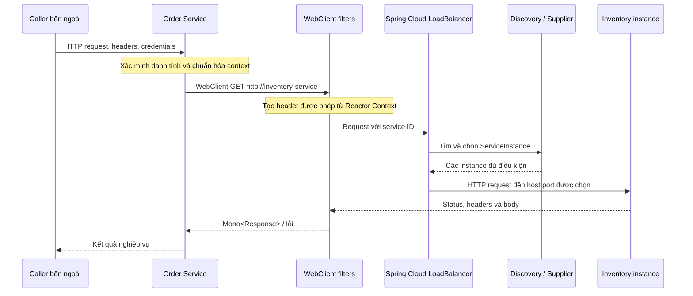

# Truyền header, thông tin xác thực và Reactor Context

Trong hệ thống microservice sử dụng Spring Cloud LoadBalancer, `order-service` có thể gọi `inventory-service` bằng `WebClient` và service ID `http://inventory-service`. Ngoài phương thức HTTP, URI và body, lời gọi còn cần mang những thông tin như `Accept`, `Authorization`, correlation/trace ID hoặc một routing hint đã được xác minh. Với API reactive, vấn đề không chỉ là **thêm header nào**, mà còn là **lấy dữ liệu từ đâu, chuyển qua ranh giới tin cậy như thế nào và giữ ngữ cảnh đúng khi chuỗi Reactor chuyển luồng thực thi**.

Ví dụ người dùng gửi request chứa `X-Correlation-ID` và bearer token đến `order-service`. Có ba câu hỏi độc lập:

1. Header nào nên được chuyển tiếp sang `inventory-service` và header nào phải bị loại bỏ?
2. Ai phát hành token được phép dùng với `inventory-service`? Có thể dùng lại token đầu vào hay phải lấy token dành riêng cho dịch vụ đích?
3. Làm sao truy cập correlation ID ở một `ExchangeFilterFunction` bất đồng bộ mà không phụ thuộc `ThreadLocal`?

Bài học thuộc phần **WebClient** của module Spring Cloud LoadBalancer, kết nối kiến thức về chọn `ServiceInstance`, discovery, zone/hint routing, health check và chính sách retry/timeout. Trọng tâm là truyền **header, thông tin xác thực và Reactor Context** một cách đúng nghĩa, có kiểm soát và dễ quan sát.

## 1. Đường đi của header qua WebClient và LoadBalancer

WebClient xây dựng HTTP request. Khi được tích hợp Spring Cloud LoadBalancer bằng `@LoadBalanced WebClient.Builder`, URI sử dụng service ID sẽ đi qua filter cân bằng tải, được ánh xạ sang `ServiceInstance` thực tế, rồi HTTP connector gửi request đi.



Sơ đồ thể hiện các bước ở mức logic; thứ tự thực tế của các `ExchangeFilterFunction`, filter LoadBalancer và connector phụ thuộc cách builder được cấu hình. Một filter tùy chỉnh có thể quan sát URI logic hoặc URI đã được chuyển đổi tùy vị trí của nó. Đừng suy ra filter luôn chạy trước hoặc sau LoadBalancer chỉ dựa trên tên filter; cần kiểm tra chuỗi filter thực tế khi triển khai.

**Ba trách nhiệm không được đánh đồng:**

| Lớp | Trách nhiệm |
|---|---|
| WebClient và filter | Xây request, gắn header, xử lý response, lỗi và thông tin dùng khi gọi HTTP. |
| Spring Cloud LoadBalancer | Từ service ID, lấy danh sách `ServiceInstance`, lọc và chọn đích; không tự quyết định ai được phép sử dụng token. |
| Spring Security / chính sách nghiệp vụ | Xác thực danh tính, cấp quyền, chọn credential đúng đối tượng nhận và bảo vệ dữ liệu. |

Việc `@LoadBalanced` chọn đúng instance không có nghĩa `Authorization` tự xuất hiện, và cũng không chứng minh token gửi đi có đúng audience/phạm vi quyền hay không.

## 2. Phân biệt các nơi chứa dữ liệu

Trong reactive application, “context” có thể ám chỉ nhiều cơ chế khác nhau:

| Cơ chế | Tồn tại ở đâu? | Dùng khi nào? |
|---|---|---|
| **HTTP headers** | Trong request/response thực sự truyền trên mạng. | `Authorization`, `Accept`, `Content-Type`, `traceparent`, correlation ID... |
| **WebClient request attributes** | Dữ liệu trong `ClientRequest`, chỉ tồn tại nội bộ phía client. | Truyền metadata giữa các WebClient filter; không tự biến thành HTTP header. |
| **Reactor Context** | Ngữ cảnh gắn với **subscription**, có thể đọc bởi operator trong luồng Reactor. | Mang correlation ID, dữ liệu theo request hoặc metadata cần thiết qua chuỗi reactive. |
| **Spring Security reactive context** | Ngữ cảnh bảo mật được tích hợp với Reactor khi dùng Spring Security WebFlux. | Truy cập `SecurityContext`/`Authentication` theo subscription; không tự đồng nghĩa header của HTTP outbound. |
| **ThreadLocal/MDC** | Gắn với một thread cụ thể. | Logging truyền thống; không mặc nhiên được duy trì qua mọi `publishOn`/`subscribeOn` hoặc callback. |

**Reactor Context không được gửi qua mạng.** Nó chỉ mang dữ liệu bên trong luồng reactive; muốn downstream thấy correlation ID thì cần tạo HTTP header (hoặc dùng instrumentation tracing có cơ chế propagation). Ngược lại, nhận một HTTP header từ người dùng không tự đưa giá trị đó vào Reactor Context đáng tin.

Đừng đưa access token, cookie hoặc thông tin cá nhân vào Context nếu không cần: dữ liệu trong Context có thể bị các operator/filter nội bộ truy cập. Với thông tin xác thực, ưu tiên tích hợp Spring Security và OAuth2 thay vì tự tạo một Context key tên `token` rồi sao chép khắp nơi.

## 3. Tạo WebClient sử dụng Spring Cloud LoadBalancer

Ví dụ trong `order-service` (Spring Boot và Spring Cloud phiên bản tương thích):

```java
import org.springframework.cloud.client.loadbalancer.LoadBalanced;
import org.springframework.context.annotation.Bean;
import org.springframework.context.annotation.Configuration;
import org.springframework.web.reactive.function.client.WebClient;

@Configuration
class WebClientConfiguration {

    @Bean
    @LoadBalanced
    WebClient.Builder loadBalancedWebClientBuilder() {
        return WebClient.builder();
    }

    @Bean
    WebClient inventoryWebClient(
            @LoadBalanced WebClient.Builder builder) {

        return builder.clone()
            .baseUrl("http://inventory-service")
            .defaultHeader("Accept", "application/json")
            .build();
    }
}
```

Khi gọi `inventoryWebClient.get().uri("/api/items/{id}", id)`, host `inventory-service` là **service ID logic**. Spring Cloud LoadBalancer cần dependency starter thích hợp và một nguồn instance (discovery hoặc danh sách tĩnh); nếu không tìm thấy instance, request có thể thất bại **trước khi kết nối đến upstream**.

`builder.clone()` giúp tạo client chuyên dụng mà không làm thay đổi builder được chia sẻ. WebClient được build là đối tượng có thể dùng lại cho nhiều request đồng thời; không nên tạo client mới cho từng lời gọi. Cấu hình socket timeout, TLS và connection pool thuộc `ClientHttpConnector`/HTTP transport, không thuộc `Reactor Context` hoặc thuật toán chọn instance.

Chỉ những WebClient được build từ builder đã được tích hợp `@LoadBalanced` mới có hành vi phân giải service ID qua LoadBalancer theo cơ chế này. Một `WebClient.create()` thông thường với `http://inventory-service` có thể cố phân giải bằng DNS.

## 4. Thêm header cho từng request

Đối với header thay đổi theo request, dùng `header(...)` hoặc `headers(...)`:

```java
Mono<ItemDto> findItem(WebClient inventoryWebClient, String id) {
    return inventoryWebClient.get()
        .uri("/api/items/{id}", id)
        .accept(MediaType.APPLICATION_JSON)
        .header("X-Caller-Service", "order-service")
        .retrieve()
        .bodyToMono(ItemDto.class);
}
```

`.accept(...)` là cách khai báo `Accept` có kiểu dữ liệu; `.header(...)` dùng cho header tùy chỉnh. `ItemDto` là DTO do ứng dụng định nghĩa; các ví dụ lược bớt import không cốt yếu.

Khi muốn **ghi đè thay vì cộng thêm** giá trị:

```java
return inventoryWebClient.get()
    .uri("/api/items/{id}", id)
    .headers(headers -> {
        headers.set("X-Caller-Service", "order-service");
        headers.setAccept(List.of(MediaType.APPLICATION_JSON));
    })
    .retrieve()
    .bodyToMono(ItemDto.class);
```

Phân biệt:

- `header(name, value...)` thường **thêm** các giá trị header trên request; tùy header, nhiều giá trị có thể không phù hợp.
- `headers(h -> h.set(name, value))` thay thế giá trị hiện tại của header đó.
- `defaultHeader(...)` trên builder chỉ cấp **giá trị mặc định** nếu request chưa tự thiết lập header tương ứng.
- `defaultHeaders(...)` trên builder cho phép thao tác với tập header mặc định.

Không dùng `defaultHeader("Authorization", token)` với một token lấy từ request hiện tại trên **bean WebClient dùng chung**: token có thể bị chia sẻ sai giữa các người dùng hoặc hết hạn. Credential theo request cần được lấy và gắn trong luồng xử lý riêng, hoặc do OAuth2 integration quản lý.

## 5. Filter: chèn header dùng chung và xử lý trước khi gửi

`ExchangeFilterFunction` có thể kiểm tra/chỉnh sửa request và response cho tất cả lời gọi đi qua WebClient. Ví dụ thêm tên dịch vụ gọi mà không phụ thuộc request người dùng:

```java
ExchangeFilterFunction callerNameFilter = (request, next) -> {
    ClientRequest enriched = ClientRequest.from(request)
        .header("X-Caller-Service", "order-service")
        .build();
    return next.exchange(enriched);
};

WebClient inventoryWebClient = builder.clone()
    .baseUrl("http://inventory-service")
    .filter(callerNameFilter)
    .build();
```

Với header cần **chỉ có một giá trị**, dùng `.headers(h -> h.set(...))` thay vì `.header(...)` trong builder `ClientRequest`. Filter nên xử lý bất biến dữ liệu, không thay đổi request gốc:

```java
ClientRequest enriched = ClientRequest.from(request)
    .headers(headers -> headers.set(
        "X-Caller-Service", "order-service"))
    .build();
```

Một filter không nên ghi toàn bộ `request.headers()` vào log: đó có thể gồm `Authorization`, cookie hoặc token của dịch vụ. Nếu cần log, chỉ lấy trường cho phép, loại bỏ giá trị nhạy cảm và tránh đưa dữ liệu tùy ý vào metric tag.

## 6. Reactor Context: ngữ cảnh theo subscription, không theo thread

Trong Reactor, `Context` là tập key/value **bất biến theo cách sử dụng**, đi cùng subscription. `contextWrite(...)` tạo ngữ cảnh mới cho phần chuỗi *upstream* nhìn thấy; `Mono.deferContextual(...)` đọc `ContextView` tại **thời điểm subscription**, không đọc lúc lắp ghép pipeline.

Ví dụ nhỏ:

```java
Mono<String> value = Mono.deferContextual(context -> {
    String correlationId =
        context.getOrDefault("correlationId", "missing");
    return Mono.just(correlationId);
});

Mono<String> withContext = value
    .contextWrite(context -> context.put(
        "correlationId", "c74a1e63-3f14-4d45-a7a6-17f9fd2471d0"));
```

Khi subscribe `withContext`, operator `deferContextual` nhìn thấy `correlationId`. Dù có chuyển scheduler ở các đoạn tương thích Reactor, Context vẫn đi theo luồng subscription; nó không được gắn với một Java thread cố định.

### Hướng lan truyền Context dễ gây nhầm

Context từ `contextWrite` được cung cấp theo hướng **từ downstream lên upstream trong quá trình subscription**. Vì vậy hãy đặt `contextWrite(...)` ở đoạn tạo/bao quanh lời gọi cần dùng Context, sau phần dựng pipeline:

```java
return inventoryGateway.findItem(id)
    .contextWrite(context -> context.put(
        "correlationId", verifiedId));
```

Nếu gọi `contextWrite` ở một nhánh khác không bao quanh phần tạo WebClient subscription, filter không tự nhìn thấy giá trị. Tương tự, đặt dữ liệu vào một `ThreadLocal` trước `publishOn(...)` không đảm bảo filter chạy trên thread mới đọc được dữ liệu đó.

**Không nhầm Reactor Context với WebClient request attributes:** `.attribute("key", value)` trên request tạo metadata cho WebClient filters, chứ không đi vào `ContextView`; muốn đọc thuộc tính dùng `ClientRequest.attribute(...)` hoặc API tương ứng. Context và attributes có vòng đời/phạm vi khác nhau.

## 7. Đưa correlation ID từ Reactor Context vào outbound header

Một cách rõ ràng là để `ExchangeFilterFunction` đọc Reactor Context **khi được subscribe**, rồi tạo `ClientRequest` mới. Code minh họa sử dụng Java 17 và các API WebClient/Reactor tương ứng:

```java
import org.springframework.web.reactive.function.client.ClientRequest;
import org.springframework.web.reactive.function.client.ExchangeFilterFunction;
import reactor.core.publisher.Mono;

final class CorrelationFilter {

    static final String CONTEXT_KEY = "correlationId";
    static final String HEADER_NAME = "X-Correlation-ID";

    private CorrelationFilter() {
    }

    static ExchangeFilterFunction fromReactorContext() {
        return ExchangeFilterFunction.ofRequestProcessor(request ->
            Mono.deferContextual(context -> {
                String id = context.getOrDefault(CONTEXT_KEY, "");

                ClientRequest.Builder updated =
                    ClientRequest.from(request);

                if (!id.isBlank()) {
                    updated.headers(headers ->
                        headers.set(HEADER_NAME, id));
                }

                return Mono.just(updated.build());
            })
        );
    }
}
```

Gắn filter vào client đã có LoadBalancer:

```java
@Bean
WebClient inventoryWebClient(
        @LoadBalanced WebClient.Builder builder) {

    return builder.clone()
        .baseUrl("http://inventory-service")
        .filter(CorrelationFilter.fromReactorContext())
        .build();
}
```

Sử dụng trong gateway:

```java
@Service
class InventoryGateway {
    private final WebClient inventoryWebClient;

    InventoryGateway(WebClient inventoryWebClient) {
        this.inventoryWebClient = inventoryWebClient;
    }

    Mono<ItemDto> findItem(String id) {
        return inventoryWebClient.get()
            .uri("/api/items/{id}", id)
            .retrieve()
            .bodyToMono(ItemDto.class);
    }
}
```

Ví dụ ở một controller WebFlux, chỉ chấp nhận correlation ID là UUID hợp lệ; nếu request không cung cấp hoặc cung cấp giá trị sai thì tự sinh UUID mới:

```java
@RestController
@RequestMapping("/orders")
class OrderController {

    private final InventoryGateway inventoryGateway;

    OrderController(InventoryGateway inventoryGateway) {
        this.inventoryGateway = inventoryGateway;
    }

    @GetMapping("/preview/{itemId}")
    Mono<ItemDto> preview(
            @PathVariable String itemId,
            @RequestHeader(
                name = "X-Correlation-ID",
                required = false) String incomingId) {

        String correlationId = normalize(incomingId);
        return inventoryGateway.findItem(itemId)
            .contextWrite(context -> context.put(
                CorrelationFilter.CONTEXT_KEY, correlationId));
    }

    private String normalize(String incomingId) {
        if (incomingId != null) {
            try {
                return UUID.fromString(incomingId).toString();
            } catch (IllegalArgumentException ignored) {
                // Không tin hoặc sao chép nguyên header không hợp lệ.
            }
        }
        return UUID.randomUUID().toString();
    }
}
```

Đây là ví dụ học tập; `UUID` được import từ `java.util.UUID` và DTO/annotation import tương ứng. **Correlation ID dùng để liên kết log, không dùng để xác thực hoặc phân quyền.** Ứng dụng có thể chọn quy ước ID khác, nhưng phải xác thực độ dài/định dạng và tránh log injection. Trên production, nên ưu tiên tích hợp Micrometer Tracing và chuẩn W3C `traceparent`/`tracestate` khi đã có hệ thống distributed tracing; không cần tự xây filter trùng lặp với instrumentation.

### Nếu Context không chứa key thì sao?

Filter đang dùng `getOrDefault(..., "")`. Khi không có key, nó gửi request không kèm `X-Correlation-ID` từ filter này; **không tự tạo correlation ID ở filter**. Cách này giúp quy tắc tạo ID có một chủ sở hữu rõ ràng ở ingress. Nếu hợp đồng bắt buộc luôn có ID, nên xử lý trường hợp thiếu từ sớm trong caller thay vì âm thầm bịa ngữ cảnh tại nhiều tầng.

## 8. Thông tin xác thực: không chuyển tiếp Authorization một cách mù quáng

`Authorization: Bearer ...` là credential có ý nghĩa bảo mật, khác hoàn toàn `X-Correlation-ID`. Một người dùng có thể có access token hợp lệ để gọi `order-service` nhưng **không được phép dùng cùng token đó cho `inventory-service`**, vì token có audience, scope hoặc chính sách xác thực khác.

Các mô hình thường gặp:

| Tình huống | Cách tiếp cận phù hợp |
|---|---|
| Caller gọi downstream nhân danh chính dịch vụ | Cấp token **service-to-service** bằng OAuth2 client credentials hoặc cơ chế workload identity thích hợp. |
| Cần truyền danh tính người dùng đến downstream | Sử dụng token exchange/delegation/on-behalf-of nếu hạ tầng cho phép, với audience/scope đúng dịch vụ nhận. |
| Cùng một token đã được cấp hợp lệ cho downstream và chính sách cho phép relay | Chỉ forward sau khi xác nhận audience, scope, trust boundary và hợp đồng bảo mật. |
| Cần correlation/tracing | Không sử dụng access token để thay thế trace ID; dùng header truy vết chuyên biệt. |

**Không làm như sau:**

```java
// KHÔNG NÊN: copy mù quáng mọi header của user sang upstream.
// outboundHeaders.addAll(incomingRequest.getHeaders());
```

Cách copy này có thể vô tình chuyển token, cookie, `Host`, `X-Forwarded-*` hoặc các routing hint không đáng tin sang service khác. Nó có thể làm lộ credential, gây nhầm tenant hoặc bỏ qua chính sách định tuyến; ngay cả bên trong mạng nội bộ, header do caller gửi không mặc nhiên đáng tin.

### Lấy token dành cho downstream bằng OAuth2 client credentials

Trong ứng dụng WebFlux dùng Spring Security OAuth2 Client, có thể dùng `ReactiveOAuth2AuthorizedClientManager` để lấy/cập nhật authorized client cho registration `inventory-client` đã cấu hình trước. Ví dụ minh họa phương thức gateway:

```java
private final ReactiveOAuth2AuthorizedClientManager manager;
private final WebClient inventoryWebClient;

Mono<ItemDto> findWithServiceToken(String itemId) {
    OAuth2AuthorizeRequest authRequest =
        OAuth2AuthorizeRequest
            .withClientRegistrationId("inventory-client")
            .principal("order-service")
            .build();

    return manager.authorize(authRequest)
        .switchIfEmpty(Mono.error(
            new IllegalStateException("Cannot authorize inventory client")))
        .flatMap(authorizedClient ->
            inventoryWebClient.get()
                .uri("/api/items/{id}", itemId)
                .headers(headers -> headers.setBearerAuth(
                    authorizedClient.getAccessToken().getTokenValue()))
                .retrieve()
                .bodyToMono(ItemDto.class)
        );
}
```

Để ví dụ chạy, ứng dụng phải có dependency Spring Security OAuth2 Client, registration/provider hợp lệ và bean `ReactiveOAuth2AuthorizedClientManager` được cấu hình đúng cho loại grant và môi trường chạy (không phải bean tự có trong mọi ứng dụng). Ví dụ dùng một principal đại diện ứng dụng cho client credentials, **không giả mạo danh tính người dùng**. Token phải có audience và quyền phù hợp với `inventory-service`; `inventory-service` vẫn phải xác thực và phân quyền ở phía nhận.

`ServerOAuth2AuthorizedClientExchangeFilterFunction` cũng là cơ chế tích hợp Spring Security OAuth2 với `WebClient` trong môi trường reactive: filter có thể lấy authorized client và đính token khi đã cấu hình rõ registration/authorized client manager. Dùng tích hợp này thường thuận lợi hơn tự đọc token từ header request và lưu vào Reactor Context. Không nên bật tùy chọn truyền token mặc định cho mọi downstream nếu không kiểm soát được endpoint đích.

### Security Context trong WebFlux

Khi dùng Spring Security WebFlux, thông tin bảo mật có thể được đọc trong reactive chain thông qua `ReactiveSecurityContextHolder.getContext()`:

```java
Mono<String> currentPrincipalName() {
    return ReactiveSecurityContextHolder.getContext()
        .map(context -> context.getAuthentication())
        .filter(authentication -> authentication != null)
        .map(Authentication::getName);
}
```

Đoạn mã chỉ minh họa **đọc tên principal**, không cấp quyền tự động và không biến principal thành access token gửi đi. Trong production, việc kiểm tra authorization phải dựa vào Spring Security và policy của tài nguyên; không chỉ dựa vào `getName()` hoặc một header do client tự khai.

## 9. Header định tuyến và ServiceInstance: phải kiểm soát nguồn tin cậy

Spring Cloud LoadBalancer có thể dùng zone, metadata hoặc hint để điều chỉnh danh sách instance. Nhưng **gắn một header như `X-Preferred-Zone` vào WebClient không mặc nhiên khiến LoadBalancer thay thuật toán hay chọn zone đó**: cần supplier, filter và cơ chế truyền request context tương ứng, tùy phiên bản Spring Cloud.

Nếu chính sách định tuyến lấy thông tin từ request, cần phân biệt:

- **Client preference:** gợi ý từ người gọi, có thể bỏ qua.
- **Verified routing context:** giá trị do gateway/caller nội bộ tính từ danh tính đã xác thực và policy phía server.
- **Hard constraint:** tenant/region được phép. Không có instance đạt điều kiện thì không được âm thầm fallback sang vùng bị cấm.

Ví dụ, user gửi `X-Preferred-Zone: zone-b`, trong khi policy của tenant chỉ cho phép `zone-a`. Dù filter WebClient có đọc được header, phía caller **không được đưa nguyên giá trị user-supplied làm hard routing policy**. Tách rõ routing context hợp lệ khỏi correlation ID hoặc access token. LoadBalancer chọn instance, còn authorization phải được kiểm tra độc lập tại downstream.

## 10. HTTP headers và Reactor Context khi có retry hoặc đổi scheduler

Với WebClient, chuỗi `retrieve().bodyToMono(...)` thường chỉ thực hiện HTTP call khi được subscribe. Nếu dùng `retryWhen(...)`, Reactor có thể **subscribe lại vào nguồn**, từ đó request/filter được thực thi lại. Khi đó:

- Correlation ID từ Context thường vẫn là giá trị gắn với cùng logical request.
- Token có thể cần được lấy lại/refresh thông qua authorized client manager nếu hết hạn; không nên hard-code token trong client dùng chung.
- Retry có thể dẫn đến **lần chọn instance mới** khi lời gọi quay qua filter LoadBalancer, nhưng không bảo đảm đổi instance; còn phụ thuộc integration và chính sách retry.
- Một request nghiệp vụ có thể tạo nhiều HTTP attempts, làm tăng tải; hãy giới hạn retry và thời gian tổng.
- `POST` có thể đã được server xử lý trước khi client timeout. Không retry các thao tác không idempotent khi chưa có cơ chế chống trùng.

Ví dụ xử lý lỗi tạm thời có giới hạn cho `GET`:

```java
return inventoryWebClient.get()
    .uri("/api/items/{id}", id)
    .retrieve()
    .bodyToMono(ItemDto.class)
    .retryWhen(Retry.backoff(2, Duration.ofMillis(150))
        .filter(this::isTransientFailure));
```

`isTransientFailure(Throwable)` trong ví dụ là predicate **do ứng dụng phải triển khai**, chỉ chọn loại lỗi được phép retry. Không retry mọi exception, đặc biệt không biến `401`/`403` thành vòng thử lại. Tổng deadline cần được tính cho cả request ban đầu, retry và backoff; connect/response timeout của Reactor Netty chỉ giới hạn những giai đoạn tương ứng, không mặc nhiên là deadline tổng.

### Reactor Context khác với MDC và ThreadLocal

Trong reactive chain, `publishOn` và `subscribeOn` có thể làm mã chạy trên thread khác. Reactor Context vẫn gắn với subscription, còn MDC/`ThreadLocal` không tự động an toàn qua các bước bất đồng bộ. Để log giữ trace ID, sử dụng cơ chế context propagation/instrumentation phù hợp với phiên bản Reactor và Micrometer, thay vì tự tin rằng `MDC.put(...)` ở controller sẽ tồn tại trong mọi filter.

**Không gọi `block()` trên Reactor Netty event-loop thread.** Làm vậy có thể gây lỗi hoặc nghẽn luồng xử lý. Nếu có đoạn mã blocking không tránh được, phải tách sang scheduler và kiến trúc thích hợp, đồng thời vẫn kiểm soát deadline và saturation.

## 11. Ghi log và tracing mà không lộ dữ liệu nhạy cảm

Khi có lỗi `inventory-service`, cần nối được request người dùng với các HTTP attempts và instance đã được chọn. Nhưng log và metric cũng là một nơi dễ lộ thông tin.

| Nên quan sát | Không nên ghi nguyên văn |
|---|---|
| `traceId`/`correlationId` đã chuẩn hóa | `Authorization` hoặc refresh/access token. |
| Service ID logic, HTTP method, route template | Cookie phiên, API key và thông tin cá nhân. |
| HTTP status, loại exception, giai đoạn lỗi | URL có token trong query string hoặc payload nhạy cảm. |
| Retry attempt và tổng latency | Header tùy ý từ caller làm metric label. |
| Kết quả LoadBalancer selection, nếu được cho phép | Danh tính instance/topology quá chi tiết gửi trả về phía client ngoài. |
| p50/p95/p99 latency và timeout | Correlation ID không giới hạn độ dài/cardinality trên metric tag. |

Nên phân biệt lỗi **không có `ServiceInstance`**, lỗi **kết nối sau khi chọn**, và **HTTP status trả về từ upstream**. Một mã `503` ở caller có thể được tạo khi không có instance hoặc do upstream thật sự trả về; chỉ status cuối cùng chưa đủ để kết luận.

Nếu đã có Micrometer Observation/Tracing, ưu tiên tích hợp instrumentation chuẩn để propagate trace context và ghi metric thay vì tự chèn/xử lý mọi trace header. Filter viết tay dùng cho correlation ID riêng cần nhất quán với hệ thống trace, không xóa `traceparent`/`tracestate` hợp lệ hoặc gắn token vào baggage.

## 12. Thực hành: kiểm tra header và Context qua hai replica

Chuẩn bị `inventory-service` có hai instance A/B dưới cùng một service ID, mỗi instance expose `GET /api/debug/headers` trong **môi trường test**. Endpoint chỉ trả những trường được phép quan sát: instance ID, correlation ID đã kiểm tra, tên caller; **không trả token/cookie/credential**.

Gợi ý thực hiện:

1. **Header cố định:** tạo `@LoadBalanced WebClient.Builder` và gọi `http://inventory-service/api/debug/headers` với `X-Caller-Service: order-service`. Kiểm tra hai instance đều nhận đúng header khi được chọn.
2. **Header per-request:** thử `header(...)` và `headers(h -> h.set(...))`; kiểm tra khác biệt khi header đã tồn tại và khi nhiều giá trị được thêm.
3. **Reactor Context:** đặt `correlationId` bằng `contextWrite(...)` ở lời gọi reactive, dùng filter `Mono.deferContextual(...)` để tạo outbound header. Gọi song song với hai UUID khác nhau, xác nhận không bị lẫn giữa các subscription.
4. **Thiếu Context:** bỏ `contextWrite(...)`; quan sát filter không tạo header tùy tiện và gateway xử lý thiếu correlation ID theo hợp đồng.
5. **Đổi scheduler:** thử `publishOn(Schedulers.parallel())` trên một đoạn pipeline phù hợp; xác nhận Reactor Context vẫn đọc được nhưng không suy ra MDC tự được propagate.
6. **Token hợp lệ:** cấu hình OAuth2 client registration test, lấy token dành riêng cho inventory và xác nhận upstream thực thi authorization. Gửi token thiếu audience/scope để xác minh bị từ chối.
7. **Không relay bừa:** thử gửi `Cookie` và một header routing giả mạo từ HTTP request đầu vào; xác nhận outbound chỉ có danh sách header đã được allowlist.
8. **Retry/timeout:** cho một instance phản hồi chậm với `GET` và retry có giới hạn; đối chiếu logical requests, HTTP attempts, correlation ID, instance được chọn và tổng thời gian.

Các phép thử về credential phải sử dụng identity provider và token test, không lưu token thật trong code hoặc log. Không đưa endpoint debug cho header lên môi trường công khai.

## 13. Checklist trước khi đưa WebClient vào production

- Dùng đúng `@LoadBalanced WebClient.Builder`, dependency Spring Cloud LoadBalancer và nguồn `ServiceInstance` cho service ID.
- Dùng `defaultHeader` cho giá trị ổn định; dùng `headers(h -> ...)` hoặc filter cho giá trị theo request.
- Không giữ token người dùng trong `WebClient`/builder singleton hoặc biến static.
- Phân biệt HTTP header, `ClientRequest` attributes, Reactor Context và Spring Security reactive context.
- Chỉ đưa dữ liệu đã xác minh và cần thiết vào Reactor Context; không dùng nó như cơ chế cấp quyền.
- Đọc Context bằng `Mono.deferContextual(...)` trong chuỗi được subscribe; đặt `contextWrite(...)` bao quanh phần upstream cần dùng.
- Kiểm tra token service-to-service hoặc delegated token có audience/scope hợp lệ cho upstream; không copy toàn bộ `Authorization` hay cookie từ request ngoài.
- Không tin routing hint/zone do client tự gửi; hard region/tenant isolation phải dựa vào policy phía server, kể cả lúc retry/failover.
- Tách lỗi chọn instance, transport timeout và lỗi HTTP; không mặc định `@LoadBalanced` xử lý authorization, retry hoặc deadline tổng.
- Retry đúng loại lỗi và idempotency, đặt backoff/deadline; không nhân đôi thao tác `POST` không an toàn.
- Ưu tiên Micrometer Tracing cho distributed tracing; log theo allowlist, không tiết lộ token, cookie và header nhạy cảm.
- Kiểm tra nhiều subscription đồng thời, context propagation qua scheduler, health/discovery và kết quả chọn instance.

**Ghi nhớ:** HTTP header là dữ liệu **được gửi qua mạng**; Reactor Context là dữ liệu **đi cùng subscription nội bộ**, không tự truyền sang dịch vụ khác. `ExchangeFilterFunction` có thể nối hai cơ chế bằng cách đọc Context tại thời điểm subscribe và tạo header trên `ClientRequest`. Thông tin xác thực phải được cấp và chuyển tiếp theo **chính sách bảo mật**, không được sao chép mù quáng từ request người dùng. Spring Cloud LoadBalancer chọn `ServiceInstance` từ service ID; nó không xác thực token, không tự truyền Reactor Context và không thay thế timeout/retry hay authorization của WebClient và upstream.
