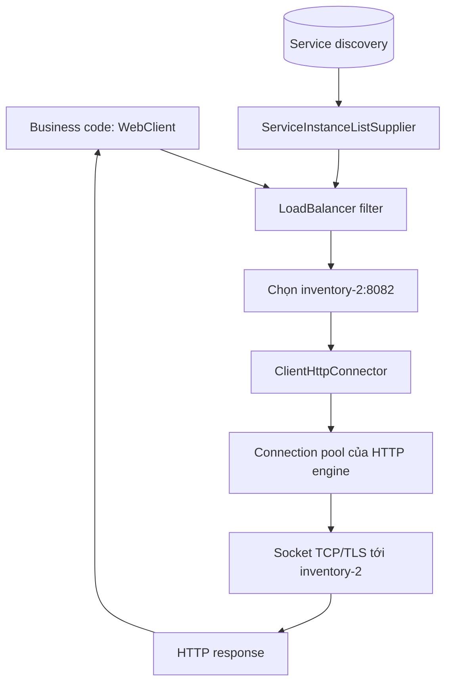
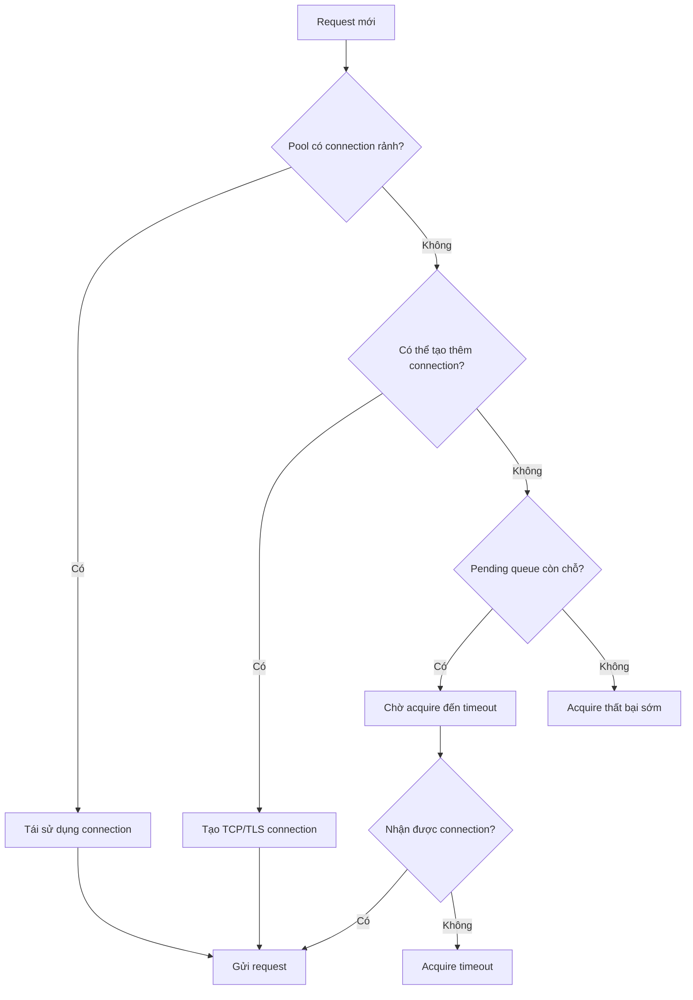

# Lựa chọn HTTP connector và cấu hình connection pool

Trong Spring Cloud LoadBalancer, `WebClient` có thể gọi URL logic như `http://inventory-service/api/products/P-1001`, tìm một `ServiceInstance` đang được phát hiện và gửi request đến host/port tương ứng. Tuy nhiên, **việc chọn instance không đồng nghĩa với việc quản lý TCP connection**. Để xử lý lượng request lớn và ổn định, WebClient còn cần một HTTP connector và một chính sách kết nối phù hợp.

Một tình huống điển hình: `order-service` sử dụng `@LoadBalanced WebClient.Builder`, discovery trả ba instance của `inventory-service`, thuật toán round robin luân phiên chọn chúng. Khi tải tăng, caller gặp `PoolAcquireTimeoutException` hoặc thời gian chờ kết nối tăng mạnh. Lúc này đổi thuật toán load balancing chưa chắc giải quyết được vấn đề: điểm nghẽn có thể nằm ở **connection pool của HTTP transport** hoặc mức đồng thời mà ứng dụng tạo ra.

Bài thuộc chương **WebClient** của module Spring Cloud LoadBalancer, tập trung vào cách chọn HTTP connector, thiết kế connection pool, giới hạn timeout và concurrency, cùng cách kiểm chứng sự tương tác giữa pool và danh sách `ServiceInstance`.

## 1. Bốn lớp trong đường đi của một request

WebClient là API gọi HTTP bất đồng bộ và phản ứng (reactive). Trong một lời gọi load-balanced, có ít nhất bốn mối quan tâm riêng:

1. **Application layer:** tạo request, chọn method/path/header và xử lý kết quả `Mono` hoặc `Flux`.
2. **Load-balancing layer:** phân giải service ID qua `ReactorLoadBalancerExchangeFilterFunction` hoặc cơ chế tương ứng được cấu hình cho `WebClient.Builder`, sau đó chọn `ServiceInstance`.
3. **HTTP connector:** biến request của WebClient thành lời gọi HTTP thật, sử dụng một HTTP client engine cụ thể.
4. **Connection pool/transport:** tái sử dụng hoặc mở TCP connection, quản lý chờ cấp connection, timeout và có thể là TLS.



**Tách bạch trách nhiệm:** Spring Cloud LoadBalancer chọn instance; HTTP connector xử lý kết nối đến instance đã chọn. Một `@LoadBalanced WebClient.Builder` không có nghĩa LoadBalancer tự quyết định `maxConnections`, `pendingAcquireTimeout` hay vòng đời socket.

## 2. Những lựa chọn HTTP connector thường gặp

Spring WebFlux định nghĩa giao diện `ClientHttpConnector` để WebClient có thể sử dụng các HTTP engine khác nhau. Các lựa chọn có thể có tùy Spring Framework, Spring Boot và dependency:

| Connector | HTTP engine | Khi nào cân nhắc | Điều cần chú ý |
|---|---|---|---|
| `ReactorClientHttpConnector` | Reactor Netty `HttpClient` | Lựa chọn phổ biến cho ứng dụng WebFlux cần hiệu năng I/O bất đồng bộ và tùy chỉnh pool rõ ràng. | Pool do Reactor Netty `ConnectionProvider` quản lý. |
| `JdkClientHttpConnector` | JDK `java.net.http.HttpClient` | Muốn dùng HTTP client đi kèm JDK, ít dependency bổ sung. | Cách quản lý connection và các núm chỉnh pool khác Reactor Netty; không dùng API `ConnectionProvider`. |
| `JettyClientHttpConnector` | Jetty reactive HTTP client | Dự án có chuẩn hóa Jetty hoặc yêu cầu tính năng transport tương ứng. | Cần dependency/client Jetty thích hợp và quản lý lifecycle của client. |
| `HttpComponentsClientHttpConnector` | Apache HttpComponents async client | Dự án có nhu cầu tương thích/tính năng của Apache HttpClient 5 async. | Cần artifact tương ứng và cách cấu hình connection manager riêng. |

Không chọn connector chỉ dựa trên danh tiếng thư viện. Cần xét phiên bản Spring đang dùng, protocol HTTP/1.1 hay HTTP/2, TLS, proxy, điều kiện mạng, observability, khả năng cấu hình pool và cách shutdown tài nguyên.

Với cấu hình Spring Boot WebFlux thông dụng có `spring-boot-starter-webflux` và Reactor Netty trên classpath, **Reactor Netty thường là lựa chọn mặc định**. Tuy vậy, HTTP engine thực sự được Boot chọn còn phụ thuộc classpath và cấu hình. Hãy quan sát bean `ClientHttpConnector`/`WebClient.Builder` cuối cùng thay vì tự suy đoán rằng mọi ứng dụng có WebClient đều chạy Reactor Netty.

## 3. Những dependency cần thiết

Ví dụ Maven đơn giản với Spring Boot WebFlux và Spring Cloud LoadBalancer:

```xml
<dependencies>
    <dependency>
        <groupId>org.springframework.boot</groupId>
        <artifactId>spring-boot-starter-webflux</artifactId>
    </dependency>
    <dependency>
        <groupId>org.springframework.cloud</groupId>
        <artifactId>spring-cloud-starter-loadbalancer</artifactId>
    </dependency>
</dependencies>
```

Cần dùng Spring Boot và Spring Cloud release train **tương thích**, quản lý version bằng Boot BOM/parent và Spring Cloud BOM. Không tùy tiện ép version riêng của `reactor-netty-http`, `spring-webflux` hoặc `spring-cloud-loadbalancer` ra khỏi tập dependency tương thích.

`spring-boot-starter-webflux` mang WebClient và thường mang Reactor Netty; `spring-cloud-starter-loadbalancer` bổ sung cơ chế chọn instance. Để gọi bằng service ID trong môi trường production, còn phải có discovery provider hoặc một nguồn `ServiceInstance` khác. Trong môi trường học tập có thể dùng `SimpleDiscoveryClient`.

## 4. Pool hoạt động như thế nào khi WebClient chọn nhiều instance?

Đối với HTTP/1.1 keep-alive, một connection có thể được tái sử dụng cho nhiều request **tuần tự** đến cùng remote endpoint. Khi cần gửi đồng thời, client có thể mở thêm connection theo giới hạn pool; request vượt quá mức kết nối có sẵn có thể xếp hàng chờ được cấp connection.

Reactor Netty `ConnectionProvider` quản lý các pool theo **địa chỉ đích/remote endpoint** và cấu hình liên quan. Vì vậy:

```text
order-service
  |
  +-- LoadBalancer -> inventory-1:8081 -> pool cho remote 1
  |
  +-- LoadBalancer -> inventory-2:8082 -> pool cho remote 2
  |
  +-- LoadBalancer -> inventory-3:8083 -> pool cho remote 3
```

Một thông số như `maxConnections(100)` được hiểu theo cơ chế giới hạn **mỗi pool remote address** của Reactor Netty, không nên tự xem nó là mức tối đa 100 socket cho **toàn bộ ba instance cộng lại**. Nếu có nhiều instance, nhiều protocol/endpoint hoặc nhiều `ConnectionProvider` độc lập, tổng số socket tiềm năng còn cao hơn.

**Hệ quả quan trọng:** round robin chia lượt chọn, còn pool giữ các connection theo địa chỉ instance thực đã chọn. Khi instance mới xuất hiện, nó thường có pool chưa được làm nóng; khi instance cũ rời hệ thống, pool có thể vẫn đang giữ kết nối idle đến địa chỉ cũ cho tới khi đóng/evict. Đây là hai vòng đời khác nhau.

### Mối liên hệ với HTTP/2

HTTP/2 có thể multiplex nhiều stream trên một connection. Số HTTP request concurrent không còn tương ứng đơn giản với số TCP socket như mô hình HTTP/1.1. Khi dùng HTTP/2, phải xét khả năng protocol của engine/server, max concurrent streams và cấu hình pool HTTP/2 riêng. Không áp nguyên công thức “một request đồng thời bằng một connection” cho mọi giao thức.

## 5. Những tham số pool quan trọng trong Reactor Netty

| Tham số | Ý nghĩa | Nếu cấu hình không phù hợp |
|---|---|---|
| `maxConnections` | Số connection tối đa cho một pool remote theo chính sách provider. | Quá thấp: request phải chờ; quá cao: socket/file descriptor và tài nguyên backend tăng. |
| `pendingAcquireMaxCount` | Giới hạn số yêu cầu đang chờ được cấp connection. | Quá thấp: từ chối sớm khi bùng tải; quá cao: backlog lớn, tăng latency và memory. |
| `pendingAcquireTimeout` | Thời gian tối đa chờ lấy connection từ pool. | Ngắn quá: lỗi dưới tải đỉnh; dài quá: request “kẹt” trước khi kết nối. |
| `maxIdleTime` | Thời gian connection được phép idle trước khi bị xem là không nên tái sử dụng. | Idle quá lâu: có thể gặp connection đã bị proxy/server đóng. |
| `maxLifeTime` | Thời gian sống tối đa của connection, kể cả có hoạt động. | Quá ngắn: tăng kết nối/handshake; quá dài: giữ connection cũ không cần thiết. |
| `evictInBackground` | Chu kỳ thực hiện eviction nền nếu được hỗ trợ và bật. | Eviction chậm có thể giữ nhiều connection idle trong thời gian dài. |

Đây là tham số **Reactor Netty**, không phải Spring Cloud LoadBalancer properties dùng chung cho mọi connector. Nếu chuyển sang JDK, Jetty hoặc Apache, phải cấu hình bằng API pool/connection manager của HTTP engine tương ứng.

Giá trị mặc định phụ thuộc phiên bản Reactor Netty và môi trường. Không sao chép một giá trị cũ rồi cho rằng đó là default được bảo đảm ở mọi release train.

## 6. Ví dụ cấu hình @LoadBalanced WebClient với Reactor Netty

Ví dụ sau minh họa cách kiểm soát pool và timeout cho HTTP client gọi `inventory-service`. Nó giả định tổ hợp Spring Boot/WebFlux và Spring Cloud tương thích có khả năng xử lý `@LoadBalanced WebClient.Builder`.

### 6.1. Cấu hình một ConnectionProvider có quản lý vòng đời

```java
import java.time.Duration;
import io.netty.channel.ChannelOption;
import org.springframework.cloud.client.loadbalancer.LoadBalanced;
import org.springframework.context.annotation.Bean;
import org.springframework.context.annotation.Configuration;
import org.springframework.http.client.reactive.ReactorClientHttpConnector;
import org.springframework.web.reactive.function.client.WebClient;
import reactor.netty.http.client.HttpClient;
import reactor.netty.resources.ConnectionProvider;

@Configuration(proxyBeanMethods = false)
class InventoryWebClientConfiguration {

    @Bean(destroyMethod = "dispose")
    ConnectionProvider inventoryConnectionProvider() {
        return ConnectionProvider.builder("inventory-http-pool")
                .maxConnections(100)
                .pendingAcquireMaxCount(200)
                .pendingAcquireTimeout(Duration.ofMillis(500))
                .maxIdleTime(Duration.ofSeconds(20))
                .maxLifeTime(Duration.ofMinutes(5))
                .evictInBackground(Duration.ofSeconds(30))
                .build();
    }

    @Bean
    @LoadBalanced
    WebClient.Builder inventoryLoadBalancedBuilder(
            ConnectionProvider inventoryConnectionProvider) {

        HttpClient httpClient = HttpClient
                .create(inventoryConnectionProvider)
                .option(ChannelOption.CONNECT_TIMEOUT_MILLIS, 2_000)
                .responseTimeout(Duration.ofSeconds(5));

        return WebClient.builder()
                .clientConnector(new ReactorClientHttpConnector(httpClient));
    }

    @Bean
    WebClient inventoryWebClient(
            @LoadBalanced WebClient.Builder inventoryLoadBalancedBuilder) {
        return inventoryLoadBalancedBuilder
                .baseUrl("http://inventory-service")
                .build();
    }
}
```

Phần `destroyMethod = "dispose"` đảm bảo bean `ConnectionProvider` **do cấu hình này tạo và sở hữu** được giải phóng khi Spring context đóng. Nếu dùng Reactor Netty resources chia sẻ toàn ứng dụng do Spring Boot quản lý, **không tự dispose pool/global resources của thư viện dùng chung** tại một service riêng; cần thống nhất chủ sở hữu vòng đời.

Các con số 100/200/500 ms/20 s/5 min ở trên là **giá trị minh họa**, không phải cấu hình chuẩn cho production. Sau khi đo tải và tài nguyên thật, hãy điều chỉnh theo capacity backend và thời gian phản hồi. Thay đổi pool mà không giới hạn concurrency của caller có thể chỉ chuyển điểm nghẽn sang một tầng khác.

### 6.2. Gateway dùng service ID

```java
import org.springframework.stereotype.Service;
import org.springframework.web.reactive.function.client.WebClient;
import reactor.core.publisher.Mono;

@Service
class InventoryGateway {

    private final WebClient inventoryWebClient;

    InventoryGateway(WebClient inventoryWebClient) {
        this.inventoryWebClient = inventoryWebClient;
    }

    Mono<ProductView> findProduct(String productId) {
        return inventoryWebClient.get()
                .uri("/api/products/{id}", productId)
                .retrieve()
                .bodyToMono(ProductView.class);
    }
}
```

`ProductView` là DTO của ứng dụng ví dụ. Lời gọi trả `Mono<ProductView>`; HTTP thực hiện khi chuỗi được subscribe. `WebClient` không tự gửi request chỉ vì object `Mono` đã được tạo.

### 6.3. Cấu hình danh sách instance trong lab

```yaml
spring:
  cloud:
    discovery:
      client:
        simple:
          instances:
            inventory-service:
              - uri: http://localhost:8081
              - uri: http://localhost:8082
```

Hai backend phải chạy và expose `/api/products/{id}`. Việc khai báo URI tĩnh giúp tách lỗi connection pool khỏi lỗi registry trong bài lab, nhưng nó **không mô phỏng việc instance tự đăng ký/rút khỏi discovery** nếu không cập nhật nguồn dữ liệu tương ứng.

### 6.4. Lưu ý về builder do Spring Boot tùy chỉnh

Mẫu `WebClient.builder()` ở trên cố ý nhấn mạnh connector và pool. Trong ứng dụng production, Spring Boot có thể bổ sung `WebClientCustomizer`, observation, codec, SSL hoặc HTTP configuration khác lên builder được quản lý. Một builder tự tạo không mặc nhiên kế thừa tất cả tùy chỉnh đó.

Khi tích hợp vào dự án thật, nên cân nhắc dùng cơ chế customizer/configurer hoặc resource factory tương thích với **phiên bản Boot đang sử dụng**, rồi kiểm tra builder được đánh dấu `@LoadBalanced` cuối cùng. Phải giữ đồng thời hai yêu cầu: **chọn instance đúng** và **HTTP connector/observability/SSL được cấu hình đúng**.

## 7. Bốn lớp timeout khác nhau

Một request có thể chờ ở nhiều giai đoạn:


| Timeout | Giai đoạn kiểm soát | Ví dụ trong Reactor Netty |
|---|---|---|
| **Pending acquire timeout** | Chờ một connection rảnh hoặc cơ hội tạo connection mới trong pool. | `pendingAcquireTimeout(...)` |
| **Connect timeout** | Thiết lập TCP tới remote endpoint mới. | `ChannelOption.CONNECT_TIMEOUT_MILLIS` |
| **Response timeout** | Thời gian/độ trễ chờ hoạt động phản hồi theo ngữ nghĩa Reactor Netty. | `HttpClient.responseTimeout(...)` |
| **Overall deadline** | Giới hạn tổng cho logical operation, có thể bao gồm pool acquire, connect, response và retry. | Có thể áp dụng toán tử Reactor `timeout(...)` ở mức nghiệp vụ. |

**Không đánh đồng response timeout và tổng deadline.** Một giới hạn 5 giây cho response không có nghĩa tổng thời gian chờ pool acquire, DNS, TLS, retry và stream body sẽ luôn dưới 5 giây. Với streaming response, thời gian toàn bộ stream còn cần chính sách timeout riêng.

Ví dụ giới hạn tổng thời gian cho một lần gọi:

```java
Mono<ProductView> result = inventoryWebClient.get()
        .uri("/api/products/{id}", productId)
        .retrieve()
        .bodyToMono(ProductView.class)
        .timeout(Duration.ofSeconds(8));
```

Toán tử `timeout` đặt giới hạn lên publisher được subscribe. Nếu có retry hoặc nhiều downstream call, hãy thiết kế **deadline tổng** ở tầng orchestration thay vì mỗi attempt đều nhận một ngân sách mới không giới hạn.

## 8. Khi pool đầy: chờ, timeout hoặc thất bại nhanh

Giả sử một remote instance đang dùng đủ 100 connection HTTP/1.1 và caller vẫn tạo thêm nhiều request. Những request mới có thể xếp hàng trong pending acquisition theo policy của `ConnectionProvider`.



Số connection tối đa và số request đồng thời **không giống nhau**: ứng dụng có thể tạo nhiều hơn 100 `Mono` đang subscribe cùng lúc; pool chỉ giới hạn nguồn connection. Nếu pending queue lớn, người dùng có thể thấy latency tăng mạnh trước khi client báo lỗi. Tăng `pendingAcquireMaxCount` lên rất cao có thể che giấu quá tải và tích lũy hàng đợi.

Nên điều chỉnh song song:

- **Client concurrency:** giới hạn số request đồng thời được khởi tạo tới cùng downstream.
- **Connection pool size:** đủ cho lưu lượng đồng thời thông thường và dự phòng hợp lý.
- **Pending queue:** hữu hạn; có chính sách fail fast hoặc backpressure phù hợp.
- **Backend capacity:** số thread/worker, DB pool, CPU và khả năng đáp ứng thật của instance.

Khi mọi instance đều bão hòa, chỉ tăng pool của caller có thể làm backend quá tải nhanh hơn.

## 9. Ước lượng concurrency trước khi chọn pool size

Với hệ thống ở trạng thái tương đối ổn định, có thể dùng trực giác từ **Little's Law**:

```text
Số request đang xử lý trung bình ≈ tốc độ đến (request/s) × thời gian trung bình (s)
```

Ví dụ caller có 120 request/giây và mỗi request mất trung bình 300 ms:

```text
120 request/s × 0,3 s ≈ 36 request đồng thời (toàn luồng)
```

Nếu có ba instance với tải phân phối gần đều, số request đồng thời trung bình đến mỗi instance có thể khoảng 12, nhưng đó **không phải giới hạn cao nhất**. Tail latency, burst, retry, connection handshake và thuật toán chọn đích có thể làm một remote pool chịu tải nhiều hơn. Khi sizing nên đo p95/p99, peak concurrency và kích thước response.

Với HTTP/2, còn phải xét multiplex streams thay vì suy một request tương ứng một TCP connection. Đây chỉ là cách có cơ sở để **bắt đầu đo**, không phải công thức trực tiếp để chọn `maxConnections`.

## 10. Giới hạn concurrency ở tầng reactive

`WebClient` cho phép tạo nhiều request dễ dàng, nhưng “non-blocking” không có nghĩa “không tốn tài nguyên”. Ví dụ xử lý một batch IDs với concurrency giới hạn:

```java
Flux<ProductView> products = Flux.fromIterable(productIds)
        .flatMap(
                productId -> inventoryWebClient.get()
                        .uri("/api/products/{id}", productId)
                        .retrieve()
                        .bodyToMono(ProductView.class),
                32
        );
```

Con số `32` là mức đồng thời minh họa. Nó giới hạn số inner publisher được `flatMap` subscribe đồng thời trong pipeline này; các pipeline hoặc replica caller khác vẫn có thể tạo thêm request. Nếu không giới hạn, nhiều đoạn code cùng tạo request có thể vượt xa capacity của cả pool và backend.

Không gọi `.block()` trên event-loop thread của Reactor Netty. Blocking không đúng chỗ có thể chiếm event loop và làm client/server chậm ngay cả khi connection pool vẫn còn capacity. Nếu phải tích hợp blocking code, dùng scheduler phù hợp và kiểm soát số task; tốt hơn là giữ chuỗi reactive xuyên suốt khi có thể.

## 11. Tái sử dụng connection, idle timeout và server keep-alive

Một connection idle trong pool có thể bị server, reverse proxy, service mesh hoặc load balancer hạ tầng đóng do timeout riêng. Nếu client vẫn cố tái sử dụng, request có thể gặp lỗi như connection reset hoặc premature close.

Giải pháp không đơn thuần là tăng `maxConnections`. Cần:

1. Xác định idle timeout ở **server**, proxy/ingress và HTTP client.
2. Cấu hình `maxIdleTime` hợp lý so với timeout ở đường mạng.
3. Dùng eviction nền khi phù hợp để dọn connection đã quá cũ.
4. Quan sát connection closed/reset và số connection được mở mới.
5. Đảm bảo backend drain connection trước khi shutdown thay vì cắt toàn bộ socket đang phục vụ.

Giới hạn `maxLifeTime` giúp quay vòng connection định kỳ, nhưng nếu quá ngắn có thể làm TLS handshake và TCP setup tăng. Ngược lại, keep-alive quá lâu không bảo đảm kết nối sẽ còn sống khi instance bị rút khỏi registry.

## 12. Discovery, health check và pool là ba vòng đời độc lập

Spring Cloud LoadBalancer có thể lấy danh sách instance từ discovery và cache, đồng thời lọc theo health check. Reactor Netty quản lý pool connection đến những remote đã từng được chọn. Các lớp này **không tự đồng bộ tuyệt đối**.

Ví dụ khi `inventory-2` shutdown:

| Thời điểm/sự kiện | Discovery và supplier | Connection pool |
|---|---|---|
| Instance đang hoạt động | Danh sách có `inventory-2`. | Có thể đã có các connection idle/active tới nó. |
| Instance shutdown hoặc mất mạng | Danh sách tạm thời còn instance cũ nếu cache/registry chưa cập nhật. | Connection có thể bị đóng đột ngột hoặc lỗi khi dùng lại. |
| Supplier loại instance | LoadBalancer không chọn `inventory-2` cho request mới nếu filter hoạt động đúng. | Pool cũ có thể tồn tại cho đến khi connection được giải phóng/evict. |
| Instance mới đăng ký | Supplier sẽ thấy nó sau khi dữ liệu cập nhật. | Pool cho remote mới thường cần tạo connection lần đầu. |

**Không kỳ vọng** “instance bị xóa khỏi discovery” sẽ ngay lập tức xóa mọi socket trong HTTP pool; cũng không kỳ vọng “connection vẫn còn trong pool” là dấu hiệu LoadBalancer còn chọn instance đó.

Nếu dùng DNS, proxy hoặc service mesh, một remote address có thể đại diện cho nhiều backend phía sau; khi đó việc ánh xạ pool sang một instance cần được hiểu theo **địa chỉ kết nối thực tế** mà connector nhìn thấy.

## 13. HTTP/2, streaming và response body

Connection pooling phụ thuộc cách sử dụng connection:

- **HTTP/1.1 keep-alive:** tái sử dụng connection cho nhiều request liên tiếp; request đang nhận body có thể giữ connection bận.
- **HTTP/2:** multiplex streams trên connection; cần kiểm tra hỗ trợ từ cả client lẫn server và cấu hình protocol thật.
- **Streaming/chunked response:** một stream kéo dài có thể giữ tài nguyên lâu, ngay cả khi application code không block thread.
- **Server-sent events (SSE):** một stream liên tục không có thời điểm kết thúc thường xuyên như request JSON ngắn; cần ngân sách connection riêng.

Khi xử lý `ClientResponse` trực tiếp qua API thấp, cần bảo đảm response body được tiêu thụ hoặc giải phóng đúng cách theo WebClient API của phiên bản đang dùng. Cách thông dụng `retrieve().bodyToMono(...)` hay `bodyToFlux(...)` quản lý việc giải mã body thông qua publisher; không bỏ quên response mà giữ connection và bộ đệm vô hạn.

Đối với luồng dài, kiểm soát cancellation, timeout khi cần và số stream đồng thời. Thời gian sống của stream phải được tính vào capacity của downstream, không chỉ đếm RPS.

## 14. Tác động của retry đến pool và backend

Giả sử một request thất bại có thể retry thêm hai lần. Một logical operation có thể tạo **tối đa ba attempt**. Mỗi attempt có thể cần chọn instance và acquire connection lại, tùy pipeline và cấu hình retry.

```text
1 logical request
  ├─ attempt 1 -> timeout
  ├─ attempt 2 -> acquire connection mới hoặc lại đợi pool
  └─ attempt 3 -> response / lỗi
```

Khi pool bão hòa, retry thiếu kiểm soát có thể làm pending queue lớn hơn; khi backend bão hòa, retry làm downstream nhận nhiều request hơn lúc nó yếu nhất. Nên giới hạn attempt, áp dụng backoff có jitter theo yêu cầu, kiểm tra loại lỗi nào được retry và giữ **deadline tổng** cho logical request.

Không retry tùy tiện `POST`/`PUT` có side effect nếu backend chưa có bảo đảm idempotency. Trường hợp response bị mất sau khi server đã commit có thể khiến thao tác được thực hiện hai lần. Connection pool và LoadBalancer không tự làm request ghi an toàn.

## 15. Quan sát pool, latency và thuật toán chọn instance

Những nhóm chỉ số cần theo dõi:

| Metric/biểu hiện | Câu hỏi cần trả lời |
|---|---|
| Active/idle connections theo remote | Pool đang dùng bao nhiêu connection? Có connection nhàn rỗi quá nhiều không? |
| Pending acquire count/time | Request đang xếp hàng chờ pool bao lâu? |
| Acquire timeout/failure | Pool có là bottleneck trước khi kết nối tới instance không? |
| Connection create/close/reset | Có churn TCP/TLS hoặc keep-alive mismatch không? |
| DNS/connect/TLS/response latency | Thời gian nằm ở giai đoạn nào của đường gọi? |
| HTTP p50/p95/p99 và error ratio | Client có đạt latency budget không? |
| `serviceId`/`instanceId` được chọn | LoadBalancer đang phân phối sang các remote nào? |
| Event-loop CPU/lag và GC | Có blocking hoặc quá tải không? |

Reactor Netty hỗ trợ instrumentation/Micrometer cho connection provider và HTTP client khi được bật và cấu hình tương ứng; tên metric cụ thể tùy phiên bản. Spring Boot Actuator và tracing cũng có thể bổ sung quan sát WebClient/LoadBalancer. **Không mặc định** mọi metric pool đều tự xuất hiện chỉ vì thêm `spring-boot-starter-actuator`; phải kiểm chứng meter và tag của phiên bản đang chạy.

Nên kiểm soát cardinality: service ID và route pattern thường ổn định hơn URL đầy đủ chứa product ID hay token. Tránh log Authorization, cookie hoặc body nhạy cảm khi bật debug/wiretap HTTP.

### Ba thời gian khác nhau thường bị gộp nhầm

```text
Latency của logical request
  = thời gian chọn instance / discovery (nếu có)
  + chờ connection acquire
  + kết nối TCP/TLS mới (nếu cần)
  + truyền request và nhận response
  + xử lý và các lần retry có thể có
```

Đây là cách phân rã khái niệm; nhiều giai đoạn có thể lồng nhau/overlap tùy HTTP engine và instrumentation. Khi p99 tăng, không nên chỉ tăng `maxConnections` nếu thực tế 90% thời gian đang nằm ở database bên đích.

## 16. Bài thực hành: so sánh pool và tải

Chuẩn bị hai server `inventory-service` khác nhau tại `localhost:8081` và `localhost:8082`. Mỗi server có:

- `GET /api/debug/instance` trả instance ID.
- `GET /api/lab/fast` trả dữ liệu nhỏ ngay.
- `GET /api/lab/slow` mô phỏng I/O chậm **có kiểm soát** trong môi trường lab.

Caller dùng `@LoadBalanced WebClient` và `SimpleDiscoveryClient` ở phần 6. Ghi log service ID, instance được chọn và duration; bật metric Reactor Netty nếu khả dụng.

### Kịch bản A — Baseline tải nhẹ

Gửi một nhóm request `/api/lab/fast` với concurrency thấp. Quan sát round robin (nếu đang dùng), connection được mở lần đầu, và sau đó tỷ lệ connection reuse. So sánh request đầu với request sau để nhận diện chi phí warm-up TCP/TLS.

### Kịch bản B — Pool nhỏ và tải cao

Thử `maxConnections(2)`, `pendingAcquireMaxCount(4)` và concurrency cao hơn trong **môi trường thử nghiệm**. Với HTTP/1.1 và request chậm, quan sát pending acquire và lỗi khi hàng đợi đầy/hết timeout. Sau đó tăng pool một mức có kiểm soát và so sánh latency, active connections và tác động lên backend.

### Kịch bản C — Tăng concurrency nhưng không tăng pool

Giữ pool cố định và tăng `flatMap` concurrency từ mức thấp lên mức cao. Xem request có bị xếp hàng, timeout hay làm backend bão hòa. Điều này minh họa vì sao **pool size không thay thế concurrency limit**.

### Kịch bản D — Một instance biến mất

Dừng `inventory-2` và kiểm tra danh sách do supplier trả về, các attempt đến remote cũ, pending acquisition, connection reset và thời gian để instance bị loại. Không đánh đồng lỗi kết nối của HTTP pool với lỗi thuật toán chọn instance.

### Kịch bản E — Streaming/HTTP2

Nếu hệ thống thực sự hỗ trợ streaming hoặc HTTP/2, thử tải có đặc tính này riêng. So sánh số connection và số request đồng thời; không dùng kết quả HTTP/1.1 để tự suy sizing cho HTTP/2.

Mỗi kịch bản chỉ nên đổi một nhóm biến chính, giữ nguyên số instance, phần cứng và workload còn lại. Không thực hiện stress test lên backend production có dữ liệu người dùng.

## 17. Bảng chẩn đoán sự cố

| Triệu chứng | Nguyên nhân có thể | Cách kiểm chứng |
|---|---|---|
| `PoolAcquireTimeoutException` khi RPS tăng | Pending queue chờ connection quá lâu hoặc pool đã hết capacity. | Theo dõi active/idle/pending của đúng remote pool; kiểm tra concurrency và backend latency. |
| Thường xuyên mở TCP connection mới | `maxIdleTime` quá thấp, server/proxy đóng keep-alive hoặc không reuse. | Theo dõi connection churn, idle timeouts và chính sách proxy. |
| Số socket cao hơn `maxConnections` | Thông số áp dụng theo remote pool, có nhiều instance/provider hoặc connector khác. | Phân loại socket theo remote host:port và số client/provider. |
| Round robin đều nhưng một instance chậm | Backend tải nặng, dữ liệu/cache khác nhau hoặc pool remote đó bão hòa. | So sánh latency, pending acquire và CPU theo từng instance. |
| Sau scale up instance mới chậm ở những request đầu | Pool mới chưa warm-up, discovery/cache chưa cập nhật hoặc TLS handshake. | Đối chiếu thời điểm registry và connection creation. |
| Request thất bại sau scale down | Instance cũ còn trong supplier/cache hoặc socket đóng đột ngột. | Kiểm tra selected instance, refresh và connection reset. |
| `UnknownHostException` cho service ID | WebClient không sử dụng builder `@LoadBalanced` hoặc thiếu cấu hình chọn instance. | Kiểm tra bean, filter LoadBalancer và discovery. |
| `503` / không có instance | Supplier rỗng, sai service ID hoặc health filter loại hết. | Quan sát danh sách instance; tăng pool không giải quyết được. |
| `SSLHandshakeException` | Truststore, certificate, SNI/hostname hoặc mTLS không phù hợp. | Kiểm tra TLS của connector, không vô hiệu hóa verification. |
| CPU cao, latency tăng dù pool rảnh | Blocking event loop, dữ liệu xử lý nặng hoặc GC. | Profile event loop và thread, tìm `block()`/I/O blocking. |
| Hết memory khi streaming | Không giới hạn stream/concurrency hoặc buffering body quá lớn. | Kiểm tra số stream active, buffer limit, cancellation. |

## 18. Checklist trước khi đưa WebClient vào vận hành

- [ ] Xác định chính xác HTTP connector đang chạy, không suy đoán từ `WebClient` API.
- [ ] Chọn Reactor Netty/JDK/Jetty/Apache theo yêu cầu protocol, hạ tầng và thư viện hiện có.
- [ ] Dùng Spring Boot/Spring Cloud release train tương thích và BOM nhất quán.
- [ ] Đăng ký/inject đúng `@LoadBalanced WebClient.Builder` để service ID được chọn qua LoadBalancer.
- [ ] Hiểu `maxConnections` và pending queue của Reactor Netty áp dụng theo remote pool.
- [ ] Có giới hạn concurrency ở application layer thay vì tạo request vô hạn.
- [ ] Cấu hình riêng pending acquire, connect, response timeout và overall deadline.
- [ ] Chọn `maxIdleTime`/`maxLifeTime` dựa trên keep-alive của server/proxy.
- [ ] Không dispose tài nguyên Reactor Netty dùng chung; quản lý đúng lifecycle pool tự tạo.
- [ ] Kiểm tra chính sách HTTP/2 và streaming nếu workload có dùng.
- [ ] Có metric active/idle/pending connections, client latency và selected instance.
- [ ] Hiểu health check/discovery/cache và pool là các cơ chế độc lập.
- [ ] Giới hạn retry và bảo vệ idempotency cho request có side effect.
- [ ] Thử quá tải, scale down, TCP reset và TLS trong môi trường lab trước production.

**Kết luận:** Spring Cloud LoadBalancer giúp `WebClient` chọn đúng `ServiceInstance`, còn HTTP connector và connection pool quyết định cách **kết nối thực tế** đến instance đã chọn. Một hệ thống ổn định cần cân bằng cả hai: danh sách instance chính xác, một HTTP engine phù hợp, pool và timeout có giới hạn, concurrency theo năng lực backend và metric đủ chi tiết để xác định điểm nghẽn.
