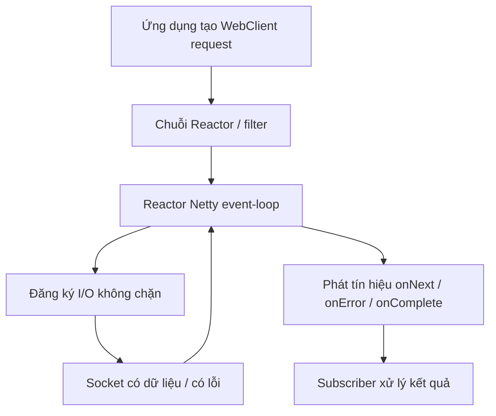
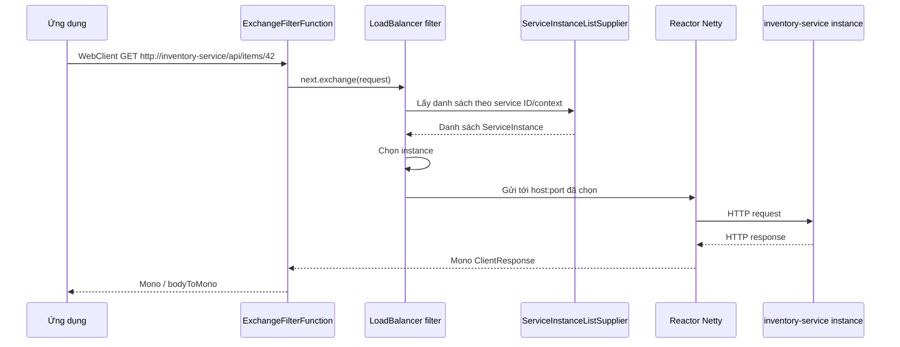

# Tránh block trên event-loop và tác vụ chặn luồng trong filter

`WebClient` là HTTP client hỗ trợ lập trình reactive của Spring WebFlux. Khi kết hợp `WebClient` với **Spring Cloud LoadBalancer**, request có thể đi qua một hoặc nhiều `ExchangeFilterFunction`, sau đó LoadBalancer chọn `ServiceInstance` theo service ID, discovery, health check và chính sách định tuyến. Một lỗi thiết kế dễ bỏ sót là gọi API **blocking** ngay trong filter hoặc trong chuỗi Reactor xử lý request. Đoạn mã có thể chạy đúng ở môi trường ít tải nhưng khiến nhiều request khác bị chậm hoặc treo khi ứng dụng chịu tải thực tế.

Bài học thuộc chương **WebClient** giải thích event-loop là gì, vì sao `.block()`, `Thread.sleep()`, JDBC, file I/O và các API đồng bộ khác gây vấn đề trong filter, cách thay bằng composition của `Mono`/`Flux`, cách chuyển những tác vụ blocking chưa thể loại bỏ sang `Schedulers.boundedElastic()` và cách kiểm chứng tác động bằng kiểm thử, metrics. Phạm vi tập trung vào **client-side load balancing**; việc chuyển sang reactive không tự giải quyết mọi vấn đề của HTTP timeout, retry hoặc connection pool.

## 1. Event-loop trong WebClient là gì?

Với Spring WebFlux sử dụng Reactor Netty, HTTP I/O thường chạy trên một nhóm nhỏ các thread event-loop. Các thread này xử lý nhiều kết nối bằng cách phản ứng với sự kiện đọc/ghi thay vì giữ một thread chuyên dụng để chờ mỗi request.



Một điểm quan trọng: **reactive không có nghĩa mọi đoạn Java tự động chạy trên thread riêng**. Các operator như `map`, `flatMap`, `doOnNext` và code được gọi trong filter có thể chạy trên thread phát tín hiệu hiện tại, bao gồm thread event-loop, nếu không có ranh giới scheduler phù hợp.

### 1.1. Blocking và non-blocking khác nhau thế nào?

| Hành vi | Ví dụ | Ảnh hưởng lên thread hiện tại |
|---|---|---|
| **Blocking** | `Thread.sleep(500)`, `Future.get()`, `RestTemplate.getForObject(...)` | Thread phải đứng chờ đến khi thao tác hoàn tất |
| **Blocking bridge** | Gọi `.block()` trên một `Mono` để lấy kết quả ngay | Chờ kết quả đồng bộ; không phù hợp trên event-loop |
| **Non-blocking I/O** | `WebClient.get().retrieve().bodyToMono(...)` | Biểu diễn kết quả bất đồng bộ; không giữ thread chờ socket |
| **Reactive composition** | `tokenMono.flatMap(token -> callApi(token))` | Nối các bước khi dữ liệu tới, không cần `block()` |
| **Offload có kiểm soát** | `Mono.fromCallable(...).subscribeOn(Schedulers.boundedElastic())` | Đưa công việc blocking sang scheduler dành cho tác vụ chặn luồng |

Một HTTP request có thể mất 300 ms để hoàn thành mà **không chặn event-loop 300 ms**. Thời gian request dài không đồng nghĩa thread bị chiếm liên tục. Ngược lại, `Thread.sleep(300)` trong filter giữ nguyên một thread, khiến các socket khác do thread đó quản lý phải đợi.

### 1.2. Vì sao chỉ một filter chậm có thể làm nhiều request bị ảnh hưởng?

Giả sử event-loop có vài thread và mỗi request đi qua một filter gọi hệ thống quản lý token bằng API đồng bộ mất 200 ms. Nếu 100 request tới cùng lúc, nhiều lời gọi bị xếp hàng đợi vì số thread event-loop có giới hạn. Kết quả thường biểu hiện bằng p95/p99 latency tăng, timeout dây chuyền, lỗi kết nối hoặc throughput giảm dù downstream service vẫn khỏe.

```text
Không phù hợp:
event-loop-1: filter(req A) -- chờ 200ms -- filter(req B) -- chờ 200ms -- ...

Phù hợp hơn:
event-loop-1: đăng ký tác vụ A -> đăng ký tác vụ B -> tiếp tục xử lý I/O
boundedElastic: thực hiện API đồng bộ A / B với số thread và hàng đợi giới hạn
```

Offload vẫn sử dụng thread và tài nguyên thật; nó chỉ **không chiếm event-loop** trong lúc chờ. Nếu quá nhiều tác vụ blocking cùng lúc, `boundedElastic` cũng có thể bão hòa. Giải pháp tốt nhất, khi khả thi, vẫn là dùng một API bất đồng bộ từ đầu đến cuối.

## 2. Filter nằm ở đâu trong luồng Spring Cloud LoadBalancer?

Một `WebClient.Builder` được đánh dấu `@LoadBalanced` có thể được Spring Cloud cấu hình với LoadBalancer exchange filter. Với reactive LoadBalancer, thành phần thường gặp là `ReactorLoadBalancerExchangeFilterFunction` hoặc biến thể trì hoãn (`DeferringReactiveLoadBalancerExchangeFilterFunction`) tùy cách cấu hình và phiên bản.



Mục tiêu của một filter là bổ sung header, xác thực, logging hoặc điều chỉnh request/response theo hợp đồng `ExchangeFilterFunction`: từ `ClientRequest` và `ExchangeFunction`, trả về **`Mono<ClientResponse>`**. Filter không cần thực hiện HTTP call đồng bộ để lấy kết quả trước khi tiếp tục.

**Lưu ý về thứ tự:** thứ tự các filter trong builder ảnh hưởng thời điểm một filter nhìn thấy URI logic (`http://inventory-service`) hay URI đã được rewrite sang instance cụ thể. Không nên viết bộ lọc phụ thuộc vào thứ tự ẩn. Hãy kiểm chứng chain trên phiên bản đang dùng, đặc biệt khi custom filter cần host, service ID hoặc headers để log và áp dụng bảo mật.

## 3. Các anti-pattern phải tránh trong filter

### 3.1. Gọi `.block()` để lấy token trước request

Ví dụ **không nên dùng**:

```java
// SAI: Không dùng trong ExchangeFilterFunction.
ExchangeFilterFunction blockingAuthFilter(WebClient authClient) {
    return (request, next) -> {
        String token = authClient.post()
                .uri("/oauth/token")
                .retrieve()
                .bodyToMono(String.class)
                .block(); // Chờ đồng bộ trong filter.

        ClientRequest changed = ClientRequest.from(request)
                .headers(headers -> headers.setBearerAuth(token))
                .build();

        return next.exchange(changed);
    };
}
```

`.block()` là cầu nối từ reactive sang synchronous. Nếu được thực thi trên thread event-loop (như `reactor-http-nio-*`), Reactor còn có thể ném ngoại lệ dạng `IllegalStateException: block()/blockFirst()/blockLast() are blocking, which is not supported in thread ...`. Nếu được gọi ở một thread khác không bị cấm, nó vẫn chiếm thread đó trong thời gian chờ và có nguy cơ tạo deadlock hoặc giảm khả năng mở rộng.

**Không sửa bằng cách chuyển `.block()` vào `Mono.defer(...)` rồi gọi nó trên cùng event-loop.** `defer` chỉ trì hoãn thời điểm thực thi, không tự chuyển công việc sang scheduler khác.

### 3.2. Tác vụ chặn luồng khác có thể ẩn trong filter

| Tác vụ trong filter hoặc operator | Vì sao có thể blocking? | Hướng xử lý |
|---|---|---|
| `Thread.sleep(...)` | Giữ thread trong thời gian chờ | Dùng `Mono.delay(...)` cho khoảng chờ phi chặn hoặc backoff của Reactor |
| `CompletableFuture.get()` / `.join()` | Chờ Future đồng bộ | Dùng `Mono.fromFuture(...)` hoặc API async tương ứng |
| JDBC/JPA call | Driver thông thường chặn thread trong lúc truy vấn | Ưu tiên R2DBC; nếu chưa đổi được, offload và giới hạn concurrency |
| `RestClient` / `RestTemplate` | HTTP I/O đồng bộ | Dùng `WebClient` hoặc client bất đồng bộ |
| `Files.readAllBytes(...)` trên file lớn | Disk I/O đồng bộ | Offload sang `boundedElastic` hoặc chuyển sang API bất đồng bộ |
| API SDK đồng bộ để lấy credentials/metadata | Có thể thực hiện I/O, DNS hoặc khóa chờ | Dùng SDK async, cache token hoặc offload có kiểm soát |
| `CountDownLatch.await()` / lock lâu | Giữ thread trong lúc đợi điều kiện | Dùng primitive reactive/async, tránh khóa quanh I/O |
| Ghi log đồng bộ quá nặng | Có thể chờ disk/network appender | Dùng logging cấu hình hợp lý, async appender và giới hạn kích thước payload |

Không phải mọi thao tác CPU trong `map` đều là blocking I/O, nhưng tính toán CPU rất nặng vẫn chiếm event-loop và gây triệu chứng tương tự. Với tác vụ CPU thuần dài, cân nhắc scheduler/executor phù hợp và giới hạn concurrency; **không dùng `boundedElastic` như lời giải mặc định cho mọi phép tính CPU**.

### 3.3. `.subscribe()` trong filter cũng không phải cách nối bước đúng

Ví dụ sau sai về kiểm soát luồng:

```java
// SAI: Fire-and-forget không bảo đảm token có trước HTTP request.
return (request, next) -> {
    refreshTokenAsync().subscribe();
    return next.exchange(request);
};
```

Gọi `.subscribe()` thủ công tạo một nhánh công việc **ngoài** chuỗi request gốc, làm khó truyền lỗi, cancellation, tracing và sequencing. Nó có thể khiến `next.exchange(...)` chạy trước khi refresh hoàn tất. Thay vào đó, trả về `Mono` kết hợp bằng `flatMap` hoặc `then` để caller quản lý toàn bộ vòng đời.

## 4. Giải pháp tốt nhất: kết hợp Mono/Flux, không chờ đồng bộ

Nếu dịch vụ cấp token có API reactive, hãy để filter **trả lại** chuỗi `Mono`:

```java
public interface ReactiveTokenProvider {
    Mono<String> getAccessToken();
}

@Bean
ExchangeFilterFunction reactiveAuthFilter(ReactiveTokenProvider tokens) {
    return (request, next) -> tokens.getAccessToken()
            .switchIfEmpty(Mono.error(
                    new IllegalStateException("Không lấy được token")))
            .flatMap(token -> {
                ClientRequest updated = ClientRequest.from(request)
                        .headers(headers -> headers.setBearerAuth(token))
                        .build();
                return next.exchange(updated);
            });
}
```

Trong ví dụ:

1. `getAccessToken()` trả về `Mono<String>`; không gọi `.block()`.
2. `flatMap` đợi token phát ra rồi mới gửi request đã bổ sung `Authorization`.
3. Nếu token provider báo lỗi, luồng request nhận `onError`, không âm thầm dùng token rỗng.
4. Cancellation, timeout và context của subscription có cơ hội đi theo toàn bộ chuỗi.

Nếu token provider cũng dùng `WebClient`, nên cấu hình một **client xác thực riêng** (thường direct hoặc một client nội bộ khác không chứa chính filter này). Nếu cùng filter được đăng ký trên HTTP client dùng để lấy token, rất dễ tạo vòng gọi đệ quy: request lấy token lại yêu cầu token.

Chỉ áp dụng filter chứa secret cho **đích tin cậy**. Không đăng ký header Authorization của một đối tác lên builder dùng cho mọi hostname. Không ghi token vào log hay metric label.

### 4.1. Ví dụ filter đọc và xử lý response không blocking

`ExchangeFilterFunction` có thể quan sát metadata của response mà không cần ép đồng bộ:

```java
ExchangeFilterFunction statusLoggingFilter() {
    return (request, next) -> next.exchange(request)
            .doOnNext(response -> {
                HttpStatusCode status = response.statusCode();
                log.debug("method={} status={}", request.method(), status);
            });
}
```

`doOnNext` nên thực hiện công việc **nhẹ, ngắn, không chặn luồng**. Trong thực tế, cấu hình logging appender cũng phải tránh chờ disk/network kéo dài. Nếu cần phân tích body, hãy dùng operator phù hợp trên stream; đừng gọi `.block()` hoặc tiêu thụ body hai lần trong filter.

## 5. Chưa thể bỏ API đồng bộ: offload bằng boundedElastic

Không phải dự án nào cũng chuyển ngay JDBC, SDK hoặc hệ thống cấp token sang async. Khi buộc phải gọi một API blocking, cần **bọc lệnh blocking trong publisher được thực thi có kiểm soát**:

```java
@Bean
ExchangeFilterFunction legacyTokenFilter(BlockingTokenService tokenService) {
    return (request, next) -> Mono.fromCallable(() -> {
                String token = tokenService.getToken(); // API đồng bộ.
                if (token == null || token.isBlank()) {
                    throw new IllegalStateException("Token trống");
                }
                return token;
            })
            .subscribeOn(Schedulers.boundedElastic())
            .flatMap(token -> {
                ClientRequest updated = ClientRequest.from(request)
                        .headers(headers -> headers.setBearerAuth(token))
                        .build();
                return next.exchange(updated);
            });
}
```

`BlockingTokenService` là lớp giả định có phương thức **đồng bộ** `String getToken()`. Ý nghĩa của từng phần:

- `Mono.fromCallable(...)` trì hoãn việc chạy `getToken()` tới khi có subscription; nếu bỏ wrapper này và gọi method ngay khi dựng Mono, tác vụ vẫn có thể chạy trên event-loop.
- `.subscribeOn(Schedulers.boundedElastic())` đưa nguồn blocking vào scheduler được thiết kế cho công việc chờ I/O, có giới hạn thread và hàng đợi.
- `.flatMap(...)` tiếp tục tạo/gửi HTTP request bằng `next.exchange(...)` mà không cần gọi `.block()`.
- Lỗi trong `Callable` được chuyển thành tín hiệu `onError` để retry/timeout/handler quyết định theo chính sách.

**Giới hạn quan trọng:** offload không biến API blocking thành non-blocking thực sự; nó chỉ chuyển thời gian chờ sang nhóm thread khác. Nếu 1.000 request cùng đồng thời chờ token service, `boundedElastic` cũng có thể phải xếp hàng, tăng latency hoặc cạn tài nguyên. Nên cache token theo thời hạn phù hợp, giới hạn số lần gọi đồng thời và ưu tiên SDK async khi có thể.

### 5.1. Vì sao `subscribeOn` phù hợp ở đây?

Reactor phân biệt hai operator scheduler quan trọng:

| Operator | Ý nghĩa chính | Dùng khi nào? |
|---|---|---|
| `subscribeOn(scheduler)` | Điều phối quá trình subscribe/nguồn dữ liệu upstream trên scheduler | Bọc nguồn blocking như `Mono.fromCallable(...)` |
| `publishOn(scheduler)` | Chuyển thread xử lý các tín hiệu **từ điểm đó trở xuống** | Khi muốn tách phần xử lý downstream sang scheduler phù hợp |

Để offload một lệnh `Callable` blocking, dùng mẫu:

```java
Mono<Result> result = Mono.fromCallable(() -> blockingService.load())
        .subscribeOn(Schedulers.boundedElastic());
```

Không nên hiểu `publishOn` là giải pháp cho mọi code blocking. Nếu một phép gọi blocking đã chạy **trước** `publishOn`, việc thêm `publishOn` phía sau không sửa được đoạn đã chặn. Ngay cả khi dùng `publishOn` đúng điểm, việc dời một chuỗi dài sang scheduler khác có thể gây overhead không cần thiết.

### 5.2. `Schedulers.parallel()` không dành cho blocking I/O

`Schedulers.parallel()` tối ưu cho tác vụ CPU ngắn/thuần tính toán và có số thread hữu hạn. Đưa các lời gọi JDBC hoặc `Thread.sleep()` lên `parallel` có thể làm nghẽn nhóm thread tính toán. `Schedulers.boundedElastic()` phù hợp hơn cho **blocking I/O tạm thời**, còn với khối lượng lớn nên thiết kế pool/limit riêng và cân nhắc thay API đồng bộ.

Một số phiên bản Reactor có chế độ dùng virtual threads của Java 21 cho `boundedElastic` khi được bật đúng cấu hình. Điều này **không** loại bỏ giới hạn tài nguyên của database, connection pool hoặc SDK bên dưới, và không làm `.block()` trong event-loop trở thành hợp lệ.

### 5.3. Giới hạn thời gian và số tác vụ offload

Một token provider hoặc kho dữ liệu chậm vẫn có thể làm request WebClient trễ, dù event-loop không bị block. Hãy đặt timeout cho chính API blocking (nếu hỗ trợ) và deadline của pipeline:

```java
Mono<String> token = Mono.fromCallable(tokenService::getToken)
        .subscribeOn(Schedulers.boundedElastic())
        .timeout(Duration.ofSeconds(2));
```

`Mono.timeout` chấm dứt **việc chờ phản hồi trong pipeline**; nó không bảo đảm dừng một lệnh blocking đang chạy nếu SDK bỏ qua interrupt hoặc không hỗ trợ cancellation. Vì vậy, timeout ở HTTP client/database driver vẫn cần thiết; không được dùng `timeout` của Reactor để thay thế việc cấu hình socket timeout.

Muốn bảo vệ downstream dưới tải, bổ sung bulkhead, semaphore hoặc rate limiter giới hạn số thao tác blocking đồng thời. Đừng tự động retry tất cả lỗi timeout với số lần vô hạn; retry làm tăng số request đang chờ và có thể khuếch đại sự cố.

## 6. Cấu hình WebClient cân bằng tải theo service ID

Ví dụ tối thiểu về bean builder có tích hợp Spring Cloud LoadBalancer:

```java
import org.springframework.cloud.client.loadbalancer.LoadBalanced;
import org.springframework.context.annotation.Bean;
import org.springframework.context.annotation.Configuration;
import org.springframework.web.reactive.function.client.WebClient;

@Configuration(proxyBeanMethods = false)
class InventoryWebClientConfiguration {

    @Bean
    @LoadBalanced
    WebClient.Builder loadBalancedWebClientBuilder() {
        return WebClient.builder();
    }
}
```

Sử dụng builder đó trong gateway reactive:

```java
@Service
class InventoryGateway {
    private final WebClient inventory;

    InventoryGateway(@LoadBalanced WebClient.Builder builder) {
        this.inventory = builder
                .baseUrl("http://inventory-service")
                .build();
    }

    Mono<Item> findItem(long id) {
        return inventory.get()
                .uri("/api/items/{id}", id)
                .retrieve()
                .bodyToMono(Item.class);
    }
}
```

`Item` là DTO theo hợp đồng API của dịch vụ. `inventory-service` trong base URL là **service ID**, không nhất thiết là DNS hostname. Integration LoadBalancer chọn `ServiceInstance` từ chuỗi supplier rồi gửi request tới host/port tương ứng. Dự án cần dependency `spring-cloud-starter-loadbalancer` cùng nguồn discovery (`Eureka`, `Consul`, `SimpleDiscoveryClient`, v.v.) hoặc supplier riêng.

Ví dụ này giả định reactive LoadBalancer integration có mặt. Khi dùng Spring Boot auto-configuration, nên giữ các cấu hình WebClient liên quan codecs, connector và observability, và cân nhắc phân biệt builder load-balanced với builder trực tiếp để tránh gắn LoadBalancer lên lời gọi đến URL bên ngoài.

### 6.1. Gắn filter không blocking vào client

```java
@Bean
@LoadBalanced
WebClient.Builder loadBalancedWebClientBuilder(
        ReactiveTokenProvider tokenProvider) {

    return WebClient.builder()
            .filter((request, next) -> tokenProvider.getAccessToken()
                    .flatMap(token -> next.exchange(
                            ClientRequest.from(request)
                                    .headers(h -> h.setBearerAuth(token))
                                    .build())));
}
```

Đây là **phương án thay thế** bean `loadBalancedWebClientBuilder` ở trên, không phải khai báo hai bean trùng tên trong cùng cấu hình. Filter dùng `Mono` nên không phải gọi `.block()`. Nếu ứng dụng có nhiều service ID, chỉ gắn token filter vào các client cần token tương ứng. Token provider không được dùng chính builder này để gọi endpoint cấp token, nếu không có thể xảy ra vòng lặp filter.

### 6.2. Vì sao chọn ServiceInstance cũng phải non-blocking?

Ngay cả khi filter ứng dụng không gọi `.block()`, một `ServiceInstanceListSupplier` tùy chỉnh có thể gây nghẽn nếu truy vấn database hoặc HTTP đồng bộ trong `get(Request)`. Chuỗi supplier tham gia quá trình chọn đích của request; nếu nó block, nhiều request có thể bị ảnh hưởng trước khi Netty kịp bắt đầu gửi HTTP.

```java
// KHÔNG NÊN: I/O blocking trong get(Request).
@Override
public Flux<List<ServiceInstance>> get(Request request) {
    List<ServiceInstance> instances = legacyRegistry.fetchBlocking();
    return Flux.just(instances);
}
```

Một giải pháp chuyển tiếp khi bắt buộc dùng API blocking:

```java
@Override
public Flux<List<ServiceInstance>> get(Request request) {
    return Mono.fromCallable(() -> legacyRegistry.fetchBlocking())
            .subscribeOn(Schedulers.boundedElastic())
            .flux();
}
```

Ví dụ thứ hai offload truy vấn nhưng **vẫn có nguy cơ truy vấn nguồn cho mỗi request**. Nếu danh sách instance ít thay đổi, nên sử dụng discovery client phù hợp, cache hoặc snapshot bất biến được refresh định kỳ, rồi để `get(Request)` đọc snapshot nhanh, không chặn. Cẩn thận đặt cache trước các bộ lọc phụ thuộc request để tránh dùng lại danh sách sai cho tenant/zone/phiên bản khác.

## 7. Những chỗ blocking khác trong pipeline cần để ý

### 7.1. Blocking không chỉ nằm trong ExchangeFilterFunction

```java
// SAI: doOnNext vẫn chạy trên thread phát tín hiệu hiện tại.
Mono<Item> item = inventory.get()
        .uri("/api/items/42")
        .retrieve()
        .bodyToMono(Item.class)
        .doOnNext(value -> auditRepository.save(value)); // JDBC blocking.
```

`doOnNext` phù hợp cho side effect nhanh, không phù hợp để gọi repository đồng bộ. Nếu audit là một bước bắt buộc trong luồng nghiệp vụ, hãy dùng repository reactive hoặc offload và **compose** kết quả:

```java
Mono<Item> item = inventory.get()
        .uri("/api/items/42")
        .retrieve()
        .bodyToMono(Item.class)
        .flatMap(value -> Mono.fromCallable(() -> {
                    auditRepository.save(value); // Blocking; chưa có async API.
                    return value;
                })
                .subscribeOn(Schedulers.boundedElastic()));
```

Nếu audit thất bại, pipeline trên báo lỗi; nếu audit chỉ là best-effort thì cần thiết kế luồng retry/queue riêng, không `.subscribe()` fire-and-forget trong `doOnNext`. Khi thích hợp, dùng message broker hoặc outbox để bảo đảm việc ghi audit mà không giữ request chờ.

### 7.2. Không giả định map/filter luôn chạy ngoài event-loop

```java
// SAI: map có thể chạy trên event-loop.
Mono<Report> report = webClient.get()
        .uri("/reports/42")
        .retrieve()
        .bodyToMono(Report.class)
        .map(data -> blockingReportEnrichment.enrich(data));
```

Nếu `enrich` là HTTP/JDBC đồng bộ, phải thay bằng async API hoặc:

```java
Mono<Report> report = webClient.get()
        .uri("/reports/42")
        .retrieve()
        .bodyToMono(Report.class)
        .flatMap(data -> Mono.fromCallable(
                        () -> blockingReportEnrichment.enrich(data))
                .subscribeOn(Schedulers.boundedElastic()));
```

Đừng offload mọi `map` vô điều kiện: phép đổi kiểu dữ liệu nhỏ, đọc metadata hay định dạng header thường nên thực hiện ngay, không cần chuyển thread.

### 7.3. ThreadLocal không mặc nhiên truyền đúng qua scheduler

Nếu filter đọc `SecurityContextHolder` hoặc MDC bằng `ThreadLocal`, việc chuyển thread trong pipeline có thể làm mất context hoặc nhận giá trị không còn phù hợp. Trong reactive stack, dùng Reactor `Context` và cơ chế context propagation của Spring Security/Micrometer phù hợp với phiên bản đang dùng.

Ví dụ đọc một routing key đã được upstream lưu an toàn trong Reactor Context:

```java
Mono<String> routingKey = Mono.deferContextual(context ->
        Mono.just(context.getOrDefault("routingKey", "default")));
```

Giá trị `routingKey` cần được tạo từ thông tin đã xác thực, không tin trực tiếp header do người dùng gửi nếu nó quyết định tenant/region hoặc quyền truy cập. `Context` trong ví dụ là dữ liệu của subscriber, không phải global biến dùng chung cho mọi request.

## 8. Timeout, retry và connection pool vẫn là phần riêng

Một pipeline hoàn toàn non-blocking vẫn có thể bị chậm hoặc thất bại vì server không trả lời. WebClient và Reactor Netty cần timeout, connection pool, retry và giám sát thích hợp.

Ví dụ thiết lập connect/response timeout ở Reactor Netty connector:

```java
HttpClient httpClient = HttpClient.create()
        .option(ChannelOption.CONNECT_TIMEOUT_MILLIS, 1000)
        .responseTimeout(Duration.ofSeconds(3));

WebClient.Builder builder = WebClient.builder()
        .clientConnector(new ReactorClientHttpConnector(httpClient));
```

`ChannelOption` là `io.netty.channel.ChannelOption`, `HttpClient` là `reactor.netty.http.client.HttpClient`. `ReactorClientHttpConnector` thuộc Spring HTTP reactive. Nếu áp dụng cho builder load-balanced, giữ cả tích hợp LoadBalancer tương ứng; không tạo một builder direct rồi tưởng nó đã được gắn `@LoadBalanced` chỉ vì có Reactor Netty connector.

| Giới hạn | Vai trò | Không giải quyết |
|---|---|---|
| Connect timeout | Giới hạn thời gian mở kết nối TCP | Không tự thay đổi danh sách `ServiceInstance` |
| Response timeout | Giới hạn thời gian chờ phản hồi theo cơ chế HTTP client | Không thay thế timeout của truy vấn JDBC/blocking SDK |
| `Mono.timeout(...)` | Giới hạn thời gian chờ tín hiệu của pipeline | Không chắc dừng được API blocking không hỗ trợ hủy |
| Connection pool | Giới hạn/tái sử dụng các kết nối vật lý | Không bảo đảm instance đang healthy |
| Retry | Thử lại một số lỗi theo chính sách | Không đảm bảo an toàn cho `POST` có side effect |

**Retry:** nếu pipeline trả lỗi timeout sau khi request đã đến server, server có thể vẫn xử lý xong. Với request có side effect, cần idempotency key hoặc chính sách chống thực thi trùng; giới hạn số attempt và tổng deadline. Khi Spring Cloud LoadBalancer chọn lại instance, retry có thể cần supplier nhận biết previous instance để tránh lặp lại đích vừa lỗi. Không kết hợp nhiều lớp retry mà không tính số lượt gọi thực tế.

### 8.1. `timeout()` trong filter không phải giải pháp cho blocking code

Ví dụ:

```java
Mono<String> call = Mono.fromCallable(blockingService::slowCall)
        .subscribeOn(Schedulers.boundedElastic())
        .timeout(Duration.ofSeconds(2));
```

Đây là giải pháp **offload + giới hạn thời gian chờ**, khác với:

```java
// SAI: vẫn gọi blocking API ngay khi xây Mono.
Mono<String> call = Mono.just(blockingService.slowCall())
        .timeout(Duration.ofSeconds(2));
```

Ở mẫu sai, lời gọi `slowCall()` chạy **trước khi** `Mono.just(...)` trả về, nên `.timeout` không thể giúp thread đang chạy phương thức đó. Đây là lý do phải phân biệt *lười thực thi* (`fromCallable`, `defer`) và *chuyển thread* (`subscribeOn`).

## 9. Quan sát dấu hiệu event-loop bị block

Không nên chỉ dựa vào việc ứng dụng không có exception. Event-loop starvation có thể xuất hiện dưới dạng tăng độ trễ đuôi, queue chờ connection và throughput giảm.

| Triệu chứng | Khả năng liên quan | Cách điều tra |
|---|---|---|
| p99 tăng đột ngột khi thêm concurrency | Filter/operator có tác vụ blocking hoặc CPU nặng | Profile thread, xem stack trace tại `reactor-http-nio-*` |
| `IllegalStateException: block() ... not supported` | `.block()` trên thread được Reactor đánh dấu non-blocking | Tìm `.block()`, `.blockFirst()`, `.blockLast()` trong filter và reactive chain |
| CPU không cao nhưng request treo | Thread đang chờ I/O/lock hoặc boundedElastic đã bão hòa | Thread dump, trạng thái WAITING/TIMED_WAITING, scheduler queue |
| Timeout lan sang nhiều service ID | Event-loop bị chặn trước cả bước network hoặc pool quá tải | Phân biệt thời gian filter, chọn instance, connect và server latency |
| Health check/discovery chậm khi tải tăng | Custom supplier đang thực hiện I/O đồng bộ | Xem implement `get(Request)` và số lần gọi registry mỗi request |
| Tăng `boundedElastic` nhưng vẫn nghẽn | Nguồn blocking có pool/limit bên dưới hoặc tạo quá nhiều tác vụ | Đo số lượt thực thi đồng thời, queue, DB pool, token service |
| Trace/MDC sai khi chuyển scheduler | Dựa vào `ThreadLocal` mà không có context propagation | Kiểm tra Reactor Context và cấu hình Spring Security/Observability |

### 9.1. Metrics nên đo

- **p50/p95/p99** của HTTP request và của từng downstream service ID.
- **Thời gian trong filter** nếu có instrumentation riêng; không gắn toàn bộ header/URI động làm metric label.
- **Connection pool active/pending**, connect timeout và response timeout.
- **Số request đang xử lý**, tỉ lệ lỗi, retry và cancellation.
- **BoundedElastic queued/active tasks**, nếu scheduler metrics được bật và cung cấp trong bản Reactor sử dụng.
- **Event-loop thread dumps** và dấu hiệu blocked thread khi tải tăng.

Với Spring Cloud LoadBalancer, có thể quan sát service ID, instance được chọn và các lifecycle event khi cấu hình metrics phù hợp. Nhưng request bị chặn trong một filter **trước khi LoadBalancer chọn instance** có thể chưa xuất hiện trong metrics lựa chọn đích. Cần đo cả tổng thời gian ở lớp WebClient và từng bước của pipeline.

Không ghi access token, cookies, thông tin định danh tenant chưa chuẩn hóa hoặc request body nhạy cảm vào log và metrics.

## 10. Kiểm thử phát hiện blocking và xác minh cách sửa

### 10.1. Unit/integration test với StepVerifier

`StepVerifier` từ `reactor-test` giúp kiểm tra tín hiệu `Mono` mà không phải tự `.block()` trong code ứng dụng:

```java
@Test
void inventoryClientEmitsItem() {
    Mono<Item> result = gateway.findItem(42);

    StepVerifier.create(result)
            .assertNext(item -> assertEquals(42L, item.id()))
            .verifyComplete();
}
```

Test cần một stub HTTP hoặc instance thật ở service ID được discovery nhận diện. `StepVerifier` chạy xác minh theo kiểu test; đây không phải là lời khuyên thực thi logic chờ đồng bộ trong filter hoặc controller của ứng dụng.

### 10.2. Dùng BlockHound để phát hiện thao tác blocking

Trong test hoặc môi trường phát triển, **BlockHound** có thể phát hiện một số API blocking được gọi trên thread được đánh dấu non-blocking của Reactor. Ví dụ cách cài đặt về mặt ý tưởng:

```java
// Ví dụ minh họa trong test setup; phụ thuộc cách tích hợp BlockHound.
BlockHound.install();
```

Sau đó chạy bài kiểm thử gọi filter có `Thread.sleep()` trên scheduler non-blocking và quan sát lỗi được báo. Cần kiểm tra tương thích Java/Reactor/agent instrumentation, các yêu cầu JVM và allowlist phù hợp trước khi thêm vào test suite. BlockHound **không phát hiện mọi kiểu I/O blocking** và không thay thế load test hoặc thread dump.

Đừng bật BlockHound tùy tiện trên production rồi kết luận mọi cảnh báo đều do code của ứng dụng; một số thư viện nội bộ có hành vi khác nhau theo phiên bản. Dùng dữ liệu để chọn nơi sửa và tái kiểm chứng.

### 10.3. Thực hành A/B: filter blocking và non-blocking

Chuẩn bị một API stub phản hồi bình thường và một token provider giả lập có độ trễ. Thử hai phiên bản filter:

1. **Phiên bản lỗi (chỉ chạy trong môi trường test):** `Thread.sleep(200)` hoặc `blockingTokenService.getToken()` ngay trong filter, không offload.
2. **Phiên bản sửa:** token provider reactive; nếu chỉ có API blocking, dùng `Mono.fromCallable(...).subscribeOn(Schedulers.boundedElastic())`.
3. Gửi nhiều request đồng thời qua `@LoadBalanced WebClient.Builder` đến `inventory-service`.
4. So sánh p95/p99, throughput, thread dump, queue của connector và số task đang chờ.
5. Tăng concurrency để kiểm tra khi nào chính `boundedElastic` hoặc hệ thống cấp token chạm giới hạn.
6. Thử timeout/cancellation và lỗi token provider để bảo đảm pipeline phát `onError` và không gửi request thiếu Authorization.
7. Lặp lại với custom `ServiceInstanceListSupplier` có I/O đồng bộ để thấy việc block ở giai đoạn chọn instance cũng gây nghẽn, ngay cả khi filter đã sửa.

Kết luận thử nghiệm phải căn cứ vào số liệu và cấu hình cụ thể. Offload có thể cải thiện khả năng phục vụ I/O concurrent nhưng không bảo đảm throughput luôn tăng nếu dependency blocking phía dưới là nút thắt chính.

## 11. Checklist trước khi đưa filter WebClient vào production

- **Không gọi `.block()`, `.blockFirst()`, `.blockLast()`, `.get()`/`.join()` chờ Future** trong filter, supplier hoặc reactive handler chạy trên event-loop.
- **Không gọi JDBC/JPA, `RestTemplate`/`RestClient` hoặc file I/O đồng bộ** trực tiếp trong `map`, `doOnNext`, `ExchangeFilterFunction` hoặc `ServiceInstanceListSupplier.get(Request)`.
- **Ưu tiên API reactive/async** cho token provider, discovery, HTTP, database và thao tác enrich.
- **Khi chưa thay API đồng bộ được**, dùng `Mono.fromCallable(...).subscribeOn(Schedulers.boundedElastic())`, có timeout, giới hạn concurrency và đo queue/tài nguyên.
- **Trả chuỗi Mono/Flux**, không `.subscribe()` fire-and-forget trong filter để xử lý công việc bắt buộc trước request.
- **Cấu hình filter đúng phạm vi client và service ID**, tránh vòng gọi lấy token và tránh gửi secret sang host ngoài ý muốn.
- **Không giả định `defer` tự chuyển thread**; hiểu khác nhau giữa `subscribeOn` và `publishOn`.
- **Giữ context đúng cách** qua scheduler bằng Reactor Context và cơ chế propagation phù hợp, không phụ thuộc ThreadLocal thuần.
- **Giữ timeout/retry/connection pool riêng biệt**, không kỳ vọng non-blocking tự bảo đảm request thành công.
- **Kiểm thử dưới concurrency thực tế**, kèm thread dump/BlockHound khi phù hợp và đo p95/p99, lỗi, queue, latency của filter.

**Kết luận:** một `WebClient` được tích hợp Spring Cloud LoadBalancer chỉ hoạt động ổn định khi toàn bộ đường xử lý request — từ filter xác thực, chọn instance, đọc discovery đến nhận response — không chiếm giữ event-loop bằng công việc chặn luồng. **Tốt nhất là dùng composition `Mono`/`Flux`; nếu buộc dùng thư viện blocking, hãy offload có giới hạn sang `Schedulers.boundedElastic()` và đo tác động dưới tải.** Cùng với discovery/health check, timeout, retry và observability, cách này giúp client giữ khả năng xử lý đồng thời khi số dịch vụ và request tăng.

## Tài liệu tham khảo

- [Spring Framework — WebClient Filters](https://docs.spring.io/spring-framework/reference/web/webflux-webclient/client-filter.html): cách viết `ExchangeFilterFunction` và xử lý request/response.
- [Spring Cloud Commons — Spring Cloud LoadBalancer](https://docs.spring.io/spring-cloud-commons/reference/spring-cloud-commons/loadbalancer.html): tích hợp WebClient, reactive load-balancer filter và supplier.
- [Project Reactor — FAQ: Blocking Call](https://projectreactor.io/docs/core/release/reference/faq.html#faq.wrap-blocking): `Mono.fromCallable` kết hợp `Schedulers.boundedElastic()`.
- [Project Reactor — Threading and Schedulers](https://projectreactor.io/docs/core/release/reference/coreFeatures/schedulers.html): event-loop, `subscribeOn`, `publishOn`, `boundedElastic` và tài nguyên scheduler.
