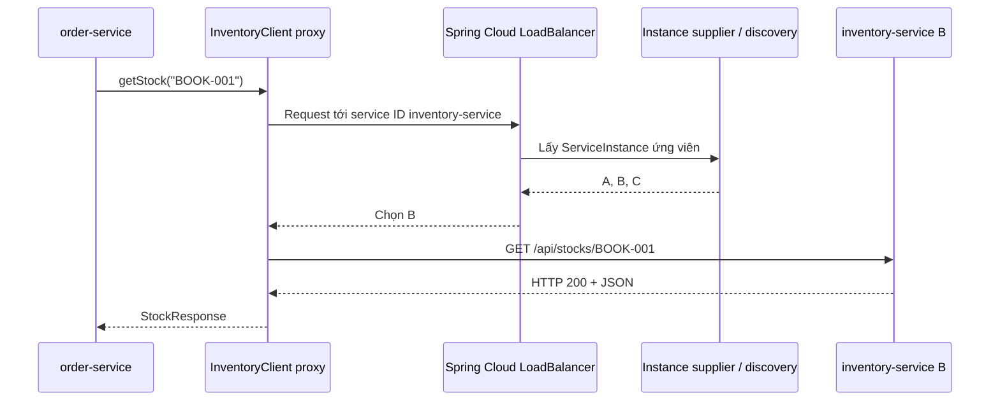

# HTTP client khai báo với @FeignClient

Trong kiến trúc microservices, `order-service` thường phải gọi API của `inventory-service` để kiểm tra tồn kho, trong khi `inventory-service` có thể chạy trên nhiều bản sao. Khi sử dụng `RestClient` hay `WebClient`, lập trình viên chủ động tạo lời gọi bằng builder và URI. Với **Spring Cloud OpenFeign**, ta có thể mô tả HTTP API dưới dạng **interface Java**, rồi để framework tạo implementation tại thời điểm chạy.

Annotation **`@FeignClient`** là điểm bắt đầu của cách viết này: interface khai báo dịch vụ đích và HTTP contract; Spring Cloud OpenFeign tạo proxy để mã nghiệp vụ gọi phương thức Java như một lời gọi cục bộ. Khi client chỉ dùng tên logic của dịch vụ và Spring Cloud LoadBalancer được tích hợp, proxy có thể chọn `ServiceInstance` phù hợp thông qua service discovery/supplier, thay vì buộc ứng dụng hard-code IP và port.

Bài này thuộc chương **OpenFeign** của module `SPRING_CLOUD_SERVICE_COMMUNICATION_LOAD_BALANCING`. Trọng tâm là khai báo và sử dụng `@FeignClient`, nhận diện các thành phần tham gia lựa chọn bản sao, cấu hình timeout, diễn giải lỗi HTTP/nghiệp vụ và hiểu giới hạn của HTTP client dạng khai báo.

## 1. Client khai báo giải quyết vấn đề gì?

Một lời gọi HTTP thông thường phải xác định method, URI, request body, headers, cách chuyển response và xử lý lỗi. Nếu lặp lại phần dựng request ở nhiều nơi, mã nghiệp vụ có thể bị lẫn với chi tiết giao thức.

Với client khai báo, ta mô tả contract tại một interface:

```java
@FeignClient(name = "inventory-service")
interface InventoryClient {
    @GetMapping("/api/stocks/{sku}")
    StockResponse getStock(@PathVariable("sku") String sku);
}
```

Code nghiệp vụ chỉ cần gọi `inventoryClient.getStock("BOOK-001")`. Phần tạo HTTP request được proxy của Feign xử lý dựa trên metadata từ các annotation.

| Cách viết | Điểm nổi bật | Điều cần chú ý |
| --- | --- | --- |
| `RestClient` | API fluent đồng bộ; tạo request rõ ràng bằng builder | Tự tổ chức adapter và dựng URI/method |
| `WebClient` | API reactive; phù hợp pipeline bất đồng bộ | Cần hiểu `Mono`/`Flux` và mô hình non-blocking |
| Spring Cloud OpenFeign | Interface mô tả HTTP API; proxy sinh tự động | Cần quản lý contract, cấu hình proxy, timeout và xử lý lỗi |

OpenFeign vẫn gửi request HTTP qua một transport bên dưới. Việc code trông như gọi một phương thức Java **không biến lời gọi mạng thành lời gọi trong bộ nhớ**. Nó vẫn có độ trễ, timeout, lỗi kết nối và khả năng kết quả không chắc chắn khi server đã xử lý request nhưng response không về kịp thời.

## 2. Bốn thành phần của một lời gọi Feign có cân bằng tải

Giả sử `inventory-service` có ba instance:

| Instance | Host | Port |
| --- | --- | --- |
| A | `10.0.1.11` | `8080` |
| B | `10.0.1.12` | `8080` |
| C | `10.0.1.13` | `8080` |

Các thành phần chính:

1. **Feign proxy:** nhận lời gọi phương thức Java, chuyển tham số sang HTTP request và giải mã response.
2. **Tên dịch vụ logic:** `inventory-service`, được khai báo ở `@FeignClient(name = "...")`.
3. **Spring Cloud LoadBalancer:** lấy danh sách bản sao từ `ServiceInstanceListSupplier`, chọn instance theo chính sách như Round Robin và chuyển request tới đích được chọn.
4. **HTTP transport:** tạo kết nối, gửi request, nhận response hoặc ném exception.



Sơ đồ là **đường đi thành công điển hình**. Nếu registry không có instance, supplier lọc hết ứng viên hoặc kết nối tới B thất bại, caller có thể không nhận được `StockResponse`. Feign không tự bảo đảm mọi request thành công chỉ vì một client proxy đã được tạo.

## 3. Khai báo dependency và kích hoạt Feign

Trong dự án Spring Boot phù hợp với Spring Cloud OpenFeign, dependency Maven cơ bản có dạng:

```xml
<dependency>
    <groupId>org.springframework.cloud</groupId>
    <artifactId>spring-cloud-starter-openfeign</artifactId>
</dependency>

<dependency>
    <groupId>org.springframework.cloud</groupId>
    <artifactId>spring-cloud-starter-loadbalancer</artifactId>
</dependency>
```

`spring-cloud-starter-openfeign` cung cấp tích hợp Feign; `spring-cloud-starter-loadbalancer` cung cấp thành phần client-side load balancing khi gọi bằng service ID. Nguồn instance có thể đến từ Eureka, Consul, Kubernetes, một `DiscoveryClient` thích hợp hoặc danh sách tĩnh dùng cho ví dụ/kiểm thử.

Cần sử dụng Spring Cloud BOM tương thích với phiên bản Spring Boot của dự án; không gắn version độc lập tùy ý lên từng starter. Nếu ứng dụng đã dùng cơ chế quản lý dependency của công ty, hãy tuân theo phiên bản đang được hỗ trợ.

Kích hoạt việc quét các interface Feign:

```java
import org.springframework.boot.SpringApplication;
import org.springframework.boot.autoconfigure.SpringBootApplication;
import org.springframework.cloud.openfeign.EnableFeignClients;

@SpringBootApplication
@EnableFeignClients(basePackages = "com.example.order.clients")
public class OrderApplication {
    public static void main(String[] args) {
        SpringApplication.run(OrderApplication.class, args);
    }
}
```

`@EnableFeignClients` đăng ký các Feign client được phát hiện ở package đã chỉ định. Nếu interface nằm ngoài phạm vi quét, proxy có thể không được tạo và việc inject sẽ thất bại. Trong ứng dụng có cấu trúc package đơn giản, có thể dùng `@EnableFeignClients` không có `basePackages` nếu phạm vi quét mặc định phù hợp.

**Không đặt `@LoadBalanced` lên interface `@FeignClient` như cách gắn cho `RestClient.Builder`.** Tích hợp Feign với Spring Cloud LoadBalancer được thiết lập qua thành phần Feign client và các bean Spring Cloud liên quan khi dependency/cấu hình đúng.

## 4. Xác định HTTP contract giữa caller và destination

Trước khi khai báo Feign, cần có một hợp đồng rõ về HTTP method, path, status và JSON. Ví dụ `inventory-service` cung cấp endpoint đọc tồn kho:

```http
GET /api/stocks/BOOK-001 HTTP/1.1
Host: inventory-service
Accept: application/json
```

Phản hồi thành công:

```http
HTTP/1.1 200 OK
Content-Type: application/json

{
  "sku": "BOOK-001",
  "availableQuantity": 12
}
```

Tại dịch vụ đích, controller có thể được viết như sau:

```java
import org.springframework.web.bind.annotation.GetMapping;
import org.springframework.web.bind.annotation.PathVariable;
import org.springframework.web.bind.annotation.RequestMapping;
import org.springframework.web.bind.annotation.RestController;

@RestController
@RequestMapping("/api/stocks")
class StockController {

    @GetMapping("/{sku}")
    StockResponse getStock(@PathVariable("sku") String sku) {
        // Chỉ minh họa contract; dữ liệu thực đến từ service/repository.
        return new StockResponse(sku, 12);
    }
}

record StockResponse(String sku, int availableQuantity) {}
```

Controller và Feign client là **hai thành phần chạy trong hai ứng dụng khác nhau**. Chúng không bắt buộc chia sẻ cùng một class Java, nhưng DTO và contract phải tương thích về tên trường, kiểu dữ liệu, mã lỗi và quy tắc versioning.

## 5. Khai báo @FeignClient ở dịch vụ gọi

Ví dụ interface thuộc package `com.example.order.clients`:

```java
package com.example.order.clients;

import org.springframework.cloud.openfeign.FeignClient;
import org.springframework.web.bind.annotation.GetMapping;
import org.springframework.web.bind.annotation.PathVariable;

@FeignClient(
        name = "inventory-service",
        path = "/api/stocks"
)
public interface InventoryFeignClient {

    @GetMapping("/{sku}")
    StockResponse getStock(@PathVariable("sku") String sku);
}
```

Và DTO phù hợp với JSON trả về:

```java
package com.example.order.clients;

public record StockResponse(String sku, int availableQuantity) {}
```

**Cách Feign ghép contract:** `path = "/api/stocks"` ở interface kết hợp `@GetMapping("/{sku}")` ở method để tạo request `GET /api/stocks/{sku}`. Giá trị `sku` được đưa vào path variable theo tên khai báo tường minh.

Các annotation thường gặp khi mô tả contract:

| Annotation | Vai trò | Ví dụ |
| --- | --- | --- |
| `@GetMapping` | Gọi HTTP GET | Đọc tồn kho |
| `@PostMapping` | Gọi HTTP POST | Tạo yêu cầu giữ hàng |
| `@PathVariable` | Điền biến vào URI path | `{sku}` |
| `@RequestParam` | Thêm query parameter | `?warehouse=HCM` |
| `@RequestHeader` | Gắn header cụ thể | `X-Correlation-ID` |
| `@RequestBody` | Chuyển đối tượng thành request body | JSON cho thao tác ghi |

Spring Cloud OpenFeign dùng Spring MVC contract theo cấu hình mặc định phổ biến, nên các annotation Spring MVC trên interface có thể được dùng để mô tả HTTP endpoint. Không nên giả định mọi annotation của controller server đều mang đầy đủ ý nghĩa như nhau tại client; hãy dựa trên contract mà Feign hỗ trợ và kiểm thử thực tế.

### 5.1. Ví dụ có query parameter và header

```java
@FeignClient(name = "inventory-service", path = "/api/stocks")
public interface InventoryFeignClient {

    @GetMapping("/{sku}")
    StockResponse getStock(
            @PathVariable("sku") String sku,
            @RequestParam("warehouse") String warehouse,
            @RequestHeader("X-Correlation-ID") String correlationId);
}
```

Lời gọi:

```java
StockResponse stock =
        inventoryFeignClient.getStock("BOOK-001", "HCM", traceId);
```

HTTP request có thể có path và query:

```http
GET /api/stocks/BOOK-001?warehouse=HCM HTTP/1.1
X-Correlation-ID: 123e4567-e89b-12d3-a456-426614174000
```

Ví dụ này mô tả **một biến thể của interface** so với ví dụ chỉ có `sku`, không phải yêu cầu khai báo đồng thời hai interface cùng tên. Khi thiết kế API thật, cần xác nhận destination hỗ trợ `warehouse` và header tương ứng.

### 5.2. Ví dụ POST với request body

```java
@FeignClient(name = "inventory-service", path = "/api/reservations")
public interface InventoryReservationClient {

    @PostMapping
    ReservationResponse reserve(@RequestBody ReservationRequest request);
}

public record ReservationRequest(
        String requestId, String sku, int quantity) {}

public record ReservationResponse(
        String reservationId, String status) {}
```

Method này biểu diễn một thao tác **có thể thay đổi trạng thái** ở phía server. Không nên retry tự động chỉ vì kết nối hết thời gian chờ: server có thể đã tạo reservation nhưng phản hồi bị mất. Với thao tác ghi, nên thiết kế `requestId` hoặc idempotency key và quy tắc xử lý trùng ở phía server trước khi bật retry.

## 6. Những thuộc tính quan trọng của @FeignClient

```java
@FeignClient(
        name = "inventory-service",
        contextId = "inventoryQueryClient",
        path = "/api/stocks"
)
interface InventoryQueryClient {
    @GetMapping("/{sku}")
    StockResponse getStock(@PathVariable("sku") String sku);
}
```

| Thuộc tính | Ý nghĩa | Lưu ý |
| --- | --- | --- |
| `name` / `value` | Tên Feign client và thường là service ID để load balancing | `inventory-service` phải khớp tên trong nguồn instance |
| `contextId` | Định danh ngữ cảnh client khi cần phân biệt nhiều Feign client cùng `name` | Hữu ích để tránh trùng bean/ngữ cảnh cấu hình |
| `path` | Path prefix cho mọi method | Không phải tên service hoặc địa chỉ server |
| `url` | URL đích tường minh nếu được cung cấp | Có thể bỏ qua lựa chọn qua discovery/LoadBalancer |
| `configuration` | Lớp cấu hình dành riêng cho Feign client | Tránh vô ý áp dụng toàn cục khi component scan |
| `fallback` / `fallbackFactory` | Cơ chế fallback khi có tích hợp circuit breaker phù hợp | Không tự hoạt động nếu thiếu dependency và cấu hình hỗ trợ |

Không nhất thiết khai báo mọi thuộc tính trên. Với trường hợp **gọi service ID qua discovery**, cấu hình tối thiểu thường là `name` cùng các mapping method. Mức độ cần thêm `contextId` và cấu hình client phụ thuộc cấu trúc ứng dụng.

## 7. name và url: có cân bằng tải hay không?

Hai cấu hình sau trông gần giống nhau nhưng đường đi request khác biệt.

**Trường hợp A — chỉ định service ID:**

```java
@FeignClient(name = "inventory-service")
interface InventoryClient {
    @GetMapping("/api/stocks/{sku}")
    StockResponse getStock(@PathVariable("sku") String sku);
}
```

Nếu không có URL cố định nào được cấu hình cho client, Feign sử dụng tên `inventory-service` để gọi qua Spring Cloud LoadBalancer **khi tích hợp này được cài đặt và bật**. Bộ chọn lấy danh sách từ discovery/supplier, rồi chọn một instance.

**Trường hợp B — chỉ định một URL vật lý:**

```java
@FeignClient(
        name = "inventory-service",
        url = "http://localhost:18081"
)
interface InventoryDirectClient {
    @GetMapping("/api/stocks/{sku}")
    StockResponse getStock(@PathVariable("sku") String sku);
}
```

Ở đây Feign dùng URL đã xác định. Nó không cần chọn một instance qua service ID cho lời gọi này; việc cân bằng tải phía client của Spring Cloud thường **không được dùng trên đường URL tường minh**.

Ngay cả khi annotation không đặt `url`, một URL có thể được cung cấp từ cấu hình:

```yaml
spring:
  cloud:
    openfeign:
      client:
        config:
          inventory-service:
            url: http://localhost:18081
```

Khi điều tra vì sao LoadBalancer không được gọi, hãy kiểm tra cả annotation lẫn thuộc tính cấu hình hiệu lực. Đừng kết luận chỉ từ việc `name` vẫn có giá trị `inventory-service`.

## 8. Cấu hình nguồn instance để thử nhiều bản sao

Feign không tự sinh ra danh sách instance. Có thể dùng discovery thật như Eureka/Consul hoặc dùng SimpleDiscoveryClient trong môi trường demo.

Ví dụ hai server test tại `localhost:18081` và `localhost:18082`:

```yaml
spring:
  application:
    name: order-service
  cloud:
    discovery:
      client:
        simple:
          instances:
            inventory-service:
              - uri: http://localhost:18081
              - uri: http://localhost:18082
```

Lưu ý: cấu hình này chỉ tạo **nguồn instance tĩnh**, không tự khởi động hai HTTP server. Cần chạy hai process hoặc hai server test tại các port tương ứng và bảo đảm Spring context có tích hợp discovery và LoadBalancer thích hợp.

Khi nguồn instance trả về cả hai địa chỉ, Spring Cloud LoadBalancer có thể phân phối lựa chọn theo chính sách đã cấu hình. Nếu dùng Round Robin với danh sách ổn định, các lần lựa chọn kế tiếp có thể luân phiên giữa hai server. Tuy nhiên, nhiều caller hoặc nhiều process có trạng thái LoadBalancer riêng; không nên kỳ vọng một chuỗi phân phối toàn cục tuyệt đối.

## 9. Tiêm Feign client vào lớp nghiệp vụ

Spring Cloud OpenFeign tạo bean proxy từ interface đã được `@EnableFeignClients` tìm thấy. Lớp nghiệp vụ có thể dùng constructor injection:

```java
import org.springframework.stereotype.Service;

@Service
class OrderStockService {

    private final InventoryFeignClient inventoryClient;

    OrderStockService(InventoryFeignClient inventoryClient) {
        this.inventoryClient = inventoryClient;
    }

    boolean hasEnoughStock(String sku, int requestedQuantity) {
        StockResponse stock = inventoryClient.getStock(sku);
        return stock.availableQuantity() >= requestedQuantity;
    }
}
```

Ví dụ giả định interface ở mục 5 chỉ có method `getStock(String sku)`. `StockResponse` là response đã được Feign chuyển từ JSON sang Java record phù hợp.

**Kết quả nghiệp vụ không đồng nhất với status HTTP.** Nếu API trả `200 OK` với `availableQuantity = 0`, Feign vẫn trả DTO bình thường, nhưng `hasEnoughStock(...)` có thể là `false`. Nếu API dùng `409`/`422` để biểu diễn thiếu tồn kho, cần xử lý HTTP error response và đọc mã lỗi miền theo contract.

## 10. Feign xử lý HTTP response và exception như thế nào?

Một lời gọi Feign có thể thất bại ở các lớp khác nhau:

| Loại tình huống | Dấu hiệu thường gặp | Hướng điều tra |
| --- | --- | --- |
| Không có instance khả dụng | Feign/LoadBalancer không có đích để gửi | Service ID, discovery, supplier, health check và cache |
| Lỗi kết nối hoặc timeout | Exception từ HTTP client, có thể được bọc thành `RetryableException` | Host/port, mạng, TLS, connect/read timeout, root cause |
| HTTP response lỗi | `FeignException` mang status và có thể có response body | Endpoint, method, authentication, status và error code |
| Kết quả nghiệp vụ bị từ chối | Response body/status theo contract của API | Quy tắc tồn kho, trạng thái tài nguyên, mã lỗi nghiệp vụ |

Theo đường xử lý thông thường của Feign, các HTTP response không được coi là thành công bởi decoder/error decoder sẽ được biểu diễn thành exception như `FeignException`. `RetryableException` là một loại exception Feign liên quan tới tình huống có thể retry, nhưng **không thể chỉ nhìn tên class để kết luận mọi lỗi đều an toàn retry**.

Ví dụ adapter ở caller:

```java
import feign.FeignException;
import feign.RetryableException;

class InventoryGateway {

    private final InventoryFeignClient client;

    InventoryGateway(InventoryFeignClient client) {
        this.client = client;
    }

    StockResponse loadStock(String sku) {
        try {
            return client.getStock(sku);
        } catch (RetryableException ex) {
            // Xem root cause và chính sách retry trước khi quyết định gửi lại.
            throw new InventoryDependencyException(
                    "Inventory request could not be completed", ex);
        } catch (FeignException ex) {
            if (ex.status() == 404) {
                throw new InventoryItemNotFoundException(sku, ex);
            }
            throw new InventoryDependencyException(
                    "Inventory HTTP error: " + ex.status(), ex);
        }
    }
}
```

`InventoryDependencyException` và `InventoryItemNotFoundException` là các exception **minh họa do ứng dụng định nghĩa**. Trong thực tế, mã lỗi HTTP và body phải được ánh xạ theo contract: `404` có thể là sản phẩm không tồn tại hoặc sai endpoint, `409` có thể là xung đột nghiệp vụ, còn `503` có thể là lỗi tạm thời của dịch vụ đích.

Khi cần error mapping nhất quán, có thể cấu hình `ErrorDecoder` cho Feign client để biến status và error code thành các exception nghiệp vụ hoặc exception hạ tầng phù hợp. Không nên phân loại dựa trên chuỗi thông báo lỗi có thể thay đổi theo ngôn ngữ hay phiên bản.

## 11. Cấu hình connect timeout, read timeout và logging

Có thể khai báo cấu hình theo tên Feign client:

```yaml
spring:
  cloud:
    openfeign:
      client:
        config:
          inventory-service:
            connectTimeout: 2000
            readTimeout: 5000
            loggerLevel: basic
```

Trong cấu hình Spring Cloud OpenFeign thường gặp, `connectTimeout` và `readTimeout` nhận giá trị **mili giây**. Ví dụ `2000` tương ứng 2 giây và `5000` tương ứng 5 giây. Hãy kiểm tra phiên bản và các property nguồn khác khi cần xác định giá trị hiệu lực.

- **Connect timeout** giới hạn thời gian thiết lập kết nối. Nếu instance không reachable, đây có thể là nguyên nhân trực tiếp của lỗi.
- **Read timeout** giới hạn thời gian chờ dữ liệu phản hồi theo cách transport áp dụng. Timeout ở đây không chứng minh server chưa xử lý.
- **Feign logger level** kiểm soát mức độ Feign có thể ghi request/response qua cơ chế logging khi cấu hình logger tương ứng được bật.

Với `loggerLevel: basic`, thông tin thường tập trung vào các thành phần cơ bản của request và kết quả. Các mức logging chi tiết hơn có thể đưa header và body nhạy cảm vào log, nên cần cân nhắc đặc biệt khi ứng dụng xử lý token, cookie hoặc dữ liệu cá nhân.

**Timeout per attempt không phải deadline end-to-end.** Tổng thời gian còn phụ thuộc service discovery, kết nối, xử lý tại server và retry nếu có. Nếu một lời gọi có nhiều attempt, tổng thời gian chờ có thể lớn hơn cấu hình read timeout của một attempt.

## 12. Retry không tự bảo đảm tính đúng đắn

OpenFeign lõi có cơ chế retry riêng, nhưng Spring Cloud OpenFeign thường cấu hình một bean `Retryer.NEVER_RETRY` mặc định. Vì vậy **không nên suy đoán Feign luôn retry theo mặc định**. Kiểm tra retryer, HTTP client, LoadBalancer và circuit breaker thực tế của dự án.

Ví dụ về hai lời gọi với mức rủi ro khác nhau:

| Request | Có nên retry? | Điều kiện |
| --- | --- | --- |
| `GET /api/stocks/BOOK-001` | Có thể cân nhắc retry giới hạn khi gặp lỗi tạm thời | API là thao tác đọc an toàn, có deadline và backoff |
| `POST /api/reservations` | Không retry mù quáng sau timeout | Cần idempotency key hoặc khả năng tra cứu kết quả trước đó |

Giả sử phía server đã lưu reservation nhưng connection bị ngắt trước khi trả response. Feign thấy lỗi mạng, nhưng caller **không biết chắc** thao tác đã thành công hay chưa. Nếu retry sang instance khác mà không có bảo vệ idempotency, cùng một request có thể giữ tồn kho hai lần.

Retry nên được thiết kế theo chính sách rõ ràng: lỗi nào được thử lại, số lần tối đa, backoff, tổng deadline, có thử instance khác hay không và cách chống duplicate. Tránh để gateway, Feign adapter và một thư viện retry ở tầng dưới đồng thời lặp request ngoài dự tính.

## 13. Cấu hình riêng cho một Feign client

Khi một ứng dụng dùng nhiều Feign client, có thể cần bổ sung header, encoder, decoder hoặc interceptor riêng cho `inventory-service` mà không ảnh hưởng tới những dịch vụ khác.

Ví dụ cấu hình một header nhận diện caller:

```java
import feign.RequestInterceptor;
import org.springframework.context.annotation.Bean;

class InventoryFeignConfiguration {

    @Bean
    RequestInterceptor callerServiceHeader() {
        return template ->
                template.header("X-Caller-Service", "order-service");
    }
}
```

Gắn configuration vào interface:

```java
@FeignClient(
        name = "inventory-service",
        path = "/api/stocks",
        configuration = InventoryFeignConfiguration.class
)
interface InventoryFeignClient {

    @GetMapping("/{sku}")
    StockResponse getStock(@PathVariable("sku") String sku);
}
```

Class cấu hình ở đây là một **ví dụ thay thế cho khai báo interface tại mục 5**, không cần thêm một interface cùng tên. Khi cấu hình client-specific, nên đặt class cấu hình ở vị trí không bị component scan toàn cục tự động chọn, nếu không một số bean cấu hình có thể ảnh hưởng tới các Feign client khác ngoài dự định.

`RequestInterceptor` của Feign thực hiện các thao tác chuẩn bị HTTP request **khác với** `ClientHttpRequestInterceptor` của `RestClient`. Không hoán đổi trực tiếp hai interface này. Nếu muốn thêm bearer token, cần dùng nguồn xác thực đáng tin cậy, không hard-code credential trong source hoặc ghi token vào log.

## 14. Observability: nhìn thấy cả Feign lẫn LoadBalancer

Một client khai báo không làm mất nhu cầu đo lường network. Nên liên kết các dữ kiện bằng trace ID hoặc correlation ID:

- **Mức ứng dụng:** tên thao tác như `getStock`, mục tiêu nghiệp vụ, mã lỗi miền.
- **Mức Feign/HTTP:** method, path template, HTTP status, duration, timeout hoặc exception.
- **Mức LoadBalancer:** service ID, danh sách ứng viên, instance đã chọn, attempt nếu có retry.
- **Mức server:** instance thực sự nhận request, thời gian xử lý, lỗi từ dependency phía sau.

Ví dụ log minh họa:

```text
traceId=93ab... client=inventory-service operation=getStock
loadBalancer.selected=10.0.1.12:8080
http.method=GET http.status=200 durationMs=42
business.availableQuantity=12
```

Trong ví dụ này, cả Feign và LoadBalancer đều hoạt động bình thường; nhưng bản thân status `200` vẫn chưa nói yêu cầu tạo đơn hàng cuối cùng sẽ được chấp nhận. Nếu log chỉ có `http.status=503`, cần kiểm tra HTTP response và instance đích, không kết luận discovery đã lỗi.

Có thể dùng Micrometer/Observation hoặc tracing nếu phiên bản Spring Boot/Spring Cloud hỗ trợ và dependency phù hợp đã được bật. Không tự giả định mọi metric hay span đều xuất hiện mặc định. Tránh ghi body, authorization header, cookie và các ID nhạy cảm vào log. Với metric, hạn chế label có cardinality quá cao như SKU hoặc path chứa ID động.

## 15. Các lỗi cấu hình thường gặp

| Triệu chứng | Khả năng nguyên nhân | Cách kiểm tra |
| --- | --- | --- |
| Không inject được `InventoryFeignClient` | Chưa dùng `@EnableFeignClients` hoặc package scan không chứa interface | Kiểm tra package, annotation và bean registration |
| Client được tạo nhưng không có LoadBalancer | Thiếu starter LoadBalancer hoặc có `url` tường minh | Kiểm tra classpath, `@FeignClient` và property URL |
| Báo không có instance cho `inventory-service` | Service ID không khớp registry, discovery chưa thấy instance hoặc supplier lọc rỗng | Đọc danh sách `ServiceInstance` ở caller |
| `404` dù service tồn tại | Path/method sai hoặc tài nguyên không tồn tại | Kiểm tra `path`, `@GetMapping` và response body |
| `401`/`403` | Thiếu token, sai quyền hoặc request interceptor không gắn header | Kiểm tra cơ chế auth và thông tin cấu hình không nhạy cảm |
| Connect timeout | Instance/port không reachable hoặc mạng bị chặn | Xem instance đã chọn, network, TLS và timeout |
| Read timeout | Server xử lý lâu, nghẽn tài nguyên hoặc dependency chậm | Xem server trace và chính sách timeout |
| Dữ liệu JSON không parse được | DTO và JSON contract khác nhau | So sánh schema, phiên bản API và decoder |
| Một Feign client ảnh hưởng client khác | Configuration class bị quét toàn cục hoặc bean cấu hình không được cô lập | Xem named client context và component scan |
| Số request thực tế nhiều hơn dự tính | Retry ở Feign, LoadBalancer hoặc tầng bên ngoài | Ghi attempt index, deadline, chính sách retry |

Không nên dùng cách sửa tạm là hard-code URL một replica mỗi khi LoadBalancer gặp lỗi. Cách đó có thể giúp cô lập vấn đề để chẩn đoán, nhưng làm mất khả năng chọn bản sao và không giải quyết nguyên nhân nằm ở registry, supplier hay cấu hình tích hợp.

## 16. Kiểm thử client khai báo với nhiều bản sao

Một kiểm thử tích hợp có thể dùng hai HTTP server test và nguồn instance tĩnh hoặc registry thử nghiệm. Các bước kiểm tra hữu ích:

1. **Kiểm tra bean proxy:** Spring context khởi động và inject được `InventoryFeignClient`.
2. **Kiểm tra mapping:** gọi `getStock("BOOK-001")` thực sự tạo `GET /api/stocks/BOOK-001`.
3. **Kiểm tra DTO:** JSON phản hồi được giải mã thành `StockResponse` đúng trường.
4. **Kiểm tra service ID:** khi không có `url` cố định, Feign dùng danh sách instance từ LoadBalancer thay vì một hostname tình cờ được DNS phân giải.
5. **Kiểm tra nhiều bản sao:** request được gửi tới instance thuộc danh sách ứng viên và có thể phân phối theo chính sách.
6. **Kiểm tra thiếu instance:** xác định lỗi xuất hiện khi danh sách rỗng và cách caller trả lời.
7. **Kiểm tra HTTP status:** thử `404`, `409`, `429`, `503` và xác nhận error mapping.
8. **Kiểm tra timeout:** giả lập instance phản hồi chậm, đo số lần retry và tổng thời gian gọi.
9. **Kiểm tra POST không idempotent:** giả lập response bị mất sau khi server đã ghi, xác nhận chống xử lý trùng.
10. **Kiểm tra quan sát:** trace ID liên kết Feign request với instance thực tế.

Unit test với một Feign client được mock có thể kiểm tra luồng nghiệp vụ của `OrderStockService`, nhưng **không chứng minh** LoadBalancer chọn được replica hoặc request HTTP được tạo đúng. Những điều đó cần kiểm thử tích hợp với client thật.

## 17. Câu hỏi tự kiểm tra

1. `@FeignClient` tạo ra điều gì tại runtime? Vì sao interface Java vẫn có thể gọi một API HTTP?
2. `name = "inventory-service"` có vai trò gì khi không cung cấp `url`?
3. `@EnableFeignClients` cần thiết ở đâu và vì sao package scan quan trọng?
4. Vì sao Feign client không cần `@LoadBalanced RestClient.Builder` như trường hợp RestClient?
5. `path` trong `@FeignClient` khác gì với `@GetMapping` ở method?
6. Khi nào cấu hình `url` làm Spring Cloud LoadBalancer không tham gia chọn instance?
7. Vì sao connect timeout và read timeout phải được phân biệt?
8. Một response `200 OK` luôn đồng nghĩa thao tác nghiệp vụ thành công hay không?
9. Vì sao không nên retry `POST /api/reservations` ngay lập tức sau read timeout?
10. Khi một Feign client bị lỗi, cần lấy những log nào để phân biệt thiếu instance, lỗi kết nối, HTTP status và lỗi nghiệp vụ?

**Kết luận:** `@FeignClient` giúp mô tả lời gọi HTTP như một interface Java, giảm phần mã dựng request và tập trung contract tại một nơi. Khi không chỉ định URL vật lý và tích hợp Spring Cloud LoadBalancer đúng cách, tên client có thể được dùng như service ID để chọn `ServiceInstance` phù hợp. Tuy vậy, Feign vẫn là HTTP client qua mạng: phải quản lý discovery, timeout, retry, error mapping và observability để giao tiếp giữa các dịch vụ ổn định.
