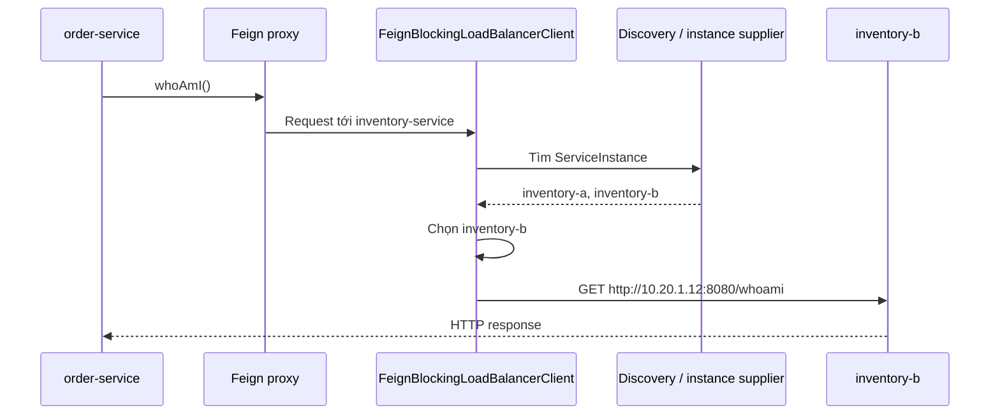

# Phân biệt name, contextId, url và tên dịch vụ

## Mục tiêu

Spring Cloud OpenFeign là HTTP client kiểu khai báo: ứng dụng định nghĩa Java interface, gắn `@FeignClient` và gọi phương thức interface như một bean thông thường. Khi sử dụng Spring Cloud LoadBalancer, Feign có thể tìm bản sao dịch vụ qua **service ID** và chọn `ServiceInstance` thay vì cố định IP/port.

Những tên xuất hiện trong cấu hình Feign thường gây nhầm lẫn: `name`, `contextId`, `url`, tên interface, bean qualifier và `spring.application.name` của ứng dụng đích. Các trường này **không đồng nghĩa**. Đặc biệt, chỉ cần khai báo `url` cố định là có thể thay đổi hoàn toàn cách request được định tuyến.

Sau bài học, bạn có thể:

- Phân biệt `@FeignClient(name = ...)`, `contextId`, `url` và tên dịch vụ trong registry.
- Hiểu khi nào Feign dùng `FeignBlockingLoadBalancerClient` và khi nào gọi trực tiếp một endpoint.
- Đặt nhiều Feign client trỏ cùng một service ID nhưng có cấu hình độc lập.
- Khai báo timeout và URL đúng namespace `spring.cloud.openfeign.client.config.<clientId>`.
- Hiểu thứ tự ưu tiên khi URL có trong annotation và trong properties.
- Thực hành với hai instance được discovery cung cấp và một client dùng URL cố định.
- Chẩn đoán các lỗi sai tên service, trùng context, không tìm thấy instance và gọi nhầm backend.

## 1. Một kịch bản có nhiều kiểu tên

Giả sử `order-service` cần gọi `inventory-service`. Dịch vụ tồn kho có hai instance:

| Service ID | Instance ID | Địa chỉ |
|---|---|---|
| `inventory-service` | `inventory-a` | `10.20.1.11:8080` |
| `inventory-service` | `inventory-b` | `10.20.1.12:8080` |

Ứng dụng đích có thể khai báo:

```yaml
spring:
  application:
    name: inventory-service
```

Với các discovery provider thường gặp, tên ứng dụng này được dùng trong quá trình đăng ký dịch vụ. Tuy nhiên, cách chuẩn hóa tên và metadata có thể khác giữa Eureka, Consul, Kubernetes và các discovery client; cần xác nhận service ID thực tế trong registry.

Trong ứng dụng gọi, ta tạo một Feign interface:

```java
import org.springframework.cloud.openfeign.FeignClient;
import org.springframework.web.bind.annotation.GetMapping;

@FeignClient(
        name = "inventory-service",
        contextId = "inventoryReadClient"
)
public interface InventoryReadClient {

    @GetMapping("/whoami")
    String whoAmI();
}
```

Giải nghĩa:

- `inventory-service` trong `name` là tên client logic, **đồng thời là service ID** khi không có URL cố định.
- `inventoryReadClient` trong `contextId` dùng để phân biệt tổ hợp cấu hình của Feign client này.
- `InventoryReadClient` là tên interface Java và là kiểu bean có thể inject.
- `/whoami` là HTTP path, không phải service ID.
- Không khai báo `url`, nên nếu có tích hợp Spring Cloud LoadBalancer thì request được chọn instance dựa trên `name`.

**Không cần đặt `contextId` trùng với tên ứng dụng provider.** Hai client có thể có `contextId` khác nhau nhưng cùng gọi một service ID.

## 2. So sánh name, contextId, url, path và bean alias

| Thuộc tính / định danh | Công dụng | Ảnh hưởng chọn backend? |
|---|---|---|
| `@FeignClient(name = "inventory-service")` | Đặt tên Feign client; là service ID nếu dùng discovery | **Có**, khi không có URL cố định |
| `@FeignClient(value = "inventory-service")` | Alias của `name` | Như `name` |
| `@FeignClient(contextId = "inventoryReadClient")` | Định danh tổ hợp cấu hình/child context | **Không** đổi service ID |
| `@FeignClient(url = "http://localhost:8081")` | Đặt đích HTTP trực tiếp | **Có**, bỏ qua chọn instance |
| `@FeignClient(path = "/api")` | Thêm path prefix vào endpoint | Không đổi service ID |
| `@FeignClient(qualifiers = "inventoryReader")` | Alias/qualifier cho dependency injection | Không đổi đích |
| `InventoryReadClient` | Tên interface Java và kiểu bean | Không tự đổi service ID |
| `spring.application.name` của provider | Tên ứng dụng, thường là cơ sở đăng ký vào discovery | Tùy discovery provider |
| `spring.cloud.openfeign.client.config.<clientId>.*` | Cấu hình một Feign context | Có thể đổi đích nếu khai báo `url` |
| `spring.cloud.loadbalancer.clients.<serviceId>.*` | Chính sách LoadBalancer theo service ID | Chỉ khi Feign thực sự dùng LoadBalancer |

Quy tắc ngắn: **`name` trả lời “dịch vụ logic nào?”, `contextId` trả lời “cấu hình Feign nào?”, `url` trả lời “endpoint cố định nào?”**.

## 3. name là service ID khi dùng LoadBalancer

Khai báo không có URL:

```java
@FeignClient(name = "inventory-service")
interface InventoryClient {

    @GetMapping("/whoami")
    String whoAmI();
}
```

Nếu `spring-cloud-starter-loadbalancer` có trên classpath, Spring Cloud OpenFeign có thể dùng `FeignBlockingLoadBalancerClient`. Client này lấy service ID từ tên client logic, yêu cầu LoadBalancer chọn một `ServiceInstance`, rồi chuyển request tới host/port của instance.



Các bước:

1. Feign dùng annotation Spring MVC như `@GetMapping` để xây dựng HTTP request.
2. Spring Cloud LoadBalancer lấy danh sách instance theo `name`/service ID.
3. Supplier có thể áp dụng cache, health check, zone, weight hoặc hint trước khi chọn.
4. `FeignBlockingLoadBalancerClient` dựng URI vật lý dựa trên `ServiceInstance` đã chọn.
5. Feign gửi request và decode response về kiểu Java của interface.

Nếu provider đăng ký `inventory-service` nhưng caller khai báo `@FeignClient(name = "inventory-api")`, LoadBalancer sẽ tìm một **service ID khác**. Đổi `contextId` thành `inventory-service` cũng không sửa được `name` sai.

`name` là tên logic, không nên khai báo thêm scheme như `name = "http://inventory-service"`. Khi muốn chỉ định một endpoint tuyệt đối, hãy dùng `url`.

## 4. contextId tách cấu hình Feign, không chuyển service

### 4.1. Hai client cùng name

Một ứng dụng có thể cần hai interface gọi cùng `inventory-service`, nhưng khác timeout, logger hoặc request interceptor.

```java
import org.springframework.cloud.openfeign.FeignClient;
import org.springframework.web.bind.annotation.GetMapping;

@FeignClient(
        name = "inventory-service",
        contextId = "inventoryReadClient",
        configuration = InventoryReadFeignConfiguration.class
)
public interface InventoryReadClient {

    @GetMapping("/whoami")
    String whoAmI();
}
```

```java
import org.springframework.cloud.openfeign.FeignClient;
import org.springframework.web.bind.annotation.GetMapping;

@FeignClient(
        name = "inventory-service",
        contextId = "inventoryAuditClient",
        configuration = InventoryAuditFeignConfiguration.class
)
public interface InventoryAuditClient {

    @GetMapping("/whoami")
    String whoAmI();
}
```

Cả hai vẫn load balance qua **`inventory-service`**, không phải hai tên `inventoryReadClient`/`inventoryAuditClient` trong discovery.

Spring Cloud OpenFeign tạo một tổ hợp bean từ `FeignClientsConfiguration` như decoder, encoder, contract, logger và các bean tùy chỉnh cho mỗi client. `contextId` thay đổi tên context/bean cấu hình liên quan, tránh xung đột khi nhiều Feign client dùng cùng `name`.

### 4.2. Cấu hình Java riêng

Ví dụ dùng header để phân biệt request trong môi trường thử nghiệm:

```java
import feign.RequestInterceptor;
import org.springframework.context.annotation.Bean;

class InventoryReadFeignConfiguration {

    @Bean
    RequestInterceptor readRoleHeader() {
        return template -> template.header("X-Client-Role", "read");
    }
}
```

```java
import feign.RequestInterceptor;
import org.springframework.context.annotation.Bean;

class InventoryAuditFeignConfiguration {

    @Bean
    RequestInterceptor auditRoleHeader() {
        return template -> template.header("X-Client-Role", "audit");
    }
}
```

Lớp truyền vào `@FeignClient(configuration=...)` **không nhất thiết phải có `@Configuration`**. Nếu được đánh dấu `@Configuration` và nằm trong component scan chung, bean dự định dành riêng cho một client có thể bị đăng ký trong parent context, tác động đến các client khác. Hãy đặt lớp cấu hình ngoài vùng scan chính hoặc không gắn `@Configuration` như ví dụ.

Header minh họa không phải quyền truy cập. Server cần xác thực và phân quyền độc lập.

### 4.3. Cấu hình YAML theo contextId

Khi đã đặt `contextId`, nên dùng đúng ID đó làm key trong `spring.cloud.openfeign.client.config`:

```yaml
spring:
  cloud:
    openfeign:
      client:
        config:
          default:
            connectTimeout: 2000
            readTimeout: 3000
          inventoryReadClient:
            readTimeout: 1000
            loggerLevel: basic
          inventoryAuditClient:
            readTimeout: 5000
            loggerLevel: basic
```

`connectTimeout` và `readTimeout` ở ví dụ này tính bằng **mili giây**. Hai client có thể sử dụng cùng service ID, cùng danh sách instance nhưng timeout khác nhau.

Với các client có `contextId` riêng, property ở khóa `inventory-service` không tự trở thành cấu hình độc lập cho `inventoryReadClient` và `inventoryAuditClient`. Nếu đổi `contextId`, cần rà soát lại key cấu hình Feign tương ứng.

Khi cùng một tùy chỉnh được khai báo trong bean Java và properties, Spring Cloud OpenFeign mặc định ưu tiên properties. Có thể thay đổi bằng `spring.cloud.openfeign.client.default-to-properties=false` nếu thật sự cần.

## 5. url cố định khiến Feign không chọn instance qua LoadBalancer

### 5.1. URL trong annotation

```java
@FeignClient(
        name = "inventory-service",
        contextId = "inventoryDirectClient",
        url = "http://localhost:8081"
)
interface InventoryDirectClient {

    @GetMapping("/whoami")
    String whoAmI();
}
```

Vì `url` đã được chỉ định, client **gọi trực tiếp `localhost:8081`**, không chọn `inventory-a` hoặc `inventory-b` qua discovery. `name` vẫn là tên client bắt buộc nhưng không còn quyết định tập instance cho request này.

Hệ quả:

- Nếu `localhost:8081` dừng, client direct có thể lỗi dù registry có backend khác khỏe mạnh.
- `contextId` vẫn dùng để xác định cấu hình riêng.
- Các chính sách `spring.cloud.loadbalancer.clients.inventory-service.*` không giúp client direct chuyển sang backend khác.
- Ngay cả `url = "http://inventory-service"` cũng là **URL trực tiếp**; hostname đó phải được DNS/proxy phân giải, không tự biến thành lookup `ServiceInstance` của Spring Cloud LoadBalancer.

### 5.2. URL trong application.yml

Không khai báo URL trên interface:

```java
@FeignClient(
        name = "inventory-service",
        contextId = "inventoryDirectClient"
)
interface InventoryDirectClient {

    @GetMapping("/whoami")
    String whoAmI();
}
```

Nhưng đặt URL theo `contextId`:

```yaml
spring:
  cloud:
    openfeign:
      client:
        config:
          inventoryDirectClient:
            url: http://localhost:8081
```

Kết quả vẫn là **gọi trực tiếp**, không qua bước chọn instance trong LoadBalancer. Ưu điểm của property: có thể thay đổi theo môi trường triển khai. Tuy nhiên thay YAML lúc ứng dụng chạy không mặc nhiên cập nhật client ngay; chỉ có cơ chế refresh tương ứng nếu được cấu hình và hỗ trợ.

## 6. Bốn trường hợp ưu tiên name và url

| Annotation `@FeignClient` | Property `openfeign.client.config.<clientId>.url` | Kết quả |
|---|---|---|
| `name` có; `url` không có | Không có | **Load-balanced** theo service ID trong `name` nếu tích hợp LoadBalancer khả dụng |
| `name` có; `url` có | Không có | **Direct** tới URL của annotation |
| `name` có; `url` không có | Có URL | **Direct** tới URL từ property |
| `name` có; `url` có | Có URL | **Direct** tới URL **trong annotation**; property URL bị bỏ qua |

Hai cấu hình dưới đây khác nhau rõ rệt:

```java
// Chọn một ServiceInstance qua discovery.
@FeignClient(name = "inventory-service")
interface InventoryDiscoveredClient {
    @GetMapping("/whoami")
    String whoAmI();
}
```

```java
// Luôn gọi một URL vật lý cố định.
@FeignClient(
        name = "inventory-service",
        url = "http://localhost:8081"
)
interface InventoryFixedClient {
    @GetMapping("/whoami")
    String whoAmI();
}
```

Đây là hai **phương án thay thế**. Nếu đăng ký cả hai interface trong cùng ứng dụng, thêm `contextId` duy nhất cho từng interface để tránh xung đột các context cấu hình.

Tài liệu OpenFeign hiện hành yêu cầu có `name` **ngay cả khi `url` đã được khai báo**. Không nên bỏ `name` và chỉ viết `@FeignClient(url=...)`.

## 7. Tên bean, qualifiers và contextId khác nhau

Bean Feign proxy được đăng ký bằng interface Java; tên bean thường là tên đầy đủ của interface. `qualifiers` cung cấp alias/qualifier cho dependency injection, chứ không quyết định request gửi đến đâu.

```java
@FeignClient(
        name = "inventory-service",
        contextId = "inventoryReadClient",
        qualifiers = "inventoryReader"
)
public interface InventoryReadClient {

    @GetMapping("/whoami")
    String whoAmI();
}
```

Inject theo type:

```java
import org.springframework.stereotype.Service;

@Service
class InventoryProbe {

    private final InventoryReadClient client;

    InventoryProbe(InventoryReadClient client) {
        this.client = client;
    }

    String whoAmI() {
        return client.whoAmI();
    }
}
```

Hoặc inject với qualifier đã khai báo:

```java
import org.springframework.beans.factory.annotation.Qualifier;

InventoryProbe(@Qualifier("inventoryReader") InventoryReadClient client) {
    this.client = client;
}
```

Ví dụ thứ hai chỉ minh họa **constructor thay thế**, không đặt đồng thời hai constructor đó trong một lớp. Đổi tên interface hoặc `qualifiers` có thể ảnh hưởng injection, nhưng **không** chuyển request sang service ID khác.

## 8. Cấu hình Feign và LoadBalancer có hai phạm vi khác nhau

```yaml
spring:
  cloud:
    openfeign:
      client:
        config:
          inventoryReadClient:
            connectTimeout: 1000
            readTimeout: 2000
    loadbalancer:
      clients:
        inventory-service:
          health-check:
            interval: 15s
```

| Namespace | Khóa thường dùng | Ý nghĩa |
|---|---|---|
| `spring.cloud.openfeign.client.config` | `inventoryReadClient` | Cấu hình Feign context: timeout, URL, logger, retryer... |
| `spring.cloud.loadbalancer.clients` | `inventory-service` | Cấu hình LoadBalancer theo **service ID** |

Property `health-check.interval` chỉ có tác dụng khi chuỗi `ServiceInstanceListSupplier` có health-check supplier. Tương tự, đặt `connectTimeout` ở namespace LoadBalancer không tự cấu hình HTTP client Feign.

Hai client cùng service ID có thể có timeout khác nhau, nhưng vẫn chia sẻ chính sách LoadBalancer cho `inventory-service`. Nếu một client có URL cố định, chính sách chọn instance của LoadBalancer không áp dụng trên đường gọi direct của client đó.

Đặc biệt, đừng nhầm hai cơ chế retry:

- Spring Cloud OpenFeign mặc định tạo `Retryer.NEVER_RETRY`, khác với retry mặc định của Feign thuần.
- Spring Cloud LoadBalancer có thể có retry riêng cho đường gọi qua LoadBalancer nếu các điều kiện và integration phù hợp được bật.

Khi gọi một URL trực tiếp, retry của LoadBalancer không thể chọn instance khác qua registry vì không có bước discovery/selection trong đường gọi đó. Với HTTP method có side effect, phải kiểm soát idempotency trước khi cho phép thử lại.

## 9. Placeholder, profile và refresh URL

`name` và `url` hỗ trợ placeholder:

```java
@FeignClient(
        name = "${services.inventory.name}",
        contextId = "inventoryReadClient"
)
interface ConfiguredInventoryClient {
    @GetMapping("/whoami")
    String whoAmI();
}
```

```yaml
services:
  inventory:
    name: inventory-service
```

Để load balance qua discovery, **không đặt URL** trong annotation lẫn properties. Nếu cần fixed endpoint ở profile local:

```yaml
spring:
  config:
    activate:
      on-profile: local-direct
  cloud:
    openfeign:
      client:
        config:
          inventoryReadClient:
            url: http://localhost:8081
```

Khi profile `local-direct` bật, client đi trực tiếp `localhost:8081`; khi profile không bật và URL không đến từ nguồn cấu hình khác, client dùng `name` để lookup discovery. Hãy kiểm tra biến môi trường/config server bởi chúng có thể ghi đè property.

Spring Cloud OpenFeign 4.x/5.x resolve thuộc tính annotation **eagerly** theo mặc định. Có thể chọn `spring.cloud.openfeign.lazy-attributes-resolution=true` trong những kịch bản đặc biệt, nhưng cần cân nhắc AOT/native image và khả năng kiểm thử.

URL cấu hình qua properties có thể được refresh khi bật `spring.cloud.openfeign.client.refresh-enabled=true` và có cơ chế refresh tương ứng; mặc định refresh Feign client tắt. Không gắn `@RefreshScope` trực tiếp lên interface `@FeignClient`.

**Bảo mật:** chỉ cho phép URL từ nguồn cấu hình tin cậy. Nếu nhận URL tùy ý từ request người dùng, hệ thống có thể gặp rủi ro SSRF hoặc vô tình chuyển credential đến host không được phép.

## 10. Thực hành: hai contextId cùng service và một client URL cố định

### Bước 1. Tạo ba interface Feign

```java
import org.springframework.cloud.openfeign.FeignClient;
import org.springframework.web.bind.annotation.GetMapping;

@FeignClient(
        name = "inventory-service",
        contextId = "inventoryReadClient"
)
public interface InventoryReadClient {
    @GetMapping("/whoami")
    String whoAmI();
}
```

```java
import org.springframework.cloud.openfeign.FeignClient;
import org.springframework.web.bind.annotation.GetMapping;

@FeignClient(
        name = "inventory-service",
        contextId = "inventoryAuditClient"
)
public interface InventoryAuditClient {
    @GetMapping("/whoami")
    String whoAmI();
}
```

```java
import org.springframework.cloud.openfeign.FeignClient;
import org.springframework.web.bind.annotation.GetMapping;

@FeignClient(
        name = "inventory-service",
        contextId = "inventoryDirectClient",
        url = "${inventory.direct-url}"
)
public interface InventoryDirectClient {
    @GetMapping("/whoami")
    String whoAmI();
}
```

Hai client đầu có `contextId` riêng nhưng cùng service ID. Client thứ ba sử dụng URL cấu hình cố định, không qua discovery/LoadBalancer.

### Bước 2. Chuẩn bị dependency và bật @EnableFeignClients

Với Maven, import Spring Cloud BOM tương thích với Spring Boot đang sử dụng; sau đó khai báo các starter:

```xml
<dependency>
    <groupId>org.springframework.cloud</groupId>
    <artifactId>spring-cloud-starter-openfeign</artifactId>
</dependency>
<dependency>
    <groupId>org.springframework.cloud</groupId>
    <artifactId>spring-cloud-starter-loadbalancer</artifactId>
</dependency>
```

`spring-cloud-starter-loadbalancer` là optional dependency đối với OpenFeign starter, nên phải thêm nếu muốn client-side load balancing. Nếu caller có endpoint MVC trong ví dụ Spring Boot 4.x, có thể thêm `spring-boot-starter-webmvc`.

```java
import org.springframework.boot.SpringApplication;
import org.springframework.boot.autoconfigure.SpringBootApplication;
import org.springframework.cloud.openfeign.EnableFeignClients;

@SpringBootApplication
@EnableFeignClients(clients = {
        InventoryReadClient.class,
        InventoryAuditClient.class,
        InventoryDirectClient.class
})
public class OrderApplication {

    public static void main(String[] args) {
        SpringApplication.run(OrderApplication.class, args);
    }
}
```

Trong dự án nhiều module, khai báo `clients = {...}` hoặc `basePackages` giúp Spring biết chính xác interface cần đăng ký.

### Bước 3. Khai báo hai instance trong caller

```yaml
server:
  port: 8080

inventory:
  direct-url: http://localhost:8081

spring:
  application:
    name: order-service
  cloud:
    discovery:
      client:
        simple:
          instances:
            inventory-service:
              - uri: http://localhost:8081
              - uri: http://localhost:8082
    openfeign:
      client:
        config:
          default:
            connectTimeout: 2000
            readTimeout: 3000
          inventoryReadClient:
            readTimeout: 1000
          inventoryAuditClient:
            readTimeout: 5000
```

`SimpleDiscoveryClient` trả về hai instance của `inventory-service`. Cấu hình timeout theo `contextId` không thay đổi danh sách discovery.

Trên hai tiến trình `inventory-service`, tạo endpoint:

```java
import org.springframework.core.env.Environment;
import org.springframework.web.bind.annotation.GetMapping;
import org.springframework.web.bind.annotation.RestController;

@RestController
class WhoAmIController {

    private final Environment env;

    WhoAmIController(Environment env) {
        this.env = env;
    }

    @GetMapping("/whoami")
    String whoAmI() {
        return env.getProperty("demo.instance-id", "unknown");
    }
}
```

Chạy hai backend:

```text
inventory-a: --server.port=8081 --demo.instance-id=inventory-a
inventory-b: --server.port=8082 --demo.instance-id=inventory-b
```

### Bước 4. Tạo ba endpoint ở caller

```java
import org.springframework.web.bind.annotation.GetMapping;
import org.springframework.web.bind.annotation.RestController;

@RestController
class FeignDemoController {

    private final InventoryReadClient readClient;
    private final InventoryAuditClient auditClient;
    private final InventoryDirectClient directClient;

    FeignDemoController(
            InventoryReadClient readClient,
            InventoryAuditClient auditClient,
            InventoryDirectClient directClient) {
        this.readClient = readClient;
        this.auditClient = auditClient;
        this.directClient = directClient;
    }

    @GetMapping("/demo/feign/read")
    String read() {
        return readClient.whoAmI();
    }

    @GetMapping("/demo/feign/audit")
    String audit() {
        return auditClient.whoAmI();
    }

    @GetMapping("/demo/feign/direct")
    String direct() {
        return directClient.whoAmI();
    }
}
```

### Bước 5. Gửi request và đối chiếu

```bash
curl "http://localhost:8080/demo/feign/read"
curl "http://localhost:8080/demo/feign/audit"
curl "http://localhost:8080/demo/feign/read"
curl "http://localhost:8080/demo/feign/audit"
curl "http://localhost:8080/demo/feign/direct"
curl "http://localhost:8080/demo/feign/direct"
```

| Caller endpoint | Feign context | Backend nhận request |
|---|---|---|
| `/demo/feign/read` | `inventoryReadClient` | `inventory-a` hoặc `inventory-b` qua LoadBalancer |
| `/demo/feign/audit` | `inventoryAuditClient` | `inventory-a` hoặc `inventory-b` qua LoadBalancer |
| `/demo/feign/direct` | `inventoryDirectClient` | `localhost:8081` cố định |

Khi dùng round robin mặc định, các request tới hai client load-balanced thường phân phối trên hai instance nhưng không nên khẳng định thứ tự chính xác nếu có nhiều caller hoặc retry. Với client direct, thay đổi danh sách instance trong discovery không làm thay đổi đích `localhost:8081`.

### Bước 6. Thử lỗi có chủ đích

1. Tắt backend A: client direct tới `localhost:8081` sẽ lỗi, hai client load-balanced có thể tiếp tục chọn A nếu discovery tĩnh vẫn giữ A; cần health check/danh sách mới để xử lý.
2. Đổi `name` của client read thành `inventory-api` khi registry chỉ có `inventory-service`: client read không có instance để chọn.
3. Đổi `contextId` thành `inventoryReadV2` mà không đổi key property: timeout riêng có thể không còn hiệu lực.
4. Khai báo `url` trong cả annotation và property: URL trong annotation được dùng.
5. Đặt trùng `contextId` cho hai interface cùng `name`: có thể xảy ra xung đột cấu hình/bean.

## 11. Lỗi phổ biến và cách nhận biết

| Triệu chứng | Nguyên nhân thường gặp | Cách khắc phục |
|---|---|---|
| `No instances available for inventory-service` | Discovery không có instance hoặc supplier lọc hết | Kiểm tra service ID, registry và supplier. |
| `No instances available for inventory-api` | `name` không khớp service ID | Sửa `name`; đổi `contextId` không đủ. |
| Chỉ request một backend dù có nhiều replica | Annotation hoặc properties chứa `url` | Kiểm tra cả hai nơi, xóa URL khi muốn discovery. |
| URL trong properties không được dùng | Annotation đã có URL, có ưu tiên cao hơn | Bỏ URL annotation nếu muốn property quản lý đích. |
| Timeout theo client không có hiệu lực | Config key không khớp `contextId` | Đối chiếu `openfeign.client.config.<clientId>`. |
| Nhiều client cùng `name` gây xung đột context | Thiếu `contextId` riêng | Đặt ID duy nhất cho các Feign interface khác nhau. |
| Header của một client xuất hiện ở client khác | Bean config riêng lọt vào parent component scan | Giữ config riêng ngoài scan chung. |
| `url=http://inventory-service` không dùng LoadBalancer | URL trực tiếp nên phụ thuộc DNS | Bỏ `url` nếu cần chọn `ServiceInstance`. |
| Bean Feign không được tạo | `@EnableFeignClients` chưa quét interface | Chỉ rõ `clients` hoặc `basePackages`. |
| Gọi direct gặp lỗi dù registry còn backend khác | Không có bước chọn lại instance qua discovery | Dùng `name` không URL hoặc triển khai client failover khác có kiểm soát. |
| Request bị retry bất ngờ hoặc không retry | Nhầm Feign Retryer với LoadBalancer retry | Kiểm tra từng tầng và tính idempotent. |

## 12. Checklist triển khai

- [ ] Provider đăng ký đúng service ID, caller dùng `@FeignClient(name = ...)` tương ứng.
- [ ] Chỉ dùng `contextId` để phân biệt cấu hình client, không coi nó là tên backend.
- [ ] Nếu có nhiều Feign interface cùng `name`, mỗi interface có `contextId` riêng.
- [ ] Nếu muốn discovery/LoadBalancer, không có `url` trong annotation hoặc properties.
- [ ] Nếu dùng URL trực tiếp, chấp nhận rằng LoadBalancer không tự chọn bản sao khác.
- [ ] Đã kiểm tra URL trong annotation có ưu tiên hơn property URL.
- [ ] Property Feign dùng đúng key context ID; property LoadBalancer dùng đúng service ID.
- [ ] `@EnableFeignClients` quét đúng interface và starter LoadBalancer được thêm nếu cần.
- [ ] Java config cho một Feign client không bị quét thành cấu hình toàn cục.
- [ ] Timeout, retry và refresh được kiểm tra ở đúng tầng.
- [ ] Có thử nghiệm với hai instance để chứng minh sự khác biệt giữa lookup discovery và URL cố định.
- [ ] URL đích nằm trong danh sách đáng tin cậy; không lấy trực tiếp từ dữ liệu người dùng.

## Kết luận

Trong Spring Cloud OpenFeign, **`name` là service ID dùng để tìm instance khi không khai báo URL**, **`contextId` chỉ phân biệt tổ hợp cấu hình của Feign client**, còn **`url` là địa chỉ trực tiếp làm bỏ qua bước chọn instance của LoadBalancer**. Tên Java interface, bean qualifier và tên đăng ký trong discovery thuộc những lớp khái niệm khác nhau.

Hãy ghi nhớ bốn trường hợp: **không có URL → chọn instance theo `name`; URL annotation → gọi trực tiếp; URL property → gọi trực tiếp; cả hai URL → annotation thắng**. Khi nhiều client trỏ về cùng một dịch vụ nhưng cần cấu hình riêng, đặt `contextId` khác nhau và kiểm tra property theo context ID. Đây là nền tảng để tránh sai đích khi cấu hình OpenFeign trong hệ thống có nhiều bản sao và chính sách định tuyến khác nhau.

## Tài liệu tham khảo

- [Spring Cloud OpenFeign 5.0.4 — Declarative REST Client, Feign Defaults và contextId](https://docs.spring.io/spring-cloud-openfeign/reference/spring-cloud-openfeign.html)
- [Spring Cloud OpenFeign — Supported Ways To Provide URL To A Feign Client](https://docs.spring.io/spring-cloud-openfeign/reference/spring-cloud-openfeign.html#supported-ways-to-provide-url-to-a-feign-client)
- [Spring Cloud OpenFeign — Timeout Handling và Refresh Support](https://docs.spring.io/spring-cloud-openfeign/reference/spring-cloud-openfeign.html)
- [Spring Cloud Commons — Spring Cloud LoadBalancer](https://docs.spring.io/spring-cloud-commons/reference/spring-cloud-commons/loadbalancer.html)
- [Spring Cloud OpenFeign — GitHub source và tài liệu](https://github.com/spring-cloud/spring-cloud-openfeign)
