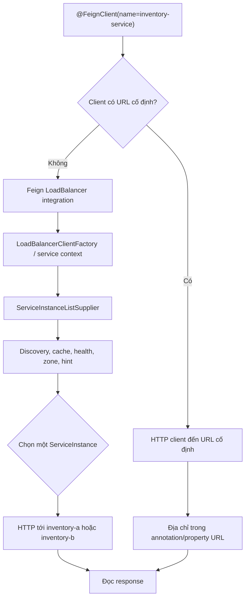

# Khi cấu hình URL trực tiếp làm thay đổi đường đi cân bằng tải

Trong hệ thống microservices, Spring Cloud OpenFeign giúp định nghĩa HTTP client bằng Java interface. Khi tích hợp với Spring Cloud LoadBalancer, Feign có thể gọi service bằng **service ID**: lấy danh sách `ServiceInstance` từ discovery, áp dụng cache/health check/chính sách định tuyến, rồi chọn một instance để gửi request.

Tuy nhiên, một thay đổi nhỏ như thêm `url` vào `@FeignClient` hoặc khai báo `spring.cloud.openfeign.client.config.<clientId>.url` có thể khiến Feign **bỏ qua cơ chế chọn instance phía client** và gửi request trực tiếp đến URL đã cấu hình. Lời gọi vẫn có thể trả HTTP 200, nên lỗi cấu hình này dễ bị bỏ sót nếu chỉ kiểm tra kết quả nghiệp vụ.

Bài học thuộc chương **OpenFeign** của module `SPRING_CLOUD_SERVICE_COMMUNICATION_LOAD_BALANCING`. Trọng tâm là phân tích đường đi request giữa hai chế độ, các quy tắc ưu tiên cấu hình URL, hậu quả đối với discovery, health check, cân bằng tải, retry/timeout và cách viết kiểm thử có bằng chứng về instance thực sự nhận request.

## 1. Hai chế độ gọi rất khác nhau

Giả sử `order-service` muốn lấy dữ liệu từ `inventory-service`. Trong discovery có hai instance:

| Service ID | Instance ID | Host | Port |
|---|---|---|---:|
| `inventory-service` | `inventory-a` | `10.0.1.11` | 8081 |
| `inventory-service` | `inventory-b` | `10.0.1.12` | 8082 |

### 1.1. Chế độ dùng service ID và LoadBalancer

Khai báo:

```java
@FeignClient(name = "inventory-service")
public interface InventoryClient {

    @GetMapping("/api/v1/stock/{sku}")
    StockResponse getStock(@PathVariable("sku") String sku);
}
```

Khi không có URL cố định được cấu hình cho client này và tích hợp Spring Cloud LoadBalancer hiện diện, tên `inventory-service` là **định danh dịch vụ để chọn instance**. Mỗi lần cần gửi request, hệ thống có thể lựa chọn A hoặc B theo danh sách khả dụng và chính sách định tuyến.

```text
InventoryClient.getStock("SKU-001")
    ↓
Feign client sử dụng name=inventory-service
    ↓
Spring Cloud LoadBalancer
    ↓
ServiceInstanceListSupplier (discovery/cache/health/filters)
    ↓
Chọn inventory-a hoặc inventory-b
    ↓
HTTP request đến host:port đã chọn
```

### 1.2. Chế độ dùng URL trực tiếp

Khai báo:

```java
@FeignClient(
        name = "inventory-service",
        url = "http://10.0.1.11:8081")
public interface InventoryClient {

    @GetMapping("/api/v1/stock/{sku}")
    StockResponse getStock(@PathVariable("sku") String sku);
}
```

Ở đây `name` vẫn dùng để định danh/cấu hình Feign client, nhưng **URL đã xác định sẵn đích HTTP**. Request được gửi đến `10.0.1.11:8081`, không cần tìm instance của `inventory-service` bằng Spring Cloud LoadBalancer.

```text
InventoryClient.getStock("SKU-001")
    ↓
Feign client có url=http://10.0.1.11:8081
    ↓
HTTP client / transport
    ↓
10.0.1.11:8081

Không thực hiện bước chọn ServiceInstance theo service ID.
```

Đây là khác biệt **về đường đi request**, không chỉ là khác biệt cách viết URL. Cần xem liệu ứng dụng còn đi qua `LoadBalancerClientFactory` và `ServiceInstanceListSupplier` hay không, thay vì chỉ so sánh giá trị response.

## 2. Sơ đồ so sánh request flow



Trong bản phát hành Spring Cloud OpenFeign hỗ trợ Spring Cloud LoadBalancer, một tích hợp phổ biến là `FeignBlockingLoadBalancerClient`. Client này phối hợp Spring Cloud LoadBalancer để thay host logic bằng instance được chọn. Khi Feign được cấu hình bằng URL trực tiếp, quá trình tạo client sẽ sử dụng đường gọi trực tiếp tương ứng, **không dùng vòng chọn instance của Spring Cloud LoadBalancer** cho URL đó.

Không nên kết luận từ tên Java class của HTTP transport đơn lẻ; có nhiều biến thể client, wrapper và cơ chế tùy biến. Cách xác nhận chắc chắn nhất là quan sát **instance nhận request** và sự tham gia của supplier/load balancer trong kiểm thử tích hợp.

## 3. Những cách khai báo URL làm thay đổi hành vi

Spring Cloud OpenFeign cho phép định nghĩa URL cố định ngay trên `@FeignClient` hoặc trong cấu hình property. Bảng sau minh họa các trường hợp phổ biến:

| Khai báo | URL cấu hình bên ngoài | Đường đi thường dùng |
|---|---|---|
| `@FeignClient(name="inventory-service")` | Không có | Qua Spring Cloud LoadBalancer, nếu integration có mặt |
| `@FeignClient(name="inventory-service", url="http://host-a:8081")` | Không có | Gọi trực tiếp `host-a:8081` |
| `@FeignClient(name="inventory-service")` | Có `spring.cloud.openfeign.client.config.inventory-service.url` | Gọi trực tiếp URL trong property |
| `@FeignClient(name="inventory-service", url="http://host-a:8081")` | Có URL khác trong property | URL trong annotation được ưu tiên |
| `@FeignClient(name="inventory-service", url="http://inventory-service")` | Không có | Vẫn là URL được khai báo trực tiếp; **không tự biến thành service discovery** |

Hàng cuối rất dễ nhầm: trông giống service ID nhưng vì thuộc tính `url` đã được đặt, Feign xem đó là một endpoint URL. Host `inventory-service` cần được cơ chế DNS/network khác giải quyết. Nếu không có DNS phù hợp, lời gọi có thể lỗi `UnknownHostException` dù discovery đang chứa nhiều instance hợp lệ.

### 3.1. Không khai báo URL: dùng discovery

```java
@FeignClient(name = "inventory-service")
public interface InventoryClient {

    @GetMapping("/api/v1/stock/{sku}")
    StockResponse stock(@PathVariable("sku") String sku);
}
```

Một lời gọi `stock("SKU-001")` được xây từ service ID `inventory-service`. Với starter LoadBalancer và danh sách instance khả dụng, client có thể chọn một instance theo round robin hoặc một thuật toán tùy chỉnh.

**Lưu ý:** bỏ `url` chưa đủ nếu ứng dụng không có dependency load balancing hoặc nguồn instance. Không có Spring Cloud LoadBalancer trên classpath, Feign không thể tự lấy một danh sách instance từ discovery chỉ nhờ tên service.

### 3.2. URL trong annotation: đích cố định

```java
@FeignClient(
        name = "inventory-service",
        url = "http://127.0.0.1:18081")
public interface InventoryClient {

    @GetMapping("/api/v1/stock/{sku}")
    StockResponse stock(@PathVariable("sku") String sku);
}
```

Mọi request từ client này dùng URL cố định làm base URL. Nếu ứng dụng chạy trong container, `127.0.0.1` trỏ về network namespace của **chính container đó**, không phải `inventory-service`. Vì vậy ví dụ localhost chỉ phù hợp test cục bộ hoặc khi có proxy cùng môi trường; không tự phù hợp để triển khai phân tán.

### 3.3. URL trong property: vẫn là direct URL

Giữ interface không có `url`:

```java
@FeignClient(name = "inventory-service")
public interface InventoryClient {

    @GetMapping("/api/v1/stock/{sku}")
    StockResponse stock(@PathVariable("sku") String sku);
}
```

Nhưng cấu hình:

```yaml
spring:
  cloud:
    openfeign:
      client:
        config:
          inventory-service:
            url: http://127.0.0.1:18081
```

Khi property URL này được Spring Cloud OpenFeign áp dụng, Feign sử dụng địa chỉ trực tiếp. Việc interface chỉ có `name` **không có nghĩa** nó còn qua LoadBalancer nếu môi trường cấu hình một URL.

Cách cấu hình bằng property hữu ích cho test/triển khai đích cố định, nhưng cũng là nguồn gây lỗi: cùng một artifact chạy ở profile `dev` có thể gọi trực tiếp localhost, trong khi profile `prod` dùng discovery; hoặc ngược lại.

### 3.4. URL trong annotation ưu tiên URL trong property

Ví dụ:

```java
@FeignClient(
        name = "inventory-service",
        url = "http://host-a:8081")
public interface InventoryClient {
    @GetMapping("/whoami")
    String whoami();
}
```

Và:

```yaml
spring:
  cloud:
    openfeign:
      client:
        config:
          inventory-service:
            url: http://host-b:8082
```

Trong cơ chế phân giải URL của Spring Cloud OpenFeign, **URL trong annotation được ưu tiên**; property URL không đổi đích của client này thành `host-b`. Đừng thử sửa lỗi chỉ bằng cách thay property khi annotation vẫn đang gắn URL cứng.

Các tùy chọn Feign khác như timeout, logger level hoặc error decoder có quy tắc cấu hình riêng; thứ tự ưu tiên URL không tự động giải thích thứ tự ưu tiên tất cả cấu hình Feign khác.

## 4. Vai trò của name và contextId khi đã có URL

Các thuộc tính dễ nhầm:

| Thuộc tính | Vai trò |
|---|---|
| `name` | Định danh Feign client; khi không có direct URL thì thường cũng là service ID dùng để chọn instance |
| `contextId` | Phân biệt các Feign client context/bean trong các trường hợp có nhiều client cùng service name |
| `url` | Định nghĩa base URL trực tiếp của HTTP target nếu được cung cấp |
| `path` | Tiền tố đường dẫn cho các endpoint của client; không phải service ID hoặc thuật toán chọn instance |
| `qualifiers` | Giúp định danh bean để inject; không tự kích hoạt load balancing |

Ví dụ muốn cùng một interface nghiệp vụ có hai cách kết nối trong test:

```java
@FeignClient(
        name = "inventory-service",
        contextId = "discoveredInventory")
public interface DiscoveredInventoryClient {

    @GetMapping("/whoami")
    String whoami();
}

@FeignClient(
        name = "inventory-service",
        contextId = "directInventory",
        url = "http://127.0.0.1:18081")
public interface DirectInventoryClient {

    @GetMapping("/whoami")
    String whoami();
}
```

Cả hai có cùng `name` nhưng `contextId` khác nhau, thuận tiện khi phân biệt cấu hình và bean của từng client. **Chỉ client không có direct URL** dùng service ID cho lựa chọn instance; client có URL cố định gọi thẳng đích đó.

Nếu hai client phải dùng URL thay đổi theo môi trường, có thể dùng placeholder trong `url`, ví dụ `url = "${inventory.direct-url}"`. Tuy nhiên, khi placeholder được giải quyết thành một URL, client vẫn là **chế độ direct URL**, không tự được load balance.

### 4.1. Client ID trong thuộc tính

Với các Feign client tùy biến `contextId`, khóa trong `spring.cloud.openfeign.client.config.<clientId>` có thể liên quan tới định danh context của client. Cần xem cách `name` và `contextId` được dự án sử dụng trong phiên bản Spring Cloud OpenFeign hiện tại; không nên mặc định chỉ có một khóa cấu hình nếu nhiều client cùng `name`.

Trong bài này, ví dụ cấu hình property đơn giản dùng client duy nhất với `name="inventory-service"` để tránh nhiễu từ nhiều Feign context.

## 5. Cấu hình tối thiểu cho chế độ load-balanced

Ví dụ dependency Maven (giả sử đã import Spring Cloud BOM tương thích vào `dependencyManagement`):

```xml
<dependencies>
    <dependency>
        <groupId>org.springframework.boot</groupId>
        <artifactId>spring-boot-starter-web</artifactId>
    </dependency>

    <dependency>
        <groupId>org.springframework.cloud</groupId>
        <artifactId>spring-cloud-starter-openfeign</artifactId>
    </dependency>

    <dependency>
        <groupId>org.springframework.cloud</groupId>
        <artifactId>spring-cloud-starter-loadbalancer</artifactId>
    </dependency>
</dependencies>
```

Trong ứng dụng:

```java
import org.springframework.boot.SpringApplication;
import org.springframework.boot.autoconfigure.SpringBootApplication;
import org.springframework.cloud.openfeign.EnableFeignClients;

@SpringBootApplication
@EnableFeignClients
public class OrderServiceApplication {

    public static void main(String[] args) {
        SpringApplication.run(
                OrderServiceApplication.class, args);
    }
}
```

Và Feign interface:

```java
import org.springframework.cloud.openfeign.FeignClient;
import org.springframework.web.bind.annotation.GetMapping;
import org.springframework.web.bind.annotation.PathVariable;

@FeignClient(name = "inventory-service")
public interface InventoryClient {

    @GetMapping("/api/v1/stock/{sku}")
    StockResponse stock(@PathVariable("sku") String sku);
}
```

Ví dụ DTO:

```java
public record StockResponse(
        String sku,
        int available,
        String servedBy) {
}
```

Ứng dụng còn cần **nguồn instance**: Eureka, Consul, Kubernetes discovery hoặc `SimpleDiscoveryClient` được cấu hình. `spring-cloud-starter-openfeign` không tự đăng ký một instance `inventory-service` vào discovery.

### 5.1. Khai báo instance tĩnh trong môi trường thực hành

Nếu không cần registry thật, có thể khai báo:

```properties
spring.cloud.discovery.client.simple.instances.inventory-service[0].uri=http://localhost:18081
spring.cloud.discovery.client.simple.instances.inventory-service[1].uri=http://localhost:18082
```

Hai địa chỉ phải thực sự có HTTP server phục vụ cùng contract. Với Feign client **không khai báo URL**, Spring Cloud LoadBalancer có thể chọn một trong hai instance đó.

Một khi client được đặt `url="http://localhost:18081"` hoặc property URL tương ứng, hai entry của Simple Discovery không còn là nguồn để Feign chọn instance cho lời gọi direct URL.

## 6. Khi URL cố định khiến discovery, health check và routing không còn hiệu lực

Với chế độ load-balanced, các bước như `ServiceInstanceListSupplier`, cache, health check và metadata/zone/hint có thể ảnh hưởng tập ứng viên trước khi lựa chọn.

Khi direct URL được áp dụng, Feign **không thực hiện bước chọn từ danh sách đó** cho request tương ứng. Hệ quả:

| Cơ chế | Dùng service ID qua LoadBalancer | Dùng direct URL |
|---|---|---|
| Discovery theo service ID | Có, nếu nguồn được cấu hình | Không cần dùng để chọn đích |
| Chọn nhiều `ServiceInstance` | Theo thuật toán và danh sách | Không có vòng chọn instance từ Spring Cloud LoadBalancer |
| `RoundRobinLoadBalancer` / custom policy | Có thể áp dụng | Không áp dụng cho target direct URL |
| Health-aware supplier | Có thể lọc instance | Không tự bảo vệ URL cố định |
| Cache danh sách instance của LoadBalancer | Có thể dùng | Không cung cấp lợi ích chọn target này |
| Zone preference | Có thể tác động danh sách | Không tự ưu tiên zone khác |
| Hint từ request | Có thể tác động nếu supplier hỗ trợ | Không tự đổi sang instance mang hint |
| Timeout và HTTP error handling của Feign | Vẫn cần | Vẫn cần |
| Authentication, encoder, decoder, headers | Vẫn cần | Vẫn cần |
| DNS/proxy/ingress của target URL | Có thể có ở đích vật lý | Vẫn có thể phân phối ở tầng hạ tầng riêng |

**Direct URL không có nghĩa hoàn toàn không có cân bằng tải trong hệ thống.** Nếu URL trỏ tới gateway, reverse proxy, DNS load balancer hoặc cloud load balancer, **thành phần đó** vẫn có thể phân phối request. Chỉ có điều đây không phải vòng chọn `ServiceInstance` do **Spring Cloud LoadBalancer phía Feign client** thực hiện.

Ví dụ `https://inventory.example.internal` có thể trỏ vào Kubernetes Service hoặc một internal load balancer và được hạ tầng phân phối. Dù có nhiều backend phía sau, Feign nhìn thấy một endpoint URL và không tự áp dụng zone/hint filter của Spring Cloud LoadBalancer.

## 7. Hai cách triển khai giống kết quả HTTP nhưng khác cơ chế

Đặt hai nhóm deployment:

**Nhóm A — discovery + client-side LoadBalancer**

```java
@FeignClient(name = "inventory-service")
interface InventoryClient {
    @GetMapping("/whoami")
    String whoami();
}
```

**Nhóm B — endpoint cố định**

```java
@FeignClient(
        name = "inventory-service",
        url = "http://inventory-gateway.internal")
interface InventoryClient {
    @GetMapping("/whoami")
    String whoami();
}
```

Nếu gateway ở nhóm B phân phối request tới A/B, cả hai nhóm có thể trả về `inventory-a` và `inventory-b`. Không nên nhìn vào việc response luân phiên để kết luận cả hai đều đang dùng Spring Cloud LoadBalancer.

Muốn biết thật sự request đi qua đâu:

- Đo số lần `ServiceInstanceListSupplier` của service ID được gọi.
- Kiểm tra bean load balancer và các log liên quan.
- Quan sát target hostname/socket và kết quả tại tầng gateway.
- Kiểm tra route của Feign client có URL property hoặc annotation hay không.
- Kiểm tra service ID trong URL được cấp cho Feign và các biến môi trường.

Một proxy có thể cho phép failover, retry, TLS termination và health check **ở phía proxy**, nhưng chính sách đó độc lập với Bean `RoundRobinLoadBalancer` trong Spring Cloud.

## 8. Một test để phân biệt hai đường đi

Cách kiểm chứng rõ nhất là tạo hai HTTP server cục bộ cùng mô phỏng `inventory-service`:

- Instance A trả chuỗi `inventory-a`.
- Instance B trả chuỗi `inventory-b`.
- Discovery đăng ký cả hai bằng cùng service ID.
- Feign client `discoveredInventoryClient` không có `url`.
- Feign client `directInventoryClient` có `url` trỏ vào instance A.

Trong điều kiện round robin, request tuần tự qua client thứ nhất có thể đến cả A và B. Request qua client thứ hai **chỉ đến A** nếu URL trỏ trực tiếp A và không có proxy phân phối trung gian.

### 8.1. Định nghĩa hai Feign interface

```java
import org.springframework.cloud.openfeign.FeignClient;
import org.springframework.web.bind.annotation.GetMapping;

@FeignClient(
        name = "inventory-service",
        contextId = "discoveredInventory")
interface DiscoveredInventoryClient {
    @GetMapping("/whoami")
    String whoami();
}

@FeignClient(
        name = "inventory-service",
        contextId = "fixedInventory",
        url = "${inventory.fixed-url}")
interface FixedInventoryClient {
    @GetMapping("/whoami")
    String whoami();
}
```

`inventory.fixed-url` là property của riêng bài test: ở môi trường test nó sẽ trỏ vào HTTP server A. Việc dùng placeholder không làm mất tính chất URL trực tiếp của client thứ hai.

### 8.2. Dựng hai server trên cổng động và đăng ký bằng @DynamicPropertySource

Ví dụ integration test sau sử dụng `com.sun.net.httpserver.HttpServer` của JDK, không cần Eureka hay Consul. Với Maven Surefire và JUnit Jupiter, tên class hậu tố `Test` được phát hiện theo quy ước mặc định phổ biến.

```java
import java.io.IOException;
import java.io.OutputStream;
import java.io.UncheckedIOException;
import java.net.InetSocketAddress;
import java.nio.charset.StandardCharsets;
import java.util.HashSet;
import java.util.Set;

import com.sun.net.httpserver.HttpServer;
import org.junit.jupiter.api.AfterAll;
import org.junit.jupiter.api.Test;
import org.springframework.beans.factory.annotation.Autowired;
import org.springframework.boot.SpringBootConfiguration;
import org.springframework.boot.autoconfigure.EnableAutoConfiguration;
import org.springframework.boot.test.context.SpringBootTest;
import org.springframework.cloud.openfeign.EnableFeignClients;
import org.springframework.test.context.DynamicPropertyRegistry;
import org.springframework.test.context.DynamicPropertySource;

import static org.junit.jupiter.api.Assertions.assertEquals;

@SpringBootTest(
        classes = FeignUrlRoutingTest.TestApp.class,
        webEnvironment = SpringBootTest.WebEnvironment.NONE,
        properties = {
                "spring.cloud.loadbalancer.cache.enabled=false",
                "spring.cloud.loadbalancer.retry.enabled=false"
        }
)
class FeignUrlRoutingTest {

    private static final HttpServer A = server("inventory-a");
    private static final HttpServer B = server("inventory-b");

    @DynamicPropertySource
    static void targets(DynamicPropertyRegistry properties) {
        properties.add(
                "spring.cloud.discovery.client.simple.instances."
                        + "inventory-service[0].uri",
                () -> "http://127.0.0.1:" + A.getAddress().getPort());

        properties.add(
                "spring.cloud.discovery.client.simple.instances."
                        + "inventory-service[1].uri",
                () -> "http://127.0.0.1:" + B.getAddress().getPort());

        properties.add(
                "inventory.fixed-url",
                () -> "http://127.0.0.1:" + A.getAddress().getPort());
    }

    @Autowired
    DiscoveredInventoryClient discovered;

    @Autowired
    FixedInventoryClient fixed;

    @Test
    void discoveryClientCanReachBothInstances() {
        Set<String> observed = new HashSet<>();

        for (int n = 0; n < 8; n++) {
            observed.add(discovered.whoami());
        }

        assertEquals(
                Set.of("inventory-a", "inventory-b"),
                observed);
    }

    @Test
    void directUrlClientOnlyReachesA() {
        for (int n = 0; n < 8; n++) {
            assertEquals("inventory-a", fixed.whoami());
        }
    }

    @AfterAll
    static void shutdown() {
        A.stop(0);
        B.stop(0);
    }

    private static HttpServer server(String instanceId) {
        try {
            HttpServer server = HttpServer.create(
                    new InetSocketAddress("127.0.0.1", 0), 0);

            server.createContext("/whoami", exchange -> {
                byte[] bytes = instanceId.getBytes(
                        StandardCharsets.UTF_8);

                exchange.getResponseHeaders().set(
                        "Content-Type",
                        "text/plain; charset=UTF-8");

                exchange.sendResponseHeaders(200, bytes.length);

                try (OutputStream body = exchange.getResponseBody()) {
                    body.write(bytes);
                }
            });

            server.start();
            return server;
        } catch (IOException ex) {
            throw new UncheckedIOException(ex);
        }
    }

    @SpringBootConfiguration
    @EnableAutoConfiguration
    @EnableFeignClients(clients = {
            DiscoveredInventoryClient.class,
            FixedInventoryClient.class
    })
    static class TestApp {
    }
}
```

Các phần cần lưu ý:

1. Hai Feign interface ở mục 8.1 là các kiểu trong cùng package của test và được đăng ký qua `@EnableFeignClients(clients = ...)`.
2. `@DynamicPropertySource` cấp URI của server sau khi cổng động đã được mở. Nó cũng cấp giá trị cho `inventory.fixed-url`.
3. Với client discovery, danh sách có A và B; khi dùng round robin mặc định, tám request tuần tự đủ để quan sát cả hai instance trong điều kiện chain không có policy khác.
4. Với client direct URL, URL trỏ vào A; không có lý do để client này tự chuyển sang B thông qua LoadBalancer.
5. Cache và retry được tắt để dễ phân tích kết quả; test riêng mới nên bật các cơ chế đó.
6. Test dùng HTTP thực tới loopback; không chỉ mock một `Feign.Client` rồi tự giả lập response.

Đoạn mã là ví dụ theo API Spring Boot Test/Spring Cloud OpenFeign. Dự án phải có `spring-cloud-starter-openfeign`, `spring-cloud-starter-loadbalancer`, `spring-boot-starter-test` và Java có module `jdk.httpserver`. Không dùng ví dụ này để kết luận chắc chắn một phiên bản/framework không tương thích nếu test compile lỗi do API thay đổi; hãy căn chỉnh BOM trước.

### 8.3. Không assert thứ tự A, B tuyệt đối

Mặc định thường là `RoundRobinLoadBalancer`. Tuy nhiên, chỉ số round robin ban đầu có thể không phải 0 và test environment có thể tạo thêm một số lần chọn. Vì vậy nên kiểm tra **tập instance quan sát được**:

```java
assertEquals(
        Set.of("inventory-a", "inventory-b"),
        observed);
```

Không buộc request đầu phải tới A và request hai phải tới B. Nếu cấu hình `RandomLoadBalancer`, việc hai instance xuất hiện sau tám request không được bảo đảm; khi đó hãy thay assertion phù hợp hoặc dùng thuật toán deterministic trong test.

## 9. Kiểm thử URL property và mức ưu tiên

Ví dụ ở phần 8 kiểm tra URL trong annotation. Với property URL, nên có một test context riêng:

**Bản không có URL trong annotation:**

```java
@FeignClient(name = "inventory-service")
interface InventoryClient {
    @GetMapping("/whoami")
    String whoami();
}
```

**Profile cấu hình direct URL:**

```yaml
spring:
  cloud:
    openfeign:
      client:
        config:
          inventory-service:
            url: http://127.0.0.1:18081
```

Khi test client này, tất cả request dự kiến đến endpoint 18081, giả sử port đó đang chạy server A và không có proxy. Tắt property URL và khởi động lại context để kiểm tra chế độ load-balanced.

Đối với mức ưu tiên annotation, tạo test riêng với annotation URL trỏ A, property URL trỏ B. Kết quả dự kiến vẫn tới A. Không trộn nhiều cấu hình Feign cùng tên trong một context rồi kết luận từ kết quả khó phân giải.

### 9.1. Vì sao phải dùng context mới?

Feign client và các bean cấu hình thường được tạo khi ApplicationContext khởi động. Nếu thay một property sau khi context đã tạo mà không có cơ chế refresh được hỗ trợ, không thể giả định URL target sẽ thay ngay. Với thí nghiệm A/B, hãy dùng hai profile hoặc hai `@SpringBootTest` context khác nhau.

Một số phiên bản Spring Cloud OpenFeign hỗ trợ refresh URL cấu hình thông qua cơ chế riêng. Nếu ứng dụng bật refresh, kiểm tra ràng buộc và hành vi theo phiên bản; **không mặc định** thay URL trong file cấu hình sẽ tự động chuyển client quay lại discovery.

## 10. Khi nào nên dùng direct URL?

Direct URL không phải lúc nào cũng là sai. Nó có những trường hợp sử dụng hợp lệ:

| Tình huống | Direct URL có thể phù hợp? | Điều cần kiểm tra |
|---|---|---|
| Gọi đối tác bên ngoài có một base URL | Có | TLS, DNS, timeout, rate limit, authentication |
| Gọi API gateway có HA/load balancing riêng | Có | Gateway xử lý health và phân phối backend thế nào |
| Test tích hợp vào một HTTP stub cụ thể | Có | Không dùng test này để chứng minh Spring Cloud LoadBalancer |
| Service nội bộ cần cân bằng theo zone/hint | Thường không | Ưu tiên service ID và supplier phù hợp |
| Tạm cô lập lỗi của một instance | Có thể trong test/diagnostic | Không giữ URL cố định như cấu hình production |
| Hệ thống chỉ có một endpoint ổn định do hạ tầng quản lý | Có thể | Hạ tầng có đảm bảo failover và monitoring không |
| Muốn dùng discovery và client-side retry chọn lại instance | Không phù hợp với direct URL | Không có lựa chọn instance mới từ LoadBalancer cho target này |

Khi dùng direct URL đến một API gateway, nên nói rõ kiến trúc là **client → gateway → backends**, không mô tả là **Feign → Spring Cloud LoadBalancer → ServiceInstance**. Điều đó giúp team vận hành xác định đúng nơi cần sửa health check hoặc routing.

### 10.1. Không dùng URL cố định làm “đường tắt” khắc phục discovery

Nếu một service không có instance trong discovery, đặt URL cứng tới một pod/VM có thể khiến lỗi biến mất tạm thời nhưng đánh mất khả năng scale, failover và phản ánh metadata/health. Cần xác minh nguyên nhân:

- Service ID sai hay không.
- Instance đã đăng ký đúng registry/namespace chưa.
- Network/TLS/credentials tới discovery có lỗi không.
- Health check hoặc supplier filter có loại hết bản sao không.
- Cache LoadBalancer/discovery có dữ liệu cũ không.

Direct URL có thể hỗ trợ **cô lập nguyên nhân khi chẩn đoán**, nhưng không nên xem là giải pháp tương đương khi mục tiêu ban đầu là cân bằng tải phía client.

## 11. Timeout, retry và circuit breaker khi direct URL

Khai báo URL cố định **không vô hiệu hóa** timeout, encoder/decoder, HTTP interceptors, logging hoặc error handling của Feign. Ví dụ:

```yaml
spring:
  cloud:
    openfeign:
      client:
        config:
          inventory-service:
            connectTimeout: 1500
            readTimeout: 3000
            loggerLevel: basic
```

Các giá trị timeout trên là ví dụ, thông thường tính bằng millisecond trong cấu hình OpenFeign. Cần xác minh giá trị và cách chúng được chuyển cho HTTP transport ở phiên bản sử dụng.

Tuy nhiên, retry cần phân biệt:

- **Feign/client retry:** có thể lặp lại HTTP request tới cùng URL hoặc target do client quản lý.
- **LoadBalancer retry:** trong chế độ dùng service ID, có thể phối hợp chọn lại instance theo chính sách/phụ thuộc của Spring Cloud.
- **Proxy retry:** nếu URL trỏ tới gateway, proxy có thể tự thử lại hoặc đổi backend.

Nếu dùng direct URL đến A, retry không tự biến target thành B chỉ vì discovery có B. Nó có thể lặp lại request tới A, hoặc proxy phía sau URL có thể chọn backend khác.

Theo tài liệu Spring Cloud OpenFeign, một `Retryer.NEVER_RETRY` thường được cấu hình mặc định trong ngữ cảnh OpenFeign của Spring Cloud. Đây không nhất thiết giống hành vi mặc định của thư viện OpenFeign thuần. Vì thế không được mặc định request sẽ retry nếu chưa cấu hình và kiểm tra thực tế.

### 11.1. Retry không tự an toàn cho POST

Một request `POST /reservations` có thể đã được server xử lý trước khi client timeout. Gửi lại request có thể tạo bản ghi trùng. Chỉ bật retry thao tác ghi khi có hợp đồng idempotent hoặc cơ chế `Idempotency-Key` và deduplication phía server.

### 11.2. Circuit breaker

Nếu ứng dụng tích hợp Spring Cloud CircuitBreaker với OpenFeign bằng cấu hình phù hợp, cơ chế circuit breaker có thể tồn tại ở cả chế độ URL cố định và service ID. Nhưng circuit breaker **không tự bổ sung lựa chọn instance** cho một direct URL. Nó giúp kiểm soát thất bại của lời gọi, không thay thế discovery/supplier.

Cần định nghĩa lỗi nào mở circuit, cách phục hồi, fallback có ý nghĩa hay không và thời gian chờ tổng. Với ứng dụng phục vụ HTTP, hãy phân biệt timeout từ transport, lỗi “không có instance” và response 5xx từ service đích.

## 12. Observability: phân biệt lỗi client-side LB với lỗi URL

Nếu chỉ nhìn log `HTTP 503` hoặc `connection refused`, có thể chưa biết request đang đi qua đường nào.

Một số tín hiệu hữu ích:

| Tín hiệu | Giúp phân biệt |
|---|---|
| Feign client name/contextId | Client logic được gọi |
| URL cấu hình hiệu lực | Client direct URL hay service ID |
| `serviceId` trong LoadBalancer | Có bước chọn instance theo tên service không |
| `candidateCount` | Số ứng viên từ supplier trong chế độ LB |
| `selectedInstanceId` | Đích được LB chọn, nếu có |
| `httpTargetHost` | Đích socket/host thực tế |
| `responseStatus` | Status server/proxy trả về |
| `failureCategory` | Discovery, no-instance, DNS, TLS, timeout, HTTP 4xx/5xx |
| `retryAttempt` | Số lần thử HTTP |
| `routeMode` | `DISCOVERY_LB` hoặc `DIRECT_URL` theo quy ước tự thiết kế |

Ví dụ log cấu trúc do ứng dụng tự định nghĩa:

```text
event=feign.request
client=inventory-service
contextId=discoveredInventory
routeMode=DISCOVERY_LB
serviceId=inventory-service
candidateCount=2
selectedInstanceId=inventory-b
outcome=SUCCESS
```

Ví dụ client direct URL:

```text
event=feign.request
client=inventory-service
contextId=fixedInventory
routeMode=DIRECT_URL
targetHost=inventory-gateway.internal
outcome=SUCCESS
```

Các trường trên là **gợi ý instrumentation**, không phải tên metric mặc định bắt buộc. Đừng đưa token, API key, raw query chứa dữ liệu nhạy cảm hoặc instance ID có cardinality cao thành nhãn metric. Có thể ghi chi tiết trong trace/log có phân quyền và sampling.

### 12.1. Kiểm tra hiệu lực cấu hình lúc khởi động

Đối với mỗi Feign client cần load balancing, xác nhận:

1. Annotation không có URL cố định (kể cả placeholder đã resolve thành URL).
2. Property `spring.cloud.openfeign.client.config.<clientId>.url` không đặt URL cho client đó.
3. Spring Cloud LoadBalancer có trên classpath và được tích hợp.
4. Supplier/discovery có danh sách instance theo đúng service ID.
5. Không có custom Feign target/client implementation cố tình bỏ qua LoadBalancer.
6. Test thực sự gửi đến những instance công bố qua discovery.

Nếu dùng Actuator hoặc môi trường có cấu hình bí mật, tránh công khai nguyên văn toàn bộ environment. Hãy chỉ hiển thị các khóa đã được chọn và che thông tin nhạy cảm khi cần kiểm tra URL cấu hình.

## 13. Các lỗi thường gặp và cách chẩn đoán

| Triệu chứng | Nguyên nhân có thể | Hành động đề xuất |
|---|---|---|
| Tất cả request Feign tới một instance | `url` trong annotation/property hoặc supplier chỉ có một ứng viên | Xem cấu hình URL và danh sách instance |
| Feign không phân phối dù có Eureka/Consul | Client đang dùng direct URL | Xóa URL nếu cần service discovery |
| Có `UnknownHostException: inventory-service` | `url="http://inventory-service"` nhưng DNS không có record; URL bypass LB | Bỏ `url` để dùng service ID hoặc cấp DNS đúng |
| Sửa property URL nhưng đích không đổi | Annotation URL đang ưu tiên hoặc context chưa refresh | Kiểm tra annotation, restart/context refresh theo cơ chế hỗ trợ |
| Client chỉ fail khi A chết, B vẫn khỏe | Direct URL trỏ A hoặc cache/supplier chưa bỏ A | Xác nhận routeMode, test gọi B, xem freshness |
| Thêm `@LoadBalancerClient` custom policy không có tác dụng | Feign dùng direct URL | Bỏ URL nếu muốn đi qua policy theo service ID |
| Hint/zone không đổi instance | URL cố định không qua supplier | Kiểm tra Feign target và request path |
| Test `200 OK` nhưng round robin không chạy | Target là proxy hoặc test đã mock toàn bộ HTTP transport | Dùng hai HTTP stub có instance marker và đếm supplier |
| HTTP 503 không có request tới A/B | Chế độ LB không có instance hoặc lỗi tại gateway | Phân loại nguồn của status và kiểm tra candidateCount |
| Retry lặp tới cùng endpoint lỗi | Direct URL hoặc chính sách retry chọn lại target không có | Thiết kế failover ở đúng tầng |
| URL localhost chạy được local, lỗi trong Docker | `localhost` trỏ vào chính container client | Dùng service ID hoặc DNS/URL phù hợp môi trường |
| Hai client cùng name bị xung đột cấu hình | `contextId`/bean ID không tách bạch | Đặt contextId riêng và kiểm tra các property keys |

Trong chẩn đoán, câu hỏi đầu tiên nên là **“Feign client này có URL cố định hiệu lực không?”**. Nếu có, việc thay supplier, health check hoặc round robin của Spring Cloud LoadBalancer sẽ không điều khiển đường gọi tới URL đó.

## 14. Bài thực hành thay đổi một biến duy nhất

Có thể thực hành theo trình tự:

1. Khởi động hai HTTP server A và B, cả hai trả `/whoami` với instance marker riêng.
2. Đăng ký A/B qua `SimpleDiscoveryClient` hoặc discovery thật với `name=inventory-service`.
3. Tạo Feign interface chỉ có `@FeignClient(name="inventory-service")`.
4. Gọi tám lần tuần tự và ghi tập instance nhận request.
5. Thêm property URL cố định trỏ A, **khởi động lại** context.
6. Gọi tám lần và ghi kết quả.
7. Bỏ property URL rồi khởi động lại; xác minh client quay về chế độ LB.
8. Thử đồng thời URL annotation và property; xác minh annotation URL ưu tiên.
9. Dừng A và quan sát sự khác biệt giữa direct URL và LB có nguồn instance được cập nhật.
10. Tắt/mở cache hoặc health check trong **một bài kiểm thử khác** để tránh nhầm nguyên nhân.

Mẫu bảng để ghi **kết quả thật từ môi trường thực hành**, không tự điền số nếu chưa chạy:

| Lượt thử | Annotation URL | Property URL | Instance thực nhận | Supplier có được gọi? | Ghi chú |
|---|---|---|---|---|---|
| A | Không | Không | Ghi sau test | Ghi sau test | Service discovery |
| B | Không | URL tới A | Ghi sau test | Ghi sau test | Direct URL bằng property |
| C | URL tới A | URL tới B | Ghi sau test | Ghi sau test | Kiểm tra precedence |
| D | URL tới gateway | Không | Ghi sau test | Ghi sau test | Có thể hạ tầng LB riêng |

Không tự suy rằng **một instance duy nhất được quan sát** đồng nghĩa direct URL: nó cũng có thể là kết quả của bộ lọc health/zone/hint, sticky routing hoặc danh sách discovery chỉ còn một bản sao. Phải kết hợp bằng chứng cấu hình URL và đường đi client.

## 15. Nguyên tắc lựa chọn và checklist production

Khi xây HTTP client giữa microservices, nên xác định mục tiêu kiến trúc trước khi chọn cách cấu hình.

**Nếu cần client-side load balancing theo service ID:**

- Dùng `@FeignClient(name = "inventory-service")` không có `url`.
- Không đặt `spring.cloud.openfeign.client.config.inventory-service.url` trong profile đang chạy.
- Có Spring Cloud LoadBalancer cùng discovery/supplier phù hợp.
- Kiểm tra health/metadata/zone/hint qua supplier chain.
- Thiết kế timeout và retry phù hợp để không tạo retry storm.
- Kiểm thử A/B với hai instance thật và assert đích nhận request.

**Nếu chủ ý dùng direct URL:**

- Ghi rõ URL là endpoint có vòng đời/HA do thành phần nào quản lý.
- Kiểm tra DNS, TLS, credentials, circuit breaker, timeout và cơ chế failover của hạ tầng.
- Không kỳ vọng Spring Cloud LoadBalancer tự xoay vòng các instance phía sau.
- Theo dõi thay đổi URL qua cấu hình và quy trình triển khai, không hard-code địa chỉ môi trường production trong source.
- Dùng integration test riêng xác nhận endpoint cố định/gateway xử lý đúng.
- Không phụ thuộc nhầm vào metadata/health/zone filters của service discovery.

## 16. Kết luận

Trong Spring Cloud OpenFeign, **`name` không tự đảm bảo client-side load balancing**. Khi Feign client không có URL được khai báo, nó có thể dùng service ID để chọn `ServiceInstance` thông qua Spring Cloud LoadBalancer, với điều kiện dependency và nguồn instance được cấu hình phù hợp. Nhưng khi đặt `url` trong `@FeignClient` hoặc URL trong `spring.cloud.openfeign.client.config.<clientId>.url`, client chuyển sang gửi HTTP theo URL đó, **bỏ qua bước chọn instance từ Spring Cloud LoadBalancer**. Nếu cả hai URL cùng tồn tại, annotation URL được ưu tiên.

Direct URL có thể hoàn toàn hợp lệ cho external API hoặc gateway do hạ tầng quản lý, nhưng nó không thay thế được nhu cầu client-side discovery, health filtering và chính sách định tuyến theo zone/hint. Để tránh kết luận sai, hãy kiểm tra cấu hình URL hiệu lực và dùng integration test với hai server có instance marker: không chỉ assert HTTP 200 mà còn quan sát **server nào thực sự nhận request và supplier có được gọi hay không**.

### Tài liệu tham khảo

- [Spring Cloud OpenFeign — URL configuration](https://docs.spring.io/spring-cloud-openfeign/reference/spring-cloud-openfeign.html) — các chế độ cấu hình URL trong `@FeignClient` và properties; trường hợp có/không có LoadBalancer.
- [Spring Cloud Commons — Spring Cloud LoadBalancer](https://docs.spring.io/spring-cloud-commons/reference/spring-cloud-commons/loadbalancer.html) — lựa chọn `ServiceInstance`, supplier chain, cache, health và routing.
- [Spring Cloud Commons — Common Abstractions](https://docs.spring.io/spring-cloud-commons/reference/spring-cloud-commons/common-abstractions.html) — client-side load balancing và service discovery.

