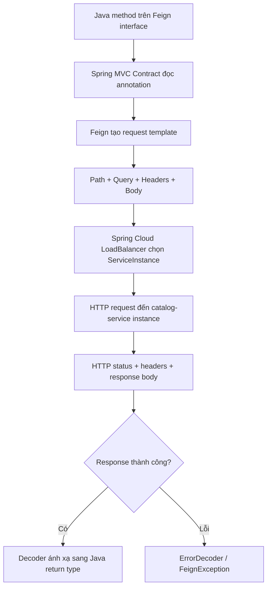
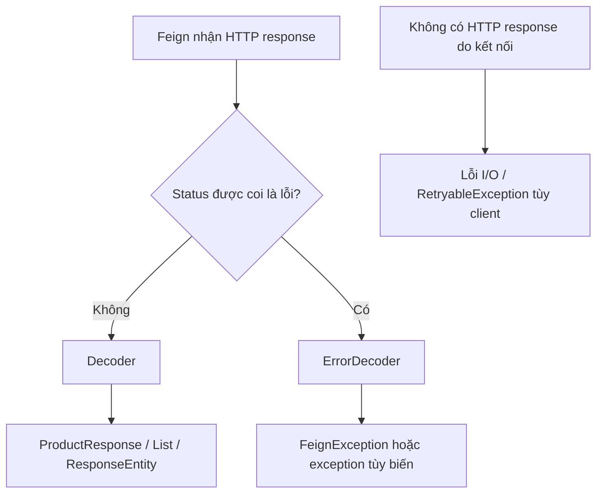

# Ánh xạ path, query, header, body và kiểu phản hồi

Spring Cloud OpenFeign cho phép mô tả HTTP API của một dịch vụ bằng **Java interface**. Thay vì tự ghép URL, thêm header, serialize JSON rồi parse response tại mỗi điểm gọi, lập trình viên khai báo các annotation như `@GetMapping`, `@PathVariable`, `@RequestParam`, `@RequestHeader` và `@RequestBody`. Feign tạo HTTP client từ hợp đồng đó.

Trong module Spring Cloud LoadBalancer, một interface `@FeignClient(name = "catalog-service")` thường dùng **service ID** để tìm bản sao qua discovery và LoadBalancer. Tuy nhiên, định tuyến đúng bản sao không bảo đảm request đúng: chỉ cần khai báo sai tên path variable, query parameter, `Content-Type` hoặc kiểu response, dịch vụ vẫn có thể trả `400`, `404`, `415` hoặc gây lỗi giải mã JSON.

Bài này hướng dẫn ánh xạ đầy đủ **path, query, header, body và kiểu phản hồi**, giải thích dữ liệu được biến đổi thế nào giữa Java và HTTP, đồng thời chỉ ra cách xác minh lỗi ở ranh giới OpenFeign – LoadBalancer – dịch vụ đích.

## 1. Từ Java method đến HTTP request

Giả sử `order-service` cần truy cập `catalog-service` với hợp đồng API:

| Thao tác | HTTP API | Ý nghĩa |
|---|---|---|
| Xem sản phẩm | `GET /api/products/{id}` | ID nằm trong **path** |
| Tìm sản phẩm | `GET /api/products?category=...&page=...` | Điều kiện nằm trong **query** |
| Tạo sản phẩm | `POST /api/products` với JSON | Dữ liệu nằm trong **body** |
| Cập nhật sản phẩm | `PUT /api/products/{id}` với JSON | Path xác định đối tượng; body mang nội dung |
| Xóa sản phẩm | `DELETE /api/products/{id}` | Có thể trả `204 No Content` |

Một lời gọi Java có thể tương ứng với request:

```http
POST /api/products HTTP/1.1
Host: catalog-service
Accept: application/json
Content-Type: application/json
X-Correlation-Id: req-0081

{"name":"Mechanical Keyboard","price":1500000}
```

`catalog-service` trong ví dụ là hostname **logic** của service ID khi request đi qua Spring Cloud LoadBalancer, không phải địa chỉ IP cố định. HTTP connector thực tế sẽ gửi request đến host/port của `ServiceInstance` được chọn; đường dẫn, query, header và body vẫn phải khớp hợp đồng của API đích.



Trong Spring Cloud OpenFeign, **Spring MVC Contract** là cơ chế thường được dùng để diễn giải các annotation Spring Web. Không nên tự động trộn cú pháp `@RequestLine` của Feign gốc với `@GetMapping` của Spring MVC trong cùng interface nếu chưa thay contract tương ứng.

## 2. Khởi tạo Feign client với service ID

Với dự án Spring Boot phù hợp, cần dependency Spring Cloud OpenFeign và Spring Cloud LoadBalancer, đồng thời có một nguồn cung cấp `ServiceInstance` như Eureka, Consul hoặc cấu hình discovery tĩnh.

Ví dụ Maven khai báo starter (phiên bản được quản lý bởi Spring Cloud BOM tương thích với Spring Boot):

```xml
<dependency>
    <groupId>org.springframework.cloud</groupId>
    <artifactId>spring-cloud-starter-openfeign</artifactId>
</dependency>
<dependency>
    <groupId>org.springframework.cloud</groupId>
    <artifactId>spring-cloud-starter-loadbalancer</artifactId>
</dependency>
```

Kích hoạt việc tìm Feign interface:

```java
package com.example.orders;

import org.springframework.boot.SpringApplication;
import org.springframework.boot.autoconfigure.SpringBootApplication;
import org.springframework.cloud.openfeign.EnableFeignClients;

@SpringBootApplication
@EnableFeignClients(basePackages = "com.example.orders.client")
public class OrderApplication {
    public static void main(String[] args) {
        SpringApplication.run(OrderApplication.class, args);
    }
}
```

DTO dùng trong các ví dụ:

```java
package com.example.orders.client;

import java.math.BigDecimal;

public record ProductResponse(
        String id,
        String name,
        BigDecimal price) { }

public record CreateProductRequest(
        String name,
        BigDecimal price) { }

public record UpdateProductRequest(
        String name,
        BigDecimal price) { }
```

Với Feign interface, `name` cần khớp **service ID** mà discovery công bố:

```java
package com.example.orders.client;

import org.springframework.cloud.openfeign.FeignClient;
import org.springframework.web.bind.annotation.GetMapping;
import org.springframework.web.bind.annotation.PathVariable;

@FeignClient(name = "catalog-service")
public interface CatalogFeignClient {

    @GetMapping("/api/products/{id}")
    ProductResponse getProduct(@PathVariable("id") String id);
}
```

Feign thực hiện việc ánh xạ phương thức `getProduct("42")` sang `GET /api/products/42`. Nếu `catalog-service` có nhiều instance, Spring Cloud LoadBalancer có thể chọn một instance theo cấu hình. Nếu interface sử dụng `url` cố định trong `@FeignClient`, luồng thường gọi thẳng địa chỉ đó thay vì phân giải service ID bằng LoadBalancer.

**Lưu ý cấu hình:** nên đặt `@GetMapping`/`@PostMapping` ở từng method của Feign interface. Không dựa vào `@RequestMapping` cấp class trên `@FeignClient` vì cách khai báo đó không được hỗ trợ như đối với Spring MVC controller thông thường trong các phiên bản Spring Cloud OpenFeign hiện hành.

## 3. Ánh xạ path với `@PathVariable`

Path variable nằm trong **phần đường dẫn** của URL, thường đại diện cho một tài nguyên cụ thể:

```java
@GetMapping("/api/products/{id}")
ProductResponse getProduct(@PathVariable("id") String id);

@GetMapping("/api/categories/{categoryId}/products/{productId}")
ProductResponse getProductInCategory(
        @PathVariable("categoryId") String categoryId,
        @PathVariable("productId") String productId);
```

Lời gọi:

```java
ProductResponse product =
        client.getProductInCategory("keyboard", "42");
```

Tương ứng với:

```http
GET /api/categories/keyboard/products/42 HTTP/1.1
```

Các quy tắc quan trọng:

1. Tên trong `@PathVariable("productId")` phải trùng placeholder `{productId}` của đường dẫn. `@PathVariable("id")` không thể thay thế tùy ý cho `{productId}`.
2. Khai báo tên **tường minh** để contract ổn định, không phụ thuộc vào việc compiler có giữ metadata tên tham số hay không.
3. Feign xử lý việc encode giá trị đường dẫn theo contract/encoder đang dùng; không nối chuỗi URL bằng tay và không tự encode hai lần.
4. Với ID có dấu `/`, dấu `?`, phần trăm hoặc ký tự đặc biệt, phải kiểm tra kết quả encode thực tế theo phiên bản và thiết kế API. Một số HTTP server/proxy có thể xử lý encoded slash khác nhau. **Không dùng path variable để truyền dữ liệu tùy ý chứa phân tách đường dẫn** nếu chưa thỏa thuận rõ hợp đồng.

**Sai thường gặp:**

```java
// SAI: placeholder là {productId}, annotation lại ghi "id".
@GetMapping("/api/products/{productId}")
ProductResponse wrong(@PathVariable("id") String id);
```

Lỗi ánh xạ này có thể được phát hiện khi tạo request hoặc dẫn đến một request không đúng mong đợi. Cách sửa là đồng nhất tên:

```java
@GetMapping("/api/products/{productId}")
ProductResponse correct(@PathVariable("productId") String id);
```

## 4. Ánh xạ query với `@RequestParam`

Query parameter nằm sau dấu `?` và biểu diễn bộ lọc, tìm kiếm, phân trang hoặc tùy chọn hiển thị. Query **không** thay thế cho path xác định tài nguyên.

```java
@GetMapping("/api/products")
List<ProductResponse> findProducts(
        @RequestParam("category") String category,
        @RequestParam("page") int page,
        @RequestParam("size") int size);
```

Ví dụ gọi:

```java
List<ProductResponse> products =
        client.findProducts("keyboard", 0, 20);
```

Request tương ứng về mặt ý nghĩa:

```http
GET /api/products?category=keyboard&page=0&size=20 HTTP/1.1
```

Thứ tự xuất hiện của query parameter trong URL **không bắt buộc giống** thứ tự khai báo ở Java. Bên server nên xử lý theo tên khóa, không dựa vào thứ tự.

### 4.1. Query tùy chọn và giá trị rỗng

```java
@GetMapping("/api/products/search")
List<ProductResponse> searchProducts(
        @RequestParam("q") String keyword,
        @RequestParam(value = "category", required = false)
        String category);
```

Khi `category` là `null`, quá trình tạo query có thể bỏ qua parameter này theo encoder/contract; cần kiểm tra bằng HTTP test nếu hợp đồng phân biệt **vắng mặt**, **chuỗi rỗng** và **chuỗi ký tự "null"**. Đừng dùng `null` để mặc định mang nghĩa `category=` trong mọi phiên bản.

`@RequestParam(defaultValue = "0")` của Spring MVC rất hữu ích ở **controller nhận request**, nhưng không nên coi nó là giải pháp duy nhất cho việc Feign **phát** giá trị mặc định tới upstream. Client nên chủ động chuẩn hóa các lựa chọn bắt buộc trước khi gọi.

### 4.2. Query object với `@SpringQueryMap`

Khi có nhiều trường lọc, có thể gói thành một Java bean và đánh dấu `@SpringQueryMap`:

```java
package com.example.orders.client;

public class ProductSearchQuery {
    private String category;
    private Integer page;
    private Integer size;

    public String getCategory() { return category; }
    public void setCategory(String category) { this.category = category; }

    public Integer getPage() { return page; }
    public void setPage(Integer page) { this.page = page; }

    public Integer getSize() { return size; }
    public void setSize(Integer size) { this.size = size; }
}
```

```java
@GetMapping("/api/products")
List<ProductResponse> findProducts(@SpringQueryMap ProductSearchQuery query);
```

```java
ProductSearchQuery query = new ProductSearchQuery();
query.setCategory("keyboard");
query.setPage(1);
query.setSize(10);
List<ProductResponse> page = client.findProducts(query);
```

Trong interface thực tế cần import `org.springframework.cloud.openfeign.SpringQueryMap`. Cơ chế `QueryMapEncoder` chuyển các thuộc tính bean thành tên/giá trị query. Khi một trường có tên Java khác tên API, hoặc có kiểu dữ liệu phức tạp, cần tùy biến encoder hoặc ánh xạ tường minh. Không giả định object nested hoặc mọi cấu trúc collection đều được serialize theo định dạng mà server mong đợi.

### 4.3. Query có nhiều giá trị

Giả sử API chấp nhận nhiều nhãn:

```http
GET /api/products?tag=gaming&tag=wireless HTTP/1.1
```

Có thể dùng collection query và chỉ định rõ format khi cần:

```java
@CollectionFormat(feign.CollectionFormat.EXPLODED)
@GetMapping("/api/products")
List<ProductResponse> findByTags(@RequestParam("tag") List<String> tags);
```

Annotation `@CollectionFormat` thuộc package `org.springframework.cloud.openfeign`. Tùy API, server có thể muốn `tag=gaming,wireless` (CSV) thay vì lặp key; client và server phải thống nhất định dạng, không suy từ kiểu `List<String>` đơn thuần. Các ký tự như dấu cách, `&`, `+` cần được encode phù hợp.

## 5. Ánh xạ request header với `@RequestHeader`

Header truyền metadata của HTTP request: loại nội dung chấp nhận, bearer token, correlation ID, locale hoặc một định danh nghiệp vụ theo hợp đồng.

```java
@GetMapping("/api/products/{id}")
ProductResponse getProductWithHeaders(
        @PathVariable("id") String id,
        @RequestHeader("X-Correlation-Id") String correlationId,
        @RequestHeader("Authorization") String authorization);
```

Ví dụ:

```java
ProductResponse product = client.getProductWithHeaders(
        "42",
        "req-0081",
        "Bearer " + accessToken);
```

Đường truyền HTTP về mặt ngữ nghĩa:

```http
GET /api/products/42 HTTP/1.1
Authorization: Bearer <token>
X-Correlation-Id: req-0081
```

Một số nguyên tắc:

- Dùng `@RequestHeader("X-Correlation-Id")` cho giá trị thay đổi theo **từng lần gọi**; dùng `RequestInterceptor` cho header cần thêm theo chính sách **của client**.
- `Accept` mô tả response client muốn nhận; `Content-Type` mô tả định dạng body client gửi. Chúng **không thay thế lẫn nhau**.
- Không log bearer token, cookie hoặc những header bí mật. Không tự động forward toàn bộ header từ request bên ngoài sang dịch vụ nội bộ.
- Chỉ chuyển token người dùng khi mô hình ủy quyền của hệ thống cho phép; nhiều hệ thống dùng service credential riêng thay vì dùng trực tiếp token của caller.

### 5.1. Header chung qua `RequestInterceptor`

Ví dụ một interceptor dành cho **riêng** `catalog-service`:

```java
import feign.RequestInterceptor;
import org.springframework.context.annotation.Bean;

public class CatalogFeignConfiguration {

    @Bean
    RequestInterceptor catalogClientHeader() {
        return request -> request.header(
                "X-Client-App", "order-service");
    }
}
```

Gắn với Feign client:

```java
@FeignClient(
        name = "catalog-service",
        configuration = CatalogFeignConfiguration.class)
public interface CatalogFeignClient {
    // Các phương thức @GetMapping / @PostMapping...
}
```

Khi chỉ muốn áp dụng interceptor cho một Feign client, **không đặt lớp `CatalogFeignConfiguration` vào vùng component scan của ứng dụng chính** nếu nó tạo bean cấu hình có thể được chia sẻ toàn cục. Có thể đặt trong package ngoài phạm vi scan rồi tham chiếu qua `configuration = ...`. Đây là nguyên tắc phạm vi bean tương tự khi cấu hình LoadBalancer per-service, dù **Feign context và LoadBalancer context là các cơ chế khác nhau**.

Không nên phụ thuộc vào `ThreadLocal` để lấy token trong mọi loại xử lý bất đồng bộ: nếu dùng thread pool, circuit breaker hoặc propagation khác, ngữ cảnh bảo mật cần được truyền theo cơ chế phù hợp.

## 6. Ánh xạ body JSON với `@RequestBody`

Đối với request tạo hoặc cập nhật tài nguyên, nội dung JSON nằm ở **HTTP body**, khác với query hoặc path. Spring Cloud OpenFeign thường sử dụng `SpringEncoder` và các `HttpMessageConverter` được Spring Boot cấu hình để serialize đối tượng Java thành JSON khi đúng media type và dependency.

```java
@PostMapping(
        value = "/api/products",
        consumes = MediaType.APPLICATION_JSON_VALUE)
ProductResponse createProduct(
        @RequestBody CreateProductRequest request);
```

```java
CreateProductRequest request =
        new CreateProductRequest(
                "Mechanical Keyboard", new BigDecimal("1500000"));

ProductResponse created = client.createProduct(request);
```

Request tương ứng:

```http
POST /api/products HTTP/1.1
Content-Type: application/json

{"name":"Mechanical Keyboard","price":1500000}
```

`MediaType` ở snippet thuộc `org.springframework.http.MediaType`; `@PostMapping` và `@RequestBody` thuộc `org.springframework.web.bind.annotation`. Hai record request/response ở phần trước có các trường giống JSON minh họa. Cấu hình thực tế cần đảm bảo có JSON converter thích hợp và server chấp nhận schema này.

### 6.1. Kết hợp path với body

```java
@PutMapping(
        value = "/api/products/{id}",
        consumes = MediaType.APPLICATION_JSON_VALUE)
ResponseEntity<Void> updateProduct(
        @PathVariable("id") String id,
        @RequestBody UpdateProductRequest request);
```

Lời gọi `updateProduct("42", body)` đặt `42` vào **path**, còn `name` và `price` vào **body**. Các giá trị này có ý nghĩa khác nhau. Nếu server yêu cầu ID trong body nữa, phải thỏa thuận điều kiện nhất quán; Feign không tự đồng bộ hai nơi.

### 6.2. Những lỗi body thường gặp

| Lỗi | Biểu hiện | Hướng xử lý |
|---|---|---|
| Quên `@RequestBody` hoặc khai báo sai contract | Body không được serialize như mong muốn | Kiểm tra method annotation và HTTP request thực |
| `Content-Type` không khớp `consumes` của server | `415 Unsupported Media Type` | Dùng media type và encoder phù hợp |
| JSON thiếu field bắt buộc hoặc sai kiểu | `400` / `422` tùy server | Xem DTO, validation và error payload |
| Gửi `null` cho request bắt buộc body | API có thể không nhận dữ liệu hợp lệ | Xác định semantics `null`, validation và contract |
| DTO có tên trường không khớp JSON | Payload sai hoặc bị bỏ dữ liệu | Dùng DTO đúng hợp đồng hoặc annotation JSON phù hợp |

Một method Feign có nhiều tham số không có nghĩa tất cả tham số được đưa vào body. Các tham số phải có annotation thể hiện **vị trí trên HTTP request**. Với một JSON document thông thường, hãy gói dữ liệu vào **một request DTO** được đánh dấu `@RequestBody` thay vì cố tạo nhiều body độc lập.

## 7. Ánh xạ form và multipart khác JSON body

`application/json`, `application/x-www-form-urlencoded` và `multipart/form-data` là các định dạng khác nhau. Không nên lấy một method đang dùng `@RequestBody` JSON rồi đổi `consumes` thành multipart và kỳ vọng encoder tự xử lý đúng.

Ví dụ hợp đồng multipart nhận file:

```java
@PostMapping(
        value = "/api/products/{id}/images",
        consumes = MediaType.MULTIPART_FORM_DATA_VALUE)
void uploadImage(
        @PathVariable("id") String productId,
        @RequestPart("file") MultipartFile file);
```

`@RequestPart` thuộc Spring Web, `MultipartFile` thuộc `org.springframework.web.multipart`. Để lời gọi này hoạt động cần encoder multipart được phiên bản Spring Cloud OpenFeign và cấu hình ứng dụng hỗ trợ. Nếu server yêu cầu metadata JSON và file trong nhiều part, định nghĩa rõ `@RequestPart` cho từng part. Cần kiểm thử **tên part**, filename, content type của từng part và giới hạn kích thước upload.

Không nhầm `@RequestParam` query với form field: cách giải mã phía server tùy `Content-Type` và hợp đồng endpoint. Khi API nhận form, thiết kế riêng DTO/encoder và kiểm tra wire format thay vì dựa vào ngẫu nhiên hành vi serialize.

## 8. Chọn kiểu phản hồi: DTO, `List<T>`, `ResponseEntity<T>`, `void`

Kiểu trả về trên Feign interface quy định cách decoder diễn giải **HTTP response**. Kiểu đúng giúp tầng nghiệp vụ làm việc với dữ liệu Java thay vì JSON raw, nhưng cần khớp body mà server thực sự trả.

| Kiểu trả về | Dùng cho | Lưu ý |
|---|---|---|
| `ProductResponse` | JSON object của một sản phẩm | Không có body có thể dẫn đến `null` |
| `List<ProductResponse>` | JSON array `[{},{}]` | Khác với JSON object bọc `items` |
| `ResponseEntity<ProductResponse>` | Cần status, headers và DTO | 4xx/5xx mặc định vẫn là exception |
| `ResponseEntity<Void>` | Cần status/header nhưng không dùng body | Phù hợp với `204 No Content` |
| `void` | Không cần xử lý body thành công | Không trực tiếp cung cấp status cho caller |
| DTO envelope, ví dụ `CatalogPageResponse` | Server trả JSON `{"items":[...],"total":...}` | DTO phải phản ánh đúng cấu trúc |

### 8.1. Đọc status và headers với `ResponseEntity`

```java
@GetMapping("/api/products/{id}")
ResponseEntity<ProductResponse> getProductWithResponse(
        @PathVariable("id") String id);

@DeleteMapping("/api/products/{id}")
ResponseEntity<Void> deleteProduct(
        @PathVariable("id") String id);
```

Trong service:

```java
ResponseEntity<ProductResponse> response =
        client.getProductWithResponse("42");

int status = response.getStatusCode().value();
String requestId = response.getHeaders().getFirst("X-Request-Id");
ProductResponse body = response.getBody();

if (body == null) {
    throw new IllegalStateException(
            "Catalog response missing product body");
}
```

Khác với `ResponseEntity` trong Spring MVC controller, ở đây đây là **kiểu kết quả của HTTP client**. Với xử lý lỗi mặc định, Feign không trả `ResponseEntity` chứa status `404` để mã nghiệp vụ tự xét; các HTTP error status thường được chuyển sang exception ở bước ErrorDecoder.

### 8.2. Generic collection và response envelope

Với response JSON là mảng, method có thể khai báo:

```java
@GetMapping("/api/products")
List<ProductResponse> getAllProducts();
```

Nếu JSON là object phân trang:

```json
{
  "items": [
    {"id": "42", "name": "Keyboard", "price": 1500000}
  ],
  "total": 1
}
```

DTO cần ánh xạ **object**, không phải list:

```java
public record CatalogPageResponse(
        List<ProductResponse> items,
        long total) { }
```

```java
@GetMapping("/api/products")
CatalogPageResponse getPage(@RequestParam("page") int page);
```

Một số serializer/decoder hỗ trợ generic kiểu `ApiResponse<List<ProductResponse>>` nếu type metadata được giữ đúng trong khai báo method. Tuy nhiên, hãy kiểm thử schema thực thay vì mặc định `Page<ProductResponse>` của Spring Data luôn tương thích với JSON phân trang do service khác tạo ra.

### 8.3. Response rỗng và status `204`

`204 No Content` thông thường không có response body. Dùng `ResponseEntity<Void>` hoặc `void` khi hợp đồng cho phép. Nếu API được khai báo trả `ProductResponse` nhưng thực tế trả `204`, kết quả có thể `null`, không nên giả định `ProductResponse` luôn có dữ liệu vì Java method có return type non-null trong khai báo.

## 9. Phân biệt decoder và ErrorDecoder

Spring Cloud OpenFeign thường cung cấp decoder dựa trên **Spring `HttpMessageConverter`** để đọc body thành công, chẳng hạn `SpringDecoder` và lớp hỗ trợ `ResponseEntity`. Khi HTTP status biểu thị lỗi, Feign sử dụng **ErrorDecoder** thay vì giải mã response theo DTO thành công.



Ví dụ bắt lỗi thông thường:

```java
try {
    ProductResponse product = client.getProduct("42");
} catch (FeignException.NotFound ex) {
    // catalog-service trả 404, nếu chưa có ErrorDecoder tùy biến.
    throw new ProductNotFoundException("42", ex);
} catch (FeignException ex) {
    // HTTP status khác hoặc lỗi được Feign đại diện bằng exception.
    log.warn("Catalog call failed: status={}", ex.status());
    throw new CatalogDependencyException(ex);
}
```

Ví dụ giả định đã import `feign.FeignException` và định nghĩa `ProductNotFoundException`/`CatalogDependencyException` trong ứng dụng. Trong một số tình huống transport, Feign có thể ném `RetryableException` hoặc exception khác tùy HTTP client/phiên bản; không kết luận một exception bất kỳ luôn có HTTP response thật.

Không biến toàn bộ HTTP error thành `404` của API phía caller. `404` tài nguyên, `409` xung đột, `429` giới hạn tần suất, `5xx` lỗi dependency và lỗi kết nối cần được xử lý theo **hợp đồng nghiệp vụ**. Cần đặc biệt cân nhắc idempotency khi bật retry cho request ghi dữ liệu.

**Tùy chọn đặc biệt:** một số phiên bản hỗ trợ `dismiss404`/cấu hình xử lý 404 khác mặc định. Nếu bật, `404` có thể được chuyển qua decoder thay vì ném lỗi theo cách thông thường. Luôn kiểm tra cấu hình Feign client và kiểm thử hành vi thực tế; đừng dựa duy nhất vào kiểu method.

## 10. Tách lỗi request mapping và lỗi chọn instance

Trong ứng dụng dùng Spring Cloud LoadBalancer, một lời gọi Feign trải qua hai nhóm quyết định độc lập:

1. **HTTP mapping:** Feign chuyển annotation thành method/path/query/header/body và quyết định cách giải mã response.
2. **Service discovery/load balancing:** Spring Cloud tìm instance ứng với `catalog-service` và chọn một địa chỉ đích.

Ví dụ:

| Triệu chứng | Nguyên nhân có thể | Cần kiểm tra |
|---|---|---|
| `404` dù discovery thấy nhiều instance | Path hoặc route không khớp, ID không tồn tại | `@GetMapping`, `@PathVariable`, log server và HTTP status |
| `400` hoặc `422` | Query/body sai tên, thiếu field hoặc validation lỗi | Wire query, JSON schema, `@RequestParam`, `@RequestBody` |
| `401` hoặc `403` | Header xác thực sai/thiếu, chính sách phân quyền | `@RequestHeader`, interceptor, bảo mật token |
| `415` | Body encoder và `Content-Type` không khớp | `consumes`, media type, encoder và controller đích |
| `406` | `Accept` không được server đáp ứng | Header `Accept`, `produces` và kiểu response |
| Có HTTP 200 nhưng decode thất bại | JSON không khớp DTO hoặc content type | Response body, decoder, generic types |
| Không có instance cho service ID | Registry/discovery hoặc supplier trả danh sách rỗng | `@FeignClient(name)`, discovery, health/zone filters |
| Connection refused hoặc timeout | Instance được chọn không thể truy cập/đang lỗi | Host:port, mạng, timeout, readiness, retry |

Không nên sửa `@RequestBody` chỉ vì nhận timeout: timeout có thể xảy ra trước khi server trả bất kỳ response nào. Ngược lại, không tăng retry nếu lỗi nhất quán là `400` do body sai hợp đồng.

Nếu Feign client được khai báo `@FeignClient(name = "catalog-service", url = "...")`, hãy xác định đang sử dụng **URL cố định** hay **service discovery** trước khi suy luận về LoadBalancer. Một `url` sai có thể làm lệch hoàn toàn hướng chẩn đoán.

## 11. Kiểm thử hợp đồng request và kiểu phản hồi

Khi viết hoặc chỉnh sửa Feign interface, cần xác minh **request gửi thật**, không chỉ xem code annotation. Có thể dùng một HTTP mock server (như WireMock/MockWebServer) hoặc một bản sao thử nghiệm của dịch vụ đích để ghi nhận method, path, query, headers, body và response.

Một quy trình thực hành:

1. **Path:** gọi `getProduct("42")`, xác nhận mock server thấy `GET /api/products/42`. Thử ID có ký tự đặc biệt và kiểm tra encode.
2. **Query:** gọi tìm kiếm với `category`, `page`, `size`; so tên key và kiểu biểu diễn. Với `@SpringQueryMap`, thử thuộc tính vắng mặt, `null` và query có collection.
3. **Header:** truyền `X-Correlation-Id` và một giá trị xác thực giả trong môi trường test, kiểm tra header hiện diện; không đưa token thật vào snapshot/log.
4. **Body:** gửi `CreateProductRequest`, kiểm tra `Content-Type`, JSON keys và giá trị số. Test trường thiếu, sai kiểu và response validation.
5. **Response object:** mock trả JSON sản phẩm, xác nhận decoder tạo đúng `ProductResponse`.
6. **Response list/envelope:** mock trả cả JSON array và JSON object có `items`; xác minh method tương ứng decode đúng và method sai type thất bại theo dự kiến.
7. **Response rỗng:** trả `204 No Content` cho method `ResponseEntity<Void>`, kiểm tra không cố parse body.
8. **HTTP lỗi:** mock trả `404`, `409`, `429`, `503` với error payload; kiểm tra `FeignException` hoặc ErrorDecoder tùy biến, rồi kiểm tra ánh xạ lỗi của tầng nghiệp vụ.
9. **Discovery/LoadBalancer:** chạy ít nhất hai instance `catalog-service`, không cấu hình `url` cố định và kiểm tra cả hai có thể được chọn theo policy hiện tại.
10. **Lỗi kết nối:** làm instance không còn truy cập được, quan sát timeout, số lần retry, instance được chọn và xem có HTTP response hay không.

Ví dụ bảng đối chiếu:

| Java call | HTTP kỳ vọng | Kiểu response dự kiến |
|---|---|---|
| `getProduct("42")` | `GET /api/products/42` | `ProductResponse` |
| `findProducts("keyboard", 0, 20)` | `GET /api/products?category=keyboard&page=0&size=20` | `List<ProductResponse>` |
| `createProduct(request)` | `POST /api/products`, JSON body | `ProductResponse` |
| `updateProduct("42", body)` | `PUT /api/products/42`, JSON body | `ResponseEntity<Void>` |
| `deleteProduct("42")` | `DELETE /api/products/42` | `ResponseEntity<Void>` |

Trong thực tế, thứ tự query key có thể khác, body JSON có thể thay đổi thứ tự field và header name không phân biệt chữ hoa/thường. Test nên so **ngữ nghĩa HTTP**, tránh phụ thuộc byte-for-byte vào thứ tự không mang ý nghĩa.

## 12. Logging, timeout và chính sách retry

Để quan sát request khi tích hợp OpenFeign:

- Bật mức log Feign có kiểm soát trong môi trường thử nghiệm, ưu tiên log method, URL đã che dữ liệu nhạy cảm, status và thời gian. Mức `FULL` có thể in headers/body, **không thích hợp bật rộng rãi trong production** vì có thể lộ token hoặc dữ liệu cá nhân.
- Gắn trace/correlation ID theo hạ tầng observability và theo dõi service ID, instance được chọn, HTTP status, attempt và thời lượng.
- Cấu hình **connect timeout** và **read timeout** phù hợp với hợp đồng thời gian của dịch vụ. Chúng không nhất thiết tạo ra một deadline tổng duy nhất khi có discovery, retry và xử lý request.
- Nếu bật retry, xác định rõ những lỗi có thể retry, số lần thử, backoff và ngân sách thời gian. Theo mặc định của Spring Cloud OpenFeign, cơ chế retry của Feign thường được cấu hình khác với retryer mặc định của Feign gốc; không tự giả định có retry chỉ vì sử dụng OpenFeign.
- Với `POST`/request thay đổi trạng thái, retry có thể làm lặp thao tác nếu server đã xử lý nhưng response bị mất. Cần idempotency key hoặc bảo đảm nghiệp vụ tương ứng.

Ngoài ra, `@FeignClient(configuration = ...)` là cấu hình **Feign client** (encoder, decoder, interceptor, logger, retryer...). Cấu hình cách chọn instance như health filter, zone và chính sách LoadBalancer là **một lớp riêng** của Spring Cloud LoadBalancer. Không nhầm chỉnh sửa encoder/decoder với việc đổi thuật toán chọn `ServiceInstance`.

## 13. Các quy tắc cần ghi nhớ

- `@PathVariable` đặt giá trị vào placeholder của URL path; tên annotation phải khớp placeholder.
- `@RequestParam` và `@SpringQueryMap` mô tả query string; cần làm rõ cách biểu diễn giá trị `null`, collection và kiểu phức tạp.
- `@RequestHeader` truyền metadata theo request; `RequestInterceptor` bổ sung header theo chính sách Feign client, nhưng không được làm rò credential.
- `@RequestBody` và `consumes` quyết định serialization body; JSON, form và multipart có hợp đồng riêng.
- Kiểu trả về `ProductResponse`, `List<ProductResponse>`, `ResponseEntity<T>` hay `Void` phải phù hợp với HTTP status và cấu trúc body thật.
- Feign decoder xử lý response thành công; HTTP 4xx/5xx thông thường được xử lý qua ErrorDecoder và exception, không được mặc định chuyển thẳng thành DTO thành công.
- Khi gọi bằng service ID, **HTTP mapping đúng** và **LoadBalancer chọn được instance khỏe** là hai điều kiện độc lập. Đọc request/response thực tế, trace, timeout và retry để khoanh vùng sự cố.

Khi hiểu rõ từng vị trí dữ liệu trên HTTP request và kiểu phản hồi, OpenFeign giúp giao tiếp giữa các dịch vụ gọn hơn mà vẫn giữ được hợp đồng API rõ ràng, kiểm thử được và quan sát được trong hệ thống dùng Spring Cloud LoadBalancer.
