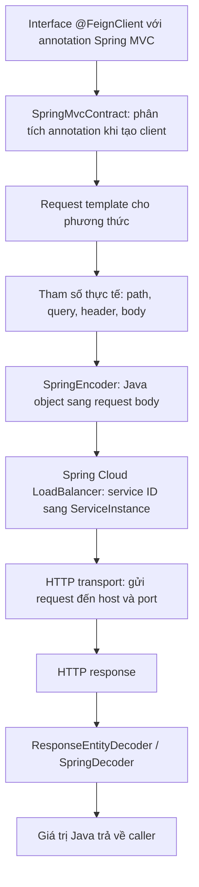
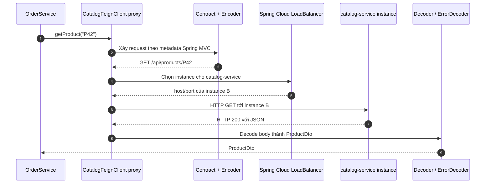

# Spring MVC contract, Encoder và Decoder

Spring Cloud OpenFeign cho phép mô tả lời gọi HTTP tới một dịch vụ khác bằng **interface Java** thay vì tự tạo request bằng `RestClient`, `RestTemplate` hoặc `WebClient`. Tuy nhiên, interface chỉ mô tả ý định của lập trình viên. Để biến một phương thức như `getProduct("P42")` thành request HTTP và biến response JSON thành đối tượng Java, OpenFeign phải phối hợp ba thành phần khác nhau: **Contract**, **Encoder** và **Decoder**.

Trong module `SPRING_CLOUD_SERVICE_COMMUNICATION_LOAD_BALANCING`, OpenFeign còn kết hợp với Spring Cloud LoadBalancer để giải quyết tên logic như `catalog-service` thành một `ServiceInstance` có host và port thực tế. Cần phân biệt: **Contract xác định request trông như thế nào; Encoder tạo phần body; LoadBalancer chọn đích đến; Decoder đọc kết quả thành kiểu Java**. Hiểu ranh giới đó giúp chẩn đoán đúng lỗi mapping, JSON, content type, HTTP status và cân bằng tải.

## 1. Vai trò của ba thành phần

| Thành phần | Input chính | Kết quả | Lỗi thường thấy |
|---|---|---|---|
| `Contract` | Annotation và chữ ký phương thức của Feign interface | Metadata/request template: HTTP method, path, header, tham số | Thiếu annotation, sai `@PathVariable`, sai contract cho interface |
| `Encoder` | Đối tượng Java được dùng làm request body, cùng metadata của request | Dữ liệu body gửi qua HTTP, thường là JSON hoặc form | Không có converter phù hợp, sai `Content-Type`, body không serialize được |
| `Decoder` | HTTP response thành công cùng kiểu trả về khai báo | DTO, `List<T>`, `ResponseEntity<T>` hoặc kiểu Java phù hợp | JSON không khớp DTO, `Content-Type` sai, thiếu converter |

`SpringMvcContract` là contract thường được Spring Cloud OpenFeign dùng để hiểu annotation kiểu Spring MVC như `@GetMapping`, `@PostMapping`, `@RequestParam`, `@PathVariable`, `@RequestHeader` và `@RequestBody`. `SpringEncoder` và `SpringDecoder` tận dụng hệ thống `HttpMessageConverters` của Spring để mã hóa/giải mã HTTP body. Trong cấu hình mặc định, decoder thường là `ResponseEntityDecoder` bọc một `SpringDecoder`, nhờ đó các kiểu trả về như `ResponseEntity<ProductDto>` được hỗ trợ.



Sơ đồ mô tả trách nhiệm logic. Contract thường được xử lý khi Feign client được tạo; không phải mỗi lần gọi request mới quét lại toàn bộ annotation. Encoder chỉ cần thực hiện khi có phần body thích hợp, còn response lỗi HTTP có thể đi qua cơ chế `ErrorDecoder` thay vì decoder thông thường.

## 2. Cấu hình nền tảng cho OpenFeign và LoadBalancer

Với dự án Spring Boot dùng Maven, các dependency chính là:

```xml
<dependencies>
    <dependency>
        <groupId>org.springframework.cloud</groupId>
        <artifactId>spring-cloud-starter-openfeign</artifactId>
    </dependency>

    <dependency>
        <groupId>org.springframework.cloud</groupId>
        <artifactId>spring-cloud-starter-loadbalancer</artifactId>
    </dependency>
</dependencies>
```

Nếu ứng dụng cũng cung cấp controller Spring MVC, bổ sung `spring-boot-starter-web` theo nhu cầu. Các starter và dependency Jackson phù hợp có thể cung cấp `HttpMessageConverters` cho JSON. Hãy sử dụng **Spring Cloud BOM** tương thích với phiên bản Spring Boot của dự án; không tự chọn ngẫu nhiên phiên bản OpenFeign và LoadBalancer.

Bật quét Feign client trong ứng dụng gọi:

```java
package com.example.orders;

import com.example.orders.client.CatalogFeignClient;
import org.springframework.boot.SpringApplication;
import org.springframework.boot.autoconfigure.SpringBootApplication;
import org.springframework.cloud.openfeign.EnableFeignClients;

@SpringBootApplication
@EnableFeignClients(clients = CatalogFeignClient.class)
public class OrderApplication {

    public static void main(String[] args) {
        SpringApplication.run(OrderApplication.class, args);
    }
}
```

`@EnableFeignClients` cho Spring biết cần tạo proxy từ những interface được đánh dấu `@FeignClient`. Tùy dự án có thể dùng `basePackages` hoặc danh sách `clients` rõ ràng. Không có bước này, interface Feign có thể không được đăng ký làm bean, khiến injection thất bại trước khi request được gửi.

## 3. Ví dụ đầy đủ về Spring MVC contract

Giả sử `order-service` gọi `catalog-service` để lấy thông tin sản phẩm, tìm theo danh mục hoặc tạo một sản phẩm. Interface có thể được viết như sau:

```java
package com.example.orders.client;

import java.util.List;
import org.springframework.cloud.openfeign.FeignClient;
import org.springframework.http.MediaType;
import org.springframework.http.ResponseEntity;
import org.springframework.web.bind.annotation.GetMapping;
import org.springframework.web.bind.annotation.PathVariable;
import org.springframework.web.bind.annotation.PostMapping;
import org.springframework.web.bind.annotation.RequestBody;
import org.springframework.web.bind.annotation.RequestHeader;
import org.springframework.web.bind.annotation.RequestParam;

@FeignClient(name = "catalog-service", path = "/api/products")
public interface CatalogFeignClient {

    @GetMapping(value = "/{id}", produces = MediaType.APPLICATION_JSON_VALUE)
    ProductDto getProduct(@PathVariable("id") String id);

    @GetMapping(produces = MediaType.APPLICATION_JSON_VALUE)
    List<ProductDto> findProducts(
            @RequestParam("category") String category,
            @RequestParam(value = "limit", required = false) Integer limit);

    @PostMapping(
            consumes = MediaType.APPLICATION_JSON_VALUE,
            produces = MediaType.APPLICATION_JSON_VALUE)
    ResponseEntity<ProductDto> createProduct(
            @RequestHeader("X-Correlation-Id") String correlationId,
            @RequestBody CreateProductRequest request);
}
```

DTO dùng trong interface, ví dụ với Java `record`:

```java
package com.example.orders.client;

public record ProductDto(String id, String name, int available) {
}

public record CreateProductRequest(String name, int available) {
}
```

Trong dự án Java thực tế, hai `public record` trên phải nằm ở **hai file Java riêng**, tương ứng `ProductDto.java` và `CreateProductRequest.java`. Chúng được đặt chung trong khối code chỉ để trình bày gọn DTO của bài.

Các annotation được `SpringMvcContract` hiểu theo mục đích:

| Annotation | Thông tin contract tạo ra | Ví dụ khi gọi |
|---|---|---|
| `@FeignClient(name = "catalog-service")` | Tên client/service ID | Tra cứu instance của `catalog-service` |
| `@FeignClient(path = "/api/products")` | Prefix đường dẫn cho những method của client | `/api/products` |
| `@GetMapping("/{id}")` | HTTP `GET` với path template | `/api/products/P42` |
| `@PathVariable("id")` | Đưa giá trị tham số vào placeholder `{id}` | `P42` |
| `@RequestParam("category")` | Thêm query parameter | `?category=books` |
| `@RequestHeader("X-Correlation-Id")` | Đưa giá trị vào header request | `X-Correlation-Id: trace-123` |
| `@RequestBody` | Chỉ định tham số là HTTP request body | JSON của `CreateProductRequest` |
| `consumes` / `produces` | Mô tả định dạng request/response mong đợi | `Content-Type`, `Accept` tương ứng |

Trong Feign, các annotation Spring MVC là **metadata dành cho phía client**. Chúng không tự tạo endpoint ở `catalog-service`. Dịch vụ đích vẫn cần controller/HTTP handler tương ứng. Hai phía phải thống nhất method, path, query, body và định dạng dữ liệu.

**Lưu ý:** Spring Cloud OpenFeign không hỗ trợ mọi mẫu sử dụng annotation trên Spring MVC controller. Chẳng hạn, nên dùng `path` của `@FeignClient` để tạo prefix, thay vì sao chép nguyên class-level `@RequestMapping` từ controller sang interface Feign mà không kiểm tra hỗ trợ của phiên bản đang dùng.

## 4. Contract biến lời gọi Java thành HTTP request ra sao?

Giả sử service gọi:

```java
ProductDto product = catalogFeignClient.getProduct("P42");
```

Contract đã biết method này dùng GET, đường dẫn `/api/products/{id}`, và tham số `id` là path variable. Khi phương thức được thực thi, Feign thay placeholder bằng giá trị đã encode thích hợp:

```http
GET /api/products/P42 HTTP/1.1
Host: catalog-service
Accept: application/json
```

`Host` trong đoạn HTTP là ví dụ ở mức logic. Khi Spring Cloud LoadBalancer chọn instance thực tế và transport tạo request, host/port của kết nối và header liên quan có thể được điều chỉnh tương ứng. Không nên coi dòng `Host` minh họa là bằng chứng Feign gửi nguyên văn giá trị đó trên dây trong mọi HTTP transport.

Với method `findProducts("books", 10)`, request có dạng:

```http
GET /api/products?category=books&limit=10 HTTP/1.1
Accept: application/json
```

Contract xác định vị trí tham số, còn quá trình expand template và encoder tham số sẽ xử lý việc đưa giá trị vào path/query/header thích hợp. Các giá trị chứa dấu cách, dấu `/`, ký tự Unicode hoặc ký tự đặc biệt phải được mã hóa theo ngữ cảnh URL; không tự nối chuỗi URL bằng tay.

Nếu thiếu `@PathVariable("id")` hoặc tên `{id}` trong `@GetMapping` không khớp, Feign có thể phát hiện sai contract ngay khi tạo client hoặc tạo request sai. Một số lỗi annotation do đó xuất hiện **lúc khởi động**, trước khi HTTP transport có cơ hội gửi request. Khi không thấy bất kỳ request nào đến service đích, cần kiểm tra contract trước khi nghi ngờ LoadBalancer.

### Spring MVC Contract khác `feign.Contract.Default`

Feign gốc có contract riêng, dùng các annotation như `@RequestLine` và `@Param`. Spring Cloud OpenFeign thường dùng `SpringMvcContract` để đọc `@GetMapping`, `@PostMapping` và các annotation Spring MVC quen thuộc.

Nếu thay bean `Contract` bằng `feign.Contract.Default` nhưng vẫn giữ interface chỉ có `@GetMapping`, proxy có thể không hiểu mapping như mong muốn. Đừng thay contract chỉ để khắc phục một vấn đề serialize body hoặc decode response; Contract, Encoder và Decoder xử lý **ba loại vấn đề khác nhau**.

## 5. SpringEncoder: biến DTO thành request body

Khi gọi:

```java
CreateProductRequest request = new CreateProductRequest("Notebook", 25);

ResponseEntity<ProductDto> response =
        catalogFeignClient.createProduct("trace-123", request);
```

`SpringMvcContract` xác định phương thức HTTP, path, header và vị trí `@RequestBody`. Tiếp theo, **`SpringEncoder`** chịu trách nhiệm biến DTO thành nội dung HTTP body thông qua `HttpMessageConverters` của Spring. Với Jackson JSON converter và `Content-Type: application/json`, body sẽ có dạng:

```http
POST /api/products HTTP/1.1
Content-Type: application/json
Accept: application/json
X-Correlation-Id: trace-123

{"name":"Notebook","available":25}
```

Các yếu tố quan trọng của quá trình encode:

1. **Kiểu dữ liệu Java:** DTO, `String`, byte array hoặc dạng form cần converter phù hợp.
2. **`Content-Type`:** Feign/Spring chọn cách serialize dựa trên media type của request và các converter được đăng ký.
3. **Quy tắc Jackson:** tên trường, định dạng ngày giờ, enum, null và các annotation như `@JsonProperty` ảnh hưởng đến JSON.
4. **Charset và định dạng:** JSON, text, binary hoặc multipart có cách mã hóa khác nhau; không phải mọi request đều là JSON.
5. **Nguồn converters:** Spring Boot thường cấu hình sẵn `HttpMessageConverters`, nhưng việc thay bean encoder hoặc converters có thể làm mất khả năng xử lý kiểu vốn đang hoạt động.

Ví dụ DTO dùng tên trường khác với API đích:

```java
import com.fasterxml.jackson.annotation.JsonProperty;

public record CreateProductRequest(
        @JsonProperty("product_name") String name,
        @JsonProperty("stock_count") int available) {
}
```

Khi dùng DTO này, JSON sẽ có key `product_name` và `stock_count`, không còn là `name` và `available`. `SpringEncoder` không tự đoán schema nghiệp vụ của dịch vụ đích: hai ứng dụng phải thống nhất contract dữ liệu hoặc dùng mapping rõ ràng.

### Không nhầm `@RequestParam` và `@RequestBody`

`@RequestParam` tạo query parameter, trong khi `@RequestBody` mô tả nội dung request body. Nếu API yêu cầu JSON nhưng interface Feign chỉ dùng query parameter, request gửi đi sẽ không có body như server mong đợi. Nếu API yêu cầu form URL-encoded hoặc multipart, cần thiết lập media type và cấu hình encoder phù hợp cho định dạng đó; không thay bằng JSON chỉ vì DTO có thể serialize thành JSON.

## 6. SpringDecoder và ResponseEntityDecoder: đọc response thành Java

Giả sử `catalog-service` trả về:

```http
HTTP/1.1 200 OK
Content-Type: application/json

{"id":"P42","name":"Notebook","available":25}
```

Với interface khai báo `ProductDto getProduct(...)`, decoder cần đọc response body và tạo một `ProductDto` tương ứng. `SpringDecoder` tận dụng `HttpMessageConverters`, trong đó Jackson converter thường chịu trách nhiệm biến JSON thành DTO.

Spring Cloud OpenFeign thường cung cấp mặc định:

```text
Decoder cho Feign client
  └─ ResponseEntityDecoder
       └─ SpringDecoder
            └─ HttpMessageConverters
                 └─ Jackson JSON converter, text converters, ...
```

`ResponseEntityDecoder` giúp hỗ trợ thêm những kiểu trả về như:

```java
ResponseEntity<ProductDto> createProduct(...);
```

Ở đây caller có thể xem cả status và headers bên cạnh body. Nếu method trả `ProductDto`, caller chỉ nhận giá trị đã decode theo kiểu được khai báo. Ví dụ:

```java
ResponseEntity<ProductDto> result =
        catalogFeignClient.createProduct("trace-123", request);

int status = result.getStatusCode().value();
String location = result.getHeaders().getFirst("Location");
ProductDto product = result.getBody();
```

Các kiểu `List<ProductDto>` hoặc các kiểu generic phù hợp cũng có thể được decode khi metadata kiểu trả về và converter hỗ trợ chúng. Nếu DTO có kiểu dữ liệu không tương thích JSON, tên trường thay đổi hoặc response gửi content type bất thường, lỗi decode có thể xuất hiện **sau khi HTTP request đã thành công ở tầng mạng**.

### Cần xử lý response trống và trạng thái HTTP rõ ràng

Một endpoint `DELETE` có thể trả `204 No Content`; trong trường hợp này interface nên dùng kiểu trả về phù hợp, ví dụ `void` hoặc `ResponseEntity<Void>`, thay vì bắt decoder tạo một DTO từ body không tồn tại. Với JSON `null`, field tùy chọn hoặc dữ liệu thiếu, cần thiết kế DTO và xử lý null theo quy tắc của API. Decoder không tự biến mọi response rỗng thành một đối tượng nghiệp vụ hợp lệ.

## 7. Decoder thông thường khác ErrorDecoder

Một lỗi dễ gặp là cho rằng bất kỳ response HTTP nào cũng đi qua `SpringDecoder`. Trong Feign, response có status được coi là lỗi thường được đưa đến **`ErrorDecoder`**. Mặc định, Feign thường ném `FeignException` hoặc exception liên quan khi nhận lỗi HTTP.

| Kết quả HTTP | Thành phần thường xử lý | Ví dụ |
|---|---|---|
| `200 OK` với JSON | `Decoder` (`ResponseEntityDecoder` / `SpringDecoder`) | Tạo `ProductDto` |
| `201 Created` với JSON | `Decoder` | Tạo `ResponseEntity<ProductDto>` |
| `204 No Content` | Xử lý response không có body | `void`, `ResponseEntity<Void>` |
| `400 Bad Request` | `ErrorDecoder` | Tạo exception mô tả request không hợp lệ |
| `404 Not Found` | Thường là `ErrorDecoder`, tùy tùy chọn xử lý 404 | `FeignException.NotFound` hoặc chính sách riêng |
| `500 Internal Server Error` | `ErrorDecoder` | Exception phía server |
| Không kết nối được, timeout | Transport/Feign exception | Không có HTTP body để `SpringDecoder` đọc |

Spring Cloud OpenFeign có những tùy chọn làm thay đổi cách 404 được xử lý trong một số phiên bản. Không nên mặc định 404 luôn được chuyển thành `null`, `Optional.empty()` hoặc một DTO trống. Hãy kiểm tra client config cụ thể và thể hiện rõ chính sách tại tầng nghiệp vụ.

Nếu cần ánh xạ response lỗi thành exception nghiệp vụ, có thể cấu hình `ErrorDecoder` riêng cho một Feign client. Ví dụ:

```java
package com.example.feignconfig;

import feign.Response;
import feign.codec.ErrorDecoder;
import org.springframework.context.annotation.Bean;

public class CatalogFeignErrorConfiguration {

    @Bean
    ErrorDecoder catalogErrorDecoder() {
        ErrorDecoder delegate = new ErrorDecoder.Default();

        return (methodKey, response) -> {
            if (response.status() == 404) {
                return new CatalogResourceNotFoundException(
                        "Catalog resource not found");
            }
            return delegate.decode(methodKey, response);
        };
    }
}
```

`CatalogResourceNotFoundException` là exception của ứng dụng và cần được khai báo riêng. Đây là **mẫu minh họa**: nếu một client có nhiều method với ý nghĩa 404 khác nhau, phải phân biệt chúng theo contract nghiệp vụ thay vì coi mọi 404 đều là “sản phẩm không tồn tại”. Tránh đọc và ghi log toàn bộ error body nếu nó chứa thông tin nhạy cảm.

Nếu muốn retry khi gặp một số status, phải thiết kế rõ `Retryer` và cách tạo exception có khả năng retry theo API đang dùng; chỉ thêm `ErrorDecoder` không có nghĩa Feign tự thử lại. Với request tạo/cập nhật dữ liệu, retry không kiểm soát có thể gây thực thi trùng.

## 8. Tùy biến Encoder và Decoder theo từng Feign client

Cấu hình mặc định của Spring Cloud OpenFeign thường đủ cho JSON API chuẩn. Chỉ viết bean `Encoder` hoặc `Decoder` khi cần thay đổi rõ ràng về media type, converters hoặc cấu trúc payload.

Ví dụ cấu hình minh họa cách xây lại bộ encoder/decoder dựa trên `HttpMessageConverters` của Spring:

```java
package com.example.feignconfig;

import feign.codec.Decoder;
import feign.codec.Encoder;
import org.springframework.beans.factory.ObjectFactory;
import org.springframework.boot.autoconfigure.http.HttpMessageConverters;
import org.springframework.cloud.openfeign.support.ResponseEntityDecoder;
import org.springframework.cloud.openfeign.support.SpringDecoder;
import org.springframework.cloud.openfeign.support.SpringEncoder;
import org.springframework.context.annotation.Bean;

public class CatalogFeignCodecConfiguration {

    @Bean
    Encoder catalogEncoder(
            ObjectFactory<HttpMessageConverters> messageConverters) {
        return new SpringEncoder(messageConverters);
    }

    @Bean
    Decoder catalogDecoder(
            ObjectFactory<HttpMessageConverters> messageConverters) {
        return new ResponseEntityDecoder(
                new SpringDecoder(messageConverters));
    }
}
```

Trong thực tế, đoạn cấu hình này **chủ yếu minh họa cấu tạo mặc định** và thường chưa mang lại lợi ích nếu không có yêu cầu thay đổi converters. Với các Spring Cloud release khác nhau, constructor và API của những class support có thể thay đổi; hãy đối chiếu phiên bản dependency trước khi áp dụng nguyên văn. Nếu cần một format đặc biệt, việc thay `Encoder` hoặc `Decoder` phải đi kèm kiểm thử trên request/response thực tế.

Gắn cấu hình riêng vào client:

```java
@FeignClient(
        name = "catalog-service",
        path = "/api/products",
        configuration = CatalogFeignCodecConfiguration.class)
public interface CatalogFeignClient {
    // Khai bao cac method nhu phan tren
}
```

Đặt `CatalogFeignCodecConfiguration` **ngoài phạm vi component scan** của ứng dụng chính nếu chỉ muốn cấu hình tác động đến `catalog-service`. Nếu lớp cấu hình chứa bean `Encoder` hoặc `Decoder` bị quét vào parent `ApplicationContext`, bean đó có thể ảnh hưởng đến các Feign client khác thay vì chỉ client dự định.

Khi một client đồng thời cần codec và `ErrorDecoder`, có thể gộp các bean trong một class cấu hình per-client hoặc tham chiếu những class cấu hình thích hợp theo `configuration`. Chú ý không vô tình khai báo nhiều bean cùng kiểu mà không rõ bean nào phải được sử dụng.

### Điều chỉnh qua properties

Spring Cloud OpenFeign cũng hỗ trợ cấu hình per-client qua properties, ví dụ:

```yaml
spring:
  cloud:
    openfeign:
      client:
        config:
          catalog-service:
            connectTimeout: 2000
            readTimeout: 5000
            loggerLevel: basic
```

Timeout trong ví dụ được tính bằng mili giây theo cấu hình OpenFeign tương ứng. Đây là cấu hình **HTTP client**; nó không thay thế `Encoder` hoặc `Decoder` và không quyết định thuật toán chọn instance. Khi cấu hình codec bằng class trong properties, cần lưu ý kiểu class được hỗ trợ, cách Spring tạo instance và phạm vi của client tương ứng.

Nếu nhiều interface cùng trỏ đến một service ID nhưng cần codec khác nhau, `contextId` của `@FeignClient` có thể giúp phân biệt named client context và tránh đụng tên bean. Khi dùng `contextId`, cần kiểm tra lại **khóa cấu hình properties nào được ánh xạ đến client context thực tế**, thay vì giả định chỉ có khóa service ID.

## 9. Contract/Codec khác với Spring Cloud LoadBalancer

Khi `@FeignClient(name = "catalog-service")` không chỉ định `url`, Spring Cloud OpenFeign có thể sử dụng LoadBalancer để lựa chọn instance nếu module tương ứng có mặt và được cấu hình đúng. Trong các phiên bản hiện đại, tích hợp thường có một Feign HTTP client dạng `FeignBlockingLoadBalancerClient` hoặc biến thể hỗ trợ retry.



Các vai trò được tách biệt như sau:

- **SpringMvcContract:** biến phương thức và annotation thành metadata dùng để tạo HTTP request.
- **SpringEncoder:** chuyển giá trị `@RequestBody` thành dữ liệu gửi đi.
- **LoadBalancer:** chọn instance trong danh sách do discovery/supplier cung cấp.
- **HTTP transport:** mở kết nối, đặt timeout, gửi request và đọc response.
- **SpringDecoder/ResponseEntityDecoder:** chuyển response thành giá trị trả về khi status phù hợp.
- **ErrorDecoder:** xử lý response lỗi HTTP theo chính sách của Feign client.

Nếu khai báo URL tường minh như `@FeignClient(name = "catalog-service", url = "http://localhost:8081")`, Feign sẽ dùng địa chỉ đó thay vì phân giải service ID qua LoadBalancer theo cách thông thường. Cấu hình URL cố định có thể hữu ích cho bài kiểm thử giao thức, nhưng không phù hợp nếu mục tiêu là phân phối request qua nhiều instance từ discovery.

## 10. Những lỗi phổ biến và cách tìm đúng nguyên nhân

| Triệu chứng | Nguyên nhân đáng kiểm tra | Cách xác minh |
|---|---|---|
| Ứng dụng lỗi khi tạo Feign bean | Annotation không được contract hiện tại hỗ trợ, `@EnableFeignClients` thiếu hoặc mapping sai | Kiểm tra stack trace lúc startup và loại `Contract` đang cấu hình |
| `@GetMapping` không được hiểu | Đã thay `SpringMvcContract` bằng Feign `Contract.Default` | Kiểm tra bean `Contract` của named client context |
| Server trả `404` cho mọi request | Sai `@FeignClient(path)`, sai method/path hoặc dùng URL đích không đúng | Log request method/path thật, so với API server |
| `400 Bad Request` khi POST | DTO sai schema, thiếu `@RequestBody`, `Content-Type` không khớp | Xem header và body trên dây, kiểm tra server validation |
| Không serialize được body | `Encoder`/converter không hỗ trợ kiểu hoặc media type | Xem exception trước lúc gửi HTTP, kiểm tra HttpMessageConverters |
| HTTP `200` nhưng lỗi đọc JSON | DTO không khớp payload, converter thiếu hoặc Content-Type sai | Ghi mẫu response an toàn, đối chiếu `ProductDto` và decoder |
| Không lấy được status/header | Method chỉ trả DTO thay vì `ResponseEntity<T>` | Đổi signature phù hợp khi caller thật sự cần metadata HTTP |
| HTTP `404` bị ném exception | Response đi vào `ErrorDecoder` như chính sách mặc định | Xác định xử lý 404 mong muốn tại client/business layer |
| Feign gọi một host cố định | `url` được đặt cứng hoặc thuộc tính URL override discovery | Xem Feign client config và instance thật sự được chọn |
| Không tìm thấy instance | Discovery trống, sai service ID hoặc supplier lọc hết | Kiểm tra danh sách `ServiceInstance` theo service ID |
| JSON đúng nhưng chậm/timeout | Lỗi transport hoặc server, không phải Contract/Decoder | Kiểm tra connect/read timeout, latency, retry và kết nối |

**Quy trình chẩn đoán theo giai đoạn:**

1. **Khởi tạo:** interface có được đăng ký thành Feign bean không, `Contract` có phân tích được annotation không?
2. **Tạo request:** method/path/query/header có đúng không, body có được `Encoder` serialize theo media type không?
3. **Chọn đích:** có dùng URL cố định hay service ID, discovery có trả instance và LoadBalancer có chọn đúng không?
4. **Vận chuyển:** request đến được host/port chưa, có connect/read timeout hoặc TLS/network error không?
5. **Nhận kết quả:** status HTTP có thành công không, response body có decode được kiểu Java không, hay đang qua `ErrorDecoder`?

Ghi log ở mức phù hợp để quan sát method, path, service ID, selected instance ID, status và latency. Tránh ghi thông tin nhạy cảm như cookie, token, thông tin xác thực hoặc toàn bộ request/response body trong production.

## 11. Bài thực hành kiểm tra contract, encode, decode và cân bằng tải

### Chuẩn bị hai bản sao `catalog-service`

Chạy ứng dụng server trên các port `8081` và `8082`. Mỗi bản sao cài endpoint tương ứng với `CatalogFeignClient` và trả header hoặc body cho biết `instanceId` của nó. Ví dụ server Spring MVC:

```java
@RestController
@RequestMapping("/api/products")
class CatalogController {

    @Value("${server.port}")
    private int port;

    @GetMapping("/{id}")
    ProductDto get(@PathVariable String id) {
        return new ProductDto(id, "Notebook-" + port, 25);
    }

    @PostMapping
    ResponseEntity<ProductDto> create(@RequestBody CreateProductRequest input) {
        ProductDto output = new ProductDto("P-new", input.name(), input.available());
        return ResponseEntity.status(201)
                .header("X-Instance-Port", Integer.toString(port))
                .body(output);
    }
}
```

Đoạn code là ví dụ tối giản để thực hành GET/POST. Những import Spring MVC, DTO và xử lý validation có thể được tổ chức ở các file Java riêng khi dựng dự án thực tế. Nếu muốn kiểm tra `findProducts`, bổ sung endpoint GET với `@RequestParam` phù hợp.

### Cấu hình discovery ở consumer

```yaml
spring:
  cloud:
    discovery:
      client:
        simple:
          instances:
            catalog-service:
              - uri: http://localhost:8081
              - uri: http://localhost:8082
```

`localhost` chỉ dùng được nếu consumer và hai tiến trình server cùng chạy trong ngữ cảnh mạng của máy local. Khi consumer chạy trong container, cần thay bằng địa chỉ mà container consumer có thể truy cập thực sự.

### Bốn kịch bản kiểm thử

| Kịch bản | Thao tác | Kỳ vọng |
|---|---|---|
| **Contract** | Gọi `getProduct("P42")` | Server thấy `GET /api/products/P42` và đúng path variable |
| **Encoder** | Gọi `createProduct(...)` với `CreateProductRequest` | Server nhận body JSON và header `X-Correlation-Id` đúng giá trị |
| **Decoder** | Server trả `201` với body JSON và header `X-Instance-Port` | Caller đọc được `ResponseEntity<ProductDto>` gồm status, header và DTO |
| **LoadBalancer** | Gửi nhiều request GET tới `catalog-service` | Với danh sách và round robin ổn định, hai instance có thể cùng nhận request |

Thực hiện thêm các phép thử lỗi:

1. Đổi path trong interface thành một URL không có endpoint để nhận `404`. Xác định response đi qua `ErrorDecoder` thay vì coi là lỗi Jackson.
2. Đổi JSON trả về thành một payload không khớp DTO để quan sát lỗi decoder, trong khi HTTP status vẫn thành công.
3. Để một instance ngừng hoạt động nhưng giữ địa chỉ trong `SimpleDiscoveryClient`. Xem khác biệt giữa lỗi kết nối, retry/health check và khả năng chọn instance còn lại.
4. Đặt `url` cố định chỉ trong một bài kiểm thử để kiểm tra HTTP contract không có LoadBalancer, sau đó bỏ `url` để xác nhận discovery được dùng.
5. Thay `Content-Type` ở phía server bằng định dạng không phù hợp rồi kiểm tra kết quả decode; không tự sửa mapping mà chưa kiểm tra media type.

Không dùng **thứ tự response** làm bằng chứng duy nhất cho round robin: concurrency, retry, health check hoặc cache có thể thay đổi thứ tự nhận kết quả. Cách chắc chắn hơn là cho mỗi instance trả về một mã nhận diện rồi đối chiếu request/response thực tế.

## 12. Checklist áp dụng trong hệ thống thật

1. Feign interface có được đăng ký bởi `@EnableFeignClients` không?
2. Các annotation Spring MVC trong interface có được `SpringMvcContract` hỗ trợ và trùng với HTTP API đích không?
3. `@FeignClient(name)` có đúng service ID của discovery và có tránh `url` cố định khi cần LoadBalancer không?
4. `@PathVariable`, `@RequestParam`, `@RequestHeader` và `@RequestBody` đã được dùng đúng vị trí chưa?
5. `consumes`/`produces` và header `Content-Type`/`Accept` có phù hợp payload thực tế không?
6. `SpringEncoder`, `SpringDecoder` và `ResponseEntityDecoder` có hỗ trợ DTO, generic type và converters cần dùng không?
7. Đã phân biệt response thành công đi qua `Decoder` với lỗi HTTP đi qua `ErrorDecoder` chưa?
8. Nếu custom codec hoặc contract, class cấu hình có nằm ngoài component scan chung để tránh ảnh hưởng các client khác không?
9. Timeout, retry, health check và discovery đã được kiểm thử cùng nhau chưa, đặc biệt với request ghi có tác dụng phụ?
10. Có thể quan sát request mapping, status, instance được chọn và lỗi encode/decode mà không log dữ liệu bí mật không?

Tóm lại, **`SpringMvcContract` diễn giải annotation Spring MVC, `SpringEncoder` tạo request body và `SpringDecoder` (thường được bọc trong `ResponseEntityDecoder`) chuyển response thành đối tượng Java**. Spring Cloud LoadBalancer là lớp riêng chịu trách nhiệm chọn instance theo service ID. Khi hiểu ranh giới và kiểm chứng request/response thực tế ở từng lớp, ứng dụng OpenFeign có thể giao tiếp ổn định với nhiều bản sao dịch vụ mà không đánh đồng lỗi HTTP contract với lỗi discovery hoặc định tuyến.
