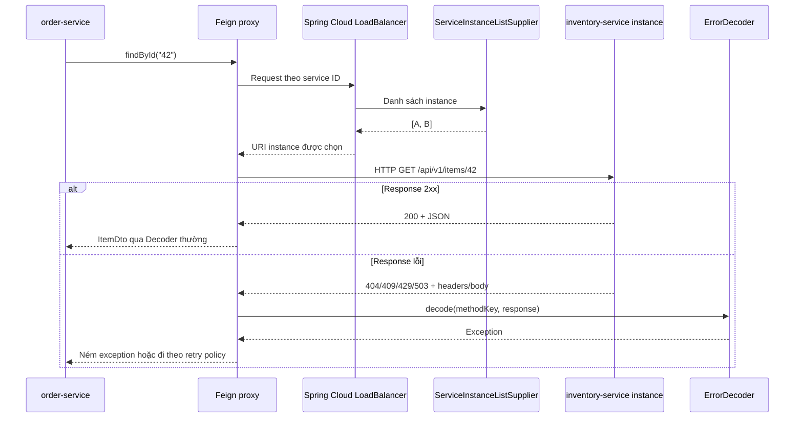

# ErrorDecoder và phân loại lỗi từ dịch vụ đích

Trong kiến trúc microservices dùng Spring Cloud LoadBalancer, một `@FeignClient` có thể gọi dịch vụ khác qua **service ID** thay vì tự quản lý IP và port của từng `ServiceInstance`. Feign giúp viết lời gọi HTTP dưới dạng giao diện Java, còn Spring Cloud LoadBalancer có thể chọn instance dựa trên discovery. Tuy nhiên, **chọn được instance không có nghĩa lời gọi thành công**: provider có thể trả HTTP `404`, `409`, `429`, `500` hoặc `503`, hay kết nối bị đứt trước khi nhận response.

**`ErrorDecoder`** của OpenFeign là điểm mở rộng để chuyển **HTTP response không thành công** thành exception có ý nghĩa. Nếu thiết kế đúng, tầng gọi có thể phân biệt lỗi nghiệp vụ (không tìm thấy dữ liệu, xung đột trạng thái), lỗi giới hạn tốc độ và lỗi tạm thời của dịch vụ đích, từ đó quyết định trả response phù hợp, retry có giới hạn hoặc dừng ngay.

Bài học phân tích thứ tự xử lý của Feign và Spring Cloud LoadBalancer, hành vi lỗi mặc định, cách cài đặt `ErrorDecoder` cho riêng `inventory-service`, cách bảo vệ body/headers nhạy cảm và cách kiểm thử việc phân loại lỗi mà không nhầm lỗi HTTP với lỗi discovery hay kết nối.

## 1. ErrorDecoder nằm ở đâu trong chuỗi gọi OpenFeign?

Giả sử `order-service` gọi `inventory-service`:

```java
@FeignClient(name = "inventory-service")
interface InventoryClient {
    @GetMapping("/api/v1/items/{id}")
    ItemDto findById(@PathVariable("id") String id);
}
```

Với Spring Cloud OpenFeign và Spring Cloud LoadBalancer được cấu hình phù hợp, `inventory-service` trong annotation là **service ID logic**. Tích hợp LoadBalancer lựa chọn một instance và HTTP client thực hiện request. Sau khi nhận HTTP response, Feign giải mã thành công hoặc xử lý lỗi.



Sơ đồ mô tả trường hợp **có HTTP response từ provider**. Nếu kết nối thất bại, response không được tạo, nên `ErrorDecoder` không nhất thiết được gọi. Đồng thời, nếu LoadBalancer không tìm được instance, một số tích hợp có thể tạo **HTTP 503 tổng hợp** thay vì gọi backend; `ErrorDecoder` vẫn có thể thấy mã 503, nhưng 503 đó không đến từ provider.

Do đó cần phân biệt hai câu hỏi:

1. **Đã chọn đích và gửi HTTP request tới instance nào chưa?**
2. **Có HTTP response thật từ dịch vụ đích không, và response mang status gì?**

Một status `503` đơn lẻ không đủ chứng minh backend trả `503`, còn một exception kết nối không tự chứng minh thuật toán chọn instance sai.

## 2. Feign phân loại lỗi mặc định như thế nào?

Trong OpenFeign, giao diện cốt lõi có dạng:

```java
package feign.codec;

public interface ErrorDecoder {
    Exception decode(String methodKey, feign.Response response);
}
```

`methodKey` định danh phương thức Feign đang gọi; `response` chứa status, headers, request và body của HTTP response. Khi nhận một status không thuộc luồng giải mã thành công, Feign sẽ gọi `ErrorDecoder` phù hợp, trừ những trường hợp đặc biệt đã cấu hình như xử lý 404 bằng decoder thường.

**Mặc định**, `ErrorDecoder.Default` thường tạo exception thuộc họ `FeignException` để giữ thông tin về HTTP response. Với response có header `Retry-After`, phiên bản Feign có thể biểu diễn lỗi theo kiểu `RetryableException` để retryer có cơ hội quyết định; đây **không phải** bảo đảm mọi 429 hoặc 503 sẽ tự động được retry.

| Kết quả lời gọi | Đường xử lý thông thường | Tầng ứng dụng nhìn thấy |
|---|---|---|
| `200 OK` + JSON hợp lệ | Decoder dữ liệu | `ItemDto` |
| `204 No Content` | Luồng thành công, không có body | Kết quả phụ thuộc kiểu trả về và decoder |
| `400/404/409` | ErrorDecoder nếu không có cấu hình miễn trừ | `FeignException` hoặc exception tùy biến |
| `429` | ErrorDecoder | `FeignException` / `RetryableException` / exception tùy biến tùy cấu hình |
| `500/502/503/504` | ErrorDecoder | Exception HTTP tương ứng hoặc tùy biến |
| Không mở được kết nối | Không có response HTTP để decode | `RetryableException`/Feign hoặc IOException đã được wrap tùy transport |
| Không có instance khả dụng | Tùy LoadBalancer integration | Có thể là HTTP 503 tổng hợp, hoặc exception ở tầng LoadBalancer |
| Body 200 sai schema JSON | Decoder dữ liệu thất bại | `DecodeException` hoặc lỗi codec khác, **không** qua ErrorDecoder HTTP |

Các lớp exception cụ thể phụ thuộc phiên bản Feign, HTTP transport và cấu hình. Trong Spring Cloud OpenFeign, **retry mặc định thường bị vô hiệu hóa bằng `Retryer.NEVER_RETRY`**, khác với một số hành vi retry mặc định của OpenFeign core. Vì vậy phải cấu hình retry chủ động nếu muốn tự thử lại.

### 2.1. Đừng đánh đồng mọi lỗi FeignException

`FeignException` cung cấp các thông tin như status, request và một phần response body. Nhưng các trường này không thay thế việc xác định **nguồn gốc** lỗi:

- Lỗi HTTP 404 trả về từ backend có thể có payload dạng `{"code":"ITEM_NOT_FOUND"}`.
- HTTP 503 có thể do backend, proxy hoặc lớp LoadBalancer tạo.
- Lỗi DNS/TCP/TLS thường không có HTTP status thực tế để phân loại.
- HTTP 200 với body JSON sai kiểu là lỗi giải mã dữ liệu, không phải lỗi status.

Hãy phân nhóm theo **status và hợp đồng API**, đồng thời ghi nhận dấu vết chọn instance, request ID và cause để phân tích sự cố.

## 3. Chuẩn bị client và service ID

Trong ứng dụng gọi, các dependency Maven thường cần:

```xml
<dependencies>
    <dependency>
        <groupId>org.springframework.cloud</groupId>
        <artifactId>spring-cloud-starter-openfeign</artifactId>
    </dependency>
    <dependency>
        <groupId>org.springframework.cloud</groupId>
        <artifactId>spring-cloud-starter-loadbalancer</artifactId>
    </dependency>
    <dependency>
        <groupId>org.springframework.boot</groupId>
        <artifactId>spring-boot-starter-web</artifactId>
    </dependency>
</dependencies>
```

Đây là phần dependencies, chưa phải `pom.xml` hoàn chỉnh. Dự án phải sử dụng Spring Boot parent hoặc dependency management phù hợp và import **Spring Cloud BOM tương thích với phiên bản Spring Boot**. Chỉ thêm OpenFeign starter không đồng nghĩa đã có discovery/instance để cân bằng tải.

Kích hoạt Feign client:

```java
import org.springframework.boot.SpringApplication;
import org.springframework.boot.autoconfigure.SpringBootApplication;
import org.springframework.cloud.openfeign.EnableFeignClients;

@SpringBootApplication
@EnableFeignClients
public class OrderApplication {
    public static void main(String[] args) {
        SpringApplication.run(OrderApplication.class, args);
    }
}
```

Khai báo danh sách instance tĩnh cho môi trường lab:

```yaml
server:
  port: 8080

spring:
  application:
    name: order-service
  cloud:
    discovery:
      client:
        simple:
          instances:
            inventory-service:
              - uri: http://localhost:8091
              - uri: http://localhost:8092
```

`SimpleDiscoveryClient` phù hợp để thử với hai provider chạy cùng máy; trong môi trường triển khai thật, registry và cập nhật health là phần riêng. Nếu client ở Docker container, `localhost` trỏ tới **container client**, nên cần hostname có thể truy cập tới provider qua mạng container.

### 3.1. Định nghĩa Feign client với cấu hình riêng

```java
import org.springframework.cloud.openfeign.FeignClient;
import org.springframework.web.bind.annotation.GetMapping;
import org.springframework.web.bind.annotation.PathVariable;

@FeignClient(
        name = "inventory-service",
        configuration = InventoryFeignConfiguration.class)
public interface InventoryClient {

    @GetMapping("/api/v1/items/{id}")
    ItemDto findById(@PathVariable("id") String id);
}
```

DTO ví dụ ở dự án client:

```java
public record ItemDto(String id, String name, String servedBy) {
}
```

Annotation `@FeignClient(name = "inventory-service")` kết hợp với LoadBalancer gọi tên dịch vụ logic. Không cần viết code chọn `8091` hoặc `8092` trong `InventoryClient`. `InventoryFeignConfiguration` sẽ chỉ định ErrorDecoder dùng cho client này.

> **Phạm vi cấu hình:** một class cấu hình dành riêng cho `@FeignClient(configuration=...)` nên được đặt **ngoài đường component scan thông thường của ứng dụng**, trừ khi chủ đích áp dụng nó rộng hơn. Nếu class đó vô tình đi vào parent ApplicationContext, các bean như `ErrorDecoder` có thể tác động đến các Feign client khác, làm sai chính sách xử lý lỗi theo dịch vụ.

## 4. Xây dựng một ErrorDecoder theo hợp đồng API

Giả sử API inventory có hợp đồng:

| Status | Ý nghĩa trong API inventory | Exception ứng dụng muốn dùng |
|---|---|---|
| `404` | Item không tồn tại khi gọi `findById` | `ItemNotFoundException` |
| `409` | Trạng thái tồn kho xung đột | `InventoryConflictException` |
| `429` | Backend yêu cầu giảm tốc độ | `InventoryRateLimitedException` |
| `502/503/504` | Inventory hoặc gateway tạm thời không phục vụ | `InventoryUnavailableException` |
| `400/401/403/422/500` và status khác | Chưa có quy tắc riêng | Ủy quyền về `ErrorDecoder.Default` |

**Không có quy tắc phổ quát “404 lúc nào cũng là item không tồn tại”.** 404 có thể là sai path, sai version API hoặc bị chặn bởi policy. Chỉ ánh xạ thành lỗi nghiệp vụ khi endpoint và hợp đồng dịch vụ đã định nghĩa rõ. Nếu nhiều phương thức Feign dùng cùng ErrorDecoder, nên kiểm tra error code chuẩn trong body hoặc method key để tránh áp dụng nhầm quy tắc cho endpoint khác.

### 4.1. Mã Java cho custom decoder

Ví dụ tạo lớp `InventoryErrorDecoder`. Đoạn code giữ nguyên decoder mặc định ở các status không tùy biến; vì **không đọc trước body** ở nhánh default, `ErrorDecoder.Default` vẫn có thể đọc body lỗi khi tạo `FeignException`.

```java
import feign.Response;
import feign.codec.ErrorDecoder;

import java.util.Collection;
import java.util.Map;

public final class InventoryErrorDecoder implements ErrorDecoder {

    private final ErrorDecoder delegate = new ErrorDecoder.Default();

    @Override
    public Exception decode(String methodKey, Response response) {
        int status = response.status();

        return switch (status) {
            case 404 -> new ItemNotFoundException(methodKey);
            case 409 -> new InventoryConflictException(methodKey);
            case 429 -> new InventoryRateLimitedException(
                    methodKey, firstHeader(response, "Retry-After"));
            case 502, 503, 504 ->
                    new InventoryUnavailableException(status, methodKey);
            default -> delegate.decode(methodKey, response);
        };
    }

    private static String firstHeader(Response response, String name) {
        for (Map.Entry<String, Collection<String>> entry
                : response.headers().entrySet()) {
            if (entry.getKey().equalsIgnoreCase(name)) {
                return entry.getValue().stream()
                        .findFirst()
                        .orElse(null);
            }
        }
        return null;
    }

    public static class InventoryHttpException extends RuntimeException {
        private final int upstreamStatus;

        InventoryHttpException(int status, String methodKey) {
            super("Inventory call failed: " + methodKey
                    + ", upstreamStatus=" + status);
            this.upstreamStatus = status;
        }

        public int upstreamStatus() {
            return upstreamStatus;
        }
    }

    public static final class ItemNotFoundException
            extends InventoryHttpException {
        ItemNotFoundException(String methodKey) {
            super(404, methodKey);
        }
    }

    public static final class InventoryConflictException
            extends InventoryHttpException {
        InventoryConflictException(String methodKey) {
            super(409, methodKey);
        }
    }

    public static final class InventoryRateLimitedException
            extends InventoryHttpException {
        private final String retryAfter;

        InventoryRateLimitedException(
                String methodKey, String retryAfter) {
            super(429, methodKey);
            this.retryAfter = retryAfter;
        }

        public String retryAfter() {
            return retryAfter;
        }
    }

    public static final class InventoryUnavailableException
            extends InventoryHttpException {
        InventoryUnavailableException(int status, String methodKey) {
            super(status, methodKey);
        }
    }
}
```

Đây là code minh họa phân loại theo status của **client chỉ có endpoint `findById`**. Nếu `InventoryClient` có thêm các thao tác khác, việc chuyển mọi 404 thành `ItemNotFoundException` có thể sai: cần kết hợp error code trong payload, nhận diện đúng operation hoặc tách chính sách thành decoder phù hợp cho các nhóm API.

Các exception tùy biến ở đây là `RuntimeException`. Chúng có **không có khả năng retry tự động** chỉ vì mang tên “Unavailable” hoặc “RateLimited”. Nếu hệ thống muốn retry, phải xác định điều kiện retry riêng; không nên để `ErrorDecoder` tự sleep hoặc gửi thêm HTTP request.

### 4.2. Đăng ký ErrorDecoder cho đúng Feign client

```java
import feign.codec.ErrorDecoder;
import org.springframework.context.annotation.Bean;
import org.springframework.context.annotation.Configuration;

@Configuration(proxyBeanMethods = false)
public class InventoryFeignConfiguration {

    @Bean
    ErrorDecoder inventoryErrorDecoder() {
        return new InventoryErrorDecoder();
    }
}
```

Đặt `InventoryFeignConfiguration` ngoài vùng component scan mặc định của `OrderApplication`, nhưng vẫn tham chiếu qua thuộc tính `configuration` của `@FeignClient`. Như vậy, chính sách lỗi của `inventory-service` không vô tình thay thế decoder của `pricing-service` hoặc các client khác.

Nếu cần cấu hình timeout riêng theo client, có thể kết hợp với namespace cấu hình Spring Cloud OpenFeign cho service ID, nhưng **timeout** và **ErrorDecoder** là hai trách nhiệm khác nhau: decoder chỉ xử lý response đã được đưa tới Feign, không quyết định thời gian chờ socket.

## 5. Error body, header và giới hạn đọc dữ liệu

Nhiều API không chỉ trả mã HTTP mà còn cung cấp payload lỗi có cấu trúc, ví dụ:

```json
{
  "code": "ITEM_NOT_FOUND",
  "message": "Item does not exist",
  "requestId": "req-123"
}
```

Trong trường hợp này, kết hợp `status` và `code` đáng tin cậy hơn việc chỉ dùng status. Chẳng hạn, cùng 404 nhưng `ITEM_NOT_FOUND` có thể mang ý nghĩa nghiệp vụ, còn 404 do sai URI hoặc gateway routing phải được chẩn đoán riêng.

**Lưu ý:** `Response.Body` có thể là luồng **chỉ đọc một lần**. Nếu custom decoder đọc hết body rồi gọi `ErrorDecoder.Default`, decoder mặc định có thể không còn dữ liệu để tạo `FeignException` có body nguyên vẹn. Hãy chọn một trong hai:

- Nếu **định nghĩa exception riêng**, đọc body có kiểm soát và tự tạo exception cho nhánh đó.
- Nếu **ủy quyền về decoder mặc định**, không tiêu thụ body trước khi gọi `delegate.decode(...)`; hoặc phải dựng lại `Response` có body mới trước khi ủy quyền.

Trong nhánh custom, cũng cần giới hạn lượng dữ liệu đọc để tránh nhận một error body quá lớn hoặc không đáng tin:

```java
import com.fasterxml.jackson.databind.JsonNode;
import com.fasterxml.jackson.databind.ObjectMapper;
import feign.Response;

import java.io.IOException;
import java.io.InputStream;

final class ErrorPayloadReader {

    private static final int MAX_ERROR_BYTES = 4096;
    private static final ObjectMapper MAPPER = new ObjectMapper();

    static String readErrorCode(Response response) {
        if (response.body() == null) {
            return null;
        }

        // Chỉ gọi trong nhánh sẽ tự trả exception;
        // đừng đọc xong rồi delegate nguyên response.
        try (InputStream input = response.body().asInputStream()) {
            byte[] bytes = input.readNBytes(MAX_ERROR_BYTES + 1);
            if (bytes.length > MAX_ERROR_BYTES) {
                return null;
            }

            JsonNode root = MAPPER.readTree(bytes);
            return root == null
                    ? null
                    : root.path("code").asText(null);
        } catch (IOException exception) {
            return null;
        }
    }
}
```

Đây là helper **tùy chọn** dành cho API có JSON lỗi theo contract. Ví dụ trong `InventoryErrorDecoder` có thể kiểm tra `status == 404` và `"ITEM_NOT_FOUND".equals(ErrorPayloadReader.readErrorCode(response))` để phân biệt 404 nghiệp vụ với 404 hạ tầng; vì body đã bị đọc trong nhánh đó, hãy tạo exception của riêng mình thay vì ủy quyền nguyên `response` cho decoder mặc định.

Không nên đưa toàn bộ `message` upstream vào response cho người dùng: nó có thể chứa stack trace, đường dẫn nội bộ, thông tin cá nhân hoặc dữ liệu nhạy cảm. Nên lưu correlation ID, method key, status và **mã lỗi đã chuẩn hóa**, giới hạn số lượng loại mã dùng làm metric label, đồng thời bảo vệ mọi token/header xác thực.

### Retry-After không tự động có nghĩa nên retry

Với `429` hoặc `503`, header `Retry-After` có thể chứa số giây hoặc HTTP-date. Helper `firstHeader` ở mục 4 lấy giá trị gốc để chuyển lên tầng quyết định retry. Nó **không parse, sleep hoặc retry**.

Ví dụ response:

```http
HTTP/1.1 429 Too Many Requests
Content-Type: application/json
Retry-After: 2

{"code":"RATE_LIMITED","message":"Try later"}
```

Chỉ retry khi có **retry budget**, giới hạn tổng deadline, backoff/jitter, chính sách idempotency và hiểu rõ nguồn rate limit. Nếu hàng trăm client lập tức retry cùng lúc, áp lực lên backend có thể tăng thay vì giảm.

## 6. 404, dismiss404 và khác biệt giữa Decoder với ErrorDecoder

Feign phân biệt:

- `Decoder` thông thường: chuyển response thành công thành kiểu trả về của method, ví dụ JSON thành `ItemDto`.
- `ErrorDecoder`: biến response HTTP lỗi thành exception.

Spring Cloud OpenFeign hỗ trợ cấu hình xử lý 404 theo đường decoder thường, thường được gọi là `dismiss404`. Ví dụ thuộc tính:

```yaml
spring:
  cloud:
    openfeign:
      client:
        config:
          inventory-service:
            dismiss404: true
```

Khi `dismiss404` bật, 404 có thể **không đi qua ErrorDecoder như thông thường** mà được chuyển cho `Decoder`. Điều này có thể dẫn đến kết quả null/empty tùy kiểu return, body và decoder, nhưng không có nghĩa mọi response 404 tự biến thành `Optional.empty()` hợp lệ theo mọi cấu hình.

Nếu chính sách của bạn là “404 phải tạo `ItemNotFoundException` trong custom ErrorDecoder”, nên để `dismiss404: false` (thường là mặc định) và kiểm tra không có cấu hình riêng nào ghi đè. Nếu chủ định muốn 404 trở thành kết quả vắng mặt, hãy thiết kế hợp đồng return type và kiểm thử rõ đường decoder thường thay vì cài cả hai cơ chế mà không xác định thứ tự.

| Thiết kế mong muốn | Lựa chọn nên cân nhắc |
|---|---|
| 404 là lỗi nghiệp vụ có mã rõ | `ErrorDecoder` tùy biến; giữ `dismiss404=false` |
| 404 là “không tìm thấy” mà caller xử lý như giá trị rỗng | Cân nhắc `dismiss404` kết hợp decoder/return type phù hợp, hoặc bắt `FeignException.NotFound` ở tầng service |
| 404 có thể là sai routing/path | Không tự chuyển mọi 404 thành `ItemNotFoundException` |
| Muốn đọc JSON lỗi `{"code":...}` | Định nghĩa error contract và parse body một lần có giới hạn |

## 7. Phân biệt exception ở service layer

Sau khi decoder ánh xạ status, tầng service có thể áp dụng phản ứng khác nhau:

```java
import feign.FeignException;
import feign.RetryableException;
import org.springframework.stereotype.Service;

@Service
public class OrderInventoryService {

    private final InventoryClient inventoryClient;

    public OrderInventoryService(InventoryClient inventoryClient) {
        this.inventoryClient = inventoryClient;
    }

    public ItemDto requireItem(String id) {
        try {
            return inventoryClient.findById(id);
        } catch (InventoryErrorDecoder.ItemNotFoundException exception) {
            // Item không tồn tại theo contract API.
            throw exception;
        } catch (InventoryErrorDecoder.InventoryRateLimitedException exception) {
            // Giảm tốc / xử lý suy giảm; không tự retry trong catch.
            throw exception;
        } catch (InventoryErrorDecoder.InventoryUnavailableException exception) {
            // Upstream HTTP 502/503/504 hoặc response 503 tổng hợp
            // có thể đến từ load balancer.
            throw exception;
        } catch (RetryableException exception) {
            // Lỗi kết nối hoặc lỗi có dấu hiệu retryable do Feign phát.
            // Không mặc định coi đây là HTTP 503 từ provider.
            throw exception;
        } catch (FeignException exception) {
            // HTTP status khác hoặc lỗi Feign chưa được ánh xạ.
            throw exception;
        }
    }
}
```

Ví dụ cố tình phân nhánh mà không thêm fallback để thấy rõ **exception nào đi vào đường xử lý nào**. Trong ứng dụng thực, sau khi phân loại có thể ánh xạ 404 thành response 404, áp dụng circuit breaker ở nhóm lỗi tạm thời, hoặc trả response suy giảm nếu hợp đồng nghiệp vụ cho phép.

**Lưu ý về 503 tổng hợp:** `InventoryUnavailableException` là tên cho **mã HTTP và dấu hiệu suy giảm**, không khẳng định request đã tới provider. Một số `FeignBlockingLoadBalancerClient` tạo response 503 khi không tìm thấy instance; response này vẫn có thể chạy qua `ErrorDecoder`. Để kết luận “upstream đã trả 503”, cần thêm quan sát ở lớp lựa chọn instance và HTTP client, không chỉ bắt exception theo status.

### 7.1. Ánh xạ exception thành API response

Nếu `order-service` cung cấp REST API cho caller, exception tùy biến không nên khiến mọi lỗi trở thành HTTP 500 mặc định. Ví dụ có thể khai báo:

```java
import org.springframework.http.HttpStatus;
import org.springframework.http.ResponseEntity;
import org.springframework.web.bind.annotation.ExceptionHandler;
import org.springframework.web.bind.annotation.RestControllerAdvice;

import java.util.Map;

@RestControllerAdvice
class InventoryExceptionAdvice {

    @ExceptionHandler(InventoryErrorDecoder.ItemNotFoundException.class)
    ResponseEntity<Map<String, String>> notFound(
            InventoryErrorDecoder.ItemNotFoundException ex) {
        return ResponseEntity.status(HttpStatus.NOT_FOUND)
                .body(Map.of("code", "ITEM_NOT_FOUND"));
    }

    @ExceptionHandler(InventoryErrorDecoder.InventoryConflictException.class)
    ResponseEntity<Map<String, String>> conflict(
            InventoryErrorDecoder.InventoryConflictException ex) {
        return ResponseEntity.status(HttpStatus.CONFLICT)
                .body(Map.of("code", "INVENTORY_CONFLICT"));
    }

    @ExceptionHandler(InventoryErrorDecoder.InventoryRateLimitedException.class)
    ResponseEntity<Map<String, String>> rateLimited(
            InventoryErrorDecoder.InventoryRateLimitedException ex) {
        return ResponseEntity.status(HttpStatus.SERVICE_UNAVAILABLE)
                .body(Map.of("code", "UPSTREAM_RATE_LIMITED"));
    }

    @ExceptionHandler(InventoryErrorDecoder.InventoryUnavailableException.class)
    ResponseEntity<Map<String, String>> unavailable(
            InventoryErrorDecoder.InventoryUnavailableException ex) {
        return ResponseEntity.status(HttpStatus.SERVICE_UNAVAILABLE)
                .body(Map.of("code", "UPSTREAM_UNAVAILABLE"));
    }
}
```

Ở đây upstream 429 được ánh xạ thành 503 tại API của `order-service` theo **quyết định minh họa**; ứng dụng khác có thể chọn 429 nếu rate limit áp dụng trực tiếp cho caller. Không trả nguyên văn body/error message từ upstream hay chuyển header `Retry-After` không được kiểm tra ra công khai. Với endpoint ghi dữ liệu, hãy cân nhắc bảo toàn ngữ nghĩa và tránh để downstream exception làm lộ trạng thái nội bộ không cần thiết.

## 8. Cấu hình timeout, retry và LoadBalancer: không lẫn trách nhiệm

`ErrorDecoder` không đặt timeout và không quyết định thuật toán chọn instance. Trong Spring Cloud OpenFeign, timeout có thể cấu hình theo client:

```yaml
spring:
  cloud:
    openfeign:
      client:
        config:
          inventory-service:
            connectTimeout: 1000
            readTimeout: 2000
```

Các giá trị ở đây minh họa **mili giây**, cần điều chỉnh theo đặc tính hệ thống. `connectTimeout` giới hạn thời gian thiết lập kết nối; `readTimeout` liên quan thời gian chờ dữ liệu phản hồi, cách chính xác phụ thuộc HTTP client được dùng. Một request có nhiều lần retry còn cần **deadline tổng** ở tầng nghiệp vụ để tránh vượt ngân sách thời gian.

### 8.1. Retryer và ErrorDecoder

Spring Cloud OpenFeign thường đăng ký `Retryer.NEVER_RETRY` làm mặc định, nghĩa là không có retry tự động ở tầng Feign chỉ vì có `RetryableException` hoặc một response 503. Nếu muốn retry, cần chủ động thiết kế theo method, loại lỗi, số lần và chi phí của thao tác.

| Lớp/cơ chế | Quyết định điều gì? |
|---|---|
| `ErrorDecoder` | Status HTTP được chuyển thành exception nào |
| `Retryer` của Feign | Có thử lại một exception retryable hay không |
| Retry của Spring Cloud LoadBalancer | Có thực hiện lại một lần gọi hoặc chọn lại instance hay không, tùy cấu hình/tích hợp |
| `ServiceInstanceListSupplier` / load balancer | Danh sách ứng viên và instance được chọn |
| HTTP transport | Connect/read timeout, kết nối, TLS và body |
| Circuit breaker / resilience policy | Dừng gọi tạm thời, fallback và giới hạn tải |

**Không nên** bật nhiều tầng retry một cách độc lập: hai lần retry ở tầng Feign kết hợp hai lần retry ở lớp khác có thể tạo ra nhiều HTTP attempts hơn dự kiến. Hãy đếm **tổng số lần thử từ đầu tới cuối**, chứ không chỉ đọc cấu hình riêng của từng thư viện.

### 8.2. Khi nào retry hợp lý?

Một số GET idempotent có thể thử lại sau lỗi kết nối tạm thời hoặc 502/503/504 nếu còn thời gian. Ngược lại, với API ghi dữ liệu hoặc thanh toán, timeout **không chứng minh** server chưa xử lý nghiệp vụ: retry không có idempotency key có thể gây trùng lặp.

Không retry vô điều kiện những lỗi như 400, 401, 403, 404, 409. Với 429, cần tôn trọng rate limiting và `Retry-After` theo chính sách được xác thực. Trong sự cố toàn bộ instance lỗi, retry hàng loạt có thể tạo **retry storm** và làm hệ thống suy giảm thêm.

## 9. Thực hành: dựng provider trả nhiều loại lỗi

Để kiểm chứng ErrorDecoder, chạy hai bản sao `inventory-service` trên port 8091 và 8092, mỗi bản sao có cùng endpoint. Provider có thể dùng Spring Boot Web và một controller đơn giản:

```java
import org.springframework.beans.factory.annotation.Value;
import org.springframework.http.HttpHeaders;
import org.springframework.http.HttpStatus;
import org.springframework.http.ResponseEntity;
import org.springframework.web.bind.annotation.GetMapping;
import org.springframework.web.bind.annotation.PathVariable;
import org.springframework.web.bind.annotation.RestController;

record ApiError(String code, String message) {
}

@RestController
class InventoryDemoController {

    private final int port;

    InventoryDemoController(@Value("${server.port}") int port) {
        this.port = port;
    }

    @GetMapping("/api/v1/items/{id}")
    ResponseEntity<?> getItem(@PathVariable String id) {
        return switch (id) {
            case "missing" -> ResponseEntity.status(HttpStatus.NOT_FOUND)
                    .body(new ApiError("ITEM_NOT_FOUND", "No such item"));
            case "conflict" -> ResponseEntity.status(HttpStatus.CONFLICT)
                    .body(new ApiError("STOCK_CONFLICT", "Inventory conflict"));
            case "limited" -> ResponseEntity.status(429)
                    .header(HttpHeaders.RETRY_AFTER, "2")
                    .body(new ApiError("RATE_LIMITED", "Please retry later"));
            case "down" -> ResponseEntity.status(HttpStatus.SERVICE_UNAVAILABLE)
                    .body(new ApiError("INVENTORY_UNAVAILABLE", "Temporary issue"));
            default -> ResponseEntity.ok(
                    new ItemDto(id, "Item " + id, "inventory-" + port));
        };
    }
}
```

Lớp `ItemDto` trong provider có thể định nghĩa bằng record có cùng cấu trúc với phía client. Chạy hai tiến trình:

```bash
# Terminal A
java -jar inventory-service.jar --server.port=8091

# Terminal B
java -jar inventory-service.jar --server.port=8092
```

Kiểm tra **trực tiếp** các provider trước:

```bash
curl -i http://localhost:8091/api/v1/items/42
curl -i http://localhost:8091/api/v1/items/missing
curl -i http://localhost:8092/api/v1/items/conflict
curl -i http://localhost:8092/api/v1/items/limited
curl -i http://localhost:8091/api/v1/items/down
```

Kỳ vọng lần lượt status `200`, `404`, `409`, `429` (có header `Retry-After: 2`) và `503`. Hai bản sao cần cùng contract HTTP; giá trị `servedBy` giúp quan sát bản sao nhận request. Đừng tiến hành kiểm thử decoder khi response trực tiếp chưa đúng.

### 9.1. Một endpoint client để nhìn kết quả mapping

Ứng dụng `order-service` có thể expose:

```java
import org.springframework.web.bind.annotation.GetMapping;
import org.springframework.web.bind.annotation.PathVariable;
import org.springframework.web.bind.annotation.RestController;

@RestController
class InventoryProxyController {

    private final InventoryClient client;

    InventoryProxyController(InventoryClient client) {
        this.client = client;
    }

    @GetMapping("/test/items/{id}")
    ItemDto get(@PathVariable String id) {
        return client.findById(id);
    }
}
```

Khi đã đăng ký `InventoryFeignConfiguration` và `InventoryExceptionAdvice` ở trên, gọi:

```bash
curl -i http://localhost:8080/test/items/42
curl -i http://localhost:8080/test/items/missing
curl -i http://localhost:8080/test/items/conflict
curl -i http://localhost:8080/test/items/limited
curl -i http://localhost:8080/test/items/down
```

Lưu ý: HTTP response từ proxy **không nhất thiết** giống status upstream, vì `@RestControllerAdvice` có thể ánh xạ theo chính sách API. Trong ví dụ, upstream 429 chuyển thành 503 tại proxy có chủ đích. Nếu không có exception handler, exception Feign hoặc exception tùy biến có thể trở thành HTTP 500 chung của ứng dụng client.

## 10. Ma trận kiểm thử và tình huống lỗi ngoài HTTP

Để tránh kiểm thử hời hợt, hãy xác minh cả **loại exception** lẫn **tầng lỗi**.

| Dữ liệu đầu vào | Kết quả provider/LoadBalancer | Kỳ vọng trong `InventoryErrorDecoder` |
|---|---|---|
| `findById("42")` | HTTP 200 + ItemDto | Không gọi ErrorDecoder, trả DTO |
| `findById("missing")` | HTTP 404 | `ItemNotFoundException` |
| `findById("conflict")` | HTTP 409 | `InventoryConflictException` |
| `findById("limited")` | HTTP 429, `Retry-After: 2` | `InventoryRateLimitedException` có `retryAfter() == "2"` |
| `findById("down")` | HTTP 503 từ provider | `InventoryUnavailableException` |
| Client không có instance | Có thể tạo HTTP 503 từ LoadBalancer | Có thể vào cùng nhánh 503; **không kết luận provider đã trả lỗi** |
| Instance được chọn nhưng port đóng | Connection refused | ErrorDecoder **không có HTTP response** để xử lý |
| Response HTTP 200 chứa JSON sai kiểu | Decode error | Không đi qua nhánh ErrorDecoder HTTP |
| HTTP 500 chưa custom | Feign default | Exception do `ErrorDecoder.Default` |

### 10.1. Unit test cho decoder, không cần chạy provider

Vì `ErrorDecoder` chỉ nhận `methodKey` và `Response`, có thể kiểm tra mapping bằng unit test đối tượng response tự dựng:

```java
import static org.junit.jupiter.api.Assertions.assertEquals;
import static org.junit.jupiter.api.Assertions.assertInstanceOf;

import feign.Request;
import feign.Response;
import org.junit.jupiter.api.Test;

import java.nio.charset.StandardCharsets;
import java.util.Map;

class InventoryErrorDecoderTest {

    private final InventoryErrorDecoder decoder =
            new InventoryErrorDecoder();

    private Response response(int status, Map<String, java.util.Collection<String>> headers) {
        Request request = Request.create(
                Request.HttpMethod.GET,
                "http://inventory-service/api/v1/items/42",
                Map.of(),
                null,
                StandardCharsets.UTF_8,
                null);

        return Response.builder()
                .request(request)
                .status(status)
                .reason("Test")
                .headers(headers)
                .build();
    }

    @Test
    void converts404ToBusinessException() {
        Exception error = decoder.decode(
                "InventoryClient#findById(String)",
                response(404, Map.of()));

        assertInstanceOf(
                InventoryErrorDecoder.ItemNotFoundException.class, error);
    }

    @Test
    void keepsRetryAfterFrom429() {
        Exception error = decoder.decode(
                "InventoryClient#findById(String)",
                response(429, Map.of("Retry-After", java.util.List.of("2"))));

        InventoryErrorDecoder.InventoryRateLimitedException rateLimited =
                assertInstanceOf(
                        InventoryErrorDecoder.InventoryRateLimitedException.class,
                        error);
        assertEquals("2", rateLimited.retryAfter());
    }
}
```

Mẫu test này sử dụng API `Request.create` của OpenFeign; nếu phiên bản thư viện trong dự án khác về chữ ký, điều chỉnh cách dựng `Request` tương ứng thay vì sửa logic ứng dụng. Unit test **không chứng minh** Feign proxy hay LoadBalancer đã được cấu hình đúng; integration test vẫn cần tạo client thật hoặc provider/stub và thực hiện HTTP request qua service ID.

### 10.2. Kịch bản integration nên có

1. **Một instance khỏe:** provider trả 200, xác minh DTO `servedBy` và không gọi ErrorDecoder.
2. **404/409/429:** mock/stub trả status và payload đã quy định; xác minh exception tùy biến của Feign client.
3. **503 từ backend:** xác minh status mapping và trace instance đã được chọn.
4. **Danh sách instance rỗng:** kiểm tra tình huống không có đích, không giả định 503 là do backend.
5. **Provider chết sau khi được chọn:** kiểm tra lỗi kết nối và timeout, không kỳ vọng ErrorDecoder nhận HTTP response.
6. **Cấu hình `dismiss404=true`:** xác minh đường 404 thay đổi so với ErrorDecoder dự kiến, nếu dự án có dùng tùy chọn này.
7. **Retry có giới hạn:** kiểm tra số HTTP attempts thật thay vì chỉ xác minh exception cuối cùng.

## 11. Quan sát và khắc phục lỗi trong môi trường thực

| Triệu chứng | Nguyên nhân có thể | Cách điều tra |
|---|---|---|
| ErrorDecoder không nhận được 404 | `dismiss404=true`, Feign client dùng config khác hoặc request chưa tới response | Kiểm tra cấu hình theo client và exception gốc |
| Mọi client đều nhận decoder của inventory | `InventoryFeignConfiguration` bị component scan ở parent context | Di chuyển cấu hình khỏi vùng scan, kiểm tra bean scope |
| 503 vẫn xuất hiện khi provider khỏe | LoadBalancer không có instance, gateway trả 503 hoặc discovery/cache cũ | Ghi nguồn 503, service ID, instance được chọn và discovery |
| `RetryableException` khi port đóng | Lỗi mạng/HTTP transport chứ không phải response 5xx | Kiểm tra host:port, DNS, TCP/TLS, timeout |
| Retry liên tục sau HTTP 429 | Retryer hoặc resilience policy không giới hạn | Kiểm tra `Retry-After`, deadline, backoff và tổng số attempts |
| Không còn body trong FeignException mặc định | Custom decoder đã đọc hết luồng body trước khi delegate | Không đọc body ở nhánh fallback hoặc dựng lại response |
| Response 404 bị hiểu thành item missing dù sai endpoint | Mapping chỉ dựa trên status, không kiểm tra hợp đồng API | Kiểm tra error code, method key và routing |
| HTTP 200 nhưng Feign báo lỗi | Decoder dữ liệu không đọc được JSON hoặc Content-Type sai | Kiểm tra payload, DTO, schema và decoder thường |

### Những thông tin cần log/trace

- `serviceId`, Feign client name, `methodKey` và operation.
- Instance được LoadBalancer chọn, địa chỉ đích và correlation/request ID (khi được phép).
- HTTP status, mã lỗi nghiệp vụ chuẩn hóa, exception type và root cause.
- Timeout, tổng số HTTP attempts, retry count và deadline.
- Thời gian phản hồi, trạng thái discovery/cache và số instance ứng viên.

Tránh log token, cookie, Authorization header hoặc toàn bộ payload lỗi nhạy cảm. `Feign Logger.Level.FULL` hữu ích trong lab nhưng có thể ghi header/body nhạy cảm và tạo log lớn; cần kiểm soát mức log theo môi trường và quy định bảo mật.

## 12. Checklist và những điều cần nhớ

- [ ] Phân biệt **lỗi HTTP có response** với lỗi kết nối, timeout, discovery rỗng và lỗi decode body.
- [ ] Hiểu `ErrorDecoder.decode(methodKey, response)` xử lý response lỗi; 2xx thường đi qua decoder dữ liệu.
- [ ] Không tự suy luận rằng HTTP 503 chắc chắn do provider tạo; LoadBalancer cũng có thể tạo response 503 tổng hợp.
- [ ] Viết `ErrorDecoder` theo hợp đồng API và đăng ký đúng `@FeignClient(configuration=...)`.
- [ ] Với các status chưa có quy tắc riêng, ủy quyền `ErrorDecoder.Default` **trước khi tiêu thụ body**.
- [ ] Nếu đọc error payload, giới hạn kích thước, parse có kiểm soát và không để lộ dữ liệu nhạy cảm.
- [ ] Phân biệt `dismiss404` với việc biến 404 thành exception qua ErrorDecoder.
- [ ] Hiểu rằng custom exception không tự bật retry; kiểm tra `Retryer.NEVER_RETRY` trong Spring Cloud OpenFeign.
- [ ] Áp dụng timeout, retry budget, idempotency và observability phù hợp với loại lời gọi.
- [ ] Có unit test mapping status và integration test xác nhận đường gọi qua LoadBalancer tới provider.

**Kết luận:** `ErrorDecoder` là ranh giới giúp OpenFeign chuyển **HTTP status của lời gọi** thành **exception có ngữ nghĩa cho ứng dụng**. Một thiết kế tốt không chỉ mapping 404/409/429/503, mà còn phân biệt lỗi HTTP thật với 503 tổng hợp từ LoadBalancer và lỗi transport không có response, giữ body/header an toàn, và gắn retry/timeout vào chính sách phục hồi có giới hạn. Nhờ đó, giao tiếp giữa dịch vụ trở nên rõ ràng, dễ kiểm thử và dễ xử lý sự cố hơn.
