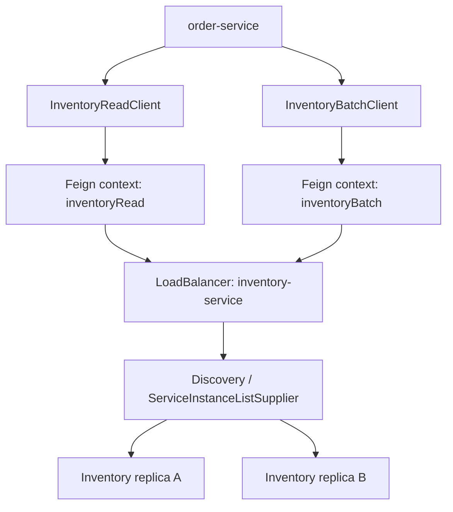
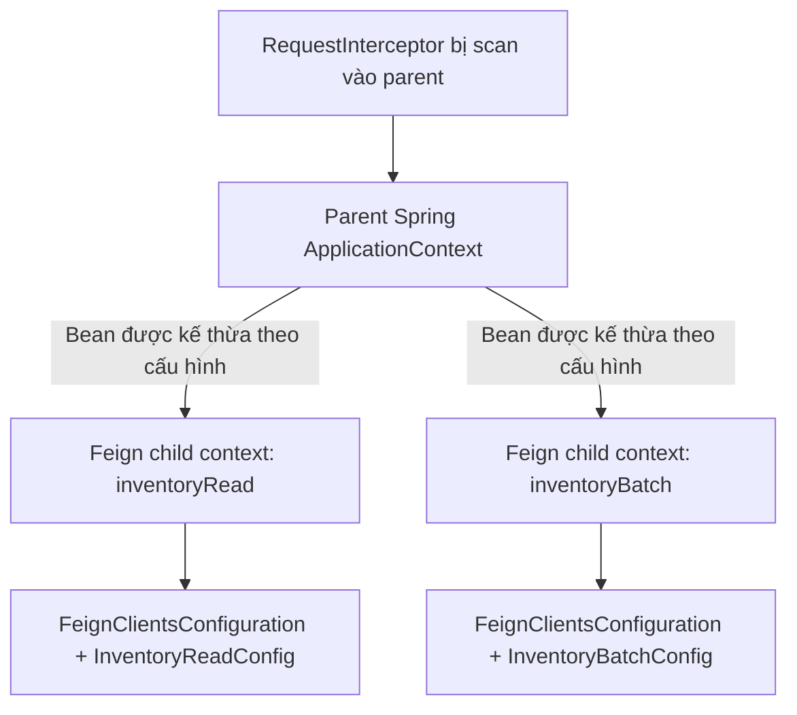

# Cấu hình riêng từng Feign client và tránh bean lan sang client khác

Khi một ứng dụng sử dụng nhiều `@FeignClient`, không phải client nào cũng cần cùng timeout, bộ giải mã lỗi, mức log, interceptor hay thông tin xác thực. Ví dụ, `order-service` gọi `inventory-service` để tra cứu tồn kho nhanh, đồng thời có một client khác gọi cùng dịch vụ cho tác vụ đối soát dài hơn. Nếu cấu hình của client đối soát vô tình được đăng ký vào **ApplicationContext cha**, các client không liên quan có thể nhận cùng `RequestInterceptor`, `Retryer` hoặc `ErrorDecoder`. Hậu quả có thể là timeout sai, header bị rò rỉ, tăng số lần retry và lỗi khó giải thích.

Bài học thuộc chương **OpenFeign** của module Spring Cloud LoadBalancer. Mục tiêu là biết cách:

- Phân biệt service ID (`name`), định danh cấu hình client (`contextId`) và lớp cấu hình chỉ dành cho một Feign client.
- Hiểu cách Spring Cloud OpenFeign tạo **named client context** và kế thừa bean từ context cha.
- Tránh để `@Configuration`, `@ComponentScan` hoặc `@EnableFeignClients(defaultConfiguration=...)` biến cấu hình riêng thành mặc định toàn cục.
- Phối hợp cấu hình trong Java và `application.yml` mà không làm ảnh hưởng timeout, retry, discovery, health check, zone routing và observability của client khác.
- Kiểm tra hiệu quả cô lập bằng bài test hành vi, không chỉ dựa vào việc ứng dụng khởi động thành công.

## 1. Tình huống: hai Feign client, một dịch vụ đích

Giả sử `order-service` có hai nhu cầu gọi `inventory-service`:

| Client | Nhiệm vụ | Mong muốn cấu hình |
|---|---|---|
| `InventoryReadClient` | Lấy tồn kho để phản hồi người dùng. | Timeout đọc ngắn, log cơ bản, header `X-Operation: read`. |
| `InventoryBatchClient` | Lấy dữ liệu tồn kho để đối soát nội bộ. | Timeout đọc dài hơn, giới hạn retry riêng, header `X-Operation: batch`. |

Cả hai cùng gọi service ID `inventory-service` để Spring Cloud LoadBalancer chọn một `ServiceInstance` trong danh sách discovery, nhưng **hợp đồng gọi và chính sách HTTP khác nhau**.

Thiết kế mong muốn:



Điểm quan trọng: hai Feign context riêng **không nhất thiết tương ứng với hai pool replica khác nhau**. Nếu cả hai dùng `name = "inventory-service"` và không chỉ định URL cố định, chúng vẫn có thể chọn từ **cùng service ID**. `contextId` phân biệt cấu hình client; chính sách chọn instance thuộc tầng LoadBalancer và các supplier/filter áp dụng cho service ID đó.

## 2. Named client context được tạo như thế nào?

Spring Cloud OpenFeign sử dụng mô hình **named clients**. Với mỗi định danh client, framework xây một context con theo nhu cầu, chứa các bean mặc định từ `FeignClientsConfiguration` và bean tùy chỉnh mà client khai báo. Các thành phần có thể liên quan:

| Thành phần | Công dụng |
|---|---|
| `feign.Decoder` | Chuyển response body thành kiểu Java. |
| `feign.Encoder` | Mã hóa request body thành nội dung gửi đi. |
| `feign.Contract` | Diễn giải annotation trên interface Feign. |
| `RequestInterceptor` | Bổ sung/chỉnh sửa header, query hoặc metadata của request Feign. |
| `ErrorDecoder` | Chuyển HTTP response lỗi thành exception phù hợp. |
| `Retryer` | Chính sách retry ở lớp Feign, tùy phiên bản/cấu hình. |
| `Logger.Level` | Mức ghi log của Feign. |
| `Request.Options` | Một số tùy chọn request, gồm connect/read timeout theo API Feign tương ứng. |

Không phải tất cả bean trên đều có cùng nguồn khởi tạo mặc định. OpenFeign tạo một số bean qua `FeignClientsConfiguration`, một số được tra cứu tùy chọn từ context. Khi tìm bean, context con **có thể thấy bean từ context cha**. Chính cơ chế này làm cho một bean được định nghĩa ngoài ý muốn ở context chính lan sang nhiều Feign client.



**Cô lập cấu hình** không có nghĩa hoàn toàn tách mọi bean khỏi ứng dụng chính. Context con vẫn có quan hệ cha/con và có những thành phần chia sẻ có chủ ý. Việc cấu hình `@FeignClient(configuration = ...)` đúng chỗ sẽ giảm rủi ro ghi đè ngoài ý muốn, nhưng **không tự loại bỏ bean dùng chung đã tồn tại ở parent**.

## 3. Ba thuộc tính phải phân biệt: name, contextId, configuration

Ví dụ:

```java
@FeignClient(
    name = "inventory-service",
    contextId = "inventoryRead",
    configuration = InventoryReadFeignConfig.class
)
public interface InventoryReadClient {

    @GetMapping("/api/items/{id}")
    ItemDto findItem(@PathVariable("id") String id);
}
```

| Thuộc tính | Ý nghĩa | Sai lầm thường gặp |
|---|---|---|
| `name` | Tên dịch vụ logic; khi gọi qua LoadBalancer, thường là service ID dùng tra cứu instance. | Tưởng rằng mỗi `name` bắt buộc có một cấu hình HTTP duy nhất. |
| `contextId` | Phân biệt named-client context và danh tính bean cấu hình của Feign client. | Bỏ qua khi tạo nhiều client cùng `name` nhưng cần cấu hình khác nhau. |
| `configuration` | Lớp/nhóm cấu hình bổ sung trong context của client được chỉ định. | Để lớp này bị quét thành cấu hình bean toàn cục. |
| `url` (nếu dùng) | Địa chỉ đích cố định/được cấu hình cho client. | Giả định mọi client có `url` vẫn dùng discovery và load balancing theo service ID. |

Trong trường hợp **chọn instance bằng Spring Cloud LoadBalancer**, ví dụ chủ đạo giữ `name = "inventory-service"` và **không đặt `url`**. Nếu khai báo URL đích trực tiếp, Feign có thể gọi URL đó thay vì hỏi LoadBalancer chọn `ServiceInstance` cho service ID; cần phân biệt khi kiểm tra cơ chế discovery, health check và zone routing.

## 4. Hai interface cùng name nhưng contextId khác nhau

Để tránh va chạm bean cấu hình, chỉ định hai `contextId` khác nhau:

```java
import org.springframework.cloud.openfeign.FeignClient;
import org.springframework.web.bind.annotation.GetMapping;
import org.springframework.web.bind.annotation.PathVariable;

@FeignClient(
    name = "inventory-service",
    contextId = "inventoryRead",
    configuration = InventoryReadFeignConfig.class
)
public interface InventoryReadClient {

    @GetMapping("/api/items/{id}")
    ItemDto findItem(@PathVariable("id") String id);
}
```

```java
@FeignClient(
    name = "inventory-service",
    contextId = "inventoryBatch",
    configuration = InventoryBatchFeignConfig.class
)
public interface InventoryBatchClient {

    @GetMapping("/api/items/export")
    String exportItems();
}
```

`ItemDto` là DTO do ứng dụng tự định nghĩa; các import quen thuộc được lược bớt ở đoạn mã thứ hai. Hai interface khác nhau nên có thể inject theo kiểu:

```java
@Service
class InventoryApplicationService {

    private final InventoryReadClient readClient;
    private final InventoryBatchClient batchClient;

    InventoryApplicationService(
            InventoryReadClient readClient,
            InventoryBatchClient batchClient) {
        this.readClient = readClient;
        this.batchClient = batchClient;
    }
}
```

Nếu hai bean có cùng kiểu hoặc có nhiều implementation cùng interface trong ứng dụng, sử dụng qualifier/bean name phù hợp; `contextId` không thay thế toàn bộ quy tắc autowiring của Spring.

### Khi nào đặc biệt cần contextId?

Trong phiên bản Spring Cloud OpenFeign hỗ trợ, nếu hai Feign client có **cùng `name` nhưng khác cấu hình**, cần `contextId` riêng để tránh xung đột định danh context/configuration bean. Nếu thiếu, có thể xảy ra lỗi cấu hình hoặc một client không nhận đúng bộ bean mong đợi. Không nên dựa vào may rủi của thứ tự khởi tạo.

## 5. Đặt lớp cấu hình riêng ở đâu để không bị scan toàn cục?

Ví dụ cấu hình an toàn với **lớp không khai báo `@Configuration`**, chỉ được tham chiếu bằng `@FeignClient(configuration = ...)`:

```java
import feign.RequestInterceptor;
import feign.Logger;
import org.springframework.context.annotation.Bean;

// Không thêm @Configuration/@Component vào lớp này.
// Được đăng ký trong context của inventoryRead.
public class InventoryReadFeignConfig {

    @Bean
    RequestInterceptor readOperationHeader() {
        return template ->
            template.header("X-Operation", "read");
    }

    @Bean
    Logger.Level readFeignLogLevel() {
        return Logger.Level.BASIC;
    }
}
```

Cấu hình độc lập cho client đối soát:

```java
import feign.RequestInterceptor;
import feign.Logger;
import org.springframework.context.annotation.Bean;

// Được đăng ký trong context của inventoryBatch.
public class InventoryBatchFeignConfig {

    @Bean
    RequestInterceptor batchOperationHeader() {
        return template ->
            template.header("X-Operation", "batch");
    }

    @Bean
    Logger.Level batchFeignLogLevel() {
        return Logger.Level.NONE;
    }
}
```

Ví dụ cố ý chọn header không nhạy cảm để quan sát. Trong hệ thống thật, không sử dụng header `X-Operation` do người dùng tự cung cấp làm chứng cứ phân quyền; upstream phải kiểm tra authentication/authorization riêng.

**Quy tắc package:** đặt các lớp `InventoryReadFeignConfig` và `InventoryBatchFeignConfig` ở vị trí tránh bị `@ComponentScan` của ứng dụng chính đưa vào parent. Việc không có `@Configuration` thường ngăn kiểu component scan thông thường tự phát hiện lớp, nhưng nếu thêm annotation dạng stereotype, import trực tiếp hoặc dùng cơ chế scan rộng, lớp vẫn có thể được đăng ký nhầm. Phương án rõ ràng là đặt Feign config ở package riêng **ngoài vùng scan của `@SpringBootApplication`**, rồi chỉ tham chiếu qua `configuration`.

Một bố cục minh họa:

```text
com.example.order
  OrderApplication.java                 (@SpringBootApplication)
  clients/
    InventoryReadClient.java
    InventoryBatchClient.java
  service/
    InventoryApplicationService.java

com.example.feignclientconfig            (ngoài component scan của order)
  InventoryReadFeignConfig.java
  InventoryBatchFeignConfig.java
```

Nếu ứng dụng cần scan client interface ở package khác, dùng `@EnableFeignClients(clients = {...})` hoặc cấu hình `basePackages` có chủ đích. Đừng mở rộng component scan cho toàn bộ workspace chỉ để Feign interface được phát hiện, vì hành động đó có thể kéo luôn các lớp cấu hình riêng vào parent.

## 6. Chống ví dụ: bean của một client lan sang tất cả client

Giả sử dev viết:

```java
package com.example.order.config;

import feign.RequestInterceptor;
import org.springframework.context.annotation.Bean;
import org.springframework.context.annotation.Configuration;

@Configuration // Bị @SpringBootApplication quét vào parent.
public class InventoryBatchFeignConfig {

    @Bean
    RequestInterceptor batchOperationHeader() {
        return request ->
            request.header("X-Operation", "batch");
    }
}
```

Rồi chỉ định lớp này ở `InventoryBatchClient`:

```java
@FeignClient(
    name = "inventory-service",
    contextId = "inventoryBatch",
    configuration = InventoryBatchFeignConfig.class
)
interface InventoryBatchClient {
    // ...
}
```

Vì `InventoryBatchFeignConfig` đã nằm trong phạm vi component scan, bean `batchOperationHeader` có thể trở thành **bean cha**. Khi tạo `InventoryReadClient` và các Feign client khác, OpenFeign có thể tìm thấy `RequestInterceptor` đó từ parent và áp dụng cho request ngoài ý muốn. Nếu interceptor thêm `Authorization` hoặc `X-Tenant-ID`, sự cố không còn chỉ là sai header mà có thể thành **rò rỉ credential hoặc định tuyến sai tenant**.

Việc một lớp được ghi trong `configuration = InventoryBatchFeignConfig.class` **không tự đảm bảo lớp ấy chỉ tồn tại ở child context** nếu Spring đã đăng ký nó ở parent từ trước.

### Sửa đúng vấn đề

1. **Loại lớp cấu hình client khỏi component scan của ứng dụng chính**: đặt ngoài base package, bỏ `@Configuration` khi không cần hoặc exclude rõ ràng khỏi scan.
2. Chỉ đăng ký lớp qua `@FeignClient(configuration = ...)` của client mục tiêu.
3. Không tạo `RequestInterceptor`, `Decoder`, `Encoder`, `Retryer`, `ErrorDecoder` có tính riêng tư bằng cấu hình chung trừ khi **thực sự muốn mọi client dùng**.
4. Kiểm thử xem header/timeout/error behavior có bị áp dụng nhầm sang các Feign client khác không.

Lưu ý: chỉ bỏ `@Configuration` mà vẫn đặt `@Component` hoặc `@Import` ở parent **không giải quyết được chuyện bean bị đăng ký toàn cục**. Phải kiểm tra cách lớp được đưa vào ApplicationContext.

## 7. @EnableFeignClients: mặc định chung khác cấu hình riêng

`@EnableFeignClients` giúp Spring Cloud phát hiện các interface `@FeignClient`. Ví dụ giới hạn rõ hai interface:

```java
@SpringBootApplication
@EnableFeignClients(clients = {
    InventoryReadClient.class,
    InventoryBatchClient.class
})
public class OrderApplication {

    public static void main(String[] args) {
        SpringApplication.run(OrderApplication.class, args);
    }
}
```

Có hai kênh cấu hình khác nhau:

| Cơ chế | Phạm vi |
|---|---|
| `@FeignClient(configuration = ReadConfig.class)` | Cấu hình bổ sung chỉ dành cho client được khai báo (nếu không bị scan thành parent bean). |
| `@EnableFeignClients(defaultConfiguration = CommonFeignConfig.class)` | Cấu hình mặc định chung cho các Feign client được quản lý. |

Nếu chỉ muốn `InventoryReadClient` dùng interceptor `X-Operation: read`, **không** đặt nó vào `defaultConfiguration`. Ngược lại, một chính sách logging/tracing chung đã được thiết kế cho mọi Feign client có thể thuộc default configuration, miễn là không lộ header nhạy cảm hoặc xung đột với telemetry khác.

## 8. application.yml: mặc định chung và cấu hình theo client

Ngoài Java configuration, Spring Cloud OpenFeign hỗ trợ các thuộc tính dạng `spring.cloud.openfeign.client.config`. Ví dụ dùng các phiên bản hiện đại của Spring Cloud OpenFeign:

```yaml
spring:
  cloud:
    openfeign:
      client:
        config:
          default:
            connectTimeout: 1500
            readTimeout: 3000
            loggerLevel: basic
          inventoryRead:
            connectTimeout: 500
            readTimeout: 1200
            loggerLevel: basic
          inventoryBatch:
            connectTimeout: 1500
            readTimeout: 10000
            loggerLevel: none
```

Các số timeout ở ví dụ trên tính bằng **mili giây** theo thuộc tính tương ứng. Đây là giá trị minh họa, không phải đề xuất SLA mặc định; cần đo thực tế, xác định deadline tổng và ngân sách retry. Với `contextId` tách biệt, khóa cấu hình theo định danh Feign client, ví dụ `inventoryRead` và `inventoryBatch`, giúp tránh một khóa `inventory-service` chung vô tình áp dụng cùng chính sách cho cả hai.

| Khóa | Ý nghĩa |
|---|---|
| `default` | Giá trị mặc định chung được áp dụng khi không có override phù hợp. |
| `inventoryRead` | Cấu hình mục tiêu của client có context ID tương ứng. |
| `inventoryBatch` | Cấu hình mục tiêu của client đối soát. |
| `connectTimeout` | Ngân sách thiết lập kết nối ở Feign HTTP client tương ứng. |
| `readTimeout` | Ngân sách chờ đọc response theo HTTP transport. |
| `loggerLevel` | Mức log Feign; cần phối hợp mức logger của framework. |

Trong tài liệu theo phiên bản, `feignName` có thể tương ứng với `name` hoặc `contextId`; với **nhiều client dùng chung name**, nên đặt context ID riêng và xác minh tên khóa property thực sự được framework áp dụng trên BOM của dự án. Các property dành cho client cụ thể và property `default` có quy tắc kết hợp/ghi đè; **không mặc định mọi thuộc tính được merge theo cùng một cách**, đặc biệt đối với danh sách interceptors và bean được kế thừa.

### Ưu tiên giữa properties và Java configuration

Khi cùng một lựa chọn được cấu hình ở Java và `application.yml`, Spring Cloud OpenFeign thường để **configuration properties có độ ưu tiên cao hơn**:

```yaml
spring:
  cloud:
    openfeign:
      client:
        default-to-properties: true
```

Nếu cần Java config ưu tiên hơn, các phiên bản hỗ trợ cung cấp:

```yaml
spring:
  cloud:
    openfeign:
      client:
        default-to-properties: false
```

Không dùng cờ này như cách sửa nhanh mọi vấn đề bean leakage. Nó giải quyết **thứ tự ưu tiên giá trị cấu hình**, không xóa bean `RequestInterceptor` đã nằm trong parent. Nếu cấu hình của client bị rò sang client khác, phải sửa phạm vi đăng ký bean trước.

## 9. Bean ở parent: chia sẻ có chủ đích hay bị kế thừa nhầm?

Một Feign client có thể kế thừa một số bean từ context cha. Ví dụ parent có bean:

```java
@Bean
RequestInterceptor sharedTraceHeader() {
    return template ->
        template.header("X-Caller-Application", "order-service");
}
```

Nếu chủ ý dùng chung, cần đảm bảo interceptor không tự đọc header không đáng tin từ request ngoài và không gây xung đột với tracing tự động. Nhưng nếu parent có interceptor chèn `Authorization` riêng của một downstream, các Feign client khác có thể gửi nhầm credential.

### Khi thật sự cần không kế thừa cấu hình từ parent

OpenFeign hỗ trợ `FeignClientConfigurer`. Có thể cấu hình `inheritParentConfiguration()` trả về `false` cho một client:

```java
import org.springframework.cloud.openfeign.clientconfig.FeignClientConfigurer;
import org.springframework.context.annotation.Bean;

// Chỉ đăng ký vào context con của client cần cô lập.
public class IsolatedFeignConfig {

    @Bean
    FeignClientConfigurer feignClientConfigurer() {
        return new FeignClientConfigurer() {
            @Override
            public boolean inheritParentConfiguration() {
                return false;
            }
        };
    }
}
```

**Quan trọng:** ví dụ phải được gắn **chỉ** với client cần cô lập qua `@FeignClient(configuration = IsolatedFeignConfig.class)` hoặc tổ hợp cấu hình tương đương và đặt ngoài component scan. Không đặt một `FeignClientConfigurer` có tác dụng cô lập vào parent rồi mặc nhiên trông đợi chỉ một client bị ảnh hưởng.

Việc tắt kế thừa parent có thể làm mất những tùy chỉnh chia sẻ thực sự cần thiết như interceptor chung, decoder/encoder đặc biệt hoặc instrumentation tùy kiến trúc. Hãy dùng khi đã hiểu các bean cần thiết của client, không áp dụng hàng loạt để che đi lỗi cấu trúc package.

### Một điểm dễ nhầm

Hai context khác nhau **không có nghĩa mọi loại tài nguyên HTTP cũng độc lập**. Chúng có thể chia sẻ LoadBalancer theo service ID, registry, HTTP transport/connection pool hoặc bean chung có chủ đích. Nếu yêu cầu cách ly tài nguyên vật lý, phải kiểm tra cả cấu hình transport, connection pool, bulkhead và giới hạn concurrency; `contextId` chỉ là một phần câu chuyện.

## 10. RequestInterceptor: kiểm soát header và thông tin xác thực

`RequestInterceptor` thường được dùng để gắn header trước khi Feign gửi request:

```java
public class InventoryReadFeignConfig {

    @Bean
    RequestInterceptor operationHeader() {
        return template ->
            template.header("X-Operation", "read");
    }
}
```

Đây là chỗ dễ tạo bug bảo mật nhất nếu interceptor dùng chung mà lại lấy token từ request hiện tại. Một token người dùng hợp lệ cho `order-service` **không mặc nhiên hợp lệ cho `inventory-service`**, và càng không nên được tự động gửi sang một Feign client gọi đối tác bên ngoài. Token cần đúng audience, scope, chủ thể và chính sách relay/delegation. Nếu dùng service-to-service token, nên chọn nguồn credential cho **đúng downstream** và quản lý vòng đời token, không giữ token theo người dùng trong singleton bean.

**Phân biệt:**

- Interceptor chung như `X-Caller-Application` có thể hợp lý nếu mọi client nhận đều đồng ý, dữ liệu không nhạy cảm và không làm thay đổi quyền truy cập.
- Interceptor riêng cho downstream (ví dụ token dành cho inventory) phải được giới hạn ở client đó, không đưa vào cấu hình parent/default.
- Header `X-Tenant-ID`, `X-Region` hoặc routing hint từ user input phải được xác minh trước khi dùng làm chính sách; Spring Cloud LoadBalancer không cấp quyền chỉ nhờ chọn đúng instance.
- Không dùng Feign `Logger.Level.FULL` trong production nếu có nguy cơ log `Authorization`, cookie, query/token hoặc response chứa dữ liệu nhạy cảm.

## 11. Retry, ErrorDecoder và timeout: các thiết lập rất dễ lan

Giả sử client tra cứu của người dùng cần phản hồi nhanh, còn client đối soát có thể chờ lâu. Nếu đưa `Request.Options` hoặc `Retryer` của batch vào parent, client tương tác có thể chờ lâu hơn dự kiến hoặc retry gây khuếch đại tải.

| Cấu hình | Nếu lan nhầm sang client khác |
|---|---|
| Connect/read timeout | Client xử lý chậm ngoài SLA hoặc timeout quá sớm. |
| `Retryer` | Một request có thể tạo nhiều HTTP attempts không mong muốn. |
| `ErrorDecoder` | HTTP `404`/`409`/`503` bị diễn giải sai hợp đồng nghiệp vụ. |
| `Logger.Level` | Ghi log quá nhiều, có thể lộ header/body nhạy cảm. |
| `RequestInterceptor` | Header, tenant ID hoặc token gửi nhầm downstream. |
| `Encoder`/`Decoder` | Sai định dạng JSON, lỗi parse hoặc serialization khó lần ra. |

Trong nhiều phiên bản Spring Cloud OpenFeign, retry mặc định của integration có đặc điểm riêng so với Feign lõi (chẳng hạn sử dụng `Retryer.NEVER_RETRY`). Ngoài retry của Feign, tầng Spring Cloud LoadBalancer hoặc thư viện resilience khác cũng có thể tham gia nếu được bật. Vì vậy không được dựa vào giả định “Feign luôn tự retry” hoặc “timeout 1 giây thì toàn bộ logical request chắc chắn kết thúc trong 1 giây”.

Nếu cùng một request bị retry ở Feign và ở lớp gọi phía ngoài, số attempt có thể **nhân** chứ không chỉ cộng. Ví dụ hai tầng mỗi tầng tối đa ba lần thực hiện có thể tạo đến chín HTTP attempts cho cùng một thao tác, tùy cách bọc và định nghĩa attempt. Đặc biệt cẩn thận với `POST` tạo đơn/ghi dữ liệu: request có thể đã được upstream xử lý trước khi caller mất response; retry cần idempotency key hoặc cơ chế chống xử lý trùng.

## 12. LoadBalancer, discovery và cấu hình per-client là hai lớp riêng

Khi không đặt `url`, Feign có thể gọi qua LoadBalancer bằng `name` logic:

```text
InventoryReadClient   (contextId=inventoryRead)
        │
        ├── timeout + interceptors của inventoryRead
        ▼
  name = inventory-service
        │
        ▼
Spring Cloud LoadBalancer chọn ServiceInstance
        │
        ▼
HTTP client thực hiện kết nối và nhận response
```

Với `InventoryBatchClient`, đường đi tương tự nhưng client có timeout/interceptor riêng. **LoadBalancer không tự tách danh sách instance theo contextId.** Nếu cần chọn nhóm replica khác nhau theo zone, metadata hay health, phải thiết kế chính sách chọn ứng viên riêng phù hợp với service ID và ngữ cảnh request; không dựa vào mỗi `contextId`.

Ngược lại, một Feign client đặt `url = "https://inventory.example.test"` có thể **không dùng discovery/LoadBalancer** cho service ID, dù interface vẫn khai báo `name`. Khi kiểm tra “đã cấu hình `@FeignClient` sao không thấy round robin?”, hãy xem có URL cố định trong annotation hoặc application properties hay không.

### Mặc định global nào thực sự hợp lý?

- Thời gian connect timeout bảo thủ, mức log an toàn và các chỉ số chung có thể đặt ở `default` nếu mọi client có nhu cầu tương tự.
- Chính sách read timeout, error decoder, retry và credential nên được xem xét riêng theo **API và mức rủi ro nghiệp vụ**, không suy từ việc cùng framework OpenFeign.
- Các component cân bằng tải như health check, zone/hint filter và retry LB cần được xem thêm theo service ID và phiên bản; chúng không thay thế cấu hình HTTP client theo `contextId`.

## 13. Cách kiểm tra cấu hình đã được cô lập thật chưa

Không nên chỉ dựa vào việc ứng dụng khởi động hoặc inject được interface. Một bean rò từ parent có thể làm mọi client khởi động bình thường và chỉ bộc lộ lỗi khi request được gửi.

Tạo hai mock/stub endpoint ở môi trường kiểm thử, cho `InventoryReadClient` và `InventoryBatchClient` gọi cùng một upstream test, sau đó xác minh:

| Kiểm thử | Kỳ vọng |
|---|---|
| Gọi read client | Chỉ có header `X-Operation: read` từ cấu hình riêng của read. |
| Gọi batch client | Chỉ có header `X-Operation: batch` từ cấu hình riêng của batch. |
| Đặt batch timeout dài hơn read | Read client timeout đúng ngân sách ngắn; batch không bị ép dùng timeout của read. |
| Upstream trả `404`/`503` | Mỗi client áp dụng đúng `ErrorDecoder` hoặc status handling của nó. |
| Đổi log level batch | Không làm read client thay mức log ngoài dự kiến. |
| Thêm interceptor vào parent trong bài thử có kiểm soát | Phát hiện client nào kế thừa; xác định đó là chủ ý hay rò rỉ. |
| Xóa một instance khỏi discovery | Cả hai client vẫn dùng cơ chế LoadBalancer theo `inventory-service` và nhận danh sách cập nhật. |
| Đặt URL cố định cho một client trong test | Xác nhận client đó không còn dùng vòng chọn replica như đường service ID bình thường. |

### Quy trình điều tra khi thấy header bị lẫn

1. Xác định Feign interface nào phát sinh request, `name` và `contextId` của nó.
2. Đọc cấu hình `@FeignClient(configuration=...)` và các property `spring.cloud.openfeign.client.config.*` liên quan.
3. Kiểm tra lớp cấu hình đó có bị `@SpringBootApplication`/`@ComponentScan` đưa vào parent hay không.
4. Kiểm tra những `RequestInterceptor`, `ErrorDecoder`, `Retryer`, `Logger.Level` và `Request.Options` đã được khai báo trong parent.
5. Phân biệt bean **được kế thừa từ parent** với bean **được tạo trong child context**.
6. Nếu cần, xác định ưu tiên Java config so với properties và cách dùng `FeignClientConfigurer` để cô lập, đồng thời bảo đảm không vô tình làm mất bean dùng chung quan trọng.
7. Gửi request vào mock server; kiểm chứng **header và hành vi thực** của từng client. Không ghi token thật vào log hoặc kết quả test.

Nếu ứng dụng có nhiều client trỏ đến các đối tác khác nhau, việc kiểm chứng không rò `Authorization` hoặc cookie giữa chúng phải là một phần của kiểm thử bảo mật, không chỉ của unit test cấu hình.

## 14. Những sai lầm thường gặp

| Sai lầm | Vì sao nguy hiểm | Hướng sửa |
|---|---|---|
| Đặt `@Configuration` riêng trong package được component scan | Bean tùy chỉnh thành bean cha, được nhiều Feign client thấy. | Di chuyển ngoài vùng scan hoặc exclude, chỉ khai báo ở `@FeignClient(configuration=...)`. |
| Hai client cùng `name` nhưng thiếu `contextId` riêng | Dễ xung đột định danh và cấu hình. | Dùng `contextId` khác nhau cho từng chính sách client. |
| Đặt interceptor mang token inventory vào `defaultConfiguration` | Các downstream khác có thể nhận token không dành cho chúng. | Giới hạn interceptor ở Feign context phù hợp. |
| Bật `default-to-properties=false` để “vá” rò bean | Cờ chỉ đổi mức ưu tiên giá trị, không xóa parent bean. | Sửa nguồn đăng ký bean và kiểm thử inheritance. |
| Tắt kế thừa parent cho mọi client một cách máy móc | Có thể làm mất các tùy chỉnh chia sẻ cần thiết. | Chỉ cô lập client thực sự yêu cầu sau khi kiểm tra dependency. |
| Hiểu `contextId` là service ID mới | Thay đổi context ID không tạo nhóm replica khác. | Dùng `name` để phân giải service ID; thiết kế LB policy riêng nếu cần. |
| Cấu hình `url` nhưng vẫn mong LB chọn nhiều instance | Feign có thể gọi đích URL trực tiếp. | Không đặt URL cố định khi cần client-side load balancing qua discovery. |
| Bật retry ở nhiều lớp mà không tính tổng attempt | Gây retry storm, quá tải downstream và request ghi trùng. | Xác định một chủ sở hữu retry, backoff, deadline và idempotency. |

## 15. Checklist trước khi đưa nhiều Feign client lên production

- Có `name` rõ ràng và nguồn `ServiceInstance` cho các client cần LoadBalancer.
- Khi nhiều client có cùng `name` nhưng khác cấu hình, đặt `contextId` khác nhau.
- Cấu hình riêng nằm trong `@FeignClient(configuration=...)`, ngoài component scan của ứng dụng chính.
- Xác định bean nào là global **có chủ đích**, bean nào phải chỉ thuộc một client.
- Không dùng `@EnableFeignClients(defaultConfiguration=...)` cho những interceptor/decoder riêng của một downstream.
- Không dựa vào `default-to-properties` để sửa vấn đề parent bean bị lan.
- Nếu dùng `FeignClientConfigurer.inheritParentConfiguration()`, kiểm thử cả các bean dùng chung cần thiết.
- Xác minh khóa cấu hình `spring.cloud.openfeign.client.config.<clientId>` đúng với `contextId` và phiên bản đang chạy.
- Phân biệt timeout của Feign transport với deadline tổng và thời gian retry.
- Kiểm soát `Authorization`, tenant và routing headers theo trust boundary; không copy mù quáng từ request ngoài.
- Kiểm tra `url` cố định có bỏ qua LoadBalancer và discovery hay không.
- Test từng client bằng mock server, xác nhận header/timeout/error decoder thực sự độc lập.
- Quan sát service ID, context ID, instance được chọn, HTTP status, lỗi chọn instance, timeout và số retry attempts; tránh log credential.

**Kết luận:** `@FeignClient(configuration = ...)` giúp định nghĩa chính sách theo client, `contextId` phân biệt các client cùng service ID, nhưng **cô lập thực sự phụ thuộc vào nơi bean được đăng ký và cơ chế kế thừa từ parent context**. Một lớp Feign config bị component scan vào parent có thể vô tình biến interceptor, retryer hoặc decoder riêng thành cấu hình chung. Hãy giới hạn phạm vi bean, kiểm soát ưu tiên Java/properties và kiểm thử request thực tế của từng client. Spring Cloud LoadBalancer vẫn chịu trách nhiệm chọn `ServiceInstance`; cấu hình riêng của Feign quyết định cách caller xây và thực thi HTTP request đến instance đó.
