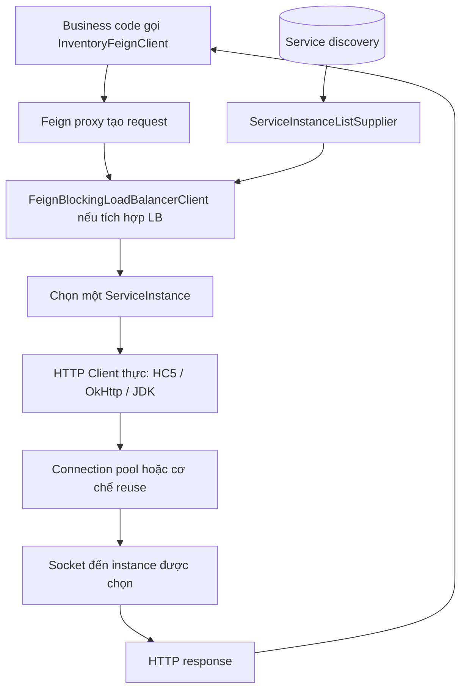
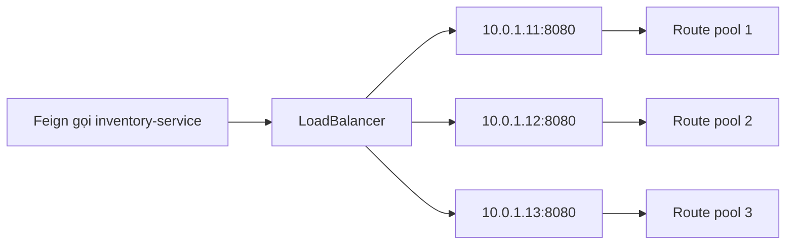
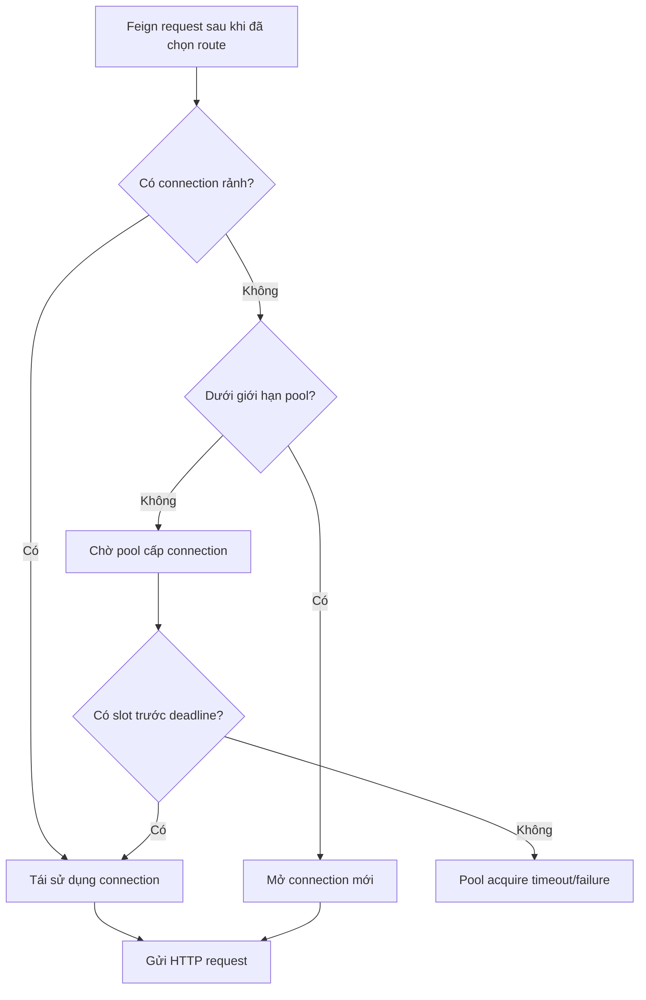
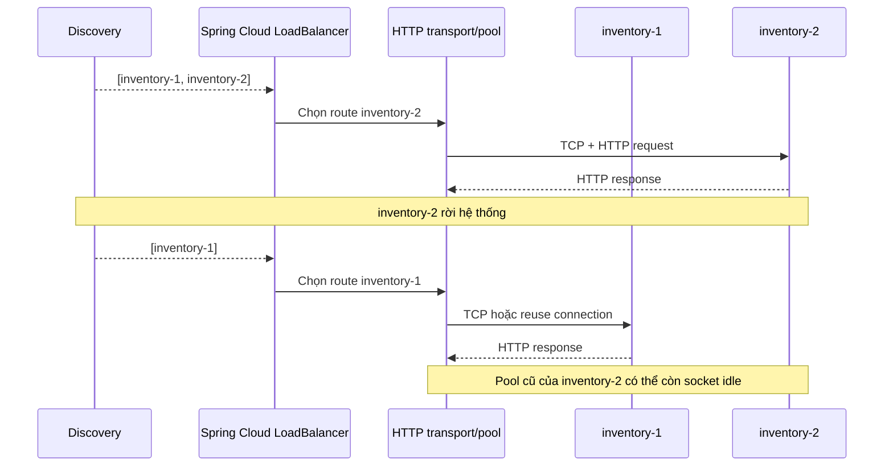

# Lựa chọn HTTP transport và connection pool

Trong ứng dụng microservice, Spring Cloud OpenFeign giúp gọi một dịch vụ khác bằng Java interface thay vì tự xây request. Ví dụ, `order-service` khai báo `@FeignClient(name = "inventory-service")` và gọi `inventoryClient.getProduct("P-1001")`. Khi Spring Cloud LoadBalancer được tích hợp, tên `inventory-service` được phân giải thành một `ServiceInstance` đang có sẵn.

Tuy nhiên, **LoadBalancer chỉ quyết định gọi instance nào; HTTP transport mới thực hiện kết nối thực tế**. Hai ứng dụng dùng cùng một `@FeignClient` và cùng thuật toán round robin có thể có hiệu năng, mức sử dụng socket và hành vi timeout rất khác nhau nếu một ứng dụng dùng JDK HTTP transport, ứng dụng kia dùng Apache HttpClient 5 hoặc OkHttp.

Bài học thuộc chương **OpenFeign** trong module Spring Cloud LoadBalancer, tập trung vào việc chọn HTTP transport, cấu hình và định cỡ connection pool, hiểu ảnh hưởng của service discovery, health check, timeout và retry, đồng thời quan sát đúng điểm nghẽn trong thực tế.

## 1. Hai quyết định khác nhau: chọn instance và mở kết nối

Khi gọi `GET http://inventory-service/api/products/P-1001` qua OpenFeign, thường có hai bước lớn:

1. **Client-side load balancing:** Spring Cloud lấy danh sách `ServiceInstance` từ discovery hoặc supplier và chọn một địa chỉ, chẳng hạn `10.0.0.12:8080`.
2. **HTTP execution:** một Feign `Client` bên dưới sử dụng transport cụ thể để lấy hoặc tạo connection TCP/TLS tới địa chỉ vừa chọn, gửi request và nhận response.



`FeignBlockingLoadBalancerClient` là một dạng wrapper của Spring Cloud OpenFeign khi tích hợp LoadBalancer cho lời gọi đồng bộ. Nó không tự biến một connection của `inventory-1` thành connection của `inventory-2`: sau khi chọn instance, connection vẫn phải phù hợp với remote endpoint thực tế.

Trong một số cấu hình có retry, wrapper có thể khác, chẳng hạn một biến thể có hỗ trợ LoadBalancer retry. Tên bean và cơ chế kết hợp tùy phiên bản; ý nghĩa kiến trúc không đổi: **chọn instance và thực thi HTTP là hai trách nhiệm riêng**.

## 2. HTTP transport có vai trò gì?

HTTP transport quyết định cách client kết nối và sử dụng tài nguyên mạng:

- Tạo và tái sử dụng kết nối TCP, TLS handshake và HTTP keep-alive.
- Quản lý connection pool, số kết nối đồng thời, thời gian chờ để lấy connection.
- Áp dụng connect timeout, response/read timeout, proxy, TLS truststore và client certificate.
- Giải quyết DNS ở đích cần kết nối, quản lý socket idle và connection không còn phù hợp.
- Hỗ trợ những tính năng HTTP khác nhau theo implementation, ví dụ HTTP/2 khi transport và cấu hình thực sự cho phép.

**Không nhầm transport với Feign encoder/decoder:** encoder/decoder quyết định chuyển object và HTTP body; còn transport quyết định đường đi của bytes trên mạng. Tương tự, `RequestInterceptor` thêm header không thay thế việc cấu hình connection pool.

## 3. So sánh các lựa chọn transport thường gặp

| Lựa chọn | Cách dùng trong Feign | Ưu điểm / trường hợp phù hợp | Lưu ý |
|---|---|---|---|
| **Feign `Client.Default`** | Sử dụng cơ chế dựa trên JDK `HttpURLConnection`. | Dễ bắt đầu, ít dependency bổ sung; phù hợp lab và lưu lượng nhỏ. | Không có bộ API pool sizing theo route như Apache HC5; hành vi keep-alive chịu ảnh hưởng JDK. |
| **Apache HttpClient 5 (HC5)** | Dùng Feign module `feign-hc5` khi được Spring Cloud OpenFeign tự cấu hình hoặc wiring phù hợp. | Pool theo route, quản lý max total/per-route, timeout và lifecycle rõ ràng; thường phù hợp HTTP/1.1 sync traffic. | Cần dependency tương thích và hiểu route/connection manager; không dùng cách cấu hình của Apache HttpClient 4. |
| **OkHttp** | Dùng Feign module `feign-okhttp`, với property enable và classpath phù hợp. | Connection pool riêng, hỗ trợ keep-alive, TLS, proxy và HTTP/2 tùy server/cấu hình. | Mô hình pool, dispatcher và timeout khác HC5; không dùng property pool của Apache để cấu hình OkHttp. |
| **Feign Client tùy chỉnh** | Đăng ký một implementation `feign.Client` hoặc tích hợp do hệ thống kiểm soát. | Cần chính sách TLS/proxy/transport đặc thù. | Dễ vô tình thay thế hoặc bỏ qua wrapper LoadBalancer; phải kiểm chứng service-ID routing. |

Nếu mục tiêu là pool có giới hạn và metric rõ ràng, HC5 thường là một điểm xuất phát thuận tiện. Nếu hệ thống đã dùng OkHttp và cần một số khả năng của nó, OkHttp có thể phù hợp hơn. **Không có một transport luôn tốt nhất:** quyết định dựa trên workload, dependency hiện có, chính sách TLS, tính tương thích và kết quả benchmark.

Lưu ý về phiên bản: trong các dòng Spring Cloud OpenFeign mới, **Apache HttpClient 4 không còn là lựa chọn được hỗ trợ như trước**. Không sao chép hướng dẫn cũ dùng `feign-httpclient` hoặc tên property cũ mà chưa kiểm tra release train hiện tại. Dùng module `feign-hc5` cho Apache HttpClient 5 nếu tổ hợp đang chạy hỗ trợ.

## 4. Điều kiện để Feign vừa load balance vừa dùng transport đúng

Với ứng dụng Spring Boot sử dụng Spring Cloud OpenFeign, dependency thường bao gồm:

```xml
<dependencies>
    <dependency>
        <groupId>org.springframework.cloud</groupId>
        <artifactId>spring-cloud-starter-openfeign</artifactId>
    </dependency>
    <dependency>
        <groupId>org.springframework.cloud</groupId>
        <artifactId>spring-cloud-starter-loadbalancer</artifactId>
    </dependency>
</dependencies>
```

Hãy quản lý Spring Boot và Spring Cloud bằng BOM/parent tương thích. Spring Cloud LoadBalancer có thể không được thêm vào classpath chỉ vì bạn đã có OpenFeign; việc khai báo starter rõ ràng giúp tránh giả định sai. Khi dùng Eureka/Consul/Kubernetes hoặc provider khác, cần nguồn discovery được cấu hình phù hợp; trong bài lab có thể dùng `SimpleDiscoveryClient`.

Một interface Feign đơn giản:

```java
import org.springframework.cloud.openfeign.FeignClient;
import org.springframework.web.bind.annotation.GetMapping;
import org.springframework.web.bind.annotation.PathVariable;

@FeignClient(name = "inventory-service")
public interface InventoryFeignClient {

    @GetMapping("/api/products/{id}")
    ProductView getProduct(@PathVariable("id") String productId);
}
```

Đăng ký Feign client với Spring Boot:

```java
import org.springframework.boot.SpringApplication;
import org.springframework.boot.autoconfigure.SpringBootApplication;
import org.springframework.cloud.openfeign.EnableFeignClients;

@SpringBootApplication
@EnableFeignClients(clients = InventoryFeignClient.class)
public class OrderApplication {
    public static void main(String[] args) {
        SpringApplication.run(OrderApplication.class, args);
    }
}
```

`ProductView` là DTO do ứng dụng định nghĩa. Khi `@FeignClient(name = "inventory-service")` không đặt URL cố định, và tích hợp LoadBalancer có hiệu lực, Feign sử dụng service ID để tìm instance.

**Quan trọng:** Nếu khai báo `@FeignClient(name = "inventory-service", url = "http://localhost:8081")` hoặc cung cấp URL tĩnh tương ứng trong cấu hình client, lời gọi thường đi trực tiếp tới URL đó, **không còn lựa chọn giữa các instance qua service discovery**. Điều này có thể hữu ích khi gọi host cố định, nhưng không chứng minh được LoadBalancer hoạt động.

### Cấu hình instance tĩnh cho bài thực hành

```yaml
spring:
  cloud:
    discovery:
      client:
        simple:
          instances:
            inventory-service:
              - uri: http://localhost:8081
              - uri: http://localhost:8082
```

Hai backend tại 8081 và 8082 phải chạy thật và cùng có endpoint `GET /api/products/{id}`. Nếu một backend không chạy, LoadBalancer vẫn có thể chọn instance đó, nhưng HTTP transport sẽ gặp `Connection refused` hoặc timeout. Đây là lỗi khác với trường hợp không tìm thấy `ServiceInstance`.

## 5. Chọn Apache HttpClient 5 trong Spring Cloud OpenFeign

Trong những phiên bản Spring Cloud OpenFeign hỗ trợ HC5, có thể thêm Feign transport module:

```xml
<dependency>
    <groupId>io.github.openfeign</groupId>
    <artifactId>feign-hc5</artifactId>
</dependency>
```

Version module nên được quản lý bởi tập BOM/dependency management tương thích. Nếu dự án dùng một phiên bản Spring Cloud OpenFeign tự cấu hình HC5 khi library hiện diện, cần để điều kiện auto-configuration hoạt động và tránh tạo bean `Client` không cần thiết.

Ví dụ trong `application.yml`:

```yaml
spring:
  cloud:
    openfeign:
      httpclient:
        hc5:
          enabled: true
        max-connections: 200
        max-connections-per-route: 50
        time-to-live: 60
        time-to-live-unit: seconds
      client:
        config:
          inventory-service:
            connectTimeout: 2000
            readTimeout: 5000
```

Đây là **cấu hình minh họa**, không phải bộ giá trị chuẩn. Các thuộc tính `httpclient.max-connections`, `max-connections-per-route`, `time-to-live` và nhánh `hc5` là những núm điều khiển có trong các thế hệ Spring Cloud OpenFeign hỗ trợ transport này, nhưng **phải đối chiếu configuration metadata đúng release train** để xác nhận tên property, đơn vị thời gian, điều kiện kích hoạt và tác động thực tế. Không áp dụng các property trên cho một ứng dụng dùng OkHttp rồi kỳ vọng pool OkHttp thay đổi.

`connectTimeout` và `readTimeout` ở ví dụ là cấu hình Feign client mức cao, tính bằng mili giây trong những dòng Spring Cloud OpenFeign thông dụng. Chúng **không nhất thiết là toàn bộ ngân sách thời gian** của một logical operation, cũng không đồng nghĩa với timeout chờ cấp connection từ pool.

### Tổng kết ý nghĩa hai giới hạn connection

| Tham số | Ý nghĩa thực hành |
|---|---|
| `max-connections: 200` | Giới hạn số connection tối đa trong phạm vi connection manager theo cấu hình HC5, không phải 200 request/giây. |
| `max-connections-per-route: 50` | Giới hạn số connection đến một HTTP route (thường gồm host, port, scheme và thông tin route/proxy). |
| `time-to-live: 60` | Giới hạn vòng đời connection ở mức transport theo chính sách được áp dụng; không phải timeout xử lý business request. |

Nếu LoadBalancer chọn hai backend thuộc hai remote route khác nhau, mỗi route có thể có pool limit riêng. Khi nhiều service ID hoặc nhiều caller dùng chung một connection manager, giới hạn **tổng** cũng quan trọng như per-route.

## 6. Chọn OkHttp khi cần transport này

Trong các dòng hỗ trợ OkHttp integration, cần dependency Feign:

```xml
<dependency>
    <groupId>io.github.openfeign</groupId>
    <artifactId>feign-okhttp</artifactId>
</dependency>
```

và bật transport theo property hỗ trợ của Spring Cloud OpenFeign:

```yaml
spring:
  cloud:
    openfeign:
      okhttp:
        enabled: true
```

Điều kiện thực tế còn phụ thuộc classpath, việc HC5 có đang khả dụng hay không, bean `Client` tùy chỉnh và thứ tự auto-configuration trong release train. **Chỉ có `feign-okhttp` trên classpath chưa chứng minh OkHttp đã được chọn**; cần quan sát implementation đang thực thi.

OkHttp có đối tượng `ConnectionPool` để kiểm soát số idle connection và thời gian giữ lại, cùng các cấu hình connect/read/write/call timeout của `OkHttpClient`. Không sao chép các tham số `max-connections-per-route` của HC5 để điều chỉnh OkHttp: mô hình và API của chúng khác nhau.

Ví dụ cấu hình pool thuần OkHttp, chỉ minh họa API của thư viện:

```java
import java.util.concurrent.TimeUnit;
import okhttp3.ConnectionPool;
import okhttp3.OkHttpClient;

ConnectionPool pool = new ConnectionPool(10, 2, TimeUnit.MINUTES);
OkHttpClient httpClient = new OkHttpClient.Builder()
        .connectionPool(pool)
        .connectTimeout(2, TimeUnit.SECONDS)
        .readTimeout(5, TimeUnit.SECONDS)
        .build();
```

Đoạn code **chưa tự nối `httpClient` này vào Spring Cloud OpenFeign**. Để dùng nó trong ứng dụng thật, cần cấu hình bean/auto-configuration được release train hỗ trợ và kiểm tra wrapper LoadBalancer không bị bỏ qua. Tránh tự khai báo một bean `feign.Client` tùy tiện rồi khiến Feign mất khả năng phân giải service ID.

### Lưu ý về Dispatcher và Feign đồng bộ

OkHttp có `Dispatcher` và các giới hạn như `maxRequests` hoặc `maxRequestsPerHost`, nhưng không nên coi chúng là một bộ **global concurrency limiter cho mọi lời gọi OpenFeign đồng bộ**: cơ chế scheduling/giới hạn của Dispatcher được thiết kế chủ yếu cho các cuộc gọi bất đồng bộ. Nếu muốn bảo vệ backend khỏi quá nhiều lời gọi Feign đồng bộ, cần chính sách concurrency, bulkhead hoặc semaphore ở tầng ứng dụng thay vì chỉ chỉnh Dispatcher.

## 7. Khi nào dùng transport mặc định?

Trong môi trường nhỏ, Feign `Client.Default` dựa trên JDK `HttpURLConnection` có thể đủ cho bài lab hoặc lưu lượng thấp. Tuy nhiên, không nên hiểu “default” là **không tái sử dụng connection**: JDK có cơ chế HTTP keep-alive/caching riêng tùy version và system properties, chỉ là mức điều khiển pool/metric khác với HC5 hoặc OkHttp.

Khi cần max total connections, per-route limit, chờ pool có deadline, eviction và metric pool rõ ràng, một HTTP client chuyên dụng thường mang lại các núm điều chỉnh dễ kiểm chứng hơn. Chỉ quyết định đổi transport sau khi đo bottleneck, vì thay transport cũng ảnh hưởng TLS, proxy, timeout, redirect và khả năng tương thích.

## 8. Connection pool thực sự “pool theo cái gì”?

Giả sử discovery trả:

| ServiceInstance | URI |
|---|---|
| `inventory-1` | `http://10.0.1.11:8080` |
| `inventory-2` | `http://10.0.1.12:8080` |
| `inventory-3` | `http://10.0.1.13:8080` |

Khi LoadBalancer chọn `inventory-2`, transport kết nối đến `10.0.1.12:8080`. Connection đã mở tới `10.0.1.11:8080` không thể tự được tái sử dụng cho remote khác. HC5 thường quản lý pool theo **route thực** (target host/port/scheme, có xét proxy khi áp dụng), còn OkHttp áp dụng quy tắc connection reuse/pool của riêng nó.



**Không nhầm service ID với route pool.** Một service ID có thể ánh xạ đến nhiều host/port; nhiều service ID cũng có thể ánh xạ về một proxy chung. Pool quản lý connection theo địa chỉ và quy tắc của HTTP engine, không theo quy ước rằng “mỗi tên Feign client luôn có đúng một pool”.

Trường hợp HTTP proxy hoặc service mesh, địa chỉ kết nối thực tế có thể khác địa chỉ instance do discovery công bố. Hãy đo route thực của transport trước khi tính số connection tới backend.

## 9. Định cỡ pool: tổng, per-route và số replica caller

Ba giới hạn cần tách biệt:

1. **Max total:** số connection tối đa trong toàn bộ connection manager được chia sẻ, nếu transport hỗ trợ giới hạn này.
2. **Max per-route:** số connection tối đa tới một route/remote riêng.
3. **Số caller replica:** mỗi pod/VM caller thường có HTTP client và pool của chính nó; tổng socket phía backend bằng tổng ảnh hưởng của nhiều caller.

Ví dụ, một caller có `max total = 200` và `per-route = 50`. Nếu discovery có ba remote route và không có giới hạn nào khác, caller có thể sử dụng nhiều connection ở cả ba route; **50 không phải giới hạn socket của toàn hệ thống**, mà 200 mới là giới hạn tổng của manager này.

Nếu có **10 replica caller**, mỗi replica có khả năng tạo tối đa 50 connection tới cùng một route, backend đó có thể phải xử lý **tới khoảng 500 connection** chỉ từ nhóm caller này, chưa tính nguồn tải khác. Đây là biên trên lý thuyết theo các giả định đơn giản, không phải dự báo số socket luôn mở.

### Dùng Little's Law để có điểm xuất phát

Ở mức ổn định, số request đồng thời trung bình có thể ước lượng:

```text
Concurrency trung bình ≈ request/giây × thời gian trung bình (giây)
```

Ví dụ một caller có `150 request/giây` và thời gian mỗi request trung bình `200 ms`:

```text
150 × 0,2 = khoảng 30 request đồng thời toàn nhóm
```

Với ba backend có tải cân bằng, trung bình mỗi route có khoảng 10 request đồng thời. Tuy nhiên, số liệu trung bình **không đủ để chọn max pool**: hãy quan sát burst, latency p95/p99, retry, một instance chậm và số caller thực tế. Với HTTP/2, quan hệ giữa request đồng thời và số connection còn phụ thuộc multiplexing.

## 10. Vì sao pool lớn không đồng nghĩa throughput cao?

Giả sử `inventory-service` chỉ xử lý được 30 request đồng thời vì database pool nhỏ. Nếu tăng max connection từ 50 lên 500 ở mọi caller, hệ thống có thể:

- Tạo nhiều socket và TLS handshake hơn, tăng CPU/memory/file descriptor.
- Đưa thêm request vào backend đang bão hòa, làm latency và timeout tệ hơn.
- Gây tranh chấp database, hàng đợi và tình trạng retry dây chuyền.
- Che giấu vấn đề chính là **backpressure/concurrency limit**.

Vì vậy cần phối hợp pool sizing với rate limit/bulkhead hoặc giới hạn concurrent calls, deadline, retry budget và năng lực của từng backend. Spring Cloud LoadBalancer mặc định không tự biết một instance có bao nhiêu connection đang bận ở caller để chọn “instance ít tải nhất”.

## 11. Ba thời gian thường bị gọi chung là timeout

Khi dùng connection pool, phải phân biệt:

| Timeout | Nó giới hạn điều gì? | Hệ quả khi quá hạn |
|---|---|---|
| **Connection request / pool acquisition timeout** | Thời gian chờ để được cấp một connection từ pool khi pool đã đầy. | Fail trước khi thực sự mở hoặc gửi request đến backend. |
| **Connect timeout** | Thời gian thiết lập kết nối TCP mới tới remote. | Lỗi kết nối, không đồng nghĩa backend đã xử lý HTTP. |
| **Read/response/socket timeout** | Thời gian chờ dữ liệu/phản hồi theo cơ chế của HTTP transport. | Có thể không biết backend đã commit thao tác hay chưa. |

Ngoài ra, một **overall deadline** của thao tác nghiệp vụ phải tính cả nhiều attempt, chờ pool, kết nối và xử lý response. Ví dụ `connectTimeout: 2000` và `readTimeout: 5000` **không mặc nhiên** bảo đảm toàn bộ một logical request kết thúc trong 7 giây, vì còn acquisition, DNS, TLS, retry hoặc redirect.

Với HC5, thường có các núm điều chỉnh riêng cho connection request timeout, connection/socket timeout theo API/nhánh property hỗ trợ. Không dựa duy nhất vào Feign `connectTimeout`/`readTimeout` rồi khẳng định đã giới hạn được hàng đợi pool.

### Nhận diện pool starvation

Nếu backend xử lý request chậm, các connection có thể bị giữ bận. Khi số request đồng thời vượt max per-route, yêu cầu mới phải chờ acquire; lỗi xảy ra trước hoặc trong quá trình lấy connection không đồng nghĩa discovery không tìm thấy instance.



Không nên vội tăng max per-route nếu request giữ connection quá lâu do streaming, backend chậm hoặc retry bão hòa. Hãy tìm nguyên nhân trước, kiểm tra leased/available/pending metrics theo route và phân tích đuôi latency.

## 12. Keep-alive, idle eviction và vòng đời connection

Connection pool tiết kiệm thời gian TCP/TLS setup bằng cách giữ kết nối để tái sử dụng. Nhưng **socket có thể bị server hoặc proxy đóng trước khi client biết**. Ví dụ, reverse proxy đóng kết nối sau 30 giây idle, còn HTTP client định giữ connection idle lâu hơn: sau giai đoạn rảnh, request đầu tiên có thể gặp `Connection reset`, `NoHttpResponseException` hoặc lỗi tương đương, tùy transport.

Cần phân biệt:

- **Keep-alive:** khả năng giữ một connection sống để sử dụng cho request tiếp theo.
- **Idle timeout:** connection không hoạt động được giữ tối đa bao lâu trước khi bị xem xét đóng/evict.
- **Time-to-live (TTL) của connection:** giới hạn tuổi của một connection kể từ lúc mở, kể cả khi nó được dùng nhiều lần; không phải TTL của danh sách `ServiceInstance`.
- **Eviction:** cơ chế dọn connection idle, hết hạn, bị đóng hoặc không còn phù hợp theo chính sách HTTP engine.
- **Graceful shutdown/draining:** server ngừng nhận request mới nhưng cho phép request đang xử lý hoàn tất trong thời hạn.

| Lớp | Một kiểu thời hạn | Ảnh hưởng |
|---|---|---|
| `ServiceInstance` cache / discovery | TTL danh sách instance hoặc chu kỳ polling. | Quyết định caller còn nhìn thấy một backend trong tập ứng viên hay không. |
| HTTP connection pool | Idle timeout, connection TTL, eviction. | Quyết định socket tới backend cũ còn được tái sử dụng/giữ trong pool hay không. |
| HTTP request | Connect/read/overall timeout. | Quyết định một request đang thực thi được phép chờ bao lâu. |
| Backend / reverse proxy | Keep-alive, idle timeout, drain timeout. | Quyết định server/proxy giữ kết nối và xử lý yêu cầu đến lúc nào. |

**Không có quan hệ 1:1** giữa các thời hạn này. Ví dụ, cache discovery đã loại `inventory-2` nhưng transport vẫn có thể giữ một connection idle tới nó cho tới khi pool evict. Điều đó không đồng nghĩa LoadBalancer vẫn chọn `inventory-2`; pool chỉ còn tài nguyên chưa được dọn. Ngược lại, nếu danh sách instance vẫn chứa một backend vừa chết, pool không thể làm request tới backend đó tự nhiên thành công.

Với pool do ứng dụng tự tạo, hãy gắn vòng đời shutdown với Spring application context và đóng client/connection manager đúng cách. Với pool do Spring Boot hoặc starter sở hữu, không tự đóng tài nguyên dùng chung khi một gateway ngừng hoạt động.

## 13. Sự thay đổi instance ảnh hưởng pool như thế nào?

Một hệ thống autoscaling có thể thêm, bớt instance liên tục. Điều này tạo tương tác giữa hai hệ thống:



Khi **scale up**, instance mới được discovery công bố rồi LoadBalancer mới có thể chọn nó. Ở lượt gọi đầu, HTTP transport thường phải thiết lập connection; chi phí cold TCP/TLS handshake có thể làm latency khác so với instance đã có pool ấm.

Khi **scale down**, nếu caller vẫn sử dụng danh sách stale từ discovery/cache hoặc server bị kill đột ngột, request có thể thất bại. Cần phối hợp readiness, deregistration, graceful drain, connection eviction và retry an toàn; không thể “sửa” toàn bộ bằng cách tăng max connection hoặc thu ngắn read timeout.

Lưu ý `SimpleDiscoveryClient` với danh sách URI tĩnh không tự phản ánh đầy đủ scale up/down khi registry thay đổi. Nếu muốn mô phỏng discovery động, dùng provider thử nghiệm có cập nhật instance, hoặc cập nhật cấu hình theo quy trình lab rồi quan sát hành vi tương ứng.

## 14. Retry có thể khuếch đại áp lực lên pool

Feign core và Spring Cloud OpenFeign có chính sách retry khác nhau. Trong nhiều phiên bản Spring Cloud OpenFeign, framework tạo `Retryer.NEVER_RETRY` làm mặc định, khác với hành vi retry mặc định của Feign core. Spring Cloud LoadBalancer còn có thể có lớp retry riêng theo dependency và cấu hình.

**Không giả định** rằng mọi lỗi I/O sẽ tự được retry, hoặc chỉ cần đổi Feign `Retryer` thì mọi lần thử của LoadBalancer đều hoạt động theo chính sách đó. Phải xác minh các bean và lớp retry đang có trong release train sử dụng.

Nếu cho phép tối đa hai lần thử lại sau lần đầu:

```text
Một logical request:
  attempt 1 -> chọn inventory-1 -> connect timeout
  attempt 2 -> chọn instance theo chính sách retry -> read timeout
  attempt 3 -> chọn instance theo chính sách retry -> response / lỗi

Tối đa: 3 attempt cho 1 logical request
```

Mỗi attempt có thể phải acquire connection mới hoặc chờ route pool. Khi backend đã bão hòa, retry làm số request và pending pool queue tăng, gây **retry storm**. Vì vậy:

- Chỉ retry những lỗi thực sự được phân loại là tạm thời; hạn chế tổng số attempt.
- Thiết lập backoff và jitter khi phù hợp; tránh tất cả caller retry cùng một thời điểm.
- Có deadline tổng, không cấp ngân sách timeout mới vô hạn qua mỗi attempt.
- Quan sát số attempt thực, phân biệt retry cùng instance và retry khác instance.
- Tránh retry request ghi có side effect nếu chưa có cơ chế idempotency/deduplication.

Ví dụ `POST /orders` có thể đã commit thành công trên server nhưng response bị timeout. Gửi lại request mà không có idempotency key có thể tạo hai đơn hàng. Pool và load balancing không thể tự bảo đảm tính đúng đắn của nghiệp vụ.

## 15. HTTP/2, proxy, TLS và transport choice

Lựa chọn HTTP transport còn phụ thuộc các điều kiện kết nối mà ứng dụng thật sự dùng:

**HTTP/1.1:** một connection thường xử lý một request active tại một thời điểm; sau khi response/body được tiêu thụ, socket có thể quay về pool cho request sau. Pool size và request concurrency có liên hệ chặt hơn.

**HTTP/2:** có thể multiplex nhiều stream trên một connection khi client, server và tuyến mạng hỗ trợ/negotiation thành công. OkHttp có khả năng hỗ trợ HTTP/2 trong một số cấu hình phù hợp. Không mặc định Feign đồng bộ với HC5 classic hay mọi transport đều dùng HTTP/2; cần kiểm tra engine/protocol được chọn thực tế.

**HTTP proxy và service mesh:** connection pool có thể kết nối đến proxy thay vì IP cuối của instance. Khi đó “pool per route” cần được hiểu theo route của transport, không đơn thuần theo service ID. Nếu proxy tự cân bằng tải, cần xác định ranh giới trách nhiệm giữa Spring Cloud LoadBalancer và proxy để tránh phân tích sai.

**TLS:** certificate, truststore, SNI, hostname verification và client certificate mTLS phải hợp lệ trên **HTTP transport bên dưới Feign**. Việc Spring Cloud LoadBalancer chọn đúng instance chỉ là bước đầu:

```text
Feign name=inventory-service
   |
   +-- LoadBalancer chọn https://inventory.internal:8443
          |
          +-- HTTP transport: TLS handshake, certificate, hostname, mTLS
                 |
                 +-- HTTP request nghiệp vụ
```

Nếu registry trả IP trong khi certificate chỉ có DNS SAN, việc kiểm tra hostname có thể thất bại. Đừng vô hiệu hóa hostname verification hoặc trust-all SSL trong production để che giấu thông tin instance sai; nên sửa tên đã đăng ký, certificate SAN và cấu hình TLS cho đồng bộ.

## 16. Chọn transport theo workload, không theo cảm giác

| Nhu cầu | Điều nên ưu tiên |
|---|---|
| Lab đơn giản với lưu lượng thấp | Client mặc định có thể đủ để học Feign và LoadBalancer; ưu tiên hiểu đúng bean và service ID. |
| HTTP/1.1 có tải lớn, cần giới hạn route rõ ràng | HC5 với max total/per-route, acquisition timeout và đo leased/available/pending. |
| Hệ thống đã chuẩn hóa OkHttp | Cân nhắc OkHttp cùng pool/timeout của chính nó, xác minh Feign integration thật. |
| Cần HTTP/2 hoặc protocol đặc biệt | Xác minh hỗ trợ thật của transport/server/proxy và benchmark với cấu hình đích. |
| TLS/mTLS phức tạp | Ưu tiên client có cơ chế SSL context/certificate rotation có thể quản lý an toàn. |
| Quản lý proxy tập trung | Kiểm tra route, DNS, keep-alive và pooling ở cả transport lẫn proxy. |
| Nhiều service ID và nhiều instance autoscale | Theo dõi số route pool, tổng sockets, tốc độ create/evict và áp lực lên backend. |

Trước khi thay transport, xác định mục tiêu đo lường: giảm connection setup, giảm tail latency, giảm pending acquisition, cải thiện TLS policy hay đồng bộ hạ tầng. Sau khi thay, đo lại cùng workload và cùng topology để tránh so sánh không công bằng.

## 17. Quan sát để biết bottleneck ở Feign, LoadBalancer hay pool

Chỉ số nên được nhóm theo các lớp:

| Tầng | Chỉ số / tín hiệu có ích |
|---|---|
| **Feign HTTP** | Request count, HTTP status/error, latency p50/p95/p99, timeout, retry attempt. |
| **LoadBalancer** | `serviceId`, `instanceId` được chọn, số instance hợp lệ, lỗi không tìm thấy instance. |
| **HTTP connection manager** | Connection leased/active, available/idle, pending theo route, max total/per-route, acquire timeout. |
| **Transport/TLS** | Connect error, TLS handshake failure, connection reset, DNS latency, connection creation rate. |
| **Backend** | Request concurrency, thread pool/CPU, database pool, p95/p99, readiness và số request bị từ chối. |

Spring Cloud OpenFeign có thể tích hợp Micrometer/Observation khi dependency và các điều kiện cấu hình thích hợp tồn tại. **Metric Feign request không tự đồng nghĩa metric pool**: nếu dùng HC5, cần thêm instrumentation/đọc số liệu từ connection manager phù hợp; nếu dùng OkHttp, cách đo cũng khác. Các metric, tag và tên bean có thể thay đổi theo phiên bản.

Các trường log hữu ích:

```text
traceId=9a3f
serviceId=inventory-service
selectedInstance=inventory-2
attempt=1
transport=hc5
httpStatus=200
durationMs=87
```

Ví dụ chỉ minh họa nội dung log/tracing, không phải log mặc định Feign. Để biết `transport=hc5`, cần quan sát hoặc instrument chính transport đang chạy; không tự in tên “HC5” dựa trên dependency có mặt.

Khi bật Feign logging để debug, tránh cấp độ ghi toàn bộ request/response trên production nếu nội dung có token, cookie, PII hoặc body nhạy cảm. Đừng đưa ID người dùng, URL chứa dữ liệu động hay token vào metric label vì rủi ro rò rỉ dữ liệu và cardinality lớn.

## 18. Kiểm tra implementation transport thực sự được chọn

Một lỗi phổ biến là cấu hình `spring.cloud.openfeign.httpclient.hc5.enabled: true` hoặc `spring.cloud.openfeign.okhttp.enabled: true` rồi nghĩ chắc chắn đúng transport đang chạy. Để xác minh:

1. Kiểm tra **resolved dependency tree** và BOM của `spring-cloud-starter-openfeign`, `feign-hc5` hoặc `feign-okhttp`.
2. Xem Condition Evaluation Report hoặc Actuator `/actuator/conditions` trong môi trường có bảo vệ.
3. Quan sát Feign client context và bean `feign.Client` đang có; nếu tích hợp LoadBalancer, có thể là **wrapper** bọc delegate HTTP client.
4. Xác minh delegate thật sự là HC5/OkHttp/JDK thay vì chỉ xem class wrapper.
5. Gọi nhiều request trong lab, quan sát connection create/reuse, leased/pending và số socket theo route.
6. Khi có bean `feign.Client` tự tạo, kiểm tra nó có còn được Spring Cloud LoadBalancer bọc hay đã làm service-ID routing bị bỏ qua.

Ví dụ lệnh Maven:

```bash
./mvnw dependency:tree -Dincludes=io.github.openfeign:feign-hc5
./mvnw dependency:tree -Dincludes=io.github.openfeign:feign-okhttp
./mvnw dependency:tree -Dincludes=org.springframework.cloud:spring-cloud-openfeign-core
./mvnw dependency:tree -Dincludes=org.springframework.cloud:spring-cloud-loadbalancer
```

Trong dự án Gradle, `./gradlew dependencyInsight --dependency feign-hc5 --configuration runtimeClasspath` và các lệnh tương tự giúp nhận diện dependency được chọn. Đây là hướng dẫn để người học tự chạy ở dự án, không phải bước bắt buộc thực thi trong quá trình viết bài.

Nếu dùng Spring Boot Actuator, có thể xem `/actuator/beans` hoặc `/actuator/conditions` khi các endpoint này đã được cấu hình và bảo vệ. Không public các endpoint chẩn đoán nội bộ ra Internet.

## 19. Bài thực hành: hai instance, HC5 và pool giới hạn

Chuẩn bị môi trường lab có hai server `inventory-service`:

- `localhost:8081` trả `instanceId=inventory-1` ở `GET /api/debug/instance`.
- `localhost:8082` trả `instanceId=inventory-2` ở cùng đường dẫn.
- Cả hai có `GET /api/lab/slow` mô phỏng độ trễ 300–500 ms bằng I/O có kiểm soát, không dùng môi trường production.

Caller `order-service` dùng `@FeignClient(name = "inventory-service")` và `SimpleDiscoveryClient` từ phần 4. Bật HC5 theo phiên bản hỗ trợ và thiết lập mức max total/per-route nhỏ để quan sát hàng chờ.

### Kịch bản A — Kiểm tra chọn instance

Gọi `GET /api/debug/instance` nhiều lần. Với thuật toán round robin và danh sách instance ổn định, kỳ vọng nhiều request đi đến hai backend. Nếu chỉ thấy DNS resolution tới `inventory-service`, kiểm tra LoadBalancer wrapper và có đang vô tình đặt URL cố định trong `@FeignClient` hay không.

### Kịch bản B — Kiểm tra connection reuse

Gửi request tuần tự rồi gửi một nhóm request đồng thời. Quan sát số connection mới, số connection tái sử dụng và socket đang hoạt động theo route. Với HTTP/1.1, request tuần tự đến cùng route thường có cơ hội reuse keep-alive connection, nhưng server/proxy có thể đóng nó theo chính sách riêng.

### Kịch bản C — Giới hạn per-route

Đặt mức ví dụ max total 8 và per-route 2 trong lab, sau đó gửi 20 lời gọi đồng thời đến endpoint chậm. Quan sát số request được xử lý, số request đợi connection, acquire timeout và latency. Mục tiêu là chứng minh **max connection khác max throughput**; không có nghĩa cứ 2 connection thì hệ thống chỉ xử lý được 2 request/giây.

### Kịch bản D — Một instance lỗi

Dừng `inventory-2` sau một lượt request thành công. Kiểm tra danh sách do supplier trả về, selected instance, connection reset/timeout và thời gian health/discovery loại instance. Giữ retry có kiểm soát để phân biệt lỗi pool với lỗi danh sách stale.

### Kịch bản E — So sánh transport

Chạy cùng workload, instance count, timeout, TLS và concurrency với HC5 và OkHttp trong hai cấu hình riêng. So sánh p95/p99, số socket, connection churn, memory, CPU và tỷ lệ lỗi. Không bật cùng lúc nhiều cấu hình transport rồi giả định biết transport nào đã được dùng.

### Mẫu bảng ghi kết quả

| Kịch bản | Transport | Max total / route | Concurrency | p95 latency | Acquire errors | Nhận xét |
|---|---|---|---|---|---|---|
| Baseline | HC5 | Ghi cấu hình | Ghi thực tế | Đo thực tế | Đo thực tế | Có reuse? |
| Pool nhỏ | HC5 | Ghi cấu hình | Ghi thực tế | Đo thực tế | Đo thực tế | Có pending? |
| So sánh | OkHttp | Dùng tham số pool tương ứng | Ghi thực tế | Đo thực tế | Đo thực tế | Khác biệt gì? |

Không tự điền số liệu không được đo. Ghi rõ version, protocol, số caller replica và điều kiện máy khi so sánh.

## 20. Bảng chẩn đoán sự cố

| Triệu chứng | Khả năng cần kiểm tra | Hành động |
|---|---|---|
| `UnknownHostException: inventory-service` | Feign đi trực tiếp theo DNS, không có wrapper LoadBalancer hoặc dùng client/url cố định sai. | Kiểm tra `@FeignClient`, `spring-cloud-starter-loadbalancer`, `feign.Client` và bean configuration. |
| Không có instance cho service ID | Registry/supplier rỗng, sai service ID hoặc health filter loại hết. | Quan sát `ServiceInstanceListSupplier`; chỉnh pool không xử lý được. |
| `Connection refused` tới IP đã chọn | Backend không lắng nghe, sai port hoặc instance đã chết. | Thử kết nối đúng host/port, kiểm tra discovery và drain. |
| Pool acquire timeout | Max total/per-route đã bão hòa hoặc connection bị giữ quá lâu. | Theo dõi leased/pending, concurrency và backend latency. |
| `ConnectTimeoutException` | DNS/network/backend không thể thiết lập TCP đúng hạn. | So sánh connect timeout, port, firewall và tốc độ tạo connection. |
| Read timeout nhưng backend có thể đã thực hiện ghi | Response chậm hoặc mất trong khi transaction đã commit. | Kiểm tra server logs, idempotency, không retry mù quáng. |
| Nhiều socket hơn dự kiến | Nhiều caller replicas, manager khác nhau hoặc nhiều route; per-route không phải global. | Đếm socket theo process, route và connection manager. |
| Connection reset sau khoảng idle | Server/proxy đóng keep-alive sớm hơn client dự kiến. | Điều chỉnh idle eviction/keep-alive và graceful drain. |
| Đã bật HC5 nhưng không thấy tác dụng | Dependency/auto-config bị thay, client khác được chọn. | Xác minh Feign delegate và resolved dependencies. |
| OkHttp được thêm nhưng vẫn dùng HC5 | Transport selection theo điều kiện/classpath khác kỳ vọng. | Quan sát auto-config/bean, chọn một transport rõ ràng. |
| HTTPS handshake thất bại | Truststore, hostname/SAN, certificate hoặc mTLS. | Xác minh chain và hostname, không tắt certificate verification. |
| Retry tăng cùng lúc p99 tăng | Lỗi có thể bị khuếch đại khi pool/backend đang nghẽn. | Giới hạn retries, áp dụng deadline và concurrency budget. |
| Một instance nhận nhiều request chậm | LoadBalancer không tính capacity thực, backend/pool route đó quá tải. | So sánh theo instance: latency, CPU, pool pending và error rate. |

## 21. Checklist trước khi đưa vào vận hành

- [ ] Chọn một Spring Boot/Spring Cloud OpenFeign release train tương thích, quản lý dependency bằng BOM.
- [ ] Có `spring-cloud-starter-openfeign` và cơ chế LoadBalancer/nguồn discovery phù hợp.
- [ ] `@FeignClient(name = "...")` dùng service ID logic; không vô tình cấu hình URL cố định nếu cần chọn instance.
- [ ] Xác minh transport HTTP **thực sự đang dùng**, không suy ra chỉ từ dependency có mặt.
- [ ] Nếu dùng HC5, biết giới hạn max total và max per-route; kiểm tra cả pool acquisition timeout.
- [ ] Nếu dùng OkHttp, cấu hình bằng API/property của OkHttp và hiểu khác biệt với HC5.
- [ ] Có timeout kết nối, chờ pool, đọc phản hồi và deadline tổng phù hợp workload.
- [ ] Theo dõi số caller replica để tránh tổng số socket phía backend vượt ngân sách.
- [ ] Điều chỉnh idle/lifetime/eviction theo keep-alive của server, proxy và TLS policy.
- [ ] Biết giới hạn concurrency/bulkhead; không kỳ vọng tăng pool tự giải quyết overload.
- [ ] Kiểm tra health, discovery và instance cache khi scale up/down hoặc một backend lỗi.
- [ ] Phân biệt Feign retry, LoadBalancer retry và nguy cơ ghi trùng khi thao tác không idempotent.
- [ ] Có metric request, selected instance, leased/idle/pending connection và lỗi theo route.
- [ ] Không log credential hoặc request body nhạy cảm; kiểm soát metric labels.
- [ ] Có bài thử nghiệm connection reuse, pool saturation, timeout, TLS và graceful shutdown trước production.

**Kết luận:** Trong Spring Cloud OpenFeign, Spring Cloud LoadBalancer chọn `ServiceInstance`, còn transport như **Apache HttpClient 5**, **OkHttp** hoặc JDK thực hiện kết nối. Connection pool được quản lý theo mô hình của HTTP engine và remote route, không đơn giản theo tên Feign client. Muốn giao tiếp liên dịch vụ ổn định, hãy chọn transport tương thích, cấu hình max total/per-route và timeout có giới hạn, điều tiết concurrency, đo leased/pending connection và hiểu độc lập vòng đời discovery, health check, retry và socket TCP/TLS.
