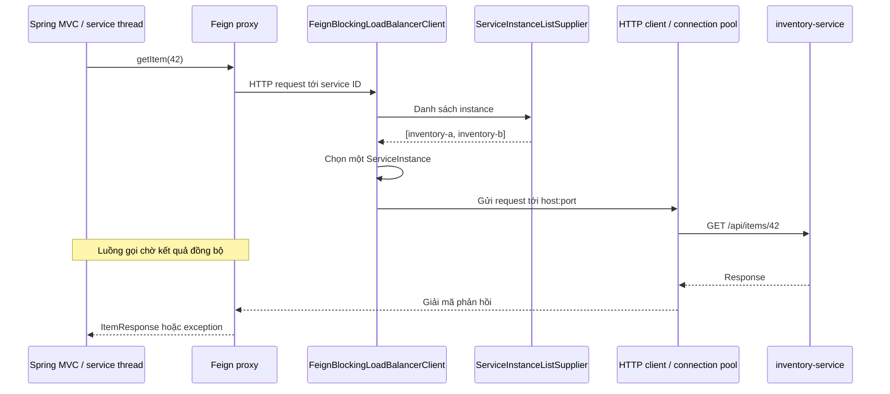
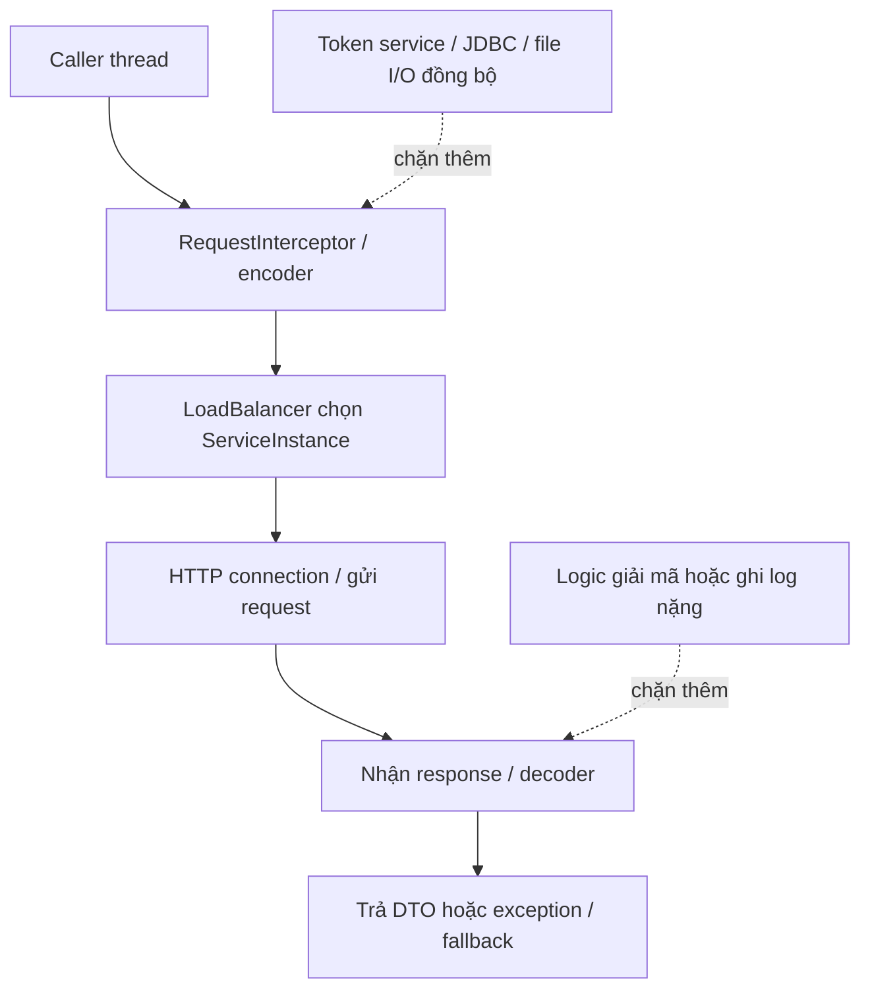
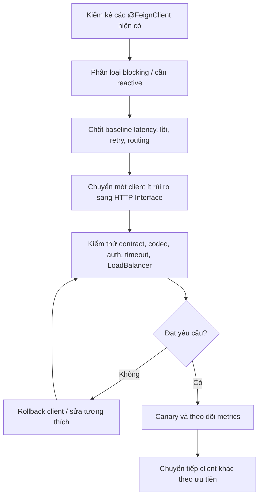

# Giới hạn chặn luồng và định hướng sử dụng theo vòng đời thư viện

Spring Cloud OpenFeign cho phép mô tả lời gọi HTTP bằng một Java interface và annotation, thay vì tự viết từng lệnh gửi request. Khi dùng cùng Spring Cloud LoadBalancer, một `@FeignClient(name = "inventory-service")` có thể gọi dịch vụ theo **service ID**: framework nhận danh sách `ServiceInstance` từ discovery/supplier, chọn đích và gửi HTTP request tới instance tương ứng. Đây là cách viết ngắn gọn, quen thuộc trong ứng dụng Spring MVC.

Tuy nhiên, **Spring Cloud OpenFeign hiện hỗ trợ mô hình client blocking**, không phải HTTP client reactive như `WebClient`. Một phương thức Feign thông thường giữ luồng gọi trong lúc chờ kết nối, phản hồi và giải mã nội dung. Đồng thời, tài liệu chính thức đã xác nhận dự án Spring Cloud OpenFeign ở trạng thái **feature-complete**: tiếp tục nhận bản vá và một số cải tiến nhỏ, nhưng không định hướng bổ sung hỗ trợ reactive; dự án khuyến nghị **Spring HTTP Service Clients** cho nhu cầu phát triển mới và chuyển đổi dần.

Bài học thuộc chương **OpenFeign** giải thích giới hạn chặn luồng, tác động tới throughput và event-loop, các cách sử dụng Feign an toàn trong hệ thống hiện tại, và tiêu chí quyết định giữ Feign hay chuyển sang `RestClient`, `WebClient` hoặc HTTP Service Clients theo vòng đời thư viện.

## 1. Đừng nhầm cú pháp khai báo với mô hình thực thi

Feign trông giống một lời gọi hàm Java thông thường:

```java
@FeignClient(name = "inventory-service")
public interface InventoryFeignClient {

    @GetMapping("/api/items/{id}")
    ItemResponse getItem(@PathVariable("id") long id);
}
```

Sử dụng trong một service:

```java
@Service
public class OrderInventoryService {

    private final InventoryFeignClient inventory;

    public OrderInventoryService(InventoryFeignClient inventory) {
        this.inventory = inventory;
    }

    public ItemResponse loadItem(long id) {
        return inventory.getItem(id); // Chờ kết quả trước khi trả về.
    }
}
```

`ItemResponse` là DTO ví dụ. Để Spring đăng ký interface, ứng dụng cần bật quét Feign clients:

```java
@SpringBootApplication
@EnableFeignClients(clients = InventoryFeignClient.class)
public class OrderApplication {
}
```

Và dependency tương ứng:

```xml
<dependency>
    <groupId>org.springframework.cloud</groupId>
    <artifactId>spring-cloud-starter-openfeign</artifactId>
</dependency>
```

Để dùng Spring Cloud LoadBalancer thay vì chỉ Feign HTTP client thông thường, cần có `spring-cloud-starter-loadbalancer` trong dependency graph cùng nguồn instance phù hợp. Nên quản lý phiên bản qua Spring Cloud BOM tương thích với Spring Boot; không chọn ngẫu nhiên phiên bản starter khác release train.

### 1.1. Điều gì xảy ra trong một lời gọi?



Trong tích hợp mặc định của Spring Cloud OpenFeign, khi Spring Cloud LoadBalancer có mặt, client được sử dụng thường là `FeignBlockingLoadBalancerClient`. Từ **blocking** trong tên này nói lên cách thực thi lời gọi, không có nghĩa discovery hoặc thuật toán chọn đích luôn phải truy vấn registry qua mạng trên từng request: các nguồn danh sách có thể đã được cache.

Nếu đặt `url` cố định trong `@FeignClient` hoặc thuộc tính cấu hình tương ứng, lời gọi có thể **bỏ qua lựa chọn instance bằng LoadBalancer** và truy cập URL đó trực tiếp. Vì vậy, cần phân biệt lời gọi theo `name`/service ID với lời gọi theo `url`.

## 2. Giới hạn blocking cụ thể là gì?

Một lời gọi đồng bộ có thể trải qua các khoảng thời gian:

\[
T_{call}=T_{select}+T_{connect}+T_{request}+T_{server}+T_{response}+T_{decode}
\]

Đây là mô hình khái niệm, không phải công thức timeout của Feign. Trong khoảng chờ socket hoặc server, **luồng Java của caller có thể bị giữ lại** và không thực hiện công việc khác. HTTP client phía dưới có thể tái sử dụng kết nối để giảm chi phí TCP/TLS nhưng việc tái sử dụng kết nối **không biến lời gọi Feign thành non-blocking**.

| Tính chất | OpenFeign thông thường | WebClient reactive |
|---|---|---|
| API gọi | `Item getItem(id)` | `Mono<Item>` hoặc `Flux<Item>` |
| Đợi HTTP response | Caller thường chờ đồng bộ | Đăng ký I/O và phát tín hiệu khi có kết quả |
| Tổ chức tài nguyên | Thread caller + connection pool | Event-loop, non-blocking I/O, Reactor pipeline |
| Ghép nhiều lời gọi | Gọi tuần tự hoặc tự dùng executor | `flatMap`, `zip`, `concatMap` và operator Reactor |
| Dùng trong WebFlux event-loop | Không phù hợp nếu gọi trực tiếp | Phù hợp khi toàn bộ pipeline không có blocking work |
| Tương thích LoadBalancer | Hỗ trợ blocking LoadBalancer | Hỗ trợ reactive LoadBalancer khi cấu hình đúng |

Không nên kết luận rằng mọi ứng dụng blocking đều có hiệu năng kém. Với một hệ thống Spring MVC, lưu lượng vừa phải, connection pool hợp lý và timeout rõ ràng, OpenFeign có thể hoạt động tốt và dễ bảo trì. Vấn đề xuất hiện khi số lời gọi chờ đồng thời vượt khả năng cấp thread, HTTP connection hoặc downstream.

### 2.1. Tính sức ép lên số luồng bằng Little's Law

Với tốc độ nhận request ổn định \(\lambda\) và thời gian mỗi lời gọi downstream phải chờ trung bình \(W\), số lời gọi đang chờ trung bình xấp xỉ:

\[
L \approx \lambda W
\]

Ví dụ `order-service` có 200 request/giây; mỗi request thực hiện một lời gọi Feign mất trung bình 200 ms:

\[
L \approx 200 \times 0.2 = 40
\]

Khoảng 40 lời gọi có thể đang chờ cùng lúc trong mô hình đơn giản. Nếu downstream chậm từ 200 ms lên 1 giây, con số tăng lên khoảng 200. Đây chưa phải số thread **chính xác** cần cấu hình vì còn xử lý controller, queue, CPU, retry, các lời gọi song song và độ phân tán thời gian. Nó cho thấy vì sao một sự cố downstream có thể nhanh chóng gây **thread pool exhaustion** ở caller.

Nếu mỗi request gọi ba Feign client **tuần tự**, tổng thời gian chờ của request có thể xấp xỉ tổng ba lời gọi. Dùng thêm thread pool để gọi song song có thể giảm latency của một request nhưng làm tăng số lời gọi đồng thời tới backend; cần giới hạn concurrency chứ không chỉ tối ưu thời gian của một request đơn lẻ.

### 2.2. Thread pool và connection pool là hai nút thắt khác nhau

| Nút thắt | Dấu hiệu | Cần quan sát |
|---|---|---|
| Thread của Servlet/container | Request đợi, queue tăng, nhiều thread ở WAITING/TIMED_WAITING | Thread dump, active threads, executor queue |
| HTTP connection pool | Chờ lấy connection dù còn thread rảnh | Leased/available/pending connections, pool timeout |
| Registry hoặc supplier | Chậm trước cả lúc bắt đầu HTTP request | Thời gian lấy danh sách instance/cache miss |
| Downstream server | p99 tăng, read timeout, queue hoặc CPU downstream cao | Latency và lỗi theo instance/backend |
| Circuit breaker/bulkhead | Request bị từ chối sớm hoặc fallback tăng | Rejection, open state, concurrency limit |

Thêm luồng caller không thể chữa hết lỗi khi connection pool quá nhỏ; tăng connection pool cũng không giúp nếu backend đã bão hòa. Phải đo cả hai phía.

## 3. OpenFeign trong Spring MVC và Spring WebFlux

### 3.1. Trong Spring MVC: blocking có thể là lựa chọn hợp lý

Ở mô hình Servlet/Spring MVC, request thường được xử lý bởi một thread worker. Feign blocking phù hợp với kiểu chương trình tuần tự: controller gọi service, service gọi Feign, sau đó trả response.

```java
@RestController
@RequestMapping("/orders")
class OrderController {

    private final OrderInventoryService service;

    OrderController(OrderInventoryService service) {
        this.service = service;
    }

    @GetMapping("/items/{id}")
    ItemResponse item(@PathVariable long id) {
        return service.loadItem(id);
    }
}
```

Trong mô hình này, lựa chọn đúng không nhất thiết là thay toàn bộ sang reactive. Hãy cấu hình connect/read timeout, pool, giới hạn request đồng thời, circuit breaker và theo dõi p95/p99 trước khi quyết định thay kiến trúc.

### 3.2. Trong WebFlux: không gọi Feign trực tiếp trên event-loop

Đoạn mã dưới đây là **anti-pattern** nếu chạy trên thread event-loop của Reactor Netty:

```java
// SAI: Lời gọi Feign đồng bộ có thể chặn event-loop.
@GetMapping("/reactive/items/{id}")
Mono<ItemResponse> bad(@PathVariable long id) {
    return Mono.just(inventoryFeignClient.getItem(id));
}
```

Lệnh `inventoryFeignClient.getItem(id)` được thực thi **trước khi** `Mono.just(...)` tạo publisher. Nó có thể chặn thread thực thi handler, và nếu đó là event-loop thì nhiều kết nối khác bị ảnh hưởng. Thay `Mono.just` bằng `Mono.defer` mà không thay scheduler chỉ trì hoãn lời gọi, **không tự offload** nó.

Một cách chuyển tiếp khi chưa thể bỏ Feign là:

```java
@GetMapping("/reactive/items/{id}")
Mono<ItemResponse> temporary(@PathVariable long id) {
    return Mono.fromCallable(() -> inventoryFeignClient.getItem(id))
            .subscribeOn(Schedulers.boundedElastic());
}
```

`Mono.fromCallable` dời việc thực thi tới thời điểm subscribe; `subscribeOn(Schedulers.boundedElastic())` cho phép chạy lời gọi đồng bộ trên scheduler có giới hạn dành cho blocking I/O, tránh giữ event-loop. Cách này **không biến Feign thành HTTP client reactive**: mỗi lời gọi Feign vẫn tiêu thụ một worker/virtual-thread tùy executor cấu hình, connection và tài nguyên downstream trong lúc chờ.

Nếu offload trong ứng dụng có lưu lượng lớn, cần giới hạn số tác vụ đồng thời và theo dõi queue của scheduler. `Schedulers.parallel()` thường không phải nơi thích hợp để chạy Feign blocking. Không gọi `.block()` trên `Mono` ở event-loop để lấy lại kết quả đồng bộ, vì chỉ đảo chiều vấn đề và có thể gây `IllegalStateException`.

### 3.3. Timeout của Reactor không bảo đảm hủy HTTP blocking

```java
Mono<ItemResponse> result = Mono.fromCallable(
                () -> inventoryFeignClient.getItem(42))
        .subscribeOn(Schedulers.boundedElastic())
        .timeout(Duration.ofSeconds(3));
```

`Mono.timeout` giới hạn thời gian chờ tín hiệu của pipeline, nhưng không nhất thiết dừng lệnh Feign nếu HTTP client/SDK không hỗ trợ cancellation hoặc interruption đúng cách. Vì thế, phải cấu hình **connect/read timeout của Feign** và cả giới hạn thời gian tổng của nghiệp vụ. Không coi operator `timeout` là thay thế cho timeout socket.

## 4. Các thành phần mở rộng Feign cũng có thể chặn luồng

Không chỉ lời gọi HTTP chính có thể blocking. Đường thực thi Feign còn chứa encoder, decoder, interceptor, error decoder và fallback.



| Mở rộng | Rủi ro nếu chạy tác vụ chậm | Cách xử lý |
|---|---|---|
| `RequestInterceptor` | Lấy OAuth token bằng API đồng bộ trên **mỗi** request | Cache token, dùng cơ chế cấp token phù hợp, giới hạn timeout/concurrency |
| `Encoder` / `Decoder` | Serialize payload lớn, decode stream hoặc parse dữ liệu nặng | Giới hạn body, chọn định dạng phù hợp, đo CPU/memory |
| `ErrorDecoder` | Đọc body lỗi quá lớn hoặc gọi thêm API blocking | Xử lý lỗi nhẹ; tránh I/O thứ cấp không cần thiết |
| Feign `Capability` | Gắn wrapper có thể tạo overhead hoặc ghi log nhạy cảm | Kiểm tra cấu hình và metrics thực tế |
| Circuit-breaker fallback | Fallback gọi hệ thống khác cũng bị chậm | Thiết kế fallback nhẹ, có deadline riêng |

### 4.1. Ví dụ RequestInterceptor: không truy vấn token vô hạn

```java
public class CachedAuthInterceptor implements RequestInterceptor {

    private final TokenProvider tokenProvider;

    public CachedAuthInterceptor(TokenProvider tokenProvider) {
        this.tokenProvider = tokenProvider;
    }

    @Override
    public void apply(RequestTemplate template) {
        String token = tokenProvider.currentValidToken();
        template.header("Authorization", "Bearer " + token);
    }
}
```

`TokenProvider` là abstraction giả định; `currentValidToken()` cần có chính sách cache/refresh rõ ràng, không gọi auth server chặn luồng vô thời hạn ở mỗi request. Không đưa token vào log. Nếu cần làm mới, nên có cơ chế refresh chủ động hoặc hạn chế số luồng được phép refresh đồng thời, tránh 100 request cùng làm mới một token đã hết hạn.

Với WebFlux, **đừng** gọi trực tiếp interceptor Feign blocking trên event-loop rồi cho rằng interceptor chỉ thao tác header nên luôn an toàn: nó có thể kéo theo SDK, DNS, lock hoặc I/O khác. Không có loại annotation nào tự biến `RequestInterceptor` của Feign thành `ExchangeFilterFunction` reactive.

## 5. Timeout, retry và LoadBalancer trong client blocking

Để Feign tồn tại ổn định trong mô hình blocking, cần giới hạn thời gian chờ và số lần gọi. Spring Cloud OpenFeign cho phép cấu hình per-client bằng properties:

```yaml
spring:
  cloud:
    openfeign:
      client:
        config:
          inventory-service:
            connectTimeout: 1000
            readTimeout: 2500
            loggerLevel: basic
```

Theo tài liệu cấu hình OpenFeign, các giá trị `connectTimeout` và `readTimeout` này sử dụng **mili giây**. `1000` và `2500` là giá trị ví dụ, cần điều chỉnh theo latency và SLA thực tế của downstream. `connectTimeout` giới hạn thời gian chờ kết nối; `readTimeout` giới hạn chờ đọc phản hồi theo cơ chế HTTP client đang dùng. Một số lỗi như `Connection refused` có thể xảy ra sớm hơn timeout.

| Thành phần | Giới hạn điều gì? | Không bảo đảm điều gì? |
|---|---|---|
| Feign connect timeout | Thời gian thiết lập kết nối | Không giới hạn toàn bộ thời gian xử lý request |
| Feign read timeout | Thời gian chờ đọc dữ liệu phản hồi theo HTTP client | Không thay thế tổng deadline của caller |
| Spring Cloud LoadBalancer | Chọn instance theo service ID và supplier | Không bảo đảm instance còn khỏe tại thời điểm gửi |
| Registry/cache/health | Tập ứng viên theo thông tin hiện có | Không loại hết race khi instance chết đột ngột |
| Retry | Thử lại một số lỗi nếu được cấu hình | Không tự bảo đảm idempotency và giới hạn thời gian tổng |
| Bulkhead/circuit breaker | Chặn bớt tải/lỗi lan truyền | Không khắc phục downstream quá tải hoặc dữ liệu sai |

**Đặc điểm dễ nhầm:** Spring Cloud OpenFeign mặc định tạo `Retryer.NEVER_RETRY`, vô hiệu hóa retry ở **lớp Feign**, khác với mặc định của Feign lõi. Điều này **không** có nghĩa toàn bộ hệ thống chắc chắn không có retry: thư viện HTTP, Spring Cloud LoadBalancer, gateway hoặc tầng nghiệp vụ vẫn có thể được cấu hình để thử lại. Cần kiểm tra số lần HTTP attempt thực tế.

### 5.1. Không bật retry tùy tiện cho POST có tác dụng phụ

Ví dụ `POST /payments` có thể xử lý thanh toán xong nhưng response bị timeout. Nếu caller tự retry mà không có idempotency key, có thể tạo giao dịch trùng. Khi bật retry trong Feign, LoadBalancer hoặc circuit breaker, hãy xác định:

1. Những HTTP method/lỗi nào an toàn để retry.
2. Số attempt tối đa, backoff và tổng deadline.
3. Có đổi instance trong mỗi retry hay không; dùng request context/retry-aware supplier phù hợp nếu cần.
4. Idempotency key hoặc cơ chế deduplication cho nghiệp vụ không idempotent.
5. Cách ghi metrics: một request từ người dùng có thể tạo ra nhiều outbound attempt.

Không nên bật retry ở nhiều tầng mà không nhân tổng số attempt: ví dụ ba attempt ở lớp A và ba attempt ở lớp B có thể tạo tối đa chín lần gọi trong một số luồng thực thi.

### 5.2. Bảo vệ thread pool bằng bulkhead và circuit breaker

Với Feign blocking, nếu downstream chậm hàng giây, nhiều thread caller có thể bị giữ lại. Circuit breaker giúp dừng sớm sau một ngưỡng lỗi, còn **bulkhead** giới hạn số lời gọi đồng thời tới downstream. Có thể dùng Spring Cloud CircuitBreaker/Resilience4j theo dependency và cấu hình phù hợp; tích hợp không tự nhiên xuất hiện chỉ nhờ annotation `@FeignClient`.

Không nên coi circuit breaker là giải pháp cho mọi lỗi. Ngưỡng, sliding window, timeout, fallback và mức concurrency phải được load test. Fallback **không nên** gọi một downstream khác vô hạn hoặc thực thi tác vụ nặng trên cùng thread đã bị quá tải.

## 6. Thread-per-request, virtual thread và backpressure

### 6.1. Virtual threads có thay được mô hình OpenFeign?

Java 21 cung cấp **virtual threads**; Spring Boot có thể hỗ trợ dùng chúng cho nhiều tác vụ đồng bộ trong các cấu hình phù hợp. Virtual threads giúp giảm chi phí giữ **platform thread** khi ứng dụng phải chờ I/O, nhưng không biến giao thức hoặc phương thức Feign thành non-blocking reactive và không giải quyết mọi giới hạn:

- Số TCP connection và giới hạn connection pool vẫn hữu hạn.
- Database, downstream, registry và token server vẫn có giới hạn đồng thời.
- Một số đoạn đồng bộ, native code hoặc lock có thể gây pinning/hạn chế lợi ích tùy JDK và thư viện.
- Retry, timeout, circuit breaker và các ràng buộc an toàn nghiệp vụ vẫn cần được thiết kế.

Ví dụ tùy chọn Boot trong môi trường tương thích Java 21:

```yaml
spring:
  threads:
    virtual:
      enabled: true
```

Tác dụng chính xác của thuộc tính này phụ thuộc phiên bản Boot, servlet container và cấu hình executor; **không khẳng định mọi lời gọi Feign đều tự động chuyển sang virtual thread** chỉ vì property được bật. Kiểm tra thread dump và tính tương thích thư viện trước khi đưa vào production.

### 6.2. Backpressure không tự xuất hiện trong client blocking

Một interface Feign trả `ItemResponse` không cung cấp cơ chế Reactive Streams `request(n)` để điều tiết việc phát nhiều phần tử. Dù bọc lời gọi bằng `Mono.fromCallable` trên `boundedElastic`, hoạt động mạng vẫn blocking. Backpressure ở pipeline ngoài không tự biến Feign thành client streaming reactive.

Với service nhận tải cao, hãy quản lý concurrency bằng semaphore/bulkhead, giới hạn request queue, timeout và rate limiting. Nếu cần xử lý hàng nghìn kết nối dài, streaming hoặc tổ hợp nhiều I/O bất đồng bộ, `WebClient` hoặc HTTP Service Clients dựa trên `WebClient` thường phù hợp hơn.

## 7. Vòng đời Spring Cloud OpenFeign: feature-complete nghĩa là gì?

Tài liệu chính thức của dự án **Spring Cloud OpenFeign** nói rõ: từ thông báo đi cùng Spring Cloud 2022.0.0, thư viện được xem là **feature-complete**. Dự án chủ yếu nhận **bug fixes** và có thể chấp nhận một số đóng góp tính năng nhỏ; nhóm phát triển khuyến nghị chuyển dần sang **Spring HTTP Service Clients**.

Điểm cần hiểu chính xác:

- **Feature-complete không đồng nghĩa đã bị xóa ngay hoặc không còn dùng được.** Nhiều hệ thống đang chạy ổn định với OpenFeign có thể tiếp tục dùng khi release train còn tương thích và được hỗ trợ.
- **Không phải cam kết sẽ có reactive Feign.** Tài liệu hiện hành ghi rõ Spring Cloud OpenFeign không hỗ trợ client reactive như Spring `WebClient` và không có kế hoạch thêm tính năng đó ở đây.
- **Không phải yêu cầu migration bằng mọi giá trong một lần release.** Nên dựa vào hỗ trợ phiên bản, yêu cầu công nghệ, rủi ro bảo mật và chi phí thay đổi.
- **Không áp dụng trạng thái Spring Cloud OpenFeign cho toàn bộ hệ sinh thái Feign.** Spring Cloud OpenFeign là integration của Spring; các dự án thư viện khác có vòng đời riêng.

Với hệ thống đã dùng Feign thành công, kế hoạch thực tế thường là **duy trì có kiểm soát** và **không mở rộng sử dụng Feign cho các client reactive mới**, thay vì thay đồng loạt hàng trăm interface chỉ vì thuật ngữ feature-complete.

### 7.1. Ma trận quyết định theo đặc điểm hệ thống

| Bối cảnh | Định hướng phù hợp | Lý do |
|---|---|---|
| Ứng dụng Spring MVC, Feign ổn định, có timeout/metrics tốt | Có thể tiếp tục dùng OpenFeign có quản trị vòng đời | Tránh migration rủi ro khi chưa có lợi ích đo được |
| Service mới, chủ yếu blocking, muốn API khai báo | Spring HTTP Service Clients + `RestClient` | Hướng API được Spring khuyến nghị cho sử dụng mới |
| Service mới chạy WebFlux end-to-end | Spring HTTP Service Clients + `WebClient`, hoặc `WebClient` trực tiếp | Duy trì pipeline reactive, không chặn event-loop |
| Feign hiện tại gọi chậm và giữ nhiều thread | Đo tải, pool, timeout, concurrency trước; cân nhắc migration theo từng client | Nguyên nhân có thể nằm ở backend hoặc config, không chỉ thư viện |
| Nhiều Feign interceptor, fallback, codec tùy biến | Migration theo chiến lược và test tương đương | Không có bảo đảm đổi annotation xong là giữ nguyên behavior |
| Dịch vụ cần streaming/bất đồng bộ cao | Ưu tiên client reactive phù hợp | Mô hình Feign blocking không giải quyết yêu cầu I/O lớn |

Không nên dùng virtual threads như tiêu chí duy nhất để tiếp tục hay bỏ Feign. Chọn mô hình client còn phụ thuộc API hợp đồng, tracing, retry, kiến trúc service và năng lực vận hành của đội.

## 8. Hướng thay thế bằng Spring HTTP Service Clients

Spring Framework cung cấp **HTTP Interface Clients**: bạn vẫn định nghĩa một Java interface có annotation `@HttpExchange`, `@GetExchange` hoặc các HTTP exchange annotation khác. `HttpServiceProxyFactory` tạo proxy dựa trên adapter của `RestClient` (blocking) hoặc `WebClient` (reactive). Đây không phải `@FeignClient`, và không tự kế thừa các interceptor/configuration của Feign.

### 8.1. Một interface cho đường gọi blocking dùng RestClient

```java
import org.springframework.web.bind.annotation.PathVariable;
import org.springframework.web.service.annotation.GetExchange;
import org.springframework.web.service.annotation.HttpExchange;

@HttpExchange
public interface InventoryHttpService {

    @GetExchange("/api/items/{id}")
    ItemResponse getItem(@PathVariable("id") long id);
}
```

Tạo proxy từ `RestClient`:

```java
@Bean
InventoryHttpService inventoryHttpService(
        @LoadBalanced RestClient.Builder builder) {

    RestClient restClient = builder
            .baseUrl("http://inventory-service")
            .build();

    RestClientAdapter adapter = RestClientAdapter.create(restClient);
    HttpServiceProxyFactory factory =
            HttpServiceProxyFactory.builderFor(adapter).build();

    return factory.createClient(InventoryHttpService.class);
}
```

Đây là minh họa cấu hình thủ công: ứng dụng cần `RestClient.Builder` đã được đánh dấu `@LoadBalanced`, nguồn instance và Spring Cloud LoadBalancer để URI `http://inventory-service` được xử lý thành service ID. Khi dùng direct `RestClient.Builder`, hostname sẽ được xử lý như URL thông thường thay vì tự tra cứu discovery.

Ví dụ dùng các API `RestClientAdapter`, `HttpServiceProxyFactory` của Spring Framework hiện đại; kiểm tra package/import và tính tương thích của phiên bản Framework/Boot trong dự án. DTO `ItemResponse` vẫn phải khớp hợp đồng JSON thực tế.

### 8.2. Interface reactive dùng WebClient

Với đường gọi WebFlux, thiết kế interface trả `Mono<ItemResponse>`:

```java
@HttpExchange
public interface ReactiveInventoryHttpService {

    @GetExchange("/api/items/{id}")
    Mono<ItemResponse> getItem(@PathVariable("id") long id);
}
```

Tạo proxy bằng `WebClientAdapter`:

```java
@Bean
ReactiveInventoryHttpService reactiveInventoryHttpService(
        @LoadBalanced WebClient.Builder builder) {

    WebClient webClient = builder
            .baseUrl("http://inventory-service")
            .build();

    WebClientAdapter adapter = WebClientAdapter.create(webClient);
    HttpServiceProxyFactory factory =
            HttpServiceProxyFactory.builderFor(adapter).build();

    return factory.createClient(ReactiveInventoryHttpService.class);
}
```

Đây là **phương án thay thế** client blocking ở mục 8.1, không phải khuyến nghị cùng một luồng nghiệp vụ gọi cả hai proxy. Khi dùng `WebClient`, cần bảo đảm auth filter, custom supplier và phần xử lý response cũng không thực hiện blocking I/O trên event-loop. Khác biệt quan trọng là adapter `WebClient` có thể hỗ trợ reactive return types; đổi một interface Feign `ItemResponse` thành `Mono<ItemResponse>` mà vẫn dùng Feign không đem lại khả năng này.

### 8.3. HTTP Service Clients không tự động có mọi tính năng của Feign

| Tính năng Feign hiện tại | Cần xem xét khi chuyển đổi |
|---|---|
| `@FeignClient(name=...)` | Base URL theo service ID và tích hợp LoadBalancer cho `RestClient`/`WebClient` |
| `@GetMapping`, `@PostMapping` | Mapping sang `@GetExchange`, `@PostExchange` và `@HttpExchange` |
| Feign `RequestInterceptor` | RestClient request interceptor hoặc WebClient `ExchangeFilterFunction` |
| Feign `ErrorDecoder` | Status handler và exception mapping của HTTP client |
| Feign codec/contract tùy chỉnh | Message converters/codecs và HTTP interface argument resolvers |
| Feign retryer / LoadBalancer retry | Retry ở HTTP client/Resilience4j/LoadBalancer, giới hạn attempt |
| Feign circuit-breaker fallback | Thiết kế riêng circuit breaker/fallback tương đương |
| `@FeignClient(url=...)` | Base URL trực tiếp, không tự động thêm LoadBalancer nếu không cần |
| Feign logging/observability | Bảo toàn tracing/metrics và chính sách log ở client mới |

Trong các dòng Spring Boot/Spring Cloud mới hỗ trợ HTTP Service Client groups, có thể cấu hình nhóm client và tích hợp Spring Cloud LoadBalancer qua cơ chế auto-configuration được tài liệu mô tả. Chẳng hạn, Spring Cloud LoadBalancer **từ 5.0.0** hỗ trợ group-based integration cho Spring HTTP Service Clients; cấu hình Boot 4.x sử dụng các group dưới `spring.http.serviceclient.<group-name>`. Với dự án Boot/Spring Cloud cũ hơn, nên bắt đầu từ adapter thủ công như ví dụ trên và kiểm tra tài liệu release train thay vì sao chép cấu hình của phiên bản khác.

## 9. Chiến lược migration không phá vỡ nghiệp vụ

Một kế hoạch chuyển đổi hiệu quả nên đi theo **từng HTTP client**, không trộn thay đổi giao thức, chiến lược routing và nghiệp vụ trong một đợt.



### 9.1. Kiểm kê những gì trước khi đổi annotation

Với mỗi `@FeignClient`, ghi nhận:

1. `name`, `contextId`, có `url` cố định hay dùng service discovery.
2. Các method HTTP và DTO, quy ước `404`, null body, pagination và error response.
3. Cấu hình `connectTimeout`, `readTimeout`, interceptor, encoder, decoder và retryer.
4. Có fallback/circuit breaker, OAuth2, mTLS, proxy, nén request hoặc logging hay không.
5. Số request/giây, p95/p99, tỷ lệ lỗi, connection pool và chiều dài queue.
6. Nguồn instance từ discovery/health/cache, chính sách chọn đích và yêu cầu route theo zone/tenant.

Không nhất thiết phải sao chép **mọi** cơ chế cũ. Migration là cơ hội loại cấu hình retry thừa, interceptor thực hiện I/O đồng bộ không cần thiết hoặc body logging quá mức. Nhưng mọi thay đổi hành vi phải được nêu rõ và có kiểm thử.

### 9.2. Kiểm thử tương đương trên hai đường gọi

| Kiểm thử | Cần xác nhận |
|---|---|
| URL và HTTP method | Path/query/header/body giống hợp đồng cũ |
| Serialization | JSON, date/time, enum, null/empty body tương thích |
| Service discovery | `inventory-service` chọn đúng `ServiceInstance` khi không có URL cố định |
| Direct URL | Client đối tác không vô tình đi qua LoadBalancer |
| Timeout | Lỗi connect/read giới hạn theo SLO, không giữ thread vô hạn |
| Retry và idempotency | Không tăng số attempt hoặc lặp side effect ngoài kế hoạch |
| Circuit breaker/fallback | Cùng điều kiện mở mạch, thứ tự xử lý và thông báo lỗi |
| Authentication | Token/credential chỉ gửi tới đích phù hợp, không lộ qua log |
| Metrics/tracing | Truy vết đúng service ID, lỗi và latency; không tăng cardinality |
| Load test | Throughput và p95/p99 dưới tải không giảm ngoài ngưỡng chấp nhận |

Khi hai implementation cùng tồn tại trong một thời gian, có thể dùng abstraction tại service layer để chuyển giữa Feign và HTTP Interface bằng feature flag hoặc cấu hình. Không nên gửi **cùng một POST có side effect** đồng thời tới cả hai client chỉ để so sánh response; nếu shadow traffic, phải bảo đảm nó không gây thay đổi dữ liệu thật.

## 10. Khi chưa thể migration: cách vận hành OpenFeign có kiểm soát

Tiếp tục sử dụng OpenFeign có thể hợp lý nếu service hiện tại hoạt động tốt. Khi đó hãy duy trì các nguyên tắc:

- **Giữ release train được hỗ trợ:** kiểm tra Spring Boot, Spring Cloud, JDK và các dependency Feign/HTTP client cùng chu kỳ bản vá bảo mật.
- **Chỉ dùng trong đường blocking phù hợp:** tránh gọi trực tiếp từ event-loop WebFlux.
- **Đặt timeout và ngân sách thời gian:** tổng thời gian request phải có giới hạn trong tình huống downstream chậm.
- **Giới hạn concurrency:** bảo vệ Servlet thread pool, Feign HTTP connection pool và downstream bằng bulkhead/rate limiting.
- **Kiểm tra retry thực tế:** Spring Cloud Feign có `Retryer.NEVER_RETRY` mặc định nhưng layer khác vẫn có thể retry.
- **Thiết kế fallback trung thực:** không trả dữ liệu giả như thành công nếu nghiệp vụ không thể chấp nhận stale/unknown.
- **Giữ observability:** service ID, instance chọn, thời gian chờ, lỗi và số attempt cần được đo.
- **Không tạo URL động từ đầu vào chưa kiểm soát:** tránh SSRF; hạn chế logging header/token và body nhạy cảm.
- **Ưu tiên HTTP Service Clients cho code mới:** tránh tăng diện tích phụ thuộc vào integration đang feature-complete khi không có rào cản kỹ thuật.

### 10.1. Những lỗi vận hành hay bị gán nhầm cho blocking

| Triệu chứng | Nguyên nhân có thể | Hướng kiểm tra |
|---|---|---|
| p99 tăng khi số request tăng | Servlet threads, connection pool hoặc downstream bão hòa | Thread dump, pool pending, latency theo instance |
| OpenFeign gọi dịch vụ báo không có instance | Sai service ID, discovery/cache trả rỗng, health filter | Đọc danh sách supplier, service name và registry |
| Request chỉ vào một instance | Danh sách nguồn thiếu, metadata filter hoặc chính sách chọn đích | Đối chiếu số ứng viên và LoadBalancer lifecycle/metrics |
| Request không đi qua LoadBalancer | Feign client đặt URL cố định hoặc thiếu starter | Kiểm tra `@FeignClient(url=...)`, properties và HTTP client bean |
| WebFlux bị chậm dù Feign request ít | Feign gọi trực tiếp trên event-loop | Thread dump `reactor-http-nio-*`, dùng WebClient hoặc offload |
| `Mono.timeout` nhưng kết nối vẫn chiếm tài nguyên | Lệnh Feign/SDK blocking không hủy được | Cấu hình Feign timeout và đo active connections |
| Một request thành nhiều POST | Retry ở nhiều tầng, thiếu idempotency | Đếm outbound attempts và kiểm tra policy mỗi lớp |
| Fallback tiếp tục timeout | Fallback gọi blocking service khác | Thiết kế fallback nhẹ và giới hạn deadline |
| Tracing thiếu sau migration | Interceptor/capability chưa map sang HTTP client mới | Đối chiếu trace và meter ở cả hai phía |

## 11. Bài thực hành: quan sát blocking và chuyển từng bước

Chuẩn bị `inventory-service` có hai instance và một endpoint `/api/items/{id}` với độ trễ có thể điều chỉnh. `order-service` gọi bằng `@FeignClient(name = "inventory-service")`. Có thể dùng registry hiện có hoặc `SimpleDiscoveryClient` với hai endpoint giả lập trong môi trường test.

**Thí nghiệm A — giữ OpenFeign trên Spring MVC:**

1. Gửi số request/giây tăng dần qua một controller MVC, đo p95/p99 và throughput.
2. Cố ý tăng độ trễ downstream từ 50 ms lên 1 giây; quan sát số Servlet worker đang chờ và connection pool.
3. Đặt `connectTimeout/readTimeout` phù hợp, giới hạn concurrency; so sánh lỗi được trả sớm và số luồng bị giữ.
4. Dừng một instance; quan sát độ trễ discovery/cache/health và các request lỗi trước khi LoadBalancer tránh đích cũ.

**Thí nghiệm B — thử trong WebFlux để hiểu giới hạn:**

1. Trong môi trường test, gọi Feign trực tiếp trong handler WebFlux; quan sát thread dump và độ trễ khi tăng concurrency.
2. Thay bằng `Mono.fromCallable(...).subscribeOn(Schedulers.boundedElastic())` và so sánh; kiểm tra queue của scheduler để thấy offload không miễn phí.
3. Thay hoàn toàn client HTTP bằng `WebClient` hoặc HTTP Interface trên `WebClient`; giữ nguyên service ID, contract và timeout tương đương.
4. Đo lại p95/p99, throughput, số thread, connection pool, errors/retries và mức tiêu thụ tài nguyên.

**Thí nghiệm C — migration từng client:**

1. Viết `InventoryHttpService` với `@GetExchange`, tạo proxy từ `RestClientAdapter`.
2. Dùng contract test với backend stub để so sánh status, headers, JSON body và mapping exception của Feign với client mới.
3. Chạy canary tỷ lệ nhỏ, theo dõi lỗi và timeout theo implementation, rồi mở rộng nếu ổn định.

Đừng kết luận client reactive tốt hơn chỉ từ một phép đo ít tải. Nếu endpoint backend đang bão hòa CPU, cả Feign, RestClient và WebClient đều có thể chậm tương đương. Cần tách **thời gian thread chờ**, **thời gian chọn instance**, **thời gian kết nối** và **thời gian server xử lý**.

## 12. Checklist ra quyết định

- Tôi có hiểu chính xác lời gọi đang **blocking** hay **reactive**, và nó chạy trên Servlet worker, event-loop hay executor nào?
- `@FeignClient` có dùng `name` để load balance hay bị cố định bằng `url`?
- Có giới hạn connect/read timeout, retry, connection pool và bulkhead chưa?
- Có `RequestInterceptor`, `ErrorDecoder` hoặc fallback thực hiện I/O đồng bộ bổ sung không?
- Nếu dùng WebFlux, có tránh `.block()` và Feign trực tiếp trên event-loop không?
- Khi offload Feign tạm thời, đã đo concurrency, queue và cancellation chưa?
- Đã hiểu **feature-complete không đồng nghĩa ngừng hỗ trợ ngay** và có kế hoạch theo dõi release train chưa?
- Với client mới, có cân nhắc HTTP Service Clients trên `RestClient` hoặc `WebClient` thay vì bổ sung thêm OpenFeign không?
- Khi migration, có kiểm thử đủ contract, auth, error mapping, timeout, retry, discovery và observability không?
- Có baseline p95/p99, tỉ lệ lỗi và khả năng rollback để chứng minh thay đổi có lợi không?

**Kết luận:** Spring Cloud OpenFeign vẫn là lựa chọn thực dụng trong nhiều dịch vụ Spring MVC đang vận hành tốt, nhưng lời gọi của nó **chặn luồng** và không phù hợp để gọi trực tiếp trên WebFlux event-loop. Chuyển một lời gọi Feign vào `boundedElastic` chỉ là biện pháp cầu nối; nó không mang lại HTTP reactive end-to-end. Đồng thời, việc Spring Cloud OpenFeign được công bố **feature-complete** là tín hiệu định hướng công nghệ: tiếp tục bảo trì các client hiện tại có kiểm soát, ưu tiên **Spring HTTP Service Clients** cho các luồng khai báo mới và chuyển dần sang `RestClient` hoặc `WebClient` tùy kiến trúc, dựa trên dữ liệu vận hành cùng kiểm thử tương đương.

## Tài liệu tham khảo

- [Spring Cloud OpenFeign — Project overview](https://docs.spring.io/spring-cloud-openfeign/reference/index.html): tuyên bố feature-complete và khuyến nghị Spring HTTP Service Clients.
- [Spring Cloud OpenFeign — Features](https://docs.spring.io/spring-cloud-openfeign/reference/spring-cloud-openfeign.html): blocking LoadBalancer, reactive support, `Retryer.NEVER_RETRY`, properties và timeout.
- [Spring Framework — REST Clients / HTTP Service Clients](https://docs.spring.io/spring-framework/reference/integration/rest-clients.html): `@HttpExchange`, `RestClientAdapter`, `WebClientAdapter` và `HttpServiceProxyFactory`.
- [Spring Cloud Commons — LoadBalancer](https://docs.spring.io/spring-cloud-commons/reference/spring-cloud-commons/loadbalancer.html): chọn `ServiceInstance` và tích hợp HTTP Service Clients theo phiên bản.
- [Spring Boot — Calling REST Services](https://docs.spring.io/spring-boot/reference/io/rest-client.html): cấu hình RestClient, WebClient và HTTP Service Clients groups.
