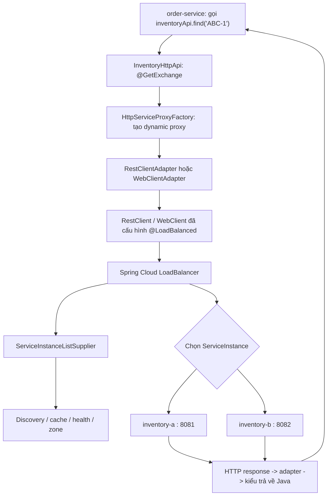

# HttpServiceProxyFactory và lớp adapter thực thi HTTP

## 1. Từ HTTP Interface đến một lời gọi thật

Trong chương **HTTP Interface** của module `SPRING_CLOUD_SERVICE_COMMUNICATION_LOAD_BALANCING`, chúng ta muốn `order-service` gọi `inventory-service` theo **service ID** thay vì viết lại mã `RestClient`/`WebClient` ở mọi nơi. Spring Framework cung cấp giao diện Java khai báo hợp đồng HTTP bằng `@HttpExchange`, `@GetExchange`, `@PostExchange` và các annotation tham số. `HttpServiceProxyFactory` tạo đối tượng proxy thực thi giao diện đó; **adapter HTTP** kết nối proxy với một client thật như `RestClient`, `WebClient` hoặc `RestTemplate`.

Cần phân biệt ba công việc:

1. **Giao diện HTTP** mô tả *gọi endpoint nào, tham số ở đâu và muốn nhận kiểu dữ liệu gì*.
2. **HttpServiceProxyFactory + adapter** chuyển phương thức Java thành HTTP exchange trên client nền.
3. **Spring Cloud LoadBalancer + discovery** quyết định *bản sao `ServiceInstance` nào* sẽ nhận exchange đó, nếu client nền đã được cấu hình cân bằng tải.

Vì thế, `HttpServiceProxyFactory` **không phải** thuật toán cân bằng tải, HTTP client hay service registry; bản thân `RestClientAdapter` cũng **không** tự tra service ID. Trong ứng dụng dùng Spring Cloud LoadBalancer, chính `RestClient`/`WebClient`/`RestTemplate` được cấu hình phù hợp mới chuyển `http://inventory-service/...` thành host/port của một instance cụ thể.

### Mục tiêu học tập

Sau bài này, bạn có thể:

- Tạo HTTP Interface cho `inventory-service` với `@HttpExchange` và các tham số đường dẫn, query, header, body.
- Xây proxy bằng `HttpServiceProxyFactory.builderFor(adapter).build().createClient(...)`.
- Phân biệt `HttpExchangeAdapter` (blocking) và `ReactorHttpExchangeAdapter` (reactive) cùng các kiểu trả về mà chúng hỗ trợ.
- Ghép `RestClientAdapter` hoặc `WebClientAdapter` với builder được `@LoadBalanced` để gọi theo service ID.
- Giải thích vì sao đổi adapter có thể đổi tính chất blocking/reactive, timeout, cách xử lý lỗi, tracing mà không đổi đường dẫn API.
- Nhận diện khác biệt giữa **tạo bean proxy thủ công** và **HTTP Service Client groups tự động** trong Spring Boot 4/Spring Cloud Commons 5.0+.
- Kiểm chứng lựa chọn instance, lỗi discovery/health check, HTTP 404/503, timeout và retry.

## 2. Sơ đồ kiến trúc: proxy không thay thế client thực



Sơ đồ là một chuỗi trách nhiệm **logic**. `HttpServiceProxyFactory` tạo proxy ở lúc khởi tạo bean, còn một phương thức blocking có thể thực hiện HTTP ngay khi được gọi; phương thức reactive thường tạo publisher để thực hiện exchange khi được subscribe. Tạo factory và bean proxy **không đồng nghĩa** đã có request mạng.

| Lớp | Đầu vào | Công việc | Không chịu trách nhiệm trực tiếp |
|---|---|---|---|
| `@HttpExchange` interface | Phương thức và annotation | Khai báo HTTP contract | Không chọn instance, không mở socket |
| `HttpServiceProxyFactory` | Interface + `HttpExchangeAdapter` | Tạo proxy và xử lý tham số/kiểu trả về | Không tự discovery, không tự retry |
| `RestClientAdapter` | `RestClient` | Chuyển exchange từ proxy sang client synchronous | Không tự biến hostname thành service ID |
| `WebClientAdapter` | `WebClient` | Chuyển exchange từ proxy sang client reactive | Không tự đảm bảo mọi lời gọi non-blocking nếu API trả kiểu sync |
| `RestTemplateAdapter` | `RestTemplate` | Hỗ trợ client blocking dựa trên RestTemplate | Không tự cân bằng tải nếu RestTemplate thiếu interceptor |
| `LoadBalancer` | service ID + danh sách `ServiceInstance` | Chọn instance theo chính sách | Không định nghĩa DTO/API contract |
| HTTP connector / request factory | URI thực, body, headers | Gửi request, quản lý kết nối và timeout transport | Không tự hiểu annotation HTTP Interface |

**Ví dụ sai thường gặp:** cấu hình một proxy từ `RestClient.create("http://inventory-service")` và kỳ vọng tên `inventory-service` luôn được Spring Cloud xử lý. Nếu client không mang interceptor LoadBalancer thì tên này có thể bị gửi thẳng tới DNS, dẫn đến lỗi `UnknownHostException`. Proxy được tạo thành công không chứng minh discovery đã hoạt động.

## 3. Định nghĩa giao diện HTTP có hợp đồng rõ ràng

Giả sử dịch vụ tồn kho có API:

| Method | Endpoint | Chức năng |
|---|---|---|
| `GET` | `/api/inventory/{sku}` | Lấy tồn kho một mã hàng |
| `GET` | `/api/inventory?onlyAvailable=true` | Lọc danh sách tồn kho |
| `POST` | `/api/inventory/reservations` | Đặt giữ một lượng hàng (phải bảo đảm idempotency) |

Dùng Java `record` làm DTO minh họa:

```java
public record InventorySnapshot(
        String sku, int available, String instanceId) {}

public record ReserveRequest(
        String sku, int quantity, String idempotencyKey) {}

public record ReservationResult(
        String reservationId, String status, String instanceId) {}
```

Định nghĩa giao diện synchronous, phù hợp `RestClientAdapter`:

```java
import java.util.List;
import org.springframework.web.bind.annotation.PathVariable;
import org.springframework.web.bind.annotation.RequestBody;
import org.springframework.web.bind.annotation.RequestHeader;
import org.springframework.web.bind.annotation.RequestParam;
import org.springframework.web.service.annotation.GetExchange;
import org.springframework.web.service.annotation.HttpExchange;
import org.springframework.web.service.annotation.PostExchange;

@HttpExchange(url = "/api/inventory", accept = "application/json")
public interface InventorySyncApi {

    @GetExchange("/{sku}")
    InventorySnapshot find(@PathVariable("sku") String sku);

    @GetExchange
    List<InventorySnapshot> list(
            @RequestParam("onlyAvailable") boolean onlyAvailable);

    @PostExchange("/reservations")
    ReservationResult reserve(
            @RequestHeader("Idempotency-Key") String key,
            @RequestBody ReserveRequest request);
}
```

Cách đọc:

- `@HttpExchange(url = "/api/inventory")` định nghĩa đường dẫn chung; nó được ghép với `baseUrl` của HTTP client nền.
- `@GetExchange("/{sku}")` định nghĩa `GET`, trong đó `@PathVariable` điền giá trị SKU vào URI.
- `@RequestParam` tạo query parameter, không phải JSON body.
- `@RequestHeader` thêm một header vào request cụ thể.
- `@RequestBody` cung cấp object cần serialize thành body; cấu hình JSON converter/codec đến từ client nền.
- `ReserveRequest.idempotencyKey` và header chỉ là hợp đồng ví dụ. **Chúng không tự tạo idempotency**: `inventory-service` phải lưu/đối chiếu khóa khi xử lý thao tác ghi.

Không đặt URL vật lý `http://localhost:8081` trong annotation nếu muốn LoadBalancer tự chọn instance; tên logic nên đặt ở `baseUrl` của client hoặc ở cấu hình group. Một interface có thể được tái sử dụng với nhiều base URL, nhưng phải thống nhất schema và version của API.

### 3.1. Các annotation và kiểu tham số thường gặp

| Cú pháp | Tác dụng | Lưu ý |
|---|---|---|
| `@HttpExchange` | Cấu hình chung HTTP interface | Có thể đặt ở type hoặc method |
| `@GetExchange`, `@PostExchange`, `@PutExchange`, `@PatchExchange`, `@DeleteExchange` | Khai báo HTTP method | Không tự thêm retry/transaction |
| `@PathVariable` | Thay biến trong URI template | Cần khớp tên biến và template |
| `@RequestParam` | Truyền query/form parameter theo content type | Phân biệt query và form-urlencoded |
| `@RequestHeader` | Truyền header | Không được tự nhét secret vào log |
| `@RequestBody` | Truyền object/publisher làm body | Codec/converter của client quyết định serialize |
| `@RequestPart` | Multipart body | Cần content type/codec phù hợp |
| `URI` là tham số phương thức | Chỉ định URI động | Có thể thay URL do annotation/base URL cung cấp; kiểm soát scheme/host |
| `@CookieValue` | Truyền cookie theo hợp đồng | Không đồng nghĩa tự bật sticky session |

Các cách biểu diễn tham số/giá trị trả về có thể khác nhau theo Spring Framework 6.x hay 7.x. Kiểm tra đúng tài liệu của phiên bản đã resolve, không suy diễn một annotation của MVC controller luôn hợp lệ cho HTTP service client.

## 4. HttpServiceProxyFactory tạo proxy như thế nào?

Một factory thường được xây dựng một lần trong cấu hình Spring. Bạn cung cấp **một adapter được tạo từ HTTP client đã cấu hình** và gọi `createClient`:

```java
RestClient restClient = RestClient.builder()
        .baseUrl("https://api.example.test")
        .build();

RestClientAdapter adapter = RestClientAdapter.create(restClient);

HttpServiceProxyFactory factory =
        HttpServiceProxyFactory.builderFor(adapter).build();

InventorySyncApi api = factory.createClient(InventorySyncApi.class);
```

Ví dụ trên chỉ minh họa API factory, **không thực hiện cân bằng tải** vì URL chỉ là một endpoint HTTPS và client chưa tích hợp LoadBalancer. Để gọi theo service ID, phải dùng builder có Spring Cloud LoadBalancer như phần kế tiếp.

Khi gọi `api.find("ABC-1")`, proxy:

1. Tìm metadata `@HttpExchange` và `@GetExchange` của phương thức.
2. Chuyển `@PathVariable` và các annotation khác thành thông tin request.
3. Yêu cầu adapter thực hiện exchange theo kiểu response cần nhận.
4. Dùng converter/codec của HTTP client nền để biến response body thành `InventorySnapshot`.
5. Trả giá trị hoặc phát exception từ tầng adapter/client nếu có lỗi.

`HttpServiceProxyFactory` là *factory của proxy*, không phải một connection pool hoặc một gateway mới. Cùng một interface được cài qua hai adapter có thể dùng hai HTTP stack hoàn toàn khác nhau.

### 4.1. Các lớp adapter chính

| Adapter | Lớp client nền | Abstraction | Kiểu trả về nên dùng | Tình huống sử dụng |
|---|---|---|---|---|
| `RestClientAdapter` | `RestClient` | `HttpExchangeAdapter` | DTO, `List<T>`, `ResponseEntity<T>`, `void` | Ứng dụng blocking/Servlet; API fluent |
| `RestTemplateAdapter` | `RestTemplate` | `HttpExchangeAdapter` | DTO, `ResponseEntity<T>`, `void` | Codebase đang dùng RestTemplate |
| `WebClientAdapter` | `WebClient` | `ReactorHttpExchangeAdapter` | `Mono<T>`, `Flux<T>` và biến thể reactive | Spring WebFlux/reactive pipeline |

`ReactorHttpExchangeAdapter` hỗ trợ thêm giá trị reactive ngoài các dạng synchronous; tuy nhiên nếu bạn khai báo kiểu trả về blocking trên `WebClientAdapter` thì proxy có thể phải chờ kết quả, không còn lợi ích end-to-end non-blocking. Tránh gọi phương thức trả DTO synchronous trong một tuyến xử lý WebFlux event-loop.

**Không dùng `RestClientAdapter` rồi khai báo `Mono<InventorySnapshot>` chỉ vì cùng interface có thể viết `Mono`**: adapter blocking không cung cấp cùng contract reactive của `WebClientAdapter`. Hãy thiết kế giao diện đúng theo cách thực thi.

## 5. Tạo proxy dùng RestClientAdapter và Spring Cloud LoadBalancer

Đây là hướng thực hành chính cho ứng dụng blocking. Cấu hình bean `RestClient.Builder` được `@LoadBalanced` rồi mới tạo adapter và proxy:

```java
import org.springframework.cloud.client.loadbalancer.LoadBalanced;
import org.springframework.context.annotation.Bean;
import org.springframework.context.annotation.Configuration;
import org.springframework.web.client.RestClient;
import org.springframework.web.client.support.RestClientAdapter;
import org.springframework.web.service.invoker.HttpServiceProxyFactory;

@Configuration(proxyBeanMethods = false)
class InventoryHttpClientConfiguration {

    @Bean
    @LoadBalanced
    RestClient.Builder loadBalancedRestClientBuilder() {
        return RestClient.builder();
    }

    @Bean
    InventorySyncApi inventorySyncApi(
            @LoadBalanced RestClient.Builder builder) {

        RestClient client = builder.clone()
                .baseUrl("http://inventory-service")
                .build();

        RestClientAdapter adapter = RestClientAdapter.create(client);

        return HttpServiceProxyFactory.builderFor(adapter)
                .build()
                .createClient(InventorySyncApi.class);
    }
}
```

**Tại sao trình tự này quan trọng?**

- `@LoadBalanced` trên bean `RestClient.Builder` cho phép Spring Cloud gắn cơ chế cân bằng tải lên client được build từ bean đó.
- `baseUrl("http://inventory-service")` chứa **service ID**; host logic được giải quyết tại request-time thông qua discovery và chính sách lựa chọn instance.
- `RestClientAdapter.create(client)` chỉ cầu nối proxy với RestClient đã tạo, không cần gọi registry.
- `HttpServiceProxyFactory.builderFor(adapter)` tạo factory, sau đó `createClient(InventorySyncApi.class)` trả bean proxy có thể inject ở nơi khác.
- `builder.clone()` tạo bản builder riêng cho client inventory, tránh thay đổi `baseUrl` của các client khác.

Ứng dụng cần Spring Web, `spring-cloud-starter-loadbalancer` và một `DiscoveryClient` hay nguồn instance tương đương. Mã trên dựa vào cách sử dụng API trong Spring Framework 6.2+/Spring Cloud Commons 4.3+; **hãy kiểm tra chính xác Release Train và import của project** nếu dùng một bản khác.

Đối với observability/tracing, Spring Boot thường cung cấp builder customizer riêng. Nếu tự tạo `RestClient.builder()` như ví dụ tối giản, hãy bảo đảm các customizer cần thiết được áp dụng theo phiên bản Boot; cách tạo builder tự quản lý có thể bỏ qua cấu hình auto-configured mong đợi.

### 5.1. Sử dụng bean proxy trong order-service

```java
import org.springframework.stereotype.Service;

@Service
class InventoryReader {
    private final InventorySyncApi inventory;

    InventoryReader(InventorySyncApi inventory) {
        this.inventory = inventory;
    }

    InventorySnapshot getStock(String sku) {
        return inventory.find(sku);
    }
}
```

Không cần biết `RestClient` hoặc `HttpServiceProxyFactory` ở lớp nghiệp vụ. Nếu `inventory-service` có ba replica, các lần gọi `find` có thể được LoadBalancer gửi tới các instance khác nhau; interface không cần thay đổi.

**Điểm kiểm tra:** trong một lời gọi blocking, HTTP request thực thi khi phương thức `inventory.find(...)` được gọi. Không giả định proxy sẽ gọi bất đồng bộ chỉ vì phía sau dùng Spring Cloud LoadBalancer có các abstraction reactive cho việc chọn instance.

## 6. Tạo proxy dùng WebClientAdapter để trả Mono hoặc Flux

Khi ứng dụng dùng WebFlux hoặc muốn pipeline non-blocking, khai báo một **giao diện reactive riêng** cho cùng HTTP contract:

```java
import reactor.core.publisher.Flux;
import reactor.core.publisher.Mono;
import org.springframework.web.bind.annotation.PathVariable;
import org.springframework.web.service.annotation.GetExchange;
import org.springframework.web.service.annotation.HttpExchange;

@HttpExchange(url = "/api/inventory", accept = "application/json")
public interface InventoryReactiveApi {

    @GetExchange("/{sku}")
    Mono<InventorySnapshot> find(@PathVariable("sku") String sku);

    @GetExchange
    Flux<InventorySnapshot> list();
}
```

Bean Spring Cloud cho WebClient:

```java
import org.springframework.cloud.client.loadbalancer.LoadBalanced;
import org.springframework.context.annotation.Bean;
import org.springframework.context.annotation.Configuration;
import org.springframework.web.reactive.function.client.WebClient;
import org.springframework.web.reactive.function.client.support.WebClientAdapter;
import org.springframework.web.service.invoker.HttpServiceProxyFactory;

@Configuration(proxyBeanMethods = false)
class InventoryReactiveHttpClientConfiguration {

    @Bean
    @LoadBalanced
    WebClient.Builder loadBalancedWebClientBuilder() {
        return WebClient.builder();
    }

    @Bean
    InventoryReactiveApi inventoryReactiveApi(
            @LoadBalanced WebClient.Builder builder) {

        WebClient client = builder.clone()
                .baseUrl("http://inventory-service")
                .build();

        WebClientAdapter adapter = WebClientAdapter.create(client);

        return HttpServiceProxyFactory.builderFor(adapter)
                .build()
                .createClient(InventoryReactiveApi.class);
    }
}
```

Đây là một **phương án thay thế** cho cấu hình blocking nếu ứng dụng chỉ cần một kiểu client; nếu dùng cả hai, phải cấu hình/inject rõ loại proxy. Khi sử dụng `WebClientAdapter`, một phương thức trả `Mono` hay `Flux` thông thường chưa gửi request lúc tạo publisher; exchange thực thi khi publisher được subscribe.

Trong controller WebFlux:

```java
@RestController
@RequestMapping("/demo/inventory")
class InventoryReactiveController {

    private final InventoryReactiveApi inventory;

    InventoryReactiveController(InventoryReactiveApi inventory) {
        this.inventory = inventory;
    }

    @GetMapping("/{sku}")
    Mono<InventorySnapshot> one(@PathVariable String sku) {
        return inventory.find(sku);
    }

    @GetMapping
    Flux<InventorySnapshot> all() {
        return inventory.list();
    }
}
```

Một `Flux<InventorySnapshot>` chứa nhiều phần tử từ **một response JSON array** vẫn thuộc một HTTP request đã chọn một instance. Nếu gọi `inventory.find(sku)` cho từng SKU trong `flatMap`, mỗi call/subscribe có thể tạo HTTP request riêng và chọn instance khác.

### 6.1. Tránh nhầm proxy reactive với “tự động phân tán từng phần tử”

```java
Flux<InventorySnapshot> oneHttpResponse = inventory.list();

Flux<InventorySnapshot> severalHttpRequests =
        Flux.fromIterable(List.of("ABC-1", "XYZ-2", "LMN-3"))
                .flatMap(inventory::find, 3);
```

Ví dụ thứ nhất gửi **một GET** nhận nhiều item; ví dụ thứ hai có **ba GET**, mỗi GET có thể chọn một instance. `WebClientAdapter` không tự biến danh sách trả về thành các request khác nhau.

## 7. RestTemplateAdapter: cầu nối với ứng dụng đã có RestTemplate

Spring Framework còn hỗ trợ `RestTemplateAdapter`. Nó hữu ích khi ứng dụng có sẵn `RestTemplate` được cấu hình request factory, interceptor, authentication và error handler.

Ví dụ **thay thế**, không dùng song song với hai bean `InventorySyncApi` trùng tên/kiểu ở mục 5:

```java
@Bean
InventorySyncApi inventorySyncApiFromRestTemplate(
        @LoadBalanced RestTemplate restTemplate) {

    // Tên service logic và path đã được đặt trong URI handler;
    // RestTemplate phải thực sự có interceptor LoadBalancer.
    restTemplate.setUriTemplateHandler(
            new DefaultUriBuilderFactory("http://inventory-service"));

    RestTemplateAdapter adapter =
            RestTemplateAdapter.create(restTemplate);

    return HttpServiceProxyFactory.builderFor(adapter)
            .build()
            .createClient(InventorySyncApi.class);
}
```

Để đoạn trên hoạt động đúng, phải có bean `@LoadBalanced RestTemplate` đã được Spring Cloud cấu hình. Chỉ tạo `new RestTemplate()` rồi gọi `RestTemplateAdapter.create(...)` **không** tích hợp service discovery. Vì thay đổi URI handler có thể ảnh hưởng mọi consumer cùng bean RestTemplate, nên trong project thật nên tạo bean client riêng cho proxy hoặc cấu hình handler ngay từ khi xây RestTemplate.

`RestTemplateAdapter` phù hợp với return type blocking. Khi ứng dụng mới không cần tương thích API cũ, `RestClientAdapter` thường tạo cấu hình dễ đọc hơn. `HttpServiceProxyFactory` cho phép giữ cách khai báo HTTP Interface, nhưng đổi lớp adapter không có nghĩa toàn bộ hành vi timeout, interceptor và converter tự động giống nhau.

## 8. Tương thích API/Release Train: manual factory khác auto-registration

**Không phải mọi Spring Boot/Spring Cloud Release Train đều có cùng cơ chế auto-registration.** Hai trường hợp cần tách rõ:

| Hệ sinh thái | Tạo bean HTTP Interface | Tích hợp LoadBalancer |
|---|---|---|
| Spring Framework 6.1/6.2 + Spring Boot 3.x + Spring Cloud Commons 4.x | Tạo thủ công từ `HttpServiceProxyFactory` như mục 5/6, hoặc registration riêng nếu ứng dụng tự làm | Tích hợp thủ công bằng `@LoadBalanced RestClient.Builder`/`WebClient.Builder` |
| Spring Framework 7.x + Spring Boot 4.x + Spring Cloud Commons 5.0+ | Có thêm `@ImportHttpServices` và **HTTP Service Client groups** của Spring Boot | Spring Cloud Commons 5.0+ có group configurer để tự gắn LoadBalancer theo điều kiện |

Cụ thể, Spring Cloud Commons **từ 5.0.0** hỗ trợ tích hợp LoadBalancer cho HTTP Service Client groups qua `LoadBalancerRestClientHttpServiceGroupConfigurer` và `LoadBalancerWebClientHttpServiceGroupConfigurer`. Cơ chế này liên quan đến bean auto-configuration của Spring Boot 4; **không sao chép phần nhóm tự động sang dự án Boot 3/Commons 4.x rồi kỳ vọng nó hoạt động**.

### 8.1. Ví dụ auto-registration trong Spring Boot 4/Spring Cloud 5

Với các phiên bản hỗ trợ, có thể đăng ký một HTTP Interface như sau:

```java
import org.springframework.boot.autoconfigure.SpringBootApplication;
import org.springframework.web.service.registry.ImportHttpServices;

@SpringBootApplication
@ImportHttpServices(
        group = "inventory-service",
        types = InventorySyncApi.class)
public class OrderApplication {
}
```

Khi nhóm tên `inventory-service` không có `base-url` được cấu hình, Spring Cloud Commons 5.0+ có thể tạo URL dựa trên **group name** như `http://inventory-service` và gắn interceptor/filter LoadBalancer tương ứng vào client của nhóm.

Có thể viết rõ cơ chế cân bằng tải bằng URL có scheme `lb`:

```yaml
spring:
  http:
    serviceclient:
      inventory-service:
        base-url: "lb://inventory-service"
        connect-timeout: 1s
        read-timeout: 2s
```

Với tích hợp Spring Cloud Commons 5.0+, scheme `lb` được dùng để kích hoạt cơ chế LoadBalancer cho nhóm; scheme HTTP ban đầu được chọn cho request và có thể chuyển HTTPS nếu instance được chọn khai báo secure. Nhóm phải được cấu hình với các module Spring Boot/Spring Cloud phù hợp, discovery phải có `ServiceInstance` và HTTP client của nhóm phải được tạo thành công.

**Bẫy rất quan trọng:** chỉ điền

```yaml
spring:
  http:
    serviceclient:
      inventory-service:
        base-url: "http://inventory-service"
```

vào **HTTP Service Client group tự động** không tương đương `lb://inventory-service`. Theo tài liệu Spring Cloud Commons 5.0, nếu `base-url` đã được đặt và có scheme **khác `lb`**, group configurer **không tự gắn** LoadBalancer. Đây là điểm khác với trường hợp **manual** ở mục 5, nơi bạn chủ động tạo client đã `@LoadBalanced` và dùng `http://inventory-service` làm `baseUrl`. Đừng trộn hai cơ chế rồi suy luận chung rằng URL có hostname service ID lúc nào cũng sẽ được cân bằng tải.

Lựa chọn adapter blocking/reactive của **group** phải khớp với HTTP Service API và cấu hình auto-configuration mà Spring Boot của dự án hỗ trợ. Nếu dùng return type `Mono`/`Flux`, kiểm tra group được xây với `WebClient`/adapter reactive; không mặc định annotation `@ImportHttpServices` tự đổi mọi return type blocking sang reactive.

### 8.2. Không đăng ký trùng proxy

Trong một ứng dụng, nếu đã dùng `@ImportHttpServices` để Spring Boot tạo bean `InventorySyncApi` thì không đồng thời tạo một bean thủ công cùng type/tên mà không có qualifier rõ ràng. Lỗi thường là `NoUniqueBeanDefinitionException` hoặc ứng dụng vô tình dùng proxy không có LoadBalancer. Chọn **manual factory** hoặc **group registration** làm đường chính cho mỗi interface.

## 9. Kiểu trả về do adapter quyết định

| Kết quả mong muốn | RestClientAdapter / RestTemplateAdapter | WebClientAdapter |
|---|---|---|
| Không cần body | `void` | `Mono<Void>` hoặc `void` |
| Một JSON object | `InventorySnapshot` | `Mono<InventorySnapshot>` hoặc kiểu synchronous |
| Danh sách JSON | `List<InventorySnapshot>` | `Flux<InventorySnapshot>` hoặc `Mono<List<InventorySnapshot>>` khi contract tương thích |
| Status + headers + body | `ResponseEntity<InventorySnapshot>` | `Mono<ResponseEntity<InventorySnapshot>>` |
| Chỉ headers | `HttpHeaders` | `Mono<HttpHeaders>` |
| Stream dữ liệu | API blocking phù hợp loại response/transport | `Flux<T>`, tùy codec và format streaming |

Với `RestClientAdapter` và `RestTemplateAdapter`, `HttpExchangeAdapter` phục vụ cách gọi synchronous, không phải Reactor pipeline. Với `WebClientAdapter`, `ReactorHttpExchangeAdapter` hỗ trợ cả kiểu reactive và một số kiểu synchronous nhưng **không nên block trong event loop WebFlux**.

**Return type không quyết định thuật toán chọn instance:** Spring Cloud LoadBalancer chọn đích cho HTTP request. Một phương thức `List<T> list()` cũng chỉ gửi một request nếu endpoint trả một array; không gửi một request cho mỗi phần tử. Một phương thức `Mono<T> find()` có thể thực hiện lại request khi publisher được subscribe nhiều lần nếu chưa cache/chia sẻ tín hiệu.

## 10. Lỗi, timeout và retry nằm ở lớp nào?

### 10.1. Phân loại lỗi theo tầng

| Triệu chứng | Nguồn khả dĩ | Cách xác minh |
|---|---|---|
| Proxy không được tạo/bean không tìm thấy | Chưa gọi `createClient` hoặc chưa `@ImportHttpServices` đúng version | Kiểm tra cấu hình bean, interface scanning và startup exception |
| `UnknownHostException: inventory-service` | HTTP client nền không được LoadBalancer xử lý; gọi DNS host trực tiếp | Kiểm tra `@LoadBalanced`/LB filter hoặc scheme `lb` ở group |
| Không có instance để chọn | Discovery rỗng, tên service ID sai, supplier lọc hết | Kiểm tra registry, supplier, health/zone/hint và event lựa chọn |
| Đã chọn instance nhưng connection refused/timeout | Instance chết, host/port sai hoặc network chậm | Đối chiếu instance ID, transport exception, DNS/network |
| Downstream trả HTTP 404 | Sai endpoint/SKU không tồn tại theo API | Phân biệt status với lỗi discovery |
| Downstream trả HTTP 503 | Server thực sự báo unavailable | Xem log server, trace và metric selection |
| Reactive LB tạo HTTP 503 khi không có instance | Không gửi HTTP tới server | Dùng LoadBalancer lifecycle/metric discard để xác định |
| Đọc body không đúng kiểu | JSON/schema/codec/converter sai | Kiểm tra Content-Type, DTO và stack trace decode |
| Mỗi request được gửi nhiều lần | Retry ở nhiều lớp, nhiều subscriptions | Đếm HTTP attempts riêng với logical requests |

Với `RestClientAdapter`, RestClient mặc định ném exception thuộc `RestClientException` khi `retrieve` gặp 4xx/5xx; loại cụ thể phụ thuộc status và cấu hình handler. Với `WebClientAdapter`, 4xx/5xx mặc định thành `WebClientResponseException` trong publisher. HTTP Interface **không tự chuẩn hóa** hai họ exception này thành một loại đồng nhất.

Lỗi “không có instance” thường được phát sinh trước khi kết nối downstream. Trong triển khai blocking, `BlockingLoadBalancerClient` có thể ném `IllegalStateException`; với reactive LoadBalancer filter có thể là một response lỗi 503 tổng hợp. Cần kiểm tra đúng Release Train và không kết luận mọi 503 đều do server thực trả.

### 10.2. Tùy biến error handling ở HTTP client nền

Ví dụ `RestClient` có status handler:

```java
RestClient client = loadBalancedBuilder.clone()
        .baseUrl("http://inventory-service")
        .defaultStatusHandler(
                status -> status.value() == 503,
                (request, response) -> {
                    throw new IllegalStateException(
                            "inventory-service trả HTTP 503");
                })
        .build();

InventorySyncApi api = HttpServiceProxyFactory
        .builderFor(RestClientAdapter.create(client))
        .build()
        .createClient(InventorySyncApi.class);
```

`loadBalancedBuilder` ở trên là `@LoadBalanced RestClient.Builder` có sẵn. Handler xử lý **HTTP response đã nhận**; nó không trực tiếp xử lý tất cả lỗi kết nối, timeout hoặc lỗi khởi tạo proxy. Trong ứng dụng thực tế, dùng exception domain riêng có nguyên nhân gốc và gắn correlation ID; không dùng `IllegalStateException` chung cho nhiều nguyên nhân như ví dụ ngắn.

Ở `WebClient`, xử lý response bằng `defaultStatusHandler` của WebClient builder hoặc `onErrorResume`/`onErrorMap` tại pipeline theo loại lỗi. Không nên tạo một fallback trả `available=0` cho mọi lỗi: “hết hàng” khác “không xác định tồn kho vì dependency lỗi”.

### 10.3. Timeout được cài ở transport, không phải factory

- **Connect/read/response timeout:** cấu hình ở RestClient request factory hoặc WebClient connector; chúng liên quan việc trao đổi HTTP thật với instance được chọn.
- **Reactive timeout:** có thể thêm `.timeout(Duration)` trên `Mono`/`Flux` với semantics phù hợp; tránh hiểu timeout giữa các tín hiệu stream là deadline toàn stream.
- **Discovery timeout/cache:** là cơ chế khác của LoadBalancer/discovery; không thay bằng timeout HTTP.
- **Factory:** `HttpServiceProxyFactory` không tự cung cấp chính sách HTTP timeout tổng quát tương đương các transport trên.

Nếu dùng `WebClientAdapter` với phương thức trả kiểu sync, một số version có thể hỗ trợ cấu hình `blockTimeout` ở adapter. Dù vậy, Spring Framework khuyến nghị dựa vào timeout ở HTTP client/transport để kiểm soát đầy đủ; không dùng kỹ thuật blocking trong luồng event-loop.

### 10.4. Retry cần tính tổng số attempts

`HttpServiceProxyFactory` không tự tạo retry. Retry có thể nằm ở:

1. Spring Cloud LoadBalancer (`spring.cloud.loadbalancer.retry.*`, tùy blocking/reactive và dependency).
2. Spring Retry hoặc Reactor `retryWhen` ở tầng caller.
3. Circuit breaker/resilience library hoặc gateway.
4. HTTP client riêng nếu được cấu hình có khả năng thử lại.

Trong lab, hãy tắt retry trước để đo đúng một request đến một instance. Sau đó bật **một** chiến lược retry có giới hạn cho GET idempotent và ghi lại từng attempt/instance được chọn. Không retry tùy tiện POST giữ hàng/thanh toán khi chưa có idempotency key và xử lý yêu cầu trùng lặp ở downstream.

## 11. Thực hành end-to-end: proxy qua service ID

### 11.1. Topology

| Thành phần | Cấu hình | Mục đích |
|---|---|---|
| `order-service` | Spring Boot, Spring Cloud LoadBalancer, HTTP interface proxy | Caller |
| `inventory-a` | `inventory-service`, cổng 8081 | Replica A |
| `inventory-b` | `inventory-service`, cổng 8082 | Replica B |
| Discovery | `SimpleDiscoveryClient` với hai URI cố định trong lab, hoặc registry thực | Cung cấp danh sách instance |

Ví dụ `application.yml` của `order-service` cho **phương án manual factory**:

```yaml
spring:
  application:
    name: order-service
  cloud:
    discovery:
      client:
        simple:
          instances:
            inventory-service:
              - uri: http://localhost:8081
                instance-id: inventory-a
              - uri: http://localhost:8082
                instance-id: inventory-b
    loadbalancer:
      retry:
        enabled: false

server:
  port: 8080
```

Không áp đồng thời phần `spring.http.serviceclient...` của phương án group ở mục 8 nếu đang kiểm chứng manual factory; giữ mỗi lượt thí nghiệm chỉ một cơ chế registration để tránh khó phân biệt nguồn cấu hình. Cổng `localhost` chỉ hợp lý khi các tiến trình cùng network namespace.

### 11.2. Server trả instanceId

Mỗi `inventory-service` có controller theo API contract, trả `instanceId` riêng:

```java
@RestController
@RequestMapping("/api/inventory")
class InventoryController {

    private final String instanceId;

    InventoryController(Environment env) {
        this.instanceId = env.getRequiredProperty("app.instance-id");
    }

    @GetMapping("/{sku}")
    InventorySnapshot find(@PathVariable String sku) {
        return new InventorySnapshot(sku, 12, instanceId);
    }

    @GetMapping
    List<InventorySnapshot> list(
            @RequestParam(defaultValue = "false")
            boolean onlyAvailable) {
        return List.of(
                new InventorySnapshot("ABC-1", 12, instanceId),
                new InventorySnapshot("XYZ-2", 5, instanceId));
    }
}
```

Ở instance A đặt `app.instance-id=inventory-a`, `server.port=8081`; instance B đặt `app.instance-id=inventory-b`, `server.port=8082`. Bài lab chỉ sử dụng `GET` để tránh tác động của các lần thử lại lên giao dịch. Với `@GetExchange` `list(...)` ở interface, truyền query `onlyAvailable` và kiểm tra JSON array server trả về.

### 11.3. Controller gọi bean proxy

Ví dụ cho **manual RestClientAdapter** ở mục 5:

```java
@RestController
@RequestMapping("/demo/inventory")
class InventoryDemoController {

    private final InventorySyncApi inventory;

    InventoryDemoController(InventorySyncApi inventory) {
        this.inventory = inventory;
    }

    @GetMapping("/{sku}")
    InventorySnapshot one(@PathVariable String sku) {
        return inventory.find(sku);
    }

    @GetMapping
    List<InventorySnapshot> all() {
        return inventory.list(false);
    }
}
```

Chạy hai instance inventory và `order-service`, rồi gửi request:

```bash
curl -i http://localhost:8080/demo/inventory/ABC-1
curl -i http://localhost:8080/demo/inventory/ABC-1
curl -i http://localhost:8080/demo/inventory/ABC-1
curl -i http://localhost:8080/demo/inventory
```

Nếu Round Robin hoạt động với hai instance có danh sách ổn định và không có request khác, `instanceId` trên các request có thể luân phiên. Trong **một** response list, các object mang cùng `instanceId` vì một HTTP GET đã được xử lý bởi một instance. Điều này không phụ thuộc proxy trả `List` hay `Flux`.

### 11.4. Bộ kiểm thử tình huống lỗi

| Thử nghiệm | Điều chỉnh | Kết quả cần kiểm tra |
|---|---|---|
| Service ID sai | Đổi base URL sang `http://inventroy-service`, không có registration | Không tìm thấy instance, không có HTTP request tại inventory |
| Thiếu interceptor/filter | Xây RestClient/WebClient không từ builder `@LoadBalanced` | Có thể bị DNS resolve hostname logic rồi lỗi |
| Một instance chết | Để URI cũ trong SimpleDiscoveryClient nhưng dừng cổng 8081 | Có request lỗi kết nối khi chọn A; không tự bị loại nếu chưa có health supplier |
| Service registry trả danh sách rỗng | Loại cả A và B khỏi discovery rồi restart caller nếu dùng cấu hình tĩnh | Nhánh no-instance, khác HTTP 503 thật từ server |
| Server trả HTTP 404 | Tạo SKU không tồn tại theo hợp đồng | Exception/status tương ứng client; không tự quy thành lỗi discovery |
| Server trả HTTP 503 | Chủ động trả status 503 tại endpoint | Có log nhận request ở server; khác 503 tổng hợp của reactive LB |
| JSON body khác contract | Đổi field/type ở server | Lỗi decode/binding; không được ghi là no-instance |
| Chuyển sang WebClientAdapter | Dùng `InventoryReactiveApi` và controller trả publisher | Mỗi GET được chọn instance khi subscribe; không chặn event-loop |
| Thay Runbook sang Boot4/Cloud5 group | Dùng `@ImportHttpServices`, bỏ manual bean | Xác nhận bean duy nhất, group name/base URL/scheme đúng và được LB intercept |

### 11.5. Phân biệt “proxy tạo được” và “request đã tới server”

Hãy log ở ba nơi:

- **Factory/bean creation:** đã tạo được proxy `InventorySyncApi` hay `InventoryReactiveApi` chưa?
- **LoadBalancer tại caller:** service ID, instance list, instance được chọn, lỗi thiếu instance, thời gian chờ discovery.
- **inventory-service:** instance ID thực nhận request, HTTP status/latency.

Proxy được tạo thành công khi start **không** chứng minh registry có instance, endpoint tồn tại hoặc TLS/cookie/auth hợp lệ. Việc gọi interface phải được kiểm chứng bằng HTTP response và log/trace thực tế.

## 12. Các lỗi kiến trúc thường gặp

| Sai lầm | Vì sao không đúng | Cách khắc phục |
|---|---|---|
| Cho rằng `HttpServiceProxyFactory` tự discovery | Factory chỉ tạo proxy từ adapter | Cấu hình LoadBalancer ở client nền hoặc Boot4/Cloud5 group |
| Tạo `RestClientAdapter` từ client thường rồi gọi service ID | Host logic có thể bị DNS resolve trực tiếp | Dùng `@LoadBalanced RestClient.Builder` và tạo client từ builder đó |
| Trộn `@ImportHttpServices` và bean factory tự tạo cho cùng interface | Có thể tạo hai proxy xung đột | Chọn một cơ chế hoặc qualifier rõ |
| Ở Boot4/Cloud5 group đặt `base-url: http://inventory-service` và chờ auto LB | Tích hợp group chỉ auto khi URL null hoặc scheme `lb` | Bỏ base URL hoặc dùng `lb://inventory-service` |
| Khai báo `Mono<T>` cho `RestClientAdapter` | Blocking adapter không cung cấp contract Reactor tương ứng | Dùng `WebClientAdapter` và reactive interface |
| Dùng `WebClientAdapter` nhưng trả DTO sync trên event loop | Có thể tạo hành vi blocking trong đường reactive | Trả `Mono`/`Flux`; để WebFlux subscribe |
| Đặt timeout vào factory và nghĩ đã kiểm soát network | Factory không sở hữu socket/pool | Cấu hình transport và deadline |
| Coi HTTP 503 nào cũng do server inventory | Reactive LoadBalancer có thể tạo 503 khi thiếu instance | Xem log server, supplier, lifecycle/metric discard |
| Retry POST không có idempotency | Có thể tạo đặt giữ hàng trùng | Thiết kế idempotency trước, giới hạn retries |
| Đổi client nhưng quên observability | Builder tự tạo có thể thiếu Boot customizer | Dùng builder/configurer phù hợp version |
| Dùng đường dẫn tuyệt đối trong annotation | Có thể bỏ qua base URL logic | Giữ path tương đối và base URL do client/group quản lý |

## 13. Checklist hoàn thành và bài tập mở rộng

### Checklist

- [ ] Đã ghi Spring Boot, Spring Framework và Spring Cloud Commons/LoadBalancer version đã resolve.
- [ ] Đã tạo interface `@HttpExchange` với đúng method/path, `@PathVariable`, `@RequestParam`, headers/body và return type.
- [ ] Hiểu `HttpServiceProxyFactory` tạo proxy, không tạo network client hay discovery.
- [ ] Biết `RestClientAdapter`/`RestTemplateAdapter` là blocking, `WebClientAdapter` hỗ trợ reactive.
- [ ] Đã cấu hình client nền bằng `@LoadBalanced` hoặc đúng group configurer theo version.
- [ ] URI logic có service ID; danh sách `ServiceInstance` thực sự có instance.
- [ ] Đã xác nhận `createClient` hoặc `@ImportHttpServices` tạo đúng một bean proxy mong muốn.
- [ ] Đã thử HTTP 200, 404, 503, no-instance, instance chết, timeout và decode error.
- [ ] Timeout/retry và authentication/tracing được cấu hình ở đúng lớp, có giới hạn và được kiểm chứng.
- [ ] Không chặn WebFlux event loop; không retry thao tác ghi nếu chưa có idempotency.
- [ ] Đã theo dõi số HTTP attempts, instance ID được chọn và log phía server.

### Bài 1 — Cùng interface, hai client nền

Dựng `InventorySyncApi` với `RestClientAdapter` và phiên bản khác dùng `RestTemplateAdapter`. Giữ nguyên URL/path và test hai instance. So sánh exception, timeout request factory và khả năng mang theo interceptor/metric. **Không** đăng ký hai bean cùng type vào một injection point nếu chưa có qualifier.

### Bài 2 — Từ blocking sang reactive

Tạo `InventoryReactiveApi` với `WebClientAdapter`, controller trả `Mono<InventorySnapshot>`. Gọi 20 GET và thống kê `instanceId`. Sau đó gọi danh sách `Flux<InventorySnapshot>` và giải thích vì sao tất cả item từ một GET có cùng instance ID.

### Bài 3 — Tắt LoadBalancer có kiểm soát

Trong môi trường lab, tạo một `RestClient` không có `@LoadBalanced` rồi cấp cho `RestClientAdapter`. Gọi `http://inventory-service` khi DNS không định nghĩa hostname đó. Ghi stack trace và so sánh với lỗi no-instance khi LoadBalancer có mặt nhưng danh sách discovery rỗng.

### Bài 4 — Group auto-configuration chỉ trên Boot4/Cloud5

Tạo một ứng dụng với `@ImportHttpServices(group="inventory-service", types=InventorySyncApi.class)`. Thử hai cấu hình: không đặt `base-url`; đặt `base-url: lb://inventory-service`. Kiểm tra đều được LoadBalancer xử lý. Sau đó thử `base-url: http://inventory-service` và quan sát sự khác biệt theo tài liệu 5.0+, tránh lẫn với cấu hình manual `@LoadBalanced`.

### Bài 5 — Lỗi và resilience

Mô phỏng một replica bị dừng nhưng còn trong registry; lần lượt thử không retry và retry GET một lần. Đếm request/attempt, xác nhận không có instance mới do factory tự tạo và timeout được thực hiện bởi HTTP transport. Nếu thử POST, chỉ thực hiện khi server hỗ trợ idempotency key.

## 14. Nguồn tham khảo

- [Spring Framework 6.2 — HTTP Interface và REST Clients](https://docs.spring.io/spring-framework/reference/6.2/integration/rest-clients.html): `@HttpExchange`, `HttpServiceProxyFactory.builderFor(...)`, `RestClientAdapter`, `WebClientAdapter`, `RestTemplateAdapter`, tham số và return values.
- [Spring Framework — REST Clients hiện hành](https://docs.spring.io/spring-framework/reference/integration/rest-clients.html): cập nhật API/registration và so sánh thay đổi qua các phiên bản Framework.
- [Spring Cloud Commons 4.3 — Common Abstractions](https://docs.spring.io/spring-cloud-commons/reference/4.3/spring-cloud-commons/common-abstractions.html): `@LoadBalanced RestClient.Builder` và `@LoadBalanced WebClient.Builder`.
- [Spring Cloud Commons 4.3 — LoadBalancer](https://docs.spring.io/spring-cloud-commons/reference/4.3/spring-cloud-commons/loadbalancer.html): service ID, danh sách instance, supplier, health, retry và chính sách chọn đích.
- [Spring Cloud Commons 5.0 — LoadBalancer](https://docs.spring.io/spring-cloud-commons/reference/spring-cloud-commons/loadbalancer.html): phần **LoadBalancer Integration for Spring HTTP Service Clients AutoConfiguration** (xác nhận trang hiển thị Commons 5.0 trước khi dùng).
- [Spring Boot 4.0 — Calling REST Services](https://docs.spring.io/spring-boot/4.0/reference/io/rest-client.html): `@ImportHttpServices`, HTTP Service Client groups, cấu hình group base URL và timeout.
- [Spring Cloud — Release Train](https://spring.io/projects/spring-cloud/): kiểm tra tương thích Spring Boot/Spring Cloud trước khi lấy code của nhánh khác.

**Kết luận:** `HttpServiceProxyFactory` tạo một **API Java có thể gọi được** từ giao diện HTTP; `RestClientAdapter`, `WebClientAdapter` hoặc `RestTemplateAdapter` quyết định **cách thực thi HTTP**. Để giao tiếp theo service ID với nhiều bản sao, HTTP client nền phải được **Spring Cloud LoadBalancer** tích hợp đúng cách. Giữ riêng ba tầng **contract – adapter – load balancing** giúp thay HTTP stack, áp retry/timeout và theo dõi lỗi mà không đánh đồng chúng với nhau.
