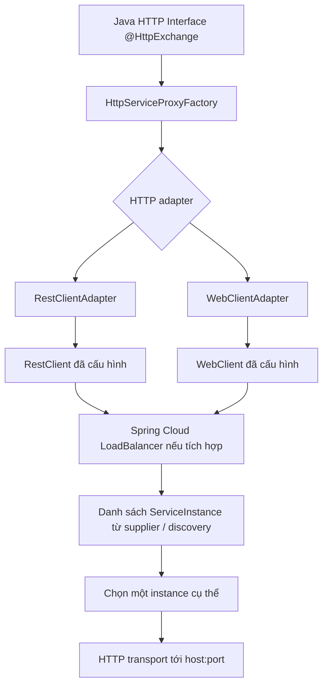

# Kết nối interface với RestClient hoặc WebClient đã cấu hình

**HTTP Interface** của Spring Framework cho phép mô tả một HTTP API dưới dạng interface Java, sau đó tạo proxy gửi request qua một HTTP client đã cấu hình. Trong hệ thống dùng Spring Cloud LoadBalancer, kỹ thuật này giúp tách **hợp đồng API** khỏi **cách lựa chọn bản sao, cấu hình kết nối, timeout, header và xử lý lỗi**.

Ví dụ, `order-service` gọi `inventory-service` để tra tồn kho. Thay vì để mã nghiệp vụ trực tiếp gọi `RestClient.get().uri(...)` hoặc `WebClient.get().uri(...)`, ta khai báo một interface có `@HttpExchange` và `@GetExchange`. Sau đó sử dụng `HttpServiceProxyFactory` với `RestClientAdapter` hoặc `WebClientAdapter`, tùy nhu cầu đồng bộ hay reactive.

**Mục tiêu học tập:** biết tạo và cấu hình proxy HTTP Interface, gắn đúng `RestClient`/`WebClient` có LoadBalancer, hiểu thời điểm chọn `ServiceInstance` theo service ID và phân biệt lỗi contract, discovery, network và nghiệp vụ. Đây là kiến thức nền của module `SPRING_CLOUD_SERVICE_COMMUNICATION_LOAD_BALANCING`, hướng tới giao tiếp giữa dịch vụ ổn định với timeout, retry và khả năng quan sát phù hợp.

## 1. Tách hợp đồng HTTP khỏi hạ tầng thực thi

Một HTTP Interface mô tả **điều gì cần gọi**, chứ không chỉ định **dùng transport nào**. Ví dụ cùng một API đọc tồn kho:

```http
GET /api/stocks/BOOK-001 HTTP/1.1
Host: inventory-service
Accept: application/json
```

Response giả định:

```http
HTTP/1.1 200 OK
Content-Type: application/json

{
  "sku": "BOOK-001",
  "availableQuantity": 12
}
```

Với HTTP Interface, mapping method và path nằm trong interface. Nhưng proxy muốn thực thi được cần một **adapter** nối tới HTTP client cụ thể.

| Thành phần | Vai trò | Điều không tự làm |
| --- | --- | --- |
| `@HttpExchange` / `@GetExchange` | Mô tả HTTP method, URL, headers và binding tham số | Không tự gửi request |
| `HttpServiceProxyFactory` | Tạo proxy Java của interface | Không tạo service registry |
| `RestClientAdapter` | Nối proxy với `RestClient` đồng bộ | Không tự bật LoadBalancer |
| `WebClientAdapter` | Nối proxy với `WebClient` reactive | Không tự bật LoadBalancer |
| `@LoadBalanced` builder | Cho phép Spring Cloud tùy biến HTTP client để dùng service ID | Không tự tạo instance đích |
| `ServiceInstanceListSupplier` và LoadBalancer | Cung cấp danh sách rồi chọn `ServiceInstance` | Không tự giải mã JSON của API |

Điểm quan trọng là **interface không quyết định bản sao được gọi**. Quyết định đó thuộc HTTP client **đã được tích hợp** Spring Cloud LoadBalancer, kết hợp nguồn instance và chính sách lựa chọn của module.

## 2. Kiến trúc: cùng contract, hai adapter khác nhau



Trong sơ đồ, `RestClient` và `WebClient` là **hai cách kết nối thay thế nhau**, không phải một request đi qua cả hai adapter. Cùng loại contract API có thể được biểu diễn thành hai interface, nhưng **kiểu trả về** sẽ khác nhau: cách gọi đồng bộ thường trả DTO hoặc `ResponseEntity`; cách gọi reactive có thể trả `Mono<DTO>` hoặc `Flux<DTO>`.

Một lưu ý quan trọng: tạo proxy từ `RestClientAdapter.create(restClient)` chỉ sử dụng **chính đối tượng RestClient được truyền vào**. Nếu đối tượng này không được build từ builder có LoadBalancer, `HttpServiceProxyFactory` sẽ không tự bổ sung LoadBalancer chỉ vì interface gọi host có tên `inventory-service`.

## 3. Khai báo HTTP contract dùng annotation của Spring Framework

Ta bắt đầu bằng interface đồng bộ:

```java
package com.example.order.clients;

import org.springframework.web.bind.annotation.PathVariable;
import org.springframework.web.service.annotation.GetExchange;
import org.springframework.web.service.annotation.HttpExchange;

@HttpExchange(url = "/api/stocks", accept = "application/json")
public interface InventorySyncApi {

    @GetExchange("/{sku}")
    StockResponse getStock(@PathVariable("sku") String sku);
}
```

DTO ở phía gọi:

```java
package com.example.order.clients;

public record StockResponse(String sku, int availableQuantity) {}
```

Các annotation thể hiện:

- `@HttpExchange(url = "/api/stocks")`: path chung ở cấp interface.
- `@GetExchange("/{sku}")`: HTTP GET cho path bổ sung.
- `@PathVariable("sku")`: lấy tham số Java chèn vào path template.
- `accept = "application/json"`: khai báo media type mong muốn cho response.

Kết hợp với base URL `http://inventory-service` của HTTP client, URI logic là:

```text
http://inventory-service/api/stocks/BOOK-001
```

Spring Framework còn có `@PostExchange`, `@PutExchange`, `@PatchExchange`, `@DeleteExchange` và các annotation binding phù hợp như `@RequestParam`, `@RequestHeader`, `@RequestBody`. Chúng mô tả contract; việc xác thực, cho phép truy cập, versioning và quy tắc nghiệp vụ vẫn phải được thiết kế riêng.

### 3.1. Tại sao không đặt địa chỉ instance ở interface?

Không nên viết:

```java
@HttpExchange(url = "http://10.0.1.11:8080/api/stocks")
interface HardCodedInventoryApi {
    @GetExchange("/{sku}")
    StockResponse getStock(@PathVariable("sku") String sku);
}
```

Ví dụ trên gắn contract với **một IP cụ thể**. Nó làm giảm khả năng thay thế instance, triển khai thêm bản sao và cân bằng tải theo service ID. Ưu tiên giữ path tại interface và để HTTP client đã cấu hình nắm **base URL logic**.

Ngoại lệ hợp lý có thể là những client chuyên dụng gọi một endpoint cố định để kiểm thử hoặc quản trị, nhưng không nên trộn chúng với client được kỳ vọng dùng discovery và Spring Cloud LoadBalancer.

## 4. Dependency và điều kiện cần

Đối với cách triển khai `RestClient` hoặc `WebClient` dùng HTTP Interface, cần Spring Framework có các API tương ứng; trong dự án Spring Boot thường sử dụng dependency:

```xml
<!-- RestClient và các API HTTP client đồng bộ -->
<dependency>
    <groupId>org.springframework.boot</groupId>
    <artifactId>spring-boot-starter-web</artifactId>
</dependency>

<!-- WebClient cho phương án reactive -->
<dependency>
    <groupId>org.springframework.boot</groupId>
    <artifactId>spring-boot-starter-webflux</artifactId>
</dependency>

<!-- Client-side load balancing -->
<dependency>
    <groupId>org.springframework.cloud</groupId>
    <artifactId>spring-cloud-starter-loadbalancer</artifactId>
</dependency>
```

Chỉ thêm những starter phù hợp với cách sử dụng trong ứng dụng; không nhất thiết cần cả `spring-boot-starter-web` và `spring-boot-starter-webflux` chỉ để sử dụng HTTP Interface. Phiên bản Spring Boot/Spring Cloud nên được quản lý bằng BOM tương thích. Ví dụ trong bài sử dụng các API HTTP Interface có từ Spring Framework 6.x và cách xây proxy qua `HttpServiceProxyFactory.builderFor(...)` trong các phiên bản có hỗ trợ phương thức này.

Ngoài thư viện, cần **nguồn instance** của `inventory-service` nếu gọi qua service ID. Đó có thể là discovery client (Eureka, Consul, ...) hoặc danh sách instance tĩnh phục vụ môi trường thử nghiệm. LoadBalancer không thể tự chọn replica nếu supplier không cung cấp ứng viên.

## 5. Kết nối HTTP Interface với RestClient đồng bộ

Đường đi gồm bốn bước:

1. Đăng ký `RestClient.Builder` có `@LoadBalanced`.
2. Sử dụng builder đó để tạo `RestClient` với base URL logic.
3. Dùng `RestClientAdapter` tạo HTTP adapter.
4. Dùng `HttpServiceProxyFactory` sinh implementation của interface.

Ví dụ cấu hình đầy đủ ở phía `order-service`:

```java
package com.example.order.config;

import com.example.order.clients.InventorySyncApi;
import org.springframework.cloud.client.loadbalancer.LoadBalanced;
import org.springframework.context.annotation.Bean;
import org.springframework.context.annotation.Configuration;
import org.springframework.web.client.RestClient;
import org.springframework.web.client.support.RestClientAdapter;
import org.springframework.web.service.invoker.HttpServiceProxyFactory;

@Configuration
class InventorySyncClientConfig {

    @Bean
    @LoadBalanced
    RestClient.Builder loadBalancedRestClientBuilder() {
        return RestClient.builder();
    }

    @Bean
    InventorySyncApi inventorySyncApi(
            @LoadBalanced RestClient.Builder builder) {

        RestClient restClient = builder
                .baseUrl("http://inventory-service")
                .build();

        HttpServiceProxyFactory proxyFactory =
                HttpServiceProxyFactory
                        .builderFor(RestClientAdapter.create(restClient))
                        .build();

        return proxyFactory.createClient(InventorySyncApi.class);
    }
}
```

Khi `InventorySyncApi.getStock("BOOK-001")` được gọi, proxy dùng contract trong interface để tạo lời gọi HTTP. Đối tượng `RestClient` có trách nhiệm thực hiện lời gọi; việc lựa chọn instance dựa vào cấu hình LoadBalancer trên builder.

**Lưu ý wiring:** `@LoadBalanced` ở đây áp dụng cho **bean builder** và điểm inject, không áp dụng cho `InventorySyncApi`. Nếu trong ứng dụng có nhiều `RestClient.Builder`, cần phân biệt builder thông thường và builder load-balanced bằng qualifier/bean name nhất quán. Không nên tạo `RestClient.create()` ở nơi khác rồi truyền nó vào adapter và mong nó được cấu hình như bean phía trên.

### 5.1. Dùng proxy trong service nghiệp vụ

```java
import com.example.order.clients.InventorySyncApi;
import com.example.order.clients.StockResponse;
import org.springframework.stereotype.Service;

@Service
class OrderStockService {

    private final InventorySyncApi inventory;

    OrderStockService(InventorySyncApi inventory) {
        this.inventory = inventory;
    }

    boolean hasAvailableStock(String sku, int required) {
        StockResponse stock = inventory.getStock(sku);
        return stock.availableQuantity() >= required;
    }
}
```

Method đồng bộ trả `StockResponse` hoặc ném exception nếu lời gọi HTTP thất bại. Mặc dù trông giống lời gọi trong ứng dụng, đây là **lời gọi mạng** có thể bị chậm, timeout hoặc lỗi. Không thực hiện nó dưới một giả định rằng downstream luôn phản hồi tức thời.

### 5.2. Dùng request factory và timeout của RestClient

Có thể cấu hình transport trước khi tạo proxy. Ví dụ sử dụng JDK HTTP Client:

```java
import java.net.http.HttpClient;
import java.time.Duration;
import org.springframework.http.client.JdkClientHttpRequestFactory;
import org.springframework.web.client.RestClient;

HttpClient jdkClient = HttpClient.newBuilder()
        .connectTimeout(Duration.ofSeconds(2))
        .build();

JdkClientHttpRequestFactory transport =
        new JdkClientHttpRequestFactory(jdkClient);
transport.setReadTimeout(Duration.ofSeconds(5));

RestClient restClient = loadBalancedBuilder
        .baseUrl("http://inventory-service")
        .requestFactory(transport)
        .build();
```

Ở đoạn code này `loadBalancedBuilder` là builder được tiêm từ bean có `@LoadBalanced`, không phải `RestClient.builder()` mới được tạo ngoài Spring context. Timeout dùng để khống chế các giai đoạn kết nối/nhận response của transport theo hợp đồng implementation; chúng **không** tự giới hạn tổng deadline khi ứng dụng còn retry hoặc chạy thêm các bước khác.

Trong Spring Boot, builder tự động cấu hình có thể đã chứa observability, customizer hoặc request factory riêng. Nếu tự khai báo `RestClient.builder()`, hãy kiểm tra những customizer quan trọng có được áp dụng hay không; cần đối chiếu với phiên bản Boot thực tế trước khi đưa code vào production.

## 6. Kết nối HTTP Interface với WebClient reactive

Nếu ứng dụng cần pipeline reactive, một interface khác có thể dùng **cùng HTTP contract** nhưng trả về `Mono<StockResponse>`:

```java
package com.example.order.clients;

import org.springframework.web.bind.annotation.PathVariable;
import org.springframework.web.service.annotation.GetExchange;
import org.springframework.web.service.annotation.HttpExchange;
import reactor.core.publisher.Mono;

@HttpExchange(url = "/api/stocks", accept = "application/json")
public interface InventoryReactiveApi {

    @GetExchange("/{sku}")
    Mono<StockResponse> getStock(@PathVariable("sku") String sku);
}
```

Bước tạo proxy tương ứng sử dụng `WebClientAdapter`:

```java
package com.example.order.config;

import com.example.order.clients.InventoryReactiveApi;
import org.springframework.cloud.client.loadbalancer.LoadBalanced;
import org.springframework.context.annotation.Bean;
import org.springframework.context.annotation.Configuration;
import org.springframework.web.reactive.function.client.WebClient;
import org.springframework.web.reactive.function.client.support.WebClientAdapter;
import org.springframework.web.service.invoker.HttpServiceProxyFactory;

@Configuration
class InventoryReactiveClientConfig {

    @Bean
    @LoadBalanced
    WebClient.Builder loadBalancedWebClientBuilder() {
        return WebClient.builder();
    }

    @Bean
    InventoryReactiveApi inventoryReactiveApi(
            @LoadBalanced WebClient.Builder builder) {

        WebClient webClient = builder
                .baseUrl("http://inventory-service")
                .build();

        HttpServiceProxyFactory proxyFactory =
                HttpServiceProxyFactory
                        .builderFor(WebClientAdapter.create(webClient))
                        .build();

        return proxyFactory.createClient(InventoryReactiveApi.class);
    }
}
```

Ở đây `@LoadBalanced WebClient.Builder` được Spring Cloud tích hợp với cơ chế LoadBalancer phù hợp khi có dependency và auto-configuration cần thiết. `WebClientAdapter` chuyển việc thực thi HTTP Interface sang `WebClient` đã tạo sẵn. Các annotation trên interface **không thay thế** filter LoadBalancer hoặc cấu hình source instance.

### 6.1. Thời điểm request thực sự chạy

`Mono<StockResponse>` biểu diễn một pipeline bất đồng bộ. Khi gọi:

```java
Mono<StockResponse> response = inventoryReactiveApi.getStock("BOOK-001");
```

thông thường chưa có HTTP request thực sự tới downstream cho tới khi có **subscription**. Ví dụ:

```java
import reactor.core.publisher.Mono;

Mono<Boolean> hasStock(String sku, int required) {
    return inventoryReactiveApi.getStock(sku)
            .map(stock -> stock.availableQuantity() >= required);
}
```

Trong một ứng dụng WebFlux, tầng xử lý request có thể subscribe cho pipeline trả về. **Không gọi `block()` trên event-loop chỉ để biến reactive thành đồng bộ**, vì việc chặn luồng có thể làm giảm throughput hoặc gây vấn đề vận hành. Nếu ứng dụng chủ yếu synchronous, sử dụng `RestClient` với interface đồng bộ thường rõ ràng hơn.

### 6.2. Cấu hình network timeout cho WebClient

Với transport Reactor Netty, có thể đặt timeout vào HTTP connector trước khi tạo proxy:

```java
import io.netty.channel.ChannelOption;
import java.time.Duration;
import org.springframework.http.client.reactive.ReactorClientHttpConnector;
import org.springframework.web.reactive.function.client.WebClient;
import reactor.netty.http.client.HttpClient;

HttpClient nettyHttpClient = HttpClient.create()
        .option(ChannelOption.CONNECT_TIMEOUT_MILLIS, 2000)
        .responseTimeout(Duration.ofSeconds(5));

WebClient webClient = loadBalancedWebClientBuilder
        .baseUrl("http://inventory-service")
        .clientConnector(new ReactorClientHttpConnector(nettyHttpClient))
        .build();
```

Đoạn code giả định `loadBalancedWebClientBuilder` là builder có `@LoadBalanced` đã được Spring quản lý. Cấu hình timeout của Netty là cho **transport**, không thay thế deadline end-to-end hoặc chính sách retry. Nếu có connection pooling hoặc TLS nâng cao, cần cấu hình thêm tài nguyên tương ứng và bảo đảm vòng đời tài nguyên được quản lý nhất quán.

## 7. RestClientAdapter và WebClientAdapter khác nhau ở đâu?

| Khía cạnh | RestClientAdapter | WebClientAdapter |
| --- | --- | --- |
| Client phía dưới | `RestClient` | `WebClient` |
| Mô hình xử lý chính | Đồng bộ, kết quả trực tiếp | Reactive, pipeline `Mono`/`Flux` |
| Kiểu trả về API thường dùng | `StockResponse`, `ResponseEntity<StockResponse>` | `Mono<StockResponse>`, `Flux<StockResponse>` |
| Độ trễ | Thread gọi bị chặn trong lúc chờ HTTP | Pipeline có thể non-blocking với transport phù hợp |
| Cấu hình network | `ClientHttpRequestFactory` và HTTP client bên dưới | `ClientHttpConnector` / Reactor Netty hoặc transport khác |
| Error handling | `try/catch` ở lời gọi đồng bộ | `onErrorResume`, `onErrorMap` hoặc xử lý tín hiệu lỗi |
| Load balancing | Phải dùng `RestClient` đã cấu hình LB | Phải dùng `WebClient` đã cấu hình LB |

Việc chọn adapter không phụ thuộc vào số bản sao của dịch vụ đích. Cả hai đều có thể dùng cùng tên logic `inventory-service` và cùng `ServiceInstanceListSupplier`. Sự khác biệt là cách gửi và nhận HTTP, xử lý đồng bộ/bất đồng bộ, cũng như lựa chọn transport và cách tổ chức ứng dụng.

Không nên lấy một interface trả `Mono<StockResponse>` rồi tùy tiện ghép với một adapter đồng bộ khi chưa xác minh hỗ trợ return type. Để giáo trình rõ ràng, hai ví dụ dùng **hai interface khác nhau**, phản ánh hai mô hình xử lý.

## 8. Service ID được xác định và instance được chọn lúc nào?

Một sai lầm thường gặp là nghĩ `HttpServiceProxyFactory.createClient(...)` sẽ truy vấn service registry ngay khi khởi động Spring. Thực tế, **việc tạo proxy** khác với **việc gửi request**:

1. Khi Spring khởi tạo bean, `HttpServiceProxyFactory` tạo proxy của interface.
2. Khi mã nghiệp vụ gọi method (hoặc subscribe vào publisher reactive), adapter chuẩn bị HTTP request.
3. HTTP client dùng base URL `http://inventory-service`.
4. Nếu client đã tích hợp Spring Cloud LoadBalancer, service ID `inventory-service` được dùng để lấy danh sách ứng viên và chọn `ServiceInstance`.
5. Request được gửi đến URI vật lý của bản sao đã chọn; HTTP response được giải mã theo contract của interface.

Ví dụ về hai bản sao:

```text
HTTP Interface:       GET /api/stocks/BOOK-001
RestClient/WebClient:  baseUrl = http://inventory-service
Service ID:            inventory-service
Supplier:              [10.0.1.11:8080, 10.0.1.12:8080]
LoadBalancer chọn:     10.0.1.12:8080
HTTP request tới:      http://10.0.1.12:8080/api/stocks/BOOK-001
```

**Không phải chỉ riêng tên host trong URL đã đảm bảo Spring Cloud LoadBalancer được dùng.** Nếu builder là client thường, hostname có thể được DNS phân giải hoặc thất bại với lỗi unknown host. Ngay cả khi DNS phân giải được service ID trong một cluster, đó cũng không phải bằng chứng LoadBalancer phía client đã chọn instance theo chính sách mong muốn.

## 9. Base URL và path: tránh ghép sai URI

Thông thường nên đặt **authority logic** tại HTTP client và **resource path** tại interface:

```java
// HTTP client:
builder.baseUrl("http://inventory-service");

// HTTP Interface:
@HttpExchange(url = "/api/stocks")
interface InventorySyncApi {
    @GetExchange("/{sku}")
    StockResponse getStock(@PathVariable("sku") String sku);
}
```

Khi cấu hình một `baseUrl` có path prefix, cần tính tới quy tắc kết hợp URI của client và annotation. Nếu vô tình thêm `/api` ở cả hai nơi, endpoint thực tế có thể bị lặp path hoặc khác dự kiến.

Một số lỗi dễ gặp:

| Lỗi | Ví dụ | Hậu quả |
| --- | --- | --- |
| Nhân đôi prefix | Base URL chứa `/api`, interface cũng chứa `/api` | Request tới path sai, có thể nhận `404` |
| Hard-code IP ở interface | `http://10.0.1.11:8080` | Bỏ qua service ID/discovery |
| Builder không có `@LoadBalanced` | Dùng `RestClient.create()` hoặc `WebClient.create()` | Không tự có lựa chọn instance của Spring Cloud |
| Nhầm service ID | `inventory` khác `inventory-service` | Không tìm được instance từ supplier |
| Thêm header sau bước lựa chọn | Header dùng làm routing hint được gắn quá muộn | Không ảnh hưởng tới quyết định chọn instance |
| Trả kiểu dữ liệu không phù hợp | JSON khác DTO hoặc return type adapter | Lỗi decode hoặc handling response |

Cần kiểm thử URL cuối cùng thay vì chỉ so sánh chuỗi cấu hình rời rạc.

## 10. Có thể tạo nhiều proxy từ các HTTP client khác cấu hình

Một hệ thống có thể có những nhu cầu khác nhau: `inventory-service` nội bộ dùng service discovery, trong khi `pricing-service` bên ngoài dùng URL cố định, TLS đặc biệt hoặc authentication khác.

Ví dụ về hai cách cấu hình:

```text
InventorySyncApi
  -> RestClientAdapter
  -> @LoadBalanced RestClient
  -> http://inventory-service
  -> chọn một ServiceInstance

ExternalPricingApi
  -> RestClientAdapter
  -> RestClient thường
  -> https://pricing.example.com
  -> DNS/transport thông thường
```

Không nên đăng ký một bean builder load-balanced chung rồi vô tình dùng nó cho toàn bộ external URL. Nếu ứng dụng có nhiều builder cùng kiểu, đặt tên bean và qualifier rõ ràng; xác định điểm nào dùng service ID, điểm nào dùng URL vật lý. Cấu hình proxy theo interface cũng giúp tách timeout, headers, lỗi và chính sách retry theo từng downstream.

## 11. Header, authentication và correlation ID nên đặt ở đâu?

Thông thường có ba cấp độ cấu hình:

| Vị trí | Thông tin thích hợp |
| --- | --- |
| Interface method | Header là tham số của HTTP contract, ví dụ `@RequestHeader("X-Correlation-ID")` |
| Client builder | Header mặc định, authentication, tracing/filter/interceptor dùng lại cho một downstream |
| Request context / LoadBalancer | Hint, cookie hoặc thông tin lựa chọn instance khi supplier được cấu hình để đọc |

Ví dụ khai báo correlation ID ở HTTP Interface:

```java
import org.springframework.web.bind.annotation.PathVariable;
import org.springframework.web.bind.annotation.RequestHeader;
import org.springframework.web.service.annotation.GetExchange;
import org.springframework.web.service.annotation.HttpExchange;

@HttpExchange(url = "/api/stocks")
interface InventoryWithTraceApi {

    @GetExchange("/{sku}")
    StockResponse getStock(
            @PathVariable("sku") String sku,
            @RequestHeader("X-Correlation-ID") String traceId);
}
```

Một header nghiệp vụ/quan sát không tự trở thành hint định tuyến. Để tác động tới lựa chọn instance, phải có cơ chế chuyển thông tin request vào context mà supplier/LoadBalancer hỗ trợ và chính sách tương ứng. Nếu Spring Cloud LoadBalancer dùng một header gợi ý cụ thể, cần xác minh cách integration lấy header và thời điểm filter/interceptor chạy, thay vì chỉ thêm header rồi kỳ vọng thay đổi replica.

Không hard-code token trong source; không ghi Authorization, cookie, body hoặc dữ liệu cá nhân vào log. Khi dùng token theo người dùng, hãy có cơ chế xác thực/ủy quyền rõ ràng; zone/hint không phải chính sách bảo mật.

## 12. Phân loại lỗi theo tầng HTTP Interface, LoadBalancer và transport

Khi proxy báo lỗi, nguyên nhân có thể đến từ nhiều tầng:

| Hiện tượng | Tầng chủ yếu | Cần kiểm tra |
| --- | --- | --- |
| Không thể tạo bean proxy | Spring configuration / contract | Interface, annotation, bean factory, dependency |
| Không tìm thấy bản sao | Discovery / supplier / LoadBalancer | Service ID, trạng thái registry, cache, health-check |
| Unknown host | DNS/transport hoặc thiếu LB wiring | Base URL và builder đã inject |
| Connection refused | TCP/transport | Host/port instance đã chọn, tiến trình server |
| Connect/read timeout | HTTP transport/server | Timeout, kết nối, tiến trình, tải hoặc proxy |
| HTTP `401`, `404`, `429`, `503` | HTTP response | Path, quyền, rate limit, downstream/gateway |
| Response `200` nhưng `availableQuantity=0` | Nghiệp vụ | Quy tắc kiểm tra tồn kho, không phải thuật toán LB |
| JSON không decode được | Contract/codec | DTO, field name, schema, content type |

Với adapter đồng bộ của `RestClient`, lỗi HTTP status khi dùng cơ chế retrieval mặc định thường dẫn đến exception nhóm `RestClientResponseException`; lỗi kết nối/I/O có thể được bọc trong `ResourceAccessException`. Với `WebClient`, các nhóm thường gặp là `WebClientResponseException` (HTTP error response) và `WebClientRequestException` (lỗi request/network). Hình thức exception thực tế có thể phụ thuộc vào cách adapter truy xuất response, custom status handler và phiên bản.

Ví dụ ở phía đồng bộ:

```java
import org.springframework.web.client.ResourceAccessException;
import org.springframework.web.client.RestClientResponseException;

try {
    StockResponse stock = inventorySyncApi.getStock("BOOK-001");
    // Tiếp tục đánh giá availableQuantity theo nghiệp vụ.
} catch (RestClientResponseException ex) {
    int status = ex.getStatusCode().value();
    // Đọc và ánh xạ error body theo hợp đồng API.
} catch (ResourceAccessException ex) {
    // Kiểm tra root cause, timeout, kết nối và instance đích.
}
```

Với reactive, xử lý lỗi tại pipeline:

```java
import org.springframework.web.reactive.function.client.WebClientRequestException;
import org.springframework.web.reactive.function.client.WebClientResponseException;
import reactor.core.publisher.Mono;

Mono<StockResponse> result = inventoryReactiveApi.getStock("BOOK-001")
        .doOnError(WebClientRequestException.class,
                ex -> logNetworkProblem(ex))
        .doOnError(WebClientResponseException.class,
                ex -> logHttpStatus(ex.getStatusCode().value()));
```

`logNetworkProblem(...)` và `logHttpStatus(...)` là các hàm do ứng dụng định nghĩa, dùng ở đây để minh họa nơi ghi nhận sự kiện. `doOnError` quan sát lỗi nhưng **không xử lý hoặc nuốt lỗi**; nếu cần fallback, dùng `onErrorResume` hoặc cơ chế error mapping tương ứng và bảo đảm fallback không che giấu lỗi hạ tầng quan trọng.

## 13. Retry, idempotency và deadline tổng

HTTP Interface không tự bảo đảm retry an toàn; proxy chỉ chuyển lời gọi đến HTTP client và những chính sách đã cấu hình.

Giả sử `POST /api/reservations` gửi đi qua `inventory-service`. Server có thể ghi reservation thành công nhưng response bị mất do read timeout. Nếu caller retry ngay sang instance khác, thao tác có thể bị thực thi hai lần.

Khi thiết kế retry:

1. Phân biệt request đọc an toàn với request có tác dụng phụ.
2. Xác định lỗi nào có thể retry: connection refusal, timeout hay một số `5xx`; không retry mọi `4xx`.
3. Giới hạn tổng số attempt và áp dụng backoff/jitter nếu phù hợp.
4. Đặt tổng deadline của nghiệp vụ, thay vì chỉ timeout cho từng attempt.
5. Với thao tác ghi, cân nhắc idempotency key hoặc API tra cứu trạng thái để chống duplicate.
6. Xác định retry thuộc tầng nào: HTTP client, Spring Cloud LoadBalancer hay adapter của ứng dụng; tránh nhân số lần thử qua nhiều tầng.

Ví dụ `GET /api/stocks/{sku}` có thể được cân nhắc thử lại sau lỗi kết nối tạm thời nếu nghiệp vụ chấp nhận. Ngược lại, `POST` thay đổi tồn kho cần hợp đồng idempotency rõ ràng ngay cả khi request được cân bằng tải tới các replica cùng dùng một kho dữ liệu.

Với reactive, toán tử `retryWhen(...)` có thể resubscribe vào publisher, dẫn tới một HTTP attempt mới. Không dùng nó như giải pháp mặc định trước khi kiểm tra tính đúng đắn và giới hạn thời gian.

## 14. Quan sát: tách proxy, lựa chọn instance và request HTTP

Để debug một request `order-service` → `inventory-service`, nên có ít nhất bốn tầng thông tin:

- **HTTP Interface:** tên operation (ví dụ `getStock`), path template và dữ liệu nghiệp vụ đã chuẩn hóa.
- **LoadBalancer:** service ID, instance được chọn, trạng thái hoàn tất; có thể dùng `LoadBalancerLifecycle` tùy integration.
- **HTTP transport:** thời gian kết nối, timeout, HTTP status, lỗi TLS hoặc I/O.
- **Server:** instance thực sự nhận request, thời gian xử lý, trạng thái nghiệp vụ.

Ví dụ một luồng log:

```text
traceId=7d2a... operation=InventorySyncApi.getStock skuCategory=book
traceId=7d2a... serviceId=inventory-service lb.selected=10.0.1.12:8080
traceId=7d2a... http.method=GET http.status=200 durationMs=56
traceId=7d2a... business.stockAvailable=true
```

Khi chỉ thấy một exception ở proxy, không thể biết ngay lỗi xảy ra trước hay sau khi chọn instance. Nên đối chiếu trace ID, danh sách ứng viên và log transport để tránh quy trách nhiệm sai cho discovery.

Nếu dự án đã dùng Spring Observability/Micrometer, nên tận dụng instrumentation tương thích với version đang chạy. Tránh tự tạo metrics cùng ý nghĩa ở nhiều interceptor hoặc tạo nhãn có cardinality quá cao từ SKU, URL động hoặc instance ID không kiểm soát.

## 15. Kiểm thử tích hợp hai adapter với source instance

Để kiểm tra HTTP Interface gọi qua service ID, có thể dùng nguồn instance tĩnh thay cho registry trong một bài lab. Ví dụ giả định hai mock HTTP server lắng nghe cổng `18081` và `18082`:

```yaml
spring:
  cloud:
    discovery:
      client:
        simple:
          instances:
            inventory-service:
              - uri: http://localhost:18081
              - uri: http://localhost:18082
```

Cấu hình chỉ cung cấp danh sách instance; phải **khởi động server test** thực sự ở các địa chỉ này. Đảm bảo hai server đều phục vụ `GET /api/stocks/{sku}` với JSON tương thích `StockResponse`.

Ma trận kiểm thử đề xuất:

| Tình huống | Kết quả cần xác minh |
| --- | --- |
| RestClient proxy gọi `getStock` | HTTP GET gửi tới một trong các instance đã khai báo; DTO deserialize đúng |
| WebClient proxy trả `Mono<StockResponse>` | Request được thực thi khi subscription và kết quả decode đúng |
| Không có `@LoadBalanced` trên builder | Không được nhầm kết quả DNS với cân bằng tải Spring Cloud |
| Một instance dừng | Phân biệt lỗi kết nối, stale discovery/cache và chính sách retry |
| Supplier trả danh sách rỗng | Caller nhận lỗi thiếu đích theo integration, không có request tới server |
| Path prefix khai báo sai | Phát hiện request URI sai và HTTP `404` |
| Server trả `503` | Nhìn thấy status/error body theo adapter đang dùng |
| Server trả `200` nhưng tồn kho không đủ | Proxy trả DTO; tầng nghiệp vụ đánh giá không đủ tồn |
| Timeout cố định | Xác nhận request factory/connector đang được sử dụng thực sự |
| Retry bật ở một tầng | Không vượt giới hạn attempt/deadline và không gửi trùng thao tác ghi |

Unit test có thể mock `InventorySyncApi` hoặc `InventoryReactiveApi` để xác nhận nghiệp vụ của caller, nhưng nó **không chứng minh** adapter tạo đúng HTTP request hoặc LoadBalancer đã chọn đúng instance. Các phần đó cần tích hợp HTTP client thật với Spring context và nguồn instance kiểm soát được.

## 16. Chẩn đoán khi interface không gọi đúng bản sao

Giả sử proxy HTTP Interface tạo thành công nhưng request thất bại. Hãy kiểm tra tuần tự:

1. **Proxy:** bean có được tạo bằng `HttpServiceProxyFactory` và đúng interface không?
2. **Adapter:** proxy dùng `RestClientAdapter` hay `WebClientAdapter`? Kiểu trả về có phù hợp mô hình client?
3. **Client đã cấu hình:** `RestClient`/`WebClient` được build từ builder nào? Có `@LoadBalanced` không?
4. **URI logic:** base URL có dùng đúng service ID và ghép đúng path với `@HttpExchange` không?
5. **Discovery/supplier:** có instance nào được trả về cho service ID? Có filter theo zone, health check hoặc cache stale không?
6. **Selection:** LoadBalancer đã chọn replica nào? Có đang retry sang replica khác không?
7. **Transport:** connect/read timeout, DNS, TLS, connection pool và khả năng lắng nghe của server có đúng không?
8. **HTTP contract:** method, headers, body, content type và DTO có khớp với API đích không?
9. **Nghiệp vụ:** HTTP status/body biểu diễn lỗi hạ tầng hay lỗi miền?
10. **Observability:** trace, log và metric có chỉ tới cùng một lượt gọi/attempt không?

Ví dụ nếu gọi trực tiếp `http://10.0.1.12:8080/api/stocks/BOOK-001` thành công nhưng proxy dùng `http://inventory-service` báo unknown host, nên kiểm tra LoadBalancer builder và cấu hình service ID trước. Nếu LoadBalancer chọn instance đúng nhưng proxy báo JSON decode error, vấn đề có thể nằm ở DTO/codec thay vì thuật toán lựa chọn.

## 17. Những lỗi thiết kế nên tránh

1. **Không đặt `@LoadBalanced` lên interface rồi kỳ vọng tự tạo proxy.** HTTP Interface cần `HttpServiceProxyFactory` và adapter phù hợp.
2. **Không đưa IP/port vào annotation contract** nếu mục tiêu là gọi dịch vụ qua service ID và chọn bản sao.
3. **Không trộn builder thông thường với builder load-balanced** nếu chúng phục vụ các hệ thống đích khác nhau.
4. **Không coi việc tạo proxy là kiểm tra sức khỏe downstream.** Lỗi network có thể chỉ xuất hiện khi thực hiện lời gọi.
5. **Không ghi header xác thực hoặc body tùy ý** trong log để debug request.
6. **Không biến `Mono` thành đồng bộ bằng `block()` trên event-loop**, nhất là trong đường đi reactive.
7. **Không retry mọi lỗi hoặc mọi HTTP method**; xét idempotency, deadline và giới hạn attempt.
8. **Không chỉ nhìn HTTP status cuối cùng** để đánh giá LoadBalancer; quan sát cả service ID, danh sách ứng viên và instance được chọn.
9. **Không sử dụng fallback thiếu kiểm soát** khiến lỗi dependency bị che dưới dữ liệu giả thành công.
10. **Không coi HTTP Interface là OpenFeign.** Cả hai dùng interface nhưng runtime, adapter, cấu hình và lớp mở rộng khác nhau.

## 18. Câu hỏi tự kiểm tra

1. Vai trò của `HttpServiceProxyFactory` khác gì `RestClientAdapter` và `WebClientAdapter`?
2. Vì sao `@HttpExchange` không tự làm cho HTTP client hiểu service ID?
3. Ở ví dụ `RestClient`, annotation `@LoadBalanced` cần đặt trên thành phần nào?
4. Tại sao thường nên giữ base URL logic ở client và chỉ khai báo path tại interface?
5. Sự khác biệt quan trọng giữa `StockResponse getStock(...)` và `Mono<StockResponse> getStock(...)` là gì?
6. Khi nào HTTP request thực sự được gửi nếu method của WebClient adapter trả `Mono`?
7. Vì sao có instance trong discovery chưa chắc request sẽ thành công?
8. Khi gặp read timeout cho `POST`, vì sao retry sang instance khác vẫn có thể nguy hiểm?
9. Nếu proxy `RestClient` trả HTTP `404`, cần phân biệt sai path với “không có instance khả dụng” bằng cách nào?
10. Phải kiểm tra những lớp nào khi cùng một interface hoạt động với URL vật lý nhưng không hoạt động với `http://inventory-service`?

**Kết luận:** HTTP Interface định nghĩa contract HTTP; `HttpServiceProxyFactory` tạo proxy; `RestClientAdapter` hoặc `WebClientAdapter` kết nối proxy với HTTP client thực tế. Spring Cloud LoadBalancer chỉ tham gia chọn `ServiceInstance` khi **HTTP client phía dưới** được cấu hình cho service ID. Việc tách rời contract, adapter, LoadBalancer và transport cho phép tái sử dụng interface, thay đổi client theo nhu cầu đồng bộ/reactive và chẩn đoán chính xác các vấn đề discovery, timeout, retry và nghiệp vụ.
