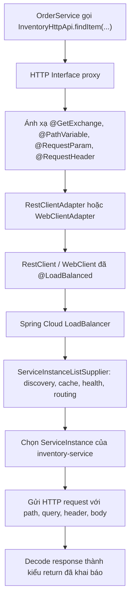

# Ánh xạ tham số, header, body và kiểu kết quả

**HTTP Interface** của Spring Framework cho phép mô tả một HTTP API bằng Java interface và các annotation như `@HttpExchange`, `@GetExchange`, `@PostExchange`. Thay vì tự gọi `restClient.get()` hay `webClient.post()` ở từng nơi, ứng dụng khai báo method, tham số và kiểu kết quả; `HttpServiceProxyFactory` tạo một client proxy thực hiện HTTP request tương ứng.

Bài học nằm trong chương **HTTP Interface** của module `SPRING_CLOUD_SERVICE_COMMUNICATION_LOAD_BALANCING`. Bối cảnh là giao tiếp microservices bằng Spring Cloud LoadBalancer: HTTP Interface phải được nối với một `RestClient` hoặc `WebClient` **đã tích hợp LoadBalancer** thì tên logic `inventory-service` mới được giải quyết thành `ServiceInstance`. Annotation HTTP Interface không tự phát hiện service, không tự bật health check, cache, retry hoặc timeout.

Mục tiêu là hiểu chính xác cách **path variable**, **query parameter**, **header**, **body** được ánh xạ thành request và cách chọn **kiểu kết quả** phù hợp cho API đồng bộ, reactive và những response cần status hoặc header.

## 1. Mô hình tổng thể: interface, adapter, transport, LoadBalancer

Một HTTP Interface gồm ba lớp trách nhiệm:

1. **Hợp đồng Java:** method, HTTP verb, đường dẫn, tham số và kiểu kết quả trong interface.
2. **Proxy và adapter:** `HttpServiceProxyFactory` đọc annotation, tạo lời gọi qua `RestClientAdapter` hoặc `WebClientAdapter`.
3. **HTTP transport và LoadBalancer:** `RestClient` hoặc `WebClient` thực thi request; khi dùng builder `@LoadBalanced` và hostname là service ID, Spring Cloud LoadBalancer chọn instance thực tế.



Ví dụ method:

```java
@GetExchange("/items/{sku}")
ItemView findItem(
        @PathVariable("sku") String sku,
        @RequestParam("warehouse") String warehouse,
        @RequestHeader("X-Correlation-ID") String correlationId);
```

Lời gọi Java:

```java
ItemView item = inventoryApi.findItem(
        "SKU-001", "hcm-01", "req-2054");
```

Request logic tương ứng:

```http
GET /api/v1/items/SKU-001?warehouse=hcm-01 HTTP/1.1
Host: inventory-service
X-Correlation-ID: req-2054
Accept: application/json
```

Sau đó LoadBalancer có thể chọn `inventory-a:8081` hoặc `inventory-b:8082`. Giá trị `SKU-001`, query `warehouse` và header correlation vẫn thuộc request; thuật toán lựa chọn instance không tự sửa những dữ liệu đó.

## 2. @HttpExchange và các HTTP method annotation

`@HttpExchange` diễn tả thông tin chung hoặc một HTTP exchange cụ thể, ví dụ base path, HTTP method, `contentType` và `accept`. Các annotation rút gọn `@GetExchange`, `@PostExchange`, `@PutExchange`, `@PatchExchange`, `@DeleteExchange` giúp phương thức dễ đọc.

```java
import org.springframework.http.MediaType;
import org.springframework.web.service.annotation.GetExchange;
import org.springframework.web.service.annotation.HttpExchange;
import org.springframework.web.service.annotation.PostExchange;
import org.springframework.web.bind.annotation.PathVariable;
import org.springframework.web.bind.annotation.RequestBody;

@HttpExchange(
        url = "/api/v1",
        accept = MediaType.APPLICATION_JSON_VALUE)
public interface InventoryHttpApi {

    @GetExchange("/items/{sku}")
    ItemView findItem(@PathVariable("sku") String sku);

    @PostExchange(
            url = "/reservations",
            contentType = MediaType.APPLICATION_JSON_VALUE)
    ReservationView createReservation(
            @RequestBody ReserveStockRequest request);
}
```

Đoạn mã dùng các DTO `ItemView`, `ReservationView` và `ReserveStockRequest` do ứng dụng tự định nghĩa. Những method có placeholder `{sku}` hoặc JSON body phải có annotation tương ứng trên tham số để proxy tạo HTTP request đúng hợp đồng.

Các quy tắc:

| Vị trí | Ví dụ | Vai trò |
|---|---|---|
| Type-level | `@HttpExchange(url="/api/v1")` | Tiền tố path và thuộc tính chung cho các method |
| Method-level | `@GetExchange("/items/{sku}")` | Định nghĩa GET và path của operation |
| Method-level | `@PostExchange(contentType="application/json")` | Định nghĩa POST và media type body gửi |
| Method-level | `@DeleteExchange("/items/{sku}")` | Định nghĩa DELETE |
| Method-level | `@HttpExchange(method="HEAD", url="/health")` | HTTP method không dùng annotation rút gọn phù hợp |

`contentType` mô tả định dạng body mà client gửi; `accept` chỉ định định dạng response mà client muốn nhận. Chúng không thay thế nhu cầu cấu hình message converter/codec tương ứng và hợp đồng API bên server.

## 3. Bảng ánh xạ tham số

HTTP Interface dùng nhiều annotation quen thuộc từ Spring MVC, nhưng ý nghĩa ở đây là **xây request đi ra**, không phải nhận request vào controller.

| Kiểu tham số | Annotation / kiểu | Ánh xạ vào request | Ví dụ |
|---|---|---|---|
| Path variable | `@PathVariable("sku")` | Điền placeholder trong path URL | `/items/{sku}` |
| Query parameter | `@RequestParam("warehouse")` | Mặc định là query, tùy content type | `?warehouse=hcm-01` |
| Header | `@RequestHeader("X-Correlation-ID")` | HTTP request header | `X-Correlation-ID: req-2054` |
| JSON body | `@RequestBody` | Payload được codec/message converter serialize | `{"sku":"SKU-001"}` |
| Multipart part | `@RequestPart("file")` | Một phần của multipart body | File hoặc form field |
| Cookie | `@CookieValue("locale")` | Cookie của request | `Cookie: locale=vi` |
| Request attribute | `@RequestAttribute("...")` | Thuộc tính nội bộ request (tùy adapter) | Không tương đương HTTP header |
| URL động | `URI` làm method parameter | Có thể ghi đè URL định nghĩa bởi annotation | Cần kiểm soát host |
| HTTP method động | `HttpMethod` làm parameter | Ghi đè method khai báo trong annotation | Dùng có chủ đích |

`@RequestHeader` hỗ trợ giá trị đơn, `Collection`, `Map` và `MultiValueMap`; `@RequestParam` cũng có thể nhận nhiều giá trị. Spring sẽ chuyển đổi những kiểu đơn giản sang dạng chuỗi khi cần.

**Phân biệt quan trọng:** Với `content-type: application/x-www-form-urlencoded`, những `@RequestParam` được mã hóa vào **request body** dạng form thay vì query URL. Vì vậy, không nên khẳng định `@RequestParam` *luôn luôn* tạo query.

Các method parameter không nên là `null` nếu annotation đang yêu cầu giá trị bắt buộc. Khi cần tham số tùy chọn, dùng cơ chế optional/`required=false` được API hỗ trợ và kiểm thử hành vi khi giá trị vắng mặt.

## 4. Ví dụ tự chứa: InventoryHttpApi đồng bộ

Xây một hợp đồng gọi `inventory-service`: đọc tồn kho theo SKU/kho, truy vấn theo danh sách tag, tạo phiếu giữ hàng và hủy reservation.

### 4.1. Các DTO

```java
package com.example.order.inventory;

public record ItemView(
        String sku,
        String warehouse,
        int available,
        String servedBy) {
}

public record ReserveStockRequest(
        String sku,
        int quantity,
        String warehouse) {
}

public record ReservationView(
        String reservationId,
        String status) {
}
```

### 4.2. Interface HTTP được khai báo đầy đủ

```java
package com.example.order.inventory;

import java.util.List;

import org.springframework.http.HttpHeaders;
import org.springframework.http.MediaType;
import org.springframework.http.ResponseEntity;
import org.springframework.web.bind.annotation.PathVariable;
import org.springframework.web.bind.annotation.RequestBody;
import org.springframework.web.bind.annotation.RequestHeader;
import org.springframework.web.bind.annotation.RequestParam;
import org.springframework.web.service.annotation.DeleteExchange;
import org.springframework.web.service.annotation.GetExchange;
import org.springframework.web.service.annotation.HttpExchange;
import org.springframework.web.service.annotation.PostExchange;

@HttpExchange(
        url = "/api/v1",
        accept = MediaType.APPLICATION_JSON_VALUE)
public interface InventoryHttpApi {

    @GetExchange("/items/{sku}")
    ItemView findItem(
            @PathVariable("sku") String sku,
            @RequestParam("warehouse") String warehouse,
            @RequestHeader("X-Correlation-ID") String correlationId);

    @GetExchange("/items")
    List<ItemView> searchItems(
            @RequestParam("tag") List<String> tags,
            @RequestParam(name = "warehouse", required = false)
            String warehouse);

    @PostExchange(
            url = "/reservations",
            contentType = MediaType.APPLICATION_JSON_VALUE)
    ResponseEntity<ReservationView> reserveStock(
            @RequestHeader("Idempotency-Key") String idempotencyKey,
            @RequestBody ReserveStockRequest request);

    @DeleteExchange("/reservations/{reservationId}")
    ResponseEntity<Void> cancelReservation(
            @PathVariable("reservationId") String reservationId);

    @GetExchange("/health-detail")
    HttpHeaders readResponseHeaders();
}
```

Ví dụ này minh họa **các cách nhận kết quả khác nhau**, không phải các operation bắt buộc phải có của mọi inventory API. Phía service đích cần triển khai các endpoint tương ứng. `readResponseHeaders()` phù hợp khi caller chỉ quan tâm response headers; nó vẫn thực hiện HTTP request.

Các quan sát:

- `@PathVariable("sku")` lấy giá trị Java đưa vào `{sku}`, không phải đưa vào body.
- `@RequestParam("warehouse")` tạo query ở method GET.
- `@RequestParam("tag") List<String>` cho phép query có nhiều giá trị, chẳng hạn `?tag=hot&tag=sale`.
- `@RequestHeader("Idempotency-Key")` đưa khóa chống ghi trùng vào header, không trộn vào JSON body.
- `@RequestBody ReserveStockRequest` được serialize bằng message converter của client.
- `ResponseEntity<ReservationView>` giữ cả status, response headers lẫn DTO response.
- `ResponseEntity<Void>` giữ status/headers khi endpoint không trả body có ý nghĩa.

### 4.3. Dự đoán request từ method

```java
ItemView item = inventoryApi.findItem(
        "SKU-001",
        "hcm-01",
        "req-2054");
```

Request logic:

```http
GET /api/v1/items/SKU-001?warehouse=hcm-01 HTTP/1.1
Host: inventory-service
Accept: application/json
X-Correlation-ID: req-2054
```

Với `reserveStock`:

```java
ResponseEntity<ReservationView> response =
        inventoryApi.reserveStock(
                "checkout-2042",
                new ReserveStockRequest(
                        "SKU-001", 2, "hcm-01"));
```

Request logic:

```http
POST /api/v1/reservations HTTP/1.1
Host: inventory-service
Accept: application/json
Content-Type: application/json
Idempotency-Key: checkout-2042

{
  "sku": "SKU-001",
  "quantity": 2,
  "warehouse": "hcm-01"
}
```

Đoạn HTTP dùng để giải thích mapping; thứ tự header, `Content-Length` và chi tiết encoding phụ thuộc HTTP transport. Spring Cloud LoadBalancer chọn đích vật lý theo hostname logic, không tự chuyển `Idempotency-Key` thành retry policy.

## 5. Tạo proxy từ RestClient có @LoadBalanced

Khai báo HTTP Interface **chưa tạo bean client**. Với cấu hình dựa trên Spring Framework `HttpServiceProxyFactory`, ứng dụng phải tạo một adapter và dùng nó sinh proxy.

Ví dụ Spring Java config:

```java
package com.example.order.config;

import com.example.order.inventory.InventoryHttpApi;
import org.springframework.beans.factory.annotation.Qualifier;
import org.springframework.cloud.client.loadbalancer.LoadBalanced;
import org.springframework.context.annotation.Bean;
import org.springframework.context.annotation.Configuration;
import org.springframework.web.client.RestClient;
import org.springframework.web.client.support.RestClientAdapter;
import org.springframework.web.service.invoker.HttpServiceProxyFactory;

@Configuration(proxyBeanMethods = false)
public class InventoryHttpInterfaceConfiguration {

    @Bean("inventoryLoadBalancedBuilder")
    @LoadBalanced
    RestClient.Builder inventoryLoadBalancedBuilder() {
        return RestClient.builder();
    }

    @Bean
    InventoryHttpApi inventoryHttpApi(
            @Qualifier("inventoryLoadBalancedBuilder")
            RestClient.Builder builder) {

        RestClient restClient = builder
                .baseUrl("http://inventory-service")
                .build();

        RestClientAdapter adapter =
                RestClientAdapter.create(restClient);

        HttpServiceProxyFactory factory =
                HttpServiceProxyFactory.builderFor(adapter)
                        .build();

        return factory.createClient(InventoryHttpApi.class);
    }
}
```

Luồng thực thi:

1. `@LoadBalanced` đánh dấu builder để Spring Cloud gắn load-balancing integration khi có starter tương ứng.
2. `baseUrl("http://inventory-service")` dùng **service ID làm hostname logic**.
3. `RestClientAdapter.create(restClient)` chuyển API HTTP client sang abstraction dùng bởi proxy factory.
4. `factory.createClient(InventoryHttpApi.class)` tạo proxy triển khai Java interface.
5. Lời gọi một method của `InventoryHttpApi` sẽ sử dụng request mapping, rồi RestClient gửi request thông qua LoadBalancer.

Không làm thế này khi muốn cân bằng tải:

```java
// Không qua @LoadBalanced builder đã cấu hình.
RestClient client = RestClient.create(
        "http://inventory-service");

InventoryHttpApi api = HttpServiceProxyFactory
        .builderFor(RestClientAdapter.create(client))
        .build()
        .createClient(InventoryHttpApi.class);
```

Ở ví dụ không có LoadBalancer, `inventory-service` có thể bị xử lý như hostname DNS thông thường; kết quả là không kết nối được hoặc đi qua một cơ chế DNS khác, chứ không dùng Spring Cloud `ServiceInstanceListSupplier`.

### 5.1. Dependency và bản Spring cần thiết

HTTP Interface là tính năng Spring Framework; `RestClient` có trong Spring Framework 6.1 trở lên. Đối với Spring Boot và Spring Cloud, hãy chọn release train tương thích qua Spring Cloud BOM.

Ví dụ các dependency phía client:

```xml
<dependency>
    <groupId>org.springframework.boot</groupId>
    <artifactId>spring-boot-starter-web</artifactId>
</dependency>
<dependency>
    <groupId>org.springframework.cloud</groupId>
    <artifactId>spring-cloud-starter-loadbalancer</artifactId>
</dependency>
```

Ngoài ra cần nguồn `ServiceInstance`: Eureka, Consul, Kubernetes discovery hoặc một danh sách tĩnh từ `SimpleDiscoveryClient`. Các annotation `@HttpExchange` tự thân **không đăng ký instance** vào discovery.

Tùy phiên bản Spring Boot, dùng builder được Boot customizer cấu hình có thể giữ các thiết lập về observability, SSL và HTTP transport. Không mặc định tự gọi `RestClient.builder()` ở mọi vị trí là tương đương với builder được ứng dụng cấu hình đầy đủ.

## 6. Path variable và URL encoding

`@PathVariable` giúp Spring expand placeholder:

```java
@GetExchange("/items/{sku}")
ItemView findBySku(@PathVariable("sku") String sku);
```

Khi gọi `findBySku("SKU-001")`, URI được dựng với path `/items/SKU-001`.

Đối với giá trị chứa ký tự đặc biệt như `SKU/2026`, dấu cách, `?`, `#`, `%`, hãy kiểm tra cách **URI builder của HTTP client** encode từng giá trị. Một dấu slash trong SKU là **dữ liệu của một biến**, không mặc nhiên là dấu phân đoạn path.

Kiểm thử nên xác nhận raw URI mà HTTP client tạo ra, ví dụ kỳ vọng encoded slash là `%2F` khi hợp đồng API yêu cầu SKU chứa slash nằm trong một path segment. Tuy nhiên, server/gateway có thể có chính sách riêng về encoded slash; encode đúng ở client chưa bảo đảm server chấp nhận dữ liệu đó.

Các nguyên tắc:

- Không nối path bằng chuỗi thô chứa dữ liệu chưa encode.
- Định nghĩa placeholder rõ ràng: `@GetExchange("/items/{sku}")` với `@PathVariable("sku")`.
- Đừng sử dụng dữ liệu người dùng làm scheme/hostname của base URL.
- Khi cần các phương pháp encode khác mặc định, cấu hình URI builder factory của transport và có test xác nhận.
- Nếu ID có nhiều ký tự đặc biệt, cân nhắc thiết kế API dùng query thay cho path tùy hợp đồng giữa các service.

## 7. Query parameter: đơn, lặp, tùy chọn và form-urlencoded

`@RequestParam` ánh xạ tham số query trong request thông thường:

```java
@GetExchange("/items")
List<ItemView> searchItems(
        @RequestParam("warehouse") String warehouse,
        @RequestParam("tag") List<String> tags);
```

Gọi:

```java
inventoryApi.searchItems(
        "hcm-01",
        List.of("sale", "fragile"));
```

Request có thể có query:

```text
/api/v1/items?warehouse=hcm-01&tag=sale&tag=fragile
```

Thứ tự cụ thể của các query parameter không phải contract quan trọng nếu server không yêu cầu; khi test, nên đối chiếu theo tên và giá trị hoặc URI đã dựng theo client.

### 7.1. Tham số tùy chọn

```java
@GetExchange("/items")
List<ItemView> search(
        @RequestParam(name = "warehouse", required = false)
        String warehouse);
```

Với `warehouse == null`, method parameter có thể bị bỏ qua theo cách xử lý optional của resolver. Không mặc định biến `null` thành chuỗi ký tự `"null"` trên URL; nếu backend phân biệt tham số vắng mặt và tham số rỗng, cần viết test riêng cho cả hai.

### 7.2. Map và nhiều giá trị

`@RequestParam` có thể nhận `Map<String, ?>` hoặc `MultiValueMap<String, ?>` cho nhiều tham số. Khi chuyển giá trị động từ người dùng, nên xây allowlist để không vô tình chuyển các khóa query nội bộ nhạy cảm.

### 7.3. @RequestParam không luôn là query

Một điểm dễ sai khi học HTTP Interface: nếu method dùng `contentType = MediaType.APPLICATION_FORM_URLENCODED_VALUE`, Spring có thể encode `@RequestParam` vào body của form.

```java
@PostExchange(
        url = "/session",
        contentType =
                MediaType.APPLICATION_FORM_URLENCODED_VALUE)
SessionView createSession(
        @RequestParam("client_id") String clientId,
        @RequestParam("scope") String scope);
```

Ở đây ý nghĩa có thể là body `client_id=...&scope=...`, **không phải JSON body**. Phải kiểm tra server API và adapter đã cấu hình hỗ trợ form encoding.

## 8. Header: tách metadata HTTP khỏi dữ liệu nghiệp vụ

`@RequestHeader` ánh xạ một tham số Java vào request header:

```java
@GetExchange("/items/{sku}")
ItemView find(
        @PathVariable("sku") String sku,
        @RequestHeader("X-Correlation-ID") String correlationId,
        @RequestHeader("Authorization") String authorization);
```

Ví dụ:

```java
api.find(
        "SKU-001",
        "req-2054",
        "Bearer " + accessToken);
```

Khi tự thiết kế API, có thể tránh yêu cầu caller truyền nguyên Authorization ở mọi method bằng **RestClient/WebClient request interceptor/filter** đáng tin cậy. Nhưng cả hai cách đều phải đảm bảo chỉ token dành cho service đích được chuyển outbound.

### 8.1. Nhiều header động

`@RequestHeader` hỗ trợ `Map` và `MultiValueMap` để truyền nhiều header:

```java
@GetExchange("/items/{sku}")
ItemView find(
        @PathVariable("sku") String sku,
        @RequestHeader HttpHeaders headers);
```

Caller có thể tạo:

```java
HttpHeaders headers = new HttpHeaders();
headers.set("X-Correlation-ID", "req-2054");
headers.setAccept(
        List.of(MediaType.APPLICATION_JSON));
```

Tuy nhiên, không nên sao chép **toàn bộ inbound headers** của người dùng sang outbound client. Header `Host`, `Cookie`, `Authorization`, các forwarding header hoặc header điều khiển routing có thể không an toàn hoặc không phù hợp khi đi sang service khác.

### 8.2. Header không đồng nghĩa request attribute

`@RequestAttribute` cung cấp thuộc tính nội bộ cho cơ chế thực hiện request, được hỗ trợ bởi RestClient và WebClient. Nó **không tự động tạo header HTTP** và không nên dùng thay `@RequestHeader` nếu API đích cần nhìn thấy dữ liệu trên wire.

### 8.3. Header có thể tham gia routing

Spring Cloud LoadBalancer có các supplier định tuyến theo hint hoặc request context. Ví dụ, một header `X-SC-LB-Hint` có thể được đọc ở lớp client/load-balancer nếu đã cấu hình supplier phù hợp. Nhưng chỉ thêm `@RequestHeader("X-SC-LB-Hint")` chưa đủ để mọi thuật toán chọn theo hint: cần integration và supplier tương ứng.

## 9. JSON body với @RequestBody

Một POST thường có payload nghiệp vụ:

```java
@PostExchange(
        url = "/reservations",
        contentType = MediaType.APPLICATION_JSON_VALUE)
ResponseEntity<ReservationView> reserve(
        @RequestHeader("Idempotency-Key") String key,
        @RequestBody ReserveStockRequest request);
```

Khi caller truyền:

```java
new ReserveStockRequest("SKU-001", 2, "hcm-01")
```

client serialize request DTO thành JSON nếu codec/message converter phù hợp. Không cần tự gọi `objectMapper.writeValueAsString(...)` rồi nối vào URI.

**Những lỗi thường gặp:**

- Không khai báo `@RequestBody`: HTTP Interface không tự suy rằng object bất kỳ phải nằm trong JSON body.
- Content-Type là form hoặc multipart nhưng payload là JSON: server có thể trả 415.
- DTO khác contract: trường thiếu, tên không khớp hoặc dữ liệu không hợp lệ dẫn tới 400.
- Truyền body vào GET không được API đích hỗ trợ: tránh thiết kế phụ thuộc body của GET.
- Đã retry POST sau timeout khi server thực tế đã xử lý: có nguy cơ tạo reservation trùng.

Với thao tác thay đổi trạng thái, cần cơ chế idempotency hoặc deduplication trước khi bật retry tự động; chỉ có `@RequestBody` không làm request trở nên idempotent.

## 10. Multipart body và @RequestPart

Khi API cần upload một file và metadata, dùng multipart thay vì cố đặt file vào `@RequestParam` query.

```java
import org.springframework.core.io.Resource;
import org.springframework.http.MediaType;
import org.springframework.http.ResponseEntity;
import org.springframework.web.bind.annotation.RequestPart;
import org.springframework.web.service.annotation.PostExchange;

@PostExchange(
        url = "/attachments",
        contentType = MediaType.MULTIPART_FORM_DATA_VALUE)
ResponseEntity<UploadReceipt> upload(
        @RequestPart("file") Resource file,
        @RequestPart("description") String description);
```

Các dạng part có thể là String, `Resource`, object được encode, `HttpEntity` chứa phần nội dung và header riêng, hoặc publisher phù hợp trong môi trường reactive.

Khi gửi file, cần cân nhắc:

- `Resource` có cung cấp tên file, chiều dài/khả năng đọc stream phù hợp không?
- Content-Type của từng part đã chính xác chưa?
- HTTP transport hỗ trợ multipart theo adapter đang dùng không?
- Có giới hạn kích thước và timeout cho payload lớn không?
- Request có thể đọc lại body nếu retry hay không?

`@RequestPart` là **một phần của body multipart**, không phải tham số path hay query.

## 11. Kiểu kết quả đồng bộ: T, ResponseEntity, HttpHeaders, void

Với HTTP Interface dùng `RestClientAdapter` hoặc `RestTemplateAdapter`, return type đồng bộ thường là:

| Kiểu return | Ý nghĩa | Khi nên dùng |
|---|---|---|
| `ItemView` hoặc kiểu `T` | Deserialize response body thành DTO | Chỉ cần dữ liệu nghiệp vụ |
| `List<ItemView>` | Deserialize collection có kiểu | Endpoint trả JSON array |
| `ResponseEntity<ItemView>` | Body, status và response headers | Cần kiểm tra ETag, 201, 202, v.v. |
| `ResponseEntity<Void>` | Status/headers không cần body | DELETE hoặc POST không trả payload |
| `HttpHeaders` | Chỉ lấy response headers | Cần metadata, phiên bản hoặc rate-limit headers |
| `void` | Thực hiện request, bỏ qua response body | Tác vụ không cần kết quả nội dung |

Ví dụ:

```java
@GetExchange("/items/{sku}")
ItemView fetch(@PathVariable("sku") String sku);

@GetExchange("/items/{sku}")
ResponseEntity<ItemView> fetchWithMetadata(
        @PathVariable("sku") String sku);

@DeleteExchange("/reservations/{id}")
ResponseEntity<Void> cancel(
        @PathVariable("id") String reservationId);

@PostExchange("/maintenance/recalculate")
void requestRecalculation();
```

Trong ví dụ `cancel`, placeholder `{id}` khớp chính xác tên trong `@PathVariable("id")` dù biến Java được đặt là `reservationId`. Nếu không khai báo tên rõ ràng, việc resolve tham số có thể phụ thuộc metadata tên tham số được giữ lại khi biên dịch.

Không bắt buộc response body luôn tồn tại. Ví dụ với status `204 No Content`, khai báo `ResponseEntity<Void>` có ý nghĩa hơn một DTO không thể được deserialize từ body rỗng.

### 11.1. ResponseEntity không thay đổi xử lý 4xx/5xx mặc định

`ResponseEntity<T>` giúp đọc status khi client nhận response theo cơ chế thành công hoặc cấu hình cụ thể. Không nên mặc định rằng return type này tự biến lỗi HTTP 4xx/5xx thành giá trị thông thường.

Với `RestClient`, cơ chế mặc định qua `retrieve()` thường chuyển HTTP 4xx/5xx thành exception; HTTP Interface adapter cũng phụ thuộc cách client xử lý status. Nếu ứng dụng muốn xử lý một mã lỗi thành DTO nghiệp vụ, cần cấu hình status handler/error decoder tại tầng HTTP client phù hợp và kiểm thử.

## 12. WebClientAdapter: kiểu reactive và ý nghĩa subscription

Khi dùng `WebClientAdapter`, HTTP Interface có thể trả `Mono` và `Flux`. Ví dụ interface riêng:

```java
package com.example.order.inventory;

import org.springframework.http.MediaType;
import org.springframework.http.ResponseEntity;
import org.springframework.web.bind.annotation.PathVariable;
import org.springframework.web.bind.annotation.RequestBody;
import org.springframework.web.service.annotation.GetExchange;
import org.springframework.web.service.annotation.HttpExchange;
import org.springframework.web.service.annotation.PostExchange;
import reactor.core.publisher.Flux;
import reactor.core.publisher.Mono;

@HttpExchange(
        url = "/api/v1",
        accept = MediaType.APPLICATION_JSON_VALUE)
public interface ReactiveInventoryHttpApi {

    @GetExchange("/items/{sku}")
    Mono<ItemView> findItem(
            @PathVariable("sku") String sku);

    @PostExchange(
            url = "/reservations",
            contentType = MediaType.APPLICATION_JSON_VALUE)
    Mono<ResponseEntity<ReservationView>> reserve(
            @RequestBody ReserveStockRequest request);

    @GetExchange(
            url = "/stock-events",
            accept = MediaType.TEXT_EVENT_STREAM_VALUE)
    Flux<StockEvent> streamChanges();
}
```

Với Spring WebFlux trên classpath, cấu hình:

```java
import org.springframework.beans.factory.annotation.Qualifier;
import org.springframework.cloud.client.loadbalancer.LoadBalanced;
import org.springframework.context.annotation.Bean;
import org.springframework.context.annotation.Configuration;
import org.springframework.web.reactive.function.client.WebClient;
import org.springframework.web.reactive.function.client.support.WebClientAdapter;
import org.springframework.web.service.invoker.HttpServiceProxyFactory;

@Configuration(proxyBeanMethods = false)
class ReactiveInventoryConfiguration {

    @Bean("inventoryLoadBalancedWebClientBuilder")
    @LoadBalanced
    WebClient.Builder inventoryLoadBalancedWebClientBuilder() {
        return WebClient.builder();
    }

    @Bean
    ReactiveInventoryHttpApi reactiveInventoryHttpApi(
            @Qualifier("inventoryLoadBalancedWebClientBuilder")
            WebClient.Builder builder) {

        WebClient webClient = builder
                .baseUrl("http://inventory-service")
                .build();

        WebClientAdapter adapter =
                WebClientAdapter.create(webClient);

        return HttpServiceProxyFactory
                .builderFor(adapter)
                .build()
                .createClient(ReactiveInventoryHttpApi.class);
    }
}
```

`StockEvent` ở trên là DTO minh họa do ứng dụng tự định nghĩa; endpoint `/stock-events` phải hỗ trợ stream phù hợp, ví dụ server-sent events. `Flux<T>` không tự biến một JSON array thông thường thành một luồng bất tận; kiểu payload thực tế và codecs quyết định cách decode.

### 12.1. So sánh return type

| Đồng bộ với RestClientAdapter | Reactive với WebClientAdapter | Ghi chú |
|---|---|---|
| `ItemView` | `Mono<ItemView>` | Một body DTO |
| `void` | `Mono<Void>` | Hoàn tất mà không cần body |
| `ResponseEntity<ItemView>` | `Mono<ResponseEntity<ItemView>>` | Cần status/headers |
| `HttpHeaders` | `Mono<HttpHeaders>` | Chỉ cần response headers |
| Không có streaming reactive tương đương trực tiếp | `Flux<StockEvent>` | Nhiều phần tử theo luồng |
| — | `Mono<ResponseEntity<Flux<StockEvent>>>` | Status/headers cùng body dạng stream |

Với `WebClient`, publisher thường là **lazy**: nếu không subscribe, request có thể chưa được gửi. Trong ứng dụng reactive, trả `Mono`/`Flux` cho controller hoặc composition chain thay vì gọi `block()` trong event-loop. `block()` sai vị trí có thể làm nghẽn tài nguyên và phá mô hình non-blocking.

WebClient cũng hỗ trợ một số kiểu kết quả đồng bộ thông qua adapter ở các phiên bản phù hợp, nhưng nên ưu tiên `Mono`/`Flux` cho pipeline reactive. Timeout cho synchronous return qua reactive adapter có yêu cầu riêng; ưu tiên cấu hình timeout ở HTTP client thực tế.

## 13. Dynamic URI và rủi ro bỏ qua service ID

HTTP Interface cho phép method có tham số kiểu `URI` để ghi đè URL đã khai báo cho lời gọi đó:

```java
@GetExchange("/items")
List<ItemView> fetchFrom(URI uri);
```

Đây là cơ chế có ích khi client **chủ đích** gọi một URL động, nhưng nguy hiểm nếu method cho phép caller gửi URI không được kiểm soát.

Ví dụ một URI như `http://127.0.0.1:8081/items` không dùng hostname logic `inventory-service`, vì vậy **không thể mặc định** nó sẽ được cân bằng theo danh sách `ServiceInstance` của `inventory-service`. Ngược lại, URI có host là service ID có thể đi qua LoadBalancer nếu HTTP client/adapters được cấu hình đúng.

Không nên nhận URL từ người dùng rồi truyền thẳng vào tham số `URI`:

- Có nguy cơ SSRF đến metadata service, loopback hoặc hệ thống nội bộ khác.
- Có thể bypass policy dịch vụ, health check, zone hoặc hint.
- Khi dùng URL vật lý, source discovery không còn là nơi quyết định instance cho request đó.

Nếu thật sự cần URL động, hãy kiểm soát scheme, hostname và đường dẫn bằng allowlist đáng tin cậy, đồng thời quyết định rõ lúc nào request đi qua LoadBalancer và lúc nào gọi trực tiếp.

## 14. Lỗi thường gặp về tham số và kiểu kết quả

| Biểu hiện | Nguyên nhân thường gặp | Cách khắc phục |
|---|---|---|
| `IllegalArgumentException` khi expand URL | `{sku}` không khớp `@PathVariable` | Khai báo tên rõ trong annotation |
| URL thiếu query | Quên `@RequestParam` hoặc đưa giá trị `null` | Kiểm tra method signature và optional semantics |
| Backend không nhận header | Quên `@RequestHeader` hoặc header chỉ có ở inbound request | Gắn header outbound đúng method/interceptor |
| Server trả 415 | Content-Type sai hoặc thiếu converter | Khai báo `contentType` phù hợp body |
| JSON body rỗng | Quên `@RequestBody` | Thêm body annotation và DTO đúng contract |
| Multipart không nhận file | Nhầm `@RequestParam` query với `@RequestPart` | Dùng multipart content type và resource phù hợp |
| Deserialize response thất bại | Return type không khớp JSON schema | Dùng DTO/collection đúng dạng |
| Cần HTTP status nhưng chỉ nhận DTO | Khai báo `T` thay vì `ResponseEntity<T>` | Chọn return type có status/headers |
| Mong `204` trả DTO | Body rỗng hợp lệ | Dùng `ResponseEntity<Void>` hoặc `void` |
| `Mono` không phát request | Không subscribe/không trả publisher ra pipeline | Compose và subscribe đúng cách |
| `UnknownHostException: inventory-service` | Proxy dùng RestClient/WebClient không có `@LoadBalanced` | Tạo adapter từ builder load-balanced |
| Chỉ chọn một instance dù có nhiều | URI vật lý hoặc supplier filter chỉ còn một instance | Kiểm tra baseUrl, danh sách và policy |
| POST tạo bản ghi trùng | Retry khi chưa có idempotency | Dùng Idempotency-Key/kiểm soát retry |
| Timeout khó phân loại | Không giới hạn connect/read/response timeout | Cấu hình tại HTTP client theo phiên bản |

## 15. Kiểm thử mapping riêng, kiểm thử LoadBalancer riêng

Hai loại lỗi có thể trông giống nhau nhưng cần công cụ khác nhau:

1. **Lỗi HTTP mapping:** request sai path, query, header, body hoặc không decode được response.
2. **Lỗi lựa chọn instance:** thiếu service ID, nguồn discovery rỗng, cache cũ, health/filter sai hoặc builder thiếu LoadBalancer.

### 15.1. Unit test mapping với MockRestServiceServer

Có thể bind một HTTP mock server vào `RestClient.Builder` và kiểm tra request được tạo từ HTTP Interface.

```java
import org.junit.jupiter.api.Test;
import org.springframework.http.HttpMethod;
import org.springframework.http.MediaType;
import org.springframework.test.web.client.MockRestServiceServer;
import org.springframework.web.client.RestClient;
import org.springframework.web.client.support.RestClientAdapter;
import org.springframework.web.service.invoker.HttpServiceProxyFactory;

import static org.junit.jupiter.api.Assertions.assertEquals;
import static org.springframework.test.web.client.match
        .MockRestRequestMatchers.header;
import static org.springframework.test.web.client.match
        .MockRestRequestMatchers.method;
import static org.springframework.test.web.client.match
        .MockRestRequestMatchers.requestTo;
import static org.springframework.test.web.client.response
        .MockRestResponseCreators.withSuccess;

class InventoryHttpInterfaceMappingTest {

    @Test
    void mapsPathQueryAndHeader() {
        RestClient.Builder builder = RestClient.builder()
                .baseUrl("http://inventory-service");

        MockRestServiceServer server =
                MockRestServiceServer.bindTo(builder).build();

        server.expect(requestTo(
                        "http://inventory-service/api/v1/items/SKU-001"
                                + "?warehouse=hcm-01"))
                .andExpect(method(HttpMethod.GET))
                .andExpect(header(
                        "X-Correlation-ID", "req-2054"))
                .andRespond(withSuccess(
                        "{\"sku\":\"SKU-001\","
                                + "\"warehouse\":\"hcm-01\","
                                + "\"available\":7,"
                                + "\"servedBy\":\"inventory-a\"}",
                        MediaType.APPLICATION_JSON));

        InventoryHttpApi api = HttpServiceProxyFactory
                .builderFor(RestClientAdapter.create(builder.build()))
                .build()
                .createClient(InventoryHttpApi.class);

        ItemView item = api.findItem(
                "SKU-001", "hcm-01", "req-2054");

        assertEquals("SKU-001", item.sku());
        assertEquals(7, item.available());
        server.verify();
    }
}
```

Unit test này chứng minh **ánh xạ các thành phần HTTP request và decode body**. Nó **không chứng minh** LoadBalancer đã chọn một instance: mock HTTP có thể trả kết quả mà không thực hiện truy vấn `ServiceInstanceListSupplier`. Không nên lấy kết quả test mock làm bằng chứng về round robin.

Đối với body, thêm một test `reserveStock` với `MockRestRequestMatchers.content().json(...)`, `contentType(MediaType.APPLICATION_JSON)` và `Idempotency-Key`. Với method trả `ResponseEntity<ReservationView>`, kiểm tra cả status, header và DTO response.

### 15.2. Integration test có ServiceInstance thật

Để kiểm tra việc HTTP Interface đi qua Spring Cloud LoadBalancer:

1. Chạy hai HTTP server stub ở cổng khác nhau, cả hai triển khai cùng endpoint `/api/v1/items/{sku}`.
2. Cho server A trả `servedBy=inventory-a`, server B trả `servedBy=inventory-b`.
3. Khai báo cả hai URI dưới cùng service ID `inventory-service` bằng `SimpleDiscoveryClient`.
4. Tạo `InventoryHttpApi` từ builder `@LoadBalanced RestClient.Builder` như mục 5.
5. Gọi `findItem(...)` nhiều lần tuần tự, thu thập `servedBy`.
6. Xác nhận mọi response đến từ tập `{inventory-a, inventory-b}`; với round robin mặc định và hai instance khỏe, có thể xác nhận cả hai xuất hiện.
7. Gọi service ID không đăng ký và xác nhận không có request HTTP tới hai stub; loại lỗi cụ thể phụ thuộc integration/version.
8. Tách test retry/cache/health vì chúng có thể ảnh hưởng số lần chọn và thứ tự quan sát.

Ví dụ khai báo nguồn instance tĩnh trong test profile:

```properties
spring.cloud.discovery.client.simple.instances.inventory-service[0].uri=http://localhost:18081
spring.cloud.discovery.client.simple.instances.inventory-service[1].uri=http://localhost:18082
spring.cloud.loadbalancer.cache.enabled=false
spring.cloud.loadbalancer.retry.enabled=false
```

Hai HTTP server phải thực sự chạy tại `18081` và `18082` hoặc dùng `@DynamicPropertySource` để cấp cổng động. `SimpleDiscoveryClient` không tự phát hiện instance chết như discovery server có health/registration lifecycle. Nếu dừng server B mà supplier vẫn trả A/B, thuật toán còn có thể chọn B và gặp connection refused.

## 16. Timeout, retry và observability không nằm trong annotation mapping

HTTP Interface làm nhiệm vụ khai báo contract. Những thuộc tính sau thuộc tầng khác:

| Trách nhiệm | Lớp cần cấu hình |
|---|---|
| Nguồn instance theo service ID | Discovery client / `ServiceInstanceListSupplier` |
| Chính sách chọn instance | `ReactorServiceInstanceLoadBalancer` và per-service config |
| Timeout kết nối/đọc/phản hồi | Request factory hoặc HTTP transport của RestClient/WebClient |
| Retry, backoff và deadline | LoadBalancer integration hoặc resilience layer phù hợp |
| Bearer token tự động | HTTP client interceptor/filter |
| Trace context | Micrometer Tracing/instrumentation của client |
| JSON serialization | Message converters/codecs và DTO |
| HTTP status mapping | Status handler/error handling ở HTTP client |
| Fallback/circuit breaker | Resilience policy của ứng dụng hoặc framework tương ứng |

Không nên kỳ vọng đổi return type từ `ItemView` sang `ResponseEntity<ItemView>` sẽ tự bật retry hoặc thay thuật toán chọn instance.

Với POST tạo reservation, nếu response timeout sau khi server đã xử lý, retry có nguy cơ tạo hai reservation. Dùng idempotency key, giới hạn số lần retry, phân loại lỗi và deadline tổng phù hợp. Với WebClient reactive, tránh thêm `retryWhen` vô điều kiện cho mọi exception.

Khi quan sát production, ghi nhận `serviceId`, path template, HTTP method, số candidate, selected instance (trong log nội bộ), response status, latency và retry attempts. Tránh đưa SKU hoặc URI đầy đủ chứa dữ liệu nhạy cảm thành metric label có cardinality cao.

## 17. Checklist thực hành

- [ ] Java interface có `@HttpExchange` và method annotation đúng HTTP verb.
- [ ] Placeholder path khớp tên `@PathVariable`.
- [ ] Query được khai báo `@RequestParam` và kiểm thử giá trị lặp/optional.
- [ ] Header outbound được khai báo `@RequestHeader` hoặc thêm qua interceptor/filter.
- [ ] Body JSON có `@RequestBody` và `contentType` tương ứng.
- [ ] Multipart dùng `@RequestPart`/resource và message writer thích hợp.
- [ ] Return type phù hợp: `T`, `ResponseEntity<T>`, `HttpHeaders`, `void` hoặc kiểu reactive.
- [ ] `HttpServiceProxyFactory` được tạo từ đúng adapter RestClient/WebClient.
- [ ] Adapter dùng HTTP client được dựng từ builder `@LoadBalanced` nếu cần service discovery.
- [ ] Base URL dùng service ID, không phải một host:port vật lý được hard-code.
- [ ] Test mock chứng minh mapping; test tích hợp độc lập chứng minh chọn instance.
- [ ] Có kiểm tra tình huống không có instance, body response rỗng, 4xx/5xx và timeout.
- [ ] Retry thao tác ghi được kiểm soát bằng idempotency hoặc contract phù hợp.
- [ ] Không chuyển tiếp Authorization, Cookie hoặc header routing không đáng tin cậy một cách mù quáng.

## 18. Tổng kết

Spring HTTP Interface ánh xạ **tham số Java → path/query/header/body của HTTP request** và **response HTTP → kiểu kết quả method**. `@PathVariable` xử lý placeholder, `@RequestParam` xử lý query hoặc form body tùy content type, `@RequestHeader` thêm header, `@RequestBody` serialize payload và `@RequestPart` dành cho multipart. Việc chọn `T`, `ResponseEntity<T>`, `HttpHeaders`, `void` hoặc `Mono`/`Flux` quyết định dữ liệu response mà caller nhận được và cách chương trình xử lý đồng bộ/reactive.

Trong module Spring Cloud LoadBalancer, điểm nối quyết định là **adapter được tạo từ RestClient hoặc WebClient đã bật load balancing**. HTTP Interface chỉ khai báo hợp đồng; LoadBalancer mới chọn instance theo service ID, discovery và chính sách định tuyến. Hãy kiểm tra hai lớp một cách riêng biệt: unit test xác nhận request mapping; integration test xác nhận URL logic thật sự được giải quyết tới đúng `ServiceInstance`.

### Tài liệu tham khảo

- [Spring Framework — REST Clients: HTTP Service Clients](https://docs.spring.io/spring-framework/reference/integration/rest-clients.html) — `@HttpExchange`, danh sách method arguments, return types, `HttpServiceProxyFactory` và các adapter.
- [Spring Cloud Commons — Common Abstractions](https://docs.spring.io/spring-cloud-commons/reference/spring-cloud-commons/common-abstractions.html) — cấu hình `@LoadBalanced RestClient.Builder` và `@LoadBalanced WebClient.Builder` để gọi bằng service ID.
- [Spring Cloud Commons — Spring Cloud LoadBalancer](https://docs.spring.io/spring-cloud-commons/reference/spring-cloud-commons/loadbalancer.html) — `ServiceInstanceListSupplier`, cache/health check và các chính sách chọn instance.

