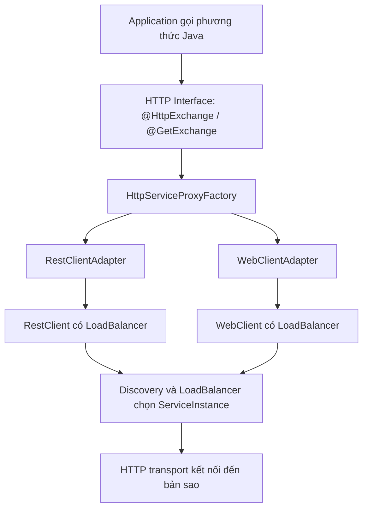

# Chọn cách gọi đồng bộ hoặc reactive phù hợp

Spring Framework cho phép khai báo HTTP client dưới dạng **interface Java** với `@HttpExchange`, `@GetExchange`, `@PostExchange` và các annotation liên quan. Thay vì tự viết lệnh gọi HTTP trong từng phương thức nghiệp vụ, ứng dụng tạo một proxy bằng `HttpServiceProxyFactory`; proxy sử dụng một HTTP adapter để thực hiện request và chuyển response thành kiểu trả về đã khai báo.

Khi kết hợp Spring Cloud LoadBalancer, một HTTP Interface có thể gọi `http://catalog-service/...` bằng **service ID** thay vì cố định host/port. Tuy nhiên, HTTP Interface không quyết định ứng dụng phải chạy theo mô hình **đồng bộ (blocking)** hay **reactive (non-blocking)**. Lựa chọn nằm ở client/adapter bên dưới, kiểu trả về và mô hình xử lý của thành phần gọi. Bài học này so sánh `RestClientAdapter` với `WebClientAdapter`, hướng dẫn cấu hình qua `@LoadBalanced` và đưa ra tiêu chí lựa chọn dựa trên tải, luồng thực thi, độ trễ, khả năng phối hợp nhiều lời gọi và vận hành.

## 1. HTTP Interface là hợp đồng; adapter quyết định cách thực thi

Một HTTP Interface mô tả **đường dẫn, HTTP method, tham số, header, body và kiểu kết quả**. Ví dụ: một phương thức lấy sản phẩm theo ID có thể được viết dưới dạng `@GetExchange("/{id}")` và nhận `@PathVariable("id")`.

`HttpServiceProxyFactory` đọc metadata của interface và tạo proxy. Khi method được gọi, proxy chuyển lời gọi sang adapter đã cấu hình. Hai adapter thường dùng là:

- `RestClientAdapter`: sử dụng `RestClient` của Spring Framework để gọi HTTP theo kiểu **blocking**.
- `WebClientAdapter`: sử dụng `WebClient` của Spring WebFlux, có thể trả `Mono<T>`/`Flux<T>` và phối hợp trong luồng **reactive**.



Sơ đồ mô tả hai **phương án cấu hình**, không ngụ ý một lời gọi phải đi qua cả hai adapter. `RestClientAdapter` và `WebClientAdapter` cùng có thể dùng metadata `@HttpExchange`, nhưng đường đi HTTP, cách chờ kết quả và những kiểu trả về được hỗ trợ là khác nhau.

Spring Cloud LoadBalancer nằm ở **tầng phân giải service ID thành `ServiceInstance`**, tách khỏi vấn đề blocking/reactive. Cả hai loại client đều có thể chọn bản sao theo service ID nếu `RestClient.Builder` hoặc `WebClient.Builder` được cấu hình LoadBalancer đúng cách.

## 2. Đồng bộ và reactive khác nhau ở điểm nào?

Giả sử `order-service` cần gọi `catalog-service` và chờ dữ liệu sản phẩm trước khi trả response cho người dùng.

**Đồng bộ (blocking):** thread gọi phương thức tạm thời chờ đến khi HTTP request hoàn tất hoặc lỗi. Kết quả thường được nhận trực tiếp như `ProductDto` hoặc `ResponseEntity<ProductDto>`.

```java
ProductDto product = catalogBlockingApi.findProduct("P42");
// Dòng tiếp theo chạy sau khi phương thức trả kết quả hoặc ném exception.
process(product);
```

**Reactive (non-blocking):** phương thức trả một publisher như `Mono<ProductDto>`; phần lớn thời gian chờ I/O không giữ một thread ứng dụng đang bị block. Ứng dụng có thể ghép thêm các bước xử lý, chỉ thực thi khi publisher được subscribe.

```java
Mono<ProductDto> product = catalogReactiveApi.findProduct("P42");

Mono<OrderView> view = product.map(this::buildOrderView);
// Pipeline được thực thi khi có subscriber; không gọi block() trên event-loop.
```

| Tiêu chí | HTTP Interface đồng bộ | HTTP Interface reactive |
|---|---|---|
| Adapter minh họa | `RestClientAdapter` | `WebClientAdapter` |
| Kiểu trả về | `ProductDto`, `ResponseEntity<ProductDto>` | `Mono<ProductDto>`, `Flux<ProductDto>` |
| Thread trong lúc chờ HTTP | Thread gọi có thể bị chặn | Không cần chặn thread gọi để đợi I/O |
| Phối hợp nhiều request | Thường gọi tuần tự hoặc sử dụng executor/virtual thread | Dễ ghép bằng `zip`, `flatMap`, `when`, v.v. |
| Xử lý lỗi | Exception ở lời gọi blocking | Tín hiệu `onError` trong publisher |
| Thích hợp | Luồng imperative/MVC, nghiệp vụ tuần tự, ứng dụng có sẵn blocking | Luồng reactive/WebFlux, nhiều I/O đồng thời, cần composition |
| Rủi ro thường gặp | Thread pool cạn khi downstream chậm | Gọi `block()` trên event-loop, trộn thao tác blocking trong pipeline |

**Reactive không mặc định nhanh hơn cho từng request riêng lẻ.** Nó chủ yếu thay đổi cách sử dụng tài nguyên khi có nhiều I/O đang chờ. Độ trễ thực tế còn phụ thuộc mạng, discovery, số instance, transport, connection pool, server đích và mô hình xử lý của toàn ứng dụng.

## 3. Các dependency và giới hạn phiên bản

Với Spring Boot và Spring Cloud tương thích, những dependency chính là:

```xml
<dependencies>
    <!-- Cho RestClient và các thành phần Spring Web. -->
    <dependency>
        <groupId>org.springframework.boot</groupId>
        <artifactId>spring-boot-starter-web</artifactId>
    </dependency>

    <!-- Cho WebClient và reactive HTTP transport. -->
    <dependency>
        <groupId>org.springframework.boot</groupId>
        <artifactId>spring-boot-starter-webflux</artifactId>
    </dependency>

    <!-- Phân giải service ID và chọn ServiceInstance. -->
    <dependency>
        <groupId>org.springframework.cloud</groupId>
        <artifactId>spring-cloud-starter-loadbalancer</artifactId>
    </dependency>
</dependencies>
```

Ví dụ cho thấy dependency cần có khi một ứng dụng thử **cả hai** lựa chọn. Ứng dụng chỉ dùng HTTP Interface đồng bộ thường không cần thêm toàn bộ WebFlux; ứng dụng chỉ dùng reactive WebClient không nhất thiết cần cả starter MVC. Chọn dependency theo mô hình triển khai thật, tránh thêm thư viện chỉ để sao chép ví dụ.

`RestClient` xuất hiện từ Spring Framework **6.1**, do đó phương án `RestClientAdapter` yêu cầu thế hệ Spring Framework hỗ trợ nó (ví dụ các phiên bản Spring Boot **3.2+** phù hợp). HTTP Interface và `WebClientAdapter` đã có từ các phiên bản Spring Framework 6 trước đó. Hãy kiểm tra BOM Spring Cloud tương thích với Spring Boot của dự án, nhất là khi dùng các tính năng tích hợp `@LoadBalanced RestClient.Builder` và `@LoadBalanced WebClient.Builder`.

Trong bài lab không có registry, ta có thể cấp danh sách instance bằng `SimpleDiscoveryClient`. Nếu dùng Eureka, Consul hay Kubernetes, cần thêm discovery starter tương ứng; một HTTP Interface tự nó không tạo ra registry hoặc danh sách bản sao.

## 4. Định nghĩa hai interface cho cùng một API

Giả sử `catalog-service` cung cấp endpoint:

```http
GET /api/products/P42 HTTP/1.1
Accept: application/json
```

Response mẫu:

```http
HTTP/1.1 200 OK
Content-Type: application/json

{"id":"P42","name":"Notebook","available":25}
```

DTO dùng chung được khai báo trong `ProductDto.java`:

```java
package com.example.orders.catalog;

public record ProductDto(String id, String name, int available) {
}
```

### Interface cho blocking call

```java
package com.example.orders.catalog;

import org.springframework.web.bind.annotation.PathVariable;
import org.springframework.web.service.annotation.GetExchange;
import org.springframework.web.service.annotation.HttpExchange;

@HttpExchange("/api/products")
public interface CatalogBlockingApi {

    @GetExchange("/{id}")
    ProductDto findProduct(@PathVariable("id") String id);
}
```

Khi gọi `findProduct("P42")`, caller sẽ chờ HTTP operation hoàn tất rồi nhận `ProductDto` hoặc exception.

### Interface cho reactive call

```java
package com.example.orders.catalog;

import org.springframework.web.bind.annotation.PathVariable;
import org.springframework.web.service.annotation.GetExchange;
import org.springframework.web.service.annotation.HttpExchange;
import reactor.core.publisher.Mono;

@HttpExchange("/api/products")
public interface CatalogReactiveApi {

    @GetExchange("/{id}")
    Mono<ProductDto> findProduct(@PathVariable("id") String id);
}
```

Hai interface mô tả **cùng HTTP endpoint**. Khác biệt chính nằm ở kiểu trả về: một bên nhận DTO trực tiếp, bên kia nhận `Mono<ProductDto>`. Nếu API có luồng dữ liệu nhiều phần tử, reactive interface có thể khai báo `Flux<T>` khi client/adapter và định dạng response hỗ trợ streaming thích hợp; không phải cứ endpoint trả JSON array là cần `Flux<T>`.

Việc tách interface trong bài giúp trình bày rõ hợp đồng blocking và reactive. Trong hệ thống thật, không nhất thiết phải tạo cả hai interface cho mọi service. Hãy chọn **một mô hình chính** cho từng client theo kiến trúc của ứng dụng.

## 5. Tạo HTTP Interface đồng bộ bằng `RestClientAdapter`

Đầu tiên, tạo `RestClient.Builder` có `@LoadBalanced`, sau đó tạo proxy dựa trên `RestClientAdapter`:

```java
package com.example.orders.config;

import com.example.orders.catalog.CatalogBlockingApi;
import org.springframework.cloud.client.loadbalancer.LoadBalanced;
import org.springframework.context.annotation.Bean;
import org.springframework.context.annotation.Configuration;
import org.springframework.web.client.RestClient;
import org.springframework.web.client.support.RestClientAdapter;
import org.springframework.web.service.invoker.HttpServiceProxyFactory;

@Configuration(proxyBeanMethods = false)
public class BlockingCatalogClientConfiguration {

    @Bean
    @LoadBalanced
    RestClient.Builder loadBalancedRestClientBuilder() {
        return RestClient.builder();
    }

    @Bean
    CatalogBlockingApi catalogBlockingApi(
            @LoadBalanced RestClient.Builder builder) {

        RestClient restClient = builder.clone()
                .baseUrl("http://catalog-service")
                .build();

        HttpServiceProxyFactory factory = HttpServiceProxyFactory
                .builderFor(RestClientAdapter.create(restClient))
                .build();

        return factory.createClient(CatalogBlockingApi.class);
    }
}
```

Các điểm cần hiểu:

1. `@LoadBalanced` đánh dấu **builder** để Spring Cloud gắn interceptor có khả năng phân giải service ID.
2. `baseUrl("http://catalog-service")` dùng service ID làm host logic, không gắn cứng địa chỉ một instance.
3. `RestClientAdapter.create(restClient)` nối proxy HTTP Interface với `RestClient` đã được cấu hình.
4. `HttpServiceProxyFactory` tạo một implementation của `CatalogBlockingApi` để inject vào các thành phần nghiệp vụ.
5. Khi proxy thực thi một phương thức, `RestClient` xử lý request đồng bộ; interceptor LoadBalancer chọn instance trước khi HTTP transport kết nối tới host/port.

Ví dụ service nghiệp vụ dùng proxy:

```java
package com.example.orders.service;

import com.example.orders.catalog.CatalogBlockingApi;
import com.example.orders.catalog.ProductDto;
import org.springframework.stereotype.Service;

@Service
public class OrderPreviewService {
    private final CatalogBlockingApi catalog;

    public OrderPreviewService(CatalogBlockingApi catalog) {
        this.catalog = catalog;
    }

    public String describeProduct(String id) {
        ProductDto product = catalog.findProduct(id);
        return product.name() + " (available=" + product.available() + ")";
    }
}
```

Ứng dụng có thể giữ `CatalogBlockingApi` như singleton proxy và tái sử dụng. Không nên dựng mới `RestClient` hoặc `HttpServiceProxyFactory` trong từng request; cấu hình HTTP client và connection pool nên có vòng đời rõ ràng ở tầng ứng dụng.

## 6. Tạo HTTP Interface reactive bằng `WebClientAdapter`

Với ứng dụng sử dụng WebFlux và Reactor, cấu hình tương đương sử dụng `WebClient.Builder`:

```java
package com.example.orders.config;

import com.example.orders.catalog.CatalogReactiveApi;
import org.springframework.cloud.client.loadbalancer.LoadBalanced;
import org.springframework.context.annotation.Bean;
import org.springframework.context.annotation.Configuration;
import org.springframework.web.reactive.function.client.WebClient;
import org.springframework.web.reactive.function.client.support.WebClientAdapter;
import org.springframework.web.service.invoker.HttpServiceProxyFactory;

@Configuration(proxyBeanMethods = false)
public class ReactiveCatalogClientConfiguration {

    @Bean
    @LoadBalanced
    WebClient.Builder loadBalancedWebClientBuilder() {
        return WebClient.builder();
    }

    @Bean
    CatalogReactiveApi catalogReactiveApi(
            @LoadBalanced WebClient.Builder builder) {

        WebClient webClient = builder.clone()
                .baseUrl("http://catalog-service")
                .build();

        HttpServiceProxyFactory factory = HttpServiceProxyFactory
                .builderFor(WebClientAdapter.create(webClient))
                .build();

        return factory.createClient(CatalogReactiveApi.class);
    }
}
```

Khi service gọi `catalogReactiveApi.findProduct("P42")`, phương thức trả về `Mono<ProductDto>`. Request được thực hiện khi có subscription đến publisher, ví dụ Spring WebFlux subscribe trong quá trình xử lý response của controller:

```java
package com.example.orders.web;

import com.example.orders.catalog.CatalogReactiveApi;
import com.example.orders.catalog.ProductDto;
import org.springframework.web.bind.annotation.GetMapping;
import org.springframework.web.bind.annotation.PathVariable;
import org.springframework.web.bind.annotation.RestController;
import reactor.core.publisher.Mono;

@RestController
public class ProductQueryController {

    private final CatalogReactiveApi catalog;

    public ProductQueryController(CatalogReactiveApi catalog) {
        this.catalog = catalog;
    }

    @GetMapping("/order-view/products/{id}")
    public Mono<ProductDto> getProduct(@PathVariable String id) {
        return catalog.findProduct(id);
    }
}
```

Điểm quan trọng: **không gọi `.block()` trong thread event-loop**. `.block()` buộc thread đang xử lý phải chờ kết quả; trên một số luồng Reactor non-blocking, thao tác này còn có thể bị từ chối bằng exception. Dùng `map`, `flatMap`, `zip` và các operator Reactor để xử lý kết quả mà không ép về mô hình đồng bộ.

Nếu ứng dụng có cấu hình cả `RestClient.Builder` và `WebClient.Builder`, chúng là hai loại bean khác nhau, nhưng vẫn có thể cần `@Qualifier` rõ ràng khi dự án khai báo nhiều builder **cùng loại**. Dùng `clone()` trước khi đổi `baseUrl`, header hay filter riêng để tránh vô tình thay đổi cấu hình một builder được dùng chung.

## 7. Spring Cloud LoadBalancer không tự xuất hiện trong HTTP Interface

`@HttpExchange` và `@GetExchange` mô tả **HTTP contract**, không đánh dấu một client phải gọi qua discovery. Giả sử adapter được tạo từ:

```java
RestClient restClient = RestClient.builder()
        .baseUrl("http://catalog-service")
        .build();
```

Nếu builder ở đây không được tích hợp LoadBalancer, `catalog-service` thường bị coi là hostname DNS thật. Trên máy local, điều này có thể dẫn đến lỗi phân giải DNS thay vì chọn một `ServiceInstance`.

Tương tự:

```java
WebClient webClient = WebClient.builder()
        .baseUrl("http://catalog-service")
        .build();
```

Việc gọi `WebClientAdapter.create(webClient)` **không tự động** chèn `ReactorLoadBalancerExchangeFilterFunction`. Bộ lọc phải tồn tại trong `WebClient` được tạo từ builder đã có `@LoadBalanced` hoặc được cấu hình tương đương.

```text
HTTP Interface proxy
    ↓
RestClientAdapter / WebClientAdapter
    ↓
HTTP client đã tích hợp LoadBalancer
    ↓
Service ID → ServiceInstanceListSupplier → chọn instance
    ↓
HTTP transport kết nối đến instance
```

Nếu cấu hình `baseUrl` với địa chỉ cố định như `http://localhost:8081`, request đã nhắm vào một instance cụ thể; đây không phải cách kiểm tra phân phối theo service ID. Một hệ thống dùng DNS-based load balancing vẫn có thể gọi thành công tên dịch vụ mà không sử dụng Spring Cloud LoadBalancer; cần xem tích hợp client và log instance được chọn để phân biệt.

## 8. Trường hợp nào nên ưu tiên gọi đồng bộ?

Gọi đồng bộ qua `RestClientAdapter` thường hợp lý khi:

- Ứng dụng hiện có là Spring MVC hoặc dùng kiến trúc imperative, từ controller đến repository và service đều là API blocking.
- Một thao tác nghiệp vụ chỉ cần một hoặc vài lời gọi tuần tự, độ trễ chấp nhận được và quy mô thread đã được tính toán.
- Thư viện nghiệp vụ, security context hoặc transaction đang được thiết kế quanh thread đang thực thi.
- Nhóm phát triển cần luồng code dễ lần theo bằng debugger và exception thông thường.
- Ứng dụng dùng Java virtual threads hoặc executor được quản lý phù hợp để xử lý nhiều thao tác blocking; vẫn phải kiểm soát kết nối HTTP và tải downstream.

Ví dụ: một API quản trị lưu dữ liệu vào database qua JDBC rồi gọi một dịch vụ xác nhận. Nếu toàn bộ kiến trúc đã blocking, thêm WebClient chỉ cho một lời gọi chưa chắc đem lại lợi ích tương xứng với chi phí chuyển đổi mô hình lỗi và context.

**Đừng chọn blocking chỉ vì nó đơn giản nếu hệ thống cần giữ rất nhiều kết nối I/O chờ đồng thời nhưng thread pool có hạn.** Khi số lượng lời gọi chồng nhau lớn, thread bị giữ trong lúc chờ downstream có thể trở thành nút thắt. Cần đánh giá thread pool, queue, connection pool và timeout theo lưu lượng thực tế.

## 9. Trường hợp nào nên ưu tiên reactive?

HTTP Interface reactive qua `WebClientAdapter` thường hợp lý khi:

- Ứng dụng đã triển khai Spring WebFlux với handler/controller trả `Mono` hoặc `Flux`.
- Một request tổng hợp kết quả từ nhiều downstream service và các lời gọi có thể chạy đồng thời.
- Hệ thống có nhiều I/O chờ, cần giới hạn số thread và kiểm soát concurrency/backpressure.
- Pipeline cần ghép timeout, fallback, cancellation hoặc các bước xử lý bất đồng bộ.
- Các dependency còn lại cũng có API reactive hoặc đã có cách cô lập phần blocking một cách an toàn.

Ví dụ một endpoint cần lấy thông tin sản phẩm và tồn kho song song:

```java
Mono<ProductDto> product = catalogReactiveApi.findProduct("P42");
Mono<StockDto> stock = inventoryReactiveApi.findStock("P42");

Mono<ProductView> combined = Mono.zip(product, stock)
        .map(tuple -> new ProductView(tuple.getT1(), tuple.getT2()));
```

Ở đây `InventoryReactiveApi`, `StockDto` và `ProductView` là các kiểu minh họa của ứng dụng, cần khai báo riêng. `Mono.zip` có thể cho phép hai request I/O tiến triển đồng thời sau khi được subscribe. Nếu một source lỗi hoặc kết thúc rỗng, quy tắc ghép kết quả có thể khiến publisher tổng không tạo `ProductView`; cần định nghĩa cách xử lý lỗi và dữ liệu thiếu theo nghiệp vụ.

**Reactive không tự làm JDBC, filesystem hay thư viện blocking trở thành non-blocking.** Nếu gọi code blocking bên trong `map` hoặc `flatMap` trên event-loop, hệ thống vẫn có thể nghẽn. Cần dùng driver reactive phù hợp hoặc chuyển phần blocking sang scheduler chuyên dụng (`Schedulers.boundedElastic()`) với giới hạn rõ ràng; đó chỉ là giải pháp cách ly, không biến thao tác blocking thành I/O thực sự bất đồng bộ.

## 10. Khi nào trộn blocking và reactive là một lựa chọn kém?

Hai đoạn code sau dễ làm sai lệch mục tiêu thiết kế:

```java
// Anti-pattern: block trên luồng xử lý reactive.
Mono<ProductDto> result = catalogReactiveApi.findProduct("P42");
ProductDto product = result.block();
```

```java
// Anti-pattern: lời gọi HTTP blocking trực tiếp trong pipeline reactive.
Mono<ProductDto> result = Mono.fromCallable(
        () -> catalogBlockingApi.findProduct("P42"));
// Chỉ tạo Mono không làm lời gọi bên trong tự trở thành non-blocking.
```

Đoạn thứ hai có thể được chạy trên scheduler chuyên biệt nếu bắt buộc tích hợp thư viện cũ, nhưng nếu gọi trên event-loop mà không chuyển scheduler, nó vẫn chặn luồng. Ngược lại, trong ứng dụng MVC, việc dùng `WebClient` rồi `.block()` ở ranh giới đồng bộ đôi khi có thể chấp nhận về mặt kỹ thuật, nhưng đó là **lời gọi đồng bộ với transport reactive**, không mang lợi ích non-blocking của một pipeline reactive hoàn chỉnh.

Khi kiến trúc chủ yếu đồng bộ, `RestClientAdapter` thường rõ ràng hơn. Khi pipeline đã là reactive, `WebClientAdapter` với `Mono`/`Flux` thường phù hợp hơn. **Không nên chọn kiểu trả về reactive chỉ để đổi cú pháp** rồi chặn ở ngay dòng tiếp theo.

## 11. Timeout, retry và health check trong hai mô hình

HTTP Interface che giấu chi tiết gọi client nhưng **không tự cung cấp** timeout, retry hoặc health filtering. Các chính sách đó nằm ở những lớp tương ứng:

| Quan tâm | Khi dùng RestClientAdapter | Khi dùng WebClientAdapter |
|---|---|---|
| Connect timeout | `ClientHttpRequestFactory` / HTTP transport | `ClientHttpConnector`, ví dụ Reactor Netty `HttpClient` |
| Chờ response | Transport và response/read timeout | Transport response timeout, operator timeout nếu cần deadline |
| Retry | Spring Cloud LoadBalancer retry hoặc lớp retry được cấu hình | LoadBalancer retry, Reactor `retryWhen` hoặc lớp phù hợp |
| Health filtering | `ServiceInstanceListSupplier` theo service ID | Cùng hệ thống supplier theo service ID |
| Lỗi HTTP 4xx/5xx | Exception khi gọi blocking theo status handler | Publisher có thể phát `onError` theo status handler |
| Timeout tổng của nghiệp vụ | Cần tính time budget gồm discovery, pool, connect, retry, xử lý | Cần tính time budget, thêm cancellation/timeout của publisher nếu thích hợp |

Các ví dụ cấu hình transport chỉ mang tính minh họa; cách đặt timeout phụ thuộc HTTP transport đang dùng. Với `RestClient`, `HttpComponentsClientHttpRequestFactory` có thể cấu hình Apache HttpClient và connection pool. Với `WebClient`, `ReactorClientHttpConnector` có thể dùng Reactor Netty `HttpClient` với các timeout tương ứng. Không có một property chung của `@HttpExchange` bảo đảm giới hạn tổng thời gian của mọi request.

Đặc biệt khi bật retry, hãy tránh để nhiều tầng cùng thử lại: HTTP transport, LoadBalancer và Reactor có thể đều có chính sách retry. Nếu mỗi tầng tự retry, một lời gọi nghiệp vụ có thể phát nhiều HTTP request hơn dự kiến. Đánh giá idempotency của POST/PATCH và time budget trước khi bật.

Một `ServiceInstance` được health check đánh giá khỏe có thể vẫn chậm hoặc thất bại trong lúc request đang thực thi. Health filtering làm giảm khả năng chọn instance xấu nhưng không thay thế timeout, retry hoặc xử lý kết quả nghiệp vụ ở HTTP Interface.

## 12. Lỗi xảy ra ở đâu và caller nhận được gì?

Giả sử cả hai interface đều gọi `catalog-service` nhưng registry không trả bản sao nào. Lỗi có thể phát sinh tại bước LoadBalancer trước khi request đến HTTP transport.

Với interface **blocking**, caller thường gặp exception ngay ở lệnh gọi:

```java
try {
    ProductDto product = catalogBlockingApi.findProduct("P42");
    process(product);
} catch (Exception ex) {
    // Phân loại theo nguyên nhân thực tế; tránh bắt Exception chung trong production.
    recordFailure(ex);
}
```

Với interface **reactive**, lỗi thường đi qua tín hiệu `onError` của publisher:

```java
Mono<ProductDto> result = catalogReactiveApi.findProduct("P42")
        .doOnError(error -> recordFailure(error))
        .onErrorResume(error -> fallbackIfAllowed(error));
```

`recordFailure`, `fallbackIfAllowed` và `process` là các hàm nghiệp vụ minh họa. Không dùng fallback mặc định cho mọi lỗi mà không xét loại lỗi: `404` có thể có nghĩa không tồn tại sản phẩm, `401` có thể liên quan quyền truy cập, còn connect timeout hoặc không có instance là lỗi hạ tầng. Mỗi trường hợp cần chính sách khác nhau.

| Dấu hiệu | Nơi cần kiểm tra trước | Không nên vội kết luận |
|---|---|---|
| Proxy không tạo được | Annotation HTTP Interface, `HttpServiceProxyFactory`, adapter và kiểu trả về | LoadBalancer lỗi |
| Host logic không phân giải | Builder chưa có `@LoadBalanced`, service ID sai, discovery trống | HTTP Interface không hoạt động |
| Đã chọn instance nhưng `Connection refused` | Host/port, process, network | Annotation sai |
| JSON body không parse được | DTO, converter, response `Content-Type` | Thuật toán round robin sai |
| Response chậm hoặc timeout | Downstream latency, transport, pool, retry | Reactive tự động giải quyết độ trễ |
| Chỉ lỗi khi chạy container | Địa chỉ instance không truy cập được từ container | Phải đổi sang reactive |

Để chẩn đoán, cần phân tách **tạo proxy → tạo request → chọn instance → kết nối HTTP → decode response**. Kiểu gọi đồng bộ hay reactive không tự sửa lỗi discovery, URI, endpoint hoặc JSON contract.

## 13. Thực hành: dùng cả hai adapter gọi hai bản sao

**Mục tiêu:** cho hai proxy sử dụng cùng service ID và quan sát rằng Spring Cloud LoadBalancer vẫn chọn instance, trong khi kiểu trả về và cách điều khiển request khác nhau.

### Chuẩn bị server và discovery

Chạy hai bản sao `catalog-service` trên port `8081` và `8082`, mỗi bản sao cung cấp endpoint `/api/products/{id}` trả JSON. Có thể thêm field hoặc response header thể hiện instance ID/port để dễ quan sát.

Khai báo discovery tĩnh trong **consumer**:

```yaml
spring:
  cloud:
    discovery:
      client:
        simple:
          instances:
            catalog-service:
              - uri: http://localhost:8081
              - uri: http://localhost:8082
```

Địa chỉ `localhost` chỉ hợp lệ khi consumer và cả hai bản sao chạy trên cùng máy/ngữ cảnh mạng. Nếu consumer chạy trong Docker, `localhost` trỏ vào container consumer và phải được thay bằng địa chỉ có thể truy cập từ container.

### Thử blocking interface

```java
ProductDto product = catalogBlockingApi.findProduct("P42");
System.out.println("blocking: " + product);
```

Lặp nhiều request và ghi nhận instance được chọn. Khi code đang chờ response, thread gọi bị block. Thử làm một instance chậm hoặc dừng hoạt động, sau đó quan sát exception và thời gian chờ.

### Thử reactive interface

```java
Mono<ProductDto> result = catalogReactiveApi.findProduct("P42");

return result
        .doOnNext(product -> logProduct(product))
        .doOnError(error -> logFailure(error));
```

Đoạn code biểu diễn phần thân một phương thức trả `Mono<ProductDto>` trong service/controller reactive; các hàm `logProduct` và `logFailure` do ứng dụng định nghĩa. Không dùng `subscribe()` thủ công chỉ để chạy request trong controller rồi bỏ mặc lifecycle của nó; trả publisher để framework quản lý subscription.

### Bảng kiểm chứng

| Thử nghiệm | Kết quả cần xác minh |
|---|---|
| Gọi proxy `RestClientAdapter` bằng service ID | Có response DTO hoặc exception trực tiếp, đã đi qua LoadBalancer |
| Gọi proxy `WebClientAdapter` bằng service ID | Có publisher `Mono<ProductDto>`; request xảy ra sau subscription |
| Bỏ `@LoadBalanced` khỏi builder được dùng | Tên logic có thể bị xử lý như DNS hostname, không qua bước chọn instance mong muốn |
| Đổi `catalog-service` thành service ID chưa đăng ký | Lỗi không có instance hoặc lỗi tương ứng từ tích hợp LoadBalancer |
| Dừng một instance nhưng giữ static discovery | Có thể phát sinh connect error/timeout; chọn instance khác phụ thuộc retry/health policy |
| Thêm timeout và làm server chậm | Phân biệt lỗi timeout transport với việc LoadBalancer không tìm thấy instance |
| Gọi hai downstream song song bằng reactive `zip` | Quan sát tổng thời gian và xử lý khi một source trả lỗi/rỗng |

Không dùng **thứ tự response** làm bằng chứng duy nhất cho round robin: concurrency, retry, health check và thay đổi danh sách instance có thể làm thứ tự nhận kết quả khác thứ tự chọn. Hãy log an toàn service ID, instance ID/host:port được chọn, thời gian và kết quả request.

## 14. Bảng quyết định khi thiết kế HTTP Interface

| Tình huống thực tế | Lựa chọn khởi đầu hợp lý | Lý do |
|---|---|---|
| Ứng dụng MVC, đa số code dùng JDBC và thư viện blocking | `RestClientAdapter` + DTO đồng bộ | Giữ nhất quán mô hình imperative |
| WebFlux reactive end-to-end, nhiều downstream I/O | `WebClientAdapter` + `Mono`/`Flux` | Giữ luồng không chặn và hỗ trợ composition |
| Chỉ cần một GET đơn giản, ít lưu lượng | Phương án phù hợp kiến trúc sẵn có | Reactive không tự giảm latency mạng |
| Aggregate nhiều HTTP endpoint độc lập | Thường cân nhắc `WebClientAdapter` | Dễ ghép request concurrent, nhưng cần error policy |
| Dùng Java virtual threads và API blocking | Có thể chọn `RestClientAdapter` | Thread model có thể chịu nhiều lời gọi blocking hơn; vẫn cần limits |
| Có phần lớn code blocking trong reactive pipeline | Cân nhắc tách boundary hoặc giữ mô hình imperative | Trộn tùy tiện làm nghẽn event-loop |
| Cần load balancing, health, zone hoặc retry | **Cả hai** đều dùng được | Đó là trách nhiệm của Spring Cloud LoadBalancer và client integration |

Quy tắc thiết kế có thể áp dụng: **chọn theo mô hình thực thi của luồng gọi và khả năng vận hành của cả hệ thống, không chọn theo việc interface trông ngắn hơn hay framework nào đang được quảng bá**. Sau đó mới cấu hình discovery, LoadBalancer, timeout và retry cho adapter tương ứng.

## 15. Checklist trước khi đưa vào production

1. Interface đã mô tả chính xác method, path, query, body, header và kiểu response của API đích chưa?
2. Đã chọn rõ **blocking `RestClientAdapter`** hoặc **reactive `WebClientAdapter`** cho client này chưa?
3. Return type của interface có tương thích với adapter và mô hình xử lý của caller không?
4. `HttpServiceProxyFactory` có tạo proxy từ HTTP client **đã được tích hợp LoadBalancer** không?
5. `baseUrl` có dùng service ID và discovery có cung cấp host/port mà consumer thật sự truy cập được không?
6. Có tránh `.block()` trong event-loop, và tránh thao tác I/O blocking trực tiếp trong pipeline reactive không?
7. Connect/response timeout, connection pool và deadline tổng có được cấu hình theo HTTP transport đang dùng không?
8. Retry có giới hạn, không chồng nhiều tầng và có đánh giá tính idempotent của các thao tác ghi chưa?
9. Có kiểm thử timeout, instance lỗi, discovery rỗng, response lỗi HTTP và JSON không hợp lệ cho cả hai kiểu gọi không?
10. Có đủ quan sát để phân biệt lỗi tạo proxy, chọn instance, kết nối và decode mà không ghi dữ liệu nhạy cảm không?

**Kết luận:** HTTP Interface là cách khai báo hợp đồng HTTP bằng Java; **`RestClientAdapter` và `WebClientAdapter` mới quyết định mô hình thực thi**. Đối với ứng dụng imperative/MVC, đồng bộ thường là lựa chọn nhất quán. Đối với luồng WebFlux nhiều I/O cần composition, reactive thường có lợi thế. Dù chọn cách nào, chỉ khi HTTP client bên dưới đã được cấu hình Spring Cloud LoadBalancer đúng cách thì service ID mới được phân giải thành `ServiceInstance` để gọi giữa các dịch vụ ổn định.
