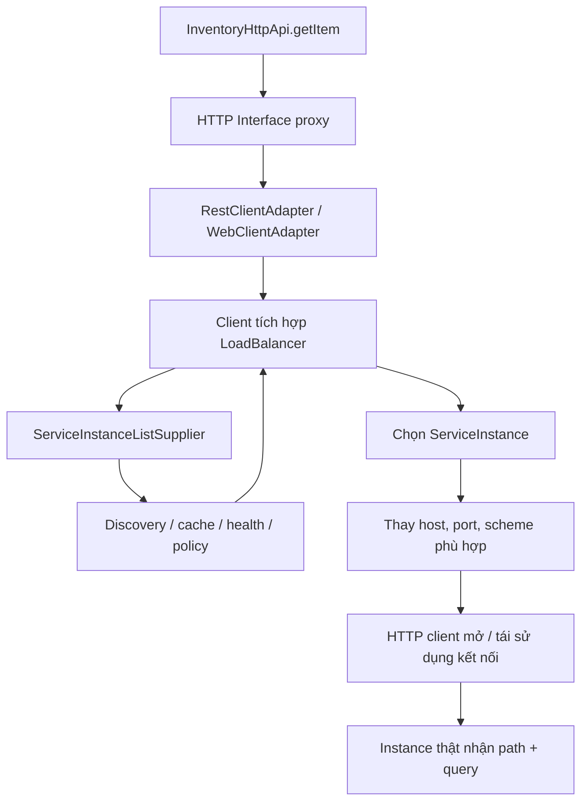
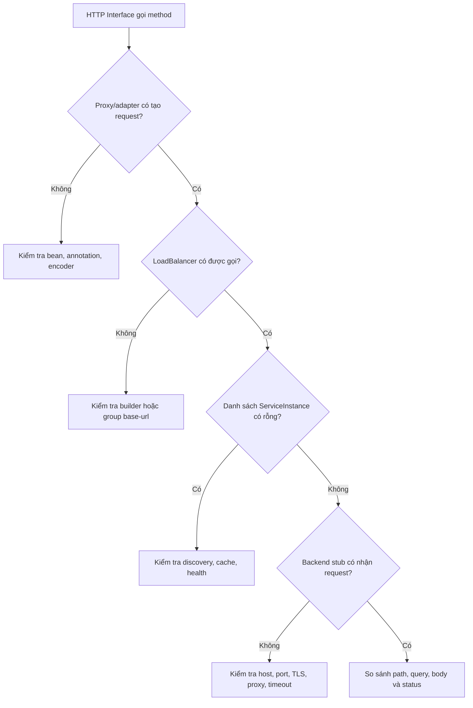

# Đưa lời gọi qua LoadBalancer và kiểm chứng URI thực tế

Spring HTTP Interface cho phép mô tả một HTTP API bằng Java interface và các annotation như `@HttpExchange`, `@GetExchange`, `@PostExchange`. `HttpServiceProxyFactory` tạo proxy thực hiện lời gọi từ interface đó thông qua `RestClient` hoặc `WebClient`. Tuy nhiên, **việc có một HTTP Interface không tự bảo đảm lời gọi đi qua Spring Cloud LoadBalancer**. Cơ chế chọn bản sao phụ thuộc vào HTTP client phía dưới và cách cấu hình `baseUrl`.

Bài học thuộc chương **HTTP Interface** của module **Spring Cloud Service Communication Load Balancing** đi sâu vào hai câu hỏi: *làm thế nào để gọi một service theo `serviceId` qua LoadBalancer?* và *làm sao chứng minh request thực sự đến host/port nào sau khi LoadBalancer chọn `ServiceInstance`?* Bài thực hành kết hợp discovery, cache/health khi phù hợp, `RestClient`, `WebClient`, timeout/retry và quan sát lỗi để tránh nhầm URI logic với URI mạng thực tế.

## 1. URI logic và URI thực tế khác nhau như thế nào?

Giả sử `order-service` cần đọc thông tin từ `inventory-service`. Trong client, lời gọi có thể mang URI logic:

```text
http://inventory-service/api/items/42?includeStock=true
```

`inventory-service` là **service ID**, không bắt buộc là hostname có bản ghi DNS. Nguồn discovery hoặc supplier có thể trả về hai instance:

| service ID | instance ID | host | port | scheme |
|---|---|---|---:|---|
| `inventory-service` | `inventory-a` | `10.0.1.10` | `8080` | HTTP |
| `inventory-service` | `inventory-b` | `10.0.1.11` | `8080` | HTTP |

Sau khi `Spring Cloud LoadBalancer` chọn `inventory-b`, HTTP client gửi request tới đích thực tế tương đương:

```text
http://10.0.1.11:8080/api/items/42?includeStock=true
```

Để diễn đạt rõ trách nhiệm:



**Phân biệt ba khái niệm trước khi debug:**

1. **URI khai báo:** `@GetExchange` và `baseUrl` cung cấp URI logic trước khi LoadBalancer xử lý.
2. **Instance đã chọn:** đối tượng `ServiceInstance` chứa `instanceId`, `host`, `port`, `isSecure`, metadata.
3. **Đích mạng đã nhận request:** endpoint thực sự nhận HTTP request, có thể kiểm tra qua stub server hoặc server access log. Trong môi trường proxy/service mesh, socket cuối cùng và instance ứng dụng có thể nằm ở các hop khác nhau.

Việc nhìn thấy `http://inventory-service/...` trong log của HTTP Interface **chưa chứng minh** request đã được cân bằng tải. Ngược lại, thấy response thành công cũng chưa chứng minh Spring Cloud LoadBalancer tham gia: tên `inventory-service` có thể được DNS nội bộ phân giải trực tiếp.

## 2. HTTP Interface chỉ khai báo hợp đồng HTTP

Định nghĩa interface cho API tồn kho:

```java
import org.springframework.web.bind.annotation.PathVariable;
import org.springframework.web.bind.annotation.RequestParam;
import org.springframework.web.service.annotation.GetExchange;
import org.springframework.web.service.annotation.HttpExchange;

@HttpExchange("/api/items")
public interface InventoryHttpApi {

    @GetExchange("/{id}")
    ItemReply getItem(
            @PathVariable("id") long id,
            @RequestParam("includeStock") boolean includeStock);
}

public record ItemReply(
        long id,
        String instance,
        int serverPort,
        String path,
        String query) {
}
```

`InventoryHttpApi` và `ItemReply` là **hai kiểu `public` nên phải được đặt trong hai file Java riêng** (`InventoryHttpApi.java` và `ItemReply.java`); ở đây chúng được trình bày cùng khối mã để thấy rõ hợp đồng. `ItemReply` là DTO của bài thực hành: backend phản hồi ID, định danh instance và thông tin request mà nó **thực sự nhận**. Trong API nghiệp vụ thực tế, DTO có thể chỉ chứa thông tin hàng hóa; không cần trả các trường debug từ production.

`@HttpExchange` và `@GetExchange` xác định method, path, tham số và cách ánh xạ dữ liệu. Chúng **không** tự cấu hình discovery, chọn instance, retry hoặc timeout. Tất cả phụ thuộc vào adapter và HTTP client được nối với `HttpServiceProxyFactory`.

| Thành phần | Vai trò | Có tự chọn instance không? |
|---|---|---|
| `InventoryHttpApi` | Hợp đồng lời gọi HTTP kiểu Java | Không |
| `HttpServiceProxyFactory` | Tạo implementation/proxy cho interface | Không |
| `RestClientAdapter` | Chuyển lời gọi proxy sang `RestClient` | Không |
| `WebClientAdapter` | Chuyển lời gọi proxy sang `WebClient` | Không |
| `RestClient` hoặc `WebClient` **đã tích hợp LoadBalancer** | Xử lý URI theo service ID, chọn instance | Có, nhờ Spring Cloud LoadBalancer |
| HTTP client **trực tiếp** | Kết nối URL qua DNS/proxy/transport | Không dùng Spring Cloud LoadBalancer |

Để test được URI, nên giữ path **tương đối** trong annotation, và đặt service ID ở `baseUrl`. Đừng hard-code `http://10.0.1.10:8080` hoặc một URL đối tác vào interface dùng để load balance, vì điều đó khiến hợp đồng API gắn với đích cụ thể.

## 3. Điều kiện tiên quyết để gọi qua LoadBalancer

Ứng dụng cần ba nhóm thành phần:

- **HTTP Interface và adapter:** Spring Framework với `HttpServiceProxyFactory`, `RestClientAdapter` hoặc `WebClientAdapter` phù hợp phiên bản.
- **Spring Cloud LoadBalancer:** dependency `org.springframework.cloud:spring-cloud-starter-loadbalancer` và một HTTP client được tích hợp LoadBalancer.
- **Nguồn danh sách instance:** `DiscoveryClient`/`ReactiveDiscoveryClient` (Eureka, Consul, Kubernetes tùy hạ tầng), `SimpleDiscoveryClient` hoặc supplier tự định nghĩa.

Ví dụ dependency Maven cho LoadBalancer:

```xml
<dependency>
    <groupId>org.springframework.cloud</groupId>
    <artifactId>spring-cloud-starter-loadbalancer</artifactId>
</dependency>
```

Nếu dùng `WebClient`, cần Spring WebFlux client và Reactor trên classpath (ví dụ qua `spring-boot-starter-webflux`). Với `RestClient`, cần Spring Web tương ứng. Spring Cloud release train phải tương thích Spring Boot; không sao chép cấu hình thuộc Boot 4/Spring Cloud 5 vào ứng dụng Boot 3/Spring Cloud 4 mà không kiểm tra phiên bản.

### 3.1. Nguồn instance cố định để thực hành

`SimpleDiscoveryClient` giúp chạy bài test mà không cần Eureka/Consul. Ví dụ trong `application.yml` của **caller**:

```yaml
spring:
  cloud:
    discovery:
      client:
        simple:
          instances:
            inventory-service:
              - uri: http://127.0.0.1:18081
              - uri: http://127.0.0.1:18082
```

Hai instance test phải **đang chạy thật** và lắng nghe trên cổng `18081`, `18082`. Nếu caller chạy trong container, `127.0.0.1` là loopback của chính container đó; cần thay bằng hostname hoặc IP mà caller thực sự truy cập được. Khi có discovery adapter khác trên classpath, phải kiểm tra nguồn danh sách được LoadBalancer sử dụng: cấu hình tĩnh chỉ có ý nghĩa nếu các instance đó có mặt trong supplier thực tế.

Để quan sát rõ phân phối, bài thực hành giả định dùng thuật toán round-robin mặc định, không có bộ lọc health/zone loại instance và không có retry khiến một request ứng dụng tạo nhiều HTTP attempt.

## 4. Cách 1: HTTP Interface với RestClient đã @LoadBalanced

Đây là cách phù hợp cho một ứng dụng **blocking**, ví dụ Spring MVC. Tạo một `RestClient.Builder` có `@LoadBalanced` rồi dùng builder đó dựng HTTP client phía dưới proxy.

```java
import org.springframework.cloud.client.loadbalancer.LoadBalanced;
import org.springframework.context.annotation.Bean;
import org.springframework.context.annotation.Configuration;
import org.springframework.web.client.RestClient;
import org.springframework.web.client.support.RestClientAdapter;
import org.springframework.web.service.invoker.HttpServiceProxyFactory;

@Configuration(proxyBeanMethods = false)
public class InventoryHttpClientConfiguration {

    @Bean
    @LoadBalanced
    RestClient.Builder inventoryLoadBalancedBuilder() {
        return RestClient.builder();
    }

    @Bean
    InventoryHttpApi inventoryHttpApi(
            @LoadBalanced RestClient.Builder builder) {

        RestClient restClient = builder
                .baseUrl("http://inventory-service")
                .build();

        HttpServiceProxyFactory factory = HttpServiceProxyFactory
                .builderFor(RestClientAdapter.create(restClient))
                .build();

        return factory.createClient(InventoryHttpApi.class);
    }
}
```

Đây là code cấu hình rút gọn: `InventoryHttpApi` và `ItemReply` được khai báo trong file Java riêng, cùng DTO phù hợp. Với một ứng dụng có **nhiều** bean `RestClient.Builder`, phải gắn `@LoadBalanced` tại injection point như trên và phân biệt builder direct bằng `@Primary` hoặc qualifier thích hợp. Không dùng builder trực tiếp khi muốn chọn service theo discovery.

### 4.1. Lời gọi proxy không cần biết host/port

```java
@Service
public class InventoryGateway {

    private final InventoryHttpApi inventory;

    public InventoryGateway(InventoryHttpApi inventory) {
        this.inventory = inventory;
    }

    public ItemReply find(long id) {
        return inventory.getItem(id, true);
    }
}
```

Lời gọi `getItem(42, true)` tạo HTTP request tương đương:

```text
URI logic:  http://inventory-service/api/items/42?includeStock=true
Instance:   inventory-a (127.0.0.1:18081) hoặc inventory-b (127.0.0.1:18082)
URI đích:   http://127.0.0.1:18081/api/items/42?includeStock=true
            hoặc http://127.0.0.1:18082/api/items/42?includeStock=true
```

Proxy tạo request từ annotation, `RestClient` chuyển cho `BlockingLoadBalancerClient` qua integration, rồi HTTP request factory thực thi kết nối. `@HttpExchange` không cần annotation riêng `@LoadBalanced`; annotation đó áp dụng cho **builder/client**.

### 4.2. Giữ cấu hình tự động của Spring Boot

`RestClient.builder()` thô là đủ để minh họa cách chọn instance, nhưng có thể không kế thừa các tùy chỉnh Spring Boot thường gắn vào `RestClient.Builder` như message converters, request factory, customizers và observability. Nếu cần những đặc điểm đó, nên dùng `RestClientBuilderConfigurer` khi tạo bean:

```java
@Bean
@LoadBalanced
RestClient.Builder inventoryLoadBalancedBuilder(
        RestClientBuilderConfigurer configurer) {

    return configurer.configure(RestClient.builder());
}
```

`RestClientBuilderConfigurer` có **package khác nhau** giữa các thế hệ Spring Boot: ở Boot 3.x dùng `org.springframework.boot.autoconfigure.web.client`, còn Boot 4.x dùng `org.springframework.boot.restclient.autoconfigure`. Chọn import đúng phiên bản trong BOM, không khai báo cả hai bean ví dụ cùng tên trong một cấu hình.

`RestClient.Builder` có trạng thái thay đổi được. Nếu tạo nhiều client riêng từ cùng builder, dùng bean scope prototype hoặc `.clone()` trước khi đặt `baseUrl`, header và timeout khác nhau. Một builder `@LoadBalanced` **không** phù hợp để gọi URL đối tác trực tiếp; hãy tách builder direct khi cần.

## 5. Cách 2: HTTP Interface reactive trên WebClient

Khi ứng dụng WebFlux cần xử lý không blocking, HTTP Interface có thể trả `Mono<T>` hoặc `Flux<T>` nếu adapter hỗ trợ reactive types. Định nghĩa một interface riêng:

```java
@HttpExchange("/api/items")
public interface ReactiveInventoryHttpApi {

    @GetExchange("/{id}")
    Mono<ItemReply> getItem(
            @PathVariable("id") long id,
            @RequestParam("includeStock") boolean includeStock);
}
```

Tạo proxy từ một `@LoadBalanced WebClient.Builder`:

```java
@Configuration(proxyBeanMethods = false)
public class ReactiveInventoryHttpClientConfiguration {

    @Bean
    @LoadBalanced
    WebClient.Builder inventoryLoadBalancedWebClientBuilder() {
        return WebClient.builder();
    }

    @Bean
    ReactiveInventoryHttpApi reactiveInventoryHttpApi(
            @LoadBalanced WebClient.Builder builder) {

        WebClient client = builder
                .baseUrl("http://inventory-service")
                .build();

        HttpServiceProxyFactory factory = HttpServiceProxyFactory
                .builderFor(WebClientAdapter.create(client))
                .build();

        return factory.createClient(ReactiveInventoryHttpApi.class);
    }
}
```

Các import tương ứng gồm `org.springframework.web.reactive.function.client.WebClient`, `org.springframework.web.reactive.function.client.support.WebClientAdapter` và `reactor.core.publisher.Mono`. Những lớp cấu hình reactive và blocking là **hai phương án minh họa**; không bắt buộc tạo cả hai cho một dịch vụ nếu kiến trúc chỉ cần một mô hình thực thi.

Sử dụng trong pipeline:

```java
Mono<ItemReply> reply = inventoryApi.getItem(42, true)
        .timeout(Duration.ofSeconds(3))
        .doOnNext(item -> log.debug("servedBy={}", item.instance()));
```

Không gọi `.block()` trong `ExchangeFilterFunction` hoặc WebFlux event-loop. Nếu có supplier tùy chỉnh, tránh I/O blocking trong `ServiceInstanceListSupplier.get(Request)`. `WebClient` không tự thay thế cấu hình connect timeout, response timeout, retry hoặc giới hạn connection pool.

### 5.1. Hai phương án giống và khác nhau ở đâu?

| Tiêu chí | Proxy trên RestClient | Proxy trên WebClient |
|---|---|---|
| HTTP Interface | Method thường trả DTO | Method có thể trả `Mono<DTO>`/`Flux<DTO>` |
| Cách tạo proxy | `RestClientAdapter.create(restClient)` | `WebClientAdapter.create(webClient)` |
| LoadBalancer integration | Blocking client/interceptor | Reactive exchange filter |
| Dạng URL logic | `http://inventory-service/...` | `http://inventory-service/...` |
| Kết quả chọn đích | `ServiceInstance` từ supplier theo service ID | `ServiceInstance` từ supplier theo service ID |
| Thread handling | Caller chờ kết quả đồng bộ | Reactive pipeline, không blocking khi các bước đều async |
| Kiểm chứng URI vật lý | Server stub/access log, LB transformer | Server stub/access log, LB transformer |

**Sự tương đương quan trọng:** HTTP Interface là lớp khai báo, còn chính `RestClient`/`WebClient` mới quyết định đường truyền thực tế. Thay adapter mà quên tạo builder load-balanced là một nguyên nhân rất thường gặp khiến client bỏ qua chính sách cân bằng tải.

## 6. Cách 3: HTTP Service Client groups của Spring Boot 4 và Spring Cloud 5

Các phiên bản mới có thể tạo HTTP Service Client tự động bằng `@ImportHttpServices`. **Spring Cloud LoadBalancer từ 5.0.0** cung cấp tích hợp cho HTTP Service Client groups thông qua các group configurer trên `RestClient` và `WebClient`. Đây là **một cơ chế cấu hình khác** với cách tạo proxy thủ công ở mục 4–5; phải phân biệt hành vi `base-url`.

Ví dụ một interface HTTP Service không chứa host cụ thể:

```java
@SpringBootApplication
@ImportHttpServices(
        group = "inventory-service",
        types = InventoryHttpApi.class)
public class OrderApplication {
}
```

`@ImportHttpServices` ở ví dụ này thuộc `org.springframework.web.service.registry.ImportHttpServices`, trong hệ thống Boot/Spring Framework hỗ trợ HTTP Service Client groups. `InventoryHttpApi` vẫn dùng annotation relative path như đã trình bày.

### 6.1. Quy tắc bật/tắt LoadBalancer tự động

Theo tài liệu Spring Cloud LoadBalancer 5.x, với một group `inventory-service`:

| Cấu hình group `base-url` | Có tự gắn integration LB không? | Hành vi |
|---|---|---|
| **Không khai báo** | **Có**, khi auto-config và dependency phù hợp | Dùng group name làm `serviceId`, tạo URL logic `http://inventory-service` |
| `lb://inventory-service` | **Có** | Scheme `lb` báo hiệu cần chọn instance; dùng HTTP ban đầu, có thể đổi HTTPS theo instance bảo mật |
| `http://inventory-service` | **Không**, theo quy tắc auto group | HTTP client xử lý host như URL thông thường, không tự thêm LB filter từ group configurer |
| `https://api.partner.example` | **Không** | Gọi đối tác bằng URL trực tiếp |

Điều gây nhầm lẫn nằm ở hai cách tích hợp:

- Với **proxy thủ công trên builder `@LoadBalanced`**, `baseUrl("http://inventory-service")` là cách đúng, vì builder **đã có** interceptor/filter LoadBalancer.
- Với **auto-configured HTTP Service Client group**, đặt `base-url: http://inventory-service` một cách tường minh **không kích hoạt** LoadBalancer group integration. Hãy **để trống** base URL để tên group trở thành service ID, hoặc chỉ định scheme `lb://`.

Ví dụ cấu hình **tường minh** cho group auto-configured:

```yaml
spring:
  http:
    serviceclient:
      inventory-service:
        base-url: "lb://inventory-service"
        connect-timeout: 1s
        read-timeout: 3s
```

Nếu muốn lấy service ID từ **tên group** `inventory-service` thì có thể **bỏ hẳn** phần `base-url`. Với các nhóm đặt tên theo chức năng như `inventoryReadClient`, cần cân nhắc scheme `lb://inventory-service` để dùng đúng service ID thực tế, thay vì vô tình chọn service có ID `inventoryReadClient`.

**Phạm vi phiên bản:** phần này dựa trên Spring Boot 4 HTTP Service Client groups và Spring Cloud LoadBalancer 5.0+; không giả định `@ImportHttpServices`, các group property hay quy tắc tự động nói trên có cùng hành vi ở Spring Boot 3.x và Spring Cloud 4.x. Kiểm tra BOM và tài liệu của release train đang dùng trước khi triển khai.

### 6.2. Vì sao phải thử cả URL explicit và implicit?

Nếu ứng dụng đổi từ tạo proxy thủ công sang `@ImportHttpServices`, việc sao chép nguyên `http://inventory-service` từ `RestClient.Builder.baseUrl(...)` sang property group có thể **mất tích hợp LoadBalancer** dù code interface và request path không đổi. Kết quả tùy môi trường: lỗi DNS `UnknownHostException`, gọi nhầm Kubernetes DNS service (thành công nhưng không dùng chính sách Spring Cloud), hoặc chọn đích qua proxy khác.

Nên có integration test khẳng định **cơ chế chọn `ServiceInstance` đã chạy**, không chỉ khẳng định response HTTP 200.

## 7. Phương án kiểm chứng chắc chắn nhất: hai backend giả lập

Muốn biết URI thực sự đã được gửi tới host/port nào, hãy dùng **hai server** có cùng API nhưng trả về ID và cổng riêng. Quan sát **phía server** đáng tin cậy hơn việc chỉ in URL logic ở interface hoặc builder.

### 7.1. Backend stub trả về định danh nơi nhận request

Ví dụ controller của ứng dụng stub `inventory-service`:

```java
@RestController
public class InventoryStubController {

    @Value("${stub.instance-name}")
    private String instanceName;

    @GetMapping("/api/items/{id}")
    ItemReply find(
            @PathVariable("id") long id,
            @RequestParam("includeStock") boolean includeStock,
            HttpServletRequest request) {

        return new ItemReply(
                id,
                instanceName,
                request.getLocalPort(),
                request.getRequestURI(),
                request.getQueryString());
    }
}
```

`ItemReply` là DTO của ví dụ ở trên; `HttpServletRequest` thuộc Jakarta Servlet trong Spring Boot 3+/4+ khi chạy trên Servlet stack. Với backend WebFlux thuần, dùng request API tương ứng của WebFlux thay vì `HttpServletRequest`.

Khởi chạy **hai process** stub với cùng code và cấu hình khác nhau:

```text
Instance A: --server.port=18081 --stub.instance-name=inventory-a
Instance B: --server.port=18082 --stub.instance-name=inventory-b
```

Khi gọi trực tiếp đến stub A và B để kiểm tra môi trường, hai response minh họa:

```json
{"id":42,"instance":"inventory-a","serverPort":18081,
 "path":"/api/items/42","query":"includeStock=true"}
```

```json
{"id":42,"instance":"inventory-b","serverPort":18082,
 "path":"/api/items/42","query":"includeStock=true"}
```

Đây là response **ví dụ**. Để xác minh thực tế, phải chạy hai server và nhận response thật; không được coi JSON minh họa là chứng cứ bài test đã chạy.

### 7.2. Gọi thông qua HTTP Interface proxy

Từ caller đã cấu hình `SimpleDiscoveryClient` và builder `@LoadBalanced`, gọi liên tiếp:

```java
ItemReply first = inventoryApi.getItem(42, true);
ItemReply second = inventoryApi.getItem(43, false);

System.out.printf("first=%s:%d path=%s query=%s%n",
        first.instance(), first.serverPort(), first.path(), first.query());
System.out.printf("second=%s:%d path=%s query=%s%n",
        second.instance(), second.serverPort(), second.path(), second.query());
```

Với hai instance khỏe, round-robin, không request đồng thời khác và không retry, hai lượt chọn liên tiếp **thường** đến hai instance khác nhau. Nhưng đừng dùng *thứ tự A rồi B* làm quy tắc cứng: bộ đếm round-robin có thể bắt đầu tại offset khác, và discovery/health/retry hoặc test đồng thời có thể ảnh hưởng.

Những điều cần xác nhận:

1. `instance` là `inventory-a` hoặc `inventory-b`, **không** phải `inventory-service`.
2. `serverPort` thuộc `{18081, 18082}`, đúng endpoint đã đăng ký.
3. `path` vẫn là `/api/items/42` hoặc `/api/items/43`.
4. `query` vẫn mang `includeStock=true`/`false` theo lời gọi.
5. Access log của mỗi stub có request tương ứng; nếu stub B không nhận gì, kiểm tra supplier/thuật toán/filter.

**Chính các trường mà backend trả về và access log của server là bằng chứng về đích HTTP đã nhận request.** Chúng bổ sung cho metrics của LoadBalancer, chứ không thay thế việc kiểm tra kết nối ở hạ tầng nếu có proxy hoặc sidecar.

## 8. Viết integration test kiểm tra cả URI logic lẫn đích vật lý

Giả sử test đã khởi chạy hai instance stub trên `18081` và `18082`, và caller dùng cấu hình tĩnh ở mục 3.1. Một kiểm thử trực tiếp trên HTTP Interface proxy:

```java
@SpringBootTest
class InventoryHttpInterfaceRoutingIT {

    @Autowired
    InventoryHttpApi inventoryApi;

    @Test
    void requestsReachDiscoveredInstances() {
        ItemReply one = inventoryApi.getItem(42, true);
        ItemReply two = inventoryApi.getItem(43, false);

        assertEquals(42L, one.id());
        assertEquals("/api/items/42", one.path());
        assertEquals("includeStock=true", one.query());

        assertEquals(43L, two.id());
        assertEquals("/api/items/43", two.path());
        assertEquals("includeStock=false", two.query());

        Set<Integer> allowedPorts = Set.of(18081, 18082);
        assertTrue(allowedPorts.contains(one.serverPort()));
        assertTrue(allowedPorts.contains(two.serverPort()));
        assertTrue(Set.of("inventory-a", "inventory-b")
                .contains(one.instance()));
        assertTrue(Set.of("inventory-a", "inventory-b")
                .contains(two.instance()));
    }
}
```

Ví dụ dùng JUnit 5, các import `Set`, `@SpringBootTest`, `@Autowired`, `@Test` và assertions được lược bớt. **Điều kiện chạy:** có hai server thực sự đang hoạt động; nếu chưa khởi động stub thì test phải thất bại. Việc assert `serverPort` ở backend chỉ xác nhận endpoint đã nhận request, không trực tiếp kiểm chứng có hay không một sidecar/proxy trung gian.

### 8.1. Kiểm tra phân phối và tránh test mong manh

Nếu muốn kiểm chứng round-robin, gửi nhiều request **tuần tự** trong môi trường không có caller khác, cố định danh sách ứng viên, tắt retry và lọc health ngoài phạm vi test. Có thể đếm số request ở mỗi backend và so sánh phân phối theo số lượt chọn đã quan sát, nhưng không nên buộc một request cụ thể phải đi A trước B khi có khả năng state đã bị test khác sử dụng.

Trong test dùng instance chọn ngẫu nhiên hoặc weighted routing, nên assert **membership** và phân phối thống kê qua một lượng request đủ lớn, chứ không đòi hai request đầu phải đến hai đích khác nhau. Với policy theo zone/metadata, hãy kiểm tra các ứng viên đã bị lọc không xuất hiện trong server access log.

### 8.2. Dùng cổng động thay vì cổng cố định

Trong CI, cổng `18081`/`18082` có thể đã bị chiếm. Thực tế nên chạy stub bằng cổng động (`server.port=0`, MockWebServer, WireMock hoặc embedded test server), rồi cung cấp URI của từng stub cho `SimpleDiscoveryClient` **trước khi context caller khởi tạo** qua `@DynamicPropertySource` hoặc cơ chế test config phù hợp. Như vậy test không phụ thuộc cổng máy của developer và có thể chạy song song an toàn.

Đừng thay đổi property discovery sau khi HTTP client và LoadBalancer child context đã được khởi tạo rồi trông chờ chúng tự đọc lại cấu hình. Nếu cần thử topology biến động khi đang chạy, dùng discovery source động hoặc supplier có khả năng cập nhật danh sách, không phải chỉ thay giá trị một property tĩnh.

## 9. Quan sát instance được chọn ngay trong LoadBalancer

Phản hồi từ stub kiểm tra **ai nhận request**; còn Spring Cloud LoadBalancer cho phép quan sát **instance nào được nó chọn**. Trong môi trường test, có thể thêm `LoadBalancerRequestTransformer` cho `RestClient` để gắn một header chẩn đoán:

```java
@Bean
LoadBalancerRequestTransformer selectedInstanceHeader() {
    return (request, instance) -> new HttpRequestWrapper(request) {
        @Override
        public HttpHeaders getHeaders() {
            HttpHeaders copy = new HttpHeaders();
            copy.putAll(super.getHeaders());
            copy.set("X-LB-Test-Instance", instance.getInstanceId());
            return copy;
        }
    };
}
```

Ở backend stub, log header `X-LB-Test-Instance` rồi đối chiếu với `instance` và `serverPort` mà backend quan sát. Ví dụ `X-LB-Test-Instance=inventory-b` kết hợp response `instance=inventory-b, serverPort=18082` là một chỉ báo nhất quán giữa quyết định của LoadBalancer và endpoint nhận request.

`LoadBalancerRequestTransformer` thuộc Spring Cloud, `HttpRequestWrapper` và `HttpHeaders` thuộc Spring Framework; ví dụ lược bỏ import. Transformer này chỉ nên bật trong môi trường test hoặc có chính sách chẩn đoán rõ ràng: header có thể bị client bên ngoài giả mạo và không thể dùng làm chứng cứ phân quyền/tenant.

### 9.1. Transformer tương đương cho WebClient

```java
@Bean
LoadBalancerClientRequestTransformer reactiveInstanceHeader() {
    return (request, instance) -> ClientRequest.from(request)
            .header("X-LB-Test-Instance", instance.getInstanceId())
            .build();
}
```

Với `WebClient`, kiểu `ClientRequest` thuộc `org.springframework.web.reactive.function.client`. Header có tác dụng hỗ trợ kiểm thử và tracing lựa chọn, **không phải** tên miền vật lý hoặc địa chỉ kết nối. Dùng server logs để xác nhận path/port và so sánh với giá trị từ transformer.

### 9.2. Tại sao log trong filter có thể gây hiểu lầm?

Một `ExchangeFilterFunction` của `WebClient` hoặc `ClientHttpRequestInterceptor` của `RestClient` có thể thấy URI **trước hoặc sau** khi LoadBalancer rewrite, tùy vị trí trong chuỗi. Nếu filter chỉ in `request.url()` và hiển thị `inventory-service`, chưa thể kết luận HTTP client đã cố kết nối DNS `inventory-service`.

Tương tự, chỉ in `ServiceInstance.getUri()` chứng minh instance được **chọn**, không phải backend đã **nhận** request. Có thể xảy ra connection refused, TLS error, proxy routing, DNS hoặc timeout sau bước chọn. Để kết luận đúng, đặt các bằng chứng vào cùng một timeline: chọn instance → bắt đầu kết nối → backend access log → response/error.

## 10. Quan hệ giữa scheme, host, port và đường dẫn

Trong một request load-balanced, phần host logic được dùng làm service ID. Khi đã chọn instance, transport phải sử dụng địa chỉ của instance và scheme phù hợp. Một số điểm cần kiểm tra:

| Thành phần URI | Ví dụ | Chú ý khi chọn instance |
|---|---|---|
| Scheme | `http` hoặc `https` | `ServiceInstance.isSecure()` và cấu hình LB có thể ảnh hưởng scheme đích |
| Host logic | `inventory-service` | Đây là service ID, không phải host socket nhất thiết |
| Host thực tế | `10.0.1.11` | Lấy từ instance được chọn; phải kết nối được từ caller |
| Port | `8080` | Phụ thuộc instance; sai port gây kết nối lỗi hoặc nhầm dịch vụ |
| Path | `/api/items/42` | Phải được giữ đúng qua proxy/client; tránh ghép `baseUrl` sai |
| Query | `includeStock=true` | Phải được URI builder encode đúng và giữ trong request cuối |

Nếu một instance đánh dấu `secure=true`, quá trình tái tạo URI có thể dùng HTTPS dù URI logic ban đầu bắt đầu `http://`, tùy integration; vì vậy cần kiểm tra cả certificate/truststore và scheme thực tế. Không tự hard-code `https://` ở mọi chỗ rồi cho rằng registry/LoadBalancer sẽ bỏ qua `isSecure`.

### 10.1. Đừng nhầm Host header với TCP destination

Header HTTP `Host` hoặc authority của HTTP/2 có thể khác địa chỉ socket mà HTTP client kết nối tới, đặc biệt khi có reverse proxy, TLS SNI, mesh hoặc cấu hình bảo toàn hostname. Bởi vậy, **chỉ đọc Host header không đủ để chứng minh instance nào được chọn**. Khi dùng server stub local trực tiếp, kết hợp `serverPort` và access log với `ServiceInstance` là cách rõ ràng hơn.

### 10.2. Tránh absolute URL không đáng tin trong HTTP Interface

Spring HTTP Interface có thể nhận tham số `URI` và một số annotation có URL tuyệt đối, nhưng một URI tuyệt đối có thể **thay thế base URL** của client. Với một client load-balanced, host mới có thể bị hiểu thành một service ID khác; với client trực tiếp, nó có thể trở thành request tới máy chủ khác.

Nếu mục tiêu là luôn gọi `inventory-service`, giữ service ID do cấu hình kiểm soát và dùng path/query tương đối. Không truyền URL do người dùng nhập trực tiếp vào proxy, vì có nguy cơ SSRF, định tuyến sai hoặc làm lộ Authorization header. Tách các HTTP Interface dành cho URL đối tác và HTTP Interface dành cho service discovery.

## 11. Lỗi thực tế khi cấu hình hoặc kiểm chứng URI

| Triệu chứng | Nguyên nhân thường gặp | Hướng điều tra |
|---|---|---|
| `No instances available for inventory-service` | Chọn đúng service ID nhưng discovery/supplier trả danh sách rỗng | Kiểm tra `getServiceId()`, registry, health filter và danh sách nguồn |
| `UnknownHostException: inventory-service` | Client direct đang cố tra DNS thay vì đi qua Spring Cloud LoadBalancer | Xác minh builder `@LoadBalanced`; với auto group, kiểm tra quy tắc `base-url` |
| HTTP Interface trả 200 nhưng không có LB metrics | DNS/proxy xử lý trực tiếp hoặc integration chưa bật | Kiểm tra transformer, lifecycle và stub access log |
| Server chỉ nhận request ở cổng `18081` | Supplier chỉ trả một instance, bộ lọc loại B hoặc policy cố định | In tập ứng viên và instance đã chọn; kiểm tra `/whoami` ở cả server |
| Response 404 dù đã chọn đúng instance | Path của `@HttpExchange`, `@GetExchange` hoặc `baseUrl` bị ghép sai | Xem path mà backend thực nhận và mapping server |
| Query bị thiếu/encode sai | Sai `@RequestParam`, URI template hoặc truyền giá trị không đúng | So sánh `query` trong response/access log với lời gọi proxy |
| TLS handshake error sau khi chọn instance | Scheme, `isSecure`, certificate, SNI hoặc truststore không tương thích | Kiểm tra scheme/host/port và lỗi transport thực tế |
| Retry làm server ghi nhiều request cho một lần gọi | Retry ở LB hoặc HTTP client; timeout sau khi backend đã nhận | Đếm outbound attempt, kiểm tra policy và idempotency |
| Đổi cấu hình discovery nhưng request vẫn đến host cũ | Cache/registry chưa hội tụ hoặc cấu hình tĩnh không refresh | Đo trạng thái từng lớp supplier và chu kỳ cập nhật |
| Cùng interface chạy direct sau migration Boot 4 | Auto group có `base-url: http://inventory-service` tường minh | Để `base-url` null hoặc dùng `lb://` cho group có tích hợp LB |

### 11.1. Xử lý lỗi theo đúng giai đoạn



Mỗi nhánh tương ứng một lớp có thể độc lập lỗi. Không quy mọi `503`, `404` hoặc timeout cho chính thuật toán round-robin; cần xem service ID, danh sách ứng viên, đích được chọn và request backend nhận.

## 12. Timeout, retry và health ảnh hưởng tới việc quan sát như thế nào?

Một integration test đơn giản thường giả định một lần gọi HTTP Interface tương ứng một request tới backend. Trong hệ thống thực tế, **retry có thể tạo nhiều attempt**, đôi khi tới nhiều instance. Cache và health check cũng khiến tập ứng viên quan sát được thay đổi theo thời gian.

- **Timeout kết nối:** LoadBalancer đã chọn đích nhưng socket chưa kết nối thành công; không có access log backend không chứng minh LB chưa chạy.
- **Timeout đọc response:** backend có thể đã nhận và xử lý request; caller vẫn thấy timeout.
- **Retry:** một method call có thể tạo nhiều HTTP request, nên cần correlation ID/attempt ID khi debug.
- **Cache danh sách:** instance đã rời registry có thể vẫn xuất hiện tạm thời trong supplier.
- **Health check:** instance không khỏe có thể bị loại trước lựa chọn; kiểm tra cả kết quả health và policy all-unhealthy.
- **Connection pool:** kết nối được tái sử dụng theo endpoint thật; URL logic không tự xác định pool key cuối cùng.

Với `POST` có side effect, retry sau timeout chỉ an toàn khi API có idempotency key hoặc cơ chế xử lý trùng. Không dùng kết quả round-robin hai request để suy luận về safety của retry.

### 12.1. Quan sát bằng Micrometer và lifecycle

Khi có dependency và cấu hình phù hợp, Spring Cloud LoadBalancer hỗ trợ các lifecycle callback và Micrometer metrics cho request đã load balance. Có thể dùng để ghi service ID, kết quả chọn instance và lỗi. Tuy nhiên, **meter LB không thay thế access log của backend** và không phải mọi đường gọi đều xuất được đầy đủ URI vật lý.

Khi thêm các nhãn thống kê, tránh gắn toàn bộ path `/api/items/123456`, token, user ID hoặc query nhạy cảm làm metric tags không giới hạn. Dùng URI template như `/api/items/{id}` khi có thể; đối với server logs, áp dụng chính sách bảo vệ dữ liệu và retention phù hợp.

## 13. Bài thực hành tổng hợp

Hãy triển khai theo ba vòng, mỗi vòng có tiêu chí kiểm chứng rõ ràng.

### Vòng A — Proxy thủ công, RestClient blocking

1. Khởi chạy stub A (`18081`) và B (`18082`) trả `ItemReply` với instance và port khác nhau.
2. Dùng `SimpleDiscoveryClient` với service ID `inventory-service` như mục 3.1.
3. Tạo proxy từ `RestClientAdapter` và `@LoadBalanced RestClient.Builder`.
4. Gọi `getItem(42, true)` nhiều lần; xác minh backend nhận path/query đúng và các port thuộc danh sách đăng ký.
5. Gắn transformer test tạm thời; đối chiếu instance ID đã chọn với `ItemReply.instance`.
6. Thử bỏ `@LoadBalanced` trên builder để thấy kết quả khác: nếu DNS không có `inventory-service` thì lỗi phân giải host; nếu DNS có, response có thể vẫn thành công nhưng không chứng minh Spring Cloud đang cân bằng tải.

### Vòng B — Proxy reactive, WebClient

1. Dùng `ReactiveInventoryHttpApi` trả `Mono<ItemReply>` và `WebClientAdapter`.
2. Gọi hai request bằng `Mono.zip` hoặc một pipeline có giới hạn concurrency.
3. Kiểm tra hai response và access log, không gọi `.block()` trong event-loop của ứng dụng.
4. Thử dừng instance B, quan sát lỗi/thời gian hội tụ của discovery và health check.
5. Cấu hình timeout/retry có giới hạn và kiểm tra số outbound attempt thực tế.

### Vòng C — Auto-configured group (Boot 4 + Cloud 5)

1. Đăng ký `@ImportHttpServices(group = "inventory-service", types = InventoryHttpApi.class)`.
2. Để `base-url` của group **không khai báo**; xác minh request qua LB.
3. Đặt `base-url: "lb://inventory-service"`; xác minh vẫn qua LB.
4. Thử `base-url: "http://inventory-service"` trong **group auto**, quan sát sự khác biệt và giải thích nguyên nhân.
5. Chọn cấu hình đã chứng minh đúng, bật metrics vừa đủ, lưu test để phòng lỗi hồi quy khi nâng cấp BOM.

### 13.1. Tiêu chí đạt bài thực hành

| Kiểm tra | Đạt khi |
|---|---|
| Proxy interface | Method Java tạo đúng HTTP method, path, query |
| LoadBalancer integration | Có quyết định chọn `ServiceInstance` khi gọi service ID |
| Đích thực tế | Backend A/B xác nhận cổng và tên instance tương ứng |
| Không nhầm direct và LB | Gọi ngoài discovery đi bằng direct client, nội bộ dùng builder LB |
| Khả năng phục hồi | Khi một instance ngừng, có lỗi/failover được quan sát và giải thích theo timeout/health/cache |
| Không tác dụng phụ không mong muốn | Retry không nhân bản thao tác nghiệp vụ ngoài chủ đích |
| Khả năng quan sát | Có dữ liệu đối chiếu URI logic, instance được chọn và access log |

## 14. Checklist khi đưa HTTP Interface qua LoadBalancer vào production

- Giữ `@HttpExchange`/`@GetExchange` khai báo **path tương đối** và hợp đồng API; đừng hard-code IP instance vào interface.
- Chọn adapter đúng mô hình: `RestClientAdapter` cho blocking, `WebClientAdapter` cho reactive.
- Với proxy thủ công, dùng đúng `@LoadBalanced RestClient.Builder` hoặc `@LoadBalanced WebClient.Builder`; không giả định adapter tự bật LB.
- Với group tự động Boot 4/Cloud 5, nhớ khác biệt giữa **không đặt base-url**, **`lb://`** và **`http://` tường minh**.
- Kiểm tra nguồn `ServiceInstance` theo service ID và khả năng caller thực sự kết nối tới host/port được quảng bá.
- Dùng server stub/access log để chứng minh endpoint nhận request; không chỉ tin URL xuất hiện trong code hoặc log filter.
- Có thể dùng `LoadBalancerRequestTransformer`/`LoadBalancerClientRequestTransformer` để đối chiếu instance được chọn trong test.
- Kiểm tra đủ path, query encoding, scheme HTTP/HTTPS, TLS, timeout và proxy.
- Đếm outbound attempts khi có retry; dùng idempotency key cho request có side effect.
- Hiểu ảnh hưởng của cache/discovery/health đối với danh sách ứng viên và hành vi failover.
- Giữ cấu hình tự động của Spring Boot khi tự tạo builder; tránh chia sẻ builder mutable không kiểm soát.
- Theo dõi metrics/tracing với cardinality được quản lý; không log credential hoặc dữ liệu nhạy cảm.

**Kết luận:** HTTP Interface giúp biến HTTP API thành một interface Java dễ đọc, nhưng **LoadBalancer không nằm trong annotation của interface**. Với proxy tạo thủ công, tích hợp nằm ở `RestClient`/`WebClient` được xây dựng từ builder `@LoadBalanced`. Với HTTP Service Client groups đời mới, tích hợp có quy tắc `base-url` riêng. Muốn chắc chắn lời gọi đã đi đúng đường, phải kiểm tra đủ **URI logic → `ServiceInstance` được chọn → host/port backend thực nhận**, cùng path/query và các lỗi có thể xuất hiện sau bước chọn đích.

## Tài liệu tham khảo

- [Spring Framework — REST Clients / HTTP Service Clients](https://docs.spring.io/spring-framework/reference/integration/rest-clients.html): `@HttpExchange`, `HttpServiceProxyFactory`, `RestClientAdapter`, `WebClientAdapter` và loại giá trị trả về.
- [Spring Cloud Commons — Common Abstractions](https://docs.spring.io/spring-cloud-commons/reference/spring-cloud-commons/common-abstractions.html): tạo `@LoadBalanced RestClient.Builder` và `WebClient.Builder`, định tuyến qua service ID.
- [Spring Cloud Commons — Spring Cloud LoadBalancer](https://docs.spring.io/spring-cloud-commons/reference/spring-cloud-commons/loadbalancer.html): transformer, lifecycle, metrics, auto integration HTTP Service Client groups từ 5.0.0.
- [Spring Boot — Calling REST Services](https://docs.spring.io/spring-boot/reference/io/rest-client.html): `@ImportHttpServices`, named groups, `spring.http.serviceclient.<group>.base-url` và cấu hình HTTP client.
