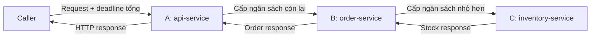

# Ngân sách thời gian từ yêu cầu đầu vào đến dịch vụ cuối

Một request trong hệ thống microservices thường không kết thúc ở dịch vụ nhận request đầu tiên. Ví dụ, `api-service` nhận `GET /orders/42`, gọi `order-service`, rồi `order-service` gọi tiếp `inventory-service`. Spring Cloud LoadBalancer giúp mỗi client chọn `ServiceInstance` theo service ID, nhưng **không tự xác định tổng thời gian mà chuỗi lời gọi được phép tiêu thụ**. Nếu mỗi hop chỉ cấu hình timeout riêng, một request có thể chờ quá lâu so với mức mà người dùng chấp nhận, nhất là khi có retry.

**Ngân sách thời gian đầu-cuối (end-to-end time budget)** là giới hạn dành cho toàn bộ hành trình: từ lúc request đi vào hệ thống đến khi trả response hoặc kết thúc bằng lỗi. Từ ngân sách này, các dịch vụ phải quyết định còn bao nhiêu thời gian cho xử lý cục bộ, discovery, chờ connection pool, kết nối mạng, HTTP response, retry và trả kết quả về caller.

Chủ đề này thuộc nhóm **Thời gian chờ** trong Spring Cloud LoadBalancer: ngoài việc cấu hình `RestClient`, `RestTemplate`, `WebClient` và OpenFeign gọi đúng service ID, ta cần bảo đảm **mọi lần thử và mọi hop đều cùng chịu một deadline có kiểm soát**.

## 1. Phân biệt timeout, deadline và time budget

Ba khái niệm thường bị dùng lẫn:

| Khái niệm | Ý nghĩa | Ví dụ |
|---|---|---|
| **Timeout** | Thời gian tối đa cho một thao tác hoặc một giai đoạn | Kết nối TCP tối đa 200 ms |
| **Deadline** | Mốc cuối cùng mà công việc phải hoàn thành | Request phải xong trước mốc kết thúc được tính từ khi nhận |
| **Time budget** | Khoảng thời gian còn được phép sử dụng trước deadline | Còn 480 ms để gọi tiếp và tổng hợp response |

Nếu request có ngân sách 1.000 ms và đã tiêu thụ 350 ms, phần còn lại **không phải 1.000 ms mới**:

\[
T_{\mathrm{remaining}}=\max(0,\ T_{\mathrm{budget}}-T_{\mathrm{elapsed}})
\]

Trong một tiến trình Java, nên tính `elapsed` bằng đồng hồ **đơn điệu** như `System.nanoTime()` để tránh lệch khi giờ hệ thống được điều chỉnh. Đồng hồ lịch (epoch milliseconds) hữu ích khi trao đổi một deadline giữa máy khác nhau, nhưng chỉ an toàn khi đã xét **clock skew**, độ tin cậy của header và thời gian truyền qua mạng.

Ví dụ:

```text
T=0 ms     api-service bắt đầu xử lý; budget = 1.000 ms
T=120 ms   hoàn tất xác thực; remaining = 880 ms
T=350 ms   chuẩn bị gọi order-service; remaining = 650 ms
T=780 ms   order-service trả response; remaining = 220 ms
T=930 ms   gửi response về caller; còn 70 ms dự phòng
```

Tại `T=350 ms`, việc cấp mới timeout **1.000 ms** cho downstream có thể khiến tổng thời gian vượt deadline ban đầu. Một lời gọi downstream phải được cấp thời gian **không lớn hơn phần còn lại**, đồng thời để lại khoảng dự phòng cho các bước phía sau.

## 2. Ngân sách xuyên qua chuỗi A → B → C

Giả sử:

- **A = api-service:** nhận request từ client bên ngoài và xác thực.
- **B = order-service:** tổng hợp đơn hàng và cần dữ liệu tồn kho.
- **C = inventory-service:** lấy tồn kho từ cache/database.



Đối với các bước **tuần tự**, thời gian theo đường găng (critical path) thường được cộng:

\[
T_{\mathrm{end\text{-}to\text{-}end}}
\approx T_A+T_{A\to B}+T_B+T_{B\to C}+T_C
+T_{\mathrm{return}}
\]

Mỗi thành phần ở đây phải được định nghĩa sao cho **không đếm trùng**: chẳng hạn `T_{A→B}` chỉ là chi phí network/transport, còn `T_B` bao gồm thời gian xử lý tại B nhưng không cộng lại thời gian B→C nếu đã tính riêng.

Trong các tầng thực tế, cấu hình “A chờ B tối đa 650 ms” **đã bao gồm** thời gian B gọi C. Vì vậy không được cộng thêm ngân sách 400 ms cho C vào ngân sách 650 ms của B như thể chúng độc lập.

### Ví dụ phân bổ một deadline 1.000 ms

| Thành phần trong hành trình | Ngân sách dự kiến | Giải thích |
|---|---:|---|
| Nhận request, xác thực, routing tại A | 80 ms | Bao gồm overhead ban đầu |
| Xử lý cục bộ của A | 70 ms | Kiểm tra input, chuẩn bị dữ liệu |
| **Toàn bộ lời gọi A → B** | **650 ms** | Bao gồm cả B → C và response từ B |
| Tổng hợp, serialize và trả response tại A | 100 ms | Không để downstream chiếm toàn bộ deadline |
| Dự phòng jitter/queue/scheduling | 100 ms | Hấp thụ biến động nhỏ |
| **Tổng** | **1.000 ms** | Không cấp lại 1.000 ms cho từng hop |

**Bên trong** ngân sách 650 ms của B, ta có thể dự tính:

| Phần việc của B | Ngân sách |
|---|---:|
| Xử lý/queue tại B | 70 ms |
| **B → C (bao gồm xử lý của C)** | **400 ms** |
| Tổng hợp dữ liệu và trả về A | 80 ms |
| Dự phòng tại B | 100 ms |
| **Tổng thuộc 650 ms của B** | **650 ms** |

Các số trên là **ví dụ minh họa**, không phải cấu hình tối ưu cho mọi ứng dụng. Chúng phải được hiệu chỉnh từ số liệu độ trễ và yêu cầu SLA/SLO thực tế.

### Khi B gọi C và D song song

Nếu B gửi hai lời gọi đồng thời tới `inventory-service` và `pricing-service`, thời gian chờ trên đường găng xấp xỉ **giá trị lớn hơn** của hai lời gọi, cộng overhead, thay vì tổng cả hai:

\[
T_{\mathrm{parallel}}\approx\max(T_{B\to C},T_{B\to D})
\]

Nhưng mỗi nhánh vẫn cần **cùng ranh giới deadline của request**, giới hạn connection pool/concurrency và chính sách lỗi thích hợp. Song song không tạo thêm thời gian; cũng không có nghĩa hai nhánh có quyền tiêu thụ độc lập toàn bộ ngân sách rồi cùng kéo dài request.

## 3. Những khoảng chờ thường bị bỏ sót

Một cấu hình chỉ có `connectTimeout` và `readTimeout` chưa bao phủ mọi thời gian có thể tiêu thụ:

| Giai đoạn | Ví dụ | Vì sao quan trọng |
|---|---|---|
| Hàng đợi trước khi xử lý | Request chờ thread/event loop hoặc giới hạn concurrency | Ngân sách có thể đã bị tiêu thụ trước khi gọi downstream |
| Chọn instance | Discovery, `ServiceInstanceListSupplier`, cache hoặc lọc health/zone | Thời gian chọn đích cũng nằm trên đường đi của request |
| Chờ connection pool | Đợi một kết nối rảnh | Có thể tốn thời gian dù connect timeout nhỏ |
| DNS và TCP connect | Phân giải tên máy, bắt tay TCP | Có thể thất bại trước khi gửi HTTP request |
| TLS handshake | Trao đổi chứng chỉ và thiết lập phiên an toàn | Không nhất thiết được bao phủ giống nhau ở mọi HTTP client |
| Gửi request | Upload payload lớn hoặc backpressure | Tốn thời gian ngay cả khi backend chưa xử lý |
| Chờ response / đọc body | Backend xử lý rồi truyền response | Read/response timeout không luôn là deadline tổng |
| Retry và backoff | Đợi rồi thực hiện một hoặc nhiều HTTP attempts | Có thể nhân nhiều lần tổng thời gian |
| Xử lý cuối và trả response | Gộp dữ liệu, serialize, ghi socket | Cần dự phòng sau khi downstream trả về |

Ví dụ, nếu `connectTimeout=200 ms` và `readTimeout=500 ms`, **không thể kết luận** toàn bộ request chắc chắn kết thúc trong 700 ms: còn chờ pool, số lần đọc, retry, xử lý dữ liệu và các tầng timeout khác. Ngữ nghĩa của `readTimeout` còn phụ thuộc HTTP transport và phiên bản thư viện.

### Timeout theo thao tác khác deadline đầu-cuối

| Cấu hình/khái niệm | Phạm vi chủ yếu | Có bảo đảm giới hạn toàn request? |
|---|---|---|
| TCP connect timeout | Một lần kết nối | Không |
| Pool acquisition timeout | Chờ lấy kết nối từ pool | Không |
| Read/response timeout | Chờ phản hồi hoặc khoảng im lặng khi đọc dữ liệu | Không luôn là deadline tổng |
| Per-attempt timeout | Một lần thử HTTP | Không nếu có nhiều attempts |
| **Overall deadline** | Toàn bộ công việc từ ingress đến response | Là giới hạn cần **chủ động thực thi** |

Để kiểm soát được đầu-cuối, cần **nhiều lớp**: timeout ở transport để bảo vệ socket, timeout trên mỗi attempt, và giới hạn tổng cho chuỗi xử lý/retry theo remaining budget.

## 4. Nguyên tắc cấp ngân sách cho hop kế tiếp

Tại thời điểm chuẩn bị gọi downstream, đặt:

- `R`: thời gian còn lại của request tại tiến trình hiện tại.
- `M`: thời gian muốn giữ lại để kiểm tra, tổng hợp và gửi response.
- `C`: giới hạn timeout cấu hình cho downstream theo chính sách.

Ngân sách tối đa cho hop tiếp theo:

\[
T_{\mathrm{hop}}=\min(C,\ R-M),\qquad
\text{chỉ gọi nếu }R>M
\]

Đây là giới hạn tổng cho **một hop**, không phải `connectTimeout` hay `readTimeout`. Nếu không còn `R-M>0`, **fail fast** thay vì vẫn gọi downstream rồi gần như chắc chắn timeout.

Ví dụ:

```text
Remaining của request tại A : 520 ms
Reserve trả response tại A   : 80 ms
Configured max cho A -> B    : 700 ms
=> Hop budget A -> B         : min(700, 520-80) = 440 ms
```

Tại B, nếu đã dùng hết 140 ms và còn khoảng 300 ms theo ngân sách nhận được, B không được cấp mới 600 ms cho C. B phải lấy phần còn lại trừ dự phòng của chính B.

### Sớm nhất trong các deadline là giới hạn thực sự

Một operation có thể chịu nhiều deadline:

1. Deadline đầu vào từ caller (nếu đã xác thực/chấp nhận).
2. Deadline tối đa theo chính sách của chính service.
3. Giới hạn theo endpoint/downstream.

**Giới hạn hiệu lực là deadline đến sớm nhất**, không phải deadline dài nhất. Nếu caller chỉ cho 300 ms thì policy nội bộ 2 giây không cho phép B tiếp tục làm việc thêm 2 giây sau khi caller đã hết ngân sách.

## 5. Đồng hồ đơn điệu và cách lưu budget trong Java

Trong **một JVM**, có thể lưu thời điểm kết thúc dưới dạng `System.nanoTime()` và tính thời gian còn lại tại thời điểm thực sự gửi request. Đoạn sau là helper **nội bộ tiến trình**, không phải một deadline epoch có thể gửi nguyên giá trị sang máy khác:

```java
import java.time.Duration;

public final class DeadlineBudget {

    private final long deadlineNanos;

    private DeadlineBudget(long deadlineNanos) {
        this.deadlineNanos = deadlineNanos;
    }

    public static DeadlineBudget after(Duration total) {
        if (total.isZero() || total.isNegative()
                || total.compareTo(Duration.ofMinutes(10)) > 0) {
            throw new IllegalArgumentException(
                    "Budget must be positive and <= 10 minutes");
        }
        return new DeadlineBudget(
                System.nanoTime() + total.toNanos());
    }

    public Duration remaining() {
        long nanos = deadlineNanos - System.nanoTime();
        return Duration.ofNanos(Math.max(0L, nanos));
    }

    public Duration forHop(Duration configuredMax, Duration reserve) {
        if (configuredMax.isZero() || configuredMax.isNegative()
                || reserve.isNegative()) {
            throw new IllegalArgumentException(
                    "Invalid hop timeout or reserve");
        }

        Duration available = remaining().minus(reserve);
        if (available.isZero() || available.isNegative()) {
            throw new DeadlineExceededException(
                    "No budget left for downstream");
        }
        return available.compareTo(configuredMax) < 0
                ? available : configuredMax;
    }

    public static final class DeadlineExceededException
            extends RuntimeException {
        DeadlineExceededException(String message) {
            super(message);
        }
    }
}
```

Ví dụ lớp này giới hạn budget đầu vào tối đa 10 phút để tránh số vô lý; **giới hạn cụ thể phải theo sản phẩm**, không lấy 10 phút làm mặc định cho API đồng bộ. Hiệu số của `System.nanoTime()` giúp đo thời gian trôi qua trong cùng tiến trình ngay cả khi đồng hồ hệ thống được chỉnh.

**Không gửi `deadlineNanos` sang service khác**: `System.nanoTime()` không có mốc chung giữa các máy và giá trị từ JVM A không thể dùng làm deadline tại JVM B. Chỉ chuyển một đại lượng có ngữ nghĩa rõ ràng như **remaining budget** hoặc deadline epoch được xác thực và có xử lý clock skew.

## 6. Truyền ngân sách giữa các dịch vụ: nguyên tắc và rủi ro

HTTP không tự cung cấp một quy tắc end-to-end deadline thống nhất cho mọi thư viện Spring Cloud. Có thể thiết kế một header nội bộ, ví dụ:

```http
GET /api/v1/items/42 HTTP/1.1
Host: inventory-service
X-Request-Budget-Ms: 350
traceparent: 00-<trace-id>-<span-id>-01
```

Header ở đây là **giao thức minh họa do ứng dụng tự định nghĩa**, không phải một header mà Spring Cloud LoadBalancer tự động thêm hoặc tự động thực thi. `traceparent` tuân theo quy ước tracing (giá trị trong ví dụ là placeholder, không phải trace ID hợp lệ để sao chép).

Khi dùng remaining budget theo milliseconds:

1. Caller phải đo thời gian đã dùng, trừ phần dự phòng, rồi gửi giá trị **không vượt quá ngân sách thật sự còn lại**.
2. Receiver kiểm tra header đến từ tầng tin cậy, parse an toàn, giới hạn theo **max budget cục bộ** rồi bắt đầu đồng hồ đơn điệu mới.
3. Receiver tiếp tục trừ thời gian xử lý của chính nó trước khi gọi hop tiếp theo.
4. Caller vẫn cần thực thi **deadline của chính nó**: thời gian network transit từ A đến B không tự bị trừ khỏi một TTL số học mà B chỉ bắt đầu đếm lúc nhận.
5. Nếu độ chính xác của deadline xuyên máy quan trọng, cần giao thức deadline thống nhất (ví dụ deadline tuyệt đối với đồng hồ đồng bộ và bù clock skew), cộng với enforcement tại ingress và từng hop.

**Bảo mật:** không tin một header budget do client Internet tùy ý gửi. Nếu chấp nhận không kiểm tra, caller có thể yêu cầu thời gian quá dài và giữ tài nguyên, hoặc gửi ngân sách bất thường khiến hệ thống fail fast hàng loạt. Ở ingress, hãy quyết định budget từ SLO, route và người gọi đã được xác thực; khi chuyển tiếp giữa dịch vụ, nên ghi đè hoặc validate header ở biên tin cậy.

### Ví dụ receiver chặn giá trị header quá lớn

```java
import java.time.Duration;

final class IncomingBudget {

    private static final long MAX_MILLIS = 800;

    static DeadlineBudget create(String trustedHeader) {
        if (trustedHeader == null) {
            return DeadlineBudget.after(
                    Duration.ofMillis(MAX_MILLIS));
        }

        try {
            long value = Long.parseLong(trustedHeader);
            if (value <= 0) {
                throw new DeadlineBudget.DeadlineExceededException(
                        "Caller budget expired");
            }
            return DeadlineBudget.after(
                    Duration.ofMillis(Math.min(MAX_MILLIS, value)));
        } catch (NumberFormatException malformed) {
            throw new IllegalArgumentException(
                    "Invalid internal budget header", malformed);
        }
    }
}
```

Đoạn này giả định header đã đi qua tầng xác thực/chuẩn hóa **trước đó**. Với input Internet, cần xác định lại budget theo policy của ingress thay vì dùng trực tiếp `trustedHeader`. Nó là ví dụ giao thức **relative TTL**, không bảo đảm bù được thời gian header nằm trên mạng; deadline tổng thực tế vẫn do caller/ingress giám sát.

## 7. Thực thi budget với WebClient và Spring Cloud LoadBalancer

`WebClient` phù hợp để minh họa deadline động vì mỗi `Mono` là một pipeline bất đồng bộ. Ví dụ dịch vụ B dùng `@LoadBalanced WebClient.Builder` để gọi C bằng service ID:

```java
import org.springframework.cloud.client.loadbalancer.LoadBalanced;
import org.springframework.context.annotation.Bean;
import org.springframework.context.annotation.Configuration;
import org.springframework.web.reactive.function.client.WebClient;

@Configuration
class WebClientConfiguration {

    @Bean
    @LoadBalanced
    WebClient.Builder loadBalancedWebClientBuilder() {
        return WebClient.builder();
    }
}
```

Client gọi `inventory-service` có thể dùng budget cho **toàn bộ hop**, không chỉ timeout khi đọc body:

```java
import java.time.Duration;

import org.springframework.beans.factory.annotation.Qualifier;
import org.springframework.stereotype.Service;
import org.springframework.web.reactive.function.client.WebClient;
import reactor.core.publisher.Mono;

record StockDto(String itemId, int available) {
}

@Service
class InventoryGateway {

    private final WebClient client;

    InventoryGateway(
            @Qualifier("loadBalancedWebClientBuilder")
            WebClient.Builder builder) {
        this.client = builder
                .baseUrl("http://inventory-service")
                .build();
    }

    Mono<StockDto> getStock(
            String itemId, long artificialDelayMs, DeadlineBudget budget) {
        return Mono.defer(() -> {
            // Giữ 80 ms cho B tổng hợp dữ liệu và trả response.
            Duration allowed;
            try {
                allowed = budget.forHop(
                        Duration.ofMillis(400), Duration.ofMillis(80));
            } catch (DeadlineBudget.DeadlineExceededException expired) {
                return Mono.error(expired);
            }

            if (allowed.compareTo(Duration.ofMillis(1)) < 0) {
                return Mono.error(
                        new DeadlineBudget.DeadlineExceededException(
                                "Insufficient time for HTTP request"));
            }

            return client.get()
                    .uri(uri -> uri.path("/api/v1/stock/{id}")
                            .queryParam("delayMs", artificialDelayMs)
                            .build(itemId))
                    .header("X-Request-Budget-Ms",
                            Long.toString(allowed.toMillis()))
                    .retrieve()
                    .bodyToMono(StockDto.class)
                    .timeout(allowed);
        });
    }
}
```

Điểm quan trọng của đoạn code:

- `Mono.defer` tính `remaining` **tại thời điểm có subscription**, thay vì tính sớm khi mới xây một `Mono` rồi để nó nằm trong queue.
- `forHop` lấy giá trị **nhỏ hơn** giữa timeout cấu hình và remaining trừ reserve.
- HTTP URI vẫn dùng **service ID** và đi qua filter LoadBalancer để chọn `ServiceInstance`.
- Header budget được gửi cho C như một **gợi ý nội bộ đã được kiểm soát**; C phải tự xử lý nếu muốn hưởng lợi.
- `timeout(allowed)` giới hạn thời gian mà subscriber của B chờ kết quả hop. Nó bao gồm lựa chọn instance và thao tác HTTP nằm trong publisher đó, nhưng **không bảo đảm C dừng tính toán ngay khi B bỏ chờ**.

Để bảo vệ connection pool và socket, bên cạnh `Mono.timeout` còn cần cấu hình HTTP connector: connect timeout, response timeout, pending-acquire timeout, giới hạn connections. Với Reactor Netty hoặc HTTP client khác, tên và ý nghĩa chính xác của timeout cần đối chiếu phiên bản đang dùng.

### Tạo budget ở cửa vào của B

Một controller WebFlux minh họa cách tiếp nhận header đã được xác minh từ A, tạo deadline riêng trong JVM B và gọi C:

```java
import org.springframework.web.bind.annotation.GetMapping;
import org.springframework.web.bind.annotation.PathVariable;
import org.springframework.web.bind.annotation.RequestHeader;
import org.springframework.web.bind.annotation.RequestParam;
import org.springframework.web.bind.annotation.RestController;
import reactor.core.publisher.Mono;

@RestController
class StockProxyController {

    private final InventoryGateway gateway;

    StockProxyController(InventoryGateway gateway) {
        this.gateway = gateway;
    }

    @GetMapping("/api/v1/stock-proxy/{id}")
    Mono<StockDto> proxy(
            @PathVariable String id,
            @RequestParam(defaultValue = "50") long delayMs,
            @RequestHeader(
                    name = "X-Request-Budget-Ms",
                    required = false) String incomingBudget) {

        // Chỉ sử dụng header đã qua một tầng tin cậy.
        DeadlineBudget budget = IncomingBudget.create(incomingBudget);
        return Mono.defer(() -> {
            Duration remaining = budget.remaining();
            if (remaining.isZero()) {
                return Mono.error(
                        new DeadlineBudget.DeadlineExceededException(
                                "Request budget already expired"));
            }
            return gateway.getStock(id, delayMs, budget)
                    .timeout(remaining);
        });
    }
}
```

Với controller ví dụ, tầng ingress tin cậy phải lọc hoặc ghi đè `X-Request-Budget-Ms` trước khi client bên ngoài được phép gửi tới B. Nếu không có ingress, hãy coi header trong lab chỉ là dữ liệu kiểm thử; không nên dùng nguyên mẫu đó làm ranh giới an toàn của production.

`Mono.timeout` ở lớp controller và ở lớp gateway có **hai phạm vi khác nhau**: controller theo phần remaining của toàn bộ request tại B, gateway theo budget được cấp cho riêng hop B→C. Deadline nhỏ hơn sẽ kết thúc chờ trước.

## 8. Timeout của RestTemplate, RestClient và OpenFeign không thay thế deadline tổng

Spring Cloud LoadBalancer có thể được tích hợp với cả blocking và reactive HTTP clients. Ngân sách đầu-cuối vẫn là trách nhiệm của **caller và tầng điều phối**.

### 8.1. RestTemplate với connect/read timeout

Ví dụ đơn giản cho ứng dụng blocking:

```java
import org.springframework.cloud.client.loadbalancer.LoadBalanced;
import org.springframework.context.annotation.Bean;
import org.springframework.context.annotation.Configuration;
import org.springframework.http.client.SimpleClientHttpRequestFactory;
import org.springframework.web.client.RestTemplate;

@Configuration
class BlockingClientConfiguration {

    @Bean
    @LoadBalanced
    RestTemplate loadBalancedRestTemplate() {
        SimpleClientHttpRequestFactory factory =
                new SimpleClientHttpRequestFactory();
        factory.setConnectTimeout(200); // ms
        factory.setReadTimeout(450);    // ms
        return new RestTemplate(factory);
    }
}
```

Bean này đi qua tích hợp LoadBalancer khi gọi URL logic `http://inventory-service/...`. Nhưng `setReadTimeout(450)` không bảo đảm cả request từ A→B→C sẽ hoàn thành trong 450 ms: nó là một giới hạn của HTTP request factory; không phải thời gian còn lại động của request nghiệp vụ.

`SimpleClientHttpRequestFactory` dùng cho ví dụ học tập; môi trường production có thể cần HTTP client có pooling, giới hạn thời gian chờ pool, TLS và timeout thích hợp.

Với `RestClient`, cũng có thể chọn `ClientHttpRequestFactory` phù hợp và sử dụng `@LoadBalanced RestClient.Builder`. Thời gian còn lại động khó áp dụng chỉ bằng bean timeout cố định; nếu cần deadline cứng ở blocking stack, phải thiết kế **cơ chế bao ngoài** biết yêu cầu tổng, cancellation/interrupt có giới hạn và hành vi của HTTP transport. Không được giả định `Future.orTimeout` hoặc hủy future làm socket đang đọc lập tức dừng.

### 8.2. OpenFeign theo service ID

Spring Cloud OpenFeign có các cấu hình per-client, ví dụ:

```yaml
spring:
  cloud:
    openfeign:
      client:
        config:
          inventory-service:
            connectTimeout: 200
            readTimeout: 450
```

Trong Spring Cloud OpenFeign, hai giá trị này được biểu diễn bằng **milliseconds**. Chúng giới hạn các giai đoạn ở tầng Feign/HTTP client, nhưng **không phải deadline từ ingress** và không tự trừ thời gian đã dùng ở A.

`@FeignClient(name = "inventory-service")` có thể chọn instance thông qua Spring Cloud LoadBalancer; nếu không có instance khả dụng, tình huống lỗi có thể xảy ra **trước khi kết nối tới provider**. Phải phân biệt lỗi chọn đích, connect timeout, read timeout và HTTP 503 thực sự từ provider.

Trong nhiều cấu hình Spring Cloud OpenFeign, `Retryer.NEVER_RETRY` là mặc định. Đừng suy luận chỉ từ cấu hình `connectTimeout/readTimeout` rằng Feign sẽ tự retry hoặc luôn đổi instance khi gặp lỗi; các cơ chế đó cần được xác định và kiểm thử riêng.

### 8.3. Ma trận so sánh

| HTTP client / kỹ thuật | Timeout dễ cấu hình | Cần làm thêm để quản lý end-to-end budget |
|---|---|---|
| `RestTemplate` | Connect và read trên request factory | Deadline ở tầng caller, kiểm soát blocking, retry budget |
| `RestClient` | Request factory / transport timeouts | Deadline ở caller, cẩn thận khi cancel thao tác blocking |
| `WebClient` | Connector timeout và `Mono.timeout` | Tính remaining lúc subscribe, áp dụng budget toàn pipeline và từng hop |
| OpenFeign | `connectTimeout`, `readTimeout` theo client | Deadline tổng ở điều phối, kiểm soát retry và timeout của caller |
| Spring Cloud LoadBalancer | Chọn instance, discovery, supplier, retry nếu được cấu hình | Không thay thế overall deadline xuyên nhiều dịch vụ |

## 9. Retry phải nằm bên trong ngân sách

Retry làm tăng xác suất thành công khi lỗi tạm thời, nhưng cũng tiêu thụ ngân sách. Nếu A có 700 ms để gọi B, một cấu hình “mỗi attempt 400 ms, retry 2 lần” có thể vượt xa 700 ms dù từng attempt tuân thủ timeout riêng.

Một bất đẳng thức bảo thủ:

\[
\sum_{i=1}^{N} T_{\mathrm{attempt},i}
+\sum_{j=1}^{N-1} T_{\mathrm{backoff},j}
+T_{\mathrm{overhead}}
\le T_{\mathrm{hop}}
\]

Với `T_hop = 650 ms`, cấu hình hai attempts tối đa 250 ms và một backoff 80 ms cần khoảng **580 ms**, còn 70 ms cho overhead. Ngược lại, ba attempts × 300 ms cộng backoff 100 + 200 ms cần tới 1.200 ms, rõ ràng vượt giới hạn 650 ms.

**Quan trọng:** tổng thời gian thực tế không cố định. Network, scheduler và kết nối có overhead; vì vậy deadline tổng phải được **thực thi**, không chỉ dựa trên phép cộng tĩnh. Nếu remaining không đủ cho một lần thử hữu ích, cần dừng retry thay vì gọi để rồi chắc chắn bị timeout.

### Ví dụ WebClient giới hạn cả attempt lẫn tổng chuỗi retry

```java
import java.time.Duration;
import java.util.concurrent.TimeoutException;

import org.springframework.web.reactive.function.client.WebClientRequestException;
import org.springframework.web.reactive.function.client.WebClientResponseException;
import reactor.core.publisher.Mono;
import reactor.util.retry.Retry;

Mono<StockDto> fetchStockWithRetry(
        String itemId, DeadlineBudget budget, WebClient client) {
    return Mono.defer(() -> {
        Duration hopLimit;
        try {
            hopLimit = budget.forHop(
                    Duration.ofMillis(400), Duration.ofMillis(80));
        } catch (DeadlineBudget.DeadlineExceededException ex) {
            return Mono.error(ex);
        }

        return client.get()
                .uri("/api/v1/stock/{id}", itemId)
                .retrieve()
                .bodyToMono(StockDto.class)
                // Mỗi attempt không chờ quá 150 ms.
                .timeout(Duration.ofMillis(150))
                .retryWhen(Retry.backoff(1, Duration.ofMillis(50))
                        .filter(error -> error instanceof TimeoutException
                                || error instanceof WebClientRequestException
                                || (error instanceof WebClientResponseException http
                                    && (http.getStatusCode().value() == 502
                                    || http.getStatusCode().value() == 503
                                    || http.getStatusCode().value() == 504))))
                // Hai attempts + backoff vẫn cùng chịu hop deadline.
                .timeout(hopLimit);
    });
}
```

`Retry.backoff(1, ...)` ở đây cho phép **tối đa một retry** sau lần gọi ban đầu. Timeout 150 ms nằm **trước** `retryWhen` nên áp dụng cho từng attempt; `timeout(hopLimit)` nằm sau `retryWhen` để giới hạn toàn bộ chuỗi, bao gồm backoff. Trong ví dụ, `client` cần là WebClient đã tích hợp LoadBalancer nếu URI dùng service ID, hoặc là client có base URL phù hợp được truyền vào.

**Không có bảo đảm retry chọn instance khác**. Việc retry có tái thực hiện chọn instance hay không còn phụ thuộc tích hợp Spring Cloud LoadBalancer, loại HTTP client và chính sách hiện hành. Nếu vừa bật retry ở Feign/WebClient vừa bật retry ở lớp LoadBalancer hoặc circuit breaker, phải kiểm tra **số HTTP attempts thực tế**, tránh nhân retries ngoài ý muốn.

Với các thao tác ghi hoặc thanh toán, timeout không chứng minh server chưa xử lý request. Đừng retry thao tác không idempotent nếu chưa có idempotency key hoặc cơ chế chống trùng phù hợp.

## 10. Thực hành: đo deadline tại B khi C xử lý chậm

Bài lab sử dụng hai tiến trình:

| Dịch vụ | Địa chỉ | Vai trò |
|---|---|---|
| `order-service` (B) | `http://localhost:8081` | Nhận request có budget, kiểm tra remaining và gọi C |
| `inventory-service` (C) | `http://localhost:8091` | Cố ý tạo delay trước khi trả dữ liệu tồn kho |

Ở `order-service`, khai báo `inventory-service` bằng `SimpleDiscoveryClient` trong `application-lab.yml`:

```yaml
server:
  port: 8081

spring:
  application:
    name: order-service
  cloud:
    discovery:
      client:
        simple:
          instances:
            inventory-service:
              - uri: http://localhost:8091
```

Ứng dụng B cần `spring-boot-starter-webflux`, `spring-cloud-starter-loadbalancer` và Spring Cloud BOM tương thích với Spring Boot. C có thể dùng Spring Boot WebFlux. `StockDto` là cùng một contract dữ liệu giữa hai dự án; trong lab có thể khai báo `record StockDto(String itemId, int available) {}` ở mỗi bên.

### 10.1. Provider C tạo delay có kiểm soát

Trong `inventory-service`:

```java
import java.time.Duration;

import org.springframework.web.bind.annotation.GetMapping;
import org.springframework.web.bind.annotation.PathVariable;
import org.springframework.web.bind.annotation.RequestParam;
import org.springframework.web.bind.annotation.RestController;
import reactor.core.publisher.Mono;

record StockDto(String itemId, int available) {
}

@RestController
class InventoryDemoController {

    @GetMapping("/api/v1/stock/{id}")
    Mono<StockDto> stock(
            @PathVariable String id,
            @RequestParam(defaultValue = "50") long delayMs) {
        long boundedDelay = Math.max(0L, Math.min(delayMs, 3000L));
        return Mono.delay(Duration.ofMillis(boundedDelay))
                .map(tick -> new StockDto(id, 12));
    }
}
```

`Mono.delay` tạo một delay bất đồng bộ phù hợp cho lab. Nó không mô phỏng đầy đủ CPU-bound work, chờ cơ sở dữ liệu hay queue saturation; mục đích chỉ là đo xem B có **tôn trọng deadline** hay không.

Chạy C và xác minh trực tiếp:

```bash
java -jar inventory-service.jar --server.port=8091
```

```bash
curl -i 'http://localhost:8091/api/v1/stock/42?delayMs=100'
```

### 10.2. Ánh xạ deadline hết hạn thành phản hồi rõ ràng

Khi `Mono.timeout` phát `TimeoutException`, nếu không có xử lý riêng, framework có thể trả về HTTP 500 chung. Dịch vụ B nên ánh xạ lỗi downstream timeout theo API contract, ví dụ `504 Gateway Timeout`:

```java
import java.util.Map;
import java.util.concurrent.TimeoutException;

import org.springframework.http.HttpStatus;
import org.springframework.http.ResponseEntity;
import org.springframework.web.bind.annotation.ExceptionHandler;
import org.springframework.web.bind.annotation.RestControllerAdvice;

@RestControllerAdvice
class DeadlineExceptionHandler {

    @ExceptionHandler({
        TimeoutException.class,
        DeadlineBudget.DeadlineExceededException.class
    })
    ResponseEntity<Map<String, String>> downstreamTimeout(Exception error) {
        return ResponseEntity.status(HttpStatus.GATEWAY_TIMEOUT)
                .body(Map.of("code", "DOWNSTREAM_DEADLINE_EXCEEDED"));
    }
}
```

Trong ví dụ, **504 là quyết định của API gateway/service B**, không phải mã mà WebClient tự động tạo khi gọi `.timeout()`. Với deadline hết trước khi B chọn instance, ứng dụng vẫn có thể chọn mã phản hồi khác theo hợp đồng của mình; phải phân biệt lỗi timeout downstream với request đầu vào không hợp lệ.

Chạy B với `StockProxyController` và `InventoryGateway` ở mục 7:

```bash
java -jar order-service.jar --spring.profiles.active=lab
```

### 10.3. Ba thí nghiệm về remaining budget

**Trường hợp A — C xử lý đủ nhanh:**

```bash
curl -i -H 'X-Request-Budget-Ms: 600' \
  'http://localhost:8081/api/v1/stock-proxy/42?delayMs=80'
```

B nhận khoảng 600 ms. `forHop` chọn tối đa `min(400, 600 - 80) = 400 ms`. Với C chỉ chờ 80 ms và điều kiện mạng bình thường, kỳ vọng `200` và body `{"itemId":"42","available":12}`.

**Trường hợp B — C xử lý lâu hơn budget của hop:**

```bash
curl -i -H 'X-Request-Budget-Ms: 250' \
  'http://localhost:8081/api/v1/stock-proxy/42?delayMs=500'
```

Ngân sách hop của B xấp xỉ `min(400, 250 - 80) = 170 ms`. Sau khi vượt timeout, `InventoryGateway` phát lỗi; ví dụ `DeadlineExceptionHandler` chuyển thành `504`. Độ trễ toàn bộ không nhất thiết đúng tuyệt đối 170 ms do scheduling, HTTP và serialization.

**Trường hợp C — không đủ thời gian để bắt đầu:**

```bash
curl -i -H 'X-Request-Budget-Ms: 50' \
  'http://localhost:8081/api/v1/stock-proxy/42?delayMs=10'
```

B giữ `80 ms` dự phòng, nên remaining chỉ 50 ms khiến `forHop` từ chối gọi C **ngay tại client**. Kỳ vọng error handler trả `504` mà không phát HTTP request downstream. Đây là **fail fast có chủ đích**, tránh tạo tải vô ích.

Nếu muốn so sánh thời gian phía caller trên Linux/macOS:

```bash
curl --silent --show-error --output /dev/null \
  --write-out 'status=%{http_code} total=%{time_total}s\n' \
  -H 'X-Request-Budget-Ms: 250' \
  'http://localhost:8081/api/v1/stock-proxy/42?delayMs=500'
```

Lưu ý: số liệu `curl` đo **toàn bộ hành trình nhìn từ người gọi**, gồm cả độ trễ từ máy chạy curl tới B. Nó không đo riêng thời gian B dùng để chọn `ServiceInstance`, chờ C hoặc gộp response.

### 10.4. Kiểm chứng cancellation không phải rollback

Khi B hết thời gian chờ, subscription tới HTTP client có thể bị cancel và connector có thể đóng hoặc bỏ request; **không thể bảo đảm** C đã ngừng mọi công việc. Một request đến C có thể đã được xử lý trước khi B timeout, đặc biệt nếu C ghi database hoặc đẩy sự kiện. Trên mỗi hop cần xác định rõ cancellation, idempotency và việc bỏ kết quả muộn.

Nếu truyền header budget cho C, lab này chỉ **chứng minh B enforce deadline**; controller C hiện chưa đọc hoặc thực thi header. Muốn kiểm tra propagation end-to-end, cần thêm ngân sách và cơ chế cancel/timeout riêng tại C, rồi mở rộng với A nhận request từ user và áp dụng deadline bao ngoài.

## 11. Thử nghiệm các trường hợp thực tế khác

| Thử nghiệm | Mong đợi | Điều cần ghi nhận |
|---|---|---|
| C xử lý 50 ms, hop có 400 ms | Thành công | Service ID, instance, response duration |
| C xử lý 700 ms, hop có 300 ms | B hết deadline trước C | Timeout type, thời điểm cancel, HTTP status do B trả |
| B đã tốn 300 ms trước khi gọi C | Budget C nhỏ hơn so với lúc B vừa nhận | Giá trị remaining tại thời điểm gọi |
| C trả 503 ngay lập tức | Lỗi HTTP, không phải timeout nếu response kịp đến | HTTP status, exception, retry policy |
| Không có instance `inventory-service` | Lỗi chọn đích có thể xuất hiện trước HTTP | Discovery/supplier, LB event |
| Một instance không thể mở TCP | Connect error hoặc timeout | Host:port, connect timeout, transport exception |
| Client thử lại một lần | Tổng thời gian vẫn phải nằm dưới hop deadline | HTTP attempts và backoff thực tế |
| A gọi B rồi B gọi C | Deadline của B và C không được vượt deadline của A | Remaining truyền qua các hop |
| B gọi hai dịch vụ song song | Deadline theo đường găng và cancel khi cần | Tốc độ nhánh chậm hơn, concurrency, kết quả gộp |

Không chạy thí nghiệm tắt provider hoặc cố ý làm chậm ứng dụng trên môi trường production. Một bản sao đang xử lý dữ liệu thật có thể nhận thêm request bị retry do phép thử và gây ảnh hưởng cho người dùng khác.

## 12. Quan sát và phân loại nguồn timeout

Chỉ log `"timeout"` là không đủ: cần biết **deadline nào**, **ở hop nào** và **trước hay sau khi chọn instance**.

| Tín hiệu quan sát | Giúp trả lời |
|---|---|
| `traceId` / `spanId` | Request trải qua những dịch vụ nào? |
| `serviceId` và `selectedInstance` | LoadBalancer đã chọn instance nào? |
| `budgetInitialMs` | Ngân sách được cấp từ ingress là bao nhiêu? |
| `remainingBeforeCallMs` | Còn bao nhiêu thời gian khi bắt đầu downstream? |
| `hopLimitMs` và `reserveMs` | Vì sao caller chỉ cấp chừng đó thời gian? |
| `connectDuration`, `responseDuration` | Chậm ở kết nối hay chờ xử lý? |
| `attemptCount` / `retryBackoffMs` | Retry đã tiêu tốn bao nhiêu ngân sách? |
| `timeoutOrigin` | Deadline tổng, per-hop, connect, read hay pool-acquire? |
| `httpStatus` và `exceptionClass` | Là response 503/504 thật hay timeout của HTTP client? |
| `cancellationObserved` | Có nhìn thấy hủy request ở downstream không? |

Các tên field này là **gợi ý cho instrumentation ứng dụng**, không phải tất cả đều là metric mặc định Spring Cloud cung cấp. Nên kết hợp OpenTelemetry/Micrometer Observation hoặc hạ tầng tracing phù hợp để quan sát span A→B→C và request duration theo hop.

Không dùng `traceId`, `itemId` hoặc `remainingBeforeCallMs` của từng request làm **metric tag** không giới hạn: chúng làm tăng cardinality. Có thể ghi chi tiết trong trace/log có bảo vệ, còn metric chỉ phân nhóm theo service, loại timeout, status, bucket latency và trạng thái retry. Không ghi token, cookie hoặc dữ liệu khách hàng vào log.

### Phân biệt những kiểu “hết thời gian”

- **Caller deadline exceeded:** tầng ingress đã hết ngân sách; kết quả trả về có thể phụ thuộc caller còn đang chờ hay đã ngắt kết nối.
- **Connect timeout:** không thiết lập TCP trong thời gian cho phép, cần kiểm tra network và instance được chọn.
- **Read/response timeout:** có kết nối nhưng không nhận phản hồi đúng hạn; có thể do backend chậm hoặc lỗi mạng.
- **Pool acquisition timeout:** chờ lấy connection rảnh quá lâu; tăng thời gian chờ không khắc phục nguyên nhân thiếu tài nguyên.
- **HTTP 504 từ gateway:** là **response HTTP do một tầng trả về**, không tự chứng minh Java `TimeoutException` ở hop nào.
- **HTTP 503 từ provider/LoadBalancer:** biểu thị không sẵn sàng/không có đích trong một số trường hợp; không đồng nghĩa timeout.

Phân loại đúng giúp tránh “chữa cháy” bằng cách tăng mọi timeout. Nếu bottleneck do pool saturation hoặc retry storm, tăng timeout có thể giữ request lâu hơn và khiến hệ thống càng quá tải.

## 13. Những lỗi thiết kế ngân sách thời gian thường gặp

| Sai lầm | Hậu quả | Cách sửa |
|---|---|---|
| Đặt 2 giây timeout cho **mỗi** A→B, B→C, C→D trong request có SLO 2 giây | Tổng thời gian vượt SLO nhiều lần | Dùng **deadline chung** và remaining giảm theo từng hop |
| Không giữ dự phòng để trả response | Downstream vừa trả xong đã hết deadline | Trừ reserve trước khi cấp hop budget |
| Chỉ đặt connect timeout | Pool/response/read có thể chờ rất lâu | Bổ sung response/read, pool và overall timeout |
| Cấu hình retry nhiều tầng không đếm tổng attempts | Retry storm, chậm và tải tăng | Kiểm tra tổng retry budget và deadline |
| Gửi nguyên `System.nanoTime()` qua HTTP header | Đồng hồ không có epoch dùng chung giữa các JVM | Gửi budget có định nghĩa rõ hoặc deadline epoch có xử lý skew |
| Tin `X-Request-Budget-Ms` từ user Internet | Caller thao túng giới hạn tài nguyên | Ấn định budget ở ingress, validate trong biên tin cậy |
| Tính timeout khi tạo `Mono` rồi subscribe nhiều giây sau | Budget cũ không phản ánh thời gian đã trôi | Tính remaining tại thời điểm subscribe bằng `Mono.defer` |
| Cho rằng `Mono.timeout` chắc chắn dừng tác vụ ghi ở C | Side effect có thể vẫn hoàn tất sau khi caller bỏ chờ | Idempotency, cancellation-aware logic, deadline tại downstream |
| Timeout biến thành retry vô hạn | Vượt deadline, nhân tải upstream | Giới hạn attempts, backoff, total deadline và circuit breaker |
| Coi HTTP 504 là kết quả tự động của mọi timeout | Mapping API sai và chẩn đoán nhầm | Xác định lớp ném timeout và exception handler |

## 14. Quy trình thiết kế budget cho API mới

1. **Xác định SLO đầu-cuối.** Ví dụ 95% request hoàn tất dưới 1 giây; cần phân biệt SLO thống kê với **hard deadline** từng request. Không tự đặt hard timeout bằng đúng p95 mà chưa xét tỷ lệ lỗi.
2. **Vẽ dependency graph.** Xác định các hop tuần tự, song song, đường đi tối đa, điểm fan-out và các bước đọc/ghi cần hoàn tất.
3. **Đo thực tế.** Thu thập distribution của connect, pool, response, processing, queue, retries; không chỉ dùng trung bình. Độ trễ p95/p99 có thể khác lớn so với p50.
4. **Phân bổ và dự phòng.** Dành phần cho ingress, bảo mật, downstream quan trọng, serialize/response và jitter. Deadline của nhánh con phải nằm trong deadline của cha.
5. **Chọn timeout ở từng lớp.** Connect/read/response của transport, per-attempt timeout, tổng hop timeout và overall deadline.
6. **Thiết kế propagation.** Ưu tiên deadline/budget có ngữ nghĩa rõ, validate header ở biên tin cậy, tránh tạo lại ngân sách ở mỗi hop.
7. **Định nghĩa retry/fallback.** Chỉ retry lỗi có thể phục hồi và thao tác an toàn; dùng giới hạn số lần, backoff/jitter, circuit breaker và deadline chung.
8. **Đặt observability.** Ghi remaining, hop budget, instance được chọn, status, loại timeout, retry count và trace ID mà không tăng metric cardinality không kiểm soát.
9. **Kiểm thử lỗi có chủ đích.** Mô phỏng backend chậm, discovery rỗng, kết nối thất bại, retry và deadline gần hết; kiểm tra hệ thống fail fast khi cần.
10. **Đánh giá lại sau deploy.** So sánh tỉ lệ timeout, p95/p99 latency, tài nguyên và số lần retry với mục tiêu; điều chỉnh có dữ liệu thay vì tăng timeout hàng loạt.

## 15. Các điểm cần nhớ

- **Một request có một ngân sách đầu-cuối.** Không cấp lại ngân sách tối đa mới khi request đi qua service B hoặc C.
- **Remaining budget giảm theo thời gian thực**, gồm cả chờ queue, lựa chọn instance, kết nối, xử lý, retry và gửi response.
- **Downstream hop timeout ≤ remaining − reserve**; nếu không đủ thời gian, fail fast thay vì cố gọi.
- Timeout connect/read/response của `RestTemplate`, `RestClient`, `WebClient` hoặc OpenFeign **không tự thay thế** deadline xuyên nhiều hop.
- Trong JVM, dùng `System.nanoTime()` để đo khoảng thời gian; giữa JVM cần giao thức truyền budget/deadline rõ ràng và lưu ý clock skew, network transit, trust boundary.
- **Retry luôn tiêu thụ ngân sách.** Tính cả attempts, backoff và overhead; không mặc định mỗi retry chọn được instance khác.
- `Mono.timeout` có thể chấm dứt chờ ở caller nhưng **không bảo đảm hủy sạch mọi side effect** đã bắt đầu ở downstream.
- Theo dõi từng hop với service ID, `ServiceInstance`, remaining, status và timeout origin để phân biệt lỗi LoadBalancer, transport và backend.

**Kết luận:** thiết kế timeout trong hệ thống nhiều dịch vụ không phải đặt một con số thật lớn cho từng HTTP client. Cách bền vững hơn là bắt đầu từ **deadline của request đầu vào**, liên tục trừ thời gian đã sử dụng, chỉ cấp phần còn lại cho từng hop, giữ dự phòng và kiểm soát retries. Khi kết hợp nguyên tắc này với discovery, health check, thuật toán chọn `ServiceInstance` và observability của Spring Cloud LoadBalancer, hệ thống sẽ tránh được những request bị treo dây chuyền và xử lý sự cố có dự đoán hơn.
