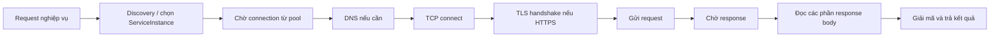
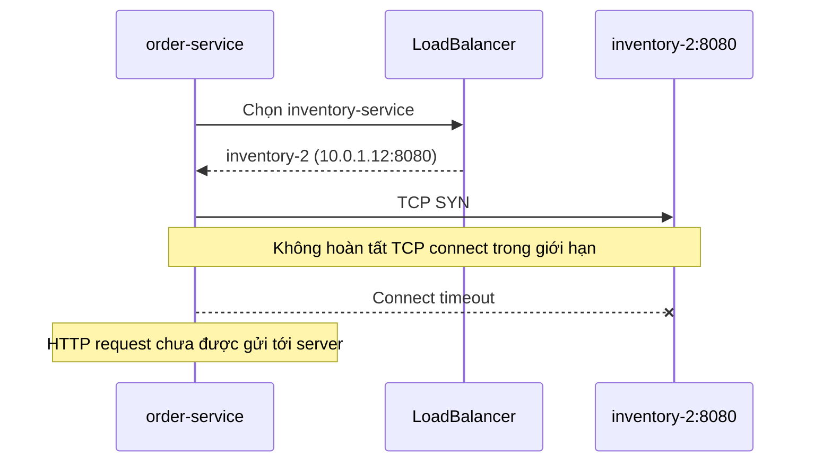
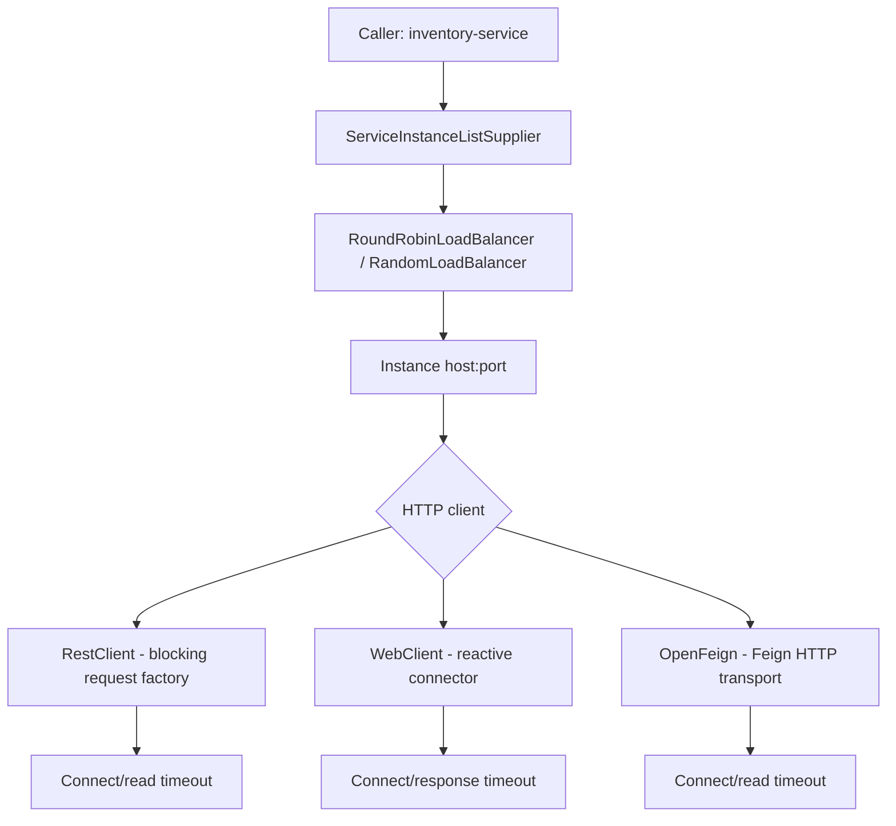
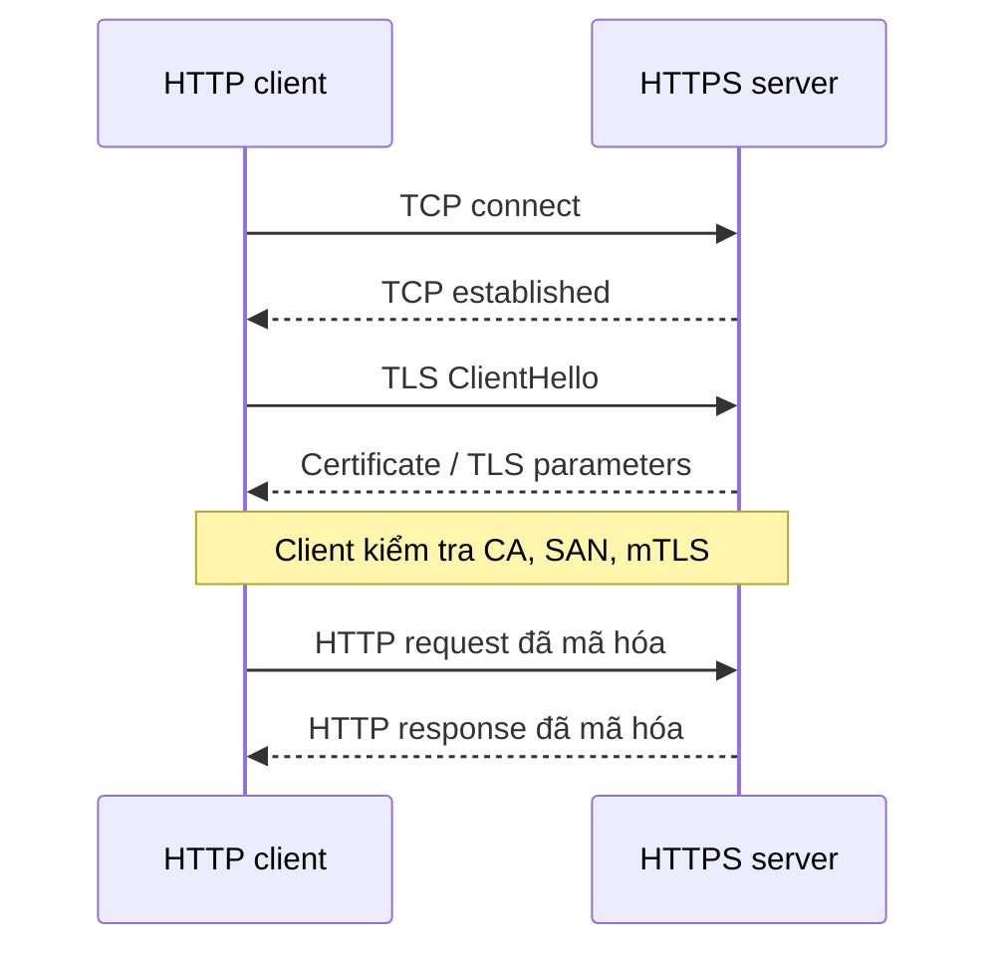
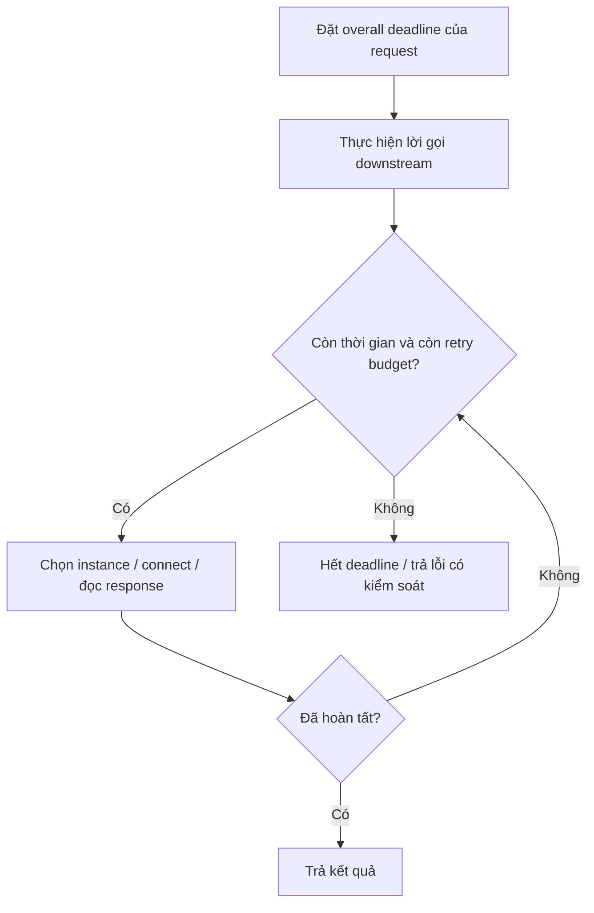

# Connect timeout, read timeout và response timeout

Một lời gọi HTTP giữa các microservice có thể thất bại dù `Spring Cloud LoadBalancer` đã chọn đúng `ServiceInstance`. Ví dụ, `order-service` gọi `inventory-service` để kiểm tra tồn kho: kết nối TCP tới instance bị chặn nên không thiết lập được; hoặc TCP kết nối thành công nhưng backend mất nhiều thời gian xử lý truy vấn; hoặc server bắt đầu trả dữ liệu rồi dừng gửi giữa chừng. Ba tình huống này thường được gọi chung là “timeout” nhưng cần những **giới hạn thời gian và cách chẩn đoán khác nhau**.

Trong chương **Thời gian chờ** của module Spring Cloud LoadBalancer, bài học giải thích cặn kẽ **connect timeout**, **read timeout** và **response timeout**, các điểm dễ nhầm khi tích hợp `RestClient`, `WebClient` và `OpenFeign`, cùng nguyên tắc đặt timeout khi đã có discovery, health check, connection pool và retry. Mục tiêu là giới hạn thời gian gọi dịch vụ một cách có chủ đích mà không che giấu nguyên nhân hoặc làm quá tải hệ thống bằng retry.

## 1. Timeout xảy ra ở giai đoạn nào?

Một lời gọi HTTP qua LoadBalancer thường đi qua các bước sau:



Không phải request nào cũng thực hiện toàn bộ các bước. Khi HTTP keep-alive connection còn hiệu lực, HTTP client có thể **tái sử dụng socket** và bỏ qua TCP connect cùng TLS handshake cho request đó. Nếu URI instance là IP, bước DNS cho tên instance có thể không xảy ra. Nếu request dùng HTTP/2, nhiều stream có thể chia sẻ một kết nối; lúc đó pool và socket timeout có thêm đặc tính riêng.

| Giai đoạn | Timeout / giới hạn liên quan | Trách nhiệm chính |
|---|---|---|
| Lấy danh sách instance từ discovery | Thời gian chờ của discovery provider, supplier hoặc deadline phía caller. | Service discovery / Spring Cloud LoadBalancer. |
| Chờ connection sẵn có từ pool | Pool acquisition / connection request timeout. | HTTP transport và connection manager. |
| Phân giải DNS | DNS resolver timeout hoặc timeout của hệ thống; tùy HTTP client. | Resolver / HTTP transport / OS. |
| Thiết lập TCP socket | **Connect timeout**. | HTTP transport. |
| Bắt tay TLS | SSL/TLS handshake timeout hoặc deadline tổng; tùy transport. | TLS/HTTP transport. |
| Chờ server bắt đầu trả HTTP response | Một số dạng **response timeout**, read timeout hoặc giới hạn chờ response headers. | HTTP client/transport. |
| Chờ byte/chunk tiếp theo của response | **Read timeout**, response-inactivity timeout hoặc cơ chế tương tự. | HTTP client/transport. |
| Toàn bộ logical operation | **Overall timeout / deadline**. | Tầng nghiệp vụ/orchestration hoặc client nếu hỗ trợ. |

**Điểm mấu chốt:** connect/read/response timeout không phải ba biến cấu hình thay thế nhau. Mỗi tên còn có **ngữ nghĩa phụ thuộc thư viện HTTP**. Cần đọc tài liệu của HTTP engine đang chạy, không chỉ thuộc tên property.

## 2. Connect timeout: giới hạn việc thiết lập TCP connection

**Connect timeout** là thời gian tối đa mà HTTP client chờ **thiết lập một kết nối TCP mới** tới remote endpoint đã chọn, theo cơ chế của transport. Nếu kết nối không hoàn tất trong giới hạn, client báo lỗi; không có HTTP response từ backend.

Ví dụ LoadBalancer chọn `10.0.1.12:8080`. Network policy hoặc firewall làm gói kết nối TCP bị bỏ qua. Caller cố thiết lập socket và hết connect timeout trước khi gửi được `GET /api/products/P-1001`.



### Các giới hạn của connect timeout

- **Thông thường không bao trùm DNS lookup**: DNS có thể tốn thời gian trước khi bắt đầu TCP connect, tùy HTTP client/resolver.
- **Không nhất thiết bao trùm TLS handshake**: TCP connect có thể thành công nhưng xác minh certificate, mTLS hoặc TLS negotiation tiếp tục bị treo/lỗi.
- **Không áp dụng khi reuse connection**: nếu socket đã tồn tại trong pool, request có thể chuyển thẳng đến bước gửi HTTP.
- **Không đồng nghĩa connection refused**: `Connection refused` thường xảy ra khi đích chủ động từ chối kết nối và có thể thất bại ngay, không phải chờ đến hết timeout.
- **Có thể lặp trên nhiều địa chỉ IP hoặc nhiều attempt**, tùy DNS và chính sách HTTP client. Không mặc định một logical request chỉ có đúng một khoảng connect timeout.

Khi cấu hình, hãy phân biệt lỗi TCP connect do network với lỗi “không tìm thấy instance” từ LoadBalancer. Nếu `ServiceInstanceListSupplier` trả danh sách rỗng thì **chưa có remote endpoint để TCP connect**; đổi connect timeout không tạo thêm instance.

## 3. Read timeout: chờ dữ liệu trên kết nối đã thiết lập

Trong nhiều HTTP client đồng bộ dùng socket timeout, **read timeout** (thường tương đương socket read timeout) giới hạn thời gian một thao tác đọc **chờ dữ liệu** từ connection đã thiết lập. Nếu trong khoảng này không có byte mới đáp ứng thao tác đọc, client báo lỗi, ví dụ `SocketTimeoutException: Read timed out`.

Ví dụ TCP connect đã hoàn tất, request đã được gửi:

```text
t=0 ms      TCP connection đã sẵn sàng
t=20 ms     Client gửi GET /api/products/P-1001
t=20..5020  Backend không gửi được dữ liệu nào cho thao tác đọc
t≈5020 ms   Read timeout 5 giây, client từ bỏ việc chờ
```

Read timeout có thể gặp ở **hai tình huống khác nhau**: chưa nhận được response header/byte đầu tiên, hoặc đã nhận một phần response nhưng đang chờ chunk tiếp theo. Chính xác khoảng nào được đo phải theo request factory/HTTP engine.

### Read timeout không nhất thiết là giới hạn toàn bộ response

Giả sử HTTP server trả body dạng nhiều chunk, cứ 4 giây có một chunk, còn read timeout là 5 giây. Nếu transport reset thời gian chờ theo từng thao tác đọc hoặc theo khoảng không có dữ liệu, response có thể tiếp tục nhiều phút mà **không bao giờ vi phạm read timeout**. Đây là lý do không thể khẳng định “`readTimeout=5000` thì toàn bộ HTTP request phải xong trong 5 giây”.

Đối với streaming, SSE hoặc tải file lớn, cần thêm **overall deadline** khi nghiệp vụ cần kết thúc trong một khoảng cố định; nhưng với stream chủ đích chạy dài hạn, timeout toàn bộ lại có thể không phù hợp. Định nghĩa SLA của từng loại request trước khi chọn.

## 4. Response timeout: tên gọi giống nhau, ngữ nghĩa không luôn giống nhau

**Response timeout** có thể chỉ khoảng chờ response xuất hiện hoặc giới hạn thời gian không nhận dữ liệu response, tùy thư viện. Đây không phải một thông số HTTP chung được mọi Java client định nghĩa giống nhau.

Ví dụ trong **Reactor Netty**, `HttpClient.responseTimeout(Duration)` thiết lập thời gian cho phép tối đa **giữa các thao tác đọc ở mức mạng khi đang nhận một response**, theo ngữ nghĩa API của phiên bản đó. Vì vậy cần hiểu nó gần với **response read inactivity timeout** hơn là một deadline tuyệt đối cho toàn bộ logical operation.

Trong một số HTTP engine/gateway khác, “response timeout” có thể là thời gian chờ **response headers**, **time to first byte (TTFB)**, hoặc khoảng thời gian chờ request hoàn tất. Không áp dụng một định nghĩa cho tất cả các nhà cung cấp.

| Khái niệm | Điểm bắt đầu / kết thúc cần hỏi rõ | Kết luận sai thường gặp |
|---|---|---|
| Connect timeout | Thời gian cố thiết lập TCP mới. | “TCP connect timeout sẽ bảo vệ cả TLS handshake và mọi lần đọc response.” |
| Read timeout | Thời gian chờ dữ liệu của thao tác đọc/socket, tùy implementation. | “Read timeout là tổng thời gian API được phép xử lý.” |
| Response timeout | Có thể là khoảng chờ phản hồi/response read theo API cụ thể. | “Ở RestClient, WebClient và Feign, response timeout luôn là cùng một property.” |
| Overall deadline | Từ khi bắt đầu logical operation đến khi hoàn tất/cancel, có thể bao gồm retries. | “Chỉ đặt response timeout là đã có end-to-end deadline.” |

### Hai mốc thời gian cần phân biệt

**Time to first byte (TTFB)**: từ một mốc gửi request tới lúc nhận byte đầu tiên của response, tùy cách metric tính; phản ánh phần lớn thời gian server bắt đầu phản hồi và chi phí đường mạng.

**Thời gian nhận toàn bộ response**: từ request hoặc lúc bắt đầu đọc đến khi tiêu thụ hết body và hoàn tất xử lý. Với body lớn hoặc streaming, thời gian này có thể rất dài dù TTFB nhỏ.

Để đo SLA của lời gọi nghiệp vụ, thường cần quan sát cả TTFB, total duration và các giai đoạn connection; không chỉ một timeout setting.

## 5. Ví dụ thời gian cho ba kiểu lỗi

Giả sử client có connect timeout 2 giây, read/response inactivity timeout 5 giây và tổng deadline nghiệp vụ 8 giây.

| Kịch bản | Diễn biến | Giới hạn có thể kích hoạt |
|---|---|---|
| Backend bị firewall drop TCP | Không thiết lập TCP được trong 2 giây. | **Connect timeout**. |
| TCP thành công, backend không trả byte response trong 5 giây. | Client đợi đọc response. | **Read / response timeout**, tùy transport. |
| Backend trả chunk mỗi 4 giây và kéo dài 30 giây. | Không có khoảng trống dữ liệu vượt 5 giây. | Read/response inactivity có thể không xảy ra, nhưng **overall deadline 8 giây** có thể kích hoạt. |
| Pool bão hòa, chờ acquire 3 giây rồi mới kết nối. | Connect 2 giây và read 5 giây chưa bao gồm riêng chờ pool. | **Pool acquire timeout** hoặc **overall deadline** nếu có. |
| TCP xong, TLS handshake chờ quá lâu. | Kết nối mạng đã mở nhưng chưa gửi HTTP. | TLS handshake timeout hoặc overall deadline, tùy client. |

Những con số chỉ mang tính minh họa; không phải thời gian cộng tuyến tính trong mọi runtime. Nếu có DNS, connection reuse, proxy hoặc retry, đường đi thực tế có thể khác và một số timeout không hề được sử dụng.

## 6. Kết nối với Spring Cloud LoadBalancer

Spring Cloud LoadBalancer có trách nhiệm **tìm và chọn ServiceInstance**, chẳng hạn từ `SimpleDiscoveryClient`, Eureka hoặc Consul; nó không tự thay thế cấu hình socket timeout của HTTP engine bên dưới.



Những tình huống thường bị hiểu sai:

- **Không có instance**: LoadBalancer không thể chọn đích; không nên chẩn đoán bằng cách tăng read timeout.
- **Instance có trong cache nhưng đã chết**: LoadBalancer vẫn có thể chọn instance cũ, dẫn đến connect timeout/refused; cần quan sát discovery freshness, health check và quá trình drain.
- **Instance được chọn nhưng backend xử lý chậm**: connect đã thành công, timeout phản hồi/đọc có thể xảy ra. Cần kiểm tra backend, database và thời gian request giữ connection.
- **LoadBalancer phải chờ discovery quá lâu**: connect/read timeout của HTTP transport chưa chắc giới hạn giai đoạn khám phá instance.

Nếu client có retry, một logical request có thể chọn nhiều instance hoặc chọn lại cùng instance tùy chính sách. Đừng coi connect timeout của một attempt là deadline của **toàn bộ** phép gọi.

## 7. RestClient: cấu hình connect và read timeout ở request factory

`RestClient` là HTTP client đồng bộ xuất hiện từ Spring Framework 6.1 (thường cùng Spring Boot 3.2 trở lên). Nó sử dụng một `ClientHttpRequestFactory`; phương thức cấu hình timeout phụ thuộc factory thực tế như `SimpleClientHttpRequestFactory`, JDK HTTP client hoặc Apache HttpComponents.

Ví dụ minh họa dùng `SimpleClientHttpRequestFactory`, phù hợp cho một bài lab đồng bộ trên các phiên bản Spring Framework hỗ trợ những setter này:

```java
import org.springframework.cloud.client.loadbalancer.LoadBalanced;
import org.springframework.context.annotation.Bean;
import org.springframework.context.annotation.Configuration;
import org.springframework.http.client.SimpleClientHttpRequestFactory;
import org.springframework.web.client.RestClient;

@Configuration(proxyBeanMethods = false)
class InventoryRestClientConfig {

    @Bean
    @LoadBalanced
    RestClient.Builder loadBalancedRestClientBuilder() {
        SimpleClientHttpRequestFactory factory =
                new SimpleClientHttpRequestFactory();
        factory.setConnectTimeout(2_000); // millis
        factory.setReadTimeout(5_000);    // millis

        return RestClient.builder().requestFactory(factory);
    }
}
```

Sau đó inject đúng bean:

```java
import org.springframework.cloud.client.loadbalancer.LoadBalanced;
import org.springframework.stereotype.Service;
import org.springframework.web.client.RestClient;

@Service
class InventoryRestGateway {

    private final RestClient client;

    InventoryRestGateway(@LoadBalanced RestClient.Builder builder) {
        this.client = builder.baseUrl("http://inventory-service").build();
    }

    ProductView getProduct(String id) {
        return client.get()
                .uri("/api/products/{id}", id)
                .retrieve()
                .body(ProductView.class);
    }
}
```

`ProductView` là DTO do ứng dụng định nghĩa. Hai timeout trên là giới hạn **do request factory này áp dụng**, không phải property chung của mọi `RestClient`. Với Apache HttpClient hoặc JDK request factory, cần sử dụng API/timeout tương ứng của factory đó.

**Lưu ý về Spring Boot customization:** Tự gọi `RestClient.builder()` có thể không nhận mọi HTTP client customizer, observation, SSL hoặc codec mà Spring Boot gắn lên builder do Boot quản lý. Trong dự án thực, hãy dùng configurer/customizer theo phiên bản Boot để giữ cả cấu hình HTTP transport lẫn `@LoadBalanced`; kiểm tra bean thực sự được inject, không chỉ cấu hình được viết.

### Điều gì nếu RestClient đang dùng connection pool?

`SimpleClientHttpRequestFactory` dùng cơ chế dựa trên JDK `HttpURLConnection`, không có API per-route pool tương đương Apache HC5. Nếu dự án chuyển sang `HttpComponentsClientHttpRequestFactory` hoặc transport khác, còn có timeout **chờ cấp connection từ pool**. Trong nhiều HTTP engine, một connect timeout **không** đặt giới hạn cho thời gian đợi pool; cần cấu hình connection request timeout riêng.

## 8. WebClient + Reactor Netty: connect và response timeout

`WebClient` dùng `ClientHttpConnector`. Với Reactor Netty, có thể cấu hình `HttpClient` trước khi gắn vào một builder được Spring Cloud đánh dấu `@LoadBalanced`:

```java
import java.time.Duration;
import io.netty.channel.ChannelOption;
import org.springframework.cloud.client.loadbalancer.LoadBalanced;
import org.springframework.context.annotation.Bean;
import org.springframework.context.annotation.Configuration;
import org.springframework.http.client.reactive.ReactorClientHttpConnector;
import org.springframework.web.reactive.function.client.WebClient;
import reactor.netty.http.client.HttpClient;

@Configuration(proxyBeanMethods = false)
class InventoryWebClientConfig {

    @Bean
    @LoadBalanced
    WebClient.Builder inventoryLoadBalancedBuilder() {
        HttpClient http = HttpClient.create()
                .option(ChannelOption.CONNECT_TIMEOUT_MILLIS, 2_000)
                .responseTimeout(Duration.ofSeconds(5));

        return WebClient.builder()
                .clientConnector(new ReactorClientHttpConnector(http));
    }
}
```

Sử dụng builder từ Spring context:

```java
import org.springframework.cloud.client.loadbalancer.LoadBalanced;
import org.springframework.stereotype.Service;
import org.springframework.web.reactive.function.client.WebClient;
import reactor.core.publisher.Mono;

@Service
class InventoryWebGateway {

    private final WebClient client;

    InventoryWebGateway(@LoadBalanced WebClient.Builder builder) {
        this.client = builder.baseUrl("http://inventory-service").build();
    }

    Mono<ProductView> getProduct(String id) {
        return client.get()
                .uri("/api/products/{id}", id)
                .retrieve()
                .bodyToMono(ProductView.class);
    }
}
```

Ở đây:

- `CONNECT_TIMEOUT_MILLIS` giới hạn việc thiết lập TCP connection mới theo Reactor Netty/Netty.
- `responseTimeout(Duration.ofSeconds(5))` là timeout phản hồi theo cơ chế của Reactor Netty, **không phải mặc nhiên tổng thời gian logic** từ khi gọi `getProduct()` đến khi mọi dữ liệu được giải mã.
- `Mono<ProductView>` là publisher bất đồng bộ; request thật diễn ra khi có subscription.
- Nếu ứng dụng dùng `JdkClientHttpConnector`, `JettyClientHttpConnector` hay `HttpComponentsClientHttpConnector`, các thuộc tính Reactor Netty ở trên **không áp dụng**.

Đừng gộp `WebClient responseTimeout` với `OpenFeign readTimeout` mà không nêu rõ engine, vì ý nghĩa đo khoảng thời gian có thể khác nhau. Tương tự, việc bổ sung dependency Reactor Netty không bảo đảm một builder đang dùng connector này nếu đã có custom client connector khác.

### Thiết lập overall deadline cho một Mono

Khi API nghiệp vụ cần hoàn tất trong một khoảng cố định, có thể áp `timeout` của Reactor ở phía ngoài pipeline:

```java
Mono<ProductView> result = client.get()
        .uri("/api/products/{id}", id)
        .retrieve()
        .bodyToMono(ProductView.class)
        .timeout(Duration.ofSeconds(8));
```

Giới hạn này áp dụng khi publisher được subscribe; nó có thể hủy subscription khi quá thời gian. Tuy nhiên, hủy client-side subscription **không bảo đảm backend đã dừng hoặc rollback công việc**. Nếu có retry, đặt deadline tổng **bên ngoài** phần retry khi muốn giới hạn tất cả attempt, thay vì để mỗi attempt nhận toàn bộ ngân sách mới.

## 9. OpenFeign: connectTimeout và readTimeout theo Feign client

Với Spring Cloud OpenFeign đồng bộ, hai thuộc tính thường dùng trong cấu hình theo service ID/client name:

```yaml
spring:
  cloud:
    openfeign:
      client:
        config:
          inventory-service:
            connectTimeout: 2000
            readTimeout: 5000
```

Trong các release train Spring Cloud OpenFeign sử dụng dạng cấu hình này, giá trị ví dụ tính bằng **mili giây**. `connectTimeout` liên quan kết nối TCP; `readTimeout` giới hạn chờ nhận dữ liệu phản hồi theo hành vi HTTP client thực tế. Khi dùng `Apache HttpClient 5` hoặc `OkHttp` làm transport Feign, hãy kiểm chứng timeout được áp vào delegate client như mong đợi.

Một Feign interface:

```java
import org.springframework.cloud.openfeign.FeignClient;
import org.springframework.web.bind.annotation.GetMapping;
import org.springframework.web.bind.annotation.PathVariable;

@FeignClient(name = "inventory-service")
public interface InventoryFeignClient {
    @GetMapping("/api/products/{id}")
    ProductView getProduct(@PathVariable("id") String productId);
}
```

Nếu đặt một `url` cố định cho `@FeignClient` hoặc cấu hình client URL cố định, cơ chế phân giải service ID có thể không còn tham gia như khi chỉ dùng `name`. Cấu hình timeout vẫn có thể có hiệu lực, nhưng **không còn là bằng chứng** rằng Spring Cloud LoadBalancer đang chọn instance.

### Vì sao Feign read timeout không phải total SLA?

Ví dụ backend đã chấp nhận request rồi đợi database 4 giây mới trả dữ liệu. `readTimeout: 5000` có thể cho phép request này thành công nếu không có giới hạn khác. Nhưng nếu trước đó client chờ pool 3 giây hoặc đã có nhiều lần retry, tổng thời gian vẫn có thể vượt 5 giây đáng kể. Ngoài ra, phản hồi chia chunk có thể khiến timeout đọc hoạt động theo khoảng giữa các lần nhận data, tùy HTTP transport.

OpenFeign không định nghĩa một “response timeout” chung có ngữ nghĩa giống Reactor Netty `responseTimeout`. Nếu cần SLA tổng, hãy thực hiện **deadline ở tầng orchestration hoặc cơ chế overall-call timeout được transport hỗ trợ**, rồi kiểm chứng hành vi cancellation và retry.

## 10. Chờ connection từ pool không phải connect timeout

Khi một HTTP engine có connection pool, client có thể phải chờ một connection rảnh trước khi mở kết nối TCP mới hoặc tái sử dụng socket. Trong Reactor Netty, bước này được điều khiển bởi các thông số của `ConnectionProvider`, không phải `ChannelOption.CONNECT_TIMEOUT_MILLIS`:

```java
import java.time.Duration;
import reactor.netty.resources.ConnectionProvider;

ConnectionProvider provider = ConnectionProvider
        .builder("inventory-pool")
        .maxConnections(40)
        .pendingAcquireMaxCount(80)
        .pendingAcquireTimeout(Duration.ofMillis(600))
        .build();
```

Gắn provider này vào `HttpClient.create(provider)`, sau đó cấu hình connector của WebClient. Khi 40 connection đang bận đối với một remote pool và không thể cấp thêm, các request mới có thể phải chờ acquire. Nếu chờ quá 600 ms hoặc hàng đợi pending đầy, request thất bại **trước khi thực sự gửi HTTP**, mặc dù `connectTimeout=2000 ms` chưa hề bị vi phạm.

Các con số ở trên chỉ minh họa: `maxConnections` của Reactor Netty thường áp dụng theo remote pool và `pendingAcquireMaxCount` giới hạn request đợi. Không nên coi 40 là max toàn ứng dụng khi có nhiều instance/connection provider.

Với **Apache HttpClient 5** dùng bởi OpenFeign hoặc RestClient, connection manager có thể cung cấp giới hạn max total, max per-route và connection-request timeout. Hành vi của một route có thể bị giới hạn riêng, ngay cả khi tổng manager chưa đạt max.

| Triệu chứng | Timeout cần xem trước |
|---|---|
| Lỗi `PoolAcquireTimeoutException`/pending acquisition ở WebClient | `pendingAcquireTimeout` và capacity của `ConnectionProvider`. |
| Apache HC5 báo không lấy được connection từ manager đúng hạn | Connection request / pool lease timeout của HC5. |
| Pool cấp connection nhưng remote chưa bắt tay TCP được | Connect timeout. |
| Pool trả socket cũ nhưng server đã đóng idle connection | Keep-alive/idle eviction, stale connection và lỗi I/O, không chỉ connect timeout. |
| TCP kết nối được, response bắt đầu rất muộn | Read/response timeout và bottleneck backend. |

**Tăng connect timeout không sửa được pool starvation.** Nếu backend xử lý chậm khiến mọi connection bận, tăng pool vô hạn có thể làm server càng quá tải. Hãy đo pool active/idle/pending, giới hạn concurrency và xác định nguyên nhân giữ connection lâu.

## 11. DNS và TLS có những timeout riêng

### DNS lookup

Khi HTTP client phải phân giải tên host, DNS có thể xảy ra trước TCP connect. Nhiều client có DNS resolver riêng hoặc dựa vào hệ thống, và connect timeout không bảo đảm giới hạn đầy đủ giai đoạn này. Khi `inventory-service` là service ID logic và LoadBalancer trả hostname như `inventory-2.internal`, vẫn có thể có thêm DNS lookup để tìm IP thực.

Nếu log cho thấy thời gian dài trước cả lần TCP connect, kiểm tra DNS resolution, search domains, cache/TTL DNS, records, mạng DNS và cơ chế resolver của HTTP engine. Đừng chỉ tăng `connectTimeout` rồi nghĩ đã khắc phục.

### TLS handshake

Sau TCP connect tới một HTTPS endpoint, HTTP transport còn phải đàm phán TLS, kiểm tra certificate chain, hostname/SAN, thời hạn certificate và có thể gửi client certificate nếu mTLS.



Khi TLS không hoàn tất, lỗi thường là `SSLHandshakeException`, certificate verification error hoặc handshake timeout, **không có response HTTP để đọc**. Một connect timeout 2 giây không có nghĩa TLS handshake nhất thiết chỉ được phép thêm 0 giây hoặc gói gọn trong 2 giây.

Đặt handshake timeout bằng API của transport nếu hỗ trợ, đồng thời có overall deadline cho logical operation khi cần. Không tắt hostname/certificate verification để né lỗi timeout hoặc cấu hình TLS sai.

## 12. Response headers, body và trường hợp streaming

Một server có thể gửi response theo nhiều cách:

1. Nhận request rồi tính toán 6 giây trước khi gửi header.
2. Gửi header sau 50 ms, rồi tạo JSON body trong 6 giây.
3. Gửi một phần body, dừng 10 giây rồi gửi tiếp.
4. Giữ SSE/stream mở hàng giờ, cứ vài giây gửi một event.

Mặc dù đều được người gọi cảm nhận là “chờ phản hồi”, những trường hợp này không giống nhau.

| Kiểu phản hồi | Chỉ số nên quan sát | Timeout cần chọn |
|---|---|---|
| Header/byte đầu tiên đến rất chậm | Time to first byte hoặc response-header latency. | Response-header/read timeout hoặc deadline tổng theo transport. |
| Body lớn, nhận đều nhưng lâu | Total duration, body size, throughput. | Deadline tổng nếu nghiệp vụ phải hoàn tất; read inactivity khi không có dữ liệu. |
| Body đang truyền thì dừng gửi | Khoảng thời gian giữa các thao tác đọc, socket inactivity. | Read timeout hoặc Reactor Netty response timeout. |
| SSE/stream chủ đích kéo dài | Event gap, stream uptime, cancel/error rate. | Idle timeout theo sự kiện và cơ chế heartbeat; không dùng deadline ngắn tùy tiện. |

Với `WebClient`, `bodyToMono(...)` thường tiêu thụ một body hữu hạn rồi phát kết quả; `bodyToFlux(...)` có thể biểu diễn nhiều phần hoặc luồng kéo dài. Nếu response có `Transfer-Encoding: chunked` hoặc HTTP/2 streaming, đừng mặc định read timeout là giới hạn tổng số giây kể từ request.

### Một ví dụ chuỗi sự kiện

```text
0s       TCP/HTTP request đã sẵn sàng
1s       Nhận response headers
4s       Nhận chunk 1
8s       Nhận chunk 2
12s      Nhận chunk 3
16s      Response hoàn tất
```

Nếu read inactivity timeout là 5 giây và mọi khoảng không nhận dữ liệu đều nhỏ hơn 5 giây, **có thể không phát sinh read timeout dù tổng request kéo dài 16 giây**. Ngược lại, nếu server dừng giữa chunk 1 và chunk 2 trong 7 giây, timeout có thể xảy ra ở giai đoạn đọc body. Các mốc cụ thể tùy cách HTTP transport nhận bytes và áp dụng timeout.

## 13. Overall deadline: bảo vệ tổng thời gian của nghiệp vụ

Một dịch vụ thường cần trả lời cho caller trước một deadline. Ví dụ API tạo báo giá có ngân sách 1,5 giây và bên trong phải gọi hai downstream services. Nếu mỗi downstream được phép chờ connect 2 giây + read 5 giây và retry thêm nhiều lần, ngân sách API tổng không có ý nghĩa.

**Overall deadline** là thời điểm cuối cùng cho cả logical operation, tính cả việc chọn instance, xếp hàng pool, connect, đọc response và các attempt retry. Ngân sách còn lại cần được chia/điều phối giữa các downstream calls.



Phân biệt:

- **Per-attempt timeout:** giới hạn một lần kết nối hoặc chờ response.
- **Per-hop budget:** giới hạn một lần gọi downstream, kể cả retries ở hop đó.
- **End-to-end deadline:** giới hạn toàn bộ phép gọi nghiệp vụ qua nhiều dịch vụ.

Với Reactor, một `Mono.timeout(...)` ở **ngoài toán tử retry** có thể giới hạn thời gian chờ toàn bộ pipeline đã tạo. Nếu đặt timeout **trước** `retryWhen(...)`, mỗi subscription lại có thể nhận một khoảng thời gian timeout mới. Cần xác minh thứ tự operator và đảm bảo hủy request hiệu quả.

Ví dụ **không có retry**:

```java
Mono<ProductView> product = webClient.get()
        .uri("/api/products/{id}", id)
        .retrieve()
        .bodyToMono(ProductView.class)
        .timeout(Duration.ofMillis(1500));
```

Timeout của publisher không thể bảo đảm backend rollback một thao tác đã chạy. Với workflow ghi dữ liệu, thiết kế idempotency, transaction boundary và cơ chế xử lý kết quả không chắc chắn.

## 14. Retry khiến timeout có thể kéo dài và tăng tải

Giả sử một Feign client có `connectTimeout=2000` và `readTimeout=5000`. Nếu hệ thống cho phép tối đa ba attempt (lần đầu + hai retry), tổng thời gian lý thuyết có thể vượt đáng kể 7 giây do:

- Mỗi attempt lại có thể phát sinh chờ pool, DNS, TCP connect, TLS và đọc response.
- Có backoff giữa các lần retry.
- LoadBalancer có thể chọn instance khác hoặc cùng instance tùy chính sách.
- Nếu response được đọc theo các chunk, read timeout không nhất thiết giới hạn toàn bộ body.

Do đó **không lấy số retry nhân với một timeout đơn lẻ rồi coi đó là một SLA chắc chắn**. Hãy xác định tổng deadline, attempt budget, backoff và xem thời gian thực tế ở từng giai đoạn.

### Hai kiểu retry cần nhận diện

1. **Retry của HTTP client/Feign/Reactor pipeline:** có thể thử lại request ở cùng hoặc khác URL/instance tùy cách cấu hình.
2. **Retry của Spring Cloud LoadBalancer:** nếu được bật và có dependency/chính sách hỗ trợ, có thể kết hợp lựa chọn instance cho attempt tiếp theo.

Spring Cloud OpenFeign trong nhiều phiên bản có default `Retryer.NEVER_RETRY`, khác với một số mặc định của Feign core; WebClient không mặc nhiên retry mọi lỗi; RestClient cũng không tự biết nghiệp vụ nào được retry. Không suy ra có retry chỉ vì project đã có LoadBalancer.

**Thao tác ghi là trường hợp cần thận trọng nhất.** Backend có thể đã ghi dữ liệu nhưng caller bị read timeout ngay trước khi nhận response. Retry `POST` mà không có idempotency key hoặc deduplication có thể nhân đôi side effect. Một lỗi read timeout không xác nhận request chưa từng được thực thi.

### Retry storm và pool saturation

Khi hàng loạt request cùng bị read timeout vì backend bão hòa, retry ngay lập tức có thể:

- Làm tăng số request xuống backend vào thời điểm nó yếu nhất.
- Chiếm thêm connection, tăng pending acquisition queue.
- Tạo thêm connect/response timeout.
- Làm p95/p99 và lỗi dây chuyền tệ hơn.

Nên giới hạn retry theo lỗi tạm thời, dùng backoff/jitter nếu cần, áp dụng concurrency/bulkhead và gắn mọi attempt vào deadline tổng.

## 15. Timeout có thể bị hiểu nhầm thành HTTP status

Một timeout ở HTTP client **không nhất thiết có HTTP response**. Khi không thể kết nối hoặc không đọc được phản hồi, client thường ném exception tương ứng. Ngược lại, một proxy hoặc gateway có thể chủ động trả về HTTP status khi chính nó hết thời gian chờ upstream.

| Dấu hiệu | Nguồn có thể phát sinh | Có HTTP response không? |
|---|---|---|
| `ConnectTimeoutException` hoặc `SocketTimeoutException: connect timed out` | HTTP transport chờ TCP connect quá lâu. | Thường **không** có response từ upstream. |
| `SocketTimeoutException: Read timed out` | HTTP transport chờ dữ liệu đọc. | Có thể chưa có hoặc đã nhận một phần response; không chắc có body hoàn chỉnh. |
| Reactor Netty `ReadTimeoutException`/response timeout | Tầng đọc response theo timeout đã cấu hình. | Có thể kết thúc publisher bằng error, không có response hoàn chỉnh. |
| Pool acquisition timeout | Chờ connection từ manager quá lâu. | Request thường chưa được gửi lên backend. |
| HTTP `408 Request Timeout` | Server/proxy trả mã liên quan timeout ở phía nhận request. | **Có** một HTTP status 408. |
| HTTP `504 Gateway Timeout` | Gateway/proxy timeout khi chờ upstream. | **Có** HTTP response do gateway/proxy tạo. |
| HTTP `503 Service Unavailable` | Có thể từ gateway/backend hoặc LoadBalancer không tìm thấy instance, tùy tích hợp. | Có thể có HTTP response; không đồng nghĩa connect/read timeout. |

Không tự động gắn mọi timeout của caller vào `504`: trong nhiều trường hợp chính caller nhận exception và ứng dụng phải quyết định cách ánh xạ lỗi ra API của mình. Cũng không kết luận mọi `504` đều do Java client read timeout; nó có thể do ingress hoặc API gateway có giới hạn riêng.

## 16. Đặt timeout theo loại lời gọi

| Loại lời gọi | Đặc điểm | Nguyên tắc đặt timeout |
|---|---|---|
| `GET` đọc dữ liệu cache/metadata nhanh | Response nhỏ, SLA ngắn. | Connect ngắn hợp lý, read/response theo p99, overall deadline rõ. |
| `GET` truy vấn database phức tạp | Server-side processing dài hơn. | Read timeout phù hợp ngân sách hợp lệ, theo dõi query p95/p99. |
| `POST` ghi đơn hàng/thanh toán | Có side effect, response trễ có thể đi kèm commit thành công. | Timeout gắn với idempotency và quy trình kiểm tra trạng thái, không retry mù quáng. |
| Upload/download file lớn | Body truyền lâu, throughput biến động. | Read inactivity và overall budget cho kích thước file; cân nhắc streaming. |
| SSE/stream dài hạn | Response cố ý không kết thúc sớm. | Idle heartbeat/stream lifecycle phù hợp; tránh deadline ngắn cho toàn luồng nếu không cần. |
| Health check | Response ngắn và đơn giản. | Timeout ngắn có kiểm chứng, không gây false negative khi network chậm. |

Đặt timeout quá thấp tạo lỗi giả vào giờ cao điểm; đặt quá cao làm connection/thread/pool bị giữ lâu, giảm năng lực chịu tải. Nên bắt đầu từ **SLO**, số liệu p95/p99, topology mạng, backoff/retry và nguồn lực của caller/backend.

Một công thức tư duy hữu ích:

```text
Ngân sách một lời gọi <= deadline còn lại của request cha
Ngân sách retry + backoff + các attempt <= deadline của lời gọi
Ngưỡng timeout phải xét tail latency, không chỉ latency trung bình
```

Không suy ra rằng tổng connect timeout + read timeout luôn bằng tổng request time; nhiều giai đoạn và các lần thử có thể lặp hoặc không xảy ra.

## 17. Quan sát timeout đúng tầng

Để chẩn đoán, nên ghi được **request đã tới giai đoạn nào**:

| Tín hiệu / metric | Dùng để phân biệt |
|---|---|
| Service ID, selected instance, attempt | LoadBalancer đã chọn đích nào; lỗi thuộc lần thử nào. |
| Discovery lookup duration, supplier result count | Có mất thời gian trước khi có đích không? |
| Connection pool active/idle/pending và acquire latency | Có chờ pool trước khi connect không? |
| DNS lookup/connect/TLS handshake duration nếu transport cung cấp | Có nghẽn network hay cấu hình TLS không? |
| TTFB / response headers time | Backend có bắt đầu trả response chậm không? |
| Total response body duration và bytes | Response chậm do body lớn, streaming hay backend ngừng gửi? |
| Connect timeout, read timeout, response timeout count | Loại lỗi nào tăng và phân bố theo instance? |
| Overall deadline exceeded / cancellation | Bao nhiêu request vượt ngân sách tổng? |
| Retry attempts, backoff, success after retry | Retry đang cứu lỗi tạm thời hay khuếch đại tải? |
| HTTP status từ backend/proxy | Có phải một status HTTP hợp lệ thay vì client-side exception? |

Spring Boot Actuator, Micrometer, Reactor Netty metrics, Feign Micrometer và tracing có thể cung cấp nhiều phần thông tin trên tùy starter và version. **Không giả định** mọi metric nêu trên có sẵn sau khi chỉ thêm Actuator: cần kiểm tra loại HTTP engine và cách instrument.

Ví dụ một log/tracing record hữu ích:

```text
serviceId=inventory-service
instanceId=inventory-2
attempt=1
phase=READ_RESPONSE
durationMs=5012
outcome=READ_TIMEOUT
traceId=73b2
```

Đây là format minh họa, không phải log mặc định của LoadBalancer. Không log token, cookie, private key hoặc request body nhạy cảm; tránh gắn product ID/URL động thành metric label có cardinality không giới hạn.

### Đo ở cả caller và server

Nếu caller ghi nhận read timeout nhưng server không thấy request ID, có thể lỗi xảy ra trước khi backend nhận request hoặc log server không đầy đủ. Nếu server thấy request đã xử lý xong rồi caller mới timeout, cần kiểm tra network, proxy, body transfer và client processing. Nếu server xử lý xong **sau** lúc caller hủy, phải quyết định cách quản lý công việc bỏ dở hoặc kết quả nghiệp vụ đã commit.

Chỉ nhìn log timeout phía caller thường không đủ để kết luận backend “không chạy”.

## 18. Bài thực hành: tái hiện từng loại timeout

Chuẩn bị `order-service` làm caller và hai instance `inventory-service` ở `localhost:8081` và `localhost:8082`. Có thể dùng `SimpleDiscoveryClient`:

```yaml
spring:
  cloud:
    discovery:
      client:
        simple:
          instances:
            inventory-service:
              - uri: http://localhost:8081
              - uri: http://localhost:8082
```

Đối với WebFlux test backend, có thể tạo một endpoint phản hồi chậm **không block event loop**:

```java
import java.time.Duration;
import org.springframework.web.bind.annotation.GetMapping;
import org.springframework.web.bind.annotation.RestController;
import reactor.core.publisher.Mono;

@RestController
class TimeoutLabController {

    @GetMapping("/lab/slow-response")
    Mono<String> slowResponse() {
        return Mono.just("ready")
                .delayElement(Duration.ofSeconds(7));
    }
}
```

Với caller có response/read timeout 5 giây, endpoint trả response sau khoảng 7 giây là một cách hữu ích để thử **chờ phản hồi quá lâu**. Tất nhiên kết quả cụ thể phụ thuộc HTTP client, cấu hình timeout và thời điểm thao tác đọc bắt đầu.

### Kịch bản A — Baseline

1. Tạo endpoint nhanh `/lab/fast` và gọi thành công qua service ID.
2. Ghi instance được chọn, HTTP status, latency, retry count (nếu có).
3. Xác minh request đi qua LoadBalancer, không phải DNS resolution tình cờ đến host mang cùng tên.

### Kịch bản B — Read/response timeout

1. Đặt connect timeout 2 giây, read/response timeout 5 giây.
2. Gọi `/lab/slow-response` với server cố ý chờ 7 giây trước khi gửi body.
3. Quan sát exception/timing; xác minh TCP đã kết nối và request đã đến server.
4. Tăng giới hạn read/response lên 9 giây **chỉ trong lab**, gọi lại và xem response có thành công không.

### Kịch bản C — Connect timeout

1. Trong môi trường lab, dùng công cụ mô phỏng network fault như proxy thử nghiệm hoặc quy tắc firewall được phép, tạo tình huống **TCP connect không hoàn tất**.
2. Đặt connect timeout hữu hạn, quan sát lỗi phát sinh **trước khi HTTP request được gửi**.
3. So sánh với cổng không có process lắng nghe: trường hợp này có thể trả `Connection refused` ngay, không phải connect timeout.
4. Khôi phục network/proxy sau thử nghiệm và xác minh backend hoạt động bình thường.

**Không dùng một IP bất kỳ trên Internet hoặc thay đổi firewall production để tạo connect timeout.** Mạng thực có thể trả ngay lỗi unreachable/refused nên thời gian khác kỳ vọng.

### Kịch bản D — Pool acquisition timeout

1. Dùng Reactor Netty hoặc HC5 với pool/route limit nhỏ và pending acquire timeout ngắn trong lab.
2. Tạo nhiều request đồng thời đến endpoint chậm.
3. Quan sát số connection active/pending và lỗi chờ cấp connection.
4. Xác minh lỗi xảy ra **trước TCP connect mới**, để phân biệt với `CONNECT_TIMEOUT_MILLIS`.

### Kịch bản E — Streaming với khoảng nghỉ

Tạo một luồng trả nhiều chunk ở khoảng cách khác nhau, ví dụ 4 giây và 7 giây. Với read inactivity timeout 5 giây, thử xem trường hợp nào báo lỗi và trường hợp nào tiếp tục. Đừng dùng response body nhỏ đã gửi một lần để suy ra cách read timeout hoạt động cho streaming.

### Kịch bản F — Retry và overall deadline

1. Thiết lập retry tối đa một hoặc hai lần cho request **GET idempotent** khi điều kiện phù hợp.
2. Ghi attempt count, timeout từng attempt và tổng latency.
3. Đặt overall deadline ngắn hơn tổng timeout nhiều attempt có thể kéo dài.
4. Xác minh logical operation dừng theo deadline, không chờ lần retry vô hạn.

Ghi kết quả theo bảng:

| Kịch bản | Transport | Timeout liên quan | Lỗi / kết quả thực tế | Request đến server? | Tổng thời gian |
|---|---|---|---|---|---|
| Baseline | Ghi rõ | Ghi cấu hình | Đo thực tế | Xác minh | Đo thực tế |
| Connect | Ghi rõ | Connect | Đo thực tế | Xác minh | Đo thực tế |
| Read/response | Ghi rõ | Read/response | Đo thực tế | Xác minh | Đo thực tế |
| Pool | Ghi rõ | Acquire | Đo thực tế | Xác minh | Đo thực tế |
| Retry/deadline | Ghi rõ | Attempt + overall | Đo thực tế | Xác minh | Đo thực tế |

Không điền số liệu đo không có thật; ghi version Framework/Boot/Cloud, HTTP engine, số instance, số caller và tải thử để có thể so sánh.

## 19. Bảng chẩn đoán nhanh

| Triệu chứng | Giả thuyết ưu tiên | Hành động kiểm tra |
|---|---|---|
| `UnknownHostException: inventory-service` | Client chưa dùng load-balanced builder/wrapper hoặc DNS không phân giải service ID. | Kiểm tra `@LoadBalanced`, `@FeignClient` URL và discovery. |
| `503` do không có instance | Supplier rỗng hoặc health check lọc hết. | Kiểm tra danh sách `ServiceInstance`; timeout TCP không giải quyết. |
| Kết nối bị refused ngay | Backend không lắng nghe trên host/port hoặc bị từ chối chủ động. | Kiểm tra remote URI/port và trạng thái server. |
| `ConnectTimeoutException` | TCP connect mới không hoàn tất kịp; mạng hoặc backend unreachable. | Xem DNS, network policy, firewall, target IP và thời gian connect. |
| SSL handshake lỗi hoặc treo | TLS trust/certificate/mTLS/handshake khác TCP connect. | Kiểm tra CA/SAN, client cert và TLS handshake timeout. |
| Pool acquire timeout | Pool per-route/total bão hòa, request chờ connection. | Theo dõi active/idle/pending, backend latency và concurrency. |
| Read timeout trước khi nhận header | Backend/proxy không phản hồi sớm hoặc mạng không nhận được byte. | So sánh TTFB, server request logs, timeout transport. |
| Read timeout giữa chừng | Stream ngưng gửi dữ liệu hoặc proxy/server cắt truyền. | Xem body chunks, keep-alive, network reset và read inactivity. |
| HTTP `504` | Gateway/proxy đã timeout upstream. | Kiểm tra timeout của gateway và upstream, không chỉ Java client. |
| Retry làm response chậm hơn nhiều | Mỗi attempt nhận timeout mới, cộng thêm backoff. | Thiết lập deadline tổng và giới hạn attempts. |
| Request ghi bị timeout nhưng dữ liệu đã lưu | Server commit trước khi response về. | Xác minh transaction/idempotency, không retry mù quáng. |
| Thấy timeout dù backend CPU thấp | Có thể nghẽn pool, DNS, TLS, database, proxy hoặc event-loop. | Đo timing theo pha trước khi tăng CPU hoặc timeout. |

## 20. Những hiểu lầm phổ biến

- **“Connect timeout là thời gian tối đa để toàn bộ request hoàn tất.”** Sai: nó giới hạn việc thiết lập TCP connection mới theo transport.
- **“Read timeout = thời gian download toàn bộ body.”** Sai với nhiều implementation: nó có thể là giới hạn **không nhận được dữ liệu** giữa các lần đọc.
- **“WebClient responseTimeout giống hệt Feign readTimeout.”** Không thể mặc định như vậy; phải xét HTTP engine và API tương ứng.
- **“Chỉ cần timeout 5 giây thì retry ba lần vẫn hết tối đa 5 giây.”** Sai nếu timeout đặt theo attempt mà không có overall deadline.
- **“Tăng timeout luôn làm hệ thống ổn định hơn.”** Không hẳn: tăng thời gian giữ connection/thread có thể làm quá tải kéo dài.
- **“TCP connect timeout nghĩa là backend đã nhận request nhưng không phản hồi.”** Sai: connect thất bại thường xảy ra **trước khi gửi HTTP request**.
- **“HTTP 504 luôn do Spring Cloud LoadBalancer trả.”** Sai: 504 thường từ gateway/proxy; cần truy nguồn phát status.
- **“Read timeout của POST chứng minh thao tác ghi chưa xảy ra.”** Sai: backend có thể đã commit trước lúc client hết thời gian chờ.
- **“Bật health check hoặc retry sẽ tự khắc phục timeout.”** Không: health check có thể lọc đích lỗi, retry có thể cứu lỗi tạm thời, nhưng cả hai không thay thế timeout và deadline phù hợp.

## 21. Checklist cấu hình timeout an toàn

- [ ] Phân biệt discovery, pool acquire, DNS, TCP connect, TLS handshake, response headers, body read và tổng deadline.
- [ ] Xác định HTTP engine **thực tế** đang dùng cho RestClient, WebClient hoặc OpenFeign.
- [ ] Hiểu `connectTimeout` không nhất thiết giới hạn DNS/TLS/pool acquisition.
- [ ] Hiểu `readTimeout` thường liên quan chờ dữ liệu, không mặc nhiên là tổng body duration.
- [ ] Kiểm tra chính xác ngữ nghĩa `responseTimeout` của HTTP engine đã chọn.
- [ ] Không giả định số giây giống nhau khi chuyển từ RestClient sang WebClient/Feign.
- [ ] Cấu hình pool acquisition timeout nếu HTTP engine sử dụng connection pool.
- [ ] Thiết lập deadline tổng từ SLO nghiệp vụ; phân bổ ngân sách cho downstream và retries.
- [ ] Phân biệt client-side exception với HTTP status từ backend/proxy.
- [ ] Quan sát selected instance, attempt, connect/read/response failures và latency theo từng giai đoạn.
- [ ] Kiểm tra health/discovery/cache nếu nhiều request chọn instance đã chết hoặc đang bị rút.
- [ ] Tránh tăng timeout/pool size mù quáng khi backend đang bão hòa.
- [ ] Chỉ retry có kiểm soát; bảo vệ idempotency đối với request ghi có side effect.
- [ ] Thử lỗi connect, read/response, pool acquire, streaming và overall deadline trong lab.
- [ ] Giữ nguyên yêu cầu bảo mật TLS, không dùng trust-all hoặc tắt hostname verification để “sửa” timeout.

**Kết luận:** **Connect timeout** kiểm soát việc thiết lập TCP connection, **read timeout** thường kiểm soát chờ nhận dữ liệu trên connection, còn **response timeout** phải được hiểu theo HTTP transport cụ thể — với Reactor Netty, nó liên quan tới khoảng thời gian đọc dữ liệu response. Không giới hạn nào trong số đó tự bảo đảm thời gian hoàn tất của toàn bộ nghiệp vụ. Khi Spring Cloud LoadBalancer chọn một `ServiceInstance`, cần phối hợp timeout của HTTP client, connection pool, discovery, retry và **overall deadline** để lời gọi liên dịch vụ vừa có thời hạn rõ ràng vừa có khả năng chẩn đoán đúng khi lỗi.
