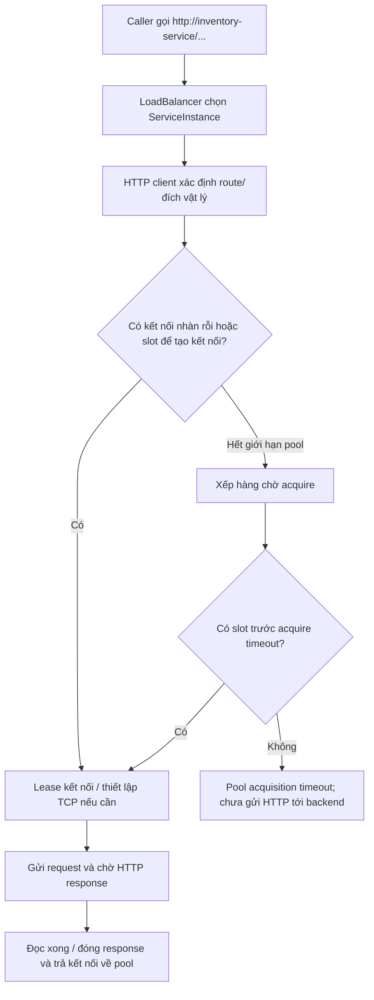
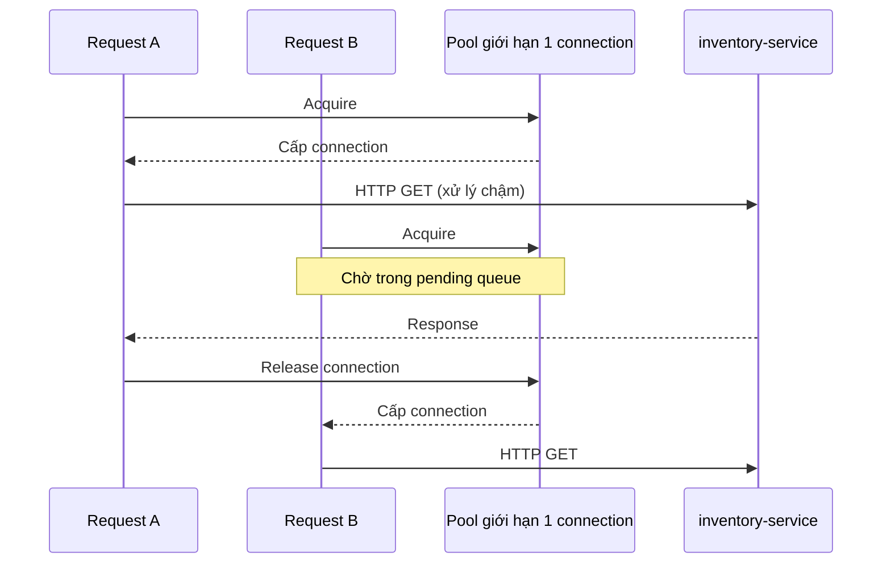

# Thời gian chờ lấy kết nối từ pool

## Mục tiêu

Một yêu cầu từ `order-service` đến `inventory-service` có thể chậm hoặc thất bại **trước khi bắt đầu thiết lập kết nối TCP**. Nguyên nhân không nhất thiết là server chậm, mạng lỗi hay Spring Cloud LoadBalancer chọn sai `ServiceInstance`. Nếu HTTP client dùng **connection pool** và pool đang hết kết nối có thể cấp phát, request phải xếp hàng chờ được *lease/acquire* một kết nối. Khi hết thời gian cho phép, request thất bại tại chính phía caller.

Thời gian chờ đó thường được gọi là **connection request timeout**, **connection acquisition timeout**, **pool acquisition timeout** hoặc **pending acquire timeout**, tùy HTTP client.

Sau bài học, bạn có thể:

- Phân biệt thời gian **chờ kết nối từ pool** với **connect timeout**, **read/response timeout** và **deadline tổng**.
- Hiểu giới hạn `max connections`, `max connections per route`, hàng đợi pending và cơ chế tái sử dụng kết nối.
- Cấu hình pool-acquire timeout với Apache HttpClient 5 cho `RestClient` và `RestTemplate`.
- Cấu hình `pendingAcquireTimeout` của Reactor Netty cho `WebClient`.
- Dùng property chính xác của Spring Cloud OpenFeign khi Feign chạy trên Apache HttpClient 5.
- Chẩn đoán pool saturation bằng metrics, lỗi timeout, số kết nối active/idle/pending và bài kiểm thử tải đồng thời.
- Đặt timeout, pool size và retry phù hợp với SLA, tránh làm hệ thống quá tải thêm.

## 1. Connection pool nằm ở đâu trong đường gọi LoadBalancer?

Trong hệ thống client-side load balancing, `RestClient`, `RestTemplate`, `WebClient` hoặc OpenFeign có thể gọi một URL logic:

```text
http://inventory-service/api/items/SKU-42
```

Spring Cloud LoadBalancer dùng `inventory-service` làm service ID, lấy danh sách instance từ discovery và chọn một `ServiceInstance`, chẳng hạn `10.20.1.12:8080`. **Sau bước lựa chọn**, HTTP client mới xử lý việc lấy hoặc tạo kết nối phù hợp với địa chỉ vật lý đã chọn.



**Pool HTTP connection không phải danh sách `ServiceInstance` của LoadBalancer.** Chúng là hai cấu trúc khác nhau:

| Thành phần | Dữ liệu quản lý | Vấn đề giải quyết |
|---|---|---|
| `ServiceInstanceListSupplier` | Instance: host, port, metadata, trạng thái danh sách | Chọn **backend nào** |
| LoadBalancer cache | Snapshot danh sách instance theo service ID | Giảm chi phí truy vấn discovery |
| HTTP connection pool | Kết nối TCP/TLS hoặc connection resource đến route/remote address | Tái sử dụng kết nối và giới hạn số kết nối đồng thời |
| Pool acquisition timeout | Thời gian request được phép đợi có connection resource | Giới hạn thời gian xếp hàng ở phía HTTP client |

Nếu thay `spring.cloud.loadbalancer.cache.ttl`, bạn đang thay cách giữ **danh sách instance**, không phải thời gian chờ lấy **HTTP connection**. Nếu thay `spring.cloud.loadbalancer.retry.*`, bạn đang tác động đến retry policy chứ không trực tiếp tăng số kết nối trong pool.

## 2. Bốn loại timeout không được đánh đồng

| Loại timeout | Bắt đầu ở đâu? | Hết hạn nghĩa là gì? | Ví dụ tên cấu hình |
|---|---|---|---|
| **Pool acquire/connection request** | Khi HTTP client xin một connection resource từ pool | Không lấy được connection resource trong thời gian chờ | HC5 `connectionRequestTimeout`; Reactor Netty `pendingAcquireTimeout` |
| **Connect timeout** | Khi thực hiện kết nối mạng mới đến host/port | Không thiết lập được kết nối trong giới hạn | `connectTimeout`; `CONNECT_TIMEOUT_MILLIS` |
| **Read/response timeout** | Trong giai đoạn chờ/đọc response theo ngữ nghĩa của HTTP stack | Backend không phản hồi/tiếp tục truyền dữ liệu đúng hạn | `readTimeout`, `responseTimeout` |
| **Deadline / tổng thời gian gọi** | Từ khi bắt đầu một operation đến khi hoàn thành hoặc bị hủy | Toàn bộ operation vượt ngân sách thời gian | Deadline ở tầng application; Reactor `Mono.timeout(...)` |

Ví dụ minh họa:

```text
t=0 ms      Caller bắt đầu một HTTP operation
t=0–450     Chờ lấy connection từ pool (pending acquire)
t=450–520   Thiết lập TCP/TLS mới nếu chưa có kết nối tái sử dụng
t=520–850   Backend xử lý và trả response
t=850       Đọc xong, giải phóng resource về pool
```

Trong kịch bản này, **450 ms đầu tiên không phải là connect timeout**: chưa chắc có lời gọi `connect()` tới backend. Cấu hình `connectTimeout=1s` không tự làm cho yêu cầu hết chờ trong pool sau 1 giây. Cấu hình `readTimeout=3s` cũng không nhất thiết giới hạn thời gian pending acquire.

Lưu ý: từng stack có thời điểm bắt đầu/khởi tạo timer khác nhau, đặc biệt khi có HTTP/2, TLS handshake, retry hoặc proxy. Vì thế không giả định phép cộng các phase timeout luôn bằng một deadline tổng. Nếu SLA yêu cầu một operation phải kết thúc trong 1.500 ms, cần thiết kế **deadline tổng** ngoài việc đặt timeout riêng từng phase.

## 3. Vì sao request phải chờ connection từ pool?

Connection pool có thể quản lý hai giới hạn quan trọng:

- **Tổng số connection** mà pool cho phép duy trì.
- **Số connection cho một route/đích**; với Apache HC5, route gồm đích HTTP và có thể bao gồm proxy/đường đi mạng.

Giả sử một Apache pool giới hạn:

```text
maxTotal = 40 connections
defaultMaxPerRoute = 10 connections
```

Khi caller có 20 request đồng thời tới **một route** và 10 connection đang phục vụ request, những request còn lại có thể phải chờ connection được trả về pool. Tổng giới hạn 40 chưa đầy nhưng **giới hạn route 10** vẫn tạo hàng đợi.

Một số tình huống dễ gây cạn pool:

1. Tải đồng thời tăng đột ngột nhưng giới hạn pool và per-route quá thấp.
2. Backend xử lý chậm, khiến mỗi request giữ connection lâu.
3. Response body không được đọc, tiêu thụ hoặc đóng đúng cách; resource không được trả về pool.
4. Retry quá nhiều làm tăng số lần request cạnh tranh connection.
5. Nhiều caller sử dụng chung một pool nhưng một endpoint nóng chiếm nhiều tài nguyên.
6. Pool chạm giới hạn do kết nối đến proxy/đích khác, dù request đang lỗi là một service riêng.
7. Khi các instance bị rút hoặc backend có sự cố, phần kết nối còn hoạt động chiếm slot lâu hơn bình thường.

Với HTTP/1.1 không multiplex, một connection thường phục vụ một request tại một thời điểm. **HTTP/2 có thể multiplex nhiều stream trên một connection**, nên số lượng connection và request đồng thời không còn quan hệ một-một. Không lấy ví dụ pool size của HTTP/1.1 áp dụng máy móc cho HTTP/2.

### 3.1. Queue time và head-of-line waiting



Nếu request A giữ connection lâu hơn `pool-acquire-timeout` của B, B sẽ lỗi dù:

- `inventory-service` vẫn hoạt động;
- DNS và discovery đều đúng;
- LoadBalancer đã chọn được một instance;
- connect timeout và read timeout của B có thể chưa được dùng.

Pool acquisition timeout **không có HTTP status từ backend**, vì request còn chưa bắt đầu đi tới backend. Caller có thể ánh xạ sự cố thành response lỗi cho upstream, nhưng không được ghi nhận như một HTTP 500 do `inventory-service` gửi về.

## 4. Apache HttpClient 5: connectionRequestTimeout

Với Apache HttpClient 5 (HC5), thời gian đợi một connection từ connection manager được cấu hình bằng `RequestConfig.Builder.setConnectionRequestTimeout(...)`. Spring Framework cung cấp `HttpComponentsClientHttpRequestFactory` để `RestClient` và `RestTemplate` dùng Apache HC5.

### 4.1. Cấu hình một pool HC5 dùng chung

Ví dụ Java tương thích với các API HC5 và Spring Framework hiện hành:

```java
import org.apache.hc.client5.http.config.RequestConfig;
import org.apache.hc.client5.http.impl.classic.CloseableHttpClient;
import org.apache.hc.client5.http.impl.classic.HttpClients;
import org.apache.hc.client5.http.impl.io.PoolingHttpClientConnectionManager;
import org.apache.hc.client5.http.impl.io.PoolingHttpClientConnectionManagerBuilder;
import org.apache.hc.core5.util.Timeout;
import org.springframework.context.annotation.Bean;
import org.springframework.context.annotation.Configuration;

@Configuration(proxyBeanMethods = false)
class ApacheHttpPoolConfiguration {

    @Bean(destroyMethod = "close")
    CloseableHttpClient pooledHttpClient() {
        PoolingHttpClientConnectionManager manager =
                PoolingHttpClientConnectionManagerBuilder.create()
                        .build();
        manager.setMaxTotal(40);
        manager.setDefaultMaxPerRoute(10);

        RequestConfig requestConfig = RequestConfig.custom()
                .setConnectionRequestTimeout(Timeout.ofMilliseconds(500))
                .setResponseTimeout(Timeout.ofSeconds(3))
                .build();

        return HttpClients.custom()
                .setConnectionManager(manager)
                .setDefaultRequestConfig(requestConfig)
                .build();
    }
}
```

Ý nghĩa:

| Cấu hình | Giá trị ví dụ | Tác động |
|---|---:|---|
| `setMaxTotal(40)` | 40 | Tối đa tổng connection trong manager. |
| `setDefaultMaxPerRoute(10)` | 10 | Tối đa connection cho một route, nếu không cấu hình riêng. |
| `setConnectionRequestTimeout(500 ms)` | 500 ms | Đợi cấp connection từ pool tối đa 500 ms. |
| `setResponseTimeout(3 s)` | 3 s | Giới hạn chờ response theo ngữ nghĩa HC5. |

Đây là **giá trị thực hành**, không phải cấu hình được khuyến nghị mặc định cho mọi hệ thống. Bạn vẫn cần cấu hình connect timeout/TLS handshake theo yêu cầu hạ tầng; trong HC5 có thể dùng `ConnectionConfig` và `SocketConfig` phù hợp. `connectionRequestTimeout` không thay thế chúng.

### 4.2. Áp dụng pool cho RestClient

Trong Spring Cloud LoadBalancer, `RestClient` được tạo từ `@LoadBalanced RestClient.Builder`:

```java
import org.apache.hc.client5.http.impl.classic.CloseableHttpClient;
import org.springframework.cloud.client.loadbalancer.LoadBalanced;
import org.springframework.context.annotation.Bean;
import org.springframework.http.client.HttpComponentsClientHttpRequestFactory;
import org.springframework.web.client.RestClient;

@Bean
@LoadBalanced
RestClient.Builder inventoryRestClientBuilder(
        CloseableHttpClient pooledHttpClient) {
    var factory =
            new HttpComponentsClientHttpRequestFactory(pooledHttpClient);
    return RestClient.builder().requestFactory(factory);
}
```

Gateway nghiệp vụ:

```java
import org.springframework.cloud.client.loadbalancer.LoadBalanced;
import org.springframework.stereotype.Component;
import org.springframework.web.client.RestClient;

@Component
class InventoryGateway {

    private final RestClient client;

    InventoryGateway(@LoadBalanced RestClient.Builder builder) {
        this.client = builder.baseUrl("http://inventory-service").build();
    }

    String whoAmI() {
        return client.get()
                .uri("/whoami")
                .retrieve()
                .body(String.class);
    }
}
```

Request vẫn đi qua Spring Cloud LoadBalancer để tìm instance của `inventory-service`, **sau đó** pool HC5 mới cấp connection tới địa chỉ vật lý đã chọn. Nếu không có connection khả dụng, thời gian chờ chịu `connectionRequestTimeout`.

Nếu ứng dụng đang dùng Spring Boot auto-configured `RestClient.Builder` và các customizer như tracing, observability, hãy tích hợp request factory vào builder được Spring Boot cấu hình thay vì tạo builder độc lập mà bỏ mất các customizer đó.

### 4.3. Áp dụng pool cho RestTemplate

Với cùng `CloseableHttpClient` bean:

```java
import org.apache.hc.client5.http.impl.classic.CloseableHttpClient;
import org.springframework.cloud.client.loadbalancer.LoadBalanced;
import org.springframework.context.annotation.Bean;
import org.springframework.http.client.HttpComponentsClientHttpRequestFactory;
import org.springframework.web.client.RestTemplate;

@Bean
@LoadBalanced
RestTemplate inventoryRestTemplate(
        CloseableHttpClient pooledHttpClient) {
    var factory =
            new HttpComponentsClientHttpRequestFactory(pooledHttpClient);
    return new RestTemplate(factory);
}
```

Hai client `RestClient` và `RestTemplate` trong ví dụ đều sử dụng **cùng một `CloseableHttpClient` singleton**: vì thế chúng chia sẻ cùng HC5 connection manager và cùng giới hạn tổng/per-route. Nếu muốn mỗi client có pool độc lập, phải tạo và quản lý connection manager riêng, có chủ đích.

### 4.4. Cấu hình trực tiếp tại HttpComponentsClientHttpRequestFactory

Spring Framework cũng có API:

```java
var factory =
        new HttpComponentsClientHttpRequestFactory(pooledHttpClient);
factory.setConnectionRequestTimeout(
        java.time.Duration.ofMillis(500));
```

`setConnectionRequestTimeout(Duration)` là timeout cho việc request connection từ manager, **không phải** connect timeout. Khi set trên factory, Spring kết hợp `RequestConfig` của factory với cấu hình có sẵn của Apache HTTP client; cần tránh khai báo các giá trị mâu thuẫn ở cả hai nơi. Chọn một nguồn cấu hình dễ kiểm tra.

`SimpleClientHttpRequestFactory` dựa trên `HttpURLConnection` không cho bạn một `PoolingHttpClientConnectionManager` như HC5 để điều chỉnh bằng property trên. Không được áp dụng `setConnectionRequestTimeout` của HC5 cho mọi HTTP client factory rồi khẳng định chúng có cùng hành vi pool.

## 5. WebClient + Reactor Netty: pendingAcquireTimeout

Với `WebClient` chạy trên Reactor Netty, lớp connection pool được quản lý bởi `reactor.netty.resources.ConnectionProvider`. Tên cấu hình tương đương với connection request timeout là **`pendingAcquireTimeout(Duration)`**.

Các thuộc tính quan trọng:

| API của ConnectionProvider | Vai trò |
|---|---|
| `maxConnections(n)` | Số connection tối đa cho mỗi pool được quản lý. |
| `pendingAcquireMaxCount(n)` | Số request acquire có thể xếp hàng; vượt ngưỡng thì bị từ chối sớm. |
| `pendingAcquireTimeout(duration)` | Thời gian tối đa một acquire đang pending được chờ. |
| `maxIdleTime(duration)` | Giới hạn thời gian một connection được giữ nhàn rỗi. |
| `maxLifeTime(duration)` | Giới hạn tuổi thọ connection. |
| `metrics(true)` | Bật thống kê pool với Micrometer khi dependency phù hợp có mặt. |

Trong tài liệu Reactor Netty hiện hành, **`pendingAcquireTimeout` mặc định là 45 giây** và pending queue mặc định tối đa **2 lần `maxConnections`**. Đây là default của Reactor Netty `ConnectionProvider` trong cấu hình thông thường, **không phải** mặc định chung cho mọi HTTP client của Spring.

### 5.1. Tạo ConnectionProvider và WebClient.Builder

```java
import java.time.Duration;
import io.netty.channel.ChannelOption;
import org.springframework.cloud.client.loadbalancer.LoadBalanced;
import org.springframework.context.annotation.Bean;
import org.springframework.context.annotation.Configuration;
import org.springframework.http.client.reactive.ReactorClientHttpConnector;
import org.springframework.web.reactive.function.client.WebClient;
import reactor.netty.http.client.HttpClient;
import reactor.netty.resources.ConnectionProvider;

@Configuration(proxyBeanMethods = false)
class InventoryWebClientConfiguration {

    @Bean(destroyMethod = "dispose")
    ConnectionProvider inventoryConnectionProvider() {
        return ConnectionProvider.builder("inventory-http-pool")
                .maxConnections(20)
                .pendingAcquireMaxCount(40)
                .pendingAcquireTimeout(Duration.ofMillis(500))
                .metrics(true)
                .build();
    }

    @Bean
    @LoadBalanced
    WebClient.Builder inventoryWebClientBuilder(
            ConnectionProvider inventoryConnectionProvider) {
        HttpClient httpClient =
                HttpClient.create(inventoryConnectionProvider)
                        .option(ChannelOption.CONNECT_TIMEOUT_MILLIS, 1000)
                        .responseTimeout(Duration.ofSeconds(3));
        return WebClient.builder()
                .clientConnector(new ReactorClientHttpConnector(httpClient));
    }
}
```

Với builder này:

- `maxConnections(20)` giới hạn pool connection.
- `pendingAcquireMaxCount(40)` giới hạn số acquire đang chờ.
- `pendingAcquireTimeout(500 ms)` chỉ giới hạn giai đoạn chờ trong pending queue.
- `CONNECT_TIMEOUT_MILLIS=1000` chỉ áp dụng lúc thiết lập TCP connection mới.
- `responseTimeout(3 s)` kiểm soát giai đoạn phản hồi theo Reactor Netty.

Một request có thể bị từ chối **ngay khi queue đã đầy**, không cần chờ hết 500 ms. Đó là hành vi backpressure, không phải bug của `pendingAcquireTimeout`.

### 5.2. Gọi dịch vụ bằng WebClient

```java
import java.time.Duration;
import org.springframework.cloud.client.loadbalancer.LoadBalanced;
import org.springframework.stereotype.Component;
import org.springframework.web.reactive.function.client.WebClient;
import reactor.core.publisher.Mono;

@Component
class InventoryReactiveGateway {

    private final WebClient client;

    InventoryReactiveGateway(@LoadBalanced WebClient.Builder builder) {
        this.client = builder.baseUrl("http://inventory-service").build();
    }

    Mono<String> whoAmI() {
        return client.get()
                .uri("/whoami")
                .retrieve()
                .bodyToMono(String.class)
                .timeout(Duration.ofSeconds(2));
    }
}
```

`Mono.timeout(2s)` là ví dụ **giới hạn tổng cho publisher được subscribe**, bao gồm thời gian pending acquire nếu request thực sự đi đến bước này. Nó không thay thế cấu hình pool và phải được lựa chọn nhất quán với connect/response timeout, retry và deadline upstream.

Trong ứng dụng Spring WebFlux, không gọi `block()` trên event-loop chỉ để dùng gateway này như một HTTP client đồng bộ.

### 5.3. Connection pool của Reactor Netty có phạm vi nào?

`ConnectionProvider` quản lý connection theo **đích/remote address hoặc pool key** tùy HTTP stack. Khi LoadBalancer chọn các instance khác nhau của `inventory-service`, chúng có thể được quản lý dưới những pool bucket khác nhau. Giá trị `maxConnections(20)` trong ví dụ không có nghĩa “toàn bộ `inventory-service` chỉ được phép có đúng 20 request đồng thời” ở mọi mô hình HTTP và mọi phiên bản.

Với HTTP/2, một connection có thể phục vụ nhiều stream song song, do đó cần xem thêm metrics về pending streams khi sử dụng HTTP/2. Khi dùng proxy hoặc service mesh, pool có thể gắn với proxy hoặc endpoint mạng trung gian; hãy xác minh route thực tế.

## 6. OpenFeign chạy trên Apache HttpClient 5

OpenFeign không có một timeout acquire chung áp dụng giống nhau cho mọi HTTP transport. Nếu Feign sử dụng **Apache HttpClient 5**, Spring Cloud OpenFeign hỗ trợ property riêng:

```yaml
spring:
  cloud:
    openfeign:
      httpclient:
        max-connections: 100
        max-connections-per-route: 20
        hc5:
          enabled: true
          connection-request-timeout: 500
          connection-request-timeout-unit: milliseconds
      client:
        config:
          inventory-service:
            connectTimeout: 1000
            readTimeout: 3000
```

Ở đây:

| Property | Ý nghĩa |
|---|---|
| `httpclient.max-connections` | Giới hạn số connection của Apache HC5 pool, tổng cộng. |
| `httpclient.max-connections-per-route` | Giới hạn connection cho một route. |
| `httpclient.hc5.connection-request-timeout` | **Thời gian chờ lấy connection từ pool HC5**. |
| `httpclient.hc5.connection-request-timeout-unit` | Đơn vị của timeout trên: `milliseconds` trong ví dụ. |
| `client.config.inventory-service.connectTimeout` | Timeout kết nối trong cấu hình Feign client. |
| `client.config.inventory-service.readTimeout` | Timeout đọc/phản hồi trong cấu hình Feign client. |

Theo tài liệu Spring Cloud OpenFeign **5.0.4**, mặc định HC5 `connection-request-timeout=3` với đơn vị `minutes`; giới hạn pool mặc định `max-connections=200` và `max-connections-per-route=50`. Đây là những default cần **kiểm tra lại đúng phiên bản** và thay đổi theo SLA thực tế: để request chờ pool tối đa ba phút có thể quá dài đối với nhiều HTTP API thời gian thực.

Lưu ý:

1. Cần có Apache HC5 trên classpath và Feign thực sự đang dùng transport HC5; property HC5 không điều khiển OkHttp hoặc Java HTTP client.
2. `spring-cloud-starter-loadbalancer` là dependency tùy chọn của OpenFeign; cần thêm khi muốn dùng client-side LoadBalancer theo service ID.
3. Với `@FeignClient(name="inventory-service", url="http://...")`, Feign vẫn có thể dùng pool HC5 cho HTTP trực tiếp, nhưng không chọn instance qua LoadBalancer.
4. Property `connection-request-timeout` của HC5 được cấu hình ở **nhóm HTTP transport**, không phải trong `spring.cloud.loadbalancer.clients.inventory-service`.
5. Nếu tự cung cấp `CloseableHttpClient` bean cho OpenFeign, cấu hình tùy chỉnh của bean đó có thể quyết định pool/timeout; không mặc nhiên coi YAML là cấu hình cuối cùng.

**Không có một property chung `spring.cloud.loadbalancer.connection-request-timeout` áp dụng cho mọi RestClient, WebClient và Feign.** Cấu hình timeout này thuộc HTTP client/pool thực thi kết nối.

## 7. Thiết kế ngân sách timeout để tránh phản ứng dây chuyền

Giả sử hợp đồng API cho phép caller đợi tối đa **1.500 ms** để gọi `inventory-service`. Một kế hoạch minh họa:

| Giai đoạn | Ngân sách ví dụ |
|---|---:|
| Chờ acquire từ pool | 200 ms |
| Thiết lập kết nối mới, nếu cần | 300 ms |
| Chờ/xử lý response | 800 ms |
| Phần dự phòng | 200 ms |

Tổng các con số minh họa bằng 1.500 ms nhưng **đây không phải phép bảo đảm của hệ thống**. Các timeout trên có thể bắt đầu theo pha khác nhau; việc lookup service, TLS, ghi request, retry và deserialize response cũng tiêu tốn thời gian.

Vì vậy, nên:

1. Xác định deadline tổng của một outbound operation theo SLA của caller.
2. Đặt pool acquire timeout đủ ngắn để tránh xếp hàng vô ích khi downstream đã quá tải.
3. Đặt connect/response timeout riêng, đủ cho độ trễ thật của mạng và backend.
4. Giới hạn số lần retry và backoff sao cho **tổng thời gian qua nhiều attempt** vẫn phù hợp deadline.
5. Khi dùng Reactor, có thể đặt `Mono.timeout(...)` ở tầng operation; với client blocking, áp dụng deadline/circuit breaker hoặc cơ chế hủy phù hợp nếu HTTP stack hỗ trợ.
6. Không đặt timeout bằng `0` hoặc `-1` tùy tiện: ý nghĩa “vô hạn” hoặc “không dùng timeout” phụ thuộc API và có thể khiến request bị giữ lâu hơn thời gian chấp nhận.

### 7.1. Retry có thể làm cạn pool nhanh hơn

Nếu một caller đang chờ acquire vì pool đầy, retry ngay không tạo ra connection mới ngoài giới hạn; nó chỉ tạo thêm nỗ lực cạnh tranh cùng resource. Một kịch bản xấu:

```text
Backend xử lý chậm
  -> connection bị giữ lâu
  -> số request pending tăng
  -> pool acquire timeout
  -> caller retry ngay
  -> lại thêm request pending
  -> backend và pool càng quá tải
```

Hãy kết hợp timeout với **concurrency limit**, hàng đợi có giới hạn, exponential backoff có jitter và chính sách retry chỉ dành cho request an toàn hoặc có idempotency. Retry ở Feign, LoadBalancer và gateway cần được kiểm soát **tổng thể**, không cộng dồn mù quáng.

### 7.2. Pool size nên dựa trên tải và thời gian giữ kết nối

Trong điều kiện gần ổn định, có thể dùng trực giác từ Little's Law:

```text
Số operation đồng thời trung bình ≈ throughput (request/giây)
                                   × thời gian giữ resource (giây)
```

Ví dụ **HTTP/1.1**, 150 request/giây, mỗi operation giữ connection trung bình 0,20 giây, cần xấp xỉ **30 connection đang hoạt động** nếu một connection chỉ phục vụ một request tại một thời điểm.

Đây là **ước lượng ban đầu**, không phải công thức chọn pool size chính xác. Cần xét phân bố p95/p99, burst traffic, số route, HTTP/2 multiplexing, retry, giới hạn hạ tầng và phần dự phòng. Tăng pool vô hạn không chữa được backend chậm; nó có thể làm downstream chịu tải cao hơn và phát sinh nhiều connect timeout.

## 8. Phân biệt pool-acquire timeout với các lỗi tương tự

| Triệu chứng | Thường xảy ra ở đâu? | Câu hỏi cần kiểm tra |
|---|---|---|
| **Pool acquisition timeout** | Caller, chờ kết nối từ pool | Active connections đã đạt giới hạn chưa? Pending queue có tăng không? |
| **Pending queue full** | Caller, trước hoặc khi xếp hàng | `pendingAcquireMaxCount` đã đầy chưa? |
| **Connect timeout** | Caller khi mở TCP connection mới | Đích đang chặn kết nối? Mạng/route/firewall/TCP backlog có vấn đề? |
| **Read/response timeout** | Caller chờ backend phản hồi | Backend xử lý chậm hay kết nối truyền dữ liệu bị treo? |
| **No instances available** | Spring Cloud LoadBalancer | Discovery/supplier có trả instance không? |
| **HTTP 429/503 từ backend/gateway** | Remote server hoặc proxy thực sự trả HTTP status | Có response/status code từ backend không? |
| **Connection refused** | TCP connect | Địa chỉ được chọn có tiến trình đang listen không? |

Với Apache HC5, hãy chú ý thông báo như **timeout waiting for connection from pool** hoặc nội dung về connection lease trong exception/cause chain. Với Reactor Netty, có thể thấy lỗi liên quan **`PoolAcquireTimeoutException`** hoặc vượt số lượng pending acquire, tùy phiên bản.

Không chỉ dựa vào tên exception ở lớp ngoài: Spring WebClient/RestClient/Feign có thể bọc lỗi thành `WebClientRequestException`, `ResourceAccessException` hoặc `RetryableException`. Hãy xem **root cause**, request phase, metrics và stack trace tương ứng.

Khi backend không ghi nhận request mà caller timeout, cần xem **pool acquire** và **connect** trước khi kết luận backend xử lý chậm. Nếu backend có log request và xử lý lâu, tập trung vào response time và việc giữ connection.

## 9. Quan sát pool bằng metrics

Với Reactor Netty, có thể bật metrics khi tạo `ConnectionProvider` bằng `metrics(true)`. Nếu Micrometer/Actuator và registry metrics được cấu hình, một số metric quan trọng:

| Metric của Reactor Netty | Ý nghĩa |
|---|---|
| `reactor.netty.connection.provider.active.connections` | Connection đã được acquire và đang hoạt động. |
| `reactor.netty.connection.provider.idle.connections` | Connection đang nhàn rỗi, có thể tái sử dụng. |
| `reactor.netty.connection.provider.total.connections` | Tổng connection active và idle. |
| `reactor.netty.connection.provider.max.connections` | Giới hạn connection của pool. |
| `reactor.netty.connection.provider.pending.connections` | Số acquire đang chờ. |
| `reactor.netty.connection.provider.max.pending.connections` | Giới hạn số acquire được xếp hàng. |
| `reactor.netty.connection.provider.pending.connections.time` | Thời gian chờ pool; cần xem phân bố/p95/p99. |

Nếu `active.connections` tiến sát `max.connections`, `pending.connections` tăng cao, đồng thời `pending.connections.time` tăng, có cơ sở nghi ngờ pool saturation.

Với Apache HC5, có thể lấy thống kê `leased`, `available`, `pending`, `max` từ `PoolingHttpClientConnectionManager` qua API thống kê của connection manager. Khi thiết kế bean production, nếu cần quan sát trực tiếp, hãy quản lý connection manager bằng bean riêng để metrics collector có thể truy cập nó; không phải mọi RestClient/Feign đều tự xuất các metric pool Apache giống Reactor Netty.

Đừng nhầm **connection pool metrics** với Spring Cloud LoadBalancer metrics. `LoadBalancerLifecycle` và các metrics chọn instance cho biết request được chọn tới backend nào; chúng không tự mô tả thời gian chờ cấp kết nối từ pool bên dưới.

Giới hạn số lượng tag: `remote.address` và pool name nên được kiểm soát, tránh đưa request ID/URL động vào metric labels.

## 10. Thực hành: tạo pool saturation có kiểm soát

Mục tiêu: chứng minh **có instance khỏe mạnh** nhưng request vẫn thất bại vì chờ pool quá lâu. Thực hành ở môi trường local/test; không tạo tải cố ý trên production.

### Bước 1. Tạo backend xử lý chậm

Giả sử backend `inventory-service` chạy trên `localhost:8081` và có endpoint:

```java
import org.springframework.web.bind.annotation.GetMapping;
import org.springframework.web.bind.annotation.RestController;

@RestController
class SlowInventoryController {

    @GetMapping("/slow")
    String slow() throws InterruptedException {
        Thread.sleep(2_000);
        return "inventory-a";
    }
}
```

`Thread.sleep()` ở đây **chỉ để demo trong Spring MVC test**, không phải mẫu xử lý cho event loop của WebFlux. Đừng sử dụng blocking sleep trong reactive endpoint production.

### Bước 2. Chuẩn bị caller

Đăng ký một service ID tĩnh:

```yaml
spring:
  cloud:
    discovery:
      client:
        simple:
          instances:
            inventory-service:
              - uri: http://localhost:8081
```

Tạo HTTP client sử dụng HC5 như phần 4, nhưng trong lần thử này **giảm per-route pool xuống 1** và đặt:

```text
maxTotal: 1
defaultMaxPerRoute: 1
connectionRequestTimeout: 500 ms
responseTimeout: 3 s
backend processing time: khoảng 2 s
```

Cho caller gọi `http://inventory-service/slow` bằng `@LoadBalanced RestClient.Builder` hoặc `RestTemplate`. Đảm bảo request thực sự sử dụng HC5 pool đã cấu hình, không dùng request factory mặc định khác.

### Bước 3. Gửi hai request đồng thời

Từ ứng dụng caller hoặc công cụ load test, bắt đầu **hai request gần như đồng thời** vào cùng service/route:

```text
Request A:
  t=0     lease connection duy nhất
  t≈2000  nhận response rồi release connection

Request B:
  t≈0     chờ trong pending acquire
  t≈500   hết connectionRequestTimeout -> exception
```

Request B có thể thất bại **trước khi backend xử lý nó**. Kết quả cụ thể phụ thuộc lịch thực thi, connection reuse và môi trường, nhưng mô hình kỳ vọng là một request giữ connection đủ lâu để request còn lại hết thời gian acquire.

### Bước 4. Đối chiếu các giả thuyết

| Thay đổi một biến | Kỳ vọng cần kiểm chứng |
|---|---|
| Tăng pool per-route từ 1 lên 2 | Hai request có khả năng được cấp connection song song. |
| Tăng acquire timeout từ 500 ms lên 3 s | Request B có thể chờ A hoàn tất rồi được cấp connection. |
| Giảm độ trễ backend từ 2 s xuống 100 ms | Connection được trả về sớm, giảm pending time. |
| Giữ pool 1 nhưng tăng connect timeout | **Không** giải quyết sự chờ đợi do pool đã đầy. |
| Giữ pool 1 nhưng tăng response timeout | Có thể khiến request giữ connection lâu hơn; không sửa lỗi acquire. |
| Bật retry ngay lập tức nhiều lần | Có thể làm queue/pool càng quá tải; cần đo trước khi bật. |

### Bước 5. Thực hành tương tự với WebClient

Giữ backend `/slow` và cấu hình `ConnectionProvider`:

```java
ConnectionProvider provider =
        ConnectionProvider.builder("demo-pool")
                .maxConnections(1)
                .pendingAcquireMaxCount(2)
                .pendingAcquireTimeout(Duration.ofMillis(500))
                .build();
```

Gửi đồng thời hai request `WebClient` qua cùng provider, kiểm tra pending acquire metrics/log. Có thể thấy lỗi `PoolAcquireTimeoutException` khi request thứ hai không lấy được connection trong 500 ms. Lưu ý phải **subscribe** hai publisher đồng thời để thử tải thật; chỉ tạo hai `Mono` mà không subscribe sẽ không thực hiện HTTP.

### Bước 6. Nâng lên nhiều instance

Đăng ký thêm `inventory-service` ở `localhost:8082` với backend khỏe mạnh, rồi so sánh việc LoadBalancer chọn route khác. Với Apache HC5, giới hạn per-route có thể cho phép mỗi đích có connection riêng; với Reactor Netty, cần nhìn pool key theo remote address. Đây là lý do **số instance** và **số kết nối cần thiết** có quan hệ nhưng không đồng nhất.

Đừng kết luận “LoadBalancer chữa được pool exhaustion” nếu LoadBalancer vẫn có thể chọn một route đang đầy hoặc các client dùng proxy chung. Phải dựa trên metrics route/connection thực tế.

## 11. Sự cố production: quy trình chẩn đoán

Khi gặp lỗi chờ lấy connection từ pool, thực hiện tuần tự:

1. **Xác định HTTP transport thật**: HC5, Reactor Netty, OkHttp hay JDK HttpClient? Không đoán dựa trên việc application dùng RestClient, WebClient hay Feign.
2. **Tìm root cause**: phân biệt pool acquire timeout với TCP connect, response timeout và `No instances available`.
3. **Kiểm tra pool metrics**: active, idle, pending, max, queue wait p95/p99 và số route.
4. **Kiểm tra downstream**: latency cao, response streaming không được đóng, timeouts hoặc sự cố sau khi rollout?
5. **Kiểm tra mức đồng thời**: request/giây, số request active, số retry trên mỗi operation và mức burst.
6. **Xem giới hạn per-route và total**: tăng max total nhưng giữ per-route quá thấp có thể không cải thiện.
7. **Kiểm tra thời gian và budget**: pool wait có vượt deadline của caller không? Timeout mặc định có dài hơn SLA rất nhiều không?
8. **Thay đổi một biến trong test**: giảm latency, giảm concurrency, thay pool size hoặc acquire timeout; quan sát thay đổi.
9. **Thiết lập giới hạn chống quá tải**: concurrency limit, queue bound, rate limiting/circuit breaker, retry có backoff.
10. **Xác minh sau triển khai**: đo lại lỗi acquire, p95/p99 latency, downstream CPU và pool saturation; không chỉ nhìn số lượng HTTP 5xx.

### 11.1. Những lỗi cấu hình thường gặp

| Sai lầm | Hậu quả | Cách sửa |
|---|---|---|
| Tăng `connectTimeout` để xử lý pool wait | Pool vẫn có thể hết slot và request vẫn chờ | Cấu hình **connection request/pending acquire timeout**. |
| Đặt timeout acquire rất dài | Request xếp hàng lâu, chiếm tài nguyên caller | Căn theo deadline và queue capacity. |
| Chỉ tăng `maxTotal` nhưng giữ `maxPerRoute` thấp | Route nóng vẫn bị cạn connection | Kiểm tra cả hai giới hạn. |
| Tăng pool không giới hạn | Có thể đẩy thêm tải tới backend hoặc mở quá nhiều connection | Đo downstream capacity và giới hạn hợp lý. |
| Không consume/close response body | Connection khó được release về pool | Đảm bảo đọc hoặc đóng resource trên mọi nhánh. |
| Gộp retry của Feign và LoadBalancer | Tăng request pending ngoài dự kiến | Tính tổng attempts và idempotency. |
| Cấu hình HC5 property nhưng dùng OkHttp | Property không có hiệu lực | Xác định transport thực tế. |
| Cấu hình `spring.cloud.loadbalancer.cache.ttl` để chữa pool exhaustion | Chỉ đổi danh sách instance cache, không đổi HTTP pool | Sửa đúng HTTP client connection manager. |
| Không phân biệt HTTP/1.1 và HTTP/2 | Ước lượng sai số connection cần | Xem stream concurrency/multiplexing. |

## 12. Checklist triển khai

- [ ] Biết rõ HTTP transport: Apache HC5, Reactor Netty hay loại khác.
- [ ] Phân biệt pool-acquire timeout, connect timeout, response/read timeout và total deadline.
- [ ] Xác định giới hạn tổng connection, giới hạn per-route và pending queue.
- [ ] Nếu dùng HC5, đã cấu hình `connectionRequestTimeout` đúng trong `RequestConfig` hoặc request factory.
- [ ] Nếu dùng WebClient/Reactor Netty, đã cấu hình `pendingAcquireTimeout`, `pendingAcquireMaxCount` và `maxConnections`.
- [ ] Nếu dùng OpenFeign/HC5, đã cấu hình `spring.cloud.openfeign.httpclient.hc5.connection-request-timeout` cùng đơn vị.
- [ ] Không dùng thuộc tính LoadBalancer cache hoặc retry để thay thế timeout của HTTP pool.
- [ ] Đã xác định pool có được chia sẻ giữa nhiều client/route không.
- [ ] Response body được consume/close; streaming response có lifecycle rõ ràng.
- [ ] Acquire timeout ngắn hơn/khớp với budget của outbound operation.
- [ ] Retry/concurrency limit không tạo thêm thác request khi pool đã đầy.
- [ ] Có metrics active/idle/pending, wait time p95/p99 và error rate.
- [ ] Đã kiểm thử hai request đồng thời với pool nhỏ để phân biệt acquire và connect timeout.
- [ ] Đã kiểm tra hành vi khi scale-out/scale-in và thay đổi số `ServiceInstance`.

## Kết luận

**Thời gian chờ lấy kết nối từ pool** là thời gian một HTTP request ở phía caller được phép đợi để có connection resource sau khi LoadBalancer đã xác định route. Nó **khác** thời gian mở kết nối TCP, thời gian chờ response và thời gian tổng của một operation.

Với **Apache HttpClient 5**, dùng `connectionRequestTimeout`; với **Reactor Netty/WebClient**, dùng `pendingAcquireTimeout`; với **OpenFeign trên HC5**, dùng nhóm property `spring.cloud.openfeign.httpclient.hc5.connection-request-timeout` cùng đơn vị thời gian. Cấu hình giới hạn connection, số acquire pending, timeout và retry phải cùng phản ánh năng lực downstream.

Không nên chữa pool saturation chỉ bằng cách tăng timeout hoặc tăng số connection. Hãy đo queue wait, số connection active/pending, độ trễ backend và tổng số attempts, sau đó chọn cấu hình phù hợp SLA để giao tiếp giữa các dịch vụ ổn định.

## Tài liệu tham khảo

- [Spring Framework — HttpComponentsClientHttpRequestFactory (connection request timeout)](https://docs.spring.io/spring-framework/docs/current/javadoc-api/org/springframework/http/client/HttpComponentsClientHttpRequestFactory.html)
- [Apache HttpClient 5 — RequestConfig và connection request timeout](https://hc.apache.org/httpcomponents-client-5.5.x/current/httpclient5/apidocs/org/apache/hc/client5/http/config/RequestConfig.Builder.html)
- [Apache HttpClient 5 — PoolingHttpClientConnectionManager](https://hc.apache.org/httpcomponents-client-5.5.x/current/httpclient5/apidocs/org/apache/hc/client5/http/impl/io/PoolingHttpClientConnectionManager.html)
- [Reactor Netty — HTTP Client Connection Pool và pendingAcquireTimeout](https://projectreactor.io/docs/netty/release/reference/http-client.html)
- [Reactor Netty — ConnectionProvider API](https://projectreactor.io/docs/netty/release/api/reactor/netty/resources/ConnectionProvider.ConnectionPoolSpec.html)
- [Spring Cloud OpenFeign 5.0.4 — HC5 connection pool settings](https://docs.spring.io/spring-cloud-openfeign/reference/spring-cloud-openfeign.html)
- [Spring Cloud OpenFeign — Configuration Properties](https://docs.spring.io/spring-cloud-openfeign/reference/configprops.html)
- [Spring Cloud Commons — Spring Cloud LoadBalancer](https://docs.spring.io/spring-cloud-commons/reference/spring-cloud-commons/loadbalancer.html)
