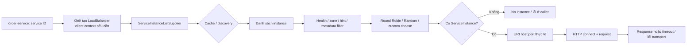

# Thời gian tra cứu danh sách và thời gian chọn bản sao

## 1. Bối cảnh: vì sao request chậm khi chưa gửi HTTP?

Trong chương **Thời gian chờ** của module `SPRING_CLOUD_SERVICE_COMMUNICATION_LOAD_BALANCING`, chúng ta phân tích phần độ trễ thường bị bỏ qua khi `order-service` gọi `inventory-service` qua Spring Cloud LoadBalancer: **lấy danh sách `ServiceInstance`** và **chọn một bản sao** trước khi HTTP client kết nối đến server.

Giả sử `order-service` dùng `RestClient`, `WebClient` hoặc OpenFeign để gọi:

```text
http://inventory-service/api/inventory/ABC-1
```

Host `inventory-service` là **service ID**. Ứng dụng không thể kết nối tới một instance cụ thể trước khi danh sách ứng viên được cung cấp và `RoundRobinLoadBalancer`, `RandomLoadBalancer` hoặc chính sách khác chọn đích. Độ trễ có thể đến từ registry, cache, chuỗi `ServiceInstanceListSupplier`, lần khởi tạo context đầu tiên, health/zone filtering, hoặc chính việc tạo request.

**Câu hỏi của bài:** khi một request mất 800 ms, có bao nhiêu thời gian dành cho *tra danh sách*, bao nhiêu cho *chọn bản sao*, và bao nhiêu cho *kết nối/đọc response*? Thuộc tính timeout nào khống chế giai đoạn nào? Làm thế nào chứng minh lỗi chậm nằm trước hay sau khi chọn instance?

### Mục tiêu học tập

Sau bài này, bạn có thể:

1. Phân biệt rõ `T_discovery`, `T_supplier`, `T_selection`, `T_connect`, `T_response` và `T_end_to_end`.
2. Giải thích `spring.cloud.loadbalancer.service-discovery.timeout` tác động đến việc truy vấn discovery, **không** phải timeout HTTP hoặc deadline toàn request.
3. Nhận diện tác động của cache, health check, zone/hint, lazy child context và retry lên thời gian chọn đích.
4. Cấu hình baseline với `@LoadBalanced RestClient.Builder` hoặc `WebClient.Builder` và timeout HTTP ở đúng client.
5. Đo riêng lần gọi đầu tiên, cache hit/cache miss, slow registry, danh sách rỗng và instance đã được chọn nhưng kết nối thất bại.
6. Thiết kế ngân sách thời gian có giới hạn, đo p50/p95/p99 và xử lý sự cố mà không che mất nguyên nhân.

## 2. Luồng xử lý một request qua LoadBalancer



Chỉ một số mắt xích được kích hoạt ở từng cấu hình. Ví dụ `SimpleDiscoveryClient` dùng danh sách tĩnh; `EurekaDiscoveryClient` có thể đã duy trì dữ liệu instance trong cache nội bộ; `CachingServiceInstanceListSupplier` có thể cung cấp danh sách từ cache của LoadBalancer; `HealthCheckServiceInstanceListSupplier` có cơ chế lập lịch riêng.

Bốn ranh giới quan trọng:

| Ranh giới | Bắt đầu | Kết thúc | Ghi chú |
|---|---|---|---|
| **Context init** | LoadBalancer service ID lần đầu được sử dụng | Child context và bean tương ứng sẵn sàng | Thường là hiệu ứng cold start, không đồng nhất giữa lần đầu và steady-state |
| **List retrieval** | Supplier bắt đầu xin danh sách cho service ID | Nhận snapshot/danh sách ứng viên | Có thể là cache hit hoặc gọi registry từ xa |
| **Selection** | Có tập ứng viên đủ điều kiện | Thuật toán trả một `ServiceInstance` hoặc no-instance | Round Robin/Random thường rẻ trên danh sách đã có; filter/supplier có thể đắt hơn |
| **HTTP exchange** | Đã biết URI instance | Kết nối, gửi request, nhận body/status | Dùng connect/read/response timeout của HTTP transport |

Trong mã Spring Cloud, `choose()` thường phụ thuộc publisher do `ServiceInstanceListSupplier` phát ra. Nếu đo **toàn bộ thời gian gọi `choose()`**, số đo có thể **bao gồm cả thời gian đợi supplier/discovery**, không phải chỉ thời gian tính chỉ số Round Robin. Đó là lý do phải đặt tên metric theo ranh giới đo, không gọi tất cả là “algorithm latency”.

### 2.1. Ký hiệu dùng xuyên suốt

Xét một lần gọi không retry, đặt:

- `T_ctx`: thời gian tạo LoadBalancer child context (nếu là lần đầu).
- `T_list`: thời gian có được danh sách `ServiceInstance` từ supplier, gồm cache/discovery tùy chuỗi.
- `T_filter`: thời gian áp health/zone/hint/metadata nếu các bước nằm trên đường xử lý request.
- `T_pick`: thời gian chọn instance trên danh sách cuối.
- `T_http`: thời gian kết nối, server xử lý và nhận response; có thể tách tiếp connect, TTFB, body read.
- `T_total`: thời gian quan sát từ client của `order-service` đến lúc nhận kết quả hoặc lỗi.

Một phân rã **khái niệm**:

\[
T_{\mathrm{total}}\approx T_{\mathrm{ctx}}+T_{\mathrm{list}}+T_{\mathrm{filter}}+T_{\mathrm{pick}}+T_{\mathrm{http}}+T_{\mathrm{overhead}}.
\]

Không cộng đơn giản các **percentile** (p95 của list + p95 của HTTP không bằng p95 của total); cũng không cộng các giai đoạn chồng lấp/asynchronous hoặc các lần thử lại như thể chúng luôn tuần tự. Muốn đo ngân sách chính xác, lưu timestamp/correlation ID cho **cùng một request hoặc attempt**.

## 3. Timeout khi truy vấn service discovery

Spring Cloud Commons 4.3 liệt kê:

```text
spring.cloud.loadbalancer.service-discovery.timeout
```

Đây là giá trị `Duration` cho **thời gian chờ lời gọi lấy danh sách instance qua discovery**, sử dụng trong `DiscoveryClientServiceInstanceListSupplier`. Ví dụ:

```yaml
spring:
  cloud:
    loadbalancer:
      service-discovery:
        timeout: 500ms
```

**Diễn giải:** supplier có ngân sách khoảng 500 ms để lấy danh sách từ delegate discovery trong cách triển khai tương ứng. Nếu registry hoặc client discovery không cung cấp danh sách kịp, supplier có thể xử lý timeout và cung cấp **danh sách rỗng**. Khi không có instance để chọn, caller sẽ nhận lỗi no-instance hoặc response lỗi tổng hợp, tùy blocking/reactive integration và version.

### 3.1. Timeout này không bao gồm điều gì?

| Giai đoạn | `service-discovery.timeout` có trực tiếp thay thế timeout giai đoạn này không? |
|---|---|
| Truy vấn `DiscoveryClient#getInstances(serviceId)` hoặc reactive delegate được supplier dùng | **Có**, trong implementation `DiscoveryClientServiceInstanceListSupplier` hỗ trợ property |
| Thời gian chờ cache TTL hết hạn | **Không** — TTL quản lý độ mới dữ liệu, không phải deadline request |
| Scheduler health check và chu kỳ refetch | **Không** — các lịch này có property riêng |
| Thời gian chạy custom zone/weighted/hint supplier | **Không bảo đảm**; chỉ áp cho đoạn discovery được implementation bọc timeout |
| Toàn bộ `ReactorLoadBalancer#choose` gồm mọi supplier/custom logic | **Không bảo đảm**; cần đo và giới hạn tổng ở tầng caller |
| Thiết lập socket/TLS với inventory instance | **Không** — cấu hình connect timeout của HTTP client |
| Chờ byte đầu tiên/đọc response từ inventory | **Không** — response/read timeout hoặc deadline khác |
| Tổng request có nhiều retry và backoff | **Không** — cần budget/deadline cho toàn logical request |

Tài liệu *Configuration Properties* 4.3 ghi mô tả property nhưng **không công bố default trong ô mặc định**. Mã nguồn của một số phiên bản `DiscoveryClientServiceInstanceListSupplier` đặt giá trị khởi tạo `Duration.ofSeconds(30)`, tuy nhiên **không nên lấy số đó làm SLA mặc định cho mọi Release Train/implementation**. Kiểm tra source tag của đúng artifact được resolve hoặc đặt timeout tường minh.

### 3.2. Khi timeout discovery xảy ra

Luồng minh họa trong một implementation có fallback danh sách rỗng:

```text
Request GET http://inventory-service/...
  -> DiscoveryClientServiceInstanceListSupplier
     -> delegate.getInstances("inventory-service") bị chậm
     -> hết 500ms: timeout / fallback danh sách []
  -> LoadBalancer nhận danh sách rỗng
  -> không chọn được ServiceInstance
  -> caller nhận lỗi "no instances" hoặc HTTP 503 tổng hợp
```

**Không có nghĩa** `inventory-service` thật sự hết instance. Registry có thể có `[a,b]`, nhưng lần truy vấn của caller không hoàn tất kịp. Vì vậy cần tách metric `discovery_timeout` khỏi `registry_zero_instances` và kiểm tra log của discovery client.

Ở một số phiên bản, timeout và exception trong supplier được chuyển thành danh sách rỗng để LoadBalancer tiếp tục. Việc xử lý như vậy tiện cho caller nhưng làm lỗi registry dễ bị nhìn nhầm thành không có service. Cần xem log/trace của supplier, nhất là khi đánh giá tình huống no-instance.

**Chú ý riêng về blocking discovery:** một timeout ở lớp Reactor quanh `DiscoveryClient` blocking không nhất thiết dừng ngay underlying I/O hoặc giải phóng tức thời mọi thread đang gọi registry. Khi tần suất timeout cao, phải kiểm tra thread pool, network timeout gốc của thư viện registry và giới hạn đồng thời; không dùng property này như biện pháp duy nhất để khống chế tải lên registry.

## 4. Thời gian chọn bản sao khác thời gian lấy danh sách

Với danh sách cố định `[inventory-a, inventory-b, inventory-c]`:

- `RoundRobinLoadBalancer` luân phiên vị trí trên danh sách.
- `RandomLoadBalancer` chọn ngẫu nhiên một chỉ số.
- Một custom LoadBalancer có thể dùng trọng số, zone, metadata hoặc lịch sử truy cập.

Phần tính toán một chỉ số trên danh sách nhỏ thường nhanh so với lời gọi registry/network. Nhưng cách triển khai LoadBalancer chọn đích **không tách rời khỏi supplier**: nó cần await danh sách, có thể áp thêm filter theo request và có thể trả rỗng khi không có ứng viên. Do đó:

| Tình huống | `T_list` | `T_pick` | Kết luận thực tế |
|---|---|---|---|
| Cache hit, ba instance sẵn có | Thường nhỏ | Thường rất nhỏ | HTTP/backend dễ chiếm phần lớn tổng latency |
| Cache miss, registry trả chậm | Có thể lớn | Không đổi đáng kể | Slow registry/supplier, không phải Round Robin “chậm” |
| Có nhiều supplier filter | Có thể tăng | Tùy implementation | Đo cả chuỗi chọn đích, tách stage nếu cần |
| Lần gọi đầu sau startup | Tăng do child context lazy + cache cold | Thường tương tự sau warm-up | Không lấy cold request làm latency chuẩn |
| Danh sách rỗng | Vẫn có chi phí tra cứu | Không có instance để chọn | Xử lý no-instance, không thể cấu hình HTTP connect timeout để sửa |
| Cache stale chứa instance đã chết | Có thể trả rất nhanh | Chọn rất nhanh | Lỗi lại xảy ra ở HTTP connect/response, không phải list lookup |

### 4.1. Lazy child context và cách warm-up

Spring Cloud LoadBalancer có context con cho từng service ID và **khởi tạo lười** khi lần đầu sử dụng. Lần gọi đầu có thể tốn thêm thời gian tạo bean/khởi động supplier, dễ gây sai lệch trong benchmark.

Có thể cấu hình eager loading:

```yaml
spring:
  cloud:
    loadbalancer:
      eager-load:
        clients:
          - inventory-service
          - payment-service
```

Cấu hình này yêu cầu tạo context cho các client được chỉ định sớm hơn; **không phải** cấu hình bảo đảm registry hoặc inventory instance đã healthy. Một cách khác trong lab là gửi warm-up requests và loại dữ liệu warm-up khỏi báo cáo. Khi kiểm chứng tối ưu cold start, phải đo riêng nhóm “lần đầu” và “các lần sau”.

### 4.2. Cache giúp nhanh hơn nhưng có đánh đổi

`CachingServiceInstanceListSupplier` giúp dùng lại danh sách instance, giảm số truy vấn tới discovery. Spring Cloud Commons 4.3 mô tả `spring.cloud.loadbalancer.cache.ttl` mặc định `35s` và `spring.cloud.loadbalancer.cache.enabled` là công tắc bật/tắt cache toàn cục.

Ví dụ để **thí nghiệm** hai chế độ:

```yaml
# Baseline không dùng cache LoadBalancer:
spring:
  cloud:
    loadbalancer:
      cache:
        enabled: false
```

```yaml
# Một lượt thí nghiệm riêng với cache được bật:
spring:
  cloud:
    loadbalancer:
      cache:
        enabled: true
        ttl: 20s
```

Hai đoạn trên là **hai phương án chạy riêng**, không chép hai khối `spring:` vào cùng một YAML. Với caching, lần đầu sau cache miss có thể chậm hơn, các lần sau hit thường nhanh hơn. **TTL 20s không có nghĩa mỗi request chờ 20s**; nó là tuổi thọ dữ liệu trong cache. Cache có thể giữ instance đã chết hoặc chưa biết instance mới cho đến khi cập nhật/hết hạn; mức chậm và trạng thái list thực tế phụ thuộc discovery cache, LoadBalancer cache và health supplier.

Theo tài liệu, khi discovery implementation (ví dụ Eureka client) đã tự cache, có thể **tắt cache LoadBalancer** để tránh cache chồng. Với `HealthCheckServiceInstanceListSupplier` có cơ chế replay/cache riêng, cần đặt đúng thứ tự supplier; không bọc thêm cache tùy tiện và kỳ vọng dữ liệu luôn mới.

## 5. Lịch health check và refetch không phải request timeout

Khi có `HealthCheckServiceInstanceListSupplier`:

- `spring.cloud.loadbalancer.health-check.interval`: chu kỳ health probe (mặc định trong Commons 4.3 là `25s`).
- `spring.cloud.loadbalancer.health-check.refetch-instances`: có chủ động lấy lại danh sách từ delegate khi delegate không phát cập nhật liên tục hay không (mặc định `false`).
- `spring.cloud.loadbalancer.health-check.refetch-instances-interval`: chu kỳ refetch khi được bật (mặc định `25s`).
- `spring.cloud.loadbalancer.health-check.repeat-health-check`: bật/tắt các vòng probe độc lập; mỗi refetch vẫn có thể kích hoạt health check.

**Các interval này mô tả lịch cập nhật nền**, không phải thời hạn cho một HTTP request cụ thể. Một instance mới cần thời gian xuất hiện trong registry, được supplier nhìn thấy, vượt qua health và được chọn; điều đó khác với `service-discovery.timeout` giới hạn một lần tra cứu.

Ví dụ để lab quan sát membership refresh:

```yaml
spring:
  cloud:
    loadbalancer:
      health-check:
        refetch-instances: true
        refetch-instances-interval: 10s
        repeat-health-check: false
        path:
          default: /actuator/health
          inventory-service: /actuator/health/readiness
```

**Điều kiện:** đã có health-check supplier trong chuỗi. Đặt property `health-check.*` **không** tự tạo `HealthCheckServiceInstanceListSupplier` trong mọi cấu hình. Với registry đã cung cấp instance healthy, lớp probe bổ sung có thể không cần.

Các quy tắc lọc zone/hint/metadata có thể khiến danh sách sau discovery khác danh sách được chọn. Đừng đánh đồng `T_registry` với `T_eligible_list` nếu request phải chờ filter hoặc một supplier reactive tùy chỉnh.

## 6. So sánh với timeout của RestClient, WebClient và OpenFeign

Bảng dưới đây giúp xác định nơi đặt cấu hình:

| Loại timeout / giới hạn | Tầng phụ trách | Điều nó **không** bảo đảm |
|---|---|---|
| `spring.cloud.loadbalancer.service-discovery.timeout` | Supplier gọi discovery | Không bao trùm mọi filter, chọn instance, HTTP connect/read |
| `RestClient` connect timeout | HTTP request factory | Không quyết định tốc độ discovery |
| `RestClient` read timeout | HTTP request factory | Không là deadline chung cho nhiều retry |
| `WebClient` connect timeout | Reactor Netty/HTTP connector | Không giúp khi chưa chọn được instance |
| `WebClient` response timeout | HTTP connector | Không nhất thiết hạn chế toàn thời gian discovery hoặc stream vô hạn |
| Reactor `Mono.timeout(...)` | Toán tử Reactor của publisher | Chỉ bao phần chuỗi đặt **bên trong** toán tử, tùy placement |
| OpenFeign `connectTimeout`/`readTimeout` | Feign client transport/configuration | Không mặc nhiên giới hạn service discovery và tổng retry |
| Deadline nghiệp vụ / request budget | API caller / request orchestration | Cần tính cả retry, backoff, queue và downstream |

### 6.1. Ví dụ RestClient với LoadBalancer và timeout HTTP

```java
@Configuration(proxyBeanMethods = false)
class InventoryRestClientConfig {

    @Bean
    @LoadBalanced
    RestClient.Builder loadBalancedRestClientBuilder() {
        return RestClient.builder();
    }

    @Bean
    RestClient inventoryRestClient(
            @LoadBalanced RestClient.Builder builder) {

        SimpleClientHttpRequestFactory factory =
                new SimpleClientHttpRequestFactory();
        factory.setConnectTimeout(500); // millisecond
        factory.setReadTimeout(1_500);   // millisecond

        return builder.clone()
                .requestFactory(factory)
                .baseUrl("http://inventory-service")
                .build();
    }
}
```

Ví dụ giả định Spring Framework 6.x/Boot 3.x và `spring-cloud-starter-loadbalancer` được cấu hình đúng. `factory.setConnectTimeout` và `setReadTimeout` áp cho HTTP tới **instance đã chọn**; nếu discovery không trả danh sách, hai thông số này không giúp kết thúc quá trình lookup sớm hơn.

`RestClient` dùng HTTP blocking. Nếu cần **deadline toàn bộ** bao gồm discovery, retry và logic nghiệp vụ, cần thiết kế tầng gọi/response timeout phù hợp với runtime, thread pool và khả năng cancel thật của transport; không giả định `connectTimeout + readTimeout` bằng giới hạn cứng của tổng request.

### 6.2. Ví dụ WebClient và timeout end-to-end ở publisher

```java
@Configuration(proxyBeanMethods = false)
class InventoryWebClientConfig {

    @Bean
    @LoadBalanced
    WebClient.Builder loadBalancedWebClientBuilder() {
        return WebClient.builder();
    }
}
```

Cấu hình WebClient dùng connector Reactor Netty:

```java
HttpClient httpClient = HttpClient.create()
        .option(ChannelOption.CONNECT_TIMEOUT_MILLIS, 500)
        .responseTimeout(Duration.ofMillis(1500));

WebClient client = loadBalancedBuilder.clone()
        .baseUrl("http://inventory-service")
        .clientConnector(new ReactorClientHttpConnector(httpClient))
        .build();
```

Trong snippet trên, `loadBalancedBuilder` là bean đã được inject bằng `@LoadBalanced`. Khi muốn giới hạn **toàn publisher gồm tìm instance và HTTP**, đặt `timeout` bên ngoài pipeline:

```java
Mono<InventoryStock> stock(String sku) {
    return client.get()
            .uri("/api/inventory/{sku}", sku)
            .retrieve()
            .bodyToMono(InventoryStock.class)
            .timeout(Duration.ofSeconds(2));
}
```

Một `Mono.timeout(2s)` đặt như trên có thể phát `TimeoutException` sau hai giây mà chưa có response. Đó là giới hạn ở **tầng Reactor**, không thay cho timeout của registry client hoặc HTTP connector, và không có nghĩa mọi underlying blocking I/O ở registry đã dừng đúng lúc. Đối với stream `Flux` dài, `timeout(Duration)` thường quan sát khoảng thời gian giữa tín hiệu; không coi đó là deadline cố định suốt đời stream.

### 6.3. Ví dụ OpenFeign

Đối với Spring Cloud OpenFeign, cấu hình kiểu:

```yaml
spring:
  cloud:
    openfeign:
      client:
        config:
          inventory-service:
            connectTimeout: 500
            readTimeout: 1500
```

Các giá trị ở ví dụ này tính bằng **millisecond** theo cấu hình Feign tương ứng. Chúng điều khiển thời gian kết nối/đọc của Feign client, không thay thế `spring.cloud.loadbalancer.service-discovery.timeout`. Tên client trong `spring.cloud.openfeign.client.config` phải khớp với Feign client ID/context ID được dùng, kiểm tra theo annotation `@FeignClient` và phiên bản Spring Cloud OpenFeign.

Khi Feign gọi theo service ID qua Spring Cloud LoadBalancer, việc chọn `ServiceInstance` diễn ra trước khi Feign có địa chỉ server thực tế. Retry của Feign, retry của LoadBalancer và resilience library có thể khác nhau; không suy luận tất cả sử dụng cùng một bộ đếm retry hoặc timeout.

## 7. Thiết kế ngân sách thời gian thay vì chỉ đặt một timeout

Giả sử API của `order-service` cần trả trong **2 giây**, gồm gọi `inventory-service` và các bước nghiệp vụ sau đó. Một ngân sách **minh họa**, không phải khuyến nghị dùng mọi nơi:

| Hạng mục | Ngân sách dự kiến | Ghi chú |
|---|---:|---|
| Lookup discovery / supplier | 200 ms | Thường nhỏ với cache hit; tối đa riêng cần xét registry |
| Lọc và chọn instance | 50 ms | Bao gồm overhead policy/custom code |
| Kết nối tới instance | 250 ms | Có thể gồm DNS/TCP/TLS tùy connector |
| Gửi/nhận response và xử lý backend | 900 ms | Theo SLO thực tế của inventory |
| Xử lý còn lại tại order-service | 200 ms | JSON, business logic và trả response |
| Khoảng dự phòng | 400 ms | Biến thiên, scheduling, GC và overhead |
| **Tổng mục tiêu** | **2.000 ms** | Deadline API phải được thực thi ở nơi phù hợp |

Ngân sách chỉ có ích khi có measurement. Đặc biệt, `service-discovery.timeout=500ms` không được mặc nhiên cộng hai lần nếu cache hit và không có lời gọi registry; cũng không được xem mọi request chắc chắn phải chờ 500 ms.

### 7.1. Khi có retry, tổng thời gian có thể nhân lên

Ví dụ một logical request có hai HTTP attempts:

```text
Attempt 1:
  lookup/pick 100ms + connect 200ms + response wait 700ms = 1000ms
Backoff: 200ms
Attempt 2:
  lookup/pick 100ms + connect 200ms + response wait 700ms = 1000ms
Tổng quan sát tối thiểu đã ~2200ms, chưa kể overhead.
```

Các con số chỉ minh họa khi các giai đoạn diễn ra tuần tự. Đặt timeout riêng cho từng attempt **không tự khống chế tổng logical request**. Với reactive pipeline, đặt `retryWhen(...)` bên trong và `timeout(...)` bên ngoài để giới hạn toàn chuỗi:

```java
Mono<InventoryStock> withRetryAndOverallDeadline(String sku) {
    return client.get()
            .uri("/api/inventory/{sku}", sku)
            .retrieve()
            .bodyToMono(InventoryStock.class)
            .retryWhen(Retry.backoff(
                    1, Duration.ofMillis(100))
                    .filter(this::isTransientNetworkError))
            .timeout(Duration.ofSeconds(2));
}
```

Ở đây `isTransientNetworkError` là predicate **do ứng dụng định nghĩa**; ví dụ chỉ retry lỗi kết nối tạm thời có thể an toàn cho HTTP GET. Không retry mọi lỗi vô điều kiện. `Retry.backoff(1, ...)` nghĩa là tối đa một lần thử lại sau attempt đầu; không bảo đảm retry sẽ chọn một instance khác nếu chính sách chọn chưa hỗ trợ. Nếu bật thêm retry trong Spring Cloud LoadBalancer, tổng attempts có thể vượt mong đợi.

Với thao tác POST có tác dụng phụ (đặt đơn, thanh toán), timeout không cho biết server đã commit hay chưa. Phải có idempotency key và cơ chế server chống lặp trước khi retry.

### 7.2. Khi cần fail-fast

Mục tiêu fail-fast là trả kết quả lỗi có ý nghĩa khi dependency không sẵn sàng thay vì chiếm tài nguyên quá lâu. Ví dụ:

- Khi registry timeout, caller cần phân biệt “discovery bị chậm” với “không có instance thực sự” để cảnh báo.
- Khi không tìm được `ServiceInstance`, HTTP connect timeout **không được sử dụng**, nên phải xử lý no-instance tại tầng LoadBalancer/caller.
- Khi instance đã được chọn nhưng socket không mở được, connect timeout và network exception là nhóm lỗi riêng.
- Khi server đã nhận request nhưng trả chậm, response/read timeout và deadline phù hợp hơn.
- Với fallback chỉ đọc dữ liệu cache, cần đánh dấu dữ liệu stale và giới hạn TTL; không biến lỗi tìm instance thành thông tin tồn kho giả.

## 8. Thực hành 1 — Tách thời gian lookup và lựa chọn khỏi HTTP

### 8.1. Topology tối giản

Dùng ba tiến trình:

| Thành phần | Cổng | Vai trò |
|---|---|---|
| `order-service` | 8080 | Caller qua LoadBalancer |
| `inventory-a` | 8081 | Instance khỏe |
| `inventory-b` | 8082 | Instance khỏe |

Trong lab không cần registry thật, có thể cấu hình `SimpleDiscoveryClient`:

```yaml
spring:
  application:
    name: order-service
  cloud:
    discovery:
      client:
        simple:
          instances:
            inventory-service:
              - uri: http://localhost:8081
                instance-id: inventory-a
              - uri: http://localhost:8082
                instance-id: inventory-b
    loadbalancer:
      retry:
        enabled: false
      cache:
        enabled: false
      service-discovery:
        timeout: 500ms
server:
  port: 8080
```

Chạy cùng máy hoặc network namespace; trong container, `localhost` của caller không phải địa chỉ của hai container inventory khác. Cấu hình `SimpleDiscoveryClient` có danh sách **tĩnh**, không mô phỏng độ trễ registry từ xa; đó là baseline để kiểm chứng pipeline và HTTP.

### 8.2. Endpoint server có thể tạo trễ

Trong cả hai instance `inventory-service`, trả về ID để nhìn thấy đích:

```java
@RestController
@RequestMapping("/api/inventory")
class InventoryController {
    private final String instanceId;

    InventoryController(Environment env) {
        this.instanceId = env.getRequiredProperty("app.instance-id");
    }

    @GetMapping("/{sku}")
    InventoryStock find(@PathVariable String sku,
                        @RequestParam(defaultValue = "0") long delayMs)
            throws InterruptedException {
        Thread.sleep(delayMs); // Chỉ dùng để mô phỏng lỗi/chậm trong lab.
        return new InventoryStock(sku, 12, instanceId);
    }
}

record InventoryStock(String sku, int available, String instanceId) {}
```

Snippet dùng Spring MVC blocking. Không sử dụng `Thread.sleep` trong event-loop WebFlux hoặc production; khi dùng WebFlux hãy mô phỏng bằng `Mono.delay` và xử lý non-blocking phù hợp. Chạy instance A với `app.instance-id=inventory-a` và B với `inventory-b`.

### 8.3. Đo cold start và steady-state

Thực hiện:

1. Khởi động `order-service` và hai inventory instances.
2. Gửi **lần đầu** tới `http://localhost:8080/demo/inventory/ABC-1`; ghi end-to-end latency ở client của `order-service` và log caller.
3. Gửi thêm 50–100 request cùng endpoint không tạo delay, bỏ request đầu khỏi thống kê steady-state.
4. Restart `order-service` và thử `spring.cloud.loadbalancer.eager-load.clients` như mục 4.1, lặp lại phép đo.
5. So sánh median/p95; nếu lần đầu chậm rõ, tách nguyên nhân child context init, JIT, DNS/connection pool, khởi động downstream thay vì quy tất cả cho thuật toán chọn instance.

`SimpleDiscoveryClient` trả danh sách nhanh, nên đây **không phải bài đo timeout discovery**. Chỉ khi tạo được nguồn discovery có thể làm chậm và kiểm soát tốc độ, ta mới chứng minh tác dụng `service-discovery.timeout`.

## 9. Thực hành 2 — Mô phỏng slow discovery và giới hạn timeout

Để thí nghiệm thực sự về **thời gian tra cứu danh sách**, cần dùng một delegate `DiscoveryClient` mà lời gọi `getInstances("inventory-service")` có thể chậm có kiểm soát, hoặc registry thật có proxy mạng gây latency. Không chỉ tăng `Thread.sleep` tại inventory server: việc đó làm chậm **HTTP response**, không làm chậm **discovery**.

### 9.1. Delegate giả lập chậm (pseudocode có chủ đích)

```java
// Pseudocode cho test: bọc DiscoveryClient thật,
// không dùng vào production như một cách tạo độ trễ.
class SlowDiscoveryClient implements DiscoveryClient {
    private final DiscoveryClient delegate;

    @Override
    public List<ServiceInstance> getInstances(String serviceId) {
        sleepForTest(Duration.ofMillis(900));  // Chỉ trong lab.
        return delegate.getInstances(serviceId);
    }

    @Override
    public List<String> getServices() {
        return delegate.getServices();
    }

    @Override
    public String description() {
        return "delayed discovery for lab";
    }
}
```

Đoạn trên là **phác thảo ý tưởng**, chưa phải bean/configuration chạy ngay: cần triển khai `sleepForTest`, đăng ký wrapper cho đúng lookup chain, tránh vòng tham chiếu `DiscoveryClient` composite và kiểm soát bean order. Nếu dùng registry thật, có thể tạo delay tại network/proxy trong một môi trường cô lập thay vì bọc client.

### 9.2. Ma trận thí nghiệm

| Lượt | Delay của discovery | `service-discovery.timeout` | Dự kiến quan sát |
|---|---:|---:|---|
| A | 50 ms | 500 ms | Có danh sách, LoadBalancer chọn được instance nếu các bước khác bình thường |
| B | 900 ms | 500 ms | Timeout discovery; có thể fallback danh sách rỗng, dẫn đến no-instance |
| C | 900 ms | 1500 ms | Có thể nhận danh sách sau ~900 ms, tổng request vẫn phải chờ HTTP |
| D | 900 ms | 500 ms; bật cache và cache đã warm | Có thể không gọi discovery trong request này nếu cache hit |
| E | Registry trả danh sách rỗng ngay | 1500 ms | No-instance nhanh; tăng timeout không tạo ra replica |
| F | Danh sách có instance nhưng inventory delay 900 ms | 500 ms | Chọn được instance nhanh, **HTTP response** chậm; điều chỉnh discovery timeout không sửa được |

Trong B và C, giữ HTTP timeout đủ lớn để kết quả discovery không bị timeout HTTP che lấp. Ở D, phải chứng minh cache hit bằng số lần `getInstances` được gọi hoặc tracing; không dựa vào một request nhanh để kết luận chắc chắn.

### 9.3. Ba câu hỏi sau mỗi lượt

1. Supplier có nhận danh sách mới, danh sách rỗng hay lỗi timeout? Ở stage nào?
2. LoadBalancer đã chọn `ServiceInstance` chưa? Nếu chưa, có HTTP request đến inventory không?
3. Bao lâu kể từ lúc bắt đầu logical request đến lúc response hoặc exception? Có retry/cold start/cache không?

Nếu kết quả B là HTTP 503, nó **có thể** là 503 được tạo ở caller do không tìm được instance, không phải inventory server trả 503. Kiểm tra log inventory và sự kiện lựa chọn tại caller.

## 10. Ghi log và đo thời gian theo đúng ranh giới

### 10.1. Những timestamp cần lấy

Gợi ý lưu cho một HTTP attempt:

```text
t0 - caller nhận yêu cầu hoặc subscribe WebClient request
t1 - LoadBalancer/supplier bắt đầu tìm danh sách
t2 - supplier phát danh sách cho service ID
t3 - LoadBalancer đã chọn instance hoặc xác định không có instance
t4 - HTTP client bắt đầu connect/gửi request tới host:port đích
t5 - nhận HTTP headers / byte đầu tiên nếu instrumentation có
t6 - đọc xong body hoặc kết thúc với lỗi/cancellation
```

Từ đó xác định:

\[
\begin{aligned}
T_{\text{list}} &= t_2 - t_1,\\
T_{\text{choose-pipeline}} &= t_3 - t_1,\\
T_{\text{selection-after-list}} &\approx t_3 - t_2,\\
T_{\text{HTTP}} &= t_6 - t_4,\\
T_{\text{end-to-end}} &= t_6 - t_0.
\end{aligned}
\]

Đây là **khung đo logic**, không phải các callback mặc định của Spring Cloud LoadBalancer luôn phát đủ `t0..t6`. Với pipeline reactive, supplier có thể phát nhiều snapshot và filter có thể chạy trong chain; `t2` nên được định nghĩa là **snapshot được dùng cho lượt lựa chọn đang xét**, không phải lần phát đầu bất kỳ.

### 10.2. Không làm sai phép đo

- Dùng `System.nanoTime()` để đo **duration trong cùng tiến trình**, tránh trừ trực tiếp timestamp từ hai máy chưa đồng bộ đồng hồ.
- Đo `T_list` bằng instrumentation quanh `ServiceInstanceListSupplier#get(...)` và khi Flux phát danh sách; lưu ý `get(Request)` có thể khác `get()` khi filter dựa trên request.
- Đo `T_choose-pipeline` từ lúc bắt đầu `ReactorLoadBalancer#choose(...)` đến khi nhận `Response<ServiceInstance>`; nó **bao gồm thời gian supplier chờ**.
- Nếu đo bằng `LoadBalancerLifecycle`, hiểu chính xác thời điểm `onStart`, `onStartRequest`, `onComplete` trong version đang dùng; không tự coi chúng tương ứng trực tiếp `t1`, `t2`, `t3` mà chưa xem mã nguồn.
- Nếu không có event phân biệt filter/pick, công bố metric là `lb_choose_total_duration` thay vì khẳng định đó là CPU time Round Robin.
- Với blocking HTTP, log thời điểm nhận exception cùng cause; với reactive HTTP, đặt các toán tử đo khi **subscribe**, không đo chỉ lúc **assemble** publisher.
- Gắn correlation ID/trace ID, service ID, instance ID (nếu đã chọn), result, retry attempt; tránh lưu token, body nhạy cảm hoặc mã định danh người dùng có cardinality cao trong metric labels.

### 10.3. Ví dụ đo discovery bằng Reactor trong test harness

Snippet ý tưởng sau đo **thời gian tới snapshot đầu tiên** của supplier, không thay thế instrumentation production:

```java
Mono<List<ServiceInstance>> firstSnapshot(
        ServiceInstanceListSupplier supplier) {

    return Mono.defer(() -> {
        long startNs = System.nanoTime();

        return supplier.get()
                .next()
                .doOnNext(instances -> {
                    long elapsedNs = System.nanoTime() - startNs;
                    log.info("serviceId={} stage=supplier-first-snapshot"
                            + " durationMs={} count={}",
                            supplier.getServiceId(),
                            elapsedNs / 1_000_000.0,
                            instances.size());
                });
    });
}
```

Ở đây `supplier.get().next()` có nghĩa **dừng sau snapshot đầu tiên** cho phép đo. Không dùng đoạn harness như supplier production nếu cần giữ Flux health updates liên tục hoặc request-based filtering. Với supplier thực phụ thuộc `Request`, đo `get(request)` thay cho `get()` để tránh đi lệch chuỗi routing.

### 10.4. Micrometer và tracing

Spring Cloud LoadBalancer hỗ trợ `MicrometerStatsLoadBalancerLifecycle` nếu bật instrumentation và có `MeterRegistry`:

```yaml
spring:
  cloud:
    loadbalancer:
      stats:
        micrometer:
          enabled: true
```

Metric LoadBalancer giúp theo dõi thành công, thất bại hoặc discard theo ngữ nghĩa của implementation. **Không mặc định** các metric có sẵn đã đo riêng chính xác `T_list`, `T_filter` và `T_pick`. Để phân tích hotspot chi tiết, cần bổ sung timer custom với tên rõ giai đoạn đo, hoặc tracing span quanh discovery và HTTP client. Cấu hình `stats.micrometer.enabled` thuộc nhóm global; phải đối chiếu version thật.

Đề xuất tên **metric tự thiết kế** (không khẳng định Spring Cloud xuất sẵn):

| Metric | Đơn vị | Labels nên dùng |
|---|---|---|
| `discovery_lookup_duration` | ms/s theo MeterRegistry | service ID, outcome, cache state |
| `lb_supplier_snapshot_duration` | ms/s | service ID, supplier type |
| `lb_choose_total_duration` | ms/s | service ID, algorithm, result |
| `lb_no_instance_total` | counter | service ID, reason nếu xác minh được |
| `http_client_duration` | ms/s | service ID, status/error class |
| `retry_attempts_total` | counter | service ID, operation class |

Không đặt `requestId` hoặc raw URI chứa SKU/token vào tag metric vì cardinality có thể tăng không kiểm soát. Thông tin chi tiết theo request nên đi vào trace/log có chính sách bảo mật.

## 11. Cách đọc báo cáo kết quả

Dữ liệu **giả định chỉ để tập diễn giải** (không phải benchmark đã thực thi):

| Kịch bản | Supplier first snapshot p95 | Choose pipeline p95 | HTTP client p95 | End-to-end p95 | Kết luận ban đầu |
|---|---:|---:|---:|---:|---|
| Warm cache, healthy | 1 ms | 2 ms | 80 ms | 88 ms | HTTP/backend là phần lớn latency |
| Cache miss, registry chậm | 180 ms | 184 ms | 80 ms | 275 ms | Registry/supplier có thể là hotspot |
| First request cold | 160 ms | 165 ms | 80 ms | 300 ms | Có thêm context/JIT/pool; cần đo riêng |
| Discovery timeout 500 ms | ~500 ms | ~500 ms | Không có HTTP | ~510 ms | No-instance do timeout; không phải inventory trả lỗi |
| Cache stale, instance chết | 1 ms | 2 ms | 500 ms rồi lỗi | ~510 ms | Lookup nhanh nhưng đích không kết nối được |

Các giá trị p95 của từng cột đến từ **phân phối khác nhau**; **không được cộng các p95 trong cùng hàng** để suy ra p95 tổng. Dữ liệu giả định còn bỏ qua một số overhead. Để kết luận theo đo thật, cần nhiều lượt, cùng cấu hình, cùng tải, warm-up rõ ràng và so sánh cả p50/p99 cùng tỷ lệ lỗi.

**Phân biệt hai dạng lỗi 503:**

- Discovery timeout tạo danh sách rỗng; LoadBalancer không chọn được instance, caller có thể sinh lỗi 503 tổng hợp. Server inventory **không nhận request**.
- HTTP 503 thật do inventory trả sau khi đã được chọn và kết nối thành công. Có bằng chứng request ở server, HTTP status và trace downstream.

Một error handler chung có thể biến cả hai thành `503 Service Unavailable` ở API ngoài. Để chẩn đoán phải giữ classification tại caller, service ID và stage phát sinh lỗi.

## 12. Những sai lầm cần tránh

| Nhận định sai | Vì sao sai | Cách sửa |
|---|---|---|
| “Tăng connect timeout giúp registry có thời gian trả danh sách” | Connect timeout thuộc HTTP instance sau chọn đích | Chỉnh/đo discovery timeout và registry client |
| “`service-discovery.timeout` là deadline cho cả request” | Nó chỉ bao một phần discovery supplier | Thiết kế deadline toàn caller và timeout từng tầng |
| “`cache.ttl=35s` khiến request luôn chờ 35 giây” | TTL là thời gian dữ liệu có hiệu lực, không phải thời gian chờ | Đo cache hit/miss, thời gian lookup và độ mới |
| “Health interval 25s nghĩa là timeout mỗi probe 25s” | Interval là nhịp scheduler, không phải probe timeout | Xem HTTP client dùng health checks và thời gian mỗi probe |
| “Round Robin chậm 500 ms” | `choose` có thể chờ discovery 500 ms rồi mới tính chỉ số | Đo supplier và selection riêng |
| “Không có instance là do sai service ID” | Có thể là registry timeout, danh sách rỗng thật hoặc lọc hết | Đo từng stage, kiểm tra danh sách trước/sau filter |
| “Lần đầu chậm nghĩa là thuật toán kém” | Lazy child context và JIT/cache cold gây overhead | Warm-up, eager-load nếu thích hợp |
| “Bật cache luôn tốt hơn” | Cache có thể chứa instance chết/thiếu instance mới | Cân bằng latency với staleness và discovery cache |
| “Retry giúp sửa mọi timeout” | Retry có thể nhân deadline và tải | Giới hạn attempt/backoff, chỉ retry lỗi an toàn |
| “Đã timeout thì request không thể được downstream xử lý” | Timeout có thể xảy ra sau khi server xử lý hoặc khi không biết kết quả | Idempotency và tracing cho thao tác ghi |
| “p95 của các stage cộng lại bằng p95 tổng” | Percentile không cộng tuyến tính | Đo end-to-end trực tiếp, phân tích trace cùng request |
| “WebClient đặt timeout nghĩa là registry blocking I/O chắc chắn bị hủy” | Cancel reactive không bảo đảm dừng tất cả blocking call | Giới hạn registry client, kiểm tra thread và network |

## 13. Bài tập thực hành tổng hợp

**Bài 1 — Cold start và eager load.** Chạy cùng `order-service`, cùng hai inventory instances. Đo request đầu sau startup và 100 request sau warm-up. Bật `eager-load.clients`, chạy lại, ghi p50/p95 và số lần gọi discovery. Chứng minh phần thay đổi đến từ context init hay nguồn khác.

**Bài 2 — Cache hit/miss.** Thử `cache.enabled=false` và `true` với TTL xác định. Ghi thời gian snapshot supplier, số lần gọi registry và độ mới danh sách khi thêm một replica. Nêu đánh đổi latency–staleness.

**Bài 3 — Slow registry.** Dùng delegate/proxy thử nghiệm trễ 900 ms, lần lượt đặt `service-discovery.timeout` là `500ms` và `1500ms`. Chỉ ra lúc nào không chọn được instance và tại sao HTTP connect timeout không tác dụng cho kịch bản này.

**Bài 4 — Instance đã chọn nhưng chết.** Đăng ký URI instance nhưng không khởi động server ở cổng đó. Đặt HTTP connect timeout 500 ms, discovery timeout 2 s. Đo và giải thích sự khác biệt với bài registry timeout.

**Bài 5 — Timeout + retry.** Tạo endpoint inventory trì hoãn phản hồi 900 ms. Cấu hình retry một lần cho GET với backoff 100 ms và overall deadline 2 s. Ghi tổng attempts, thời điểm lỗi cuối, khả năng request bị cancel và vì sao không nên áp cùng logic cho thanh toán.

**Bài 6 — Quan sát đúng metric.** Tạo một báo cáo gồm `T_list`, `T_choose-pipeline`, `T_http`, `T_total` và error rate theo cùng correlation ID. Giải thích vì sao `T_choose-pipeline` có thể lớn dù Round Robin chọn chỉ số rất nhanh.

### Checklist tự đánh giá

- [ ] Phân biệt được thời gian tra danh sách với thời gian chọn bản sao và thời gian HTTP.
- [ ] Biết property `spring.cloud.loadbalancer.service-discovery.timeout` thuộc discovery supplier.
- [ ] Không nhầm cache TTL, health interval và refetch interval với timeout request.
- [ ] Hiểu vì sao `choose()` có thể bao gồm thời gian await supplier.
- [ ] Biết cold start LoadBalancer child context và cách warm-up/eager load.
- [ ] Phân biệt cache hit/miss, registry timeout, list rỗng và instance chết.
- [ ] Cấu hình HTTP connect/read timeout đúng theo RestClient/WebClient/OpenFeign.
- [ ] Có deadline tổng khi retry/backoff; giới hạn thao tác ghi bằng idempotency.
- [ ] Đo và báo cáo p50/p95/p99, lỗi, số HTTP attempts, cache state và instance ID.
- [ ] Không xem số p95 các stage là phép cộng tạo p95 tổng.

## Nguồn tham khảo chính thức

- [Spring Cloud Commons 4.3 — Configuration Properties](https://docs.spring.io/spring-cloud-commons/reference/4.3/configprops.html): `spring.cloud.loadbalancer.service-discovery.timeout`, cache TTL, retry, health check và instrumentation.
- [Spring Cloud Commons 4.3 — Spring Cloud LoadBalancer](https://docs.spring.io/spring-cloud-commons/reference/4.3/spring-cloud-commons/loadbalancer.html): `ServiceInstanceListSupplier`, caching, eager loading, health check, cách chọn instance và metric.
- [Spring Cloud Commons — nguồn DiscoveryClientServiceInstanceListSupplier](https://github.com/spring-cloud/spring-cloud-commons/blob/main/spring-cloud-loadbalancer/src/main/java/org/springframework/cloud/loadbalancer/core/DiscoveryClientServiceInstanceListSupplier.java): cơ chế xử lý timeout của implementation tại nhánh `main`. **Không thay thế việc đọc source tag đúng phiên bản triển khai.**
- [Spring Framework — RestClient và HTTP Client](https://docs.spring.io/spring-framework/reference/integration/rest-clients.html): request factory, timeout và xử lý HTTP client.
- [Spring Framework — WebClient](https://docs.spring.io/spring-framework/reference/web/webflux-webclient.html): reactive HTTP client và cấu hình connector.
- [Reactor — Error Handling / Timeout](https://projectreactor.io/docs/core/release/reference/coreFeatures/error-handling.html): thao tác lỗi, retry và timeout trong pipeline reactive.
- [Spring Cloud — Release Train](https://spring.io/projects/spring-cloud/): chọn phiên bản Spring Cloud tương thích Spring Boot.

**Kết luận:** thời gian *tra cứu danh sách* phụ thuộc discovery, supplier, cache và các bước cập nhật; thời gian *chọn bản sao* là quyết định trên tập instance đủ điều kiện; thời gian *HTTP* bắt đầu sau khi đã có đích. Chỉ khi đo và giới hạn đúng từng lớp, kết hợp deadline của caller với retry/timeout hợp lý, hệ thống giao tiếp bằng `RestClient`, `WebClient` và OpenFeign mới có khả năng báo lỗi nhanh, chính xác và phục hồi có kiểm soát.
