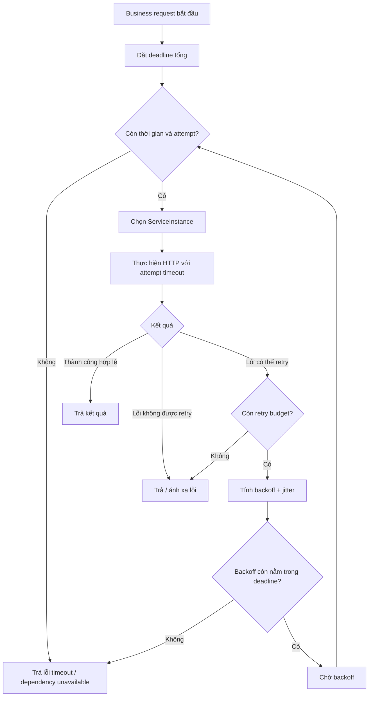

# Phối hợp timeout với số lần retry và thời gian backoff

Khi `order-service` gọi `inventory-service` qua Spring Cloud LoadBalancer, một lời gọi có thể phải đi qua service discovery, lựa chọn `ServiceInstance`, thiết lập kết nối mạng, chờ server xử lý và nhận HTTP response. Nếu một bước chậm hoặc thất bại, client có thể **retry** sang bản sao khác. Tuy nhiên, retry không tự tạo ra tính ổn định: nếu số lần thử và thời gian chờ không được phối hợp, một request nghiệp vụ có thể kéo dài quá deadline, chiếm nhiều kết nối và khuếch đại tải vào các replica đang gặp sự cố.

Bài này thuộc chương **Thời gian chờ** của module `SPRING_CLOUD_SERVICE_COMMUNICATION_LOAD_BALANCING`. Trọng tâm là thiết kế **ngân sách thời gian tổng thể (end-to-end deadline)**, **timeout của từng attempt**, **giới hạn retry** và **backoff có jitter**. Các ví dụ đề cập đến `RestClient`, `WebClient`, OpenFeign và Spring Cloud LoadBalancer, đồng thời phân biệt lỗi hạ tầng với lỗi HTTP/nghiệp vụ và chỉ ra cách đo lường thực tế.

> Nguyên tắc xuyên suốt: một timeout hoặc retry policy chỉ có ý nghĩa khi biết nó áp dụng ở tầng nào, cho bao nhiêu attempt và có nằm trong deadline của lời gọi nghiệp vụ hay không. Các giá trị mili giây trong bài là số liệu minh họa; cần điều chỉnh theo SLO, biểu đồ latency và phiên bản thư viện của hệ thống thực tế.

## 1. Phân biệt timeout, retry, backoff và deadline

Bốn khái niệm phối hợp nhưng không thay thế cho nhau:

| Khái niệm | Câu hỏi cần trả lời | Ví dụ |
| --- | --- | --- |
| **Connect timeout** | Cho phép chờ thiết lập kết nối tới instance bao lâu? | 300 ms |
| **Read/response timeout** | Sau khi đã gửi request, client chờ phản hồi/dữ liệu bao lâu theo transport đang dùng? | 900 ms |
| **Retry** | Khi một attempt lỗi, được thử lại bao nhiêu lần và với lỗi nào? | Tối đa 2 lần retry sau lần gọi đầu |
| **Backoff** | Chờ bao lâu giữa các attempt để tránh dồn tải? | 100 ms, 200 ms, có jitter |
| **End-to-end deadline** | Toàn bộ thao tác phải kết thúc trước thời điểm nào? | 2.500 ms tính từ lúc caller bắt đầu |

**Attempt** là một lượt thử thực hiện lời gọi tới dịch vụ đích. Một **business request** có thể sinh nhiều attempt khi retry được bật.

Ví dụ:

```text
Business request: kiểm tra tồn kho BOOK-001
    Attempt 1 -> instance A -> connection refused
    Backoff   -> chờ ngắn
    Attempt 2 -> instance C -> HTTP 200
Business result: nhận tồn kho từ attempt 2
```

Hai attempt là **hai lần thử HTTP**, nhưng chỉ có một yêu cầu nghiệp vụ từ caller. Khi tính metrics hoặc giới hạn tải, cần phân biệt chúng.

### 1.1. Timeout không đồng nghĩa request chưa được xử lý

Nếu client bị **connect timeout** trước khi kết nối thiết lập, khả năng cao request chưa tới application server đích qua kết nối đó. Nhưng nếu bị **read timeout** sau khi request đã được gửi, server có thể đã xử lý thao tác và chỉ bị chậm hoặc mất response.

Điều này đặc biệt quan trọng với request thay đổi dữ liệu như `POST /api/reservations`. Retry sau read timeout mà không có idempotency có thể tạo hai reservation. Với thao tác đọc `GET`, retry thường ít rủi ro hơn, nhưng vẫn cần giới hạn attempt và deadline.

## 2. Timeout tồn tại tại nhiều lớp

Không có một thuộc tính `timeout` duy nhất quản lý tất cả thời gian của HTTP call.

| Giai đoạn | Loại thời gian cần quản lý | Vị trí thường cấu hình |
| --- | --- | --- |
| Lấy danh sách `ServiceInstance` | Discovery/registry lookup và cache refresh | Discovery client hoặc supplier |
| Chọn instance | Chi phí filter/selection | Spring Cloud LoadBalancer |
| Lấy kết nối từ pool | Pool acquisition timeout hoặc pending queue | HTTP transport/pool |
| Kết nối TCP | Connect timeout | JDK, Apache HttpClient, Reactor Netty, Feign transport |
| Bắt tay TLS | Thời gian handshake tùy transport | TLS/HTTP client |
| Chờ response | Read/response timeout | HTTP transport, Feign, RestClient, WebClient |
| Nghỉ giữa các lần thử | Backoff delay | Retry policy |
| Toàn bộ lời gọi | Absolute deadline / tổng timeout | Tầng orchestration hoặc reactive pipeline |

Các implementation có thể định nghĩa “read timeout” khác nhau: timeout chờ response, timeout giữa các lần nhận byte hoặc khoảng thời gian cụ thể của transport. Vì vậy không nên mặc định cộng `connectTimeout + readTimeout` sẽ luôn cho một **cận trên cứng** của một attempt. Ngoài hai giá trị đó còn DNS, TLS, connection pool, body streaming và overhead khác.

**Spring Cloud LoadBalancer chọn instance; nó không thay thế cấu hình timeout của HTTP client.** Một supplier có health check cũng không bảo đảm instance được chọn sẽ phản hồi trước deadline.

## 3. Mô hình ba tầng thời gian

Có thể hình dung yêu cầu từ caller đến downstream bằng ba tầng:

1. **Deadline toàn lời gọi:** số thời gian caller còn được phép sử dụng cho thao tác phụ thuộc.
2. **Attempt timeout:** giới hạn riêng khi thử gửi request qua transport tới một instance.
3. **Backoff và retry budget:** số attempt còn lại và thời gian chờ tối đa giữa chúng.



Điểm mấu chốt: **quyết định retry phải được kiểm tra lại sau mỗi lần thất bại**. Việc ban đầu cho phép tối đa ba attempt không đồng nghĩa phải thực hiện đủ ba, nhất là khi deadline chỉ còn vài mili giây.

## 4. Tính ngân sách thời gian cho nhiều attempt

Giả sử ta ước lượng cận trên của mỗi attempt là `T_attempt` và có `N` attempt. Có `N - 1` khoảng nghỉ backoff giữa chúng. Một mô hình để lập ngân sách là:

```text
T_budget_dự_kiến =
    N × T_attempt
    + tổng(backoff giữa các attempt)
    + overhead discovery / chọn instance / lập lịch / xử lý
```

Đây là **công thức kế hoạch**, không phải định luật của transport: một attempt có thể kéo dài khác dự kiến nếu timeout chỉ giới hạn một giai đoạn của request.

### 4.1. Ví dụ ba attempt

Giả định:

- Connect timeout: **300 ms**.
- Read/response timeout: **900 ms**.
- Để tính minh họa, mỗi attempt chiếm tối đa **1.200 ms** (300 + 900 ms), chưa kể overhead.
- Số attempt tối đa: **3** (lần đầu + tối đa 2 retry).
- Backoff danh nghĩa trước retry thứ nhất: **100 ms**.
- Backoff danh nghĩa trước retry thứ hai: **200 ms**.

Nếu tất cả attempt chạm mức thời gian giả định:

```text
Attempt 1:       1.200 ms
Backoff 1:         100 ms
Attempt 2:       1.200 ms
Backoff 2:         200 ms
Attempt 3:       1.200 ms
-------------------------
Tổng dự kiến:    3.900 ms (chưa cộng overhead)
```

Nếu caller chỉ có **2.500 ms deadline**, chính sách “luôn cố chạy đủ ba attempt” là không nhất quán. Ta phải rút ngắn attempt timeout, giảm số retry hoặc **dừng sớm khi không đủ thời gian**.

```mermaid
gantt
    title Minh họa ngân sách 2.500 ms so với chuỗi thử tối đa 3.900 ms
    dateFormat X
    axisFormat %L
    section Lượt gọi
    Attempt 1 :0, 1200
    Backoff 1 :1200, 1300
    Attempt 2 :1300, 2500
    section Giới hạn
    Deadline tổng :crit, 0, 2500
```



Sơ đồ Gantt chỉ minh họa một kịch bản **hai attempt chạm timeout**; phần attempt thứ ba không còn ngân sách. Không nên dùng độ dài đoạn trên sơ đồ như một cam kết thời gian của thư viện.

### 4.2. Ngân sách còn lại quan trọng hơn timeout cấu hình ban đầu

Gọi `D` là deadline tuyệt đối (được đo bằng đồng hồ monotonic trong cùng tiến trình) và `now` là thời điểm hiện tại:

```text
remaining = max(0, D - now)
attemptBudget = min(perAttemptLimit, remaining - reservedMargin)
```

Nếu `remaining` quá nhỏ để thực hiện attempt có ích hoặc không đủ cho backoff tối thiểu, hãy dừng. Mỗi attempt cần được giới hạn bởi **ngân sách còn lại**, thay vì dùng nguyên giá trị timeout ban đầu bất kể deadline.

Ví dụ: sau attempt thứ nhất còn 1.000 ms. Một retry có read timeout 2.000 ms sẽ vượt ngân sách nếu không có cơ chế deadline khác. Thiết kế đúng phải giảm thời gian retry hoặc bỏ retry.

## 5. Lựa chọn số lần retry: luôn đếm cả lần đầu

Hai cách diễn đạt thường gây nhầm lẫn:

- **`maxAttempts = 3`:** tối đa ba attempt, gồm một lần đầu và hai retry.
- **`maxRetries = 3`:** tối đa ba retry *sau* lần đầu, nghĩa là có thể có bốn attempt.

Tên thuộc tính của từng thư viện có thể dùng một trong hai ngữ nghĩa. Không chuyển giá trị `3` giữa các API mà không kiểm tra hợp đồng cấu hình.

| Chính sách | Số request HTTP tối đa theo cách đếm này |
| --- | --- |
| Không retry | 1 |
| 1 attempt đầu + 1 retry | 2 |
| 1 attempt đầu + 2 retry | 3 |
| 1 attempt đầu + 3 retry | 4 |

Trong Spring Cloud LoadBalancer, còn có thể phân biệt số lần retry **trên cùng instance** và **sang instance khác**. Các property này có cách phối hợp riêng theo phiên bản; đừng suy số attempt chỉ từ một giá trị đơn lẻ. Hãy xác minh bằng log hoặc kiểm thử tích hợp số lượt thực tế được gửi.

**Không khuyến nghị retry vô hạn.** Nếu downstream đang quá tải, nhiều request đồng thời cùng retry có thể làm tình hình nặng hơn.

## 6. Backoff: tại sao không retry ngay lập tức?

Giả sử 1.000 caller cùng gặp một lỗi `503` do dịch vụ đích quá tải. Nếu cả 1.000 client retry **ngay lập tức**, server có thể nhận thêm 1.000 request gần như đồng thời, dù chưa kịp phục hồi.

**Backoff** đưa một khoảng nghỉ giữa các attempt để cho phép downstream hồi phục và giảm xác suất nhiều caller dồn request cùng lúc.

Ba chiến lược thường gặp:

| Chiến lược | Cách hoạt động | Rủi ro/lợi ích |
| --- | --- | --- |
| Không backoff | Retry ngay | Tăng tải tức thì, dễ tạo retry storm |
| Fixed backoff | Luôn chờ 100 ms | Đơn giản nhưng nhiều caller có thể đồng bộ nhịp |
| Exponential backoff | Chờ tăng dần: 100, 200, 400… ms | Giảm tốc độ retry khi sự cố kéo dài |
| Exponential + jitter | Thời gian chờ tăng theo cấp số nhân nhưng có ngẫu nhiên | Giảm hiện tượng các caller cùng retry một thời điểm |

### 6.1. Công thức exponential backoff có giới hạn

Một cách tính delay danh nghĩa cho lần retry thứ `k` (bắt đầu ở `k = 1`):

```text
delayBase(k) = min(maxBackoff, initialBackoff × 2^(k-1))
Ví dụ:
initialBackoff = 100 ms
maxBackoff     = 800 ms
k = 1 -> 100 ms
k = 2 -> 200 ms
k = 3 -> 400 ms
k = 4 -> 800 ms
k = 5 -> 800 ms (chạm trần)
```

Việc tăng delay không có nghĩa luôn phải đợi cho đến `maxBackoff`. Retry có thể bị hủy sớm do hết attempt, deadline, circuit breaker hoặc lỗi không được retry.

### 6.2. Jitter để tránh retry đồng pha

**Jitter** là thành phần ngẫu nhiên thêm vào delay nhằm làm các client phân tán thời điểm thử lại.

Ví dụ chiến lược *full jitter*:

```text
delayActual(k) = random(0, delayBase(k))
```

Với `delayBase = 200 ms`, một caller có thể chờ 40 ms, caller khác 163 ms, caller khác 198 ms. Các thư viện dùng các công thức jitter khác nhau (full, equal, tỷ lệ phần trăm); không thể suy ra thuật toán chính xác chỉ từ tên thuộc tính `jitter`.

**Điều kiện bắt buộc:** delay sau jitter vẫn phải nằm trong deadline tổng. Nếu server trả `Retry-After`, cần xét chính sách tôn trọng chỉ dẫn đó thay vì tự áp một delay ngắn hơn và tiếp tục làm quá tải server.

## 7. Timeline mẫu có retry, backoff và deadline

Giả sử `order-service` có deadline **2.500 ms** và gọi `inventory-service` với retry tối đa hai lần cho `GET`.

```text
t=   0 ms  Bắt đầu business request; deadline ở t=2.500
t=  40 ms  Chọn instance A
t= 340 ms  Attempt 1 thất bại: connection refused
t= 440 ms  Kết thúc backoff 100 ms
t= 470 ms  Chọn instance C
t=1.120 ms Attempt 2 nhận HTTP 200
t=1.140 ms Trả kết quả cuối cùng
```

Trong kịch bản này chỉ có **hai attempt**. Không có lý do thử lần thứ ba sau khi attempt 2 đã thành công. Phần ngân sách còn lại không phải chỉ tiêu phải dùng hết.

Một tình huống khác: attempt thứ hai kéo dài đến `t = 2.450 ms` rồi thất bại. Dù cấu hình vẫn còn một lượt retry, chỉ còn khoảng 50 ms trước deadline. Nếu một backoff hoặc một attempt nữa không thể hoàn thành trong ngân sách đó, phải dừng và trả lỗi phù hợp, thay vì cố gắng cho đủ số lần.

**Không chuyển trực tiếp timeout của client thành HTTP `504` nếu ứng dụng không thực sự đóng vai gateway và chưa thiết kế HTTP error contract tương ứng.** Timeout ở client thường trước tiên là một exception; tầng API gateway/service phải quyết định phản hồi HTTP nào phù hợp.

## 8. Cấu hình timeout của từng HTTP client

Tất cả ví dụ dưới đây là **cấu hình transport/attempt**, không tự tạo deadline tổng. Cách đưa chúng vào ứng dụng phụ thuộc dependency và phiên bản Spring Boot/Spring Cloud đang sử dụng.

### 8.1. RestClient với JDK HTTP Client

```java
import java.net.http.HttpClient;
import java.time.Duration;

import org.springframework.cloud.client.loadbalancer.LoadBalanced;
import org.springframework.context.annotation.Bean;
import org.springframework.context.annotation.Configuration;
import org.springframework.http.client.JdkClientHttpRequestFactory;
import org.springframework.web.client.RestClient;

@Configuration
class InventoryRestClientConfig {

    @Bean
    @LoadBalanced
    RestClient.Builder inventoryRestClientBuilder() {
        HttpClient jdkClient = HttpClient.newBuilder()
                .connectTimeout(Duration.ofMillis(300))
                .build();

        JdkClientHttpRequestFactory factory =
                new JdkClientHttpRequestFactory(jdkClient);
        factory.setReadTimeout(Duration.ofMillis(900));

        return RestClient.builder().requestFactory(factory);
    }
}
```

Client tạo từ builder có `@LoadBalanced` có thể gọi URL logic như `http://inventory-service/api/stocks/BOOK-001` nếu Spring Cloud LoadBalancer và nguồn instance được cấu hình. `JdkClientHttpRequestFactory` quản lý cách gửi HTTP; timeout không ảnh hưởng thuật toán chọn instance.

Khi dự án có Spring Boot tự động tạo `RestClient.Builder` cùng observability/customizers, hãy kiểm tra việc tự khai báo builder mới có bỏ qua những customizer cần thiết hay không.

### 8.2. WebClient với Reactor Netty

```java
import java.time.Duration;

import io.netty.channel.ChannelOption;
import org.springframework.http.client.reactive.ReactorClientHttpConnector;
import org.springframework.web.reactive.function.client.WebClient;
import reactor.netty.http.client.HttpClient;

HttpClient transport = HttpClient.create()
        .option(ChannelOption.CONNECT_TIMEOUT_MILLIS, 300)
        .responseTimeout(Duration.ofMillis(900));

WebClient inventory = loadBalancedWebClientBuilder
        .baseUrl("http://inventory-service")
        .clientConnector(new ReactorClientHttpConnector(transport))
        .build();
```

Trong ví dụ, `loadBalancedWebClientBuilder` là bean `WebClient.Builder` đã được đăng ký với `@LoadBalanced`. `responseTimeout(...)` của Reactor Netty và `Mono.timeout(...)` của Reactor có **phạm vi khác nhau**: cấu hình transport giới hạn hành vi chờ response theo Netty; `Mono.timeout` có thể giới hạn một pipeline reactive rộng hơn, gồm cả backoff nếu đặt ở vị trí thích hợp.

### 8.3. OpenFeign với tên dịch vụ

```yaml
spring:
  cloud:
    openfeign:
      client:
        config:
          inventory-service:
            connectTimeout: 300
            readTimeout: 900
```

Đối với cấu hình Spring Cloud OpenFeign thường dùng, các giá trị timeout ở trên được diễn giải theo **mili giây**. Cần xác nhận chúng đang áp dụng cho đúng Feign client; một bean `Request.Options`, cấu hình per-client khác hoặc HTTP transport được tùy chỉnh có thể làm thay đổi giá trị hiệu lực.

OpenFeign thông qua `@FeignClient(name = "inventory-service")` có thể dùng Spring Cloud LoadBalancer khi không có URL vật lý ghi đè và các dependency/bean phù hợp tồn tại. Không nên suy luận Feign đang retry chỉ vì có timeout: Spring Cloud OpenFeign thường cung cấp `Retryer.NEVER_RETRY` mặc định, khác với hành vi retry mặc định của Feign lõi ở một số cấu hình.

## 9. Giới hạn thời gian tổng bằng pipeline reactive

Với `WebClient`, Reactor cung cấp một cách dễ thấy để phối hợp **tối đa hai retry** và **deadline toàn pipeline**. Ví dụ sau là một lời gọi `GET`, giả định đã có `WebClient inventoryWebClient` được cấu hình:

```java
import java.time.Duration;

import org.springframework.web.reactive.function.client.WebClientRequestException;
import org.springframework.web.reactive.function.client.WebClientResponseException;
import reactor.core.publisher.Mono;
import reactor.util.retry.Retry;

Mono<StockResponse> result = inventoryWebClient.get()
        .uri("/api/stocks/{sku}", "BOOK-001")
        .retrieve()
        .bodyToMono(StockResponse.class)
        .retryWhen(
                Retry.backoff(2, Duration.ofMillis(100))
                        .maxBackoff(Duration.ofMillis(400))
                        .jitter(0.5)
                        .filter(error ->
                                error instanceof WebClientRequestException
                                || (error instanceof WebClientResponseException response
                                    && response.getStatusCode()
                                            .is5xxServerError()))
        )
        .timeout(Duration.ofMillis(2500));
```

Giải thích:

- `Retry.backoff(2, ...)`: **tối đa hai lần retry**, tức có thể có ba attempt gồm lần đầu.
- `.filter(...)`: ví dụ chỉ retry lỗi request/network và response `5xx`; trong thực tế cần phân loại kỹ hơn (không phải mọi lỗi mạng hoặc `5xx` đều nên thử lại).
- `.jitter(0.5)`: thêm ngẫu nhiên vào lịch backoff theo thuật toán của Reactor.
- `.timeout(2.500 ms)` đặt **sau `retryWhen(...)`**, nên giới hạn cả chuỗi attempt và backoff nhìn từ subscription.
- Nếu toàn pipeline hết 2.500 ms, nó phát tín hiệu timeout và hủy subscription; khả năng dừng ngay hoạt động phía server vẫn phụ thuộc transport và downstream.

**Thứ tự toán tử rất quan trọng**:

```java
// Giới hạn bao trùm cả retry/backoff:
source.retryWhen(policy).timeout(totalBudget);

// Không tương đương: timeout có thể được áp dụng lại cho từng lần subscribe:
source.timeout(perAttemptBudget).retryWhen(policy);
```

Đường thứ hai có thể hữu ích khi muốn timeout **từng attempt**, nhưng nếu không có một `timeout(totalBudget)` nằm ngoài, tổng thời gian vẫn có thể vượt ngân sách toàn lời gọi.

**Lưu ý:** `StockResponse` là DTO của ứng dụng. Ví dụ giả định lời gọi GET an toàn để thử lại và các retry chưa được bật thêm ở gateway/HTTP transport/LoadBalancer. Nếu Spring Cloud LoadBalancer cũng retry, cần phối hợp để tránh số attempt thực lớn hơn con số trong Reactor.

## 10. Retry của Spring Cloud LoadBalancer: cùng instance hay instance khác?

Spring Cloud LoadBalancer hoạt động ở tầng **lựa chọn bản sao**. Khi tích hợp retry được bật, nó có thể lựa chọn retry trên cùng một `ServiceInstance` hoặc thử một instance khác, tùy chính sách và khả năng của integration.

Những property thường gặp trong các phiên bản hỗ trợ bao gồm:

```yaml
spring:
  cloud:
    loadbalancer:
      retry:
        enabled: true
        maxRetriesOnSameServiceInstance: 0
        maxRetriesOnNextServiceInstance: 1
        retryOnAllOperations: false
        backoff:
          enabled: true
          minBackoff: 100ms
          maxBackoff: 500ms
          jitter: 0.5
```

Ví dụ này minh họa ý định: **tránh lặp lại trên cùng instance**, cho phép **một lần thử sang instance khác**, không tự động mở retry cho mọi HTTP operation và dùng khoảng nghỉ có jitter nếu integration/phiên bản hỗ trợ.

Các điểm cần lưu ý:

1. **Phải kiểm tra phiên bản Spring Cloud và điều kiện kích hoạt retry.** Một số hành vi phụ thuộc các dependency retry và đường tích hợp của HTTP client.
2. **Không suy ra tổng số attempt từ một property đơn lẻ.** Cơ chế retry trên cùng/khác instance có quy tắc phối hợp; hãy đo thực tế bằng test.
3. **Retry-aware supplier có thể dùng context của attempt trước** để tránh instance vừa lỗi; nếu không còn ứng viên thay thế, hành vi fallback phụ thuộc cấu hình.
4. **Backoff không thay thế transport timeout.** Dù đã giảm tần suất retry, một attempt vẫn có thể treo trong thời gian dài nếu timeout mạng chưa được giới hạn.
5. **Không bật thêm một retry ở tầng business mà không tính tổng.** Mỗi tầng có thể nhân số request thực sự gửi xuống dưới.

Nếu cấu hình cụ thể không được hỗ trợ hoặc không được auto-configuration áp dụng ở phiên bản đang chạy, property có thể không tạo hiệu ứng mong muốn. Luôn xác nhận bằng log, instrumentation và test tích hợp thay vì chỉ nhìn YAML.

## 11. Khi nào được retry: theo loại lỗi và HTTP method

Retry có ích nhất với **lỗi tạm thời** và **thao tác có thể thực hiện lại an toàn**. Không nên dựa duy nhất vào “lỗi thì retry”.

| Tình huống | Retry? | Lý do |
| --- | --- | --- |
| `GET` bị connection refused tới một replica | Có thể, giới hạn | Thử instance khác khi còn thời gian có thể thành công |
| `GET` gặp `503` tạm thời | Có thể, nếu policy cho phép | Server/gateway có thể đang quá tải; cần backoff |
| `GET` gặp `429` với `Retry-After` | Theo contract và deadline | Tránh vi phạm chỉ dẫn giới hạn tốc độ |
| `GET` gặp `404` vì SKU không tồn tại | Thường không | Đổi replica không biến tài nguyên không tồn tại thành tồn tại |
| `POST` ghi tồn kho bị read timeout | Không retry mù quáng | Server có thể đã thực thi; cần idempotency |
| `POST` với idempotency key được server bảo đảm | Có thể, giới hạn | Cần hợp đồng chống xử lý trùng rõ ràng |
| HTTP `400` do payload sai | Không | Retry không sửa dữ liệu đầu vào |
| Lỗi TLS/certificate không hợp lệ | Không nên retry theo cùng cấu hình | Thường cần sửa cấu hình/chứng chỉ, không phải sự cố ngẫu nhiên |

HTTP `500` cũng không mặc định an toàn retry đối với thao tác thay đổi dữ liệu. Ví dụ server có thể ghi thành công vào database rồi lỗi khi dựng response; retry một `POST` có thể tạo thao tác trùng.

**`Retry-After` và `429`:** nếu server yêu cầu chờ lâu hơn thời gian caller còn lại, nên từ chối retry trong deadline hiện tại hoặc trả lỗi phù hợp. Không nên coi giới hạn rate chỉ là tín hiệu cần chuyển sang instance khác vì tất cả replica có thể chia sẻ cùng hạn mức.

## 12. Idempotency: điều kiện cần để retry thao tác ghi

**Idempotent** có nghĩa thực hiện nhiều lần một thao tác với cùng định danh/yêu cầu không tạo thêm tác động ngoài kết quả được thiết kế. Một HTTP method như `PUT` có tính idempotent theo ngữ nghĩa giao thức, nhưng ứng dụng vẫn phải bảo đảm side effect và logic thực thi phù hợp. `POST` có thể được thiết kế idempotent ở cấp API thông qua idempotency key.

Ví dụ caller tạo yêu cầu giữ hàng:

```http
POST /api/reservations HTTP/1.1
Host: inventory-service
Content-Type: application/json
Idempotency-Key: order-7841-reserve-BOOK-001

{
  "orderId": "order-7841",
  "sku": "BOOK-001",
  "quantity": 2
}
```

Server cần định nghĩa việc lưu và truy xuất kết quả theo key, bao gồm kiểm soát cạnh tranh giữa các instance và trường hợp cùng key nhưng payload khác. **Chỉ gửi header không tự biến API thành idempotent.** Nếu các replica chia sẻ database, cơ chế chống trùng vẫn phải được triển khai atomically ở server.

Khi client gặp read timeout sau attempt đầu, nó có thể retry cùng key khi contract cho phép. Server trả lại cùng kết quả đã xử lý hoặc một trạng thái rõ ràng, thay vì giữ hàng lần thứ hai.

## 13. Retry storm và hiệu ứng khuếch đại giữa nhiều tầng

Hãy xét chuỗi lời gọi:

```text
Client -> API Gateway -> order-service -> inventory-service
```

Nếu gateway retry tối đa **3 attempt** và `order-service` cũng retry tối đa **3 attempt** mỗi lần downstream lỗi, một yêu cầu bên ngoài có thể gây tới **9 lượt gọi inventory-service** trong tình huống xấu. Nếu thêm một tầng nữa cùng lặp 3 attempt, số lần có thể lên tới **27**, chưa kể các lời gọi phụ.

Không phải mọi sự cố đều chạm mức tối đa, nhưng khả năng nhân tải này đủ lớn để gây vòng lặp quá tải: **downstream chậm → timeout → nhiều retry → downstream càng chậm**.

Các biện pháp phòng tránh:

- Chỉ định **một tầng sở hữu chính sách retry** cho mỗi cạnh gọi dịch vụ.
- Dùng **deadline tổng** để cắt chuỗi khi không còn thời gian hữu ích.
- Giới hạn **retry budget** theo lượng request, không chỉ theo từng lời gọi riêng lẻ.
- Dùng **exponential backoff và jitter** cho lỗi tạm thời, nhưng không tạo delay vô hạn.
- Dùng **rate limiting, concurrency limit và circuit breaker** khi phù hợp để chặn tăng tải không kiểm soát.
- Theo dõi **attempts/request**, tỷ lệ retry thành công và phần tải phát sinh do retry.

Một thiết kế tốt đôi khi **không retry ở caller** mà trả lỗi sớm để bảo vệ hệ thống đang suy giảm.

## 14. Deadline phải được chuyển qua các tầng

Nếu request từ người dùng có deadline 2.000 ms nhưng `order-service` đã sử dụng 700 ms để xác thực và đọc dữ liệu, lời gọi tới `inventory-service` không còn đủ 2.000 ms. Ngân sách tối đa còn lại chỉ khoảng **1.300 ms**, chưa kể phần thời gian cần để caller tổng hợp response.

```text
Deadline gốc:              2.000 ms
Thời gian đã sử dụng:         700 ms
Ngân sách còn lại:          1.300 ms
Dự phòng đóng gói response:   100 ms
Ngân sách có thể cấp xuống: 1.200 ms
```

Nên truyền **deadline hoặc remaining budget** theo một cơ chế nội bộ đáng tin cậy, có định nghĩa rõ đơn vị, đồng hồ và thời điểm bắt đầu. Ví dụ header nội bộ có thể chứa deadline chuẩn hóa, nhưng không tin tưởng giá trị deadline từ client bên ngoài nếu không kiểm tra và giới hạn.

Phân biệt **deadline tuyệt đối** với **duration**:

- Deadline tuyệt đối phù hợp để các tầng cùng hiểu một thời điểm kết thúc nếu đồng hồ giữa các máy được đồng bộ đủ tốt.
- Duration còn lại tránh phụ thuộc hoàn toàn vào đồng hồ giữa nhiều máy, nhưng phải trừ đi thời gian đã tiêu thụ và chi phí truyền/nhận.

Trong **một tiến trình Java**, dùng `System.nanoTime()` để đo elapsed time và tính ngân sách còn lại sẽ ổn định hơn dùng đồng hồ tường, nhưng giá trị `nanoTime()` không được trao đổi giữa các máy như một timestamp có ý nghĩa toàn cục.

## 15. Thiết kế chính sách cho nhiều downstream khác nhau

Không nên sao chép chung một timeout và retry policy cho tất cả API.

| Downstream/API | Đặc điểm | Định hướng chính sách |
| --- | --- | --- |
| Kiểm tra tồn kho `GET` | Đọc, trả nhanh, có thể nhiều replica | Timeout ngắn theo SLO, có thể retry rất ít lần |
| Giữ hàng `POST` | Thay đổi dữ liệu, có nguy cơ duplicate | Ưu tiên idempotency, tránh retry mù quáng |
| Tạo báo cáo lớn | Xử lý lâu và tốn tài nguyên | Deadline phù hợp nghiệp vụ, có thể chuyển sang job bất đồng bộ |
| Gửi thông báo | Tác dụng phụ, có queue hoặc third-party | Dùng outbox/idempotency và retry ở worker có kiểm soát |
| Kiểm tra sức khỏe | Endpoint phải phản hồi nhanh | Timeout rất ngắn, không đổ retry traffic lớn |

**SLO** và phân bố latency là cơ sở cho timeout: ví dụ đo `p50`, `p95`, `p99` và tỷ lệ timeout theo từng service ID, theo instance hoặc theo zone. Chọn timeout quá thấp sẽ tạo lỗi giả và retry không cần thiết; quá cao sẽ chiếm connection/thread lâu và gây chậm toàn chuỗi.

Bên cạnh giá trị trung bình, cần xem tail latency: một downstream có `p50 = 40 ms` nhưng `p99 = 1.200 ms` đòi hỏi quyết định khác với downstream ổn định quanh 40–60 ms.

## 16. Quan sát đồng thời timeout, retry và lựa chọn instance

Để phát hiện chính sách quá mạnh hoặc quá yếu, không chỉ xem HTTP status cuối cùng. Một request có thể kết thúc `200` sau nhiều lỗi và backoff; nếu chỉ ghi kết quả cuối, ta sẽ không thấy tải phát sinh do retry.

Các trường quan sát nên có:

| Tầng | Dữ liệu hữu ích |
| --- | --- |
| Business request | Trace ID, operation, deadline ban đầu và elapsed time cuối |
| Mỗi attempt | Attempt index, service ID, instance đã chọn, thời gian thực thi |
| Retry policy | Nguyên nhân retry, delay/backoff thực tế, số retry đã dùng |
| Transport | Connect/read timeout, connection reset, response status, root cause |
| Discovery/LoadBalancer | Danh sách ứng viên, health/zone filter, selected instance |
| Downstream | Lượng request/giây, latency, trạng thái xử lý và quá tải |

Ví dụ log minh họa:

```text
traceId=b731... serviceId=inventory-service attempt=1
instance=10.0.1.11:8080 result=CONNECT_REFUSED durationMs=83
traceId=b731... retry=true backoffMs=117 remainingBudgetMs=2180
traceId=b731... serviceId=inventory-service attempt=2
instance=10.0.1.13:8080 httpStatus=200 durationMs=146
traceId=b731... outcome=SUCCESS totalDurationMs=376 attempts=2
```

Nếu một lỗi chỉ xuất hiện ở một instance, log của `LoadBalancerLifecycle` hoặc phần tích hợp tương đương có thể chỉ ra bản sao được chọn. Không được kết luận `HTTP 503` đồng nghĩa “không có instance”: có thể downstream hoặc gateway đã trả response `503`. Ngược lại, thiếu instance là lỗi ở bước lựa chọn, trước khi request HTTP tới dịch vụ đích.

Khi xuất metrics, tránh đưa SKU, user ID, URL có tham số động, token hoặc giá trị chưa chuẩn hóa vào label có cardinality cao. Các nhãn hữu ích hơn là service ID, HTTP method, nhóm status và loại exception.

## 17. Quy trình debug khi lời gọi kéo dài bất thường

Giả sử `order-service` có SLO dưới 2 giây nhưng một số request kéo dài 6–10 giây. Hãy điều tra theo thứ tự:

1. **Kiểm tra deadline tổng:** có được thực thi hay chỉ ghi trong tài liệu?
2. **Xác định số attempt thật:** một lời gọi nghiệp vụ đã phát sinh bao nhiêu HTTP request?
3. **Kiểm tra chồng retry:** gateway, Feign, Spring Cloud LoadBalancer, Reactor `retryWhen` hoặc thư viện ứng dụng có cùng retry không?
4. **Đối chiếu timeout:** connect, read/response, connection-pool acquisition và timeout tổng có được cấu hình trên đúng HTTP client instance không?
5. **Đọc backoff thực tế:** có bao nhiêu khoảng chờ và chúng đã chiếm bao nhiêu thời gian?
6. **Kiểm tra lỗi kích hoạt retry:** `404`/`400` có bị retry sai hay không? Có tôn trọng `Retry-After`?
7. **Xác định instance:** retry có thực sự đổi replica không hay vẫn chọn instance lỗi?
8. **Kiểm tra discovery/health/cache:** instance đã chết có còn trong danh sách ứng viên quá lâu không?
9. **Đo downstream latency:** vấn đề đến từ server quá chậm, pool cạn hay TLS/network?
10. **Xem tính đúng đắn:** request ghi dữ liệu bị timeout có thể đã thực thi; idempotency và log server có phát hiện duplicate không?

Ví dụ nếu lần gọi đầu mất 1.000 ms, retry hai lần cũng mất 1.000 ms mỗi lượt, backoff là 200 ms và 400 ms thì thời gian đã xấp xỉ **3.600 ms**, chưa kể overhead. Không nên đổ lỗi riêng cho thuật toán Round Robin khi **cộng dồn attempt và backoff** đã đủ làm vượt SLO.

## 18. Những sai lầm triển khai cần tránh

1. **Chỉ đặt connect timeout:** kết nối mở thành công nhưng downstream không trả response vẫn có thể chiếm tài nguyên lâu.
2. **Chỉ đặt read timeout:** thời gian chờ connection pool, DNS, discovery, TLS và retry chưa chắc đã được bao phủ.
3. **Đặt timeout của mỗi attempt bằng deadline tổng:** nhiều attempt + backoff sẽ dễ vượt deadline nếu không có lớp giới hạn ngoài.
4. **Nhầm `maxRetries` với `maxAttempts`:** có thể phát sinh thêm một request so với dự kiến.
5. **Retry liên tục không backoff:** gây spike tải và retry storm.
6. **Backoff nhưng không có jitter:** nhiều caller thất bại cùng thời điểm có thể tiếp tục đồng bộ retry.
7. **Retry mọi status hoặc method:** đặc biệt nguy hiểm cho thao tác ghi và lỗi đầu vào không sửa được.
8. **Bật retry ở nhiều tầng độc lập:** số attempt và tổng thời gian có thể tăng theo cấp số nhân.
9. **Bỏ qua `Retry-After`:** có thể đi ngược tín hiệu overload/rate limit của downstream.
10. **Lấy timeout từ log phía caller để suy server chưa xử lý:** client không có đủ thông tin khi response bị mất.
11. **Chỉ đo kết quả cuối:** che sự cố một replica liên tục làm fail attempt đầu.
12. **Dùng `Thread.sleep` trong luồng reactive:** làm nghẽn event loop; nên dùng cơ chế backoff bất đồng bộ của Reactor.
13. **Dựa hoàn toàn vào cancel phía client:** hủy subscription không chắc chắn hủy được tác dụng phụ đang diễn ra tại server.
14. **Copy cấu hình mẫu vào production mà không đo:** mức timeout phù hợp phụ thuộc latency, SLO, throughput và giới hạn tài nguyên.

## 19. Bài tập thực hành có đáp án định hướng

**Tình huống A.** Caller có deadline 2.000 ms, mỗi attempt dự kiến tối đa 800 ms và backoff lần đầu 150 ms, lần hai 300 ms. Nếu cho phép ba attempt:

```text
3 × 800 + 150 + 300 = 2.850 ms (chưa tính overhead)
```

Chính sách này vượt deadline dự kiến. Cách sửa có thể là giảm số attempt, giảm per-attempt timeout, hoặc cắt sớm theo remaining budget. **Không** cố tăng deadline chỉ vì muốn thực hiện đủ ba attempt nếu SLO của caller không cho phép.

**Tình huống B.** Request `POST /api/reservations` bị read timeout trên instance A. Có instance B khỏe. Có nên retry sang B ngay? **Không mặc định.** Cần biết contract idempotency và khả năng thao tác đã ghi tại A; nếu server hỗ trợ key chống trùng xuyên instance, có thể retry có kiểm soát.

**Tình huống C.** Gateway retry hai lần, `order-service` retry hai lần và HTTP client còn retry nội bộ. Vì sao p99 tăng? Mỗi tầng có thể nhân số attempt và backoff, kéo dài đường xử lý cũng như làm tăng tải lên `inventory-service`. Phải chọn một tầng chịu trách nhiệm retry và thiết lập tổng deadline.

**Tình huống D.** Một instance liên tục connection refused nhưng các instance khác khỏe. Nên giảm timeout hay bật thêm retry? Trước tiên kiểm tra **health check, danh sách instance, thời gian cập nhật cache và chính sách retry sang instance khác**. Timeout ngắn giúp fail fast, nhưng không sửa nguồn dữ liệu instance đã cũ.

## 20. Tự kiểm tra kiến thức

1. Vì sao connect timeout và read timeout không tạo ra một end-to-end deadline đúng nghĩa?
2. `maxRetries = 2` và `maxAttempts = 2` có thể khác nhau như thế nào?
3. Khi có ba attempt và hai khoảng backoff, công thức lập ngân sách thời gian tổng là gì?
4. Nếu một retry còn 50 ms ngân sách nhưng cần chờ backoff 100 ms, policy nên làm gì?
5. Exponential backoff và jitter giúp giảm hiện tượng nào trong hệ thống nhiều caller?
6. Khi dùng Reactor, vì sao `source.retryWhen(policy).timeout(total)` khác `source.timeout(perAttempt).retryWhen(policy)`?
7. Retry trên cùng `ServiceInstance` khác retry sang instance khác ở tầng nào? Vì sao cả hai vẫn cần timeout transport?
8. Lỗi `HTTP 404`, `503` và connection refused có nên được retry giống nhau không?
9. Vì sao read timeout của request `POST` không chứng minh server chưa ghi dữ liệu?
10. Nếu gateway và service cùng retry tối đa ba attempt, số request thực tế có thể bị khuếch đại ra sao?
11. Những chỉ số nào giúp phân biệt retry có ích và retry gây quá tải?
12. Khi một request vượt deadline, bạn sẽ kiểm tra cấu hình nào và log ở những tầng nào?

**Kết luận:** để giao tiếp giữa dịch vụ ổn định, hãy **đặt deadline tổng trước**, rồi cấp ngân sách hợp lý cho timeout từng attempt, giới hạn số retry và thêm backoff có jitter trong phạm vi thời gian còn lại. Spring Cloud LoadBalancer có thể giúp chọn một `ServiceInstance` khác khi retry, nhưng không giải quyết thay việc giới hạn thời gian HTTP transport hay tính idempotent của nghiệp vụ. Chính sách đúng phải được kiểm chứng bằng số attempt thực tế, latency, trace và tải downstream — không chỉ bằng giá trị timeout trong file YAML.
