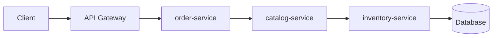

# Truyền deadline và dừng công việc khi yêu cầu đã hết hạn

Trong kiến trúc microservices, một request có thể đi qua API Gateway, `order-service`, `catalog-service` và `inventory-service` trước khi trả kết quả. Nếu mỗi dịch vụ tự đặt timeout 2 giây cho lần gọi tiếp theo, tổng thời gian xử lý có thể lớn hơn rất nhiều so với thời gian người dùng sẵn sàng chờ. Hơn nữa, sau khi caller đã bỏ cuộc, những dịch vụ phía sau có thể vẫn tiếp tục dùng thread, connection, CPU hoặc cơ sở dữ liệu để xử lý một kết quả không còn ai nhận.

**Deadline** giải quyết vấn đề này bằng cách định nghĩa **thời điểm cuối cùng** một yêu cầu còn có ý nghĩa. Deadline được truyền qua các hop, mỗi hop tính lại thời gian còn lại, từ chối bắt đầu công việc khi ngân sách đã hết và cố gắng hủy những thao tác không còn cần thiết. Với module `SPRING_CLOUD_SERVICE_COMMUNICATION_LOAD_BALANCING`, cách làm này phải phối hợp với Spring Cloud LoadBalancer, `RestClient`, `WebClient`, OpenFeign, timeout của HTTP transport và retry, nhưng **không** được giả định rằng LoadBalancer tự truyền deadline hoặc tự hủy mọi công việc của downstream.

## 1. Phân biệt timeout, deadline và cancellation

Ba khái niệm có liên quan nhưng không thay thế nhau:

| Khái niệm | Ý nghĩa | Phạm vi ví dụ |
|---|---|---|
| **Timeout** | Thời lượng tối đa dành cho một thao tác hoặc giai đoạn | Chờ connection từ pool 200 ms; kết nối TCP 300 ms; chờ response 700 ms |
| **Deadline** | Thời điểm tuyệt đối mà toàn bộ yêu cầu phải kết thúc | Yêu cầu phải xong trước 12:00:01.500 UTC |
| **Cancellation** | Tín hiệu ngừng một tác vụ đang chờ/chạy vì kết quả không còn cần thiết | Hủy subscription của WebClient; interrupt một task; đóng request/connection |

Timeout trả lời câu hỏi “được chờ **bao lâu**?”, còn deadline trả lời “đến **lúc nào** thì không còn thời gian?”. Cancellation trả lời “khi đã hết thời gian, **làm sao yêu cầu phần việc còn lại dừng lại?**”.

Ví dụ, `order-service` nhận ngân sách 1.500 ms. Nó mất 450 ms để xác thực và chuẩn bị dữ liệu. Lúc gọi `catalog-service`, ngân sách thực tế chỉ còn khoảng 1.050 ms, không phải một lượt 1.500 ms mới. Nếu phải chừa 100 ms để kết hợp dữ liệu và ghi response, `catalog-service` chỉ nên nhận tối đa khoảng 950 ms cho phần việc tiếp theo.

Một **connect timeout** ngắn không bảo đảm toàn bộ lời gọi kết thúc đúng deadline: thời gian đợi pool, discovery, retry, backoff, đọc body và xử lý nghiệp vụ đều có thể tiêu tốn ngân sách. Vì vậy deadline cần được thực thi ở **tầng điều phối request**, ngoài timeout của từng giai đoạn HTTP.

## 2. Vì sao timeout riêng từng hop dễ làm vượt SLA?

Giả sử chuỗi gọi tuần tự:



Nếu mỗi hop có “read timeout 2 giây” mà không biết deadline chung, một request có thể trải qua nhiều lần chờ và retry. Mỗi service coi mình còn trọn 2 giây dù caller có thể đã ngắt kết nối từ trước. Khi nhiều request cùng gặp sự cố downstream, công việc thừa này có thể tạo hàng đợi, làm cạn connection pool và khuếch đại lỗi.

Deadline cung cấp giới hạn chung:

```text
Client muốn hoàn thành trước D = 12:00:01.500
    |
Gateway chuyển deadline D
    | đã tiêu thụ 150 ms
order-service còn khoảng 1.350 ms
    | đã tiêu thụ thêm 350 ms
catalog-service còn khoảng 1.000 ms
    | trước khi gọi inventory-service phải trừ thêm budget dự phòng
inventory-service chỉ được làm việc trong phần thời gian còn lại
```

Không nhất thiết mọi dịch vụ có cùng timeout kết nối hay response. Nhưng **không hop nào được tự ý mở rộng deadline đã nhận**. Nếu một dịch vụ cần ít thời gian hơn để bảo vệ tài nguyên nội bộ, nó có thể đặt deadline con **sớm hơn** deadline của caller.

## 3. Cách tính ngân sách thời gian còn lại

Gọi `D` là deadline, `t_now` là thời điểm hiện tại:

\[
B_{remaining} = \max(0, D - t_{now})
\]

Nếu một dịch vụ phải dự phòng `R` cho bước xử lý sau lời gọi downstream và muốn giới hạn lời gọi đó bởi `C`:

\[
B_{downstream} = \max\bigl(0, \min(B_{remaining}-R,\;C)\bigr)
\]

Ví dụ:

- Deadline ban đầu cho toàn request: **1.500 ms**.
- Đã tiêu thụ ở gateway và `order-service`: **480 ms**.
- Còn lại: **1.020 ms**.
- Chừa **120 ms** cho kết hợp kết quả và gửi response.
- `catalog-service` có giới hạn riêng **800 ms** mỗi lời gọi.

Ngân sách cho lần gọi tiếp theo là `min(1.020 - 120, 800) = 800 ms`. Nếu còn 90 ms mà ứng dụng cần chừa 120 ms, **không bắt đầu** lời gọi downstream nữa; trả lỗi hết hạn hoặc dùng fallback rẻ, an toàn theo chính sách nghiệp vụ.

Thời gian dự phòng không phải số cố định cho mọi hệ thống. Hãy đo các giai đoạn thực tế, hàng đợi, serialization, connection pool và network overhead để đặt ngưỡng phù hợp. Nếu một request đi qua nhiều hop, việc mỗi hop chừa dự phòng quá lớn cũng có thể làm request hết ngân sách sớm; cần cân đối theo SLO tổng.

## 4. Truyền deadline qua HTTP header

Một cách phổ biến là dùng header nội bộ để mang **thời điểm tuyệt đối**, ví dụ:

```http
GET /api/products/P42 HTTP/1.1
Host: catalog-service
X-Request-Deadline-Epoch-Millis: 1794926401500
X-Correlation-Id: req-7f29
```

`X-Request-Deadline-Epoch-Millis` trong bài là **quy ước minh họa do hệ thống tự thiết kế**, không phải header chuẩn được Spring Cloud LoadBalancer tự phát hoặc tự hiểu. Giá trị là số mili giây tính từ Unix epoch. `X-Correlation-Id` giúp nối các log/traces nhưng không mang ngữ nghĩa giới hạn thời gian.

Tại mỗi hop, ứng dụng cần:

1. **Nhận** deadline đã được gateway hoặc upstream đáng tin cậy xác lập.
2. **Xác thực và giới hạn** deadline theo chính sách tối đa của chính dịch vụ.
3. **Tính thời gian còn lại** trước mỗi thao tác có thể mất thời gian.
4. **Áp giới hạn thực thi** cho thao tác bằng timeout/cancellation phù hợp.
5. **Truyền tiếp deadline không muộn hơn deadline đã nhận** khi gọi downstream.
6. **Ngừng khởi chạy công việc mới** nếu ngân sách đã hết; hạn chế các công việc đang chạy khi có thể hủy.

### Không tin header từ Internet một cách mù quáng

Client bên ngoài có thể gửi deadline quá xa trong tương lai để giữ tài nguyên lâu, hoặc deadline đã hết để tạo nhiều lỗi. Gateway nên xóa/thay header không đáng tin cậy, thiết lập deadline theo SLO và chính sách xác thực, sau đó chỉ truyền trong mạng tin cậy. Service nội bộ vẫn nên áp dụng **giới hạn tối đa của chính mình**, ngay cả khi đã có gateway.

Đối với header số epoch, cần kiểm tra cú pháp, độ lớn, giá trị âm/tràn số và chính sách xử lý dữ liệu không hợp lệ. Không lấy chuỗi deadline thô để tạo tên host hay tùy biến URL. Cần tránh làm lộ chi tiết topology hoặc chính sách nội bộ qua response cho client công khai.

## 5. Đồng hồ: deadline tuyệt đối và thời gian đo cục bộ

Truyền một thời điểm tuyệt đối giúp tránh cộng dồn timeout ở các hop. Tuy nhiên, nó đòi hỏi đồng hồ của các máy **đủ đồng bộ**. Nếu `order-service` và `catalog-service` lệch nhau 500 ms, cùng một timestamp có thể bị hiểu là hết hạn quá sớm hoặc còn nhiều thời gian hơn thực tế.

Vì vậy:

- Đồng bộ đồng hồ các máy/VM/container host bằng NTP hoặc cơ chế tương đương, quan sát clock skew.
- Dùng thời điểm tuyệt đối để **truyền giữa các process**, nhưng sau khi nhận nên chuyển sang một ngân sách cục bộ được đo bằng **đồng hồ monotonic** (ví dụ `System.nanoTime()`) để việc chỉnh đồng hồ hệ thống không làm thay đổi thời gian chờ trong process.
- Có chính sách xử lý timestamp bất thường và deadline đã hết ngay khi nhận.
- Với môi trường không bảo đảm đồng bộ tốt, có thể truyền thêm **remaining budget** qua giao thức nội bộ được thiết kế rõ, giảm độ tin cậy vào wall clock nhưng phải trừ thời gian truyền và vẫn giới hạn budget ở phía nhận.

Đừng nhầm `System.currentTimeMillis()` (wall clock, có thể được chỉnh) với `System.nanoTime()` (đo khoảng thời gian cục bộ). Hai giá trị không được so sánh trực tiếp với nhau vì dùng mốc thời gian khác nhau.

## 6. Định nghĩa đối tượng Deadline dùng chung

Một kiểu dữ liệu `Deadline` giúp ứng dụng không phải tính tay bằng nhiều biến `long`. Ví dụ sau dùng `Clock` để dễ kiểm thử; đây là triển khai **minh họa** cho service nội bộ đã nhận header từ nguồn tin cậy:

```java
package com.example.orders.timeout;

import java.time.Clock;
import java.time.DateTimeException;
import java.time.Duration;
import java.time.Instant;

public record Deadline(Instant expiresAt) {

    public static Deadline fromTrustedHeader(
            String raw,
            Duration maximumBudget,
            Clock clock) {

        Instant now = clock.instant();
        Instant localLimit = now.plus(maximumBudget);

        if (raw == null || raw.isBlank()) {
            return new Deadline(localLimit);
        }

        try {
            Instant upstream = Instant.ofEpochMilli(Long.parseLong(raw));
            return new Deadline(upstream.isBefore(localLimit)
                    ? upstream : localLimit);
        } catch (NumberFormatException | DateTimeException ex) {
            throw new IllegalArgumentException("Invalid deadline header", ex);
        }
    }

    public Duration remaining(Clock clock) {
        Duration value = Duration.between(clock.instant(), expiresAt);
        return value.isNegative() ? Duration.ZERO : value;
    }

    public boolean expired(Clock clock) {
        return remaining(clock).isZero();
    }

    public String asHeaderValue() {
        return Long.toString(expiresAt.toEpochMilli());
    }
}
```

Một exception đơn giản để biểu diễn hết deadline:

```java
package com.example.orders.timeout;

public class DeadlineExceededException extends RuntimeException {
    public DeadlineExceededException() {
        super("Request deadline exceeded");
    }
}
```

Lời gọi khởi tạo có thể dùng ngân sách tối đa 1.200 ms:

```java
Deadline deadline = Deadline.fromTrustedHeader(
        incomingDeadlineHeader,
        Duration.ofMillis(1200),
        clock);

if (deadline.expired(clock)) {
    throw new DeadlineExceededException();
}
```

Đoạn code chặn header không hợp lệ và không cho deadline vượt quá giới hạn cục bộ. Nó **chưa phải** implementation production hoàn chỉnh: cần ràng buộc `maximumBudget` phải dương/hợp lệ, lựa chọn mã lỗi HTTP cho header sai, xử lý clock skew và dùng thời gian monotonic cho ngân sách thực thi bên trong process. Đặc biệt, không dùng một deadline quá xa do client tự gửi để giữ connection lâu hơn SLO.

## 7. Reactive: truyền deadline qua WebClient và hủy khi hết hạn

Với Spring WebFlux, `Mono.timeout(Duration)` cho phép phát lỗi khi publisher không hoàn thành đúng thời gian. Khi timeout xảy ra, operator phát tín hiệu **cancel** đến subscription upstream. Đó là cơ chế phù hợp để cố gắng dừng request HTTP reactive đang chờ, nhưng **không bảo đảm** server đích đã dừng một công việc nghiệp vụ bắt đầu trước đó.

Tạo `WebClient.Builder` được Spring Cloud LoadBalancer hỗ trợ:

```java
package com.example.orders.config;

import java.time.Clock;
import org.springframework.cloud.client.loadbalancer.LoadBalanced;
import org.springframework.context.annotation.Bean;
import org.springframework.context.annotation.Configuration;
import org.springframework.web.reactive.function.client.WebClient;

@Configuration(proxyBeanMethods = false)
public class OutboundClientConfiguration {

    @Bean
    Clock clock() {
        return Clock.systemUTC();
    }

    @Bean
    @LoadBalanced
    WebClient.Builder loadBalancedWebClientBuilder() {
        return WebClient.builder();
    }
}
```

Sau đó tạo client gọi `catalog-service` và kiểm tra thời gian còn lại **tại lúc subscription**, thay vì chỉ khi dựng pipeline:

```java
package com.example.orders.catalog;

import com.example.orders.timeout.Deadline;
import com.example.orders.timeout.DeadlineExceededException;
import java.time.Clock;
import java.time.Duration;
import java.util.concurrent.TimeoutException;
import org.springframework.cloud.client.loadbalancer.LoadBalanced;
import org.springframework.stereotype.Component;
import org.springframework.web.reactive.function.client.WebClient;
import reactor.core.publisher.Mono;

@Component
public class CatalogClient {
    private final WebClient webClient;
    private final Clock clock;

    public CatalogClient(
            @LoadBalanced WebClient.Builder builder,
            Clock clock) {
        this.webClient = builder.clone().build();
        this.clock = clock;
    }

    public Mono<ProductDto> findProduct(String id, Deadline deadline) {
        return Mono.defer(() -> {
            Duration remaining = deadline.remaining(clock);
            if (remaining.isZero()) {
                return Mono.error(new DeadlineExceededException());
            }

            return webClient.get()
                    .uri("http://catalog-service/api/products/{id}", id)
                    .header("X-Request-Deadline-Epoch-Millis",
                            deadline.asHeaderValue())
                    .retrieve()
                    .bodyToMono(ProductDto.class)
                    .timeout(remaining)
                    .onErrorMap(TimeoutException.class,
                            error -> new DeadlineExceededException());
        });
    }
}
```

`ProductDto` là DTO nghiệp vụ của ứng dụng, cần được khai báo phù hợp với JSON của `catalog-service`. `Mono.defer` quan trọng vì giữa thời điểm **tạo** `Mono` và thời điểm **subscribe** có thể có thời gian chờ trong pipeline. Nếu tính `remaining` từ sớm rồi sử dụng mãi, request có thể được cấp một timeout lớn hơn ngân sách thực tế còn lại.

`timeout(remaining)` giới hạn khoảng thời gian chờ publisher ở tầng Reactor. Khi nó phát timeout, Reactor sẽ cố gắng hủy subscription upstream; với WebClient/transport tương thích, việc hủy thường dẫn đến ngừng chờ response hoặc đóng/hủy hoạt động HTTP liên quan. Tuy nhiên, **dữ liệu đã gửi đi không thể thu hồi** và một tác vụ ở server không nhất thiết biết caller đã cancel.

Không nên coi `Mono.timeout` là cấu hình thay thế mọi connect timeout, response timeout hoặc giới hạn connection pool. Vẫn cần đặt timeout thích hợp ở Reactor Netty/HTTP connector và giới hạn tài nguyên, nhất là khi có nhiều request đồng thời hoặc connection chưa được cấp.

## 8. Kiểm tra deadline từ đầu request và truyền qua nhiều hop

Ở ranh giới HTTP của `order-service`, ứng dụng có thể nhận header từ gateway tin cậy, tạo `Deadline`, rồi truyền cùng một deadline xuống các client được gọi:

```java
package com.example.orders.web;

import com.example.orders.catalog.CatalogClient;
import com.example.orders.catalog.ProductDto;
import com.example.orders.timeout.Deadline;
import java.time.Clock;
import java.time.Duration;
import org.springframework.web.bind.annotation.GetMapping;
import org.springframework.web.bind.annotation.PathVariable;
import org.springframework.web.bind.annotation.RequestHeader;
import org.springframework.web.bind.annotation.RestController;
import reactor.core.publisher.Mono;

@RestController
public class OrderPreviewController {
    private final CatalogClient catalog;
    private final Clock clock;

    public OrderPreviewController(CatalogClient catalog, Clock clock) {
        this.catalog = catalog;
        this.clock = clock;
    }

    @GetMapping("/orders/preview/{id}")
    public Mono<ProductDto> preview(
            @PathVariable String id,
            @RequestHeader(
                    value = "X-Request-Deadline-Epoch-Millis",
                    required = false) String header) {

        Deadline deadline = Deadline.fromTrustedHeader(
                header, Duration.ofMillis(1200), clock);

        if (deadline.expired(clock)) {
            return Mono.error(new DeadlineExceededException());
        }

        return catalog.findProduct(id, deadline);
    }
}
```

Trong ví dụ này, `DeadlineExceededException` cần được import và ánh xạ sang HTTP response phù hợp trong ứng dụng thực tế. `fromTrustedHeader` chỉ được dùng sau khi gateway đã kiểm soát header. Nếu controller được Internet gọi trực tiếp, phải thêm kiểm tra trust boundary và giới hạn chính sách trước khi dùng giá trị bên ngoài.

Nếu `catalog-service` tiếp tục gọi `inventory-service`, nó phải đọc deadline đã nhận, tính lại ngân sách, **truyền tiếp cùng deadline hoặc một deadline con sớm hơn**, và từ chối công việc khi hết ngân sách. Không tạo mới toàn bộ 1.200 ms ở mỗi hop. Đặc biệt, `@LoadBalanced WebClient.Builder` giúp phân giải service ID; nó **không tự mang header deadline** nếu mã hoặc filter HTTP client không thêm header.

## 9. Tổng ngân sách cho nhiều lời gọi và phép ghép reactive

Khi cần gọi `catalog-service` và `inventory-service` song song, có thể dùng `Mono.zip`. Cần đảm bảo **toàn bộ tác vụ tổng** cũng bị giới hạn bởi deadline:

```java
Mono<OrderView> buildView(String id, Deadline deadline) {
    return Mono.defer(() -> {
        Duration totalRemaining = deadline.remaining(clock);
        if (totalRemaining.isZero()) {
            return Mono.error(new DeadlineExceededException());
        }

        Mono<ProductDto> product = catalog.findProduct(id, deadline);
        Mono<StockDto> stock = inventory.findStock(id, deadline);

        return Mono.zip(product, stock)
                .map(tuple -> new OrderView(tuple.getT1(), tuple.getT2()))
                .timeout(totalRemaining)
                .onErrorMap(TimeoutException.class,
                        ex -> new DeadlineExceededException());
    });
}
```

Các kiểu `StockDto`, `OrderView` và client `inventory` được giả định đã được ứng dụng khai báo. Thời gian thực thi hai lời gọi có thể chồng lấp, nhưng chúng **chia sẻ cùng deadline**. Một lời gọi thất bại có thể làm phép ghép lỗi và hủy subscription còn lại; công việc server đã bắt đầu từ trước vẫn cần cơ chế hủy hoặc deadline riêng ở downstream để dừng sớm.

Khi cần một phần kết quả nếu một downstream lỗi, phải định nghĩa rõ chính sách fallback và tránh biến mọi timeout thành dữ liệu mặc định có vẻ hợp lệ. Ví dụ, hiển thị sản phẩm mà chưa có tồn kho có thể hợp lý với màn hình xem trước, nhưng không hợp lý với thao tác xác nhận đơn hàng hoặc trừ hàng tồn.

## 10. Đồng bộ với RestClient/OpenFeign: không có hủy bảo đảm

Với `RestClient`, `RestTemplate` hoặc OpenFeign theo mô hình blocking, một lời gọi HTTP có thể giữ thread đang chờ I/O. Có thể cấu hình các giới hạn ở HTTP client:

- **Pool lease timeout:** chờ lấy connection từ pool.
- **Connect timeout:** mở kết nối đến host/port của `ServiceInstance`.
- **Response/read timeout:** chờ dữ liệu trả về từ downstream.
- **Request deadline:** ngân sách tổng ở tầng điều phối bao gồm cả thời gian chờ, chọn instance, retry và xử lý tiếp.

Ví dụ thuộc tính per-client của Spring Cloud OpenFeign, dùng để đặt giới hạn **transport**, không phải deadline toàn request:

```yaml
spring:
  cloud:
    openfeign:
      client:
        config:
          catalog-service:
            connectTimeout: 300
            readTimeout: 700
```

Những số trên mang đơn vị mili giây theo cấu hình OpenFeign phổ biến; chúng là **ngưỡng minh họa**, không phải cấu hình tối ưu cho mọi hạ tầng. `readTimeout` không tự bao phủ toàn bộ chuỗi retry và công việc sau response. Nếu request chỉ còn 150 ms nhưng client vẫn có `readTimeout: 700`, ứng dụng có nguy cơ chờ quá deadline chung.

### Cần dừng cả phần việc của thread khi hết hạn

Với công việc blocking được chạy qua `ExecutorService`, có thể chờ tối đa thời gian còn lại và gửi yêu cầu hủy khi quá hạn:

```java
Future<Result> future = executor.submit(() -> blockingWork());

Duration remaining = deadline.remaining(clock);
if (remaining.isZero()) {
    future.cancel(true);
    throw new DeadlineExceededException();
}

try {
    return future.get(remaining.toMillis(), TimeUnit.MILLISECONDS);
} catch (TimeoutException timeout) {
    future.cancel(true);  // Yêu cầu interrupt, không phải kill chắc chắn.
    throw new DeadlineExceededException();
}
```

`Result`, `executor`, `blockingWork`, `clock` và `deadline` trong đoạn code là các thành phần giả định của ứng dụng; cần import `Future`, `TimeUnit`, `Duration`, `TimeoutException` và xử lý `InterruptedException`/`ExecutionException` đầy đủ trong implementation thực tế. Với bài toán này, **`Future.cancel(true)` chỉ gửi tín hiệu interrupt**. Nếu thư viện HTTP/JDBC không tôn trọng interrupt hoặc thao tác đã xảy ra ở server, công việc có thể vẫn tiếp diễn.

Tương tự, `CompletableFuture.orTimeout(...)` làm một future hoàn tất lỗi khi hết hạn, **không chứng minh I/O nền đã bị hủy**. Đừng chỉ thêm timeout cho đối tượng future rồi cho rằng thread, socket và truy vấn database đã được giải phóng.

Đối với synchronous HTTP client, ưu tiên hỗ trợ deadline bằng timeout ở transport, khả năng abort/cancel request do implementation cung cấp và kiểm tra cancellation ở những ranh giới công việc. Mọi thread pool/executor dùng để bọc blocking call cũng phải có giới hạn concurrency và queue, tránh giải quyết một loại timeout bằng cách tạo thêm vô hạn thread.

## 11. Spring Cloud LoadBalancer, retry và deadline còn lại

Spring Cloud LoadBalancer chọn `ServiceInstance` thông qua service ID, discovery và các `ServiceInstanceListSupplier`. **Nó không mặc nhiên quản lý một deadline end-to-end chung** qua `RestClient`, `WebClient`, OpenFeign và các dịch vụ được gọi tiếp. Khi không có instance, danh sách discovery trống hoặc instance vừa bị lỗi, quá trình chọn lại/retry vẫn phải chịu giới hạn ngân sách còn lại.

Ví dụ timeline khi caller có 900 ms tại lúc bắt đầu gọi downstream:

| Sự kiện | Thời gian tiêu tốn | Ngân sách còn lại |
|---|---:|---:|
| Bắt đầu | 0 ms | 900 ms |
| Chờ discovery/chọn instance | 60 ms | 840 ms |
| Attempt 1 kết nối thất bại | 240 ms | 600 ms |
| Backoff trước retry | 100 ms | 500 ms |
| Attempt 2 | Tối đa theo ngân sách còn lại, có dự phòng | Không được tự mở thêm 900 ms |

Nếu retry được bật qua Reactor `retryWhen`, Spring Cloud LoadBalancer retry hoặc lớp khác, cần làm rõ **ai sở hữu retry** và tổng thời gian được giới hạn ở đâu. Một pattern reactive là bao cả chuỗi attempt/retry trong một timeout tổng tính **khi subscribe**:

```java
Mono<ProductDto> withBudget(Deadline deadline) {
    return Mono.defer(() -> {
        Duration remaining = deadline.remaining(clock);
        if (remaining.isZero()) {
            return Mono.error(new DeadlineExceededException());
        }

        return fetchOneAttempt(deadline)
                .retryWhen(retrySpecForTransientFailures())
                .timeout(remaining)
                .onErrorMap(TimeoutException.class,
                        ex -> new DeadlineExceededException());
    });
}
```

`fetchOneAttempt` cần tự tính lại deadline/budget trước mỗi lần subscribe; `retrySpecForTransientFailures()` là chính sách của ứng dụng, phải giới hạn số lần/backoff và lọc loại lỗi có thể retry. Mục tiêu của ví dụ là nhấn mạnh **deadline bao trùm cả backoff lẫn retry**, chứ không khuyến khích retry mọi lỗi HTTP.

Không retry vô điều kiện các thao tác `POST`/`PATCH` tạo tác dụng phụ. Khi caller timeout nhưng server đã xử lý thành công mà response bị mất, attempt sau có thể tạo đơn hàng hoặc trừ tồn kho hai lần. Dùng idempotency key, giao dịch và deduplication phù hợp nếu nghiệp vụ cho phép retry.

## 12. Dừng công việc: hợp tác giữa caller và server đích

Việc client trả lỗi timeout không tự động khiến server ngừng xử lý. Cần phân biệt các khả năng:

| Tình huống | Caller có thể làm gì? | Downstream cần làm gì? |
|---|---|---|
| Request chưa gửi | Không gửi khi deadline đã hết | Không có việc phải làm |
| Đang chờ HTTP response reactive | Cancel subscription, giải phóng tài nguyên có thể hủy | Nhận biết disconnect/cancel hoặc kiểm tra deadline riêng |
| Đang chờ HTTP blocking | Áp timeout transport, abort request nếu hỗ trợ, interrupt có điều kiện | Tôn trọng deadline và cancellation tại ranh giới công việc |
| Server đang truy vấn DB | Caller không thể buộc DB dừng từ xa chỉ nhờ header | Đặt query/statement timeout, hủy truy vấn nếu driver hỗ trợ |
| Server đã ghi dữ liệu | Không thể “rút lại” một tác dụng phụ chỉ bằng cancel | Cần giao dịch, idempotency, chính sách bù trừ nếu phù hợp |
| Tác vụ được tách ra hàng đợi/background | Caller không còn nắm vòng đời trực tiếp | Message TTL, kiểm tra deadline khi worker nhận việc, deduplication |

Một server nhận deadline nên kiểm tra **trước bước tốn kém** (query lớn, gọi thêm HTTP, tạo job) và **sau các bước chờ dài**. Nếu hết hạn, dừng tạo công việc mới và trả lỗi phù hợp khi còn có thể trả response.

Với xử lý reactive, việc subscriber cancel có thể lan qua một số publisher và HTTP client, nhưng **không bảo đảm** tác vụ đã được tách bằng `subscribe()` thủ công, `@Async`, thread độc lập, message queue hoặc side effect bên ngoài sẽ dừng theo. Hãy tránh các tác vụ detached không được quản lý vòng đời; với công việc nền có chủ đích, cần cơ chế deadline, cancellation token hoặc trạng thái job riêng.

Với truy vấn dữ liệu, đặt query timeout/statement timeout phù hợp với ngân sách và transaction. Nếu request bị hủy trong khi transaction đang thực hiện, cần hiểu rollback semantics của framework và database; đóng connection không đồng nghĩa mọi hiệu ứng đã thực hiện được rollback.

## 13. Khi deadline kết thúc, trả HTTP status nào?

Không có một mã HTTP duy nhất áp dụng cho mọi trường hợp hết deadline:

- **`504 Gateway Timeout`** thường phù hợp khi một gateway/proxy không nhận được phản hồi kịp thời từ upstream. Ứng dụng tổng hợp nhiều downstream cũng có thể chọn cách biểu diễn tương tự theo API contract.
- **`503 Service Unavailable`** phù hợp khi không có khả năng phục vụ tạm thời, ví dụ không có instance hoặc quá tải, không đồng nghĩa mọi tình huống deadline đều là 503.
- **`408 Request Timeout`** thường liên quan đến server chờ hoàn tất request từ client, không mặc định là mã dành cho mọi downstream timeout.
- Khi **client đã ngắt kết nối**, server có thể không gửi được response nào; một số proxy dùng mã không chuẩn như `499` trong log nội bộ để biểu thị client đóng kết nối.

Điều quan trọng là tách **deadline đã hết** khỏi **service không có instance**, **connect timeout**, **read timeout**, **HTTP 500** và **lỗi nghiệp vụ** trong log/metrics. Khi API trả fallback, cần minh bạch rằng dữ liệu là kết quả một phần hoặc đã bị suy giảm nếu điều đó ảnh hưởng quyết định của người dùng.

## 14. Quan sát deadline và cancellation qua nhiều service

Để vận hành, nên ghi nhận tối thiểu:

| Trường quan sát | Ý nghĩa |
|---|---|
| `traceId` / `spanId` | Nối các hop của cùng yêu cầu |
| `serviceId` và `instanceId` được chọn | Phân biệt lỗi discovery/định tuyến với lỗi downstream |
| Remaining budget lúc nhận request | Biết service được cấp bao nhiêu thời gian |
| Remaining budget trước mỗi lời gọi | Xác định có cấp quá nhiều thời gian cho downstream không |
| Số attempt/retry và backoff | Phát hiện khuếch đại tải khi lỗi |
| Timeout type | Pool lease, connect, response, deadline tổng |
| Cancellation outcome | Có gửi cancel/interrupt? Công việc thực tế có dừng không? |
| Kết quả cuối | Success, timeout, cancelled, fallback, error |

Ví dụ hai service cùng báo timeout nhưng nguyên nhân khác nhau: `catalog-service` mất 700 ms để trả response, trong khi `inventory-service` chỉ được nhận 100 ms vì thời gian trước đó đã tiêu tốn hết ngân sách. Nếu chỉ xem connect/read timeout của `inventory-service`, người vận hành có thể sửa nhầm service cuối thay vì tối ưu chuỗi request tổng.

Đặt metric về **deadline exceeded trước khi gửi request**, **deadline exceeded khi đang chờ HTTP** và **work cancelled sau timeout** riêng nhau sẽ giúp phát hiện liệu chính sách đang giảm tải hay chỉ đổi cách báo lỗi. Không ghi token, cookie hay payload người dùng vào log deadline; timestamp, thời lượng, service ID và trace ID thường đã đủ để phân tích.

## 15. Bài thực hành với hai downstream instance

**Mục tiêu:** chứng minh một deadline chung không bị reset mỗi hop, reactive client ngừng đợi khi hết hạn và những bước đã quá hạn không tạo request mới.

### Chuẩn bị

- `order-service`: nhận `/orders/preview/{id}`, tạo deadline 1.200 ms nếu chưa có deadline tin cậy và gọi `catalog-service` bằng `@LoadBalanced WebClient.Builder`.
- `catalog-service`: hai instance trên `localhost:8081` và `localhost:8082`, mỗi instance có endpoint `/api/products/{id}`. Cho phép cấu hình độ trễ phản hồi trong lab.
- `inventory-service` (tùy chọn): endpoint trả về tồn kho sau một khoảng trễ để thử tổng hợp `Mono.zip`.

Khai báo discovery tĩnh trong consumer:

```yaml
spring:
  cloud:
    discovery:
      client:
        simple:
          instances:
            catalog-service:
              - uri: http://localhost:8081
              - uri: http://localhost:8082
```

`localhost` chỉ hợp lệ nếu consumer và hai instance chạy trong cùng ngữ cảnh mạng. Khi chạy Docker/Kubernetes, phải dùng các địa chỉ thực sự truy cập được từ consumer; vấn đề DNS/container port không được giải quyết bằng cách tăng deadline.

### Các ca cần quan sát

| Ca thử | Cách kích hoạt | Kết quả mong muốn |
|---|---|---|
| Deadline không có ở ingress | Bỏ header, dùng budget local 1.200 ms | Gateway/service đặt deadline hợp lệ theo chính sách |
| Deadline còn rất ít | Gửi header được gateway tin cậy tạo với 50 ms còn lại | Bước downstream không bắt đầu nếu budget không đủ; fail fast |
| Deadline đã hết | Gửi header quá hạn | Không gọi HTTP outbound, trả lỗi hết hạn |
| Downstream chậm | Làm instance ngủ 2 giây | Caller kết thúc chờ quanh deadline đã cấp; không chờ trọn 2 giây |
| Retry có backoff | Gây lỗi tạm thời ở attempt 1 | Tổng thời gian retry/backoff không vượt deadline |
| Một nhánh của `Mono.zip` lỗi | `inventory-service` chậm hoặc thất bại | Nhánh khác nhận cancel khi thích hợp, tổng pipeline dừng đúng hạn |
| Blocking call dùng Future | Cho tác vụ blocking chạy lâu | `future.cancel(true)` được yêu cầu, nhưng kiểm tra riêng I/O có thật sự dừng |
| Side effect sau deadline | Thử tác vụ ghi DB có idempotency key | Không tự động thực thi lại hoặc ghi trùng vì timeout |

Trong lab, ghi lại thời gian bắt đầu request, giá trị header đã truyền đi, thời gian còn lại tại từng hop, instance được chọn, số lần HTTP được gửi, thời điểm timeout và các task vẫn chạy sau đó. **Không dùng việc caller nhận timeout làm bằng chứng đủ rằng downstream đã ngừng làm việc.** Một kiểm thử tốt cần instrument cả phía server đích.

## 16. Những lỗi thiết kế cần tránh

| Anti-pattern | Hệ quả | Cách thay thế |
|---|---|---|
| Mỗi hop tự đặt lại timeout 2 giây | Chuỗi gọi vượt SLO tổng | Truyền deadline chung và trừ thời gian đã dùng |
| Chỉ đặt connect timeout | Không giới hạn đợi pool, response, retry và nghiệp vụ | Kết hợp timeout transport với deadline tổng |
| Tính `remaining` khi dựng `Mono` rồi subscribe rất muộn | Cấp ngân sách lỗi thời | Dùng `Mono.defer` hoặc tính lúc bắt đầu attempt |
| Tin deadline raw từ browser | Client có thể kéo dài hoặc phá budget | Gateway kiểm soát header, mỗi service clamp giới hạn |
| Giả định `.timeout()` hủy mọi tác vụ server | Background job/DB vẫn tiếp tục | Propagate deadline, cancellation token, query timeout và idempotency |
| Dùng `Future.cancel(true)` rồi cho rằng thread đã chết | I/O có thể không tôn trọng interrupt | Transport timeout/abort và kiểm tra cancellation của từng thư viện |
| Retry ở nhiều tầng không có budget | Khuếch đại request và làm hết connection | Retry owner rõ ràng, giới hạn attempts/backoff và tổng deadline |
| Dùng deadline để phân quyền | Dữ liệu caller cung cấp có thể bị sửa | Xác thực/phân quyền tách biệt; deadline chỉ quản lý thời gian |
| Cho rằng lỗi timeout nghĩa server chưa xử lý | Request ghi có thể đã thành công | Idempotency key, đối soát và transaction phù hợp |

## 17. Checklist áp dụng trong production

1. Đã xác định SLO/time budget tổng của request và điểm tạo deadline đáng tin cậy chưa?
2. Header deadline có quy ước rõ đơn vị, format, tính xác thực và giới hạn tối đa không?
3. Mọi downstream đều nhận và **không kéo dài** deadline của upstream không?
4. Có đo budget còn lại **ngay trước mỗi lời gọi** và fail fast khi hết hạn không?
5. Transport có connect/pool/response timeout đủ chặt, phù hợp với tổng deadline không?
6. Với WebClient, `timeout`/cancellation có được áp ở đúng publisher và thử nghiệm trên server chậm không?
7. Với RestClient/OpenFeign blocking, đã kiểm tra khả năng interrupt/abort thực tế, không chỉ timeout của future chưa?
8. Retry có giới hạn attempts/backoff, được bao trong deadline tổng và không tự động lặp thao tác ghi nguy hiểm không?
9. Database query, transaction, background job và message queue có cơ chế kiểm tra deadline và dừng khi phù hợp không?
10. Đã đo các trường hợp client disconnect, discovery chậm, instance lỗi, hết connection pool, clock skew và lỗi sau khi đã ghi dữ liệu chưa?
11. Có metrics/tracing cho remaining budget, số attempt, selected instance, timeout type và cancellation outcome không?
12. Đã định nghĩa mã lỗi/fallback rõ ràng và tránh che giấu request thất bại thành kết quả nghiệp vụ hợp lệ không?

**Kết luận:** Timeout bảo vệ một thao tác; **deadline bảo vệ toàn bộ hành trình của request**. Trong Spring Cloud LoadBalancer, việc chọn `ServiceInstance` và cấu hình `RestClient`, `WebClient` hay OpenFeign chỉ là một phần của hành trình đó. Muốn hệ thống không lãng phí tài nguyên sau khi caller hết thời gian, cần **truyền deadline qua các hop, tính lại budget trước mỗi công việc, giới hạn cả retry và timeout transport, đồng thời thiết kế cancellation mang tính hợp tác**. Quan trọng nhất, một tín hiệu timeout ở caller không được xem là bảo đảm rằng tác dụng phụ ở downstream đã bị hủy.
