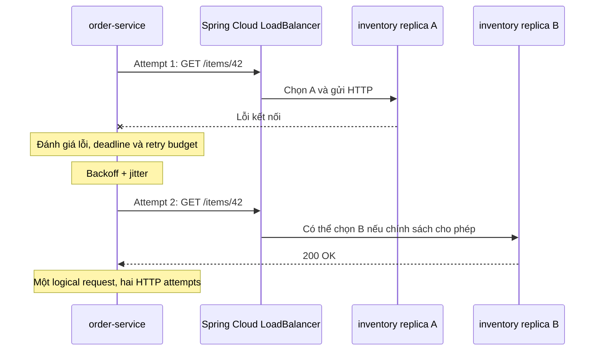
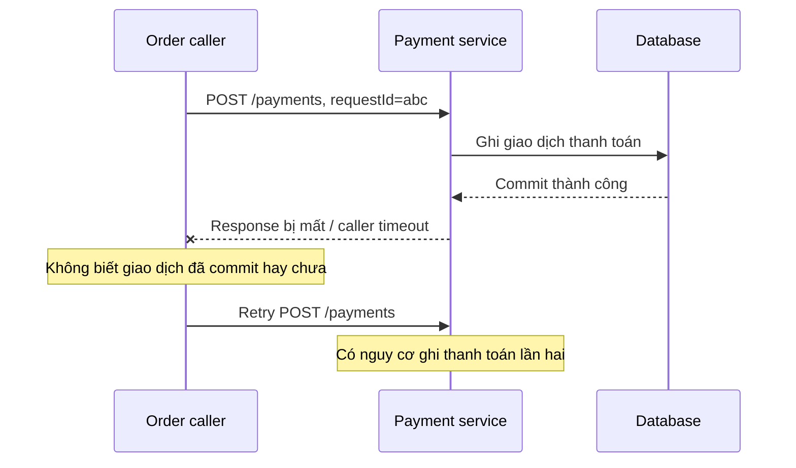
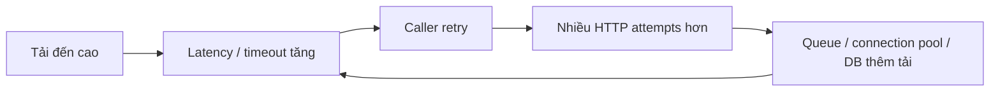
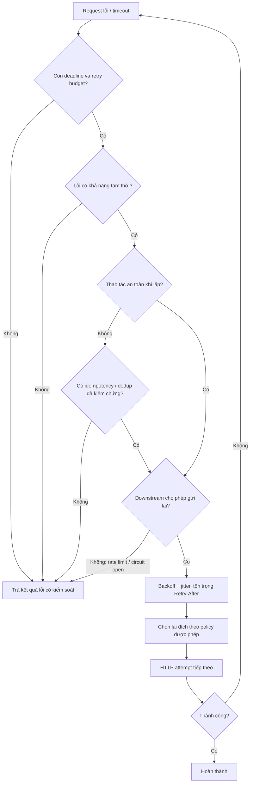

# Khi nào retry có ích và khi nào làm tình hình xấu hơn

Trong hệ thống microservice, một lần gọi HTTP thất bại chưa chắc đồng nghĩa dịch vụ đích đã hỏng hoàn toàn. Kết nối mạng có thể bị ngắt đúng lúc một replica đang được thay thế; một instance có thể tạm thời quá tải trong khi instance khác vẫn phục vụ tốt. **Retry** (gửi lại yêu cầu) giúp vượt qua những lỗi *tạm thời* như vậy. Nhưng nếu mọi caller đều thử lại ngay khi hệ thống đang nghẽn, retry có thể biến sự cố nhỏ thành **retry storm**, khiến downstream càng khó phục hồi.

Bài học thuộc chương **Gửi lại yêu cầu** trong module `SPRING_CLOUD_SERVICE_COMMUNICATION_LOAD_BALANCING` về Spring Cloud LoadBalancer. Bên gọi có thể dùng `RestClient`, `WebClient` hoặc OpenFeign để gọi một service ID như `inventory-service`. Spring Cloud LoadBalancer có nhiệm vụ chọn `ServiceInstance` dựa trên discovery, health check và chính sách định tuyến; còn việc có nên retry, retry lỗi nào, với ngân sách bao nhiêu và có chọn lại instance hay không cần được thiết kế riêng.

**Câu hỏi trung tâm:** Khi nào thêm một lần thử tạo cơ hội thành công thực sự, và khi nào nó chỉ gửi thêm tải đến một hệ thống vốn không còn khả năng xử lý?

## 1. Retry không giống một request mới độc lập

Giả sử `order-service` thực hiện một yêu cầu logic:

```http
GET http://inventory-service/api/items/42
```

Nếu lần đầu gặp lỗi kết nối và hệ thống retry hai lần, một **logical request** có thể tạo tối đa ba **HTTP attempts**:



Sơ đồ trên minh họa **một khả năng**: lần thứ hai được chọn B. Retry **không mặc nhiên** chọn instance khác. Nếu cơ chế retry nằm bên trong HTTP transport sau khi URI đã được đổi thành host/port cụ thể, lần thử lại có thể tiếp tục đi vào A. Nếu retry bao quanh toàn bộ lời gọi qua LoadBalancer, quá trình chọn instance có thể chạy lại nhưng vẫn có thể chọn đúng A do thuật toán, danh sách ứng viên và cấu hình.

Ba số liệu khác nhau cần theo dõi:

| Khái niệm | Ý nghĩa |
|---|---|
| **Logical request** | Một thao tác nghiệp vụ do caller muốn thực hiện. |
| **HTTP attempt** | Một lần thực sự thử gửi request qua transport; retry tạo thêm attempt. |
| **LoadBalancer selection** | Một lần chọn `ServiceInstance`; không phải mọi retry đều chắc chắn chạy lại lựa chọn. |

Đừng đếm ba attempts thành ba đơn hàng độc lập trong báo cáo nghiệp vụ; cũng đừng chỉ đo logical request mà bỏ qua tải thực tế do attempts bổ sung tạo ra.

## 2. Retry có ích khi nào?

Retry tạo giá trị khi đồng thời thỏa các điều kiện cơ bản:

1. **Lỗi có khả năng tạm thời:** một cơ hội hợp lý để lần thử sau thành công.
2. **Request có thể được thực hiện lại an toàn:** không tạo tác dụng phụ ngoài ý muốn hoặc có cơ chế chống xử lý trùng.
3. **Còn đủ thời gian:** tổng thời gian lần thử và backoff không vượt deadline nghiệp vụ.
4. **Downstream còn khả năng phục vụ:** retry không làm nghẽn thêm hệ thống đang quá tải hoặc vi phạm rate limit.
5. **Lần thử lại vẫn đúng chính sách định tuyến:** không bỏ qua giới hạn tenant, region, zone hoặc quyền truy cập.

Ví dụ thường phù hợp:

- **Kết nối bị từ chối với một replica vừa rời hệ thống:** danh sách discovery/caching chưa kịp cập nhật; nếu replica khác sẵn sàng, thử lại có thể thành công.
- **Lỗi gateway ngắn hạn:** một upstream proxy trả `502 Bad Gateway` do đứt kết nối tạm thời và backend khác vẫn phục vụ được.
- **Replica đang restart:** yêu cầu đọc an toàn thất bại trong khoảng ngắn giữa readiness/discovery update.
- **Phụ thuộc tạm thời chậm:** trong một số trường hợp, chờ một khoảng backoff rồi thử lại giúp hệ thống phục hồi và vẫn còn đủ deadline.

Không phải mọi lỗi trong danh sách trên đều tự động retryable. Phải dựa vào hợp đồng API, số liệu lỗi thực tế và tầng phát sinh lỗi, không chỉ tên exception.

## 3. Trước khi retry, hãy xác định lỗi xảy ra ở đâu

Lỗi xảy ra trước lựa chọn instance, khi kết nối, khi đã gửi request hay sau khi upstream xử lý xong có ý nghĩa rất khác nhau.

| Giai đoạn lỗi | Ví dụ | Retry có thể giúp? | Lưu ý |
|---|---|---|---|
| **Discovery/LoadBalancer chưa tìm thấy instance** | Sai service ID, registry trống, health supplier lọc hết ứng viên. | Ít khả năng nếu cấu hình sai; chỉ có ích nếu danh sách đang hồi phục nhanh. | Không loop vô hạn khi không có `ServiceInstance`. |
| **Sau khi chọn, trước khi kết nối thành công** | Connection refused từ A; B còn healthy. | Có, với giới hạn và chọn lại tập ứng viên phù hợp. | Chọn B chỉ khi cơ chế retry thực sự chạy qua LB. |
| **Kết nối đứt hoặc response timeout** | Read timeout, connection reset. | Có thể, nhưng **không chắc server chưa thực thi request**. | Với tác vụ ghi phải có idempotency. |
| **Upstream trả lỗi rõ ràng** | `429`, `502`, `503`, `504`. | Tùy status, chính sách rate limit và `Retry-After`. | Không được retry tức thì theo phản xạ. |
| **Yêu cầu sai hoặc thiếu quyền** | `400`, `401`, `403`, `404`. | Thường không. | Gửi lại cùng dữ liệu hiếm khi sửa được lỗi. |
| **Lỗi nghiệp vụ/điều kiện dữ liệu** | `409 Conflict`, validation failed. | Thường không tự động. | Cần xử lý hợp đồng nghiệp vụ; có thể có luồng giải quyết xung đột riêng. |

**Không có instance** không đồng nhất với **upstream trả HTTP `503`**. Tùy integration, kết quả cuối ở caller có thể đều xuất hiện như lỗi `503` hoặc exception, nhưng điểm phát sinh khác nhau. Muốn chọn chính sách retry đúng, cần ghi nhận đã chọn được `ServiceInstance` hay chưa và có nhận HTTP response từ instance thực tế hay không.

### Đọc HTTP status theo nguyên nhân, không theo nhóm máy móc

- `408 Request Timeout`: có thể là lỗi tạm thời, nhưng cần hiểu server/proxy nào trả và liệu request đã có tác dụng phụ chưa.
- `429 Too Many Requests`: downstream đang yêu cầu giảm tốc; ưu tiên tôn trọng `Retry-After`, giới hạn concurrency/rate và deadline thay vì gửi lại ngay.
- `500 Internal Server Error`: có thể là bug hoặc dependency hỏng kéo dài. Không mặc nhiên retry toàn bộ `500`.
- `502`, `503`, `504`: thường đáng cân nhắc retry *có giới hạn*, nhưng nếu mọi replica dùng chung dependency đang hỏng, retry có thể vô ích.
- `401 Unauthorized`: chỉ nên thử luồng làm mới credential có kiểm soát khi đúng nguyên nhân; không biến thành retry lặp vô tận.
- `403 Forbidden` và lỗi xác thực/phân quyền khác: không retry để “thử instance khác” nhằm vượt quyền.

Nếu response có `Retry-After` (thời gian giây hoặc mốc HTTP date), hãy áp dụng theo hợp đồng, với giới hạn hợp lý và deadline còn lại. Nếu thời gian phải chờ vượt deadline, **trả lỗi có kiểm soát** thay vì giữ request mãi.

## 4. Idempotency: điều kiện cốt lõi khi gửi lại

**Idempotency** nghĩa là thực hiện cùng một thao tác nhiều lần có tác động mong muốn tương đương một lần, theo hợp đồng của hệ thống. Mức độ an toàn khi retry phụ thuộc cả HTTP method lẫn cách API thực thi, không chỉ tên method.

| Method / thao tác | Nhận xét khi retry |
|---|---|
| `GET /items/42` | Theo HTTP, là safe/idempotent; thường là ứng viên tốt nếu API thực sự chỉ đọc. |
| `HEAD` / `OPTIONS` | Thường safe; vẫn cần deadline và giới hạn tải. |
| `PUT /items/42` | Có ngữ nghĩa idempotent theo HTTP, nhưng phải kiểm tra versioning, event phụ và logic cụ thể. |
| `DELETE /items/42` | Có ngữ nghĩa idempotent về trạng thái tài nguyên; response lần sau có thể khác và side effect phụ cần xem xét. |
| `POST /orders` | Thường tạo giao dịch mới; không tự retry khi chưa có bảo đảm idempotency/deduplication. |
| `PATCH /stock` | Không mặc nhiên idempotent; lặp thao tác tăng/giảm số lượng có thể gây sai lệch. |

### Vì sao timeout sau khi gửi đặc biệt nguy hiểm?

Một dòng thời gian có thể xảy ra:



**Timeout không có nghĩa upstream chưa xử lý.** Nếu caller tự retry `POST`, dữ liệu có thể bị tạo hai lần. Để retry có kiểm soát:

1. Caller tạo **idempotency key ổn định** cho *một thao tác nghiệp vụ*.
2. Mọi attempt của thao tác đó dùng **cùng key**, không phát sinh key mới ở mỗi retry.
3. Upstream lưu/kiểm tra key và kết quả đã xử lý trong một phạm vi thời gian phù hợp; bảo đảm thao tác kiểm tra và commit an toàn trước concurrency.
4. Nếu nhận lại key cũ, upstream trả kết quả tương thích hoặc thực hiện quy trình phát hiện trùng theo hợp đồng.
5. Theo dõi thời hạn lưu key, phạm vi tenant và ngữ nghĩa khi hai request cùng key có payload khác nhau.

Ví dụ request minh họa:

```http
POST /api/orders HTTP/1.1
Host: orders.example.test
Content-Type: application/json
Idempotency-Key: 8ec93dbe-20be-4fc1-b9b6-9fc647e310f5

{"itemId":"42","quantity":1}
```

`Idempotency-Key` là quy ước/hợp đồng do API triển khai, **không phải Spring Cloud LoadBalancer tự bảo đảm**. Chỉ gắn header mà server không kiểm tra trùng thì không thể ngăn tạo giao dịch kép.

## 5. Vì sao retry có thể làm tình hình xấu hơn?

### 5.1. Tăng tải khi hệ thống đã quá tải

Giả sử `inventory-service` đang xử lý gần giới hạn công suất. Nó trả lỗi hoặc timeout ở một phần request. Nếu mọi caller retry ngay, mỗi request thất bại tạo thêm request khác, đẩy queue và CPU tăng lên, khiến càng nhiều request thất bại hơn.



Đây là **vòng phản hồi dương**: thời gian xử lý càng dài, request đang chờ càng nhiều; retry làm downstream có ít cơ hội phục hồi hơn.

Với mỗi logical request cho phép **tối đa ba attempts**, giả sử xác suất thất bại của mỗi attempt là `p` và độc lập (giả định đơn giản để tính):

```text
E[attempts] = 1 + p + p²

p = 0,10  -> E = 1,11 attempts / logical request
p = 0,90  -> E = 2,71 attempts / logical request
```

Khi lỗi tăng từ 10% lên 90%, số attempts kỳ vọng tăng mạnh. Nếu 1.000 logical requests/giây đều thất bại và mỗi request thực hiện ba attempts, downstream có thể nhận tới khoảng **3.000 attempts/giây** thay vì 1.000, nếu không có cơ chế giới hạn/chặn trước. Trong sự cố thực, các lỗi thường **tương quan**, nên mô hình độc lập bên trên chỉ dùng để minh họa độ khuếch đại, không phải dự báo chính xác.

### 5.2. Retry nhiều tầng tạo hệ số nhân

Một số hệ thống retry ở gateway, trong service nghiệp vụ, trong Feign/RestClient/WebClient và cả tầng LoadBalancer. Nếu hai tầng mỗi tầng cho phép tổng cộng ba attempts, một logical request có thể sinh đến **3 × 3 = 9** lần gửi đến downstream, tùy cách lồng các bộ retry.

```text
1 logical request
   └─ gateway: tối đa 3 lần gọi order-service
        └─ order-service: mỗi lần tối đa 3 lần gọi inventory-service
             => tối đa 9 HTTP attempts tới inventory-service
```

Nên xác định **chủ sở hữu retry chính** theo từng đoạn call graph, thống nhất deadline và retry budget xuyên tầng. Tránh mỗi thư viện tự động “giúp” bằng cách thử lại mà không ai biết tổng attempts.

### 5.3. Đồng loạt thử lại làm tải tăng theo nhịp

Nếu 10.000 caller cùng gặp lỗi rồi đợi chính xác 100 ms trước khi retry, chúng có thể cùng tạo một đợt tải mới. Đó là lý do nên dùng **exponential backoff có jitter** thay vì khoảng nghỉ cố định giống nhau cho mọi request.

### 5.4. Retry trên lỗi cấu hình hoặc lỗi hệ thống chung

Retry không sửa được service ID sai, sai TLS certificate, sai token, cấm truy cập qua network policy hoặc database chung bị lỗi kéo dài. Khi mọi instance phụ thuộc cùng một database đang mất kết nối, đổi từ replica A sang B vẫn có thể trả cùng lỗi; retry chỉ làm tăng số kết nối chờ tới database.

### 5.5. Kéo dài tail latency của người dùng

Một request có thể thành công sau vài lần thử nhưng hết thời gian kiên nhẫn của caller phía trên. Ví dụ:

```text
Attempt 1 chờ 1,0 giây và timeout
Backoff 1: 0,2 giây
Attempt 2 chờ 1,0 giây và timeout
Backoff 2: 0,4 giây
Attempt 3 chờ 1,0 giây
Tổng ~3,6 giây (chưa tính overhead)
```

Nếu SLA của endpoint chỉ 2 giây, retry như vậy dù cuối cùng thành công cũng đã đi ngược mục tiêu dịch vụ. **Mỗi attempt có timeout** chưa đủ; cần thêm **deadline tổng** cho logical request.

## 6. Sơ đồ quyết định: có nên retry?



Sơ đồ là quy trình tư duy. Tùy ứng dụng, lỗi không retryable có thể được ánh xạ thành lỗi API rõ ràng, fallback giảm chức năng hoặc kết quả từ cache. **Fallback cũng cần hợp đồng riêng**; không được biến mọi timeout thành “không còn hàng” hoặc “thanh toán thất bại” nếu trạng thái thật chưa được xác định.

## 7. Backoff, jitter, attempts và retry budget

**Exponential backoff** tăng khoảng nghỉ sau mỗi lần thất bại; **jitter** thêm thành phần ngẫu nhiên để giảm việc các caller cùng retry đúng một thời điểm.

Một chính sách minh họa:

| Attempt | Thời điểm gần đúng từ khi bắt đầu (nếu lỗi xảy ra nhanh) | Ghi chú |
|---|---|---|
| 1 | Ngay lập tức | Gửi yêu cầu ban đầu. |
| 2 | Sau khoảng 100–250 ms | Chỉ khi lỗi retryable và còn budget. |
| 3 | Sau khoảng 200–500 ms nữa | Backoff tăng và có jitter. |
| 4 | Không thực hiện | Giới hạn tối đa ba attempts. |

Các khoảng nghỉ chỉ là ví dụ; không sử dụng mặc định cho mọi API. Cần chọn theo latency thực tế, công suất downstream, mức độ khẩn của nghiệp vụ và giới hạn server.

Ba loại giới hạn nên phối hợp:

- **Per-request attempt limit:** tối đa số lần thực hiện cho một logical request (chẳng hạn tổng cộng 3).
- **Deadline:** đồng hồ tổng cho cả attempts, backoff và quá trình xử lý lỗi (chẳng hạn 2 giây).
- **Retry budget toàn cục:** giới hạn tỷ lệ hoặc số requests retry so với traffic bình thường, tránh retry vượt tầm kiểm soát khi lỗi tăng trên diện rộng.

Ví dụ, `maxRetries = 2` thường có nghĩa “hai lần thử **thêm** sau lần đầu” trong một số API như `Reactor Retry`, tức tối đa ba attempts. Không được đọc một thuộc tính mang tên “max retries” của thư viện khác rồi suy ngay có cùng ngữ nghĩa; cần kiểm tra nó đang đếm **retries** hay **attempts**, và có giới hạn riêng cho same-instance/next-instance không.

Khi `Retry-After` yêu cầu chờ lâu hơn deadline còn lại, đừng tự ý bỏ qua yêu cầu giảm tải để retry sớm. Caller có thể từ chối retry và báo lỗi/upstream-unavailable sớm theo hợp đồng của mình.

## 8. Retry cùng instance hay chọn instance khác?

Spring Cloud LoadBalancer chọn `ServiceInstance` theo service ID, dựa trên danh sách được cung cấp bởi discovery và chuỗi `ServiceInstanceListSupplier`. Trong một hệ thống có A, B, C:

| Chiến lược | Khi có thể có ích | Khi có thể phản tác dụng |
|---|---|---|
| **Thử lại cùng A** | Lỗi tức thời của kết nối, proxy hoặc quá trình xử lý có thể biến mất rất nhanh. | A đang treo, bị quá tải, sắp shutdown hoặc có lỗi phần cứng cục bộ. |
| **Thử lại trên B** | A có lỗi riêng; B còn healthy và có khả năng phục vụ. | A và B dùng chung dependency lỗi; thử lại vẫn thất bại và tăng tải. |
| **Thử ở zone khác** | Chính sách chỉ là ưu tiên mềm và failover liên vùng được phép. | Vi phạm data residency hoặc ràng buộc tenant/region. |
| **Không retry** | Lỗi xác thực, payload sai, circuit breaker đang open, thiếu budget. | Có thể bỏ lỡ cơ hội phục hồi nếu lỗi thật sự rất ngắn, nhưng giảm nguy cơ khuếch đại. |

Trong Spring Cloud LoadBalancer, hành vi có thử lại cùng `ServiceInstance` hay chuyển sang instance kế tiếp phụ thuộc **phiên bản, tích hợp client và cấu hình retry**. Không thể kết luận cứ bật retry thì thuật toán round robin chắc chắn chọn replica khác. Cần theo dõi instance ID thực tế ở *từng attempt* và kiểm tra lớp retry nằm trước hay sau bước chọn host/port.

### Health check và discovery không xóa hết tính bất định

Một instance có thể được health check đánh dấu healthy lúc T nhưng lỗi ngay sau đó. Ngược lại, registry/caching có thể còn chứa một instance vừa ngừng nhận traffic. Retry có thể vượt qua khoảng trễ đồng bộ này, nhưng cũng có thể chọn lại thông tin stale nếu không có cơ chế refresh.

Nếu danh sách ứng viên rỗng do **hard filter** (chỉ được xử lý tại `region-eu`), retry phải giữ nguyên ràng buộc đó. **Không** dùng logic “không còn instance thì gửi sang mọi zone” để tăng tỷ lệ thành công.

## 9. Lớp nào sở hữu retry: WebClient, RestClient, OpenFeign hay LoadBalancer?

| Lớp | Cơ chế phổ biến | Điểm cần kiểm soát |
|---|---|---|
| `WebClient` | `retryWhen(...)` từ Reactor hoặc filter/resilience integration. | Re-subscription, error predicate, backoff, deadline và thứ tự operator. |
| `RestClient` | Spring Retry/Resilience4j ở lớp gọi, hoặc integration khác được cấu hình. | Blocking threads, timeout transport, số attempt và khả năng chọn lại instance. |
| OpenFeign | `Retryer` của Feign hoặc cơ chế resilience bao ngoài. | Cấu hình theo Feign client; không dựa vào retry mặc định của Feign lõi để suy ra Spring Cloud OpenFeign. |
| Spring Cloud LoadBalancer | Hỗ trợ retry có điều kiện trong các integration phù hợp và lựa chọn same/next instance tùy cấu hình. | Classpath, service ID, supplier, exception/status được retry, semantics của các property theo BOM. |
| Gateway/mesh/proxy | Retry ở tầng hạ tầng. | Tổng attempt xuyên tầng, nguy cơ retry cả thao tác ghi và xử lý `Retry-After`. |

Trong nhiều phiên bản Spring Cloud OpenFeign, framework cung cấp `Retryer.NEVER_RETRY` theo mặc định, khác với hành vi mặc định của Feign core. Điều này **không có nghĩa** mọi tầng retry khác đều tắt; phải rà soát các filter, client config, LoadBalancer retry và gateway đang tham gia trong đúng phiên bản ứng dụng.

Khi cấu hình Spring Cloud LoadBalancer, các thuộc tính có thể liên quan gồm `spring.cloud.loadbalancer.retry.enabled`, số lần retry trên same/next instance và chính sách retry theo HTTP status/exception. Tên thuộc tính, giá trị mặc định, dependency Spring Retry hay hỗ trợ reactive **có thể khác giữa các release**. Hãy kiểm tra BOM và tài liệu của phiên bản đang chạy; không copy toàn bộ cấu hình retry từ ứng dụng khác mà không thử nghiệm.

**Chọn một nơi chịu trách nhiệm chính về retry cho mỗi đường gọi** sẽ giúp hiểu chính xác số attempts, timeout, instance selection và telemetry. Nếu nhiều tầng cùng retry vì lý do riêng, phải thống nhất một deadline tổng và giới hạn khuếch đại.

## 10. Ví dụ WebClient: retry có bộ lọc và deadline

Ví dụ bên dưới dành cho **request đọc `GET`**, giả sử có bean `@LoadBalanced WebClient.Builder` và một nguồn `ServiceInstance` cho `inventory-service`.

```java
import java.net.ConnectException;
import java.net.SocketTimeoutException;
import java.time.Duration;
import org.springframework.cloud.client.loadbalancer.LoadBalanced;
import org.springframework.web.reactive.function.client.WebClient;
import org.springframework.web.reactive.function.client.WebClientRequestException;
import org.springframework.web.reactive.function.client.WebClientResponseException;
import reactor.core.publisher.Mono;
import reactor.util.retry.Retry;

class InventoryGateway {
    private final WebClient inventoryClient;

    InventoryGateway(@LoadBalanced WebClient.Builder builder) {
        this.inventoryClient = builder.clone()
            .baseUrl("http://inventory-service")
            .build();
    }

    Mono<ItemDto> getItem(String id) {
        return inventoryClient.get()
            .uri("/api/items/{id}", id)
            .retrieve()
            .bodyToMono(ItemDto.class)
            .retryWhen(
                Retry.backoff(2, Duration.ofMillis(150))
                    .maxBackoff(Duration.ofMillis(600))
                    .jitter(0.5)
                    .filter(InventoryGateway::isTransient)
            )
            .timeout(Duration.ofSeconds(2));
    }

    private static boolean isTransient(Throwable error) {
        if (error instanceof WebClientResponseException response) {
            int status = response.getStatusCode().value();
            return status == 502 || status == 503 || status == 504;
        }
        if (error instanceof WebClientRequestException request) {
            Throwable cause = request.getCause();
            return cause instanceof ConnectException
                || cause instanceof SocketTimeoutException;
        }
        return false;
    }
}
```

`ItemDto` là DTO do ứng dụng định nghĩa. Ví dụ lược bớt chú thích Spring/bean tạo builder và không phải cấu hình production hoàn chỉnh. Ý nghĩa:

1. `Retry.backoff(2, ...)` cho phép **tối đa hai lần retry sau lần gọi ban đầu**, tức tối đa ba attempts.
2. `filter(...)` chỉ chấp nhận một số lỗi được xem là tạm thời. Không retry `4xx` hoặc mọi exception một cách mù quáng.
3. `jitter(0.5)` phân tán lịch thử lại; `maxBackoff` giới hạn khoảng nghỉ.
4. `timeout(Duration.ofSeconds(2))` được đặt **sau `retryWhen`** để giới hạn thời gian của chuỗi kết hợp retries/backoff ở vị trí này. Nếu đặt timeout bên trong nguồn trước retry, timeout có thể trở thành timeout *mỗi attempt* thay vì deadline chung.
5. Re-subscription có thể khiến chuỗi filter WebClient/LoadBalancer được chạy lại, nhưng **không cam kết chọn instance khác** hoặc bảo đảm retry thực sự an toàn cho mọi backend.

Mẫu `isTransient` còn cần tinh chỉnh theo transport sử dụng, loại lỗi thực tế, policy `429/Retry-After` và mức tải. Chẳng hạn lỗi `503` do toàn bộ discovery không có instance thường không đáng retry liên tiếp với backoff ngắn; ngược lại, `503` từ upstream có `Retry-After` dài nên được xử lý theo header hoặc trả lỗi khi hết deadline. Một số lỗi mạng sẽ xuất hiện dưới nguyên nhân exception khác; không nên coi `WebClientRequestException` nào cũng retryable, đặc biệt lỗi TLS/certificate không thể tự biến mất nhờ gửi lại.

### Retry không tự sinh deadline tổng

`connectTimeout` và `responseTimeout` của HTTP connector giới hạn các giai đoạn I/O tương ứng, không nhất thiết bao trùm discovery, tất cả retry, backoff hoặc thời gian chờ pool. Khi dùng RestClient hay Feign đồng bộ, cần thiết kế ngân sách tương tự ở nơi bọc lời gọi. `timeout(...)` của Reactor có cơ chế hủy subscription, nhưng không thể bảo đảm một request đã gửi tới upstream chưa có tác dụng phụ: phía server có thể vẫn đang thực hiện công việc.

## 11. Ví dụ RestClient/OpenFeign: điều gì cần giữ nguyên?

Với RestClient hoặc OpenFeign theo kiểu đồng bộ, logic vẫn là:

```text
logical request
  -> lấy deadline + retry budget
  -> gọi service ID thông qua LoadBalancer
  -> đánh giá lỗi / HTTP status / idempotency
  -> nếu hợp lệ: backoff có jitter và thử lại
  -> nếu không: trả lỗi/fallback theo hợp đồng
```

Một ví dụ interface OpenFeign:

```java
@FeignClient(name = "inventory-service", contextId = "inventoryRead")
interface InventoryReadClient {

    @GetMapping("/api/items/{id}")
    ItemDto findItem(@PathVariable("id") String id);
}
```

Muốn giới hạn retry cho riêng client này, hãy cấu hình `Retryer` hoặc lớp resilience **theo client** và xác minh việc kế thừa bean từ parent context. Đặt một bean `Retryer` vào `@Configuration` chung có thể ảnh hưởng tất cả Feign client ngoài ý muốn. Không mặc nhiên tăng số attempt chỉ để “có vẻ bền vững hơn”.

Tương tự, với RestClient, timeout của `ClientHttpRequestFactory`/HTTP transport là các giới hạn I/O; nó không tự quyết định HTTP `503` có nên retry hay không. Một wrapper Spring Retry/Resilience4j hoặc cơ chế tương đương phải định nghĩa rõ error predicate, timeout tổng và sự an toàn của thao tác. Nếu ứng dụng dùng servlet threads, mỗi lần retry và backoff theo kiểu blocking còn giữ tài nguyên caller lâu hơn.

## 12. Retry cần phối hợp với circuit breaker, bulkhead và rate limiting

Retry là một công cụ phục hồi, **không phải cơ chế chịu tải vô hạn**.

| Cơ chế | Nhiệm vụ | Quan hệ với retry |
|---|---|---|
| **Circuit breaker** | Ngăn gửi thêm khi lỗi vượt ngưỡng và thử phục hồi theo trạng thái. | Khi circuit open, thường nên dừng retry để tránh đổ thêm tải. |
| **Bulkhead / concurrency limit** | Giới hạn số request đồng thời tiêu thụ tài nguyên. | Retry phải tuân thủ giới hạn, không được vượt hàng chờ vô hạn. |
| **Rate limiter** | Điều tiết số request theo thời gian. | `429` thường báo cần giảm tốc; retry ngay có thể gây phản tác dụng. |
| **Timeout/deadline** | Giới hạn thời gian chờ của một attempt hoặc toàn bộ logical request. | Khi deadline hết, ngừng retry dù chưa chạm max attempts. |
| **LoadBalancer + health/discovery** | Chọn instance từ danh sách ứng viên hợp lệ. | Retry có thể gọi lại quá trình chọn, nhưng không thay thế health check hoặc chính sách vùng. |
| **Idempotency/deduplication** | Ngăn xử lý nghiệp vụ trùng khi request bị lặp. | Là điều kiện quan trọng để retry thao tác ghi. |

Thứ tự bọc các cơ chế này quan trọng. Ví dụ, đặt retry **ngoài** circuit breaker có thể khiến circuit breaker quan sát từng attempt; đặt circuit breaker **ngoài** retry có thể khiến nó chỉ thấy lỗi sau khi toàn bộ retry kết thúc. Cách chọn ảnh hưởng metric, trạng thái mở circuit và tổng tải. Không có một thứ tự tối ưu cho mọi ứng dụng; phải xác định đơn vị cần bảo vệ và kiểm thử cả hai hướng.

Một thiết kế fail-fast có kiểm soát thường tốt hơn việc tiếp tục giữ mọi request chờ upstream trong lúc outage. Đối với tính năng không thiết yếu, có thể trả kết quả giảm chức năng hoặc cache nếu hợp đồng cho phép; không trả dữ liệu cũ cho thao tác yêu cầu tính nhất quán cao mà không thông báo.

## 13. Retry và bảo mật/định tuyến

Một request retry vẫn phải giữ các điều kiện đã được xác minh:

- **Đúng tenant:** không dùng header do client tự khai để chuyển request sang nhóm instance của tenant khác.
- **Đúng region:** nếu chính sách yêu cầu xử lý chỉ ở `region-eu`, retry không được fallback sang `region-us` khi hết instance EU.
- **Đúng token/scope:** retry không phải cách vượt `401`/`403` bằng cách thử các replica khác nhau.
- **Đúng logical request ID:** giữ correlation/trace ID và idempotency key theo thao tác; có thể thêm attempt number riêng để quan sát.
- **Không lộ credential trong log:** log lỗi retry, instance ID hoặc headers theo allowlist; không ghi access token, cookie hay payload nhạy cảm.

Nếu một filter WebClient hoặc `RequestInterceptor` của Feign thêm Authorization theo request, hãy xác định nó được chạy lại như thế nào ở từng attempt và token có thể hết hạn không. Với token service-to-service, nên dùng cơ chế ủy quyền/làm mới phù hợp, không copy mù quáng `Authorization` của request bên ngoài.

## 14. Observability: chứng minh retry đang giúp hay đang phá

Cần đo **logical requests** và **attempts** riêng biệt. Một tỷ lệ thành công cuối cùng cao có thể che giấu retry quá nhiều và latency xấu.

| Chỉ số / sự kiện | Câu hỏi vận hành |
|---|---|
| `logical_requests_total` | Có bao nhiêu thao tác nghiệp vụ bắt đầu? |
| `http_attempts_total` | Đã thực sự thử gửi bao nhiêu HTTP request? |
| `retries_total` theo nhóm lỗi | Retry chủ yếu vì timeout, connect error, `502`, `503` hay `429`? |
| `retry_exhausted_total` | Bao nhiêu request thất bại sau khi hết ngân sách? |
| `attempts_per_request` | Retry amplification đang là bao nhiêu? |
| `latency_p95/p99` của logical request | Retry có khiến tail latency vượt SLO không? |
| `chosen_instance` / same-vs-next attempt | Retry có đổi instance khi cần không? |
| `no_eligible_instance` | Retry thất bại do discovery/health/zone filter hay do transport? |
| `circuit_open`, `rate_limited`, `bulkhead_rejected` | Hệ thống đã giảm tải đúng lúc chưa? |

Tên metric chỉ là gợi ý triển khai, **không phải metric mặc định bắt buộc** của Spring Cloud LoadBalancer. Khi dùng Micrometer/Tracing, cần kiểm tra instrumentation sẵn có ở phiên bản Spring đang chạy.

Đừng gắn `requestId` hoặc idempotency key bất kỳ vào metric label có cardinality cao. Dùng trace/span/log để truy vết từng request, metric có tập nhãn giới hạn theo service ID, operation template và nhóm lỗi. Nếu có nhiều retry tầng, theo dõi `attemptNumber` và `retryOwner` ở phạm vi phù hợp để tránh nhầm một logical request với nhiều giao dịch.

### Một tiêu chí đo giá trị retry

So sánh hai chế độ trong môi trường kiểm thử có kiểm soát:

- **Không retry:** tỉ lệ thành công, p95, attempts/second, CPU và lỗi downstream.
- **Retry có giới hạn:** cùng các chỉ số, thêm recovered-request rate và số extra attempts.

Nếu retry cải thiện thành công rất ít nhưng làm tăng CPU, p99 và lỗi do quá tải, chính sách retry đó đang **gây hại nhiều hơn lợi**. Tỷ lệ “cuối cùng thành công” không nên là chỉ số duy nhất.

## 15. Bài thực hành: phân biệt transient failure với retry storm

Thiết lập `order-service` dùng WebClient hoặc RestClient/Feign để gọi `inventory-service` qua service ID, với hai replica A và B. Có thể dùng stub server hoặc môi trường test nội bộ. Mỗi replica trả `instanceId` để nhìn thấy nơi request thực sự được gửi; các bài test sau chỉ chạy với tải giới hạn.

| Thử nghiệm | Mô phỏng | Hành vi cần xác minh |
|---|---|---|
| **Lỗi kết nối tại A** | Cho A ngừng nhận kết nối, B vẫn khỏe. | Một số GET có thể phục hồi nhờ retry; kiểm tra có thật sự chọn B không. |
| **Không còn instance** | Discovery trả rỗng hoặc health filter loại hết. | Retry nhanh nhiều lần không tự sinh server; phân biệt với lỗi HTTP từ upstream. |
| **Toàn bộ replica chung DB lỗi** | A/B cùng trả `503`. | Retry có thể tăng attempts mà không cải thiện thành công; circuit/budget phải hạn chế. |
| **Một API trả `400`** | Payload sai. | Không retry. |
| **Rate limit `429`** | Server trả `Retry-After`. | Giảm tốc, tuân thủ deadline, không retry ngay. |
| **POST response bị mất** | Server đã commit nhưng caller timeout. | Không tạo bản ghi trùng khi có idempotency key và server dedup. |
| **Hai tầng retry** | Caller có retry, gateway cũng có retry. | Xác định số attempts tối đa và tránh nhân tải ngoài dự kiến. |
| **Deadline ngắn** | Retry/backoff vượt thời gian cho phép. | Dừng khi hết deadline, không tiếp tục giữ luồng/connection. |
| **Zone hard constraint** | Chỉ có replica ở zone bị cấm đang khỏe. | Retry không vượt ranh giới tenant/region. |
| **500 callers cùng lỗi** | Mô phỏng tải giới hạn và backoff đồng bộ. | So sánh peak RPS khi có và không có jitter. |

### Cách ghi kết quả

Với mỗi bài test, ghi thời gian, logical request ID, attempt number, service ID, instance nhận request, thời gian từng attempt, lỗi/status, backoff, tổng deadline, số response thành công và attempts/second tại upstream. Không chỉ đếm `HTTP 200` ở caller; cần xem số HTTP attempts đã tạo ra để biết cái giá phải trả cho một lần phục hồi.

Không cần tăng traffic đến mức phá hỏng hệ thống để chứng minh retry storm. Một stub server có điều khiển và biểu đồ attempts/second là đủ để giải thích tính khuếch đại.

## 16. Checklist trước khi bật retry trong production

- Chỉ retry **lỗi có khả năng tạm thời**, không retry mù quáng mọi exception hoặc HTTP `5xx`.
- Xác định request có an toàn khi lặp không; với thao tác ghi, kiểm chứng idempotency key và server-side dedup.
- Đặt giới hạn attempts rõ ràng, hiểu “max retries” đang đếm số lần bổ sung hay tổng số attempts.
- Có exponential backoff + jitter và deadline tổng, tôn trọng `Retry-After` khi có.
- Xác định **một chủ sở hữu retry chính** cho từng đường gọi; rà soát retry ở gateway, client, Feign, LoadBalancer và mesh.
- Hiểu cơ chế same-instance/next-instance; kiểm chứng instance được chọn trên từng attempt.
- Không phá ràng buộc zone/region/tenant hay security khi retry/failover.
- Kết hợp circuit breaker, bulkhead và rate limiting để tránh retry storm.
- Theo dõi logical requests, HTTP attempts, tỷ lệ phục hồi, p95/p99, extra load và retry exhaustion.
- Không nhầm connect/read timeout với tổng deadline; cân nhắc chi phí blocking của RestClient/OpenFeign.
- Kiểm thử riêng lỗi discovery rỗng, instance rời registry, HTTP `429`, `503`, timeout và POST response bị mất.
- Xem lại retry budget khi rollout hoặc thay đổi cấu hình health check, zone routing và quy mô replica.

**Ghi nhớ:** retry đáng giá khi **lỗi thực sự tạm thời, thao tác an toàn để lặp và còn đủ thời gian/công suất để thử lần nữa**. Retry gây hại khi lỗi hệ thống chung, downstream quá tải, request không idempotent hoặc nhiều tầng retry cùng khuếch đại lưu lượng. Spring Cloud LoadBalancer có thể chọn lại `ServiceInstance` nhưng không tự xác định mọi điều kiện an toàn nghiệp vụ. Một chính sách tốt phải kết hợp **phân loại lỗi, giới hạn attempts, backoff có jitter, deadline tổng, idempotency và bảo vệ tải** — đồng thời đo được retry thực sự cải thiện điều gì.
