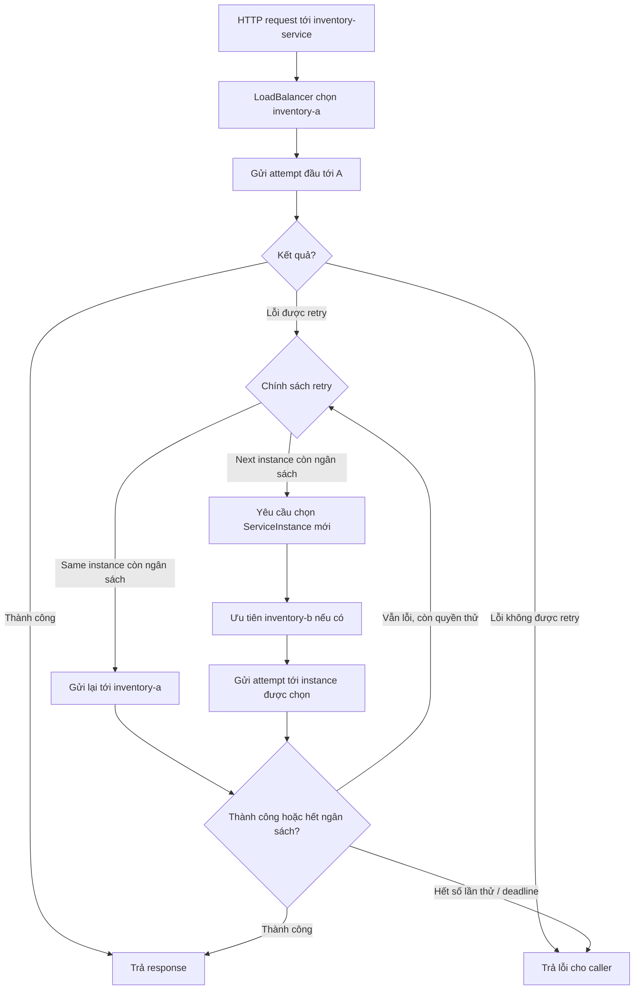
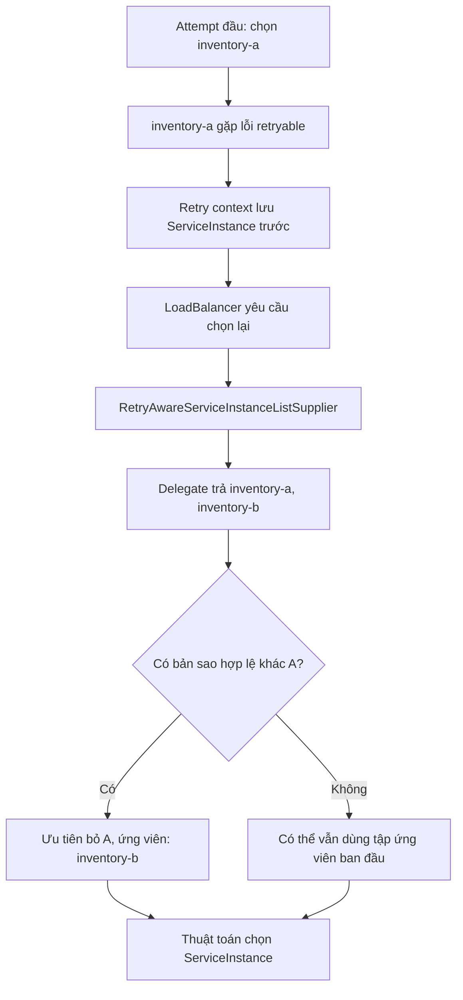

# Retry cùng bản sao và chuyển sang bản sao khác

Khi một lời gọi giữa microservices thất bại, **gửi lại cùng request** chưa chắc có nghĩa là **gửi lại đến cùng một server**. Với Spring Cloud LoadBalancer, retry có thể diễn ra theo hai hướng: giữ nguyên `ServiceInstance` vừa được chọn, hoặc yêu cầu LoadBalancer chọn một `ServiceInstance` khác trước lần thử tiếp theo. Hai hành vi này có tác động khác nhau tới khả năng phục hồi, tải của hệ thống, độ trễ và tính an toàn của thao tác nghiệp vụ.

Bài học thuộc chương **Gửi lại yêu cầu** trong module `SPRING_CLOUD_SERVICE_COMMUNICATION_LOAD_BALANCING`. Mục tiêu là hiểu chính xác hai loại retry, cấu hình số lần retry, điều kiện kích hoạt, cơ chế tránh bản sao thất bại, sự khác biệt giữa client đồng bộ và reactive, và cách kiểm thử request đã đến server nào. Nội dung cũng gắn với việc dùng `RestClient`, `RestTemplate`, `WebClient` và OpenFeign trong một hệ thống có discovery, health check, timeout và routing policy.

> **Nguyên tắc:** Retry làm tăng cơ hội phục hồi khi lỗi mang tính tạm thời, nhưng không tạo ra instance mới, không tự sửa lỗi cấu hình, không bảo đảm chọn được một server khác và không làm một thao tác ghi trở thành idempotent.

## 1. Tình huống mở đầu: một service có hai bản sao

Giả sử `order-service` gọi:

```http
GET /api/v1/stock/SKU-001 HTTP/1.1
Host: inventory-service
X-Correlation-ID: req-501
```

Nguồn discovery trả hai bản sao:

| Service ID | Instance ID | Host:port | Trạng thái minh họa |
|---|---|---|---|
| `inventory-service` | `inventory-a` | `10.0.1.11:8081` | Đang chậm do lỗi mạng thoáng qua |
| `inventory-service` | `inventory-b` | `10.0.1.12:8082` | Hoạt động bình thường |

LoadBalancer chọn A cho lần gọi đầu; request có thể gặp timeout. Có hai cách thử lại:

- **Retry same instance:** gửi lại request tới A. Hợp lý nếu A chỉ bị nghẽn ngắn hạn và vẫn đủ khả năng phục vụ.
- **Retry next instance:** thực hiện một lần chọn đích mới, ưu tiên bản sao khác A nếu có; với ví dụ này request có thể được gửi đến B.

Cả hai cách đều chỉ xảy ra khi client có **cơ chế retry đã kích hoạt** và lỗi đáp ứng **chính sách được phép retry**.

### 1.1. Sơ đồ dòng xử lý



Sơ đồ là mô hình tư duy, không quy định mọi bản phát hành phải sắp thứ tự các attempt y hệt nhau. Thứ tự và số lần gọi thật cần được xác minh bằng client integration trong release train Spring Cloud đang sử dụng.

## 2. Định nghĩa đúng “same” và “next”

Một `ServiceInstance` là một bản sao được nhận diện qua service ID cùng thông tin host/port/instance ID và metadata. Có hai bộ đếm độc lập:

| Cơ chế | Ý nghĩa | Tác động lên lựa chọn đích |
|---|---|---|
| `max-retries-on-same-service-instance` | Số lần thử lại **trên instance hiện tại** sau lần thử ban đầu với instance đó | Không yêu cầu một instance mới cho mỗi retry cùng bản sao |
| `max-retries-on-next-service-instance` | Số lần thử lại **sau khi chọn lại instance** | LoadBalancer thực hiện lựa chọn mới; có thể chọn bản sao khác |
| `avoid-previous-instance` | Chính sách tránh bản sao vừa thất bại khi chọn lại | Ưu tiên loại instance trước nếu có ứng viên phù hợp khác |
| `retryable-status-codes` / `retryable-exceptions` | Xác định lỗi nào đủ điều kiện retry | Không tự thay đổi tập bản sao nếu không retry |
| `retry-on-all-operations` | Cho phép retry các HTTP method khác GET | Cần xem xét tính an toàn nghiệp vụ |

**“Next instance” không đồng nghĩa chắc chắn instance ID khác.** Với một instance duy nhất, bộ lọc theo zone/health còn một ứng viên, hoặc không có khả năng tránh bản sao cũ, lần chọn mới có thể vẫn trả về bản sao đã thử. Vì vậy cần quan sát instance ID từng attempt, không chỉ nhìn tên thuộc tính.

### 2.1. So sánh hai chiến lược

| Tiêu chí | Retry cùng bản sao | Chọn lại bản sao |
|---|---|---|
| Đích của attempt tiếp theo | Giữ đích hiện tại | Chạy lại bước lựa chọn instance |
| Hợp lý khi | Lỗi thoáng qua nhưng server còn khỏe | Lỗi gắn với một host/port hoặc instance quá tải |
| Rủi ro | Dồn thêm tải vào instance đang lỗi | Tăng tải/phát lại request trên một instance khác |
| Yêu cầu discovery | Cần có instance ban đầu | Cần tập ứng viên cho lần chọn tiếp |
| Thay đổi zone/metadata | Không xét lại tại retry cùng bản sao | Có thể xét lại qua supplier/policy |
| Bảo đảm success | Không | Không |
| Rủi ro ghi trùng | Có | Có, thậm chí hai bản sao có thể cùng xử lý |

Không có chiến lược nào luôn tốt hơn. Cần quyết định dựa trên loại lỗi, số instance, cơ chế cập nhật discovery và đặc tính request.

## 3. Đếm attempt: “retry” không phải “tổng số request”

Các property được đặt tên là **max retries**, tức là số lần thử **thêm** sau attempt ban đầu, không phải tổng số HTTP request.

Giả sử thiết lập:

```yaml
spring:
  cloud:
    loadbalancer:
      retry:
        max-retries-on-same-service-instance: 1
        max-retries-on-next-service-instance: 2
```

Một kịch bản minh họa khi mọi attempt đều gặp lỗi được phép retry:

```text
Attempt 1: chọn instance A, gửi đến A
Attempt 2: retry cùng instance A
Attempt 3: chọn lại instance, giả sử được B
Attempt 4: retry cùng instance B
Attempt 5: chọn lại instance, giả sử được C
Attempt 6: retry cùng instance C
```

Nếu một instance thành công ở attempt 2 thì **không thực hiện** các attempt còn lại.

Trong mô hình retry cùng bản sao cho mỗi instance mới được chọn, với `S` lần retry cùng bản sao và `N` lần retry chọn instance tiếp theo, cận trên mang tính minh họa có thể biểu diễn là:

```text
maximumAttempts = (S + 1) × (N + 1)
```

Ví dụ `S=1`, `N=2` cho tối đa sáu HTTP attempt. Đây là cách tính **ngân sách lý thuyết** khi cả hai tầng retry đều được thực hiện đầy đủ; số attempt thực tế còn phụ thuộc lỗi được phép retry, implementation, deadline, số instance khả dụng và lớp retry khác.

### 3.1. Một số cấu hình và kỳ vọng

| Same retries | Next retries | Kịch bản tối đa theo mô hình | Mục đích |
|---:|---:|---|---|
| 0 | 0 | 1 attempt | Không gửi lại qua LoadBalancer |
| 1 | 0 | A → A | Chỉ thử lại cùng bản sao |
| 0 | 1 | A → lựa chọn mới (ví dụ B) | Thử lại sau khi chọn đích khác |
| 1 | 1 | A → A → B → B | Một retry trên mỗi instance được chọn |
| 2 | 1 | A → A → A → B → B → B | Ưu tiên same retry nhiều hơn |

Các tên A/B trong bảng là **instance minh họa**. Khi chọn lại không có bảo đảm B được chọn; cũng không có bảo đảm attempt đầu luôn chọn A.

## 4. Cấu hình retry của Spring Cloud LoadBalancer

Các thuộc tính thường dùng trong Spring Cloud Commons:

| Property | Vai trò | Mặc định trong tài liệu tham chiếu hiện hành |
|---|---|---|
| `spring.cloud.loadbalancer.retry.enabled` | Bật khả năng retry nếu integration/dependency đã có | `true` |
| `spring.cloud.loadbalancer.retry.max-retries-on-same-service-instance` | Số retry cùng instance | `0` |
| `spring.cloud.loadbalancer.retry.max-retries-on-next-service-instance` | Số lần retry với lần chọn instance mới | `1` |
| `spring.cloud.loadbalancer.retry.avoid-previous-instance` | Cố gắng tránh instance đã thử khi chọn lại | `true` |
| `spring.cloud.loadbalancer.retry.retry-on-all-operations` | Cho phép retry method khác GET | `false` |
| `spring.cloud.loadbalancer.retry.retry-on-all-exceptions` | Retry cả lỗi ngoài danh sách đã định nghĩa | `false` |
| `spring.cloud.loadbalancer.retry.retryable-status-codes` | Danh sách HTTP status được phép retry | Rỗng |
| `spring.cloud.loadbalancer.retry.retryable-exceptions` | Danh sách exception được phép retry | Rỗng, dùng tập mặc định theo implementation |

**Cảnh báo:** `retry.enabled=true` là điều kiện cấu hình, **không có nghĩa mọi HTTP client tự retry**. Với client blocking thường cần `Spring Retry` trên classpath; với `WebClient` cần reactive retry integration. Cần kiểm tra auto-configuration và phiên bản của client thực sự được dùng.

Với một số Spring Cloud release train, các default về điều kiện kích hoạt và classpath integration thay đổi. Hãy giữ Spring Boot và Spring Cloud BOM tương thích, đọc effective configuration và kiểm thử thay vì chỉ dựa vào giá trị trong YAML.

### 4.1. Chỉ retry trên cùng instance

```yaml
spring:
  cloud:
    loadbalancer:
      retry:
        enabled: true
        max-retries-on-same-service-instance: 1
        max-retries-on-next-service-instance: 0
        retryable-status-codes:
          - 503
```

Mô hình:

```text
GET inventory-service
  chọn A
  A -> HTTP 503
  retry A
  A -> HTTP 200
  hoàn tất
```

Nếu A tiếp tục trả 503, client dừng khi hết ngân sách; nó không chuyển sang B do `max-retries-on-next-service-instance=0`.

### 4.2. Chỉ thử lại sau khi chọn instance mới

```yaml
spring:
  cloud:
    loadbalancer:
      retry:
        enabled: true
        max-retries-on-same-service-instance: 0
        max-retries-on-next-service-instance: 1
        avoid-previous-instance: true
        retryable-status-codes:
          - 503
```

Mô hình:

```text
GET inventory-service
  chọn A
  A -> HTTP 503
  chọn lại từ danh sách ứng viên
  nếu B khả dụng, ưu tiên B
  B -> HTTP 200
  hoàn tất
```

Nếu supplier chỉ trả một instance A, attempt tiếp theo có thể lại gọi A. Cấu hình `avoid-previous-instance=true` không tự tạo instance B.

### 4.3. Tắt retry để đo hành vi gốc

```yaml
spring:
  cloud:
    loadbalancer:
      retry:
        enabled: false
```

Trong bài test về round robin, cache hoặc health, tắt retry giúp tránh việc **một lời gọi nghiệp vụ sinh nhiều HTTP attempt**, làm sai số đếm. Khi bật lại retry, phải ghi riêng logical request, số lần chọn instance và số HTTP attempt.

## 5. Bật đúng cơ chế cho RestTemplate/RestClient và WebClient

Spring Cloud LoadBalancer nằm bên dưới nhiều HTTP client, nhưng không phải client nào cũng dùng chung cơ chế retry.

### 5.1. Client blocking: RestTemplate và RestClient

Với đường đi blocking được Spring Cloud LoadBalancer hỗ trợ, tài liệu Spring Cloud Commons mô tả tích hợp **Spring Retry** để thực hiện load-balanced retry. Một dependency Maven thường cần:

```xml
<dependency>
    <groupId>org.springframework.retry</groupId>
    <artifactId>spring-retry</artifactId>
</dependency>
```

Cùng với `spring-cloud-starter-loadbalancer` và Spring Web tương thích. Tùy cách client được tạo và phiên bản, classpath có Spring Retry có thể làm Spring Cloud sử dụng interceptor/client hỗ trợ retry.

Ví dụ bean `RestClient.Builder` load-balanced:

```java
import org.springframework.cloud.client.loadbalancer.LoadBalanced;
import org.springframework.context.annotation.Bean;
import org.springframework.context.annotation.Configuration;
import org.springframework.web.client.RestClient;

@Configuration(proxyBeanMethods = false)
public class ClientConfiguration {

    @Bean("inventoryRestClientBuilder")
    @LoadBalanced
    RestClient.Builder inventoryRestClientBuilder() {
        return RestClient.builder();
    }
}
```

Gateway dùng builder do Spring quản lý:

```java
@Service
public class InventoryGateway {

    private final RestClient client;

    public InventoryGateway(
            @Qualifier("inventoryRestClientBuilder")
            RestClient.Builder builder) {

        this.client = builder.build();
    }

    public String whoAmI() {
        return client.get()
                .uri("http://inventory-service/whoami")
                .retrieve()
                .body(String.class);
    }
}
```

Đặt `spring.cloud.loadbalancer.retry.*` như mục 4, rồi xác nhận thực tế bằng counter trên server đích. **Không tạo `RestClient.create("http://inventory-service")` bên ngoài builder load-balanced** rồi kỳ vọng retry/selection theo service ID.

Nếu dự án đang dùng `RestTemplate`, bean cũng phải được đánh dấu `@LoadBalanced`. Trong từng release train, cơ chế retry blocking có thể được gắn qua các loại LoadBalancer interceptor/client khác nhau. Không nên kết luận chỉ từ một class name.

### 5.2. WebClient reactive

Với `WebClient`, dùng builder `@LoadBalanced` hoặc filter reactive tương ứng:

```java
@Configuration(proxyBeanMethods = false)
public class ReactiveClientConfiguration {

    @Bean("inventoryWebClientBuilder")
    @LoadBalanced
    WebClient.Builder inventoryWebClientBuilder() {
        return WebClient.builder();
    }
}
```

```java
@Service
public class InventoryReactiveGateway {

    private final WebClient client;

    public InventoryReactiveGateway(
            @Qualifier("inventoryWebClientBuilder")
            WebClient.Builder builder) {
        this.client = builder.build();
    }

    public Mono<String> whoAmI() {
        return client.get()
                .uri("http://inventory-service/whoami")
                .retrieve()
                .bodyToMono(String.class);
    }
}
```

Kích hoạt retry LoadBalancer bằng property phù hợp:

```yaml
spring:
  cloud:
    loadbalancer:
      retry:
        enabled: true
        max-retries-on-same-service-instance: 0
        max-retries-on-next-service-instance: 1
```

Với reactive, không nên thêm `retryWhen(Retry.max(...))` vô điều kiện **bên ngoài một chuỗi đã có LoadBalancer retry**. Nếu cả hai cùng hoạt động, số lần HTTP attempt có thể bị nhân lên và logic “same/next” bị nhầm lẫn. `WebClient` tạo trực tiếp không có LoadBalancer filter thì retry ở Reactor chỉ lặp lại request tới URL đã dựng, không tự tạo khả năng chọn lại `ServiceInstance`.

### 5.3. OpenFeign

OpenFeign có lớp retry riêng (`Retryer`) và tích hợp LoadBalancer khi dùng `@FeignClient(name=...)` không có direct URL. Spring Cloud OpenFeign thường cấu hình `Retryer.NEVER_RETRY` theo mặc định thay cho retry tự động của Feign thuần.

Vì vậy:

- Không coi số retry của Feign `Retryer` là tương đương tuyệt đối với các property retry của Spring Cloud LoadBalancer.
- Kiểm tra Feign client đang dùng service ID qua LoadBalancer hay dùng `url` trực tiếp.
- Nếu `@FeignClient(url=...)` hoặc URL property đặt target cố định, không có bước Spring Cloud LoadBalancer chọn một instance khác cho lời gọi đó.
- Không bật đồng thời Feign Retryer, circuit breaker retry và LoadBalancer retry mà không tính tổng số attempt.

## 6. Ngữ nghĩa chọn lại với RetryAwareServiceInstanceListSupplier

Khi retry chuyển sang lần chọn instance mới, `RetryAwareServiceInstanceListSupplier` là một thành phần quan trọng của Spring Cloud LoadBalancer. Nó có thể dùng thông tin về **instance trước đó** để tránh đưa lại instance ấy vào danh sách ứng viên, nếu có bản sao khác thích hợp.

Đây là một supplier dạng decorator; nó không trực tiếp gửi request HTTP.



Tài liệu Spring Cloud mô tả việc wrapper tránh instance trước khi chọn lại, theo cấu hình `spring.cloud.loadbalancer.retry.avoid-previous-instance`. Tùy release train và điều kiện classpath/auto-configuration, việc áp dụng wrapper cần được kiểm tra trong bean supplier thực tế.

**Không đánh đồng “tránh instance trước” với blacklist vĩnh viễn**:

- Instance cũ không bị deregister khỏi registry.
- Cache discovery không bị xóa chỉ vì một request timeout.
- Lần gọi nghiệp vụ tiếp theo có thể lại chọn instance cũ.
- Nếu chỉ còn A là ứng viên, wrapper không thể luôn loại A mà vẫn đảm bảo có một đích.
- Nếu A/B thuộc các zone, hint hoặc metadata khác nhau, chỉ những instance **sau các bộ lọc bắt buộc** mới phù hợp để chọn lại.

### 6.1. Vì sao “next” có thể vẫn là A?

Các trường hợp thường gặp:

1. Tập instance chỉ có A.
2. Health check hoặc zone filter loại hết B.
3. Routing có ràng buộc cứng và chỉ A được phép phục vụ request.
4. Supplier tùy chỉnh không nhận/chuyển `Request` chứa ngữ cảnh retry.
5. Chính sách `avoid-previous-instance` bị tắt hoặc wrapper không được gắn.
6. Một thuật toán chọn custom không tôn trọng danh sách đã lọc.

Không nên ép bỏ ràng buộc bảo mật/tenant/zone cứng chỉ để cho retry “có B”. Thà fail closed khi không có đích hợp lệ còn hơn gửi request nhầm khu vực dữ liệu.

## 7. HTTP status và exception nào có thể kích hoạt retry?

Retry không được kích hoạt chỉ vì response có nội dung không mong muốn. Nó phụ thuộc status, exception, HTTP method và chính sách.

### 7.1. Mã trạng thái HTTP

Trong phép thử, `503 Service Unavailable` thường là một status hợp lý để tạo tình huống retry. Có thể khai báo:

```yaml
spring:
  cloud:
    loadbalancer:
      retry:
        retryable-status-codes:
          - 503
          - 502
          - 504
```

Các mã trên chỉ mang tính ví dụ chính sách; không nên tự động thêm mọi mã 5xx hoặc 429 mà không hiểu hợp đồng API, retry-after và trạng thái hệ thống.

| Status | Có nên retry? | Lý do |
|---|---|---|
| `200`/`201` | Không | Thành công |
| `400` | Thường không | Dữ liệu request sai |
| `401`/`403` | Thường không | Xác thực/phân quyền không được sửa bằng retry cùng payload |
| `404` | Thường không | Tài nguyên không tồn tại; tùy API contract |
| `408` | Có thể | Timeout phía server/proxy; phải xem request đã được xử lý chưa |
| `429` | Có điều kiện | Giới hạn tải; cần tôn trọng `Retry-After` và deadline |
| `500` | Chỉ theo chính sách | Có thể là lỗi lập trình bền vững |
| `502`/`503`/`504` | Thường là ứng viên retry có giới hạn | Lỗi gateway/khả dụng tạm thời |

**Retryable status code phải được xử lý tại đúng tầng.** Một số client `retrieve()` tự chuyển HTTP error thành exception; tích hợp LoadBalancer retry cần được gắn ở bước có khả năng quan sát status/exception phù hợp. Test thực tế cần chứng minh một response 503 có tạo attempt thứ hai hay không.

### 7.2. IOException và timeout

Theo tài liệu Spring Cloud Commons, khi không có danh sách exception tùy chỉnh, các lỗi mặc định có thể gồm `IOException`, `TimeoutException` và `RetryableStatusCodeException`. Không nên bật `retry-on-all-exceptions=true` một cách mặc định, bởi lỗi lập trình, parse JSON hoặc cấu hình không hợp lệ cũng có thể bị lặp lại vô ích.

Ví dụ cấu hình tường minh:

```yaml
spring:
  cloud:
    loadbalancer:
      retry:
        retry-on-all-exceptions: false
        retryable-exceptions:
          - java.io.IOException
          - java.util.concurrent.TimeoutException
```

Khi cấu hình danh sách exception, cần bảo đảm không vô tình loại các cơ chế retry status code mà ứng dụng cần. Release train hiện hành có logic xử lý riêng cho `RetryableStatusCodeException`; hãy kiểm tra danh sách effective và test các status đã cho phép.

### 7.3. GET khác POST

`spring.cloud.loadbalancer.retry.retry-on-all-operations=false` là một giới hạn an toàn mặc định được tài liệu cấu hình công bố. Nó thường tương ứng việc mặc định chỉ retry các thao tác GET theo chính sách framework.

Nếu bật:

```yaml
spring:
  cloud:
    loadbalancer:
      retry:
        retry-on-all-operations: true
```

thì cần hiểu đây là **cho phép retry** các HTTP method khác GET, không có nghĩa mọi POST đều an toàn.

GET, HEAD hoặc thao tác được thiết kế idempotent có thể phù hợp hơn với tự động retry. Với POST tạo đơn hàng, giữ hàng hoặc thanh toán, server có thể đã xử lý request trước khi client timeout; retry trên A hay B đều có thể tạo **giao dịch trùng**.

## 8. Idempotency: rủi ro lớn nhất khi đổi instance

Xét request:

```http
POST /api/v1/reservations HTTP/1.1
Host: inventory-service
Content-Type: application/json

{"sku":"SKU-001","quantity":2}
```

Tình huống:

1. Instance A xử lý thành công reservation, ghi DB.
2. Response từ A bị mất vì timeout đường mạng.
3. Client hiểu là lỗi tạm thời và chọn instance B.
4. Instance B nhận lại POST tương tự.
5. Nếu server không có kiểm soát trùng lặp, reservation có thể bị tạo lần hai.

Đây không phải lỗi của LoadBalancer; retry **không biết chắc server đã commit hay chưa**.

### 8.1. Dùng idempotency key đúng cách

Client tạo một khóa ổn định cho **một logical operation**:

```http
POST /api/v1/reservations HTTP/1.1
Host: inventory-service
Idempotency-Key: order-501-reserve-stock
Content-Type: application/json

{"sku":"SKU-001","quantity":2}
```

Tất cả retry của cùng logical operation giữ nguyên key. Phía server cần:

- Ghi nhận key theo scope user/tenant và operation.
- Đảm bảo xử lý cùng key một cách nguyên tử hoặc có cơ chế khóa phù hợp.
- Trả lại cùng kết quả đã biết thay vì xử lý lần hai.
- Định nghĩa TTL/lifecycle cho idempotency record.
- Không chấp nhận cùng key với payload khác nhau một cách âm thầm.

Chỉ gắn header không đủ: **server phải thực thi chống trùng lặp**. Với thanh toán hoặc cập nhật quan trọng, kiểm soát idempotency cần tồn tại ở nguồn dữ liệu nghiệp vụ dùng chung giữa các instance.

## 9. Giới hạn tổng thời gian và hiện tượng retry storm

Retry có thể tăng độ trễ gấp nhiều lần vì mỗi attempt lại có connect timeout, read timeout, discovery và thời gian backoff.

Ví dụ:

```text
logical GET inventory-service
   attempt A: timeout sau 700ms
   backoff:    100ms
   attempt B: timeout sau 700ms
   backoff:    200ms
   attempt C: thành công sau 300ms

Tổng gần 2.000ms, chưa tính overhead.
```

Nếu upstream cũng retry logical request trên, số lượng attempt có thể tăng theo cấp số nhân. Ví dụ một API gateway retry hai lần ở tầng ngoài, trong khi `order-service` retry ba attempt ở tầng trong, có thể phát sinh tới nhiều request hơn nhiều so với một lời gọi ban đầu.

**Thiết kế tối thiểu:**

- Giới hạn số retry same/next.
- Có timeout kết nối, timeout đọc/response và deadline nghiệp vụ tổng.
- Dùng backoff có jitter cho những lỗi có thể phục hồi sau thời gian chờ.
- Không retry khi caller đã hủy request hoặc deadline đã hết.
- Tránh cùng bật nhiều retry layer độc lập mà không có ngân sách chung.
- Dùng circuit breaker, bulkhead, rate limit nếu cần tránh đè thêm tải lên service đang lỗi.

Không chọn retry chỉ vì tỷ lệ success tăng. Cần đo đồng thời P95/P99 latency, tổng HTTP attempts, lỗi cuối và tác động lên service đích.

## 10. Backoff trong reactive và blocking khác nhau

Với reactive retry của Spring Cloud LoadBalancer, có thể cấu hình backoff:

```yaml
spring:
  cloud:
    loadbalancer:
      retry:
        enabled: true
        max-retries-on-same-service-instance: 0
        max-retries-on-next-service-instance: 1
        backoff:
          enabled: true
          min-backoff: 50ms
          max-backoff: 300ms
          jitter: 0.3
```

Các property `backoff.*` này áp dụng cho cơ chế **reactive** theo tài liệu Spring Cloud; không mặc định rằng một `RestClient` blocking sẽ dùng cùng toán tử Reactor Retry/backoff chỉ nhờ cấu hình trên.

Với blocking + Spring Retry, tài liệu giới thiệu việc triển khai `LoadBalancedRetryFactory` để cung cấp `BackOffPolicy`. Ví dụ ý tưởng Java:

```java
import org.springframework.cloud.client.loadbalancer.LoadBalancedRetryFactory;
import org.springframework.context.annotation.Bean;
import org.springframework.context.annotation.Configuration;
import org.springframework.retry.backoff.BackOffPolicy;
import org.springframework.retry.backoff.ExponentialBackOffPolicy;

@Configuration(proxyBeanMethods = false)
class LoadBalancerRetryBackoffConfiguration {

    @Bean
    LoadBalancedRetryFactory loadBalancedRetryFactory() {
        return new LoadBalancedRetryFactory() {
            @Override
            public BackOffPolicy createBackOffPolicy(String service) {
                ExponentialBackOffPolicy policy =
                        new ExponentialBackOffPolicy();
                policy.setInitialInterval(100);
                policy.setMultiplier(2.0);
                policy.setMaxInterval(400);
                return policy;
            }
        };
    }
}
```

Đây là ví dụ cho phiên bản Spring Cloud có `LoadBalancedRetryFactory` và chữ ký tương ứng. Trong project có sẵn một bean factory hoặc auto-configuration khác, cần kiểm tra bean precedence, đặc biệt khi muốn override chính sách blocking mặc định. Không tự tạo nhiều factory cạnh tranh rồi giả định tất cả cùng được sử dụng.

## 11. Cấu hình riêng cho từng service

Không phải dependency nào cũng chịu được cùng một chính sách. Một service đọc catalog có thể cho phép chọn lại instance, còn service tạo payment thường cần ràng buộc retry nghiêm ngặt.

Spring Cloud Commons hiện hành mô tả khả năng cấu hình riêng từng LoadBalancer client dưới tiền tố:

```text
spring.cloud.loadbalancer.clients.<clientId>.*
```

Ví dụ thiết kế:

```yaml
spring:
  cloud:
    loadbalancer:
      retry:
        enabled: true
        max-retries-on-same-service-instance: 0
        max-retries-on-next-service-instance: 1
      clients:
        inventory-service:
          retry:
            max-retries-on-same-service-instance: 1
            max-retries-on-next-service-instance: 1
            retryable-status-codes:
              - 503
        payment-service:
          retry:
            max-retries-on-same-service-instance: 0
            max-retries-on-next-service-instance: 0
```

Mục đích:

- `inventory-service` có thể thử lại A một lần và chọn lại B một lần nếu lỗi phù hợp.
- `payment-service` không được LoadBalancer thực hiện retry theo số lần đã cấu hình.
- Các service khác theo cấu hình chung nếu không có override tương ứng.

**Lưu ý về phiên bản:** một số release train/documentation trình bày cấu hình trên `spring.cloud.loadbalancer.[serviceId].retry.*`, còn phiên bản hiện hành có tiền tố `clients.<clientId>.*`. Hãy kiểm tra chính xác lớp configuration properties đang dùng trong BOM và kiểm thử rằng client context `inventory-service` thực sự nhận override; không nên ghép đồng thời nhiều tiền tố theo phỏng đoán.

### 11.1. Khi nào nên tắt retry?

Có thể tắt retry cho service đích nếu:

- Request là giao dịch ghi không có idempotency.
- Server không thể chịu tải phát lại trong giai đoạn quá tải.
- Client có deadline rất ngắn, attempt thứ hai không còn giá trị.
- Circuit breaker hoặc hệ thống upstream đã quản lý retry trong một giới hạn chung.
- Retry làm tăng xác suất lỗi dây chuyền thay vì cải thiện khả dụng.

Tắt retry không đồng nghĩa phải tắt LoadBalancer hoặc discovery. LoadBalancer vẫn chọn instance cho **attempt đầu tiên**.

## 12. Kiểm thử đúng: quan sát HTTP attempt tại từng instance

Muốn chứng minh retry cùng/khác instance, không nên chỉ assert response cuối `200 OK`. Cần biết **instance nào nhận từng attempt**, theo thứ tự.

Có thể tạo hai HTTP stub:

- A trả 503 trong một số lần, sau đó trả 200 hoặc tiếp tục lỗi tùy kịch bản.
- B trả 200.
- Mỗi stub ghi `X-Correlation-ID` và instance ID vào một bảng log/counter.
- `order-service` gọi `http://inventory-service/whoami` qua bean `@LoadBalanced`.
- Discovery cung cấp A và B, có thể dùng `SimpleDiscoveryClient` để kiểm soát danh sách.

Ví dụ response nhận diện:

```http
HTTP/1.1 200 OK
X-Instance-Id: inventory-b
Content-Type: text/plain

inventory-b
```

### 12.1. Kịch bản same-instance

Cấu hình:

```yaml
spring:
  cloud:
    loadbalancer:
      retry:
        enabled: true
        max-retries-on-same-service-instance: 1
        max-retries-on-next-service-instance: 0
        retryable-status-codes: [503]
```

Để test **không phụ thuộc instance A/B nào được chọn đầu**, tạo cả hai server theo cùng quy tắc: với một correlation ID, attempt đầu trả 503, attempt thứ hai tại chính server đó trả 200. Sau khi gửi một logical GET, kỳ vọng:

```text
Ví dụ:
  inventory-b nhận req-501 lần 1 -> 503
  inventory-b nhận req-501 lần 2 -> 200

  inventory-a không nhận req-501
```

Assertion chính:

- Có **hai attempt** với cùng correlation ID.
- Cả hai attempt có **cùng instance ID**.
- Attempt đầu 503, attempt thứ hai 200.
- Không có attempt thứ ba.

Đây là kịch bản tốt hơn so với ép “attempt đầu phải tới A”, bởi round robin có thể bắt đầu bằng A hoặc B tùy trạng thái.

### 12.2. Kịch bản next-instance

Cấu hình:

```yaml
spring:
  cloud:
    loadbalancer:
      retry:
        enabled: true
        max-retries-on-same-service-instance: 0
        max-retries-on-next-service-instance: 1
        avoid-previous-instance: true
        retryable-status-codes: [503]
```

Cho A luôn trả 503; B luôn trả 200.

```text
Nếu attempt đầu chọn A:
  inventory-a nhận req-502 -> 503
  load balancer chọn lại
  inventory-b nhận req-502 -> 200

Nếu attempt đầu chọn B:
  inventory-b nhận req-503 -> 200
  không cần retry
```

Với hai instance đều hợp lệ và retry-aware supplier hoạt động, cần tìm **ít nhất một logical request** có attempt đầu tới A để quan sát hành vi retry. Nếu chỉ gọi một lần và lần đầu chọn B, response 200 không chứng minh cơ chế next-instance đã hoạt động.

Assertion trên request đã chọn A:

- A nhận đúng một attempt 503.
- B nhận một attempt tiếp theo cùng correlation ID và trả 200.
- Không có same-instance retry trên A.
- Tổng request đến các server được phân biệt với số logical request.

### 12.3. Không có B hợp lệ

Cho supplier chỉ trả A nhưng `max-retries-on-next-service-instance=1`. Khi attempt đầu gặp lỗi, một lần chọn lại có thể vẫn chọn A. Test cần **cho phép kết quả này theo chính sách fallback**, hoặc nếu nghiệp vụ yêu cầu không thử lại A thì triển khai policy nghiêm hơn.

Cần kiểm tra số lần chọn và số HTTP attempt riêng. Nếu source trả danh sách rỗng, cả attempt ban đầu hoặc attempt tiếp theo có thể thất bại ở tầng chọn đích mà không có request nào đến A/B.

## 13. Mẫu server stub có counter cho mỗi request

Đoạn Java dưới đây minh họa một HTTP server nhỏ bằng JDK `HttpServer`. Nó nhận một `instanceId`, trả 503 cho attempt đầu cùng correlation ID, sau đó trả 200 nếu cùng server được gọi lần nữa.

```java
import java.io.IOException;
import java.io.OutputStream;
import java.net.InetSocketAddress;
import java.nio.charset.StandardCharsets;
import java.util.concurrent.ConcurrentHashMap;
import java.util.concurrent.atomic.AtomicInteger;

import com.sun.net.httpserver.HttpServer;

public final class RetryProbeServer implements AutoCloseable {

    private final String instanceId;
    private final HttpServer server;
    private final ConcurrentHashMap<String, AtomicInteger> calls =
            new ConcurrentHashMap<>();

    public RetryProbeServer(String instanceId) throws IOException {
        this.instanceId = instanceId;
        this.server = HttpServer.create(
                new InetSocketAddress("127.0.0.1", 0), 0);

        this.server.createContext("/whoami", exchange -> {
            String requestId = exchange.getRequestHeaders()
                    .getFirst("X-Correlation-ID");

            if (requestId == null || requestId.isBlank()) {
                requestId = "missing";
            }

            int attempt = calls
                    .computeIfAbsent(
                            requestId,
                            key -> new AtomicInteger())
                    .incrementAndGet();

            int status = attempt == 1 ? 503 : 200;
            String payload = instanceId
                    + ":attempt=" + attempt;

            byte[] bytes = payload.getBytes(
                    StandardCharsets.UTF_8);

            exchange.getResponseHeaders()
                    .set("X-Instance-Id", instanceId);
            exchange.getResponseHeaders()
                    .set("X-Attempt", Integer.toString(attempt));
            exchange.getResponseHeaders()
                    .set("Content-Type",
                            "text/plain; charset=UTF-8");

            exchange.sendResponseHeaders(status, bytes.length);

            try (OutputStream out =
                         exchange.getResponseBody()) {
                out.write(bytes);
            }
        });

        this.server.start();
    }

    public int port() {
        return server.getAddress().getPort();
    }

    public int attemptsFor(String correlationId) {
        AtomicInteger value = calls.get(correlationId);
        return value == null ? 0 : value.get();
    }

    @Override
    public void close() {
        server.stop(0);
    }
}
```

Mỗi server dùng bộ đếm riêng. Với chính sách same-instance và một logical GET có cùng `X-Correlation-ID`:

```text
attemptsFor("req-501") ở A + B = 2
một trong hai server có 2
server còn lại có 0
```

Đây là **stub mô phỏng lỗi theo request ID**. Nó không có discovery thật hoặc health check. Để kết nối với client load-balanced, khởi chạy hai stub, cấp URI tương ứng qua `SimpleDiscoveryClient` và gọi bằng `@LoadBalanced RestClient.Builder` hoặc client tương thích.

### 13.1. Kịch bản riêng cho next-instance

Với next-instance, server A nên luôn trả 503, server B luôn trả 200; không dùng cùng logic “503 lần đầu trên từng server” của class trên nếu mục tiêu là chứng minh A → B thành công. Có thể thay handler để chọn status theo `instanceId` hoặc tạo một stub đáp ứng status cố định.

Ví dụ logic handler:

```java
int status = instanceId.equals("inventory-a")
        ? 503
        : 200;
```

Một tập log theo correlation ID như:

```text
req-601, attempt=1, instance=inventory-a, status=503
req-601, attempt=2, instance=inventory-b, status=200
```

là bằng chứng mạnh hơn một assertion chỉ kiểm tra kết quả `inventory-b`.

## 14. Gắn hai server vào SimpleDiscoveryClient để đo end-to-end

Không cần Eureka/Consul cho bài test cơ bản. Với hai server local và cổng động, có thể cấp thông tin instance qua Spring Boot Test:

```java
@SpringBootTest(
        classes = RetryExperimentTest.TestApp.class,
        webEnvironment = SpringBootTest.WebEnvironment.NONE,
        properties = {
                "spring.cloud.loadbalancer.cache.enabled=false",
                "spring.cloud.loadbalancer.retry.enabled=true",
                "spring.cloud.loadbalancer.retry.max-retries-on-same-service-instance=1",
                "spring.cloud.loadbalancer.retry.max-retries-on-next-service-instance=0",
                "spring.cloud.loadbalancer.retry.retryable-status-codes[0]=503"
        })
class RetryExperimentTest {

    static final RetryProbeServer A = newServer("inventory-a");
    static final RetryProbeServer B = newServer("inventory-b");

    @DynamicPropertySource
    static void instances(DynamicPropertyRegistry properties) {
        properties.add(
                "spring.cloud.discovery.client.simple.instances."
                        + "inventory-service[0].uri",
                () -> "http://127.0.0.1:" + A.port());

        properties.add(
                "spring.cloud.discovery.client.simple.instances."
                        + "inventory-service[1].uri",
                () -> "http://127.0.0.1:" + B.port());
    }

    @Autowired
    @Qualifier("loadBalancedBuilder")
    RestClient.Builder loadBalancedBuilder;

    @Test
    void retriedRequestStaysOnSameInstance() {
        String correlationId = "retry-case-501";

        String value = loadBalancedBuilder.build().get()
                .uri("http://inventory-service/whoami")
                .header("X-Correlation-ID", correlationId)
                .retrieve()
                .body(String.class);

        assertNotNull(value);

        int a = A.attemptsFor(correlationId);
        int b = B.attemptsFor(correlationId);

        assertEquals(2, a + b);
        assertTrue((a == 2 && b == 0)
                || (a == 0 && b == 2));
    }

    @AfterAll
    static void stop() {
        A.close();
        B.close();
    }

    static RetryProbeServer newServer(String name) {
        try {
            return new RetryProbeServer(name);
        } catch (IOException error) {
            throw new UncheckedIOException(error);
        }
    }

    @SpringBootConfiguration
    @EnableAutoConfiguration
    static class TestApp {
        @Bean("loadBalancedBuilder")
        @LoadBalanced
        RestClient.Builder builder() {
            return RestClient.builder();
        }
    }
}
```

Để dùng snippet trong file test Java, bổ sung import:

```java
import java.io.IOException;
import java.io.UncheckedIOException;

import org.junit.jupiter.api.AfterAll;
import org.junit.jupiter.api.Test;
import org.springframework.beans.factory.annotation.Autowired;
import org.springframework.beans.factory.annotation.Qualifier;
import org.springframework.boot.SpringBootConfiguration;
import org.springframework.boot.autoconfigure.EnableAutoConfiguration;
import org.springframework.boot.test.context.SpringBootTest;
import org.springframework.cloud.client.loadbalancer.LoadBalanced;
import org.springframework.context.annotation.Bean;
import org.springframework.test.context.DynamicPropertyRegistry;
import org.springframework.test.context.DynamicPropertySource;
import org.springframework.web.client.RestClient;

import static org.junit.jupiter.api.Assertions.*;
```

Trong `pom.xml` test, ngoài dependency Spring Boot Test và Spring Cloud LoadBalancer, **cần Spring Retry trên classpath** cho đường đi blocking được Spring Cloud hỗ trợ. Ví dụ trên nhằm chỉ rõ phương pháp integration test; hãy đối chiếu API/binder và retry interceptor trong Spring Cloud BOM đang dùng trước khi áp dụng.

Đối với **next-instance test**, dùng một test class hoặc profile riêng với `max-retries-on-same-service-instance=0`, `max-retries-on-next-service-instance=1`, dữ liệu A luôn 503 và B luôn 200. Không thay các property này giữa chừng trong cùng ApplicationContext rồi giả định bean retry đang chạy đã được tái cấu hình.

## 15. Khi kiểm thử thực tế, những điều gì dễ làm kết quả sai?

| Hiện tượng | Nguyên nhân có thể | Cách xử lý |
|---|---|---|
| Cấu hình retry nhưng chỉ một attempt | Thiếu Spring Retry cho blocking hoặc reactive retry chưa bật | Kiểm tra dependency, bean interceptor và auto-configuration |
| Attempt tới một host khác dù same=1 | Có retry ở tầng khác hoặc test trộn nhiều logical requests | Gắn correlation ID cho từng operation |
| Next retry vẫn tới A | Chỉ một ứng viên hoặc không dùng retry-aware filtering | Kiểm tra supplier/avoid-previous/zone/health |
| Chỉ nhìn thấy một HTTP response 200 | Retry có thể đã xảy ra trước response cuối | Đếm attempt tại mỗi server |
| GET lỗi 503 nhưng không retry | Status chưa được đánh dấu retryable hoặc client không tích hợp retry | Kiểm tra `retryable-status-codes` và HTTP client |
| HTTP 400 cũng bị retry | `retry-on-all-exceptions` quá rộng hoặc tầng retry bên ngoài | Thu hẹp lỗi được retry |
| POST bị gửi hai lần | Bật retry trên non-GET mà chưa có idempotency | Dùng idempotency key hoặc tắt retry |
| Tổng attempt nhiều hơn dự kiến | Retry chồng ở Feign, LB, Reactor, gateway | Lập ngân sách chung và đếm từng tầng |
| Lỗi xuất hiện dù B khỏe | Client đang dùng direct URL A hoặc B bị filter loại | Kiểm tra đường đi thực tế và supplier |
| Mọi request sau timeout đều trễ lâu | Timeout × số attempts + backoff | Giới hạn tổng deadline |
| Thêm instance mới nhưng retry chưa thấy | Cache hoặc discovery SDK còn dữ liệu cũ | Đo time-to-converge và TTL |
| Test mong A rồi B nhưng kết quả ngược | Round robin có trạng thái hoặc random policy | Assert tập/chuỗi theo correlation ID, không đoán attempt đầu |
| Log retry không có instance ID | Instrumentation chỉ ở HTTP client | Bổ sung log/metric tại điểm chọn và tại server stub |

## 16. Observability: đo cả logical request và attempts

Ở production, đo riêng những tín hiệu sau:

| Chỉ số | Ý nghĩa |
|---|---|
| `logicalRequestCount` | Số operation nghiệp vụ yêu cầu gọi dependency |
| `httpAttemptCount` | Số HTTP request thực sự đã gửi đến các instance |
| `sameInstanceRetryCount` | Số retry giữ nguyên instance |
| `nextInstanceRetryCount` | Số lần retry chọn instance lại |
| `previousInstanceId` | Bản sao thất bại trước (log/tracing có kiểm soát) |
| `selectedInstanceId` | Bản sao của attempt hiện tại |
| `retryReason` | Timeout, I/O error, HTTP 503, ... |
| `retryBudgetExhaustedCount` | Số operation thất bại sau khi hết lần thử |
| `finalOutcome` | Thành công/lỗi và mã HTTP cuối |
| `endToEndLatency` | Độ trễ của một logical operation kể cả retry |
| `loadBalancerCandidateCount` | Số ứng viên sau discovery/filters |

Ví dụ log có correlation ID chung:

```text
traceId=req-501 serviceId=inventory-service
attempt=1 instance=inventory-a mode=INITIAL status=503

traceId=req-501 serviceId=inventory-service
attempt=2 instance=inventory-a mode=SAME_INSTANCE status=503

traceId=req-501 serviceId=inventory-service
attempt=3 instance=inventory-b mode=NEXT_INSTANCE status=200

traceId=req-501 serviceId=inventory-service
logicalOutcome=SUCCESS totalAttempts=3 elapsedMs=340
```

Các tên field chỉ là **mẫu instrumentation**, không phải bộ metric mặc định của Spring Cloud. Tránh đưa raw request ID, URL động, instance ID với cardinality lớn hoặc dữ liệu cá nhân làm metric labels. Có thể giữ thông tin cụ thể trong tracing/log có sampling và chính sách truy cập thích hợp.

### 16.1. Quy tắc cảnh báo

Cảnh báo nên theo **tỷ lệ retry và tỷ lệ lỗi cuối**, không chỉ số request thành công:

- Retry tăng nhanh nhưng request vẫn thành công: có thể dependency đang suy giảm và bị che bởi retry.
- `nextInstanceRetryCount` tăng mạnh: một nhóm instance có thể không khỏe.
- P95/P99 latency tăng: nhiều attempt đã đốt hết deadline.
- `retryBudgetExhaustedCount` tăng: cần xử lý nguyên nhân gốc thay vì chỉ tăng số retry.
- Request ghi xuất hiện cùng idempotency key nhiều lần: cần xác minh server thật sự chống xử lý trùng.

## 17. Quy trình triển khai an toàn

Một lộ trình thực hành có thể theo thứ tự:

1. Chọn API idempotent, chẳng hạn `GET /whoami` hoặc `GET /stock/{sku}`, để thử retry trước.
2. Đảm bảo client có load-balancing integration và URI dùng service ID, không dùng địa chỉ instance cố định.
3. Kiểm tra dependency Spring Retry (blocking) hoặc reactive retry integration.
4. Bắt đầu với `same=0, next=0` để quan sát một request không retry.
5. Tạo lỗi 503 tại server và bật `same=1, next=0`; kiểm tra hai attempt cùng instance.
6. Chuyển sang `same=0, next=1`; tạo A lỗi/B khỏe và quan sát trường hợp A → B.
7. Kiểm tra tình huống một instance, không có instance, cache stale và zone/hint filters.
8. Cấu hình status/exception retryable tường minh; không retry mọi exception.
9. Bổ sung timeout, backoff, jitter và deadline tổng.
10. Với POST, chỉ cho phép retry sau khi có hợp đồng idempotent và kiểm thử chống ghi trùng.
11. Đo thành công, tổng attempts, độ trễ, retry budget exhausted và lỗi cuối.
12. Kiểm tra hiệu lực cấu hình trong release train Spring Cloud BOM thực tế.

## 18. Câu hỏi tự kiểm tra

**1. Nếu `max-retries-on-same-service-instance=1` và `max-retries-on-next-service-instance=0`, request có nhất thiết gửi sang B không?** Không. Nếu attempt đầu tới A, retry được phép sẽ tiếp tục tới A.

**2. Nếu `max-retries-on-next-service-instance=1`, có bảo đảm instance ID thay đổi không?** Không. Cần có bản sao khác hợp lệ và cơ chế retry-aware lựa chọn phù hợp.

**3. Vì sao HTTP 200 cuối không đủ chứng minh retry?** Vì request có thể thành công ngay ở attempt đầu; cần đếm attempt theo correlation ID tại server.

**4. Với GET trả 503, vì sao không thấy retry?** Có thể thiếu dependency/integration, status không nằm trong danh sách retryable, retry bị tắt hoặc cấu hình chưa có hiệu lực.

**5. Nếu retry POST đến B sau timeout ở A, điều gì nguy hiểm nhất?** A có thể đã commit giao dịch; B xử lý lần nữa gây dữ liệu trùng. Cần idempotency key và kiểm soát ở server.

**6. Có nên tăng max retries để sửa lỗi không có instance?** Không phải giải pháp gốc. Cần tìm nguyên nhân discovery, health, zone/metadata filter hoặc sai service ID.

**7. Vì sao một HTTP request logic có thể tạo ba HTTP attempts?** Vì LoadBalancer/client retry hoạt động sau lỗi retryable, gồm thử lại cùng hoặc chọn lại instance.

**8. Property `retry.enabled=true` có đủ để mọi client retry không?** Không. Hành vi còn phụ thuộc Spring Retry, WebClient reactive integration, Feign và các lớp tùy biến.

## 19. Kết luận

**Retry cùng bản sao** và **retry sau khi chọn bản sao mới** là hai chính sách khác nhau của Spring Cloud LoadBalancer. `max-retries-on-same-service-instance` giữ đích của attempt hiện tại; `max-retries-on-next-service-instance` yêu cầu bước chọn `ServiceInstance` tiếp theo. `RetryAwareServiceInstanceListSupplier` có thể tránh bản sao vừa lỗi khi tập ứng viên có lựa chọn khác, nhưng không bảo đảm luôn chuyển sang một server khác.

Muốn retry đáng tin cậy phải kết hợp **lỗi được phép retry**, **giới hạn số attempt**, **timeout/deadline**, **backoff**, **health/discovery freshness** và đặc biệt **idempotency cho thao tác ghi**. Đừng chỉ nhìn response cuối: dùng correlation ID để quan sát từng attempt, instance nhận request và kết quả HTTP. Một chính sách retry tốt nâng khả năng phục hồi mà không biến lỗi cục bộ thành retry storm hoặc ghi trùng dữ liệu.

### Tài liệu tham khảo

- [Spring Cloud Commons — Common Abstractions: Retrying Failed Requests](https://docs.spring.io/spring-cloud-commons/reference/spring-cloud-commons/common-abstractions.html) — same/next instance retries, danh sách lỗi có thể retry, cấu hình blocking/reactive, retry-aware supplier.
- [Spring Cloud Commons — Configuration Properties](https://docs.spring.io/spring-cloud-commons/reference/configprops.html) — giá trị mặc định cho `spring.cloud.loadbalancer.retry.*` và backoff.
- [Spring Cloud Commons — Spring Cloud LoadBalancer](https://docs.spring.io/spring-cloud-commons/reference/spring-cloud-commons/loadbalancer.html) — chọn instance, supplier chain, cache, health check và route policies.
- [Spring Cloud OpenFeign — Reference](https://docs.spring.io/spring-cloud-openfeign/reference/spring-cloud-openfeign.html) — Feign retryer và đường đi load-balanced khi gọi bằng service ID.

