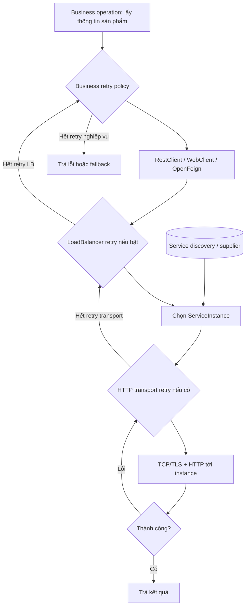
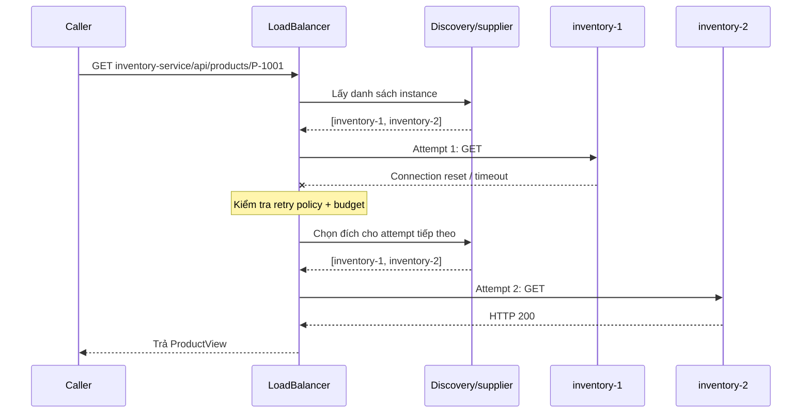
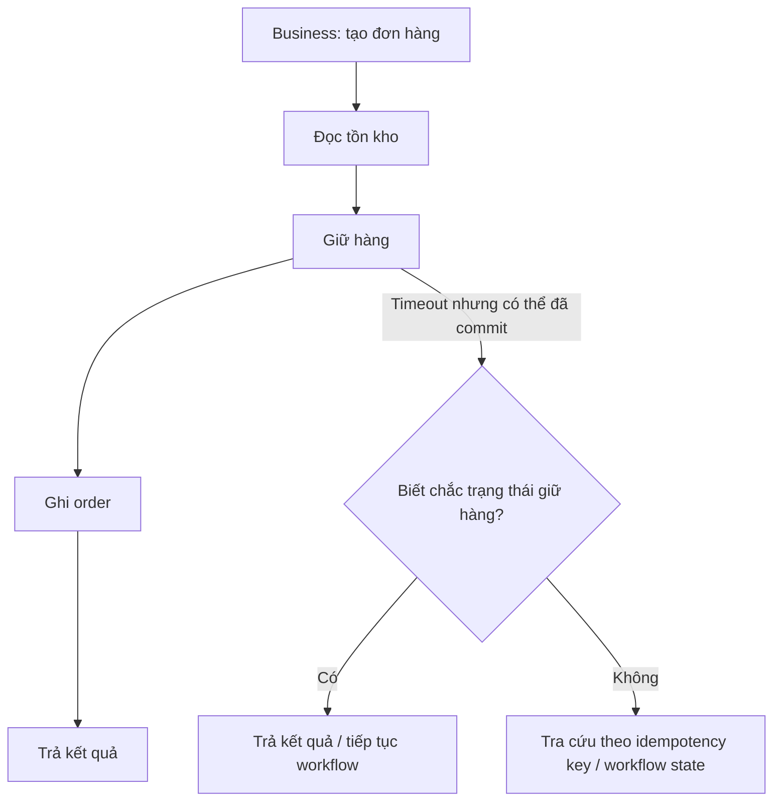
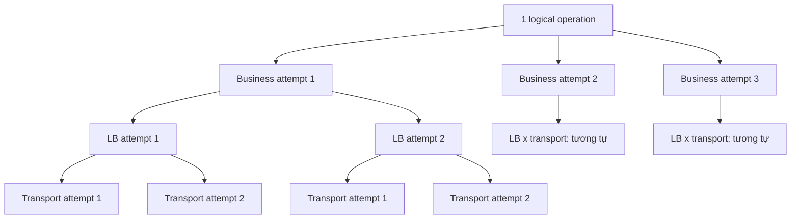
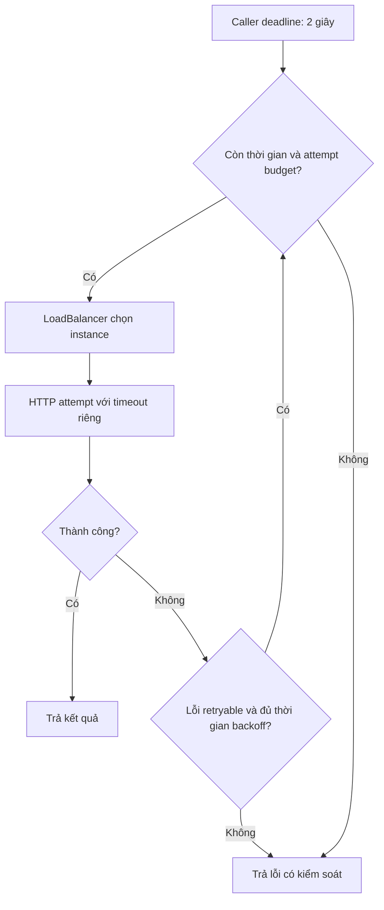

# Retry ở HTTP client, LoadBalancer và tầng nghiệp vụ

Trong hệ thống microservice, một lời gọi `order-service → inventory-service` có thể thất bại tạm thời: TCP connection bị đóng, instance vừa bị scale down, backend trả `503 Service Unavailable` hoặc network bị gián đoạn ngắn. **Retry** là việc gửi lại một thao tác sau thất bại với hy vọng lần tiếp theo thành công. Tuy nhiên, retry không phải lúc nào cũng an toàn và không chỉ tồn tại ở một vị trí.

Với Spring Cloud LoadBalancer, một lời gọi có thể trải qua **ba tầng retry khác nhau**: retry bên trong HTTP client/transport, retry gắn với việc chọn `ServiceInstance` của LoadBalancer và retry theo quyết định của tầng nghiệp vụ. Nếu bật cả ba mà không có chủ đích, một request của người dùng có thể trở thành nhiều HTTP attempt, tiêu tốn connection pool, khuếch đại tải lên backend và thậm chí tạo dữ liệu trùng.

Bài học thuộc chương **Gửi lại yêu cầu** của module Spring Cloud LoadBalancer. Nội dung giúp phân biệt đúng ba tầng retry, lựa chọn cùng hay khác instance, cấu hình và kiểm chứng với `RestClient`, `WebClient`, `OpenFeign`, đồng thời kiểm soát timeout, backoff, idempotency và quan sát lỗi.

## 1. Tại sao phải phân biệt ba tầng retry?

Xét một caller gọi:

```text
GET http://inventory-service/api/products/P-1001
```

`inventory-service` là **service ID logic**. Spring Cloud LoadBalancer hỏi nguồn `ServiceInstanceListSupplier` và chọn một instance, chẳng hạn `10.0.1.12:8080`. HTTP transport sẽ mở hoặc tái sử dụng socket để gửi request tới remote này.

Nếu xảy ra lỗi, có nhiều vị trí có thể quyết định “gửi lại”:



Sơ đồ chỉ mô tả các vòng lặp **có thể tồn tại**, không khẳng định ứng dụng nào cũng bật cả ba. Một số tích hợp đặt retry trong filter, interceptor hoặc wrapper thay vì lồng nhau đúng như hình. Muốn biết thực tế, phải kiểm tra bean, HTTP engine và thứ tự operator/wrapper đang chạy.

| Tầng | Ai đưa ra quyết định? | Có thể đổi instance không? | Mối quan tâm chính |
|---|---|---|---|
| **HTTP client / transport** | JDK/Apache HC5/OkHttp, Feign `Retryer` hoặc operator HTTP client được gắn vào request. | Thường giữ nguyên URL/remote của attempt hoặc dùng cơ chế riêng; **không mặc định** hỏi lại Spring Cloud LoadBalancer. | Lỗi kết nối, tái sử dụng socket, truyền dữ liệu, khả năng phát lại request body. |
| **Spring Cloud LoadBalancer** | Retry-aware LoadBalancer interceptor/filter/wrapper. | Có thể thử lại cùng `ServiceInstance` hoặc yêu cầu chọn instance kế tiếp theo policy. | Chọn đích trong danh sách instance và retry ở ngữ cảnh service ID. |
| **Tầng nghiệp vụ** | Service/application workflow, `RetryTemplate`, Resilience4j hay Reactor pipeline. | Có thể gọi lại cả gateway và do đó kích hoạt lựa chọn instance mới, tùy cách xây client. | Quyết định thao tác nào an toàn để gửi lại, ngân sách thời gian và kết quả cuối cùng. |

### Attempt là gì?

Trong bài này, **logical operation** là một thao tác mà nghiệp vụ cần hoàn thành; **HTTP attempt** là một lần thực sự cố gắng gửi request tới downstream. Một logical operation có thể có nhiều attempt. Vì một số lỗi xảy ra **trước khi gửi HTTP** (ví dụ không lấy được connection hoặc không có instance), không phải mọi vòng retry đều tương đương một request đã đến backend.

## 2. Retry ở HTTP client và transport

Tầng thấp nhất có thể thử lại khi gặp lỗi kết nối, socket đóng, DNS thay đổi hoặc những tình huống được HTTP engine xác định là có thể khôi phục. Tuy vậy, tính năng này **phụ thuộc implementation và version**:

- **JDK/HttpURLConnection hoặc JDK HttpClient:** hành vi phục hồi connection/redirect/retry phụ thuộc API, JDK và cấu hình. Không suy ra một chính sách retry thống nhất chỉ từ từ “JDK”.
- **Apache HttpClient 5:** có cơ chế retry execution/strategy riêng và có thể được thay đổi trong client builder. Không mặc định Apache HC5 sẽ retry đúng mọi loại request hay HTTP status.
- **OkHttp:** có thể tự phục hồi một số lỗi connection theo chính sách HTTP client; việc phát lại body và số lần thử phụ thuộc loại request và tình huống.
- **Feign core:** có khái niệm `Retryer`. **Spring Cloud OpenFeign** trong nhiều release train cung cấp `Retryer.NEVER_RETRY` làm default thay cho một số hành vi mặc định của Feign core. Phải kiểm tra version và bean thực tế.
- **WebClient và RestClient:** việc tạo API client không tự bảo đảm toàn bộ lỗi được retry. Có thể thêm Reactor `retryWhen`, Spring Retry, Resilience4j hoặc wrapper khác nếu cần.

**Một điểm nguy hiểm:** transport có thể biết “chưa nhận được response”, nhưng không phải lúc nào biết chắc **server đã xử lý request hay chưa**. Ví dụ server đã ghi đơn hàng rồi đóng connection trước khi response về; retry `POST` có thể tạo thêm đơn hàng.

### Retry kết nối không đồng nghĩa retry HTTP status

Một transport có thể thử lại sau lỗi `Connection reset` mà **không** tự retry HTTP `503`. Ngược lại, một tầng ứng dụng có thể chủ động retry `503` dù kết nối thành công. Khi điều tra hệ thống có nhiều attempt, cần ghi rõ đó là retry do exception ở socket hay do HTTP status.

### Nếu HTTP transport đã tự retry thì sao?

Ngay cả khi không cấu hình Retryer hoặc LoadBalancer retry, một HTTP engine vẫn có thể xử lý lại một số lỗi kết nối một cách trong suốt theo policy của nó. Vì thế cần quan sát **số request thực tế đến backend** hoặc instrument transport, không kết luận “chỉ có một attempt” từ việc chưa khai báo retry ở service layer.

## 3. Retry trong Spring Cloud LoadBalancer

Tầng Spring Cloud LoadBalancer xử lý **chọn instance dựa trên service ID**. Khi được tích hợp retry, nó có thể thử lại cùng `ServiceInstance` hoặc chọn một instance khác theo chính sách.

Giả sử discovery cung cấp:

```text
inventory-service
  - inventory-1 : 10.0.1.11:8080
  - inventory-2 : 10.0.1.12:8080
  - inventory-3 : 10.0.1.13:8080
```

Nếu request tới `inventory-2` thất bại, có hai lựa chọn:

| Hành vi | Ví dụ | Khi nào đáng cân nhắc? |
|---|---|---|
| **Retry trên cùng instance** | `inventory-2 → inventory-2` | Lỗi thật sự tạm thời tại connection/socket và instance vẫn khỏe; tránh thay đổi affinity không cần thiết. |
| **Retry trên instance kế tiếp** | `inventory-2 → inventory-3` | Instance đầu có dấu hiệu không sẵn sàng hoặc lỗi đích; topology có nhiều instance phù hợp. |

**“Next instance” không bảo đảm luôn khác trong mọi môi trường.** Danh sách supplier có thể chỉ còn một instance; cache hoặc health check có thể lọc hết; thuật toán có thể có chính sách chọn lại; và retry-aware supplier hỗ trợ loại tránh instance trước đó tùy phiên bản. Muốn bảo đảm hành vi, phải kiểm tra cấu hình và kết quả trong lab.

### Cấu hình các giới hạn retry

Ở những phiên bản Spring Cloud LoadBalancer có nhóm property retry tương ứng, có thể mô tả ý định như sau:

```yaml
spring:
  cloud:
    loadbalancer:
      retry:
        enabled: true
        max-retries-on-same-service-instance: 0
        max-retries-on-next-service-instance: 1
        retry-on-all-exceptions: false
        retryable-status-codes:
          - 503
```

Đây là **ví dụ cấu hình có điều kiện**, không phải cam kết các property hay giá trị mặc định giống nhau ở mọi release train. Hãy kiểm tra metadata và tài liệu của Spring Cloud **đúng phiên bản**, đặc biệt cơ chế retry dành cho blocking client so với reactive client và các dependency hỗ trợ như Spring Retry khi cần.

Ý nghĩa dự kiến của ví dụ: không đặt retry thêm trên cùng instance; cho phép tối đa một lượt chuyển sang instance khác theo khả năng của tích hợp; chỉ chủ động retry status `503` trong nhóm status đã khai báo; không tự retry tất cả exception. **Hiệu lực thực tế phụ thuộc HTTP client được dùng, classpath, và việc nó có đi qua retry-aware LoadBalancer hay không.**

### Retry-on-status khác retry-on-exception

Lỗi kết nối như `ConnectException` thường không có HTTP status. `503` lại là một response HTTP hợp lệ từ backend/gateway. Hai loại đầu vào có thể có điều kiện retry khác nhau, và một số client đóng gói exception nên cùng một lỗi có thể xuất hiện dưới type khác nhau.

Không nên bật `retry-on-all-exceptions: true` chỉ để “chữa mọi lỗi”. Lỗi business, TLS certificate sai, `401 Unauthorized`, request payload không hợp lệ và Java serialization error phần lớn không biến mất sau một lần thử lại giống hệt.

### Retry chịu ảnh hưởng bởi discovery và health checks

Nếu `ServiceInstanceListSupplier` trả danh sách stale có instance vừa scale down, một retry sang instance còn khỏe có thể cứu request. Nhưng nếu registry vẫn trả danh sách không hợp lệ hoặc health check lọc hết, tiếp tục retry không tạo ra backend mới.



Sơ đồ cho thấy một kịch bản **có thể xảy ra**, không phải bằng chứng mặc định LoadBalancer bắt buộc đổi sang instance khác hoặc mọi kết nối lỗi đều được retry. 

## 4. Retry ở tầng nghiệp vụ

Tầng nghiệp vụ hiểu **mục tiêu và ngữ nghĩa của thao tác**, điều mà HTTP transport hoặc LoadBalancer không thể tự biết đầy đủ. Nó phải trả lời:

- Thao tác này có idempotent không? Có thể đã commit dữ liệu trước khi caller timeout không?
- Lỗi này tạm thời hay vĩnh viễn?
- Còn bao nhiêu thời gian trước deadline của request cha?
- Gọi lại toàn bộ workflow hay chỉ một bước con? Có làm lặp thêm các bước đã thành công?
- Có cần kiểm tra trạng thái nghiệp vụ, compensation, hoặc trả về kết quả “đang xử lý”?

Ví dụ `OrderService` gọi inventory để **đọc** tồn kho, sau đó gửi một lệnh **giữ hàng**. Nếu lệnh giữ hàng timeout, thử lại **toàn bộ** `createOrder()` có thể tạo order mới và giữ hàng hai lần, dù thao tác đọc trước đó an toàn để thử lại.



Retry ở tầng nghiệp vụ có thể được xây bằng Spring Retry (`RetryTemplate` hoặc `@Retryable`), Resilience4j Retry hoặc Reactor operators. Chọn **một vị trí sở hữu ngân sách retry** rõ ràng. Nếu policy ở tầng nghiệp vụ đã thực hiện retry toàn bộ gateway, cần cân nhắc tắt/giới hạn retry ở HTTP transport và LoadBalancer để tránh nhân số attempt.

### “Retry đúng chỗ” thay vì “retry từ đầu”

Khi workflow có nhiều bước, retry tại bước con bị lỗi (nếu bước đó idempotent) thường an toàn hơn thực thi lại mọi bước. Nếu kết quả của bước con không chắc chắn, cần cơ chế xác nhận trạng thái hoặc request key để tránh side effect lặp.

## 5. Hiệu ứng nhân số attempt khi nhiều tầng cùng retry

Giả sử cấu hình độc lập, mỗi tầng thực sự có thể thực hiện:

- Transport: tối đa **2 attempt** cho một lần gọi transport.
- LoadBalancer: tối đa **2 attempt** cho một lần thực thi được nó quản lý.
- Tầng nghiệp vụ: tối đa **3 attempt** cho logical operation.

Trong tình huống các lớp retry lồng nhau và mọi lần thử đều tới được backend, biên trên lý thuyết:

```text
2 × 2 × 3 = 12 HTTP attempts / logical operation
```

Nếu 100 request nghiệp vụ đồng thời đều gặp lỗi, tổng áp lực có thể tăng lên tới khoảng 1.200 attempt trong kịch bản biên, trước khi tính các caller replica khác. Trong thực tế có thể ít hơn vì lỗi xảy ra trước bước gửi HTTP, retry bị lọc theo exception/status, deadline kết thúc sớm hoặc các lớp retry không lồng nhau theo cách giả định. Tuy nhiên, **retry amplification là rủi ro thực tế**.



Nguyên tắc thiết kế: **đặt retry budget cho cả logical operation và định rõ tầng sở hữu policy chính**. Retry ở tầng thấp chỉ nên giải quyết các lỗi mà tầng đó đủ thông tin phân loại an toàn; retry ở tầng nghiệp vụ quyết định rủi ro business và deadline cuối cùng.

## 6. Những lỗi nào đáng retry?

Không phải mọi response code hoặc exception đều nên gửi lại. Một bảng khởi đầu:

| Tình huống | Có thể retry? | Điều kiện và cảnh báo |
|---|---|---|
| TCP connect timeout hoặc lỗi kết nối trước khi gửi HTTP | **Có thể**, với giới hạn rõ ràng. | Phải biết thao tác/HTTP engine có thể phát lại; tránh lặp vô hạn khi sai DNS, firewall hoặc TLS. |
| Connection reset khi đang gửi hoặc đọc response | **Cẩn trọng**. | Không chắc backend đã nhận hoặc commit request; ưu tiên GET an toàn hoặc idempotency. |
| `502 Bad Gateway`, `503 Service Unavailable`, `504 Gateway Timeout` | **Có thể** cho request phù hợp. | Xét nguyên nhân từ proxy/backend; kiểm tra `Retry-After` nếu có; tránh dồn tải. |
| `429 Too Many Requests` | **Có thể**, nhưng phải tôn trọng giới hạn rate. | Xem `Retry-After`, giảm tốc hoặc queue hợp lý; retry ngay thường phản tác dụng. |
| `408 Request Timeout` | **Tùy trường hợp**. | Kiểm tra server/gateway phát mã và yêu cầu có thể được phát lại an toàn không. |
| `500 Internal Server Error` | **Không mặc định**. | Có thể là lỗi lập trình/quy trình hoặc side effect đã xảy ra; chỉ retry nếu có policy cụ thể. |
| `400 Bad Request`, `401 Unauthorized`, `403 Forbidden` | **Thường không** với cùng request. | Cần sửa payload, quyền hoặc credential; retry giống hệt không giải quyết được. |
| `404 Not Found` | **Thường không**; một số hệ thống eventual consistency có ngoại lệ có chủ đích. | Cần hợp đồng dữ liệu rõ ràng, không bật retry 404 toàn cục. |
| TLS certificate/hostname validation failure | **Không** khi cấu hình không đổi. | Sửa CA, SAN, hostname, client certificate hoặc service discovery metadata. |
| Không có `ServiceInstance` | **Không mặc định**. | Kiểm tra discovery/health, và nếu thực sự đợi scale-up thì cần deadline/backoff giới hạn. |

Phân loại lỗi nên dựa trên cả **HTTP method**, **idempotency của endpoint**, **loại exception**, **trạng thái nghiệp vụ**, **Retry-After** và **ngân sách thời gian còn lại**. Một rule đơn giản “retry tất cả 5xx” có thể không an toàn cho lệnh tạo order hoặc thanh toán.

### Trường hợp HTTP status không được retry ở đúng tầng

Lỗi `503` có thể do backend trả, do gateway trả, hoặc do tích hợp LoadBalancer không tìm thấy instance. Không phải mọi `503` đều có cùng nguyên nhân hoặc cùng khả năng retry thành công. Khi một policy kiểm tra status, hãy bảo đảm HTTP client/wrapper truyền được status tới đúng lớp retry và không biến nó thành exception loại khác mà rule bỏ qua.

## 7. Idempotency là ranh giới an toàn của retry

**Idempotent** nghĩa là thực hiện cùng một yêu cầu hợp lệ nhiều lần có hiệu ứng trạng thái cuối tương đương với một lần, theo hợp đồng của hệ thống. Cần phân biệt **idempotency theo HTTP method** với **idempotency thực tế của nghiệp vụ**.

| Method / loại thao tác | Nhận xét |
|---|---|
| `GET`, `HEAD` | Theo HTTP semantics là an toàn và idempotent; phù hợp retry hơn, miễn endpoint không lạm dụng side effect. |
| `PUT` | Theo HTTP semantics là idempotent, nhưng implementation cần giữ đúng hợp đồng và kiểm soát concurrent updates. |
| `DELETE` | Theo HTTP semantics là idempotent đối với trạng thái đích, nhưng mã status của lần gọi sau có thể khác lần đầu. |
| `POST` | Không mặc định idempotent; cần cơ chế idempotency key hoặc operation ID nếu muốn retry an toàn. |
| `PATCH` | Không mặc định idempotent; phụ thuộc ý nghĩa của patch và preconditions. |

Một request `POST /payments` có thể đã ghi giao dịch, nhưng response mất do read timeout. Client không được mặc định “không thấy 200 tức là chưa thanh toán”. Nên dùng một **idempotency key ổn định qua mọi attempt** và lưu trạng thái xử lý ở phía server:

```http
POST /api/payments HTTP/1.1
Host: payment-service
Idempotency-Key: order-2026-1120-payment-1
Content-Type: application/json

{"orderId":"order-2026-1120","amount":250000}
```

Key chỉ là ví dụ; trong production key nên duy nhất theo thao tác nghiệp vụ và không để lộ dữ liệu nhạy cảm. Server phải có cơ chế deduplication **có tính nguyên tử**, lưu kết quả/operation state và kiểm soát request cùng key đến đồng thời. Chỉ thêm header phía client mà server không xử lý key thì **không tạo ra idempotency**.

Khi request timeout, một chiến lược an toàn có thể là tra cứu `GET /payments/by-operation/{id}` hoặc đợi trạng thái operation thay vì gửi lại ngay lệnh ghi. Thiết kế này có liên quan tới outbox, workflow state và compensation nếu hệ thống có nhiều bước phân tán.

## 8. Backoff, jitter và Retry-After

Nếu nhiều caller retry ngay lập tức sau khi một backend bị lỗi, lưu lượng tạo thêm có thể làm backend phục hồi chậm hơn. **Backoff** chèn một khoảng nghỉ giữa các attempt; **jitter** thêm biến thiên ngẫu nhiên để giảm hiện tượng nhiều client cùng retry đồng bộ.

Một cách thiết kế thường gặp:

```text
delay trước retry thứ n ≈ min(maxDelay, baseDelay × 2^(n - 1))
jitter = biến thiên ngẫu nhiên có giới hạn quanh hoặc dưới delay
```

Ví dụ `baseDelay = 100 ms`, `maxDelay = 800 ms`:

| Lần retry | Backoff trước jitter |
|---|---:|
| 1 | 100 ms |
| 2 | 200 ms |
| 3 | 400 ms |
| 4 | 800 ms |
| 5 | 800 ms |

Đây không phải một yêu cầu phải retry năm lần; số lần retry phải đủ nhỏ và còn chỗ trong deadline tổng. Backoff phải được điều phối với tốc độ lỗi, traffic peak, rate limit và khả năng backend.

Với `429` và một số response `503`, server/proxy có thể gửi `Retry-After`. Header này có thể biểu diễn **số giây** hoặc **ngày giờ HTTP**; caller nên hiểu đúng kiểu dữ liệu và tôn trọng trong giới hạn SLA. Nếu `Retry-After` dài hơn thời gian còn lại của operation, thường nên **dừng retry, trả kết quả có kiểm soát** thay vì chờ vượt deadline.

**Không dùng `Thread.sleep()` trên Reactor event-loop**. Trong pipeline reactive, dùng `Retry.backoff(...)` hoặc scheduler phù hợp, không chặn các thread phục vụ I/O.

## 9. WebClient: retry theo policy của pipeline reactive

`WebClient` cung cấp một HTTP API reactive. Khi dùng Spring Cloud LoadBalancer, nó có thể được cấu hình bằng `@LoadBalanced WebClient.Builder`; phép chọn instance thường diễn ra trong filter chain khi request được thực thi. Ở tầng nghiệp vụ, Reactor `retryWhen(...)` cho phép retry một publisher theo classifier, backoff và số lần có giới hạn.

Ví dụ chỉ retry một lời gọi **GET đọc dữ liệu** khi lỗi transport hoặc backend trả `503`:

```java
import java.time.Duration;
import org.springframework.cloud.client.loadbalancer.LoadBalanced;
import org.springframework.stereotype.Service;
import org.springframework.web.reactive.function.client.WebClient;
import org.springframework.web.reactive.function.client.WebClientRequestException;
import org.springframework.web.reactive.function.client.WebClientResponseException;
import reactor.core.publisher.Mono;
import reactor.util.retry.Retry;

@Service
public class InventoryReactiveGateway {

    private final WebClient webClient;

    public InventoryReactiveGateway(@LoadBalanced WebClient.Builder builder) {
        this.webClient = builder
                .baseUrl("http://inventory-service")
                .build();
    }

    public Mono<ProductView> findProduct(String productId) {
        return Mono.defer(() -> webClient.get()
                        .uri("/api/products/{id}", productId)
                        .retrieve()
                        .bodyToMono(ProductView.class))
                .retryWhen(Retry.backoff(2, Duration.ofMillis(100))
                        .maxBackoff(Duration.ofMillis(800))
                        .jitter(0.5)
                        .filter(this::isRetryableReadError))
                .timeout(Duration.ofSeconds(3));
    }

    private boolean isRetryableReadError(Throwable error) {
        if (error instanceof WebClientRequestException) {
            return true;
        }
        if (error instanceof WebClientResponseException response) {
            return response.getStatusCode().value() == 503;
        }
        return false;
    }
}
```

`ProductView` là DTO ví dụ của ứng dụng. Trong Reactor, `Retry.backoff(2, ...)` cho phép **tối đa hai lượt retry**, tức tối đa **ba lần subscribe/attempt cấp pipeline** nếu cả hai lượt retry được dùng. Toán tử `timeout(Duration.ofSeconds(3))` ở **sau** `retryWhen` đặt giới hạn lên toàn bộ publisher đã gồm retries và backoff.

**Các điều kiện và giới hạn của ví dụ:**

- Chỉ dùng cho GET được xác định là an toàn; không sao chép sang `POST` ghi dữ liệu mà không có idempotency.
- `WebClientRequestException` là nhóm lỗi rộng. Ví dụ cố ý giới hạn số lần và deadline, nhưng production nên phân loại chi tiết connection reset, timeout, DNS hoặc lỗi SSL không thể tự khôi phục.
- Đoạn code đơn giản chỉ retry `503`, **chưa** xử lý `Retry-After` và không retry `429`. Nếu cần, phải bổ sung policy tôn trọng header và deadline.
- Đây là **retry ở pipeline/caller**, không phải phép chứng minh retry của Spring Cloud LoadBalancer đã được bật.
- Việc subscribe lại có thể khiến LoadBalancer chọn instance mới nếu filter chạy lại; **không bảo đảm luôn khác instance trước**.
- Nếu đã bật LoadBalancer retry hoặc HTTP transport tự retry, tổng số attempt bên dưới có thể nhiều hơn ba. Hãy xem chính sách ở tất cả tầng.

### Cẩn thận thứ tự operator

```java
// Deadline chung cho các lần retry bên trong:
Mono<ProductView> bounded = source
        .retryWhen(retryPolicy)
        .timeout(Duration.ofSeconds(3));

// Timeout theo từng subscription; retry có thể thử lại sau timeout:
Mono<ProductView> possiblyLonger = source
        .timeout(Duration.ofSeconds(3))
        .retryWhen(retryPolicy);
```

Hai pipeline **không tương đương**. Ở dạng thứ hai, mỗi lần resubscribe có thể có một khoảng `timeout` mới, làm logical operation kéo dài hơn 3 giây. Trong hệ thống nhiều hop, hãy đặt deadline theo thời gian còn lại của request cha và xác minh cancellation của HTTP transport.

## 10. RestClient: retry có chủ đích ở tầng nghiệp vụ

`RestClient` là HTTP client đồng bộ. Nếu chỉ gọi `RestClient.create()` hoặc xây một client thường, không nên giả định đã có retry cho mọi lỗi. Có thể dùng **Spring Retry** tại service/gateway, đồng thời tiếp tục dùng `@LoadBalanced RestClient.Builder` để phân giải service ID.

Ví dụ minh họa một policy Spring Retry giới hạn cho lỗi I/O khi gọi **GET**:

```java
import java.util.Map;
import org.springframework.context.annotation.Bean;
import org.springframework.context.annotation.Configuration;
import org.springframework.retry.backoff.ExponentialBackOffPolicy;
import org.springframework.retry.policy.SimpleRetryPolicy;
import org.springframework.retry.support.RetryTemplate;
import org.springframework.web.client.ResourceAccessException;

@Configuration(proxyBeanMethods = false)
class InventoryRetryConfiguration {

    @Bean
    RetryTemplate inventoryReadRetryTemplate() {
        SimpleRetryPolicy retryPolicy = new SimpleRetryPolicy(
                3,
                Map.of(ResourceAccessException.class, true)
        );

        ExponentialBackOffPolicy backoff = new ExponentialBackOffPolicy();
        backoff.setInitialInterval(100L);
        backoff.setMultiplier(2.0);
        backoff.setMaxInterval(800L);

        RetryTemplate template = new RetryTemplate();
        template.setRetryPolicy(retryPolicy);
        template.setBackOffPolicy(backoff);
        return template;
    }
}
```

Sử dụng trong gateway:

```java
import org.springframework.cloud.client.loadbalancer.LoadBalanced;
import org.springframework.retry.support.RetryTemplate;
import org.springframework.stereotype.Service;
import org.springframework.web.client.RestClient;

@Service
class InventoryBlockingGateway {

    private final RestClient client;
    private final RetryTemplate retryTemplate;

    InventoryBlockingGateway(
            @LoadBalanced RestClient.Builder builder,
            RetryTemplate inventoryReadRetryTemplate) {
        this.client = builder.baseUrl("http://inventory-service").build();
        this.retryTemplate = inventoryReadRetryTemplate;
    }

    ProductView findProduct(String id) {
        return retryTemplate.execute(context ->
                client.get()
                        .uri("/api/products/{id}", id)
                        .retrieve()
                        .body(ProductView.class)
        );
    }
}
```

Ví dụ giả định dự án đã thêm Spring Retry dependency phù hợp và cấu hình `@LoadBalanced RestClient.Builder` riêng. `SimpleRetryPolicy` nhận tối đa **ba attempt tổng**, không phải ba retry cộng thêm lượt đầu. `ResourceAccessException` bao gồm nhiều dạng lỗi truy cập tài nguyên/transport; trong production nên thu hẹp classifier theo ngoại lệ và ngữ nghĩa endpoint. `ExponentialBackOffPolicy` ở đây không thêm jitter; nếu tải lớn, dùng backoff policy có jitter được phiên bản Spring Retry hỗ trợ.

Code trên minh họa tầng **nghiệp vụ/gateway** đang sở hữu retry; không chứng minh LoadBalancer đã retry theo policy `max-retries-on-next-service-instance`. Muốn giới hạn tổng thời gian của lời gọi đồng bộ, cần thêm deadline tổng ở lớp orchestration hoặc timeout thích hợp của HTTP transport; riêng `RetryTemplate` không tự bảo đảm deadline end-to-end.

**Về injection:** Khi có nhiều bean `RetryTemplate` hoặc `RestClient.Builder`, đặt qualifier rõ ràng thay vì dựa vào tên biến tham số. Mẫu đơn giản chỉ tập trung vào retry; một project production cần cấu hình HTTP request factory, TLS, metrics và bean lifecycle theo tổ hợp Spring Boot/Cloud đang chạy.

## 11. OpenFeign: phân biệt Feign Retryer và LoadBalancer retry

Spring Cloud OpenFeign tạo proxy từ interface, ví dụ:

```java
import org.springframework.cloud.openfeign.FeignClient;
import org.springframework.web.bind.annotation.GetMapping;
import org.springframework.web.bind.annotation.PathVariable;

@FeignClient(name = "inventory-service")
public interface InventoryFeignClient {
    @GetMapping("/api/products/{id}")
    ProductView getProduct(@PathVariable("id") String productId);
}
```

Với Spring Cloud LoadBalancer trên classpath và client không đặt URL cố định, Feign có thể dùng wrapper như `FeignBlockingLoadBalancerClient` để phân giải service ID. Trong các dòng Spring Cloud OpenFeign thường gặp, một bean `feign.Retryer.NEVER_RETRY` được dùng theo mặc định, khác với retry policy mặc định của Feign core.

Nếu cần **chủ động vô hiệu hóa Feign core retry** cho một client và để một tầng khác sở hữu policy, có thể khai báo configuration theo client:

```java
import feign.Retryer;
import org.springframework.context.annotation.Bean;

class InventoryFeignConfiguration {
    @Bean
    Retryer feignRetryer() {
        return Retryer.NEVER_RETRY;
    }
}
```

và gắn vào `@FeignClient`:

```java
@FeignClient(
        name = "inventory-service",
        configuration = InventoryFeignConfiguration.class)
public interface InventoryFeignClient {
    @GetMapping("/api/products/{id}")
    ProductView getProduct(@PathVariable("id") String productId);
}
```

Đây là hai đoạn **thay thế cho khai báo interface trước đó**, không phải ba interface cùng tên trong một project. Đặt configuration dành riêng Feign bên ngoài phạm vi component scan toàn cục, nếu không nó có thể ảnh hưởng nhiều Feign client.

**Lưu ý quan trọng:** `Retryer.NEVER_RETRY` chỉ kiểm soát retry theo cơ chế Feign Retryer; nó **không bảo đảm** HTTP transport không có phục hồi nội bộ hoặc Spring Cloud LoadBalancer retry đã tắt. Đồng thời, Spring Cloud OpenFeign có thể có tích hợp CircuitBreaker, metrics, custom `Client` và property từ configuration; hãy kiểm tra bean cuối cùng.

Không bật lại Feign core `Retryer.Default` một cách tùy tiện cho mọi HTTP method, nhất là khi cùng request đã có LoadBalancer retry và business retry. Nếu cần retry, thiết kế classifier, deadline, backoff và idempotency tại tầng sở hữu chính.

## 12. Retry và timeout: ngân sách phải áp dụng cho toàn bộ operation

Giả sử mỗi HTTP attempt có:

```text
Connect timeout: 2 giây
Read/response timeout: 5 giây
Backoff giữa attempt: 100 - 400 ms
Tối đa 3 attempt
```

Không thể kết luận logical request kết thúc trong 5 giây; thậm chí **2 + 5** cũng không phải bảo đảm tổng cho một attempt vì còn discovery, pool acquisition, DNS, TLS và response body. Nếu cho phép retry, các thời hạn này có thể lặp lại.

Hãy tách:

1. **Per-attempt timeout:** giới hạn từng TCP connect, chờ response hoặc đọc dữ liệu.
2. **Per-operation retry budget:** tối đa bao nhiêu attempt và tổng backoff.
3. **End-to-end deadline:** yêu cầu cha phải trả kết quả hoặc lỗi trước thời điểm nào.



Trong một chuỗi gọi `gateway → order-service → inventory-service`, từng hop không được tùy ý tiêu hết deadline của request cha. Nếu order-service chỉ còn 300 ms trước khi gateway timeout, việc khởi động một retry có backoff 500 ms thường vô ích và còn giữ tài nguyên.

### Hủy request không đảm bảo hủy side effect

Reactive cancellation, HTTP client timeout hoặc client connection close có thể dừng việc chờ ở caller. Nhưng backend **có thể vẫn tiếp tục xử lý** và commit dữ liệu. Đây là lý do một request ghi cần operation ID/idempotency ngay cả khi caller đã thiết lập deadline rất chặt.

## 13. Retry, connection pool và backpressure

Retry làm tăng số request gửi xuống backend. Nếu connection pool của `WebClient` hoặc Apache HC5 đang có nhiều active connections, retry có thể tiếp tục làm tăng pending acquire queue và tỷ lệ `PoolAcquireTimeoutException`/connection-request timeout.

```text
Backend xử lý chậm
    ↓
HTTP requests chiếm connection lâu hơn
    ↓
Pool pending tăng, caller timeout
    ↓
Caller retry ngay lập tức
    ↓
Backend nhận thêm tải và tiếp tục chậm
```

Một cách phòng tránh là phối hợp:

- **Giới hạn số attempt** và áp dụng deadline tổng.
- **Backoff có jitter** để tránh synchronized retries.
- **Concurrency limit/bulkhead** để giới hạn số operations đang gọi mỗi downstream.
- **Circuit breaker** có điều kiện để ngừng gửi thêm request tới dependency đang lỗi kéo dài.
- **Rate limiting** và tôn trọng `Retry-After` khi backend báo quá tải.
- **Load shedding** hoặc fallback khi không còn khả năng phục vụ, thay vì xếp hàng vô hạn.

Circuit breaker và retry có mục tiêu khác nhau. Retry có thể cứu lỗi tạm thời, còn circuit breaker ngăn tiếp tục gây tải khi dependency đã được đánh giá không khả dụng. Nếu bọc sai thứ tự, số request mà circuit breaker thống kê và số attempt thực tế tới backend có thể khác nhau; phải kiểm chứng cấu hình Resilience4j/Spring Cloud CircuitBreaker đang dùng.

## 14. Tính nhất quán và affinity khi đổi instance

Retry sang instance khác không phải lúc nào cũng tương đương retry trên cùng instance:

- **Sticky session:** instance có thể giữ session in-memory; retry sang đích khác mất ngữ cảnh nếu không chia sẻ session state.
- **Eventual consistency:** instance thứ hai có thể chưa thấy dữ liệu vừa ghi ở instance đầu; retry GET ngay có thể trả `404` hoặc giá trị cũ.
- **Stateful processing:** công việc chưa hoàn tất ở instance đầu có thể không được tiếp tục ở instance khác.
- **Sharding hoặc tenant routing:** không phải mọi instance đều được phép xử lý mọi key hoặc tenant.
- **Version rollout:** nhiều instance đang chạy API version khác nhau có thể trả hành vi khác nhau cho cùng request.

Vì vậy, trước khi bật retry-on-next-instance, hãy xác nhận **mọi instance trong danh sách có khả năng xử lý tương đương đối với request cụ thể**. Nếu có phân tuyến theo zone, version, metadata hoặc affinity, supplier/filter và retry policy phải tôn trọng ràng buộc đó.

Retry không thay thế thiết kế consistency hoặc cơ chế lưu state dùng chung.

## 15. Observability: đo retry ở cả ba tầng

Không chỉ đếm số logical requests. Để biết retry có thực sự giúp hay đang khuếch đại lỗi, cần đo cả **HTTP attempt thực**:

| Tín hiệu | Ý nghĩa |
|---|---|
| Logical operation count | Có bao nhiêu yêu cầu nghiệp vụ đầu vào? |
| HTTP attempt count | Backend thực sự nhận bao nhiêu lần thử HTTP? |
| Retry count theo layer | Transport, LoadBalancer hoặc business layer đang quyết định gửi lại? |
| Retry reason | Exception/status nào khiến retry được phép? |
| Selected `serviceId` và `instanceId` | Attempt tiếp theo có đổi instance không? |
| First-attempt success vs success-after-retry | Retry đã cứu được bao nhiêu request? |
| Retry-exhausted count | Bao nhiêu operation vẫn thất bại sau ngân sách đã dùng? |
| Timeout/deadline exceeded | Retry có đang làm operation vượt SLA không? |
| Backoff duration và `Retry-After` | Chính sách chờ có hợp lý và phù hợp server không? |
| Pool active/idle/pending, backend p95/p99 | Retry có gây nghẽn connection hoặc downstream không? |

Ví dụ log có cấu trúc:

```text
traceId=6c33
operationId=read-product
serviceId=inventory-service
attempt=2
retryLayer=business
previousError=HTTP_503
selectedInstance=inventory-3
backoffMs=200
deadlineRemainingMs=1450
```

Đây là **log minh họa**, không phải log/metric mặc định của Spring Cloud LoadBalancer. Từng transport có logging riêng; muốn biết đúng retry layer, có thể cần interceptor, observation handler hoặc instrumentation bổ sung. Đừng gắn order ID, URL động, user token, credential hoặc toàn bộ request body vào metric labels có cardinality cao.

### Trace một logical request có nhiều attempts

Tracing nên liên kết các attempt với cùng logical operation, nhưng vẫn phân biệt được span/attempt. Nếu tất cả attempt được ghi như một HTTP call duy nhất, rất khó phát hiện request amplification. Nếu mỗi attempt có một trace độc lập không có correlation ID, việc xác định ảnh hưởng của retry lên latency nghiệp vụ cũng khó.

Một dashboard hữu ích đặt **retry rate**, **success-after-retry**, **backend errors**, **pool pending** và **p99 logical latency** cạnh nhau. Retry rate tăng cùng lúc backend p99 tăng và success-after-retry giảm thường là dấu hiệu cần giảm retry, không phải tăng số lần thử.

## 16. Bài thực hành: retry cùng và khác ServiceInstance

Chuẩn bị ba ứng dụng thử nghiệm trong môi trường local:

1. `order-service` làm caller, có một gateway `WebClient` hoặc `RestClient` mang `@LoadBalanced`.
2. `inventory-1` chạy tại `localhost:8081`.
3. `inventory-2` chạy tại `localhost:8082`.

Hai backend cùng expose `GET /api/products/{id}`. Để quan sát, response nên chứa instance ID và một request ID do caller truyền vào. Có thể dùng danh sách instance tĩnh qua `SimpleDiscoveryClient`:

```yaml
spring:
  cloud:
    discovery:
      client:
        simple:
          instances:
            inventory-service:
              - uri: http://localhost:8081
              - uri: http://localhost:8082
```

Trước khi thử retry, phải xác minh một request bình thường đi qua LoadBalancer và cả hai backend có thể được chọn theo thuật toán đang dùng. Với danh sách tĩnh, việc dừng server **không tự xóa URI** khỏi discovery; đây là một cách thuận tiện để tái hiện instance stale.

### Kịch bản A — Không retry, xác lập baseline

- Tắt retry có chủ đích ở LoadBalancer và business layer, kiểm tra transport thực có tự phục hồi connection hay không.
- Tạo endpoint trả `503` và gọi một GET.
- Ghi số request thực sự đến backend, HTTP status/exception và logical latency.
- Xác minh không có lớp retry không mong muốn trước khi so sánh kịch bản sau.

### Kịch bản B — Retry cùng instance

- Cấu hình policy thử lại cùng instance (nếu phiên bản và tích hợp hỗ trợ).
- Cho `inventory-1` trả `503` ở attempt đầu, `200` ở attempt tiếp theo cho **GET idempotent**.
- Ghi `requestId`, `instanceId`, `attempt` và kết quả.
- Kiểm tra có thực sự là cùng instance hay chỉ tình cờ thuật toán round robin chọn lại.

### Kịch bản C — Retry trên instance khác

- Bật policy thử instance kế tiếp và giới hạn số attempt.
- Cho một backend luôn trả `503` trong khi backend kia trả `200`.
- Quan sát caller có thành công sau retry hay không và **instance đã chọn thực tế**.
- Thử lại khi chỉ còn một instance trong supplier để thấy retry-on-next không bảo đảm có đích khác.

### Kịch bản D — Timeout xảy ra trước và sau khi server nhận request

- Tạo lỗi connect (trong lab, bằng proxy/network fault có kiểm soát) và lỗi read timeout sau khi backend đã nhận request.
- So sánh server logs và count attempts: connect timeout thường chưa gửi HTTP, còn read timeout **có thể** xảy ra sau khi server đã thực hiện side effect.
- Với `POST` thử nghiệm, dùng operation ID/idempotency key có cơ chế deduplication ở backend, không tạo dữ liệu thực.

### Kịch bản E — Các tầng retry cùng bật

- Thiết lập business retry tối đa 2 attempt và LoadBalancer retry tối đa 2 attempt, chỉ cho GET.
- Nếu có transport retry, ghi cả số lần kết nối/request thực.
- So sánh số HTTP attempt tối đa quan sát được với dự đoán từ các vòng lặp lồng nhau.
- Đặt deadline tổng và xem nó có cắt ngắn số attempt dưới tải chậm hay không.

### Kịch bản F — Backoff và quá tải

- Cho backend trả `429` hoặc `503`, thử backoff ngắn có jitter với số lượng caller nhỏ trong lab.
- Nếu backend gửi `Retry-After`, xác minh policy riêng có tôn trọng header không; không mặc định ví dụ `Retry.backoff` tự làm điều này.
- Quan sát RPS thực đến backend, pool pending, retry rate, p95/p99 và success-after-retry.
- So sánh một policy retry ngay với policy có backoff; không stress test trên production.

### Mẫu ghi kết quả

| Kịch bản | Business attempts | LB attempts | HTTP attempts thực | Instance được chọn | Logical latency | Kết quả |
|---|---|---|---|---|---|---|
| Baseline | Đo thực tế | Đo thực tế | Đo thực tế | Quan sát | Đo thực tế | Ghi lỗi/thành công |
| Retry cùng instance | Đo thực tế | Đo thực tế | Đo thực tế | Quan sát | Đo thực tế | Ghi lỗi/thành công |
| Retry khác instance | Đo thực tế | Đo thực tế | Đo thực tế | Quan sát | Đo thực tế | Ghi lỗi/thành công |
| Retry nhiều tầng | Đo thực tế | Đo thực tế | Đo thực tế | Quan sát | Đo thực tế | Ghi lỗi/thành công |
| Deadline tổng | Đo thực tế | Đo thực tế | Đo thực tế | Quan sát | Đo thực tế | Có dừng đúng hạn? |

Không tự điền số liệu benchmark. Ghi rõ version của Spring Boot, Spring Cloud, HTTP engine, danh sách instance và policy thật để tái hiện kết quả.

## 17. Bảng chẩn đoán khi retry không như mong đợi

| Triệu chứng | Giả thuyết cần kiểm tra | Cách xử lý |
|---|---|---|
| Đã cấu hình retry nhưng chỉ có một HTTP attempt | Retry layer chưa được kích hoạt; exception/status không được classifier chấp nhận; thiếu dependency/tích hợp. | Xem effective properties, bean, trace và rule phân loại theo release train. |
| Retry không chuyển instance | Policy vẫn thử cùng instance, danh sách chỉ có một đích hoặc supplier không hỗ trợ tránh đích trước đó. | Kiểm tra selected instance ở từng attempt, supplier và chính sách retry-aware. |
| Có nhiều request tới backend dù tầng nghiệp vụ không bật retry | Transport hoặc LoadBalancer đã thực hiện retry. | Instrument underlying HTTP engine và wrapper; không chỉ xem `RetryTemplate`/`retryWhen`. |
| Retry thành công nhưng p99 tăng mạnh | Backoff/attempt quá nhiều, backend chậm hoặc deadline quá rộng. | Giảm attempt budget, tối ưu backend, đo logical latency thay vì attempt latency. |
| `POST` tạo giao dịch trùng sau timeout | Server đã commit trước khi response mất; request bị phát lại thiếu deduplication. | Idempotency key, operation state và xử lý “không chắc kết quả”. |
| `429` vẫn bị retry liên tục | Policy bỏ qua `Retry-After` hoặc backoff quá ngắn. | Đọc header, giới hạn tốc độ, dừng khi vượt deadline. |
| TLS certificate lỗi nhưng retry nhiều lần | Classifier quá rộng, ví dụ retry mọi exception. | Loại các lỗi validation/cấu hình không thể tự khôi phục. |
| Lỗi `503` lặp lại với mọi instance | Hạ tầng hoặc dependency chia sẻ đang lỗi; retry sang instance khác không giải quyết. | Kiểm tra backend/common dependency, dùng circuit breaker/load shedding. |
| Pool acquire timeout tăng khi retry bật | Retry khuếch đại concurrency và giữ connection lâu hơn. | Giảm retries, giới hạn concurrency, xem pool pending và backend latency. |
| Caller đã timeout nhưng server vẫn ghi dữ liệu | Client cancellation không hủy transaction bên server. | Thiết kế idempotency và tra cứu kết quả bằng operation ID. |
| Retry lỗi trước khi có instance | Discovery rỗng/health lọc hết. | Kiểm tra danh sách `ServiceInstance` và readiness; không chỉ tăng max attempts. |
| Các metric attempt không khớp log backend | Một số lỗi chưa gửi request, transport retry ẩn, proxy làm retry hoặc metric instrument sai tầng. | Đối chiếu client trace, proxy logs và server correlation ID. |

## 18. Checklist thiết kế chính sách retry an toàn

- [ ] Xác định **logical operation** và định nghĩa một HTTP attempt trong hệ thống đang chạy.
- [ ] Liệt kê tất cả tầng retry: HTTP transport, Spring Cloud LoadBalancer, service/business layer và cả gateway/proxy nếu có.
- [ ] Chỉ định **một tầng sở hữu ngân sách retry chính**, tránh nhân số attempt không chủ đích.
- [ ] Kiểm tra phiên bản Spring Boot/Cloud, classpath và bean để biết retry LoadBalancer có thực sự được bật.
- [ ] Phân biệt retry cùng `ServiceInstance` và retry sang instance khác; không giả định instance kế tiếp luôn khác.
- [ ] Xác minh các instance thay thế có cùng khả năng xử lý request, đặc biệt với session affinity, sharding và eventual consistency.
- [ ] Chỉ retry những status/exception được phân loại là tạm thời và phù hợp với HTTP method.
- [ ] Không retry mọi `4xx`, `5xx` hoặc exception chỉ vì request trước thất bại.
- [ ] Đối với request ghi, yêu cầu idempotency key/operation ID và cơ chế deduplication phía server nếu cho phép retry.
- [ ] Giới hạn số attempt, dùng exponential backoff và jitter khi thích hợp.
- [ ] Tôn trọng `Retry-After` của backend/proxy đối với `429`/`503` khi có.
- [ ] Đặt **overall deadline** bao trùm attempt, backoff, pool acquisition, connect và response.
- [ ] Kết hợp giới hạn concurrency/bulkhead, circuit breaker hoặc rate limiter khi hệ thống có thể bão hòa.
- [ ] Quan sát retry count theo layer, selected instance, error classifier, success-after-retry và retry-exhausted.
- [ ] Kiểm tra connection pool và backend p95/p99 để phát hiện retry amplification.
- [ ] Thử nghiệm GET lỗi tạm thời, POST mất response, lỗi TLS, instance stale, pool bão hòa và deadline trên lab.
- [ ] Không để lộ Authorization, cookie, private key, user data hay request body nhạy cảm trong log và metric.

**Kết luận:** Retry giúp tăng khả năng vượt qua lỗi tạm thời **chỉ khi được áp dụng đúng tầng, đúng loại lỗi và trong ngân sách thời gian rõ ràng**. Retry của HTTP client giải quyết một số vấn đề transport; retry của Spring Cloud LoadBalancer có thể tác động đến lựa chọn `ServiceInstance`; retry tầng nghiệp vụ quyết định tính an toàn và kết quả của thao tác. Để giao tiếp ổn định với `RestClient`, `WebClient` hoặc `OpenFeign`, hãy đo số HTTP attempt thực, tránh retry nhiều tầng không kiểm soát, giới hạn backoff/deadline và đặt idempotency làm điều kiện trước khi phát lại thao tác ghi.
